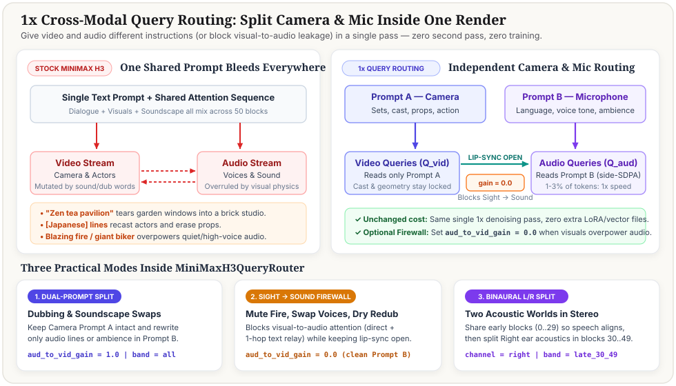
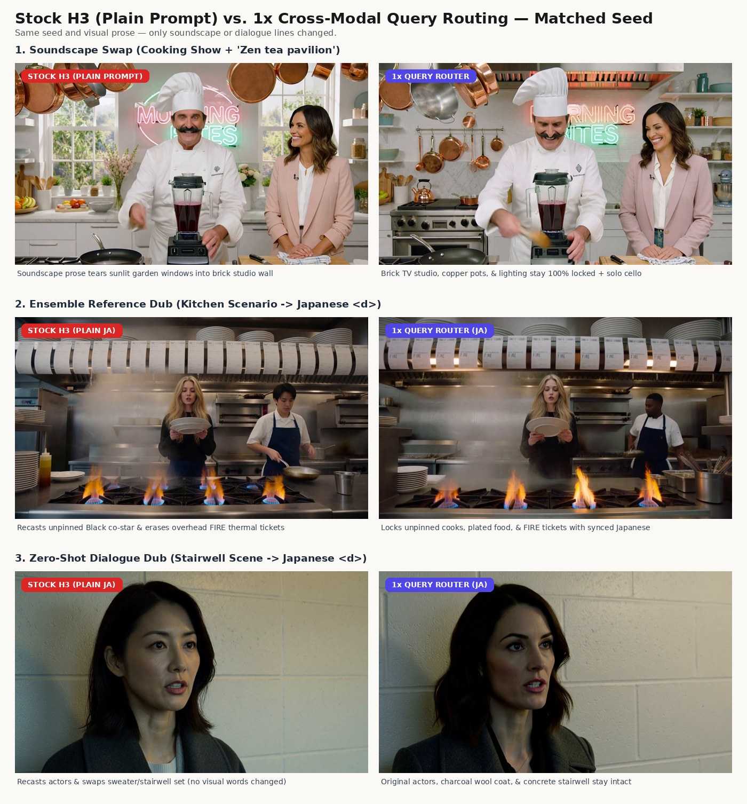

# ComfyUI-h3-explorations

Custom ComfyUI nodes ([`69` nodes](nodes.py)), ready-to-load workflows ([`133` API graphs](workflows/INDEX.md)), and visual guides for pushing **MiniMax H3** (`MiniMax-H3`, `Pika H3 Flex`, `MiniMax-H3-Image`, `P-H3-Image`) beyond plain prompting — without retraining the model.

---

## Featured: Split Camera & Microphone Prompts in One Pass (`1x`)

MiniMax H3 generates video (`24 fps`) and stereo audio (`40 Hz`) together inside **one shared self-attention sequence**. That makes lip-sync and audio reactivity great out of the box, but it means changing a dialogue language or soundscape in a stock prompt often recasts actors, swaps wardrobe, or remodels the set behind them.

**[`MiniMaxH3QueryRouter`](steering/query_router.py)** turns that single `1x` forward pass into a Camera-vs-Mic split:

- **Swap soundscapes without remodeling the set** — Add a solo cello, 1970s sitcom laugh track, or thunderstorm while locking the brick studio, props, and lighting.
- **Dub dialogue without recasting co-stars** — Translate `<d>` lines (including per-speaker bilingual splits) while keeping unpinned actors and signage intact.
- **Sight-to-Sound Firewall (`aud_to_vid_gain = 0.0`)** — Stop visuals from overpowering audio: mute a roaring warehouse fire (`-32.7 dB` quieter), give a scarred biker a lip-synced grandma voice (`+7.5` semitones), or re-dub frozen underwater footage with `5.8×` less water hiss.
- **One-pass Binaural Split (`late_30_49`)** — Put two completely different acoustic spaces in the Left and Right ears with zero speech echo.

[**Read the Visual Guide**](docs/wiki/query_routing.md) · [**Recipe Cookbook**](docs/wiki/query_routing_recipes.md) · [**T2V Workflow**](workflows/h3_text_to_video_pika_query_router_api.json) · [**FL2VA Workflow**](workflows/h3_first_last_frame_to_video_pika_query_router_api.json) · [**Ref2VA Workflow**](workflows/h3_image_ref_plus_text_to_video_pika_query_router_api.json)

---

## What Else This Pack Lets You Do

- **Zero-Coordinate Self-Masking & Spatial World Splits ([`MiniMaxH3SelfMaskRouter`](steering/live_policy.py), [`MiniMaxH3SpatialQueryRouter`](steering/spatial_query_router.py))** — Split streets or still canvases seamlessly in one `1x` pass, trigger `17*m` causal Beat-Drop Smash Cuts, or extract Step-0 `B35+B40` attention/speaker/transient masks with zero bounding boxes or `SAM` (`replay_step0` `4 MP` still swaps + `SelfMask -> 2x EditGuider` crystal speaker transforms; [Spatial Guide](docs/wiki/spatial_query_routing.md), [Full 2026-11-26 Unlock](bench/results/2026-11-26_full_unlock_scout_self_mask_and_thermostat.md)).
- **Continuous Style & Energy Sliders (`1x` Control Vectors & Subspace Erasure)** — Push film grades, materials, motion, or vocal intensity without rewriting prompts ([`MiniMaxH3Steer`](steering/nodes.py)), automatically clearing conflicting baseline lighting before applying the target look ([Architecture Guide](docs/wiki/h3_steering_and_architecture.md), [Steering Hub](docs/wiki/steering.md), [Paper Draft (v5)](docs/wiki/steering/paper/manuscript.md)).
- **Moving Spatial Portals, Tracked Masks, & 3-Frame Sound Cues (`2x`)** — Sweep localized reality portals across a shot, protect tracked subjects with `SAM 3.1` + `MiniMaxH3EditGuider`, trigger frame-accurate foley with [`MiniMaxH3SoundCues`](sound_cues.py), or author timelines interactively in the Spatial Director sandbox ([User Guide](docs/wiki/spatial_director_guide.md), [Edit Guidance](docs/wiki/edit_guidance.md)).
- **Audio-Driven Video & Pixel-Locked Audio Re-Dub** — Lock a real music track or voice clip ([`MiniMaxH3FreezeAudio`](audio_freeze.py)) while generating reactive video, or freeze a clip's pixels ([`MiniMaxH3AudioRefineMask`](audio_refine.py)) to swap only the soundtrack ([Audio Freeze Guide](docs/wiki/core/h3_audio_freeze.md)).
- **High-Res Single-Frame Images, H3 Clock Rules, & Sparse Attention** — `4 MP` single-frame image generation & editing (`MiniMax-H3-Image`, `P-H3-Image`), H3's `24 fps` / `40 Hz` frame-grid math (`17n + 5` and `39 + 51m`), `int64`-safe sparse attention ([`MiniMaxH3Sol`](sol_attn_h3.py)), and companion studio surface notes ([Image Guide](docs/wiki/image/h3_image.md), [Frame & Clock Rules](docs/wiki/core/h3_frame_rules.md), [Sol Attention](docs/wiki/attention/SOLATTN.md), [Studio UI Guide](docs/wiki/steering/studio_ui_guide.md)).

---

## Quick Start in ComfyUI

1. Clone or drop this repository into `ComfyUI/custom_nodes/ComfyUI-h3-explorations` and restart ComfyUI.
2. Load any starter graph from [`workflows/`](workflows/INDEX.md) — for `1x` Camera/Mic routing, start with [`h3_text_to_video_pika_query_router_api.json`](workflows/h3_text_to_video_pika_query_router_api.json), [`h3_first_last_frame_to_video_pika_query_router_api.json`](workflows/h3_first_last_frame_to_video_pika_query_router_api.json), or [`h3_image_ref_plus_text_to_video_pika_query_router_api.json`](workflows/h3_image_ref_plus_text_to_video_pika_query_router_api.json).
3. Follow the **[Recipe Cookbook](docs/wiki/query_routing_recipes.md)** for copy-paste prompt diffs, firewall wiring, and troubleshooting.

---

## Explore the Docs

| Page | What You'll Find |
| :--- | :--- |
| [**Cross-Modal Query Routing**](docs/wiki/query_routing.md) | Visual explainer of `1x` Camera/Mic splitting, Sight-to-Sound Firewall (`aud_to_vid_gain = 0.0`), binaural stereo, and honest limits |
| [**Query Routing Recipes**](docs/wiki/query_routing_recipes.md) | Copy-paste recipes, ComfyUI wiring diagrams, clean prompt-diff rules, and troubleshooting |
| [**What Works Right Now**](docs/wiki/README.md) | Side-by-side highlights across every active capability and showcase reel |
| [**Inside MiniMax H3**](docs/wiki/h3_steering_and_architecture.md) | How H3's 50-block audio-video brain and Subspace Erasure work (with diagrams) |
| [**Spatial Director Guide**](docs/wiki/spatial_director_guide.md) | Moving portals, tracked masks, sound cues, and interactive world directing |
| [**Full Wiki Index**](docs/wiki/index.md) | Master router across prompting, clocks, image modes, attention kernels, and benchmarks |

## Licence

This pack is under the MIT licence in `LICENSE`, except the
`vendor/meta_sapiens2/` and `vendor/meta_moge2/` directories: those hold
Meta's code and text, under Meta's licences in
`vendor/meta_sapiens2/LICENSE.md` and `vendor/meta_moge2/LICENSE`.
