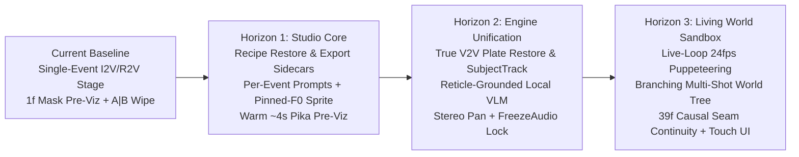

# Spatial Director: Current-to-Vision Gap Analysis & Roadmap

> Last updated: 2026-11-17.
> Maps the observable gaps between today's implementation in [`director/`](AGENTS.md) and the enduring direction defined in [`director/VISION.md`](VISION.md). For day-to-day usage and the 6-level progressive tutorial, see [`docs/wiki/spatial_director_guide.md`](../docs/wiki/spatial_director_guide.md); for module ownership and invariants, see [`director/AGENTS.md`](AGENTS.md).

---

## 1. Current Baseline — What Already Works End-to-End

Today's studio (`:8195` local HTTP / `:8194` private overlay HTTPS alongside ComfyUI `:8188`) delivers a complete **single-event anchored loop**:

1. **World State Anchor:** Upload a still image, extract Frame 0 from an uploaded MP4 (`director/server.py::_decode_frame0_or_image`), or generate a `4 MP`+ 1-frame still (`director/compiler.py::compile_still` across `MiniMax-H3-Image`, `Pika H3 Image`, and `P-H3-Image`).
2. **Zero-Latency (`0 ms`) Stage Choreography:** Drag circular/elliptical/split portals, tune concentric inner aperture vs. outer reaction halo (`Scroll` / `Shift+Scroll`), place timed point targets, segment Frame-0 subjects via SAM 3.1 (`POST /api/segment`), lift or generate an RGBA actor cutout with `WASD`/path waypoints, and audition `3`-frame (`125 ms`) WebAudio cues (`director/static/js/stage.js`, `director/static/js/sequencer.js`, `director/static/js/foley_synth.js`).
3. **1-Frame Masked Pre-Viz:** Run a localized still edit inside the active region (`POST /api/preview_in_mask` -> `director/compiler.py::compile_masked_still_edit`) with live `taeh3_image.safetensors` step previews, then roll the composited preview forward as the new World State.
4. **Localized Joint AV Simulation & Counterfactual Audit:** Compile dual-branch `edit_guidance.py::MiniMaxH3EditGuider` Pika 6-step takes (`director/compiler.py::compile_spatial_take`, `i2v_portal` Frame-0 default) on `h3_rules.py::on_both_clocks` with real-time `27`-frame `taeh3.safetensors` step previews, optional 2nd-pass `MiniMaxH3FrozenVideoCache` + `MiniMaxH3AudioRefineMask` re-dubbing, `A|B` spatial wipe + In-Mask/Out-Mask MAE telemetry (`POST /api/ab_metrics`), and `temp/` scratch isolation until explicit export to `$H3_OUTPUT_DIR/Video/`.

---

## 2. At-a-Glance Gap Matrix

| Vision Pillar (`director/VISION.md`) | Current State on Disk | Desired Future State | Leverage |
| :--- | :--- | :--- | :--- |
| **1. Anchored Reality & V2V Surgery** *(§2.1, §5)* | Guidance-space `MiniMaxH3EditGuider` only; MP4 upload extracts **Frame 0 PNG only** and discards frames `1..N`; attaching a sprite forces `ref2va` (**unpinning Frame 0**) | True video-to-video masked inpainting (`MiniMaxH3MaskedSource` + `MiniMaxH3RestorePlate` with frozen audio) + `MiniMaxH3GuideLatent` Frame-0 pin alongside sprites | **High** (pack nodes already exist) |
| **2. Multi-Event & Multi-Entity Causality** *(§2.2, §2.4, §5)* | Multiple target pins exist in `events_json`, **but share one global `#target-prompt`** (`targets[0]` wins); SAM is 1-frame static (`SAM3_Detect`), 1 sprite max | Per-event prompts & staggered causal beats (`t0` impulse -> `t1` actor reaction); video-tracked `MiniMaxH3SubjectTrack` masks across moving plates | **High** |
| **3. Recipe Lineage & Reopenability** *(§2.6, §5)* | `POST /api/export` copies raw `.mp4` bytes only (recipe lost on `Forget Temp`); `Load Stage` plays video without restoring controls; 8-item RAM `shotHistory` | Sidecar/embedded `.director.json` recipes on export; 1-click **Restore Recipe to Stage**; persistent **Branching Shot Tree** with `39f` causal overlap | **High** (immediate studio win) |
| **4. Latency & Warm VRAM Harmony** *(§2.3)* | `Preview in Circle` defaults to `h3_image` (`16 -> 4 MP`), triggering ~20 GB VRAM checkpoint swaps (`~25–35s`) when alternating with Pika video | Warm-VRAM-aware pre-viz (`~3–5s` 1-frame Pika edit reusing `MiniMaxH3EncodeReferences` KV cache when Pika is resident; `h3_image` for HQ bake) + draggable preview patch | **Medium–High** |
| **5. Visual Co-Direction (Local VLM)** *(§2.2, §5)* | Prompt compiler is **visually blind** to `<Picture 1>` unless `Scene Context Override` is typed; `heylook` sees whole frame without the `(x, y, r)` reticle | Reticle-cropped visual grounding: local VLM sees the exact circled object, grounds `<Subject 1>` automatically, and translates conversational stage notes | **Medium–High** |
| **6. Live-Loop Puppeteering** *(§2.3, §5)* | Keyframes and waypoints are placed while paused or via discrete clicks; dragging / `WASD` during playback does not record live trajectories | Live-loop recording: hold-drag a portal, steer keys, or click impulses *while the 24 fps loop plays*, auto-fitting curves onto `[1, 4, 4, 4, 4]` steps | **Medium** |
| **7. Spatial & Locked Acoustics** *(§2.4)* | Unpanned procedural `3f` `MiniMaxH3SoundCues` + full-stream `AudioRefineMask`; no imported audio stem lock (`MiniMaxH3FreezeAudio`) | Portal `x -> stereo L/R pan` in both `FoleySynth` and `MiniMaxH3SoundCues`; `MiniMaxH3FreezeAudio` stem lock so visual edits preserve uploaded voice/music | **Medium** |
| **8. Pocket / Touch Surface Craft** *(§2.7)* | `/docs` is responsive, but main `/` stage relies on desktop `Wheel` / `Shift+Wheel` / `Alt+Wheel` / `WASD` and wide desktop chrome | Multi-touch pinch aperture, two-finger halo gesture, responsive bottom-sheet inspector, and phone/tablet ergonomics over private overlay HTTPS | **Medium** |

---

## 3. Code-Verified Architectural Gaps

### Gap 1: Guidance Steering Only — Missing Video-to-Video Plate Restoration & Pinned-Frame-0 Sprites
- **Where it lives today:** `director/server.py::_decode_frame0_or_image` (`director/server.py:701-710`) and `director/compiler.py::compile_spatial_take` (`director/compiler.py:1461-1488`).
- **What happens:**
  1. Uploading an `.mp4` extracts Frame 0 as a static PNG and imports the clip into `takes.json` for playback/extraction, **discarding frames `1..N` and original audio during generation**. Even in `i2v_portal`, unmasked pixels on frames `1..N` evolve along the `original` prompt branch rather than locking to a captured video plate.
  2. Attaching a movable cutout (`sprite_ref`) forces `mode` into `r2v_portal` or `world_targets` (`director/compiler.py:1461-1469`), demoting the anchor photo from pinned `first_frame` (`t = 0`) to `<Picture 1>` (`t < 0` reference) — allowing the model to re-compose camera framing and background architecture whenever a sprite is active.
- **How to close it:**
  - Add a **`v2v_masked`** workflow route in [`director/compiler.py`](compiler.py) wiring [`video_mask.py`](../video_mask.py) (`video_mask.py::MiniMaxH3MaskedSource`, max-pooled over `[1, 4, 4, 4, 4]` x `32x32` patches with `NestedTensor` audio freeze) + [`plate_restore.py`](../plate_restore.py) (`plate_restore.py::MiniMaxH3RestorePlate`) so uploaded videos keep `100%` pixel-locked unmasked plates and untouched original audio.
  - Wire [`guide_latent.py`](../guide_latent.py) (`guide_latent.py::MiniMaxH3GuideLatent` pinning Frame 0 at `t = 0`) inside `r2v_portal` so `sprite_trajectory.py::MiniMaxH3AppendSpriteTrajectory` (`<Video N>` at `t < 0`) moves actors across a locked Frame-0 scene without re-rolling the room.

### Gap 2: Multi-Event Stage vs. Single-Prompt Bottleneck & Static Frame-0 Masks
- **Where it lives today:** `spatial_director.py::WorldTargetEvent` (`spatial_director.py:65-80`), `director/compiler.py::_summarize_focus_region_and_time` (`director/compiler.py:680-721`), and `director/static/js/app.js:66-70`.
- **What happens:**
  1. Although a user can drop multiple timed `WorldTargetEvent` pins on the loop capsule (`f18`, `f54`, `f96`), `WorldTargetEvent` stores no per-event action text. Only one global `state.targetPrompt` (`#target-prompt`) exists, and `_summarize_focus_region_and_time` (`director/compiler.py:695-705`) reads **`primary_t = targets[0]` only** for the spatial region phrase and `onset_s..offset_s` window in `director/compiler.py::synthesize_spatial_prompts`.
  2. SAM 3.1 segmentation (`POST /api/segment`) runs single-frame `SAM3_Detect` on Frame 0 (`1` include mask, `1` exclude mask, `1` sprite cutout), and `director/static/js/stage.js::computeCouplingInfo` (`director/static/js/stage.js:181-222`) computes a single radial `push`/`pull` vector onto that lone cutout.
- **How to close it:**
  - Add an optional `prompt` (and `subject_id`) field to `WorldTargetEvent` and portal keyframes so `synthesize_spatial_prompts` emits ordered, time-stamped `<T.T seconds>` multi-beat clauses across all active events.
  - Upgrade entity locking on video plates from static Frame-0 `SAM3_Detect` PNGs to multi-object video tracking via [`subject_track.py`](../subject_track.py) (`subject_track.py::MiniMaxH3SubjectTrack`), allowing multiple named entities to be independently targeted, reacted, or protected across camera/subject motion.

### Gap 3: Recipe Amnesia on Export & Reload + Linear-Only Roll-Forward
- **Where it lives today:** `director/server.py::handle_export` (`director/server.py:2731-2770`), `director/static/js/app.js::loadTakeIntoStage` (`director/static/js/app.js:2163-2195`), and `director/static/js/app.js::chainTakeFrameToAnchor` (`director/static/js/app.js:2197-2255`).
- **What happens:**
  1. `POST /api/export` copies raw `temp/*.mp4` bytes to `$H3_OUTPUT_DIR/Video/<name>.mp4` with **zero sidecar or embedded recipe metadata**. Once `Forget Temp` runs, the portals, cues, masks, seed, and prompts behind that exported select cannot be recovered.
  2. Clicking **Load Stage** in the `Takes` drawer loads the rendered `.mp4` for playback and `A|B` comparison, **without** restoring `take.params` (`events_json`, `target_prompt`, `original_prompt`, `seed`, `scale`, `anchor_image`) back onto the stage controls for iterative refinement.
  3. Multi-shot chaining (`Roll Forward`) extracts a single still frame (`frame_index = -1` or current frame) into an 8-slot in-memory `state.shotHistory` array (`director/static/js/app.js:76`), losing motion momentum, room-tone audio continuity, and sibling shot branches.
- **How to close it:**
  - Write `<name>.director.json` provenance sidecars alongside exported `.mp4` files (and support importing `.director.json` back onto the stage), plus add a **Restore Recipe** action on every Take card in `Takes`.
  - Persist `parent_take_id` + `parent_frame` in `takes.json` to render a navigable **Branching Shot Tree**, and add `39`-frame causal overlap handoffs on `h3_rules.py::chain_lengths` so motion velocity and room acoustics bridge smoothly across shot seams.

### Gap 4: Cold VRAM Model Swaps Between Pre-Viz and Video Simulation
- **Where it lives today:** `director/static/js/app.js:85` (`previewWorkflowId: "h3_image"`) and `director/compiler.py::compile_masked_still_edit` (`director/compiler.py:995-1164`).
- **What happens:** `MiniMax-H3-Image` (`16 -> 4 MP`) yields crisp still edits, **but** alternating between `Preview in Circle` (`h3_image`) and `Generate World Clip` (`i2v_portal` Pika video) swaps ~20 GB checkpoints in and out of VRAM on single-GPU hosts, stretching a 5-second 6-step preview into a ~25–35s cold load. In addition, the previewed image patch is baked at its original coordinates rather than being draggable/resizable as a `0 ms` layer before committing.
- **How to close it:**
  - Add a **Warm Fast Pre-Viz (`pika_image`) vs. HQ Still Bake (`h3_image`)** auto-mode that reuses the already-loaded Pika DiT and [`reference_encode.py`](../reference_encode.py) (`reference_encode.py::MiniMaxH3EncodeReferences`) KV prefix cache for **~3–5s** turnaround when iterating rapidly before a video take, and allow `0 ms` 2D translation/scaling of the masked preview layer before baking.

### Gap 5: Visually Blind Prompt Compiler vs. Reticle-Grounded Local VLM
- **Where it lives today:** `director/compiler.py::synthesize_spatial_prompts` (`director/compiler.py:772-824`) and `director/server.py::handle_context_suggest` (`director/server.py:2381-2496`).
- **What happens:** Without a manual `Scene Context Override`, `synthesize_spatial_prompts` knows only normalized coordinates (`"the upper-right region"`), not what object is actually pictured in `<Picture 1>`. Even when `H3_HEYLOOK_URL` is online, `handle_context_suggest` sends the unmarked full image (`director/server.py:2420-2440`) without burning or cropping the active `(x, y, rx, ry)` portal reticle, so the VLM cannot see *which* element on the stage the director selected.
- **How to close it:**
  - Send both the full scene thumbnail (with a crisp visual reticle drawn at `(x, y, rx, ry)`) and a high-detail crop of the selected region to the local vision model on `H3_HEYLOOK_URL`: auto-drafting accurate scene context on upload, naming `<Subject 1>` precisely (*"the upper-right arched window"*), and compiling conversational stage notes into multi-beat `events_json` + prompt diffs.

### Gap 6: Pause-and-Place Authoring vs. Live-Loop Puppeteering
- **Where it lives today:** `director/static/js/app.js::stepPlayback` (`director/static/js/app.js:2352-2438`) and [`director/static/js/sequencer.js`](static/js/sequencer.js).
- **What happens:** `stepPlayback` plays the 24 fps loop and triggers WebAudio cues, **but** dragging the portal, scrolling its radius, or steering `WASD` while playing mutates only a single static keyframe rather than recording a time-varying motion curve.
- **How to close it:**
  - Add an opt-in **Record on Loop (`R`)** pass that captures pointer `(x, y, rx)` and `WASD`/hop inputs at 24 fps while the loop plays, simplifying and snapping the recorded curve onto H3's `[1, 4, 4, 4, 4]` causal step boundaries (`director/static/js/sequencer.js::causalStepBoundaries`).

### Gap 7: Unpanned Procedural Foley vs. Spatial Stereo & Locked Audio Stems
- **Where it lives today:** [`sound_cues.py`](../sound_cues.py) (`sound_cues.py::MiniMaxH3SoundCues`), [`director/static/js/foley_synth.js`](static/js/foley_synth.js), and `director/compiler.py::compile_audio_redub`.
- **What happens:** `3f` procedural cues are centered/unpanned regardless of whether an event fires at `x = 0.10` (far left) or `x = 0.90` (far right), and there is no stage control to upload or lock an external voice/music stem while directing visual events.
- **How to close it:**
  - Map event horizontal coordinate `x in [0..1]` to stereo `L/R` pan in both WebAudio `FoleySynth` and `MiniMaxH3SoundCues` stereo `cond_audio` islands, and expose [`audio_freeze.py`](../audio_freeze.py) (`audio_freeze.py::MiniMaxH3FreezeAudio`) so directors can lock an imported soundtrack or dialogue stem while steering visuals freely.

### Gap 8: Desktop Wheel/Modifier Reliance vs. Pocket & Tablet Touch Ergonomics
- **Where it lives today:** `director/static/js/stage.js:310-315` and [`director/static/style.css`](static/style.css).
- **What happens:** Core stage controls (`Scroll` size, `Shift+Scroll` halo, `Alt+Scroll` scale, `Shift+Drag` couple, `WASD` actor nudge) assume a desktop mouse + keyboard at `>= 1280px`, whereas private-overlay review and direction (`:8194`) also happen on phones and tablets.
- **How to close it:**
  - Add two-finger pinch/spread gestures on [`director/static/js/stage.js`](static/js/stage.js) (pinch = inner aperture, two-finger rotate or rim-handle drag = outer halo), on-canvas touch handles, and a responsive `< 900px` bottom-sheet inspector layout matching `modern-web-guidance` `44px` touch targets.

---

## 4. Three-Horizon Implementation Roadmap

### Horizon 1 — High-Leverage Studio Core (Zero New Model Research Required)
1. **Recipe Provenance & Reopenability:** Emit `<export_name>.director.json` alongside exported MP4s in `director/server.py::handle_export`, support `.director.json` import, and add **Restore Recipe to Stage** in `Takes` (`director/static/js/app.js`).
2. **Per-Event Multi-Beat Prompts:** Add `prompt` to `WorldTargetEvent` and portal keyframes; upgrade `director/compiler.py::synthesize_spatial_prompts` so multiple timed events compile into ordered `<T.T seconds>` action and soundscape beats instead of reading `targets[0]` alone.
3. **Frame-0 Lock with Movable Sprites:** Wire `guide_latent.py::MiniMaxH3GuideLatent` (`t = 0` Frame-0 pin) into `r2v_portal` / `world_targets` so `MiniMaxH3AppendSpriteTrajectory` moves cutouts without unpinning background composition.
4. **Warm VRAM Pre-Viz Mode:** Add auto/one-click `pika_image` warm 1-frame pre-viz reusing `MiniMaxH3EncodeReferences` node `"132"` (`~3–5s` with zero 20 GB checkpoint swap when Pika is loaded), keeping `h3_image` for `4 MP` HQ still bakes.

### Horizon 2 — Pack Engine Unification & Grounded Co-Direction
1. **True Video-to-Video (`v2v_masked`) Mode:** Keep full uploaded `.mp4` frames (`on_both_clocks` up to `345f`), track cast masks across motion via `subject_track.py::MiniMaxH3SubjectTrack`, and compile `video_mask.py::MiniMaxH3MaskedSource` + `plate_restore.py::MiniMaxH3RestorePlate` with frozen source audio.
2. **Reticle-Grounded Local VLM (`heylook`):** Composite the `(x, y, rx, ry)` reticle + cropped ROI onto `POST /api/context_suggest` vision payloads so local VLMs auto-caption uploaded scenes and bind `<Subject 1>` to the exact object under the cursor.
3. **Spatial Stereo Foley & `FreezeAudio` Stem Lock:** Pan `3f` `MiniMaxH3SoundCues` + `FoleySynth` by normalized `x`, and allow locking imported audio tracks via `audio_freeze.py::MiniMaxH3FreezeAudio`.

### Horizon 3 — Continuous Branchable World Sandbox
1. **Live-Loop Puppeteering (`Record on Loop`):** Record real-time cursor trajectories, radius modulation, and `WASD` paths while the 24 fps loop plays, fitting clean keyframes onto `[1, 4, 4, 4, 4]` causal steps.
2. **Branching Multi-Shot World Tree & Overlap Seams:** Replace RAM-only `shotHistory` with a persistent DAG in `takes.json` (`parent_take_id`, `parent_frame`) and `39`-frame causal context handoffs (`h3_rules.py::chain_lengths`) carrying motion velocity, cast identity banks, and room tone across multi-shot sequences.
3. **Touch & Tablet Stage Ergonomics:** Multi-touch aperture/halo gestures and `44px` responsive bottom-sheet controls across private-overlay mobile Safari.
