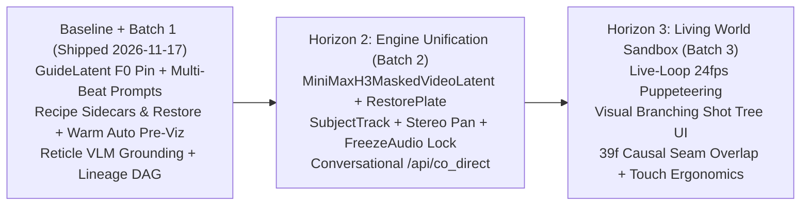

# Spatial Director: Current-to-Vision Gap Analysis & Roadmap

> Last updated: 2026-11-18.
> Maps the observable gaps between today's implementation in [`director/`](AGENTS.md) and the enduring direction defined in [`director/VISION.md`](VISION.md), organized across all three backend layers and three delivery horizons. For day-to-day usage and the 6-level progressive tutorial, see [`docs/wiki/spatial_director_guide.md`](../docs/wiki/spatial_director_guide.md); for module ownership and invariants, see [`director/AGENTS.md`](AGENTS.md).

---

## 1. Current Baseline — What Already Works End-to-End

1. **Horizon 1 — High-Leverage Studio Core (`2026-11-17`..`2026-11-18`)** & **Pack Alignment (`:8188` Reload)** all run live across the studio:
   - `guide_latent.py::MiniMaxH3GuideLatent`, `spatial_director.py::MiniMaxH3SpatialDirector` (plus `include_sprite_envelope` D-pad corridor union & off-center `pan=` cue emission), `sound_cues.py` (`@pan=` equal-power L/R stereo), and `sprite_trajectory.py::extract_sprite_rgba` (perimeter border-flood studio matte).

1. **World State Anchor:** Upload a still image, extract Frame 0 from an uploaded `.mp4` (`director/media.py::decode_frame0_or_image`), drag/upload a saved `.director.json` sidecar recipe (`director/server.py::handle_import_recipe`), or generate a `4 MP`+ 1-frame still (`director/compiler.py::compile_still` across `MiniMax-H3-Image`, `Pika H3 Image`, and `P-H3-Image`).
2. **Zero-Latency (`0 ms`) Stage Choreography:** Drag circular/elliptical/split portals, tune concentric inner aperture vs. outer reaction halo (`Scroll` / `Shift+Scroll`), place multiple timed point targets with per-event prompts, segment Frame-0 subjects via SAM 3.1 (`POST /api/segment` with connected-component speck denoising in `director/media.py::encode_rgba_cutout_png`), toggle the orthogonal **`Actor Layer`** overlay (`#mode-btn-sprite`, `aria-pressed`) across any spatial mode (`Region | Timed Event | Combined`), steer cutouts with `WASD`/path waypoints (without requiring a manual prompt when a sprite trajectory is authored), and audition `3`-frame (`125 ms`) WebAudio cues (`director/static/js/stage.js`, `director/static/js/sequencer.js`, `director/static/js/foley_synth.js`). `#sam-actor-hint` explicitly warns when a Frame-0 lift copies background behind the actor vs. `+ Stamp` clean-plate cutouts.
3. **Warm-VRAM Aware 1-Frame Pre-Viz:** Run a localized still edit inside the active region (`POST /api/preview_in_mask` -> `director/compiler.py::compile_masked_still_edit`) using `workflow="auto"` (`director/compiler.py::resolve_image_edit_workflow`) to stay on warm Pika (`pika_image`) when Pika video was last resident in `app["runtime"]["last_resident_backbone"]` or switch to `h3_image` (`16 -> 4 MP`) for high-res still bakes, then roll the composited preview forward as the new World State.
4. **Anchored Localized Joint AV Simulation & Counterfactual Audit:** Compile dual-branch `edit_guidance.py::MiniMaxH3EditGuider` Pika 6-step takes (`director/compiler.py::compile_spatial_take`, `i2v_portal` Frame-0 default at `141f`; `r2v_portal` / `world_targets` pinning Frame 0 via `guide_latent.py::MiniMaxH3GuideLatent` node `"169"` alongside movable sprites; `POST /api/compile` returning synthesized `original_prompt`, `edited_prompt`, and `region_summary`) with chronological multi-beat `<T.T seconds>` prompts, real-time `27`-frame `taeh3.safetensors` previews, lean single-pass `[original]` companion baselines (`director/graph_builder.py::finalize_lean_baseline` setting `scale=0.0` + `audio_scale=0.0` and stripping `"13"`, `"161"`, `"131"`, `"134"`, `"130"`, `"170..179"`), optional 2nd-pass `MiniMaxH3FrozenVideoCache` + `MiniMaxH3AudioRefineMask` re-dubbing (`director/graph_builder.py::wire_audio_refine_pass`), `A|B` spatial wipe + In-Mask/Out-Mask MAE telemetry (`POST /api/ab_metrics` -> `director/media.py::compute_ab_metrics_sync`), off-loop reticle-grounded `heylook` suggestions (`director/media.py::prepare_vlm_reticle_images`), `parent_take_id` / `parent_frame` Shot-DAG tracking (`director/store.py::SessionStore` + `director/static/js/takes_ui.js`), and `<export_name>.director.json` provenance sidecars (`POST /api/export`).

---

## 2. At-a-Glance Gap Matrix

| Vision Pillar (`director/VISION.md`) | Prior State | Current State (2026-11-18) | Remaining Future State (Horizons 2–3) | Leverage |
| :--- | :--- | :--- | :--- | :--- |
| **1. Anchored Reality & V2V Surgery** *(§2.1, §5)* | Attaching a sprite unpinned Frame 0 (`ref2va` `<Picture 1>` only); MP4 frames `1..N` discarded | `MiniMaxH3GuideLatent` (`"169"`) pins Frame 0 inside `r2v_portal` / `world_targets`; `include_sprite_envelope` aligns D-pad flight corridors inside `MiniMaxH3SpatialDirector`; **Remaining:** MP4 frames `1..N` + source audio unused during generation | True **`v2v_masked`** plate restoration (`MiniMaxH3MaskedVideoLatent` + `MiniMaxH3RestorePlate` + `MiniMaxH3CompositePlate`) locking unmasked video pixels & original audio | **High** (Batch 2) |
| **2. Multi-Event & Multi-Entity Causality** *(§2.2, §2.4, §5)* | `targets[0]` overwrote all pins; single global prompt only; static 1-frame SAM | Chronological `<T.T seconds>` multi-beat prompts + `_dpad_motion_summary`; explicit-only Halo Coupling; border-flood studio cutout matte (`extract_studio_cutout_rgba` / `extract_sprite_rgba`); **Remaining:** static Frame-0 SAM, 1 sprite max | Multi-shot tracked cast masks via `subject_track.py::MiniMaxH3SubjectTrack` across camera/actor motion + multi-actor `dpad` tracks + `MiniMaxH3DirectorHUD` per-beat badges | **High** (Batch 2) |
| **3. Recipe Lineage & Reopenability** *(§2.6, §5)* | Export wrote raw `.mp4` only; `Load Stage` played video only; linear `shotHistory` | `.director.json` sidecars, `POST /api/import_recipe` + dropzone + **Restore Recipe** on Takes, `parent_take_id` / `parent_frame` in `takes.json`, lean `[original]` baseline (`scale=0.0` + sprite pruning) + `A|B` badges | Visual branching **Shot Tree** graph UI + `39`-frame causal overlap handoffs (`h3_rules.py::chain_lengths`) for continuous motion & room-tone continuity | **High** (Batch 3) |
| **4. Latency & Warm VRAM Harmony** *(§2.3)* | Fixed `h3_image` pre-viz swapped ~20 GB checkpoints on every video alternation | `workflow="auto"` tracks `app["runtime"]["last_resident_backbone"]` and stays on warm `pika_image` when Pika Video is loaded; **Remaining:** fixed patch coords + Pika 1x KV reuse | Re-use persistent `MiniMaxH3EncodeReferences` KV prefix across rapid iterations + draggable `0 ms` floating preview patch before bake | **Medium–High** |
| **5. Visual Co-Direction (Local VLM)** *(§2.2, §5)* | Prompt compiler blind to canvas; `heylook` saw unmarked whole image | `POST /api/context_suggest` composites the `(x, y, rx, ry)` reticle onto Image #1 AND attaches a padded `512px` ROI crop as Image #2, returning `scene_caption` & `subject_label` | Auto-caption on upload into `<Subject N>` definitions + conversational `POST /api/co_direct` translating natural stage notes directly into `events_json` keyframes & prompt diffs | **Medium–High** |
| **6. Live-Loop Puppeteering** *(§2.3, §5)* | Pause-and-place keyframes & discrete clicks only | Pause-and-place keyframes & discrete `WASD`/clicks | Opt-in **Record on Loop (`R`)** pass sampling continuous drags/keys at `24 fps` and fitting clean curves onto `[1, 4, 4, 4, 4]` causal steps | **Medium** (Batch 3) |
| **7. Spatial & Locked Acoustics** *(§2.4)* | Unpanned mono-duplicated `3f` cues; no audio stem lock | Equal-power horizontal `x -> pan=[-1..+1]` stereo panning (`sound_cues.py`, `MiniMaxH3SpatialDirector`, `FoleySynth` `StereoPannerNode`) + 2nd-pass `AudioRefineMask`; **Remaining:** no imported audio stem lock | `audio_freeze.py::MiniMaxH3FreezeAudio` voice/music stem locking via `POST /api/upload_audio` | **Medium** (Batch 2) |
| **8. Pocket / Touch Surface Craft** *(§2.7)* | `/docs` responsive; `/` stage tied to desktop mouse modifiers + keyboard | `/docs` has responsive reader + pan/zoom SVG lightbox; `/` stage still desktop-wheel-centric | Multi-touch pinch aperture, two-finger halo gesture, `44px` bottom-sheet inspector for private overlay (`:8194`) mobile/tablet control | **Medium** (Batch 3) |

---

## 3. Three-Layer Backend Architecture & Gap Ledger

The Spatial Director backend spans three distinct code layers with different restart boundaries:

1. **Layer 1 — ComfyUI Pack Nodes (repo root `*.py`)**: Require restarting ComfyUI `:8188` only when adding nodes or altering `io.Schema` widget definitions.
2. **Layer 2 — Runtime Graph & Prompt Compiler (`director/compiler.py`, `director/graph_builder.py`)**: Top-level stdlib only (`bench/check_imports.py`); live on `:8195` restart only.
3. **Layer 3 — Studio Server, Store, Media & Local VLM (`director/server.py`, `director/store.py`, `director/media.py`, `director/routes.py`)**: Live on `:8195` restart only.

### Layer 1 — ComfyUI Pack Nodes (`*.py`, `:8188`)

| Capability Needed by Vision | Underlying Pack Primitives Already on Disk | Code-Verified Pack Gap (`path::Symbol` & Exact Catch) | Target Batch |
| :--- | :--- | :--- | :--- |
| **Frame-0 Lock Alongside Movable R2V Sprites** | `guide_latent.py::MiniMaxH3GuideLatent`, `control_vector_nodes.py::MiniMaxH3ReleaseReferences` | **None — Ready & Wired (`2026-11-17`).** `MiniMaxH3GuideLatent(frame_idx=0, edited_positive=...)` attaches `minimax_keyframes` to both branches, and `MiniMaxH3ReleaseReferences(end_percent=1.0, video_end_percent=0.33)` keeps Frame 0 pinned across all steps while releasing `<Video N>` sprite trajectories. | **Batch 1 (Shipped)** |
| **True Masked V2V with Frozen Audio & `EditGuider`** | `video_mask.py::token_mask`, `video_mask.py::composite`, `plate_restore.py::MiniMaxH3RestorePlate`, `audio_freeze.py::MiniMaxH3FreezeAudio` | **Thin Wrapper Nodes Needed:** `video_mask.py::MiniMaxH3MaskedSource` (`video_mask.py:2330`) returns a custom `H3_MASKED_SOURCE` dict consumed exclusively by `audio_freeze_song.py::MiniMaxH3AudioFreezeSong` (`audio_freeze_song.py:905`), which embeds `BasicGuider` and writes directly to `$H3_OUTPUT_DIR`. It cannot feed `SamplerCustomAdvanced` + `edit_guidance.py::MiniMaxH3EditGuider` + `ModelPreviewOverrideKJ` (`27f` `taeh3`). **Fix:** Add two thin nodes wrapping `video_mask.py::token_mask` and `video_mask.py::composite`: `MiniMaxH3MaskedVideoLatent` (emitting `(latent_with_noise_mask, plate_latent, spatial_mask_tensor)` with audio frozen at `0.0`) and `MiniMaxH3CompositePlate` (blending decoded video over clean source pixels). | **Batch 2 (`:8188` reload)** |
| **Multi-Shot Moving Entity Masks (`SAM 3.1`)** | `subject_track.py::MiniMaxH3SubjectTrack`, `shot_table.py::MiniMaxH3SaveShotTable` | **Frame-0 Detect Only Today:** Studio UI currently calls `SAM3_Detect` on Frame 0 only. Video-tracked cast masks across moving cameras need a lightweight wrapper or JSON mask-track cache feeding `MiniMaxH3SubjectTrack` outputs (`[N, H, W]` binary masks) into V2V mask pooling. | **Batch 2** |
| **Spatial Stereo Foley (`3f` Cues) & Actor Corridor** | `sound_cues.py::MiniMaxH3SoundCues`, `spatial_director.py::MiniMaxH3SpatialDirector`, `sprite_trajectory.py::extract_sprite_rgba` | **Shipped (`2026-11-18`):** `@pan=` equal-power L/R stereo in `synthesize_island_waveform` + horizontal `pan=` emission in `_compute_sound_cues_text`, trailing `include_sprite_envelope` / `sprite_envelope_radius` on `MiniMaxH3SpatialDirector`, and border-flood studio matte on `extract_sprite_rgba`. | **Batch 1b / 2 (`5fed97ce`)** |
| **Per-Event Prompt & Entity Metadata in `SpatialDirector`** | `spatial_director.py::parse_director_events`, `spatial_director.py::PortalKeyframe`, `spatial_director.py::WorldTargetEvent`, `spatial_director.py::MiniMaxH3DirectorHUD` | **Non-Strict JSON Works Today / HUD Fields Missing:** Because `spatial_director.py::parse_director_events` (`spatial_director.py:158`) uses `.get(...)`, extra `prompt` / `entity_id` keys already pass live `:8188` validation with zero restart (enabling Batch 1). **Batch 2:** Add optional typed `prompt` and `entity_id` fields to `PortalKeyframe`, `WorldTargetEvent`, and `MiniMaxH3DirectorHUD` card rendering. | **Batch 1 (compat) + Batch 2 (HUD)** |

### Layer 2 — Runtime Graph & Prompt Compiler (`director/compiler.py`)

- **Shipped (`2026-11-17`..`2026-11-18`):**
  - `director/compiler.py::has_guide_latent_support` & node `"169"` `MiniMaxH3GuideLatent` Frame-0 pinning in `r2v_portal` / `world_targets`, plus `has_sprite_envelope_support` auto-wiring `include_sprite_envelope=True` on `"160"` (`MiniMaxH3SpatialDirector`) so active `dpad` actor paths stay inside `EditGuider`'s spatial mask.
  - `director/compiler.py::_collect_spatial_beats`, `_dpad_motion_summary`, `_events_have_per_event_prompts`, and `synthesize_spatial_prompts` compiling chronological `<T.T seconds>` multi-beat visual + soundscape prompts (and actor trajectory summaries when `target_prompt` is blank).
  - `director/graph_builder.py::finalize_lean_baseline` (`scale=0.0`, `audio_scale=0.0`, pruning HUD nodes + unused `"51".."54"` sprite references when `"133"` omits `<Video `) and `wire_audio_refine_pass`.
  - `director/compiler.py::resolve_image_edit_workflow` and `"auto"` entry in `director/compiler.py::available_image_edit_workflows` routing 1-frame masked previews onto `pika_image` when Pika Video is warm in VRAM or `h3_image` otherwise.
- **Remaining in Horizon 2–3 (`director/compiler.py`):**
  - `compile_v2v_masked`: `LoadVideo` (`24.0 fps`) -> `MiniMaxH3MaskedVideoLatent` -> 2-sampler / optional `MiniMaxH3RestorePlate` -> `VAEDecode` -> `MiniMaxH3CompositePlate` with original audio muxed untouched unless `audio_refine=True` or external stem provided.
  - `compile_sam3_video_track`: Compile `MiniMaxH3SAM31Corrections` -> `MiniMaxH3SubjectTrack` for uploaded/rendered clips.
  - External audio stem attachment via `audio_freeze.py::MiniMaxH3FreezeAudio` in `compile_spatial_take` / `compile_v2v_masked`.
  - `39`-frame causal overlap context compilation on `h3_rules.py::chain_lengths` (`cond` tail frames from Shot `N` + frozen tail audio -> Shot `N+1`).

### Layer 3 — Studio Server, Provenance & Local VLM (`director/server.py`, `director/store.py`, `director/media.py`, `director/routes.py`)

- **Shipped (`2026-11-17`..`2026-11-18`):**
  - Modularized `director/store.py` (`SessionStore`, `.director.json` recipe provenance, stripped `take_prompt_preview`) and `director/media.py` (border-flood studio cutout extraction `extract_studio_cutout_rgba`, `encode_rgba_cutout_png`, reticle+ROI crop `prepare_vlm_reticle_images`, and `invert_mask` + `sprite_envelope`-aware `compute_ab_metrics_sync`).
  - Modularized `director/static/js/takes_ui.js` (`A|B` readiness badges, stale take resolution, `Restore Recipe`), `stage.js` (de-overlapped `_placedPillBoxes` labels, explicit-only `computeCouplingInfo`), and `foley_synth.js` (`StereoPannerNode`).
  - `director/server.py::handle_export`, `handle_import_recipe`, `app["runtime"]["last_resident_backbone"]` tracking, and Shot-DAG `parent_take_id`/`parent_frame` persistence.
- **Remaining in Horizon 2–3 (`director/server.py`, `director/routes.py`):**
  - Full-clip `24.0 fps` resample/conform on `.mp4` upload (`director/server.py::handle_upload`) + frame-count validation against `h3_rules.py::on_both_clocks`.
  - Uploaded audio stem endpoint (`POST /api/upload_audio`, `.wav`/`.flac`/`.mp3`) + waveform peak JSON + `director/routes.py::compute_forget_plan` protection for active audio stems and V2V video sources.
  - Persistent track mask cache (`.npz` / preview strips) for `MiniMaxH3SubjectTrack` results across `takes.json` shots.
  - Conversational `POST /api/co_direct` (local `heylook` LLM proposing structured `events_json` diffs, `3f` cues, and `<Subject N>` edits for 1-click user apply).

---

## 4. Detailed Architectural Gaps (Gaps 1–8)

### Gap 1: Guidance Steering Only -> True Video-to-Video Plate Restoration & Pinned-Frame-0 Sprites
- **Where it lives today:** `director/server.py::_decode_frame0_or_image`, `director/compiler.py::compile_spatial_take` (`"169"` `MiniMaxH3GuideLatent`).
- **Batch 1 status (`2026-11-17`):** **Partially closed.** Attaching a movable sprite cutout (`sprite_ref`) in `r2v_portal` / `world_targets` now automatically pins Frame 0 via `guide_latent.py::MiniMaxH3GuideLatent` (`frame_idx=0`, opt-out `lock_first_frame=False`), stopping background camera drift when sprites animate.
- **Remaining gap:** Uploading an `.mp4` still discards frames `1..N` and source audio during diffusion rather than running true `v2v_masked` inpainting (`MiniMaxH3MaskedVideoLatent` + `plate_restore.py::MiniMaxH3RestorePlate` + `MiniMaxH3CompositePlate`).

### Gap 2: Multi-Event Stage vs. Per-Event Prompt Synthesis & Static Frame-0 Masks
- **Where it lives today:** `director/compiler.py::_collect_spatial_beats`, `director/static/js/app.js`, and `POST /api/segment`.
- **Batch 1 status (`2026-11-17`):** **Partially closed.** Each `WorldTargetEvent` and `PortalKeyframe` now stores an optional `prompt`, and `synthesize_spatial_prompts` compiles chronological `<T.T seconds>` multi-beat sections across all active events instead of reading `targets[0]` alone.
- **Remaining gap:** SAM 3.1 segmentation (`POST /api/segment`) runs single-frame `SAM3_Detect` on Frame 0 only (`1` include mask, `1` exclude mask, `1` sprite cutout). Multi-shot moving-plate subject locks require `subject_track.py::MiniMaxH3SubjectTrack`.

### Gap 3: Recipe Provenance on Export & Reload + Branching Shot Tree
- **Where it lives today:** `director/server.py::handle_export`, `director/server.py::handle_import_recipe`, `director/static/js/app.js::applyImportedRecipe`, and `director/server.py::SessionStore`.
- **Batch 1 status (`2026-11-17`):** **Mostly closed for single takes.** Exporting now writes `<export_name>.director.json`, **Restore Recipe** restores full stage state from any recorded `take_id` (and dropping a `.director.json` file restores an archived shot), and `takes.json` stores `parent_take_id` / `parent_frame`.
- **Remaining gap:** Render an interactive **Branching Shot Tree** drawer/view from `parent_take_id` links and implement `39`-frame causal overlap handoffs (`h3_rules.py::chain_lengths`) across multi-shot continuations.

### Gap 4: Cold VRAM Model Swaps Between Pre-Viz and Video Simulation
- **Where it lives today:** `director/compiler.py::resolve_image_edit_workflow`, `director/server.py::handle_preview_in_mask`, `director/static/js/app.js` (`previewWorkflowId = "auto"`).
- **Batch 1 status (`2026-11-17`):** **Routing closed.** Setting `Mask Image Preview Model` to `"auto"` (default) keeps `Preview in Circle` on `pika_image` whenever Pika Video was last active on `:8188`, avoiding cold `~20 GB` swaps back to `MiniMax-H3-Image`.
- **Remaining gap:** Reuse persistent `reference_encode.py::MiniMaxH3EncodeReferences` KV prefix caches across rapid tweaks and make the masked preview patch draggable/resizable at `0 ms` before `Apply Preview`.

### Gap 5: Visually Blind Prompt Compiler vs. Reticle-Grounded Local VLM
- **Where it lives today:** `director/server.py::handle_context_suggest` (`director/server.py`), `director/static/js/app.js::refreshContextSuggestions`.
- **Batch 1 status (`2026-11-17`):** **Vision grounding shipped.** When `H3_HEYLOOK_URL` is online, `/api/context_suggest` composites the active `(x, y, rx, ry)` reticle onto the scene image and sends a padded `512px` ROI crop alongside it, returning `scene_caption` and `subject_label`.
- **Remaining gap:** Auto-populate structured `<Subject 1>` tokens from `subject_label` and add conversational multi-beat `POST /api/co_direct`.

### Gap 6: Pause-and-Place Authoring vs. Live-Loop Puppeteering
- **Where it lives today:** `director/static/js/app.js::stepPlayback` and [`director/static/js/sequencer.js`](static/js/sequencer.js).
- **Remaining gap:** Add an opt-in **Record on Loop (`R`)** pass that records continuous pointer `(x, y, rx)` and `WASD` steering while `24 fps` playback loops, fitting clean keyframes onto `[1, 4, 4, 4, 4]` causal step boundaries (`director/static/js/sequencer.js::causalStepBoundaries`).

### Gap 7: Unpanned Procedural Foley vs. Spatial Stereo & Locked Audio Stems
- **Where it lives today:** `sound_cues.py::synthesize_island_waveform` (`sound_cues.py:304`), [`director/static/js/foley_synth.js`](static/js/foley_synth.js), and `director/compiler.py::compile_audio_redub`.
- **Remaining gap:** Map horizontal coordinate `x in [0..1]` to stereo `L/R` pan in both WebAudio `FoleySynth` and `MiniMaxH3SoundCues`, and expose `audio_freeze.py::MiniMaxH3FreezeAudio` via `POST /api/upload_audio` so imported dialogue/music stems lock during visual direction.

### Gap 8: Desktop Wheel/Modifier Reliance vs. Pocket & Tablet Touch Ergonomics
- **Where it lives today:** `director/static/js/stage.js` and [`director/static/style.css`](static/style.css).
- **Remaining gap:** Add two-finger pinch aperture & halo gestures, on-canvas touch handles, and a responsive `< 900px` bottom-sheet inspector layout matching `modern-web-guidance` `44px` touch targets over `:8194`.

---

## 5. Three-Horizon Implementation Roadmap

### Horizon 1 — High-Leverage Studio Core (**Batch 1 + Bucket 1 Cleanup Shipped `2026-11-17`..`2026-11-18` — Zero `:8188` Restart**)
- [x] **Recipe Provenance & Reopenability:** Emit `<export_name>.director.json` alongside exported MP4s (`director/server.py::handle_export`), validate/import via `POST /api/import_recipe` (`director/store.py::normalize_imported_recipe`, `director/server.py::handle_import_recipe`), drag-drop `.director.json` onto stage, and **Restore Recipe** from `Takes` (`director/static/js/takes_ui.js::restoreTakeRecipe`).
- [x] **Per-Event Multi-Beat Prompts:** Store per-target/keyframe `prompt` fields in `events_json` and compile chronological `<T.T seconds>` multi-beat sections (`director/compiler.py::_collect_spatial_beats`, `director/compiler.py::synthesize_spatial_prompts`).
- [x] **Frame-0 Lock with Movable Sprites:** Wire `guide_latent.py::MiniMaxH3GuideLatent` (`"169"`, `frame_idx=0`) inside `r2v_portal` / `world_targets` (`director/compiler.py::has_guide_latent_support`) so movable sprites keep background framing anchored.
- [x] **Warm VRAM Pre-Viz Routing:** Track `app["runtime"]["last_resident_backbone"]` in `director/server.py` and resolve `"auto"` (`director/compiler.py::resolve_image_edit_workflow`) to `pika_image` when Pika Video is loaded.
- [x] **Reticle-Grounded Local VLM (`heylook`):** Composite `(x, y, rx, ry)` reticle + `512px` ROI crop off the event loop (`director/media.py::prepare_vlm_reticle_images`, `director/server.py::handle_context_suggest`), returning `scene_caption` & `subject_label`.
- [x] **Shot-DAG Persistence & Takes Modularization:** Record `parent_take_id` & `parent_frame` in `takes.json` (`director/store.py::SessionStore`) and modularize Takes UI + chaining (`director/static/js/takes_ui.js`).
- [x] **UX & Foundation Modularization (`2026-11-18`):** Separate `Actor Layer` (`#mode-btn-sprite`, `aria-pressed`) from spatial modes, extract `director/graph_builder.py` (`finalize_lean_baseline` single-pass `[original]` CFG baselines with `scale=0.0` + `audio_scale=0.0` and lean graph pruning, `wire_audio_refine_pass`), extract `director/store.py` & `director/media.py` (with connected-component cutout denoising), expose prompt synthesis on `POST /api/compile`, add `#sam-actor-hint`, and allow blank `#target-prompt` when an actor trajectory is authored.
- [ ] **Remaining in Horizon 1b:** Draggable/resizable floating 1-frame preview patch before `Apply Preview`, KV-prefix reuse across warm Pika edits, and the **§6 Edge-Case & UX Polish Queue** below (all isolated to `director/static/`, zero `:8188` restart).

### Horizon 2 — Pack Engine Unification & Grounded Co-Direction (Batch 2 — `:8188` Schema Update)
- [ ] **Layer 1 Pack Nodes:** Add `MiniMaxH3MaskedVideoLatent` + `MiniMaxH3CompositePlate` wrappers around `video_mask.py::token_mask` / `video_mask.py::composite` and typed `prompt`/`entity_id` HUD rendering in `spatial_director.py::MiniMaxH3DirectorHUD` *(Done `2026-11-18`: `@pan=` stereo panning in `sound_cues.py::synthesize_island_waveform` + `spatial_director.py::_compute_sound_cues_text`, `include_sprite_envelope` on `MiniMaxH3SpatialDirector`, and perimeter flood matte on `sprite_trajectory.py::extract_sprite_rgba`)*.
- [ ] **True Video-to-Video (`v2v_masked`) & Tracking (`SubjectTrack`):** Keep full `24.0 fps`-conformed uploaded `.mp4` frames (`h3_rules.py::on_both_clocks`), track cast masks across cuts via `subject_track.py::MiniMaxH3SubjectTrack`, and compile `MiniMaxH3MaskedVideoLatent` + `plate_restore.py::MiniMaxH3RestorePlate` + `MiniMaxH3CompositePlate`.
- [ ] **Spatial Stereo Foley & `FreezeAudio` Stem Lock:** Add `POST /api/upload_audio` and lock stems with `audio_freeze.py::MiniMaxH3FreezeAudio` *(Done `2026-11-18`: `FoleySynth` `StereoPannerNode` + `MiniMaxH3SoundCues` horizontal `x` stereo panning)*.
- [ ] **Conversational Co-Direction (`POST /api/co_direct`):** Translate natural-language director notes + grounded `<Subject 1>` labels into structured `events_json` edits.

### Horizon 3 — Continuous Branchable World Sandbox (Batch 3)
- [ ] **Live-Loop Puppeteering (`Record on Loop`):** Record continuous pointer trajectories, aperture modulation, and `WASD` steering at `24 fps`, fitting clean keyframes onto `[1, 4, 4, 4, 4]` steps (`director/static/js/sequencer.js::causalStepBoundaries`).
- [ ] **Visual Branching Shot Tree & `39f` Causal Overlap Seams:** Render an interactive Shot Tree DAG from `parent_take_id` records and compile `39`-frame causal overlap handoffs (`h3_rules.py::chain_lengths`) carrying motion velocity and room tone across shots.
- [ ] **Touch & Tablet Stage Ergonomics:** Multi-touch aperture/halo pinch gestures and `44px` responsive bottom-sheet controls over `:8194` mobile Safari.

---

## 6. Open Edge-Case Bugs & UX Polish Queue (Verified 2026-11-18)

Tracked separately from Horizons 2–3; items 1–6 require zero `:8188` ComfyUI restart (item 4 optional guard on `app.js` / `server.py`).

### Edge-Case State & Control Bugs

1. [ ] **`Tail -> Shot` chaining carries stale sprite/prompt/portal state** (`director/static/js/takes_ui.js::chainTakeFrameToAnchor`, `director/static/js/takes_ui.js:247-277`)
   - **Observed code:** Clears `state.lastFrameRef` / `state.lastFrameName`, sets `state.parentTakeId` / `state.parentFrame`, and calls `loadAnchorImageUrl(...)` (`director/static/js/app.js:1700-1739`), which only clears SAM mask refs/points when `!meta.preserveOriginalPrompt && prevRef !== meta.ref`. Unlike `director/static/js/app.js::handleAnchorUpload` (`director/static/js/app.js:1641-1670`), chaining does not reset `state.targetPrompt`, `state.spriteCutout`, `state.spriteMode`, `state.doc.dpad`, or `state.portalTouched`.
   - **Fix direction:** Clear prior shot overlay/prompt/sprite state when promoting a tail frame to Shot `N+1`'s new anchor (while keeping `parentTakeId` / `parentFrame`).
2. [ ] **Incomplete Undo/Redo snapshot scope** (`director/static/js/app.js::snapshotDoc` / `restoreSnapshot`, `director/static/js/app.js:444-470`)
   - **Observed code:** Snapshots and restores only `{ doc, targetPrompt, editGuidance }`. Changes to `state.length`, `state.originalPrompt`, `state.samePrompt`, `state.spriteCutout` / SAM mask refs, `state.couplings`, and `state.portalTouched` fall outside `Undo`/`Redo`.
   - **Fix direction:** Include scene length, prompts, mask/sprite refs (or cutout metadata), and `portalTouched` in `snapshotDoc()` / `restoreSnapshot()`.
3. [ ] **Sticky `#engine-workflow` manual override** (`director/static/js/app.js::resolvedWorkflowMode`, `director/static/js/app.js:86,1016-1027,1538,3334-3340`)
   - **Observed code:** Changing `#engine-workflow` or importing a recipe sets `state.workflowManualOverride = true`, and `handleAnchorUpload` (`director/static/js/app.js:1615-1698`) never resets `state.workflowManualOverride = false`. Moreover, leaving `i2v_portal` manually locked after attaching an actor cutout causes `resolvedWorkflowMode()` to return `"i2v_portal"` and silently skip `r2v_portal`.
   - **Fix direction:** Reset `workflowManualOverride = false` on fresh uploads (when `!opts.preserveLineage`), and surface a clear status hint or auto-switch prompt when a sprite is attached under manual `i2v_portal`.
4. [ ] **`+ Stamp` runs T2I cutout generation when `!state.anchorRef`** (`director/static/js/app.js::generateOrExtractStamp`, `director/static/js/app.js:1861-1907`; `director/server.py::handle_stamp_cutout`, `director/server.py:1215-1285`)
   - **Observed code:** `generateOrExtractStamp()` only blocks when `!state.anchorRef && !prompt`. Entering a spawn prompt with no scene loaded dispatches a T2I cutout render (`for_cutout=True`, `source_ref` omitted), while `renderPortalEdit()` (`director/static/js/app.js:2324-2330`) blocks when `!state.hasAnchor` (unless `wfMode === "t2v_portal"`).
   - **Fix direction:** Either keep staging explicit with an inline toast/hint (`"Cutout staged — load/generate a Scene Anchor before Render"`), or require a scene anchor first.

### Visual / UX Polish Spots

5. [ ] **`Takes` card header truncation at drawer width** (`director/static/js/takes_ui.js::renderTakesList`, `director/static/js/takes_ui.js:343-376`; `director/static/style.css:1959-2006`)
   - **Observed UI/code:** Putting `.take-ab-badge` (`A|B`) and `.take-status-chip` inline inside `.take-card-top` next to `.take-card-title` (`white-space: nowrap; text-overflow: ellipsis`) clips duration and seed (e.g., `"World Clip · r2v_portal · ..."`, `"Cutout · h3_image · 1f · seed 73..."`).
   - **Fix direction:** Move `A|B` + status pills onto a secondary meta row or compact the title tokens so length and seed stay visible.
6. [ ] **Dual endpoint pills on auto-aligned `Set Path` sprites** (`director/static/js/app.js::alignUntouchedPortalToSpritePath`, `director/static/js/app.js:2040-2074`; `director/static/js/stage.js::_drawPortalOverlay`, `director/static/js/stage.js:1261-1302` & `_drawSpriteOverlay`, `director/static/js/stage.js:1587`)
   - **Observed UI/code:** When an untouched portal path is auto-aligned to a sprite's start/end waypoints, both the portal keyframe pill (e.g., `Macro (0.22 @ fN)`) and `DEST @ fN` (sprite path pill) draw at the destination frame. `_placedPillBoxes` prevents text overlap, but two pills stack at the same endpoint.
   - **Fix direction:** Suppress or combine the portal endpoint pill when `!state.portalTouched` and the portal keyframe mirrors `dpad` destination.

### Framing Limitation (Closed Structurally by Horizon 2)

7. **`Frame-0` only anchor conditioning on uploaded `.mp4` clips** (`director/server.py::handle_upload`, `director/server.py:768-815`)
   - **Observed code:** `.mp4` uploads store the clip as an imported `takes.json` entry (`imported_take_id`) for stage playback/`A|B`, while `_decode_frame0_or_image` sets Frame 0 as the active scene anchor (`source_kind == "video_frame0"`). Frames `1..N` and original clip audio are not conditioned on until **Horizon 2 `v2v_masked`** (`compile_v2v_masked` + `MiniMaxH3MaskedVideoLatent`) ships.
