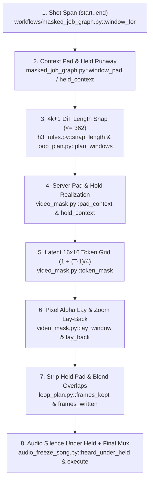

# Masked V2V Code Map — Parts 2 & 4: Cross-Process Contracts, Window Math & Duplicate Logic

This companion document to [2026-10-26_code_map_and_simplification_plan.md](../research/masking/2026-10-26_code_map_and_simplification_plan.md)
covers Part 2 (ComfyUI prompt JSON contracts, server-side `$H3_OUTPUT_DIR` artifact writes, the 4-way window &
padding math contract, dynamic imports, and shared-name file collisions) and Part 4 (the 5 duplicate logic groups
across the masked lane).

For live `StartLine-EndLine` coordinates and `cannot_see` boundaries, see [CODE_MAP_INDEX.md](CODE_MAP_INDEX.md).
For Stage 1-5 state mutations, see [code_map_stages.md](code_map_stages.md).

---

## Part 2 — Cross-Process Contracts, Window Math & Shared-Name Collisions

### Section 2a.1 — ComfyUI API Prompt JSON Contract (`<job>_api.json`)

- **Symbols**: `workflows/masked_job_graph.py::load`, `workflows/masked_job_graph.py::check_load`, `bench/masked_job.py::build`, `bench/masked_job.py::before_queue`, `bench/load_chain.py::step_plan`, `bench/load_chain.py::step_render`
- **Node `104` (`MiniMaxH3MaskedSource`)**:
  - Written by `workflows/masked_job_graph.py::load`; executed on the ComfyUI server by `video_mask.py::MiniMaxH3MaskedSource.execute`.
  - Key inputs: `video` (source clip path), `mask_video` (`parts_held__<by>.mkv`), `track_video` (`track__<by>.mkv`), `keep_out_videos`, `grow_px` (`0`), `feather_px` (`8`), `hold_frames` (`0`), `floor_head_scale` (`1.1`), `mask_fill` (`hole_and_hair`), `min_component_pixels` (`150`), `zoom`, `window_length`, `window_overlap`.
- **Node `74` (`MiniMaxH3AudioFreezeSong`)**:
  - Written by `workflows/masked_job_graph.py::load`; executed by `audio_freeze_song.py::MiniMaxH3AudioFreezeSong.execute`.
  - Key inputs: `plan_only` (`True` during `bench/load_chain.py::step_plan`, `False` during `step_render`), `filename_prefix` (`<video>/<job>`), `windows`, `reference_videos` (`_head_ref.mp4`, `_drawn.mp4`), `reference_images` (`<cast_ref>.png`).
- **Reference Conditioning Nodes (`reference_conditioning.py`)**:
  - `reference_conditioning.py::MiniMaxH3AppendRefImage.execute`, `reference_conditioning.py::MiniMaxH3AppendRefVideo.execute`, and `reference_conditioning.py::MiniMaxH3ReferenceConditioning.execute` compile `<Picture N>` and `<Video N>` slots into `_compile_reference_records`.

### Section 2a.2 — Server-Side Artifact Writes on `$H3_OUTPUT_DIR`

- **Symbols**: `video_mask.py::save_window_region`, `audio_freeze_song.py::write_plan`, `audio_freeze_song.py::_write_pieces_mp4`, `audio_freeze_song.py::_write_frames_mp4`, `audio_freeze_song.py::_write_review_mp4`, `audio_freeze_song.py::zoomed_record`, `bench/masked_job.py::collect`
- **Artifact Patterns Written to `$H3_OUTPUT_DIR/<prefix>*`**:
  1. `$H3_OUTPUT_DIR/<prefix>_plan.json`: written by `audio_freeze_song.py::write_plan` during `plan_only=True` (`step_plan`) and read by `bench/capture_masked_run.py::step_keepout_carves` and `bench/what_h3_got.py::audit_capture`.
  2. `$H3_OUTPUT_DIR/<prefix>_window_NNN_region.npz`: written by `video_mask.py::save_window_region` (`token_mask`, `pixel_alpha`, `zoom_box`, `pad_spec`); read by `bench/capture_masked_run.py::read_saved_regions`, `bench/inspect_mask_steps.py::inspect_capture`, and `bench/assemble_delivery.py::Matte`.
  3. `$H3_OUTPUT_DIR/<prefix>.mp4`: primary composited output MP4 written by `audio_freeze_song.py::MiniMaxH3AudioFreezeSong.execute`.
  4. `$H3_OUTPUT_DIR/<prefix>_pieces.mp4`: raw uncomposited DiT window outputs written by `audio_freeze_song.py::_write_pieces_mp4`; read by `bench/assemble_delivery.py::piece_frames`.
  5. `$H3_OUTPUT_DIR/<prefix>_frames.mp4` and `<prefix>_review.mp4`: frame-indexed and diagnostic review MP4s written by `audio_freeze_song.py::_write_frames_mp4` and `_write_review_mp4`.
  6. `$H3_OUTPUT_DIR/<prefix>.json` and `<prefix>_zoomed.json`: render provenance and per-window zoom boxes written by `audio_freeze_song.py::zoomed_record`; collected into the capture folder by `bench/masked_job.py::collect`.

### Section 2b — The 4-Way Window, Context Padding & `4k+1` Snapping Contract

- **Symbols**: `h3_rules.py::snap_length`, `h3_rules.py::chain_lengths`, `loop_plan.py::plan_windows`, `loop_plan.py::frames_kept`, `loop_plan.py::frames_written`,
  `workflows/masked_job_graph.py::window_for`, `workflows/masked_job_graph.py::window_pad`, `workflows/masked_job_graph.py::held_context`,
  `video_mask.py::pad_context`, `video_mask.py::hold_context`, `video_mask.py::window`, `audio_freeze_song.py::MiniMaxH3AudioFreezeSong.execute`

- **8-Step Trace & Drift Risk**:
  1. **Shot Span Selection (`workflows/masked_job_graph.py::window_for`)**: Computes the active frame span `[start, end)` from the subject's mask and shot boundaries.
  2. **Graph-Side Context Padding (`workflows/masked_job_graph.py::window_pad`, `held_context`)**: Adds lead/tail context frames or repeated held boundary frames when a cut or mask edge sits near the window boundary.
  3. **`4k+1` Snapping & Multi-Window Tiling (`h3_rules.py::snap_length`, `loop_plan.py::plan_windows`)**: Snaps total window length `T` to a valid H3 causal-VAE length (`4k + 1`, capped at `h3_rules.MAX_LENGTH = 362`) and tiles long spans into overlapping windows.
  4. **Server-Side Padding Realization (`video_mask.py::pad_context`, `hold_context`)**: Re-applies lead/tail context or held frame repetition inside `MiniMaxH3MaskedSource.execute` before encoding latents.
  5. **Causal VAE Temporal Compression (`video_mask.py::token_mask`)**: Maps frame `0` to latent `t=0` and each subsequent group of `4` frames (`1..4`, `5..8`, ...) to `t=1, 2, ...` (`t_lat = 1 + (T - 1) // 4`).
  6. **Pixel-Space Window Lay (`video_mask.py::lay_window`, `lay_back`)**: Composites DiT output over the padded window using `pixel_alpha` and un-crops `zoom_box`.
  7. **Padding Strip & Overlap Blend (`loop_plan.py::frames_kept`, `frames_written`)**: Trims lead/tail held frames and cross-fades overlapping windows in `audio_freeze_song.py::MiniMaxH3AudioFreezeSong.execute`.
  8. **Audio Alignment (`audio_freeze_song.py::heard_under_held`, `silenced`)**: Zeros audio waveform under held frames during DiT sampling, then muxes the un-padded original shot audio onto the stripped output frames.

### Section 2c.1 — Dynamic `importlib` / `sys.path` Loading Matrix

- **Symbols**: `bench/capture_masked_run.py::_pack`, `bench/shot_to_load.py::step_job`, `bench/masked_job.py::build`, `bench/assemble_delivery.py::build`
- **Import Topology**:
  - Top-level pack modules (`video_mask.py`, `audio_freeze_song.py`, `loop_plan.py`, `h3_rules.py`, `subject_track.py`, `sapiens2_parts.py`, `sam31_corrections.py`, `reference_conditioning.py`, `clip_folder.py`) live at the repository root so ComfyUI's custom-node loader imports them without `bench/`.
  - `bench/capture_masked_run.py::_pack` dynamically loads root modules (`video_mask`, `h3_rules`, `loop_plan`) via `importlib.util.spec_from_file_location` so `bench/` scripts can call node mask functions (`token_mask`, `grow`, `margins`) without starting ComfyUI.
  - Shared utilities that require zero heavy dependencies live in `bench/_lib/` (`code_stamp.py`, `face_points.py`, `frames.py`).

### Section 2c.2 — Shared-Name File Collisions & In-Place Overwrites

- **Symbols**: `bench/capture_masked_run.py::_files`, `bench/capture_masked_run.py::her_hair_in_hole`, `bench/capture_masked_run.py::step_keepout_carves`, `bench/draw_face_points.py::run`, `bench/shot_to_load.py::drawn_form`
- **Collision & Overwrite Table**:
  1. **`parts_held__<by>.mkv` (4 writes in `bench/capture_masked_run.py`)**:
     - Write 1: Stage 2.7 (`_files`, after `grade_holds`).
     - Write 2: Stage 2.8 (`her_hair_in_hole`, overwriting Write 1 in place after adding Parts 1-3 hair).
     - Write 3: Stage 3.2 (`step_keepout_carves`, overwriting in place after `grid_carve` against `window_NNN_region.npz`).
     - Write 4: Stage 3.2 (`step_keepout_carves`, overwriting in place after re-running `her_hair_in_hole`).
  2. **`track__<by>.mkv` (3 writes in `bench/capture_masked_run.py`)**:
     - Written in `_files`, overwritten in place by `her_hair_in_hole` (`00a3f1d8`), and overwritten again in `step_keepout_carves`.
  3. **`masks__<by>.npz` vs `parts_held__<by>.mkv` (`bench/capture_masked_run.py`)**:
     - `masks__<by>.npz` is written once at Stage 2.6 (before `grade_holds`, `her_hair_in_hole`, and `step_keepout_carves`) and is never updated when `parts_held__<by>.mkv` changes.
  4. **`part_grades.json` (`bench/capture_masked_run.py`)**:
     - Written once at Stage 2.7 (`_files`) and never updated after Stage 2.8 (`her_hair_in_hole`) or Stage 3.2 (`step_keepout_carves`).
  5. **`<job>_<subj>_drawn_sheet.jpg` & `<job>_<subj>_drawn.json` (`bench/draw_face_points.py` vs `bench/shot_to_load.py`)**:
     - Written by `bench/draw_face_points.py::run` and immediately overwritten by `bench/shot_to_load.py::drawn_form`.

---

## Part 4 — Duplicate Logic Inventory Across the Masked Lane

### Section 4.1 — Video Probing, Frame I/O & Bit-Packed `.npz` Serialization (5 Copies)

- **Symbols**: `bench/_lib/frames.py::probe`, `bench/_lib/frames.py::read_mask`, `bench/_lib/frames.py::write_mask_video`, `bench/capture_masked_run.py::_pack`, `bench/measure_blocks.py::_pack`, `bench/facts_pass.py::_unpack_mask`, `bench/assemble_delivery.py::probe`, `bench/assemble_delivery.py::pipe_frames`
- **Duplication Details**:
  - `bench/_lib/frames.py` already provides canonical `probe`, `read_mask`, and `write_mask_video`, but `bench/capture_masked_run.py`, `bench/assemble_delivery.py`, `bench/measure_blocks.py`, and `bench/facts_pass.py` each maintain private `_pack`/`_unpack_mask`/`probe`/`ffprobe` wrappers.
- **Consolidation Target**: Move `_pack` / `_unpack_mask` into `bench/_lib/frames.py` and route all 5 callers through it (Part `5c`).

### Section 4.2 — Sapiens-2B 28-Class Constants & Head/Hair/Worn Class Sets (6 Copies)

- **Symbols**: `sapiens2_parts.py::subject_parts`, `bench/strangers.py::people_pass`, `bench/head_tube_parts.py::sam31_head_tube`, `bench/capture_masked_run.py::her_hair_in_hole`, `bench/facts_pass.py::_resolve_face_hair_classes`, `bench/assemble_delivery.py::class_names`
- **Duplication Details**:
  - Sapiens-2B class indices (`2=Face_Neck`, `3=Hair`, `23..27=Mouth/Teeth/Tongue`, `NO_CORE={0, 1, 17, 18, 19, 20}`, `worn_classes`) are hardcoded independently in 6 files.
- **Consolidation Target**: Centralize Sapiens-2B class constants and named frozensets in `bench/_lib/sapiens_classes.py` (Part `5c`).

### Section 4.3 — Window Padding, Held-Context Runway & `4k+1` Math (4 Copies)

- **Symbols**: `loop_plan.py::plan_windows`, `workflows/masked_job_graph.py::window_for`, `workflows/masked_job_graph.py::window_pad`, `video_mask.py::pad_context`, `video_mask.py::hold_context`, `bench/capture_masked_run.py::predict_regions`
- **Duplication Details**:
  - Graph generation (`workflows/masked_job_graph.py`), capture prediction (`bench/capture_masked_run.py::predict_regions`), loop planning (`loop_plan.py`), and server execution (`video_mask.py`) each compute window bounds and context padding separately.
- **Consolidation Target**: Extract a pure-Python `window_spec.py` shared by graph builder, capture predictor, and ComfyUI nodes (Part `5b`).

### Section 4.4 — Keep-Out Carving, `16x16` Grid Rounding & Hole Reconstruction (3 Copies)

- **Symbols**: `video_mask.py::token_mask`, `bench/capture_masked_run.py::grid_carve`, `bench/capture_masked_run.py::predict_regions`, `bench/capture_masked_run.py::hole_of_the_load`, `bench/inspect_mask_steps.py::inspect_capture`
- **Duplication Details**:
  - `hole_of_the_load` reconstructed the regeneration hole separately from `predict_regions` and `video_mask.py::token_mask`, causing the Stage 2.8 pre-carve/pre-feather bug fixed in `3820654d`.
- **Consolidation Target**: Make `predict_regions` the single source of truth for offline hole/token-grid simulation and pass its settled array directly into `her_hair_in_hole` (Part `5a`).

### Section 4.5 — 308-Point Pose Face-on-Mask & Landmark Filtering (4 Copies)

- **Symbols**: `bench/_lib/face_points.py::face_on_mask`, `bench/head_tube_parts.py::own_part_face_points`, `bench/head_tube_parts.py::cross_check_face_points`, `bench/shot_to_load.py::head_marks_of`, `bench/assemble_delivery.py::face_points_of`
- **Duplication Details**:
  - `bench/_lib/face_points.py` defines `load`, `face_on_mask`, and `table`, while `head_tube_parts.py`, `shot_to_load.py`, and `assemble_delivery.py` each implement custom keypoint-in-mask and confidence thresholding slices.
- **Consolidation Target**: Unify landmark index slices and confidence thresholds in `bench/_lib/face_points.py` (Part `5c`).
