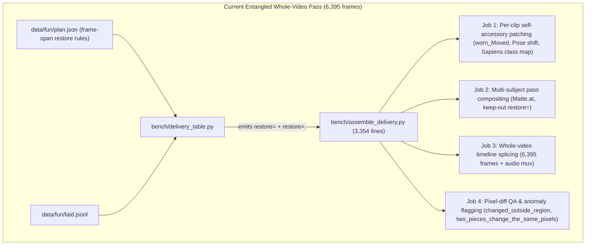
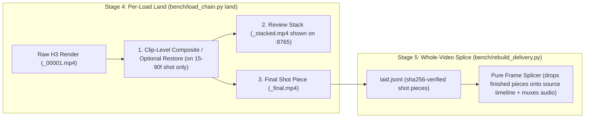

# Delivery Table, `restore=` Spans, and Assembly Entanglement

 Companion to [`docs/masked_v2v/AGENTS.md`](AGENTS.md), [`docs/masked_v2v/PROTOCOL.md`](PROTOCOL.md), [`docs/masked_v2v/chain_trace_and_remakes.md`](chain_trace_and_remakes.md), and [`docs/research/masking/2026-10-26_code_map_and_simplification_plan.md`](../research/masking/2026-10-26_code_map_and_simplification_plan.md).

---

## 1. Root Cause of the `day_2026-10-27` Double-Sunglasses Bug (`lead_fp_3967c` & `lead_fp_2823b`)

When `fun_0000_6394_joined_2026-10-27T1421Z_from_laid.mp4` (`day_2026-10-27`) was assembled from `data/fun/laid.jsonl`, the owner spotted double-stacked sunglasses on `lead` in `3967–4035` (`lead_fp_3967c`).

### 1.1 What happened on `3967–4052` (`lead_fp_3967c`)
1. **In the H3 render (`lead_fp_3967c_00001.mp4`)**:
   - The prompt (`data/2026-10-25_lead_fp_3967c_job/lead_fp_3967c.render.txt`) includes `<Subject 1> wears white sunglasses.`
   - H3 painted clean white sunglasses with dark lenses directly onto the replaced face across `3970–4035`.
   - The per-shot review clip (`lead_fp_3967c_3967_4052_stacked.mp4`, built by [`bench/load_chain.py`](../../bench/load_chain.py) `land` via [`bench/capture_masked_run.py`](../../bench/capture_masked_run.py) `video`) displays `lead_fp_3967c_00001.mp4` directly — it **never** reads `data/fun/plan.json`'s `restore` spans or runs [`bench/assemble_delivery.py`](../../bench/assemble_delivery.py).
2. **At whole-video delivery assembly (`bench/delivery_table.py` → `bench/assemble_delivery.py`)**:
   - `data/fun/plan.json` (`subjects.lead.restore`) still held a frame-span entry from `2026-10-14` / `2026-10-23`:
     ```json
     {
       "classes": ["Eyeglass"],
       "first": 3909,
       "last": 4052,
       "exception": "..."
     }
     ```
   - That entry was originally written for `lead_fp_3909b` (`3909–3966`) and the pre-remake shot `3967–4052` before `lead_fp_3967c` rendered its own sunglasses in H3.
   - Because `bench/delivery_table.py::own_restores` matched `plan["subjects"][label]["restore"]` purely by **frame span** (`3909–4052`) rather than by **load name**, it automatically emitted `restore=lead.Eyeglass` onto `lead_fp_3967c`'s delivery row (`3970–4035`).
   - During whole-video assembly, `bench/assemble_delivery.py::worn_of` (`WORN_ON_THE_HEAD = frozenset({"Eyeglass", "Apparel"})`) cut the 1980s source actress's translucent sunglasses (with her original eyes and blue eyeshadow visible through the lenses) out of the source plate and pasted them on top of `lead_fp_3967c_00001.mp4`'s H3-generated sunglasses. Worse, on the 18 frames where Sapiens missed `Eyeglass` on the source plate (`3993–4002`, `4025–4035`), the pasted source glasses vanished and revealed H3's sunglasses underneath, creating a double-glasses flicker.

### 1.2 Audit of all self-accessory `restore=lead.*` rows in `data/fun/plan.json`
Across all 71 rows of `data/fun/delivery_table_laid.txt`, only 6 rows carried self-accessory `restore=lead.<Class>` tokens from `data/fun/plan.json`:
- **`168–184` (`lead_fp_0168c`, `restore=lead.Apparel@head`)**: **Needed** for `lead_fp_0168c`. H3 redrew the top of her head without her black hat; `Apparel@head` restores the hat shifted to `lead_fp_0168c`'s face height.
- **`3060–3062` & `3063–3097` (`lead_fp_2823b`, `restore=lead.Left_Hand+Right_Hand` and `restore=lead.Eyeglass`)**: **Needed** for `lead_fp_2823b`, though `lead_fp_2823b` also has faint H3-drawn frames under the source sunglasses paste.
- **`3098–3109` (`lead_fp_3098b`, `restore=lead.Eyeglass` and `restore=lead.Left_Hand+Right_Hand`)**: **Needed** for `lead_fp_3098b`. In `lead_fp_3098b_00001.mp4`, H3 did not generate sunglasses on her face; the restore places the white sunglasses on her face across the cut from `3097` to `3098`.
- **`3909–3966` (`lead_fp_3909b`, `restore=lead.Eyeglass`)**: **Needed** for `lead_fp_3909b`. In `lead_fp_3909b_00001.mp4`, H3 rendered her side profile on the stairs without sunglasses; the restore places her sunglasses on her face.
- **`3970–4035` (`lead_fp_3967c`, `restore=lead.Eyeglass`)**: **Bug** (double sunglasses). `lead_fp_3967c_00001.mp4` already has clean H3-rendered white sunglasses.

---

## 2. Why `delivery_table.py` and `assemble_delivery.py` Became Entangled

Currently, [`bench/delivery_table.py`](../../bench/delivery_table.py) (`898` lines) and [`bench/assemble_delivery.py`](../../bench/assemble_delivery.py) (`3,354` lines) do **four distinct jobs** in one global whole-video pass at the very end of the pipeline:



### The two completely different meanings of `restore=`
Because [`bench/delivery_table.py`](../../bench/delivery_table.py) emits both kinds of `restore=` onto the same table row, two unrelated operations share one keyword:
1. **Cross-subject protection (`restore=second`, `restore=third:whole`)**:
   - When `lead` is laid on a shot where `second` is also present, `restore=second` prevents `lead`'s rectangular zoom box from overwriting `second`.
   - Note that since `2026-10-20`, `bench/assemble_delivery.py::Matte.at` (`L1372–1474`) already composites each piece using the ComfyUI node's saved per-frame soft `matte` (`*_window_*_region.npz["matte"]`), which has `second` and `strangers` carved out during the load itself.
2. **Self-accessory source give-back (`restore=lead.Eyeglass`, `restore=lead.Apparel@head`, `restore=lead.Left_Hand+Right_Hand`)**:
   - This is a **single-clip post-processing patch** for an older render where H3 failed to draw a hat or sunglasses.
   - Running this inside [`bench/assemble_delivery.py`](../../bench/assemble_delivery.py) across the 4.5-minute (`6,395`-frame) joined video has two major architectural flaws:
     - **Review vs. Delivery mismatch**: The owner reviews and clicks `"keep this one"` on `<load>_<first>_<last>_stacked.mp4` (`bench/load_chain.py` `land`), which is built **without** `bench/assemble_delivery.py`. Any self-accessory `restore=` only appears later when the whole-video cut is assembled!
     - **Silent leakage across remakes**: Because `plan.json` keyed `restore` by frame span (`first`, `last`), remaking a shot or an adjacent shot inside that span silently applied the legacy source-paste on top of the new render.

---

## 3. Step 1 (Landed `187dc9fd`): Pinning `plan.json` `restore` Spans to Explicit `loads`

To stop silent leakage immediately without breaking existing kept clips (`lead_fp_0168c`, `lead_fp_2823b`, `lead_fp_3098b`, `lead_fp_3909b`) or requiring re-renders:
1. **`bench/delivery_table.py::own_restores` (`L308–355`) and `decide` (`L523`)**:
   - Supports `"loads": ["<load_name>", ...]` (validated as a non-empty list of non-empty strings by both `bench/delivery_table.py::own_restores` and `bench/shot_coverage.py::load_plan`).
   - When `"loads"` is present on a `plan["subjects"][label]["restore"]` entry, `own_restores(label, r["name"])` emits the `restore=` token **only** when `r["name"] in x["loads"]`.
2. **`bench/shot_to_load.py::load_job` (`L3496–3500`)**:
   - Filters `job["restore"]` by `not r.get("loads") or name in r["loads"]`, so a new remake on those frames never inherits `--over-the-eyes` or `--given-back` flags from an older load's exception.
3. **`data/fun/plan.json` (`subjects.lead.restore`)**:
   - Every active exception in `data/fun/plan.json` is now explicitly pinned to the exact kept load(s) it was approved for:
     - `3909–3966` (`Eyeglass`): `"loads": ["lead_fp_3909b"]` (removed from `3967–4052` / `lead_fp_3967c`).
     - `3063–3109` (`Eyeglass`) and `3060–3109` (`Left_Hand`, `Right_Hand`): `"loads": ["lead_fp_2823b", "lead_fp_3098b"]`.
     - `168–184` (`Apparel` `@head`): `"loads": ["lead_fp_0168c"]`.

---

## 4. Long-Term Architecture: Clip-Level Restore at `land` Time & Decoupled Delivery Splicing

Every operation in `bench/assemble_delivery.py` is **100% frame-local** to the shot being replaced (verified across `bench/assemble_delivery.py`: `Matte.at` at `L1372`, `restore_weight` at `L1340`, `worn_of` at `L706`, and `worn_fill` at `L655`, which looks at most `WORN_FILL_FRAMES = 2` frames left/right within the same capture). Nothing in `restore=` requires the 4.5-minute timeline.

The clean long-term separation splits the four jobs into their natural pipeline stages:



### 4.1 Why Clip-Level Restore at `land` Time Wins
1. **What you review on `:8765` is byte-for-byte what goes into the joined video**:
   - If a clip uses a clip-level restore or matte composite, it runs **once** at `bench/load_chain.py` `land` time on that 15–90 frame clip before `<load>_<first>_<last>_stacked.mp4` is written.
   - The owner sees the exact final pixels on `:8765` before clicking `"keep this one"`, eliminating any surprise difference between the review clip and the joined delivery cut.
2. **Scoped to the single load (`job.json`), never global**:
   - Any exception is requested on that specific load and baked into that load's landed output artifact. A remake (`second_hfp_4912l`, `lead_fp_3967c`) starts clean with zero risk of inheriting a global frame-span rule.
3. **Fast, simple whole-video splicing**:
   - Once each kept load's landed clip already has its matte and any per-clip restore applied (and Pass 2 loads are rendered on the Pass 1 composite cut per [`AGENTS.md`](AGENTS.md) §1), whole-video assembly reduces to a pure timeline splice that drops the kept shot clips onto the source timeline and muxes the audio track in seconds.
