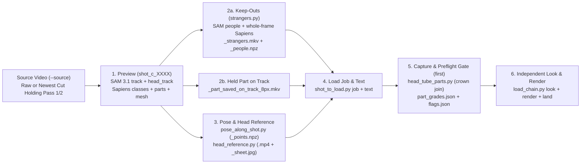

# `fun` Render & Remake Backlog: Sequence, Data Dependencies, and Multi-Subject Pass Order

> [!IMPORTANT]
> **LIVING BACKLOG — MUST BE KEPT IN SYNC AS THE BACKLOG OR PLAN CHANGES**
> - **Last Updated**: `2026-10-29T03:20Z`
> - **Last Updated By**: `gemlead` (`8` keeps laid on `2026-10-28`: `lead_fp_4647d`, `lead_fp_0516f`, `lead_fp_0559`, `lead_fp_0579`, `lead_fp_3759c`, `lead_fp_2254c`, `lead_fp_3909c`, `lead_fp_0294e`; `lead_fp_4272c`, `lead_fp_1134b`, and `lead_fp_0438b` rendered, landed, and paged for review; landed `dc07ccee` replacing `CRANIUM_SCORE_FLOOR` with 4-corner SAM 3.1 `head_track` containment + `grey_head` bound and `span_fh` marks normalisation; next up: `lead_fp_4053d` on `4053–4091` and `lead_fp_5044b` on `5044–5113`)
> - **Sync Rule**: Any session that renders, lays, parks, or re-sequences a load on `fun` — or lands a change to a stage writer (`subject_track.py`, `sapiens2_parts.py`, `bench/strangers.py`, `bench/head_tube_parts.py`, `bench/pose_along_shot.py`, `bench/head_reference.py`, `bench/load_text.py`, `bench/capture_masked_run.py`) — **MUST** update the status, cache cutoff, and timestamp in this file before closing its turn.
> - **Authoritative Machine Records (Check First to Avoid Drift)**:
>   - **What is kept and laid**: [`data/fun/laid.jsonl`](../../data/fun/laid.jsonl) (`bench/laid.py verify`)
>   - **Shot spans, subjects present, and `seen_looks`**: [`data/fun/shots.json`](../../data/fun/shots.json) (`bench/shots_look.py`)
>   - **Subject recipes, `keep_outs`, `restore` rules, and `head_marks`**: [`data/fun/plan.json`](../../data/fun/plan.json)
>   - **Confirmed SAM 3.1 seed boxes**: [`data/fun/cast/cast.jsonl`](../../data/fun/cast/cast.jsonl) (`bench/cast_file.py`)
>   - **Open review items & owner verdicts**: [`data/fun/review/items.json`](../../data/fun/review/items.json) and [`data/fun/owner_answers.jsonl`](../../data/fun/owner_answers.jsonl)
>   - **Latest whole-video coverage & ledger tables**: `data/<day>_fun_delivery_tables/frame_coverage_fun_0000_6394_*.md` and `ledger_fun_*_summary.md` (generated by [`bench/rebuild_delivery.py`](../../bench/rebuild_delivery.py) / [`bench/frame_coverage.py`](../../bench/frame_coverage.py))

---

## 1. Derived-Data Dependency DAG & Cache Invalidation Rules

Every render in `fun` depends on a strict chain of upstream derived data. **Any derived file created before a code change to its writer is stale cache and must be regenerated before building the load that consumes it** ([`docs/masked_v2v/AGENTS.md`](AGENTS.md) §8; [`docs/masked_v2v/chain_trace_and_remakes.md`](chain_trace_and_remakes.md)).

### Mandatory Cache Cutoffs (As of `2026-10-28`)
1. **Preview (`shot_c_<shot><letter>`) Cutoff — `2026-10-27` (`6b0ea9a6`)**:
   - Any preview made before `2026-10-27` (`6b0ea9a6`) predates `Followed.head_mode = "per stretch"` by default in [`subject_track.py`](../../subject_track.py) and SAM 3.1 `--people` verification in [`bench/cast_file.py`](../../bench/cast_file.py).
   - **Rule**: Before building any new load on a shot whose latest preview predates `2026-10-27`, run `bench/shot_to_load.py preview ... --remake --queue` (~1–4 min on GPU).
2. **Keep-Out `strangers` (`<preview>_strangers.mkv`) Cutoff — `2026-10-27` (`426638a6`)**:
   - Any `strangers` file written before `2026-10-27` (`426638a6`) predates unowned SAM 3.1 people unioning in [`bench/strangers.py`](../../bench/strangers.py) and is refused by [`bench/shot_to_load.py`](../../bench/shot_to_load.py) `job`. Remaking the preview (`--remake`) automatically triggers a fresh `strangers.py run` during `shot_to_load.py job`.
3. **Capture & Crown-Join (`head_tube_parts.py`) Cutoff — `2026-10-28` (`c8dee328`)**:
   - For head-and-hair loads (`second`: `hair + face_and_neck`) with a head track, [`bench/head_tube_parts.py`](../../bench/head_tube_parts.py) (`c8dee328`, `_SPECK_MIN_PX = 64`, `_MIN_CROWN_ABOVE_HY0_PX = 256`) expands `head_track_bool` upward into connected components of `parts_bool & raw_track_bool` that overlap `head_track_bool` by at least `64 px` and have at least `256 px` above `hy0` (clamped at `y <= hy1`), recovering upper hair crowns clipped by SAM's head track without growing `tube_info["tube"]`.
4. **Carried Per-Load Words (`--least`, `--hold-part`, `--drop`, `--no-face-on`)**:
   - Carried words from an older letter are also cache: they must be re-verified against the new preview's `part_grades.json` (where the default starting floor is `PART_LEAST_PX = 4096 px` whole-frame, `1024 px` at `2.0x` zoom) and `flags.json` at `load_chain.py first` before `render`.
5. **Short-Load Tail Padding (`< 30` Frames) Cutoff — `2026-10-22` / `2026-10-25`**:
   - Any load covering fewer than `30` frames must be planned with post-shot context frames (`context_after` / masked end-to-end or held edge across a cut per [`docs/masked_v2v/AGENTS.md`](AGENTS.md) §6, chopped back to the exact shot span at delivery assembly) so the diffusion window has full temporal context.
6. **Reference `--crop cranium` Head-Track Containment & Default MoGe-2 Depth Cutoff — `2026-10-28` (`dc07ccee`)**:
   - [`bench/crop_reference_to_head.py`](../../bench/crop_reference_to_head.py) and [`bench/head_reference.py`](../../bench/head_reference.py) (`dc07ccee`) now discover and read SAM 3.1 `head_track` under `--cranium`, growing each tracked frame's head-track box by `CRANIUM_HEAD_TRACK_GROW = 0.50` times the active sizing median face height (`face`) on every side (`win[k]`): frames with an empty head track (`frames_with_no_head_track`) or whose 2D face box is not 4-corner contained in `win[k]` (`frames_off_the_head_track`) do not size the box, and `grey_head` is bounded to `win[k]` so raised 3D arms or flipped torso limbs cannot stretch the box (`CRANIUM_FACE_OUTLIER = 2.00` applies only when no `head_track` is present; no 2D score floor is applied). Applies to references made from `dc07ccee` onward.
   - [`data/fun/plan.json`](../../data/fun/plan.json) now sets `"depth": {"on": true}` on `lead`, `second`, and `third` so `shot_to_load.py job` automatically runs MoGe-2 per-pixel depth (`bench/measure_moge2_depth.py`) whenever `overlap_frames_of` finds overlapping track and keep-out frames.

---

## 2. Multi-Subject Pass Ordering & Crossing-Shot Rules

Per [`docs/masked_v2v/AGENTS.md`](AGENTS.md) §1 and [`data/AGENTS.md`](../../data/AGENTS.md):

1. **No Subject Goes First by Rule — A Kept Subject Stays as Pass 1**:
   - On any multi-subject shot where one or more subjects are already kept and laid in [`data/fun/laid.jsonl`](../../data/fun/laid.jsonl), **the kept subject stays as Pass 1** (and Pass 2 if two are kept).
   - The next unkept subject is made on the **newest whole-video cut** (`bench/rebuild_delivery.py --video fun --clip`) that holds every kept replacement on that shot, starting from a fresh `bench/shot_to_load.py preview --source <that_cut> --for <subject> --remake --queue`.
   - **Chain Consequence of Remaking an Earlier Pass**: Because Pass 2's preview and render take Pass 1's delivered cut as `--source` (and Pass 3 takes Pass 2's cut), remaking Pass 1 invalidates Pass 2+ on that shot and requires re-running the downstream passes in sequence on the new cut.
2. **Example from the Record (`4647–4725`, 3 Subjects, All Kept & Laid)**:
   - **Pass 1 (`2026-10-24`)**: `third_fp_4647e` (`third`, face-only, rendered on the raw source, kept & laid).
   - **Pass 2 (`2026-10-27`)**: `second_hfp_4647i` (`second`, hair + face, previewed and rendered on the cut holding `third_fp_4647e`, kept & laid).
   - **Pass 3 (`2026-10-28`)**: `lead_fp_4647d` (`lead`, face-only, previewed on `shot_c_4647m` with `--depth` from the `1505Z` cut holding both `third_fp_4647e` and `second_hfp_4647i`, verified on a 3-pass assembled clip, kept & laid).
3. **Crossing Shots & Assembly Verification**:
   - When subjects cross in front of one another (`604–1009`, `1093–1133`, `1306–1418`, `1419–1465`, `4647–4725`, `4912–4946`), pass `--depth` (MoGe-2 per-pixel depth tie-breaker) on the preview/job and **always assemble and stack the multi-pass shot span** (`bench/assemble_delivery.py` + `bench/stack_delivery.py`) before paging, because `land`'s single-load review clip does not apply `restore=` tokens from [`bench/delivery_table.py`](../../bench/delivery_table.py).

---

## 3. Master Execution Sequence

### Phase 0: Active Unrendered Queue (`2026-10-28` Immediate GPU Queue)

These shots have **no kept render laid** on their target spans and are executing first:

| Seq | Shot Span (`frames`) | Subject & Pass State | Target Load | Upstream Dependencies to Create / Reprocess | Words / Flags & Live Status |
|---|---|---|---|---|---|
| **0.1a** | **`516–603` (`516–558`, `43f`)** | `lead` (Single-subject, Sub-load 1 of 3-way split at `zoom_up_to: 4.0`) | **`lead_fp_0516f`** | 1. Preview `shot_c_0516f` (**DONE** `19:54Z`) 2. `shot_c_0516f_strangers.mkv` (**DONE** `19:56Z`) 3. Pose & Reference `lead_0516_0558` (**DONE**) | **KEPT & LAID (`2026-10-28`)** (`3.88x` zoom, `[348, 290, 612, 488]`, `108.6 px` rendered part height). |
| **0.1b** | **`516–603` (`559–578`, `20f`)** | `lead` (Single-subject, Sub-load 2 of 3-way split at `zoom_up_to: 4.0`) | **`lead_fp_0559`** | 1. Preview `shot_c_0516f` (**DONE** `19:54Z`) 2. Pose & Reference `lead_0559_0578` (**DONE**) | **KEPT & LAID (`2026-10-28`)** (`2.51x` zoom, `108.7 px` rendered part height). |
| **0.1c** | **`516–603` (`579–599`, `21f`; `600–603` `not seen`)** | `lead` (Single-subject, Sub-load 3 of 3-way split at `zoom_up_to: 4.0`) | **`lead_fp_0579`** | 1. Preview `shot_c_0516f` (**DONE** `19:54Z`) 2. Pose & Reference `lead_0579_0599` (**DONE**) | **KEPT & LAID (`2026-10-28`)** (`2.67x` zoom, `120.0 px` rendered part height, `left_out=600-603`). |
| **0.2** | **`2050–2622`** (`573f`, sub-load `2254–2598`, `345f`) | `lead` (Single-subject; `2050–2253` kept & laid as `lead_fp_2050g`) | **`lead_fp_2254c`** | 1. Remake preview **`shot_c_2050h`** (**DONE** `21:01Z`, `444 s`) 2. Fresh `shot_c_2050h_strangers.mkv` (**DONE**) 3. Pose & Reference `lead_2254_2598` (**DONE**) | **KEPT & LAID (`2026-10-28`)** (`345f` `2254–2598`, 10 interior `not seen` spans dropped so strangers in the spinning ball are untouched). |
| **0.3** | **`3759–3908`** (`150f`, continuous single load) | `lead` (Single-subject) | **`lead_fp_3759c`** | 1. Preview **`shot_c_3759f`** (**DONE** `20:07Z`) 2. `shot_c_3759f_strangers.mkv` (**DONE** `20:15Z`) 3. Recorded `3851–3857` `not seen` in `shots.json` 4. Pose & Reference `lead_3759_3908` (**DONE**) | **KEPT & LAID (`2026-10-28`)** (`150f` continuous load `3759–3908` with `3851–3857` 360° back-of-head spin dropped). |
| **0.4** | **`6105–6394`** (`290f`) | `lead` (Single-subject, 18 sub-cuts) | **`lead_fp_6105e`** | 1. Preview `shot_c_6105f` (**DONE** `10:35Z`) 2. `shot_c_6105f_strangers.mkv` (**DONE** `10:38Z`) 3. Diagnostic capture `lead_fp_6105d` (**DONE** `10:50Z`) | Resolve `who_is_who` / `absent` stretches (`6105–6127, 6152–6155, 6286–6294, 6343–6347, 6385–6394`) and `--drop` / `--no-face-on` on non-lead cuts, then build `lead_fp_6105e`. |

---

### Phase 1 (Tier 1): Laid Renders with Measurable Interior Dropouts (`emptied_inside`)

These pieces are currently in [`data/fun/laid.jsonl`](../../data/fun/laid.jsonl) (`1505Z` cut), but have **verified frame dropouts** where the original unswapped face shows through (`piece_changes_nothing` / `emptied_inside`). Note that whether later pipeline code holds each dropped span without manual words is a hypothesis tested at `first` (`part_grades.json`):

| Seq | Shot Span (`frames`) | Subjects & Kept-First Pass Order | Current Laid Piece(s) & Measured Issue on Disk | Data Dependencies to Create / Reprocess | Remake Plan |
|---|---|---|---|---|---|
| **1.0** | **`3909–3966`** (`58f`) | `lead` (Single-subject) | `lead_fp_3909b` (`10-23`, superseded by **`lead_fp_3909c`**): Text did not name her white sunglasses (`restore=lead.Eyeglass` only). | 1. Remake preview **`shot_c_3909e`** (**DONE**) 2. Fresh `shot_c_3909e_strangers.mkv` (**DONE**) 3. Pose & Reference `lead_3909_3966` (`--no-face-on` / `--drop` on `3932–3937` where her back is turned) (**DONE**) 4. Prompt text with `"<Subject 1> wears white sunglasses."` (**DONE**) | **KEPT & LAID (`2026-10-28`) as `lead_fp_3909c`** (`58f`, white cat-eye sunglasses drawn natively through the `3915–3921` and `3928–3931` head tosses). |
| **1.1** | **`604–1009`** (`406f`) | `second` + `lead` **Kept Pass 1**: `second_hfp_0604h` (`10-17`) **Pass 2**: `lead` (`lead_fp_0606d`, `10-20`) | `lead_fp_0606d`: **`58f` `emptied_inside`** (`606–612, 687–708, 747–750, 974–998` `d018`) + **`20f` `region_far_below_its_own_size`** + `13f` unlaid. `second_hfp_0604h`: Pre-Wave-4 (`10-17`), no owner verdict line, `d011`/`d012`. | 1. Preview **`shot_c_0604f`** (`--source` = newest cut holding `second_hfp_0604h` if `0604h` stays as Pass 1, or raw source if `second` is remade first) with `--depth` 2. Fresh `shot_c_0604f_strangers.mkv` 3. Pose & Reference for `lead` | Remake **Pass 2 `lead_fp_0604e`** over `604–1009` on top of kept Pass 1 `second_hfp_0604h` (unless the owner chooses to remake `second_hfp_0604h` first, which would require remaking both in order `second` -> `lead`). Assemble 2-pass clip before paging. |
| **1.2** | **`294–414`** (`121f`) | `lead` (Single-subject) | `lead_fp_0294d` (`10-13`, Wave 0, superseded by **`lead_fp_0294e`**): **`27f` `emptied_inside`** (`311–319, 349–360, 408–413` `d005`) + area steps at `343, 367` (`d004`) + closed mouth on `366–380`. | 1. Remake preview **`shot_c_0294b`** (**DONE**) 2. Fresh `shot_c_0294b_strangers.mkv` (**DONE**) 3. Pose & Reference `lead_0294_0414_b` (`2.592x` cranium crop with `312–315` gloved hands, `317–319` passer-by, `350–357` turned-away excluded) (**DONE**) | **KEPT & LAID (`2026-10-28`, `owner_answers.jsonl` `01:24Z`, `laid.jsonl` row 77) as `lead_fp_0294e`**: `2.00x` zoom `[358, 82, 870, 466]`, `2.592x` cranium reference, open singing mouth on `366–380`/`398`, `408–414` recovered, and `312–315` gloved hands preserved. |
| **1.3** | **`1419–1465`** (`47f`) | `lead` + `third` + `second` **Kept in `laid.jsonl`**: `lead_fp_1419d` (`10-15`) & `third_fp_1419d` (`10-15`) **Unlaid**: `second` (`47f` rendered, not kept) | `lead_fp_1419d`: **`14f` `emptied_inside`** (`1419, 1421, 1449–1457, 1459, 1464–1465` `d043`). `third_fp_1419d`: **`4f` `emptied_inside`** (`1440–1441, 1448–1449` `d046`). `second`: `47f` not kept. | 1. Remake preview **`shot_c_1419h`** with `--depth` (`shot_c_1419g` is from `10-24`) 2. Fresh `shot_c_1419h_strangers.mkv` 3. Pose & Reference per pass | If keeping `lead_fp_1419d` and `third_fp_1419d`, preview and render `second` as Pass 3 on the `1505Z` cut; if remaking `lead` and `third` to fix their `18` dropped frames, run all 3 passes sequentially on each new cut and assemble the 3-pass span. |
| **1.4** | **`4272–4309`** (`38f`) | `lead` (Single-subject) | `lead_fp_4272b` (`10-23`): **`17f` `emptied_inside`** (`4272–4288` `d078`, first 17 frames untouched original) | 1. Remake preview **`shot_c_4272e`** (**DONE**) 2. Fresh `shot_c_4272e_strangers.mkv` (**DONE**) 3. Pose & Reference `lead_4272_4309_b` (`2.681x`; `3.141x` under `dc07ccee`) (**DONE**) | **RENDERED, LANDED & ON REVIEW PAGE (`lead_fp_4272c`, `01:10Z`)**: awaiting owner verdict (`4289–4309` rendered at `2.681x` with `4272–4288` back-of-head left out). |
| **1.5** | **`4053–4126`** (`74f`; `4092–4126` `not seen`) | `lead` (Single-subject, active span `4053–4091` `39f`) | `lead_fp_4053c` (`10-23`): covers `4053–4097` with **`6f` `emptied_inside`** (`4092–4097` `d076`); `4092–4126` recorded `"not seen"` in `shots.json` (`2026-10-28`) | 1. Remake preview **`shot_c_4053e`** (**DONE**) 2. Fresh `shot_c_4053e_strangers.mkv` (**DONE**) 3. Pose & Reference `lead_4053_4091` under `dc07ccee` (`1.958x`) | Build **`lead_fp_4053d`** on `4053–4091` (`39f`) as the first reference made under `dc07ccee` (read `_sheet.jpg` before `first`). |
| **1.6** | **`1134–1155`** (`22f`) | `lead` (Single-subject, `< 30f`) | `lead_fp_1134` (`10-13`, Wave 0): **`9f` `emptied_inside`** (`1143–1151` `d031`) **AND `< 30f` (`22f`) with no post-shot context padding** | 1. Remake preview **`shot_c_1134c`** (**DONE**) 2. Fresh `shot_c_1134c_strangers.mkv` (**DONE**) 3. Pose & Reference `lead_1134_1155_b` (`2.188x`; `2.174x` under `dc07ccee`) (**DONE**) | **RENDERED, LANDED & ON REVIEW PAGE (`lead_fp_1134b`, `01:10Z`)**: awaiting owner verdict (`1134–1142` active with `1143–1155` hat-brim occlusion dropped + post-shot padding). |
| **1.7** | **`438–483`** (`46f`) | `lead` (Single-subject) | `lead_fp_0438e` (`10-18`): **`8f` `emptied_inside`** (`450–457` `d009`) + area steps (`d008`) + no explicit owner verdict line | 1. Remake preview **`shot_c_0438c`** (**DONE**) 2. Fresh `shot_c_0438c_strangers.mkv` (**DONE**) 3. Pose & Reference `lead_0438_0483_d` (`1.724x`; `2.169x` under `dc07ccee`) (**DONE**) | **RENDERED, LANDED & ON REVIEW PAGE (`lead_fp_0438b`, `01:10Z`)**: awaiting owner verdict (`450–457` archway turn dropped). |
| **1.8** | **`5935–6104`** (`170f`) | `lead` (Single-subject) | `lead_fp_5935d` (`10-26`, owner-approved `10-26`): 1. **`d123` (`piece_changes_across_a_cut` at `6050–6052` and `6100–6104`) is a false alarm**: `shot_c_5935e`'s shot table has `"cuts": []` (single continuous camera take); foreground dancers swinging past the lens at `6050` (`diff=40.0`) and `6103` (`diff=40.5`) tripped `CUT=40.0`. 2. **`d122` (`piece_changes_away_from_its_subject` on `5982, 6035–6039, 6048–6050, 6077, 6080, 6089, 6101–6102`) is Visually Imperceptible**: Side-by-side inspection of `ORIG`, `CHG`, and `CUT` across all 12 frames confirms H3 did **not** put a face on anyone else — the `>= 6/255` diff outline (`CHG`) is just feather/latent reconstruction over motion-blurred foreground shoulders/backs (`6048–6049`, `6101–6102`) and her white pom-pom (`6035–6039`), which look identical to `ORIG` in `CUT`. 3. **`d126` (`10f` `piece_changes_nothing`)**: `5991–5993, 6053, 6078–6079, 6096–6099` (mostly occluded behind foreground dancers). | Only if reopened: remake preview `shot_c_5935f` (`shot_c_5935e` is from `10-24` at `988a03dc`) -> `lead_fp_5935e` with `--hold-part 6053-6053` and `--drop 6096-6099`. | **Stands as kept** (both `d122` and `d123` verified visually benign on disk; no visible defect in playback). |

---

### Phase 2 (Tier 2): Remaining Short Laid Renders (`< 30` Frames) Without Post-Shot Window Padding

All rendered before `2026-10-22` without post-shot context padding (note: `1134–1155` is already in Phase 1 as Seq `1.6`):

| Seq | Shot Span (`frames`) | Subjects & Kept-First Pass Order | Current Laid Piece(s) & Render Date | Data Dependencies to Create / Reprocess | Remake Plan |
|---|---|---|---|---|---|
| **2.1** | **`1010–1038`** (`29f`) | `lead` + `second` **Kept Pass 1**: `lead_fp_1010c` (`10-13`) **Kept Pass 2**: `second_hfp_1010g` (`10-20`) | Both `< 30f` (`29f`) with `0` post-shot padding. `lead_fp_1010c` (`10-13`): `3f` `emptied_inside` (`1016–1018` `d022`). `second_hfp_1010g` (`10-20`): Pre-Wave-4 (`her hair in hole`). | 1. If remaking `second` only (keeping `lead_fp_1010c` as Pass 1): preview `shot_c_1010c` from the cut holding `lead_fp_1010c`. 2. If remaking both: preview Pass 1 from raw source, lay Pass 1, then preview Pass 2 from Pass 1's cut. | Remake with `29f` + post-shot padding (chopped at assembly) and assemble 2-pass clip. |
| **2.2** | **`1730–1754`** (`25f`) | `lead` (Single-subject, `< 30f`) | `lead_fp_1730` (`10-13`, Wave 0): `25f` with `0` post-shot padding | 1. Remake preview **`shot_c_1730b`** (`shot_c_1730` is from `10-13`) 2. Fresh `shot_c_1730b_strangers.mkv` 3. Pose & Reference `lead_1730_1754` | Build **`lead_fp_1730b`** (`25f` + post-shot padding, chopped at assembly). |
| **2.3** | **`5768–5791`** (`24f`) | `second` (`third` not laid) **Single pass**: `second` (`second_hfp_5768f`, `10-21`) | `second_hfp_5768f` (`10-21`): `24f` with `0` post-shot padding, rendered 1 day before `10-22` hair-in-hole | 1. Remake preview **`shot_c_5768d`** (`shot_c_5768c` is from `10-20`) 2. Fresh `shot_c_5768d_strangers.mkv` 3. Pose & Reference `second_5768_5791` | Build **`second_hfp_5768g`** (`24f` + post-shot padding, `restore=third`). |
| **2.4** | **`1945–1974`** (`30f`) | `lead` (Single-subject, `30f` boundary) | `lead_fp_1945b` (`10-13`, Wave 0): `30f` on the boundary, pre-Wave-1..5 | 1. Remake preview **`shot_c_1945c`** (`shot_c_1945b` is from `10-13`) 2. Fresh `shot_c_1945c_strangers.mkv` 3. Pose & Reference `lead_1945_1974` | Build **`lead_fp_1945c`** with current recipe. |

---

### Phase 3: Remaining Unrendered / Uncaptured `lead` Shots

After Phase 0 and high-impact remakes (Phases 1–2), these smaller unrendered/uncaptured `lead` spans remain in `data/2026-10-28_fun_delivery_tables/frame_coverage_fun_0000_6394_2026-10-28T1505Z.md`:

| Seq | Shot Span (`frames`) | State in `1505Z` | Latest Preview on Disk | Action & Dependencies |
|---|---|---|---|---|
| **3.1** | **`3595–3671`** (`77f`) | `77f` `no_capture` (`lead`) | `shot_c_3595e` (`10-26`) | Remake preview `shot_c_3595f` -> `strangers` -> `reference` -> `lead_fp_3595b`. |
| **3.2** | **`5044–5113`** (`70f`) | `70f` `no_capture` (`lead`) | `shot_c_5044e` (`10-26`) | Remake preview `shot_c_5044f` -> `strangers` -> `reference` -> `lead_fp_5044b`. |
| **3.3** | **`2823–3166` tail `3110–3166`** (`57f`) | `2823–3097` (`lead_fp_2823b`) & `3098–3109` (`lead_fp_3098b`) laid; **`3110–3166` (`57f`) uncaptured** | `shot_c_2823d` (`10-23`) | Remake preview `shot_c_2823e` -> build tail load covering `3110–3166` (or `3098–3166`). |
| **3.4** | **`4774–4841`** (`68f`) | `53f` `captured_not_rendered` (`lead`) | `shot_c_4774e` (`10-26`) | Remake preview `shot_c_4774f` -> `strangers` -> `reference` -> `lead_fp_4774c`. |
| **3.5** | **`3476–3523`** (`48f`) | `43f` `captured_not_rendered` (`lead`) | `shot_c_3476e` (`10-26`) | Remake preview `shot_c_3476f` -> `strangers` -> `reference` -> `lead_fp_3476c`. |
| **3.6** | **`1466–1729` gap `1536–1574`** (`39f`) | `1466–1535` (`lead_fp_1466b`), `1575–1729` (`lead_fp_1575b`), `third_fp_1466b` laid; **`1536–1574` (`39f`) uncaptured** | `shot_c_1466b` (`10-20`) | Preview `shot_c_1466c` from newest cut holding `third_fp_1466b` -> build `lead` load on `1536–1574`. |
| **3.7** | **`3240–3276`** (`37f`) | `37f` `captured_not_rendered` (`lead`) | `shot_c_3240e` (`10-26`) | Remake preview `shot_c_3240f` -> `strangers` -> `reference` -> `lead_fp_3240c`. |
| **3.8** | **`4227–4271`** (`45f`) | `35f` `captured_not_rendered` (`lead`) | `shot_c_4227e` (`10-26`) | Remake preview `shot_c_4227f` -> `strangers` -> `reference` -> `lead_fp_4227c`. |
| **3.9** | **`2013–2049` tail `2038–2049`** (`12f`) | `2013–2037` (`lead_fp_2013b`, `10-13`) laid; **`2038–2049` (`12f`) uncaptured** | `shot_c_2013c` (`10-20`) | Remake preview `shot_c_2013d` -> build full `2013–2049` (`37f`) `lead_fp_2013c`. |

---

### Phase 4 (Tier 3): Older Kept Renders (`10-13` to `10-20`) That Predate Wave 4/5 Quality Upgrades

Per project policy (`2026-10-14` / `2026-10-21`), a kept render stays unless reopened on the owner's word. When any multi-subject shot below is reopened:
- **If only one subject is reopened**, the other kept subject stays as Pass 1 and the reopened subject previews and renders from the cut holding Pass 1 (`--source <cut> --for <subject>`).
- **If Pass 1 itself is reopened**, every downstream pass built on Pass 1's output must also be remade on the new cut in sequence.

1. **`1093–1133` (`41f`, `lead` + `second`)**:
   - **Current state**: Pass 1 `lead_fp_1097c` (`10-14`, Wave 0, covers `1097–1133`, missing `1093–1096`) and Pass 2 `second_hfp_1093k` (`10-23`, `6f` `emptied_inside` on `1096–1098, 1125–1127` `d028`, owner note *"not quite, move on"*).
   - **If remaking `second` only**: Preview `shot_c_1093h` from the cut holding `lead_fp_1097c` -> build `second_hfp_1093l` with today's crown-join (`c8dee328`).
   - **If remaking both (`lead` over full `1093–1133` + `second`)**: Remake Pass 1 on raw source, lay it, rebuild cut, then preview and render Pass 2 on that cut.
2. **Pre-Wave-4 `second` (`hair + face`) Renders from `2026-10-20`** (made before `10-22` `her hair kept inside the hole`, `"face and blonde hair"` text, and `10-28` crown join):
   - **`4726–4773` (`48f`, `second` + `third`)**: `second_hfp_4726c` (`10-20`, `4f` `emptied_inside` `4752–4755` `d096`) + `third_fp_4726b` (`10-23`). Because `third_fp_4726b` (`10-23`) is kept, `third_fp_4726b` stays as Pass 1 and remaking `second` (`second_hfp_4726d`) previews/renders as Pass 2 on the cut holding `third_fp_4726b`.
   - **`5011–5043` (`33f`, `second` + `third`)**: `second_hfp_5011e` (`10-20`, `6f` `emptied_inside` `5031–5036` `d102`) + `third_fp_5011g` (`10-24`). Keep `third_fp_5011g` as Pass 1; preview and render `second_hfp_5011f` as Pass 2 on the cut holding `third_fp_5011g`.
   - **`484–515` (`32f`, `second` alone)**: `second_hfp_0484f` (`10-20`). Remake preview `shot_c_0484c` -> `second_hfp_0484g`.
   - **`5461–5497` (`37f`, `second` + `third`)**: `second_hfp_5461e` (`10-20`) + `third_fp_5461e` (`10-24`). Keep `third_fp_5461e` as Pass 1; preview and render `second_hfp_5461f` as Pass 2 on the cut holding `third_fp_5461e`.
   - **`5675–5715` (`41f`, `second` + `third`)**: `second_hfp_5675c` (`10-20`) + `third_fp_5675g` (`10-24`). Keep `third_fp_5675g` as Pass 1; preview and render `second_hfp_5675d` as Pass 2 on the cut holding `third_fp_5675g`.
   - **`5889–5934` (`46f`, `second` + `third`)**: `second_hfp_5889e` (`10-20`, covers `5889–5917`). Remake preview `shot_c_5889d` -> `second_hfp_5889f`.
3. **Wave-0 (`10-13` to `10-15`) Face-Only `lead` & `third` Renders** (made before Wave 1–5 eye/mouth drawing, closed-lip line, strangers keep-out carving, and SAM head track):
   - **Multi-subject (`lead` + `third`)**:
     - `1222–1305` (`84f`): `lead_fp_1222` (`10-14`) + `third_fp_1222b` (`10-13`).
     - `1466–1729` (`264f`): `lead_fp_1466b` (`10-14`), `lead_fp_1575b` (`10-14`), `third_fp_1466b` (`10-13`).
   - **Single-subject (`lead`)**:
     - `1755–1801` (`47f`), `1802–1848` (`47f`), `1849–1897` (`49f`), `1898–1944` (`47f`), `1975–2012` (`38f`), `2823–3097` (`275f`, `lead_fp_2823b` `10-15`).
   - **Multi-subject (`second` + `third`) where only `third` is Wave 0**:
     - `5533–5564` (`32f`): Keep `second_hfp_5533c` (`10-22`) as Pass 1; preview and render `third_fp_5533c` as Pass 2 on the cut holding `second_hfp_5533c`.

---

## 5. Cross-Shot Anomaly & Dependency Impact Triage (`2026-10-28` Pass 1 + Pass 2 Audit)

Full 110-record 3-way cranium replay table (`pre-filter` vs `b7875bf1` vs `dc07ccee`): `data/fun/cranium_replay_fun_2026-10-29T0302Z.json` (generated by [`bench/replay_cranium_references.py`](../../bench/replay_cranium_references.py)). Raw-vs-window and crown/3D-marks scans: `data/fun/cranium_raw_vs_window_scan_fun_2026-10-29T0301Z.json` and `data/fun/cranium_crown_and_marks_scan_fun_2026-10-29T0301Z.json`.

### 5.1 Bucket A — Most Impacted (High Priority / Must Act)

Every backlog shot and currently laid render where one or more of the 5 upstream issues causes a major, measurable degradation in reference conditioning (`>= 0.25x` / `>= 15%` `cranium_box` shrinkage, `>= 5` active `marks_against_the_body_model` / `no_3d_head` frames, unexcluded interior `not seen` spans in `data/fun/shots.json`, or heavy head-touching keep-out carving without `depth.npz`):

| Seq / Laid Load | Shot (`Subj`) | Primary Quantitative & Visual Impact (**Why Must Act**) | Exact Flags & Actions Required (`reference` / `job` / `first`) |
| :--- | :--- | :--- | :--- |
| **Seq 0.4** (`lead_fp_6105e`, unlaid) | `6105–6394` (`lead`, `290f`) | **`90` raw / `86` active 3D/2D collisions** (`70` `no_3d_head` on absent/black sub-cuts + `20` severe collisions up to `39.66 fh` & `134.9°` roll) + **`112,881 px` max unjoined grey** (`14,824 px` med) across 18 sub-cuts (`1.000x` whole frame under all rules). | `--drop 6105-6127 --drop 6152-6155 --drop 6241-6249 --drop 6253-6260 --drop 6343-6347 --drop 6374-6394`, matching `--no-head-on` / `--no-face-on`, plus `--no-head-on 6215-6217 --no-head-on 6263-6266 --no-head-on 6268 --no-head-on 6295`. |
| **Seq 3.2** (`lead_fp_5044b`, unlaid) | `5044–5113` (`lead`, `70f`) | **Largest `cranium_box` blowout on an unrendered `lead` shot (`1.111x` pre-filter -> `3.606x (e=9)` under `b7875bf1` -> `2.798x (e=0)` under `dc07ccee`)** caused by `f5044` (`436.8 px` against `49.7 px`); **`33` active 3D/2D collisions** (`5` `no_3d_head` on `5058-5059, 5105-5107`, `nose` up to `8.44 fh`, `roll` up to `179°`). | Remake `shot_c_5044f` (`depth.on = true`); rebuild reference under `dc07ccee` (`2.798x`, `0` edge frames); pass `--no-head-on 5044-5048 --no-head-on 5058-5059 --no-head-on 5066-5078 --no-head-on 5094-5096 --no-head-on 5105-5113` and `--no-face-on` / `--drop` on occluded spans. |
| **Seq 1.2** (Laid `lead_fp_0294d` -> **`lead_fp_0294e`**) | `294–414` (`lead`, `121f`) | `0294d` left **3 interior `not seen` spans (`312-315, 317-319, 350-357`)** and **`9` 3D/2D collisions** active (`27f` `emptied_inside` `d005`); `f317` passer-by (`104.5 px` against `48.8 px`) + raised arm blew out `cranium_box` **`1.517x -> 2.592x` (`2.674x` under `dc07ccee`)**. | **KEPT & LAID (`2026-10-28` as `lead_fp_0294e`, row 77)**: `shot_c_0294b` + `lead_0294_0414_b` (`2.592x` cranium), `--drop 312-319 --drop 350-357 --drop 414-414 --no-head-on 317-319 --no-face-on 350-357`. |
| **Seq 1.5** (Laid `lead_fp_4053c` -> **`lead_fp_4053d`**) | `4053–4126` (`lead`, `74f`; `4092–4126` `not seen`) | `6` no-track frames (`4092-4097`) + raised arm shrunk `cranium_box` (`1.432x` pre-filter -> `1.747x` under `b7875bf1` -> **`1.958x` under `dc07ccee`**) and caused `6f` `emptied_inside` (`d076`). | Build **`lead_fp_4053d`** on `4053–4091` (`39f`) with reference made under `dc07ccee` (`1.958x`), reading `_sheet.jpg` before `first` (`4092–4126` is `"not seen"` in `shots.json`). |
| **Seq 1.4** (Laid `lead_fp_4272b` -> **`lead_fp_4272c`**) | `4272–4309` (`lead`, `38f`) | `4272b` had **`19` active 3D/2D collisions (`4272-4285, 4296-4300`)** and `17f` `emptied_inside` (`4272-4288` `d078`); `lead_4272_4309_b` (`left_out=4272-4288`) is `2.681x` (`3.141x (e=0)` under `dc07ccee`). | **Rendered, landed & on review page (`lead_fp_4272c`, `01:10Z`)**: awaiting owner verdict (`2.681x`; remake reference to `3.141x` under `dc07ccee` only if head looks small on review). |
| **Seq 1.1a** (Laid `lead_fp_0606d` -> **`lead_fp_0604e`**) | `604–1009` (`lead`, `406f`) | `58f` `emptied_inside` (`d018`), `1.000x` `--crop head` across `393f`, and **`12` steps / `13` head-touching units carved by `second` & `strangers` without `depth.npz`**. | Preview `shot_c_0604f` over kept `second_hfp_0604h` with `depth.on = true` (`--depth`); use `--crop cranium` (or sub-load split) and keep `30` collision exclusions. |
| **Seq 1.3a** (Laid `lead_fp_1419d` -> **`lead_fp_1419e`**) | `1419–1465` (`lead`, `47f`) | Left **`18` `not seen` frames (`1419-1422` edge, `1448-1459` interior back-of-head, `1464-1465` edge)** active in `1419d`, causing `14f` `emptied_inside` (`d043`). | Preview `shot_c_1419h` (`depth.on = true`); pass `--drop 1419-1422 --drop 1448-1459 --drop 1464-1465` and matching `--no-head-on` / `--no-face-on` (`29` active frames `1423-1447, 1460-1463`). |
| **Seq 1.6** (Laid `lead_fp_1134` -> **`lead_fp_1134b`**) | `1134–1155` (`lead`, `22f`) | Left **interior `not seen` span `1143-1151` (`9f` black hat brim over face)** active (`9f` `emptied_inside` `d031`) + `< 30f` unpadded. | **Rendered, landed & on review page (`lead_fp_1134b`, `01:10Z` at `2.188x`; `2.174x` under `dc07ccee`)**: awaiting owner verdict (`1134–1142` active with `1143–1155` dropped + post-shot padding). |
| **Seq 1.7** (Laid `lead_fp_0438e` -> **`lead_fp_0438b`**) | `438–483` (`lead`, `46f`) | Capture `0438e` ran across **interior `not seen` archway turn `450-457`** (`8f` `emptied_inside` `d009`). | **Rendered, landed & on review page (`lead_fp_0438b`, `01:10Z` at `1.724x`; `2.169x (e=0)` under `dc07ccee`)**: awaiting owner verdict (`450–457` dropped; remake reference to `2.169x` under `dc07ccee` only if head looks small on review). |
| **Seq 2.1b** (Laid `second_hfp_1010g` -> **`second_hfp_1010h`**) | `1010–1038` (`second`, `29f`) | **`15` active 3D/2D collisions (`1024-1038`, `nose = 5.72 fh`, `roll = 176°`)**, `6` low-score (`1029-1034`) + `4` `>1.80x` (`1035-1038`) frames in `--crop head`, **`12` steps / `1,325`u carved by `lead` without `depth.npz`**, and `< 30f` unpadded. | Preview `shot_c_1010c` (`depth.on = true`, `--depth`); switch to `--crop cranium`, pass `--no-head-on 1029-1038 --no-face-on 1024-1038 --drop 1029-1038`, and add `< 30f` tail padding. |
| **Seq 3.8** (`lead_fp_4227b` -> **`lead_fp_4227c`**, unlaid) | `4227–4271` (`lead`, `45f`) | **`20` active 3D/2D collisions (`4231-4234, 4243-4257, 4271`)**, including **`10` `no_3d_head` frames (`4232-4233, 4247-4254`)**, plus `6,387 px` unjoined grey (`2.138x` under `dc07ccee`). | Remake `shot_c_4227f` (`depth.on = true`); pass `--no-head-on 4231-4234 --no-head-on 4243-4257 --no-head-on 4271-4271` and `--drop 4232-4233 --drop 4247-4254`. |
| **Seq 3.4** (`lead_fp_4774b` -> **`lead_fp_4774c`**, unlaid) | `4774–4841` (`lead`, `68f`) | **`19` active 3D/2D collisions (`4791, 4794, 4824, 4826-4841`)**, including **`15` consecutive `no_3d_head` tail frames (`4827-4841`)**; `cranium_box` `2.231x` pre-filter -> `2.286x` under `b7875bf1` -> `2.271x (e=0)` under `dc07ccee`. | Remake `shot_c_4774f`; pass `--drop 4824-4841 --no-head-on 4824-4841 --no-face-on 4824-4841` (and check `4791, 4794` on `_sheet.jpg`). |
| **Seq 3.5** (`lead_fp_3476b` -> **`lead_fp_3476c`**, unlaid) | `3476–3523` (`lead`, `48f`) | **`11` active 3D/2D collisions (`3486-3489, 3491, 3509-3513, 3515`)**, including **`5` `no_3d_head` (`3487-3488, 3511-3513`)**; `cranium_box` `1.313x` pre-filter -> `1.448x` under `b7875bf1` -> `1.446x (e=0)` under `dc07ccee`. | Remake `shot_c_3476f`; rebuild reference (`1.446x`); pass `--no-head-on 3486-3489 --no-head-on 3509-3515 --drop 3487-3489 --drop 3509-3514`. |
| **Seq 3.9** (Laid `lead_fp_2013b` -> **`lead_fp_2013c`**) | `2013–2049` (`lead`, `37f`) | **`11` consecutive `no_3d_head` frames (`2039-2049`)** in `shot_c_2013b_lead_pose_table.json` cover almost the entire `12f` uncaptured tail (`2038-2049`). | Remake `shot_c_2013d`; if `lead` is not visible on `2038-2049`, mark `2038-2049` `"not seen"` in `shots.json` and keep `lead_fp_2013b` (`2013-2037`) rather than rendering empty 3D mesh frames. |

---

### 5.2 Bucket C — Unsure (Needs Visual / Close-Up Sheet Check Before Deciding)

1. **Backlog Entries Requiring Sheet / Multi-Pass Strip Inspection Before Adding Flags (`8` entries)**:
   - **Seq 1.1b (`second_hfp_0604h`, `604–1009` `second`)**: `Left_Hand: 332f/81c, Right_Hand: 363f/62c` (`0` 3D/2D head collisions). Check playback: if clean, keep as Pass 1 so only Pass 2 `lead` (Seq 1.1a) needs rendering.
   - **Seq 1.3b (`third_fp_1419d`, `1419–1465` `third`)**: `6` active 3D/2D collisions (`1419-1424`, `roll=71°`) + `4f` `emptied_inside` (`1440-1441, 1448-1449`). Check on 3-pass stack; if remaking, pass `--no-head-on 1419-1424`.
   - **Seq 2.1a (`lead_fp_1010c`, `1010–1038` `lead`)**: `5` mild collisions (`1014, 1022-1024, 1026`, `nose=0.72 fh`) + `3f` `emptied_inside` (`1016-1018`). Check whether Pass 1 `lead` can stay kept while Pass 2 `second` (Seq 2.1b) is remade.
   - **Seq 2.2 (`lead_fp_1730`, `1730–1754` `lead`)**: `9` borderline roll frames (`1737-1743, 1752-1753`, `roll=15°–18°`) on `< 30f` (`25f`) shot. Check `_sheet.jpg` when building padded `lead_fp_1730b`.
   - **Seq 2.3a (`second_hfp_5768f`, `5768–5791` `second`)**: `7` steps / `584`u (`32` head-touching units) carved by `third` without `depth.npz` + `f5786` (`2.04x`) in `--crop head`. When building `second_hfp_5768g`, `depth.on = true` + `--crop cranium` + `< 30f` padding resolves all three.
   - **Seq 3.1 (`3595–3671` `lead`, unlaid)**: `5` `no_3d_head` frames (`3618-3620, 3642-3643`) in `shot_c_3595e_lead_pose_table.json`. Inspect `shot_c_3595f` `_sheet.jpg` and pass `--no-head-on 3618-3620 --no-head-on 3642-3643` if still present.
   - **Seq 3.3 (`2823–3166` tail `3110–3166` `lead`)**: `22,963 px` unjoined grey on `lead_3098_3109` + `f3109` collision (`roll=147°`). Inspect `shot_c_2823e` `_sheet.jpg` over `3098-3166` before building tail load.
   - **Seq 3.6 (`1466–1729` gap `1535–1574` `lead`)**: Preview `shot_c_1466c` over kept `third_fp_1466b` (`depth.on = true`) and check `1535-1574` for telephone/hand occlusion.

2. **Already-Laid Owner-Kept Renders to Spot-Check on Review Clips (`15` additional rows in `data/fun/laid.jsonl`)**:
   - **Newly laid `2026-10-28` loads with stranger head-carving without `depth.npz` or active collisions**:
     - `lead_fp_2254c` (`2254–2598`): `74` active 3D/2D collisions (`23` `no_3d_head`), `105,116 px` unjoined grey, `117` head-touching units carved by `strangers` without `depth.npz` *(note: `cranium_box` is `1.000x` pre-filter, `1.002x` under `b7875bf1`, and `1.026x` under `dc07ccee` — not a crop bug; on this arms-up shot the grey component and the track jumping onto the spinning ball on `2280–2302` span the canvas)*.
     - `lead_fp_3759c` (`3759–3908`): `108` head-touching units carved by `strangers` without `depth.npz`, `42,983 px` unjoined grey, `5` pre-spin collisions (`3846-3850`).
     - `lead_fp_0579` (`579–599`): `8` active collisions (`583, 590-596`, `roll` up to `113°`).
   - **Earlier owner-kept renders with moderate-to-high cranium enlargement delta under `dc07ccee` (when bounding `grey_head` to `win[k]` removes raised 3D arms), collision, unjoined grey, or head-carve counts**:
     - `third_fp_5011g` (`5011–5043`): `cranium_box` `2.265x -> 4.376x (e=0)` under `dc07ccee` (arms-up shot where `win[k]` bounds out his raised hands; already owner-kept).
     - `lead_fp_4647d` (`4647–4725`): `cranium_box` `2.951x -> 4.357x (e=0)` under `dc07ccee` (already owner-kept).
     - `lead_fp_5245b` (`5245–5293`): `cranium_box` `4.197x -> 5.721x (e=0)` under `dc07ccee`, `21/49` active collisions (`5248, 5250-5263, 5288-5293`) + `12` head-touching units carved without `depth.npz`.
     - `third_fp_5461e` (`5461–5497`): `cranium_box` `2.060x -> 3.251x (e=0)` under `dc07ccee`, `20/37` active nose/pitch collisions (`5464-5480, 5492-5494`).
     - `third_fp_5114e` (`5114–5129`): `cranium_box` `1.996x -> 3.122x (e=0)` under `dc07ccee` (already owner-kept).
     - `lead_fp_3967c` (`3970–4035`, owner *"looks great!"*): `cranium_box` `1.515x` pre-filter -> `1.741x` under `b7875bf1` -> `1.832x` under `dc07ccee`, `25` active collisions (`3991-3998, 4025-4035`), `219,169 px` unjoined grey.
     - `third_fp_4479e` (`4479–4509`): `31/31` bowed-head pitch frames (`pitch = 0.80–0.96`).
     - `third_fp_4602c` (`4602–4646`): `24/45` active nose/pitch collisions (`4602-4610, 4620-4625, 4634-4642`).
     - `lead_fp_3315b` (`3315–3357`): `23/43` active collisions (`roll` up to `98°`), `21,742 px` unjoined grey, `23` head-touching units carved by `strangers` without `depth.npz`.
     - `lead_fp_5245b` (`5245–5293`): `21/49` active collisions (`5248, 5250-5263, 5288-5293`) + `12` head-touching units carved without `depth.npz`.
     - `third_fp_5461e` (`5461–5497`): `20/37` active nose/pitch collisions (`5464-5480, 5492-5494`).
     - `lead_fp_3167b` (`3167–3213`): `14/47` active collisions (`3167-3169, 3173-3174, 3182-3190`), `11,320 px` unjoined grey, `4–16` head units carved without `depth.npz`.
     - `second_hfp_4726c` (`4726–4773`, Phase 4) & `second_hfp_5011e` (`5011–5043`, Phase 4): `11` and `8` active collisions + low-score frames in `--crop head` + `4f`/`6f` `emptied_inside`.
     - `third_fp_1306h` (`1306–1418`, owner *"good. keep."*), `lead_fp_2050g` (`2050–2248`), `lead_fp_3672b` (`3672–3718`): `31`, `10–64`, and `29` head-touching units carved without `depth.npz` + heavy hand overlap.

---

### 5.3 Bucket B — Least Impacted (Low Priority / Benign in Practice)

- **Backlog Entries (`4` entries)**:
  - **Seq 1.8 (`lead_fp_5935d`, `5935–6104` `lead`)**: Already inspected frame-by-frame (`ORIG`/`CHG`/`CUT`) and owner-kept; `d122`/`d123` verified visually benign on disk and `+0.153x` cranium delta is `< 0.25x`.
  - **Seq 2.3b (`third_fp_5768c`, `5768–5791` `third`)**: `5768-5781` `not seen` excluded, `0` collisions, `0` carved, `3.793x` zoom.
  - **Seq 2.4 (`lead_fp_1945b`, `1945–1974` `lead`)**: Already `30f` (at threshold), `0` collisions, `0` carved, `0` `emptied_inside`, owner-kept.
  - **Seq 3.7 (`lead_fp_3240c`, `3240–3276` `lead`)**: `0` low-score/outlier frames (`1.593x`, `0.000x` delta), `0` collisions, `0 px` unjoined grey, `0` carved; needs only routine `shot_c_3240f` preview refresh + render.
- **Kept & Laid Loads (`51 / 77` rows in `data/fun/laid.jsonl`)**:
  - Includes all `9` laid loads that already excluded `100%` of their 3D/2D collisions and/or used `depth.npz` (`second_hfp_4647i`, `lead_fp_4647d`, `second_hfp_0278m`, `third_fp_4726b`, `second_hfp_5114k`, `second_hfp_1039h`, `lead_fp_0516f`, `lead_fp_0559`, `lead_fp_3909c`), `lead_fp_5935d` (audited visually clean), `17` `--crop cranium` loads with `0.000x` box delta and `0` (or `<= 6` edge) collisions, and `24` `--crop head` loads where `hand_not_refined` or non-head `step_carves` (`0` head units carved) fire outside the core facial landmarks with zero visible defect.

