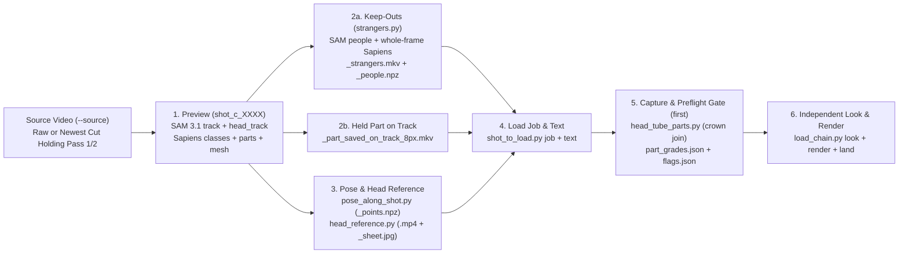

# `fun` Render & Remake Backlog: Sequence, Data Dependencies, and Multi-Subject Pass Order

> [!IMPORTANT]
> **LIVING BACKLOG — MUST BE KEPT IN SYNC AS THE BACKLOG OR PLAN CHANGES**
> - **Last Updated**: `2026-10-31T17:40Z`
> - **Last Updated By**: `gemlead`: applied the owner's 9 settled decisions (`2026-10-31`): recorded keep on **`lead_fp_6125c`** (`data/fun/owner_answers.jsonl:1737-1738`: `"keep this one"`, `"great!!"`; laid at [`data/fun/laid.jsonl`](../../data/fun/laid.jsonl) row 87 on `[[6125, 6366]]`, with `6367–6372` staged on `:8765`), set the remake scope to shots where **every kept piece predates `2026-10-28`** (`4647–4725`, `4912–4946`, and `5114–5129` stand unless flagged on playback), set `1419–1465` to a 3-pass remake (`second -> lead -> third` from `shot_c_1419i`), aligned the multi-subject pass rule (`second` first, reasoned, when all passes on a shot are remade; otherwise a standing kept pass stays Pass 1, with the `restore_weight` exception when `second` is remade after another subject), added the 12-load `zoom_up_to: 2.0` spot-check table, and unlumped the Section 6.2 remake queue into one row per subject pass per shot.
> - **Sync Rule**: Any session that renders, lays, parks, or re-sequences a load on `fun` — or lands a change to a stage writer (`subject_track.py`, `sapiens2_parts.py`, `bench/strangers.py`, `bench/head_tube_parts.py`, `bench/pose_along_shot.py`, `bench/head_reference.py`, `bench/load_text.py`, `bench/capture_masked_run.py`) — **MUST** update the status, cache cutoff, and timestamp in this file before closing its turn.
> - **Authoritative Machine Records (Check First to Avoid Drift)**:
>   - **What is kept and laid**: [`data/fun/laid.jsonl`](../../data/fun/laid.jsonl) (`bench/laid.py verify`)
>   - **Shot spans, subjects present, and `seen_looks`**: [`data/fun/shots.json`](../../data/fun/shots.json) (`bench/shots_look.py`)
>   - **Subject recipes, `keep_outs`, `restore` rules, and `head_marks`**: [`data/fun/plan.json`](../../data/fun/plan.json)
>   - **Confirmed SAM 3.1 seed boxes**: [`data/fun/cast/cast.jsonl`](../../data/fun/cast/cast.jsonl) (`bench/cast_file.py`)
>   - **Open review items & owner verdicts**: [`data/fun/review/items.json`](../../data/fun/review/items.json) and [`data/fun/owner_answers.jsonl`](../../data/fun/owner_answers.jsonl)
>   - **Latest whole-video coverage & ledger tables**: `data/<day>_fun_delivery_tables/frame_coverage_fun_0000_6394_*.md` and `ledger_fun_*_summary.md` (generated by [`bench/rebuild_delivery.py`](../../bench/rebuild_delivery.py) / [`bench/frame_coverage.py`](../../bench/frame_coverage.py))

---

## 1. Derived-Data Dependency DAG & Cache Invalidation Rules

Every render in `fun` depends on a strict chain of upstream derived data. **Any derived file created before a code change to its writer is stale cache and must be regenerated before building the load that consumes it** ([`docs/masked_v2v/AGENTS.md`](AGENTS.md) §8; [`docs/masked_v2v/chain_trace_and_remakes.md`](chain_trace_and_remakes.md)).

### Mandatory Cache Cutoffs (As of `2026-10-28`)
1. **Preview (`shot_c_<shot><letter>`) Cutoff — `2026-10-27` (`6b0ea9a6`)**:
   - Any preview made before `2026-10-27` (`6b0ea9a6`) predates `Followed.head_mode = "per stretch"` by default in [`subject_track.py`](../../subject_track.py) and SAM 3.1 `--people` verification in [`bench/cast_file.py`](../../bench/cast_file.py).
   - **Rule**: Before building any new load on a shot whose latest preview predates `2026-10-27`, run `bench/shot_to_load.py preview ... --remake --queue` (~1–4 min on GPU).
2. **Keep-Out `strangers` (`<preview>_strangers.mkv`) Cutoff — `2026-10-27` (`426638a6`)**:
   - Any `strangers` file written before `2026-10-27` (`426638a6`) predates unowned SAM 3.1 people unioning in [`bench/strangers.py`](../../bench/strangers.py) and is refused by [`bench/shot_to_load.py`](../../bench/shot_to_load.py) `job`. Remaking the preview (`--remake`) automatically triggers a fresh `strangers.py run` during `shot_to_load.py job`.
3. **Capture & Crown-Join (`head_tube_parts.py`) Cutoff — `2026-10-28` (`c8dee328`)**:
   - For head-and-hair loads (`second`: `hair + face_and_neck`) with a head track, [`bench/head_tube_parts.py`](../../bench/head_tube_parts.py) (`c8dee328`, `_SPECK_MIN_PX = 64`, `_MIN_CROWN_ABOVE_HY0_PX = 256`) expands `head_track_bool` upward into connected components of `parts_bool & raw_track_bool` that overlap `head_track_bool` by at least `64 px` and have at least `256 px` above `hy0` (clamped at `y <= hy1`), recovering upper hair crowns clipped by SAM's head track without growing `tube_info["tube"]`.
4. **Carried Per-Load Words (`--least`, `--hold-part`, `--drop`, `--no-face-on`)**:
   - Carried words from an older letter are also cache: they must be re-verified against the new preview's `part_grades.json` (where the default starting floor is `PART_LEAST_PX = 4096 px` whole-frame, `1024 px` at `2.0x` zoom) and `flags.json` at `load_chain.py first` before `render`.
5. **Short-Load Tail Padding (`< 30` Frames) Cutoff — `2026-10-22` / `2026-10-25`**:
   - Any load covering fewer than `30` frames must be planned with post-shot context frames (`context_after` / masked end-to-end or held edge across a cut per [`docs/masked_v2v/AGENTS.md`](AGENTS.md) §6, chopped back to the exact shot span at delivery assembly) so the diffusion window has full temporal context.
6. **Reference `--crop cranium` Head-Track Containment & Default MoGe-2 Depth Cutoff — `2026-10-28` (`dc07ccee`)**:
   - [`bench/crop_reference_to_head.py`](../../bench/crop_reference_to_head.py) and [`bench/head_reference.py`](../../bench/head_reference.py) (`dc07ccee`) now discover and read SAM 3.1 `head_track` under `--cranium`, growing each tracked frame's head-track box by `CRANIUM_HEAD_TRACK_GROW = 0.50` times the active sizing median face height (`face`) on every side (`win[k]`): frames with an empty head track (`frames_with_no_head_track`) or whose 2D face box is not 4-corner contained in `win[k]` (`frames_off_the_head_track`) do not size the box, and `grey_head` is bounded to `win[k]` so raised 3D arms or flipped torso limbs cannot stretch the box (`CRANIUM_FACE_OUTLIER = 2.00` applies only when no `head_track` is present; no 2D score floor is applied). Applies to references made from `dc07ccee` onward.
   - [`data/fun/plan.json`](../../data/fun/plan.json) now sets `"depth": {"on": true}` on `lead`, `second`, and `third` so `shot_to_load.py job` automatically runs MoGe-2 per-pixel depth (`bench/measure_moge2_depth.py`) whenever `overlap_frames_of` finds overlapping track and keep-out frames.

---

## 2. Multi-Subject Pass Ordering & Crossing-Shot Rules

Per [`docs/masked_v2v/AGENTS.md`](AGENTS.md) §1 and [`data/AGENTS.md`](../../data/AGENTS.md):

1. **Which Subject Goes First, and What Remaking a Pass Invalidates (`2026-10-21` / `2026-10-31`)**:
   - **When a pass is already kept and standing on the shot**: The standing kept pass stays as Pass 1 (and Pass 2 if two are kept), and the next pass is made on the **newest whole-video cut** (`bench/rebuild_delivery.py --video fun --clip`) that holds the earlier passes and not the subject being made, starting from a fresh `bench/shot_to_load.py preview --source <that_cut> --for <subject> --remake --queue`.
   - **When every pass on a multi-subject shot is being remade**: `second` (`face and hair`, `margin = 64`/`128`, reasoned) goes first as Pass 1 on the raw source video so downstream passes segment against her replaced blonde hair silhouette.
   - **General multi-subject remake rule (`from that pass onward` + `second` hair exception)**: On a shot with more than one subject, remaking any pass, even one frame of it, means **every pass from that one onward is remade in order, as whole loads, each after the one before it is kept and laid**. Each takes its whole data chain from a fresh preview on a rebuilt cut that holds the earlier passes and not the subject being made. Earlier passes stand, with one exception: if `second` is remade in a chain where another subject went before it, as on `4647–4725`, remake the whole chain with `second` first, because the earlier piece's masks hold `second`'s original hair (`bench/assemble_delivery.py::restore_weight`).
   - **Showing a Pass 1 remake on `:8765`**: Show a Pass 1 remake on its own, with the other subjects' gaps counted right above the player (`docs/wiki/working_with_the_owner.md`).
2. **Example from the Record (`4647–4725`, 3 Subjects, All Kept & Laid)**:
   - **Pass 1 (`2026-10-24`)**: `third_fp_4647e` (`third`, face-only, rendered on the raw source, kept & laid).
   - **Pass 2 (`2026-10-27`)**: `second_hfp_4647i` (`second`, hair + face, previewed and rendered on the cut holding `third_fp_4647e`, kept & laid).
   - **Pass 3 (`2026-10-28`)**: `lead_fp_4647d` (`lead`, face-only, previewed on `shot_c_4647m` with `--depth` from the `1505Z` cut holding both `third_fp_4647e` and `second_hfp_4647i`, verified on a 3-pass assembled clip, kept & laid).
3. **Crossing Shots & Assembly Verification**:
   - When subjects cross in front of one another (`604–1009`, `1093–1133`, `1306–1418`, `1419–1465`, `4647–4725`, `4912–4946`), pass `--depth` (MoGe-2 per-pixel depth tie-breaker) on the preview/job and **always assemble and stack the multi-pass shot span** (`bench/assemble_delivery.py` + `bench/stack_delivery.py`) before paging, because `land`'s single-load review clip does not apply `restore=` tokens from [`bench/delivery_table.py`](../../bench/delivery_table.py).

---

## 3. Master Execution Sequence

### Today's queue (`2026-10-29`), as ready on disk at `17:27Z`

Read from disk, not from any plan: each span's newest `data/*_shot_c_<shot><letter>_job/preview.queued.json` and its `commit`, with `git diff <commit>..HEAD` on the stage writers named in Cutoff 1 and 2 (`subject_track.py`, `sapiens2_parts.py`, `bench/strangers.py`, `bench/masked_job.py`, `workflows/masked_job_graph.py`, `workflows/h3_config.py`, `bench/cast_file.py`). "fresh" means no writer changed since the preview was queued; "stale" names the commits that changed one. Every 10-26 preview is stale by the same two commits, `6b0ea9a6` and `426638a6`. The order is the Phase 1 and Phase 3 order already below; nothing is re-sequenced here. The whole-video rebuild (`rebuild_delivery.py --video fun --clip`) runs before any of it: the newest table on disk is `data/2026-10-28_fun_delivery_tables/` at `1505Z` and every keep of `2026-10-28` (`laid.jsonl` rows 70–77) carries `no_rebuild`.

| Order | Span (`frames`) | Load to build | Newest preview on disk | Preview state | What else is on disk | Gate before `first` |
|---|---|---|---|---|---|---|
| 1 | `4053–4091` (`39f`; `4092–4126` `not seen` in `shots.json`) | `lead_fp_4053d` | `shot_c_4053e` (`2026-10-28`, `7ae92c9b`) | **KEPT & LAID (`2026-10-29`, `data/fun/owner_answers.jsonl:1682-1683`: *"loosk good!"*)** | reference `lead_4053_4091` (`1.969x` under `dc07ccee` with `--no-draw-face-on 4088-4091`) rendered, read (`lead_fp_4053d.reading.md`), kept, and laid (`laid.jsonl` row 75) | **DONE** |
| 2 | `5044–5113` (`70f`; visible profile `5091–5095` inside `5085–5113` `29f`; `5044–5084` & `5097–5113` `not seen` in `shots.json`) | `lead_fp_5085d` | `shot_c_5044f` (`2026-10-29`, `1e0d37f5`) | **KEPT & LAID (`2026-10-30`, `laid.jsonl` row 82); `lead_fp_5085b` rejected (`data/fun/owner_answers.jsonl:1717-1719`); rebuilt at `zoom_up_to = 4.0` as `lead_fp_5085d` (`5085–5113`, `29f + 10` held pad = `39f` window, `real_after = 0`)** | `lead_fp_5085b` (`5085–5096`, `12f + 17` real unmasked in-shot + `10` held, `2.00x` zoom) rejected; rebuilt `lead_fp_5085d` (`5085–5113`, `--drop 5085-5090+5096-5113`, `--no-face-on 5085-5090,5096-5113`, `--no-head-on 5096-5113`, `4.00x` render zoom, `5.02x` `<Video 1>` zoom), laid at `laid.jsonl` row 82 | **DONE** |
| 3 | `4774–4841` (`68f`; active `4774–4826` `53f`; `4827–4841` `not seen` in `shots.json`) | `lead_fp_4774c` | `shot_c_4774f` (`2026-10-29`, `1e0d37f5`) | **KEPT & LAID (`2026-10-29`, `data/fun/owner_answers.jsonl:1690-1691`: *"looks great!"*)** | reference `lead_4774_4826` (`2.462x`), `--no-head-track` + `--head-tube`, rendered, read (`lead_fp_4774c.reading.md`), kept, and laid (`laid.jsonl` row 77) | **DONE** |
| 4 | `3476–3523` (`48f`) | `lead_fp_3476c` | `shot_c_3476f` (`2026-10-29`, `1e0d37f5`) | **KEPT & LAID (`2026-10-29`, `data/fun/owner_answers.jsonl:1692-1693`: *"looks amazing! you got it at all the transitions!!"*)** | reference `lead_3476_3523_b` (`1.620x`, `--drop 3486-3489+3510-3513`), rendered, read (`lead_fp_3476c.reading.md`), kept, and laid (`laid.jsonl` row 78) | **DONE** |
| 5 | `4227–4271` (`45f`, split at `4243–4257` occlusion wipe into `4227–4257` `31f` and `4243–4271` `29f`) | `lead_fp_4227e` + `lead_fp_4243b` | `shot_c_4227f` (`2026-10-29`, `1e0d37f5`) | **KEPT & LAID (`2026-10-30`, `laid.jsonl` rows 83–84)** | `lead_fp_4227e` (`4227–4242` active inside `4227–4257`, `3.46x` render zoom, `5.48x` `<Video 1>`) laid at `laid.jsonl` row 83; `lead_fp_4243b` (`4243–4271`, `3.12x` render zoom `[696, 112, 1024, 358]`) laid at `laid.jsonl` row 84 | **DONE** |
| 6 | `3240–3276` (`37f`) | `lead_fp_3240f` | `shot_c_3240f` (`2026-10-29`, `1e0d37f5`) | **KEPT & LAID (`2026-10-29`, `data/fun/owner_answers.jsonl:1684-1685`: *"looks good!"*)** | reference `lead_3240_3276_c` (`1.59x`) rendered, read (`lead_fp_3240f.reading.md`), kept, and laid (`laid.jsonl` row 76) | **DONE** |
| 7 | `3595–3671` (`77f`) | `lead_fp_3595c` | `shot_c_3595f` (`2026-10-29`, `1e0d37f5`) | **KEPT & LAID (`2026-10-30`, `data/fun/owner_answers.jsonl:1714`: *"keep this one"*)** | reference `lead_3595_3671_c` (`1.684x` cranium, `--no-head-on 3613-3625` holding `3612`, `--no-head-on 3636-3649` holding `3635`, `--drop 3618-3621+3642-3644`) rendered, read, kept, and laid (`laid.jsonl` row 81) | **DONE** |
| 8 | `3110–3166` (`57f`) | none (`not seen` in `shots.json`) | `shot_c_2823d` (`2026-10-23`, `9c130c2a`) | **DONE (`3110–3166` recorded `not seen` in `shots.json`)** | `lead_fp_2823b` and `lead_fp_3098b` laid on `2823–3109`; `lead` is `not seen` on `3110–3166` in `data/fun/shots.json` | **DONE (no load owed)** |
| 9 | `6105–6394` (`290f`; active `6125–6366` `242f`) | `lead_fp_6125c` (`6125–6373`, `249f -> 294f` window; laid on `[[6125, 6366]]`) | `shot_c_6105j` (`2026-10-30`) | **KEPT & LAID (`2026-10-31`, `data/fun/owner_answers.jsonl:1737-1738`: *"keep this one"*, *"great!!"*; `laid.jsonl` row 87 on `[[6125, 6366]]`, with `6367–6372` staged on `:8765` for owner decision)** | withdrew bad `6228`/`6233` seeds from `cast.jsonl`, ran `shot_c_6105j` preview + `strangers.py`, built `lead_fp_6125c` (`--drop 6148-6164+6169-6224+6238-6243+6347-6351+6373`, `--hold-part 6236-6236`, `zoom_up_to = 4.0`, `--depth`, 24 verified false tracker cuts cleared via `not_cuts`), rendered (`2919.1 s`), landed, read, kept by owner, and laid on `[[6125, 6366]]` (`laid.jsonl` row 87) | **DONE** |
| 10 (reopened by owner `2026-10-29`) | `14–167` (`154f`, `second`) | `second_hfp_0014j` | `shot_c_0014f` (`2026-10-29`, `1852a6db`) | **KEPT & LAID (`2026-10-30`, `laid.jsonl` row 86)** | built `second_0014_0167_f` (`2.349x` cranium, `closed_mouth: "sculpted"`, `open_mouth: "inner outline"` on `14–15, 20–21`) + `--drop 66` and `--hold-part 48, 67-69`, rendered, kept, and laid (`laid.jsonl` row 86) | **DONE** |
| 11 (reopened by owner `2026-10-29`) | `278–293` (`16f`, `second`) | `second_hfp_0278o` | `shot_c_0278g` (`2026-10-29`, `1852a6db`) | **KEPT & LAID (`2026-10-30`, `data/fun/owner_answers.jsonl:1705`: *"keep this one"*)** | rendered `second_hfp_0278o` with `second_0278_0293_l` (`2.646x` cranium, `--eyes-shut-on 278-293 --eyes-shut-form closed`, `closed_mouth: "sculpted"`) + `--by-hand` closed-eyes text (`188a4622`), kept by owner and laid (`laid.jsonl` row 80) | **DONE** |
| after the rebuild | `1419–1465` (`47f`, 3-pass remake: `second` Pass 1 -> `lead` Pass 2 -> `third` Pass 3) | `second_hfp_1419g` (Pass 1 on raw `shot_c_1419i`) -> `lead_fp_1419e` (Pass 2 on post-`second` cut) -> `third_fp_1419e` (Pass 3 on post-`second+lead` cut) | `shot_c_1419i` (`2026-10-31`, complete on raw source) | **PREVIEW DONE (`shot_c_1419i` on raw source); owner decision (`2026-10-31`): remake all 3 passes in order `second -> lead -> third` (since `lead_fp_1419d` and `third_fp_1419d` are `10-15` Wave-0 pieces with `18f` `emptied_inside`); keep `second`'s early hair on `1419–1423`, drop `1424–1453`, override `reference_shows_no_figure` on owner's word** | Build `second_hfp_1419g` cleanly on `shot_c_1419i` (`--drop 1424-1453 --no-face-on 1424-1453 --no-draw-face-on 1419-1423`), tighten `valid_owner_word` in `bench/capture_masked_run.py` before overriding `reference_shows_no_figure`, render and page Pass 1 on its own (with `lead`/`third` gaps counted above the player), then after Pass 1 is kept and laid, run Pass 2 (`lead`) and Pass 3 (`third`) on each rebuilt cut | **FIRST (`gemhand`)** |
| 13 (`4912–4946` Pass 1 & Pass 2 DONE) | `4912–4946` (`35f`) | **Pass 1 `second_hfp_4912t` KEPT & LAID (row 79)** + **Pass 2 `third_fp_4912` KEPT & LAID (row 85)** (Seq 1.9) | `shot_c_4912j` (`2026-10-30`, post-`4912t` cut) | **KEPT & LAID (`2026-10-30`, `laid.jsonl` rows 79 & 85)** | Pass 1 `second_hfp_4912t` laid at row 79; Pass 2 `third_fp_4912` (`35f + 4 held = 39f` window) previewed on `shot_c_4912j`, rendered, assembled with `4912t`, kept, and laid at row 85 | **DONE** |

Kept and laid (`2026-10-28` to `2026-10-30`, `laid.jsonl` rows 70–86): `lead_fp_0294e` (row 70), `lead_fp_2254c` (`[[2271, 2598]]`, row 71), `lead_fp_0438b` (row 72), `lead_fp_1134b` (row 73), `lead_fp_4272c` (row 74), `lead_fp_4053d` (row 75), `lead_fp_3240f` (row 76), `lead_fp_4774c` (row 77), `lead_fp_3476c` (row 78), **`second_hfp_4912t` (row 79)**, **`second_hfp_0278o` (row 80)**, **`lead_fp_3595c` (row 81)**, **`lead_fp_5085d` (row 82)**, **`lead_fp_4227e` (row 83)**, **`lead_fp_4243b` (row 84)**, **`third_fp_4912` (row 85)**, and **`second_hfp_0014j` (row 86)**.

### Phase 0: Active Unrendered Queue (`2026-10-28` Immediate GPU Queue)

These shots have **no kept render laid** on their target spans and are executing first:

| Seq | Shot Span (`frames`) | Subject & Pass State | Target Load | Upstream Dependencies to Create / Reprocess | Words / Flags & Live Status |
|---|---|---|---|---|---|
| **0.1a** | **`516–603` (`516–558`, `43f`)** | `lead` (Single-subject, Sub-load 1 of 3-way split at `zoom_up_to: 4.0`) | **`lead_fp_0516f`** | 1. Preview `shot_c_0516f` (**DONE** `19:54Z`) 2. `shot_c_0516f_strangers.mkv` (**DONE** `19:56Z`) 3. Pose & Reference `lead_0516_0558` (**DONE**) | **KEPT & LAID (`2026-10-28`)** (`3.88x` zoom, `[348, 290, 612, 488]`, `108.6 px` rendered part height). |
| **0.1b** | **`516–603` (`559–578`, `20f`)** | `lead` (Single-subject, Sub-load 2 of 3-way split at `zoom_up_to: 4.0`) | **`lead_fp_0559`** | 1. Preview `shot_c_0516f` (**DONE** `19:54Z`) 2. Pose & Reference `lead_0559_0578` (**DONE**) | **KEPT & LAID (`2026-10-28`)** (`2.51x` zoom, `108.7 px` rendered part height). |
| **0.1c** | **`516–603` (`579–599`, `21f`; `600–603` `not seen`)** | `lead` (Single-subject, Sub-load 3 of 3-way split at `zoom_up_to: 4.0`) | **`lead_fp_0579`** | 1. Preview `shot_c_0516f` (**DONE** `19:54Z`) 2. Pose & Reference `lead_0579_0599` (**DONE**) | **KEPT & LAID (`2026-10-28`)** (`2.67x` zoom, `120.0 px` rendered part height, `left_out=600-603`). |
| **0.2** | **`2050–2622`** (`573f`, sub-load `2254–2598`, `345f`) | `lead` (Single-subject; `2050–2253` kept & laid as `lead_fp_2050g`) | **`lead_fp_2254c`** | 1. Remake preview **`shot_c_2050h`** (**DONE** `21:01Z`, `444 s`) 2. Fresh `shot_c_2050h_strangers.mkv` (**DONE**) 3. Pose & Reference `lead_2254_2598` (**DONE**) | **KEPT & LAID (`2026-10-28`)** (`345f` `2254–2598`, 10 interior `not seen` spans dropped so strangers in the spinning ball are untouched). |
| **0.3** | **`3759–3908`** (`150f`, continuous single load) | `lead` (Single-subject) | **`lead_fp_3759c`** | 1. Preview **`shot_c_3759f`** (**DONE** `20:07Z`) 2. `shot_c_3759f_strangers.mkv` (**DONE** `20:15Z`) 3. Recorded `3851–3857` `not seen` in `shots.json` 4. Pose & Reference `lead_3759_3908` (**DONE**) | **KEPT & LAID (`2026-10-28`)** (`150f` continuous load `3759–3908` with `3851–3857` 360° back-of-head spin dropped). |
| **0.4** | **`6105–6394`** (`290f`; active `6125–6373` `249f`) | `lead` (Single-subject, 25 sub-shot rows in `lead_fp_6105d.who_is_who.json`) | **`lead_fp_6105e`** | 1. Preview `shot_c_6105f` (**DONE** `10:35Z`) 2. `shot_c_6105f_strangers.mkv` (**DONE** `10:38Z`) 3. All 9 `who_is_who` rows answered (`2026-10-29`): `6105–6124` and `6374–6394` recorded `"not seen"` in `data/fun/shots.json`; Group 3 SAM boxes added in `data/fun/cast/cast.jsonl` on `6125, 6126, 6127, 6154, 6155, 6286, 6343, 6344` 4. Remake preview `shot_c_6105g` so all 15 sub-shots are seeded | **Unblocked (`2026-10-29`)**: Run `shot_c_6105g` preview with the new Group 3 seeds and build `lead_fp_6105e` (or 3 contiguous sub-loads `6125–6151`, `6156–6342`, `6348–6373` with occluded stretches dropped). |

---

### Phase 1 (Tier 1): Laid Renders with Measurable Interior Dropouts (`emptied_inside`)

These pieces are currently in [`data/fun/laid.jsonl`](../../data/fun/laid.jsonl) (`1505Z` cut), but have **verified frame dropouts** where the original unswapped face shows through (`piece_changes_nothing` / `emptied_inside`). Note that whether later pipeline code holds each dropped span without manual words is a hypothesis tested at `first` (`part_grades.json`):

| Seq | Shot Span (`frames`) | Subjects & Kept-First Pass Order | Current Laid Piece(s) & Measured Issue on Disk | Data Dependencies to Create / Reprocess | Remake Plan |
|---|---|---|---|---|---|
| **1.0** | **`3909–3966`** (`58f`) | `lead` (Single-subject) | `lead_fp_3909b` (`10-23`, superseded by **`lead_fp_3909c`**): Text did not name her white sunglasses (`restore=lead.Eyeglass` only). | 1. Remake preview **`shot_c_3909e`** (**DONE**) 2. Fresh `shot_c_3909e_strangers.mkv` (**DONE**) 3. Pose & Reference `lead_3909_3966` (`--no-face-on` / `--drop` on `3932–3937` where her back is turned) (**DONE**) 4. Prompt text with `"<Subject 1> wears white sunglasses."` (**DONE**) | **KEPT & LAID (`2026-10-28`) as `lead_fp_3909c`** (`58f`, white cat-eye sunglasses drawn natively through the `3915–3921` and `3928–3931` head tosses). |
| **1.1** | **`604–1009`** (`406f`) | `second` + `lead` **Kept Pass 1**: `second_hfp_0604h` (`10-17`) **Pass 2**: `lead` (`lead_fp_0606d`, `10-20`) | `lead_fp_0606d`: **`58f` `emptied_inside`** (`606–612, 687–708, 747–750, 974–998` `d018`) + **`20f` `region_far_below_its_own_size`** + `13f` unlaid. `second_hfp_0604h`: Pre-Wave-4 (`10-17`), no owner verdict line, `d011`/`d012`. | 1. Preview **`shot_c_0604f`** (`--source` = newest cut holding `second_hfp_0604h` if `0604h` stays as Pass 1, or raw source if `second` is remade first) with `--depth` 2. Fresh `shot_c_0604f_strangers.mkv` 3. Pose & Reference for `lead` | Remake **Pass 2 `lead_fp_0604e`** over `604–1009` on top of kept Pass 1 `second_hfp_0604h` (unless the owner chooses to remake `second_hfp_0604h` first, which would require remaking both in order `second` -> `lead`). Assemble 2-pass clip before paging. |
| **1.2** | **`294–414`** (`121f`) | `lead` (Single-subject) | `lead_fp_0294d` (`10-13`, Wave 0, superseded by **`lead_fp_0294e`**): **`27f` `emptied_inside`** (`311–319, 349–360, 408–413` `d005`) + area steps at `343, 367` (`d004`) + closed mouth on `366–380`. | 1. Remake preview **`shot_c_0294b`** (**DONE**) 2. Fresh `shot_c_0294b_strangers.mkv` (**DONE**) 3. Pose & Reference `lead_0294_0414_b` (`2.592x` cranium crop with `312–315` gloved hands, `317–319` passer-by, `350–357` turned-away excluded) (**DONE**) | **KEPT & LAID (`2026-10-28`, `data/fun/owner_answers.jsonl` `01:24Z`, `laid.jsonl` row 77) as `lead_fp_0294e`**: `2.00x` zoom `[358, 82, 870, 466]`, `2.592x` cranium reference, open singing mouth on `366–380`/`398`, `408–414` recovered, and `312–315` gloved hands preserved. |
| **1.3** | **`1419–1465`** (`47f`) | `second` (Pass 1) -> `lead` (Pass 2) -> `third` (Pass 3) **Current pre-`10-28` rows in `laid.jsonl`**: `lead_fp_1419d` (`10-15`) & `third_fp_1419d` (`10-15`) **Unlaid**: `second` (`47f` not kept) | `lead_fp_1419d`: **`14f` `emptied_inside`** (`1419, 1421, 1449–1457, 1459, 1464–1465` `d043`). `third_fp_1419d`: **`4f` `emptied_inside`** (`1440–1441, 1448–1449` `d046`). `second`: `47f` not kept. | 1. Preview **`shot_c_1419i`** on raw source (**DONE**) 2. Fresh `shot_c_1419i_strangers.mkv` + `depth.npz` 3. Pose & Reference per pass (`second` Pass 1 -> `lead` Pass 2 on post-`second` cut -> `third` Pass 3 on post-`second+lead` cut) | Remake all 3 passes sequentially (`second_hfp_1419g` Pass 1 on `shot_c_1419i`, shown on its own with `lead`/`third` gaps counted above the player; then `lead_fp_1419e` Pass 2 on the rebuilt cut; then `third_fp_1419e` Pass 3 on the rebuilt cut, keeping `1419–1435` in `third`'s load unless marked `not seen`). |
| **1.4** | **`4272–4309`** (`38f`) | `lead` (Single-subject) | `lead_fp_4272b` (`10-23`, superseded by **`lead_fp_4272c`**): **`17f` `emptied_inside`** (`4272–4288` `d078`, first 17 frames untouched original) | 1. Remake preview **`shot_c_4272e`** (**DONE**) 2. Fresh `shot_c_4272e_strangers.mkv` (**DONE**) 3. Pose & Reference `lead_4272_4309_b` (`2.681x`; `3.141x` under `dc07ccee`) (**DONE**) | **KEPT & LAID (`2026-10-29`, `data/fun/owner_answers.jsonl:1681`, `laid.jsonl` row 77) as `lead_fp_4272c`**: `4289–4309` rendered at `2.681x` with `4272–4288` back-of-head dropped. |
| **1.5** | **`4053–4126`** (`74f`; `4092–4126` `not seen`) | `lead` (Single-subject, active span `4053–4091` `39f`) | `lead_fp_4053c` (`10-23`, superseded by **`lead_fp_4053d`**): covers `4053–4097` with **`6f` `emptied_inside`** (`4092–4097` `d076`); `4092–4126` recorded `"not seen"` in `shots.json` (`2026-10-28`) | 1. Remake preview **`shot_c_4053e`** (**DONE**) 2. Fresh `shot_c_4053e_strangers.mkv` (**DONE**) 3. Pose & Reference `lead_4053_4091` under `dc07ccee` (`1.969x` with `--no-draw-face-on 4088-4091`) (**DONE**) | **KEPT & LAID (`2026-10-29`, `data/fun/owner_answers.jsonl:1682-1683`: *"loosk good!"*, `laid.jsonl` row 77) as `lead_fp_4053d`**: `4053–4091` rendered at `1.969x` cranium reference (`--no-draw-face-on 4088-4091`) with `4092–4126` `not seen`. |
| **1.6** | **`1134–1155`** (`22f`) | `lead` (Single-subject, `< 30f`) | `lead_fp_1134` (`10-13`, Wave 0, superseded by **`lead_fp_1134b`**): **`9f` `emptied_inside`** (`1143–1151` `d031`) **AND `< 30f` (`22f`) with no post-shot context padding** | 1. Remake preview **`shot_c_1134c`** (**DONE**) 2. Fresh `shot_c_1134c_strangers.mkv` (**DONE**) 3. Pose & Reference `lead_1134_1155_b` (`2.188x`; `2.174x` under `dc07ccee`) (**DONE**) | **KEPT & LAID (`2026-10-29`, `data/fun/owner_answers.jsonl:1679-1680`: *"Great!"*, `laid.jsonl` row 76) as `lead_fp_1134b`**: `1134–1142` active with `1143–1151` hair-over-face span dropped + post-shot padding. |
| **1.7** | **`438–483`** (`46f`) | `lead` (Single-subject) | `lead_fp_0438e` (`10-18`, superseded by **`lead_fp_0438b`**): **`8f` `emptied_inside`** (`450–457` `d009`) + area steps (`d008`) + no explicit owner verdict line | 1. Remake preview **`shot_c_0438c`** (**DONE**) 2. Fresh `shot_c_0438c_strangers.mkv` (**DONE**) 3. Pose & Reference `lead_0438_0483_d` (`2.049x`; `2.169x` under `dc07ccee`) (**DONE**) | **KEPT & LAID (`2026-10-29`, `data/fun/owner_answers.jsonl:1677-1678`: *"great!"*, `laid.jsonl` row 75) as `lead_fp_0438b`**: `450–457` archway turn dropped. |
| **1.8** | **`5935–6104`** (`170f`) | `lead` (Single-subject) | `lead_fp_5935d` (`10-26`, owner-approved `10-26`): 1. **`d123` (`piece_changes_across_a_cut` at `6050–6052` and `6100–6104`) is a false alarm**: `shot_c_5935e`'s shot table has `"cuts": []` (single continuous camera take); foreground dancers swinging past the lens at `6050` (`diff=40.0`) and `6103` (`diff=40.5`) tripped `CUT=40.0`. 2. **`d122` (`piece_changes_away_from_its_subject` on `5982, 6035–6039, 6048–6050, 6077, 6080, 6089, 6101–6102`) is Visually Imperceptible**: Side-by-side inspection of `ORIG`, `CHG`, and `CUT` across all 12 frames confirms H3 did **not** put a face on anyone else — the `>= 6/255` diff outline (`CHG`) is just feather/latent reconstruction over motion-blurred foreground shoulders/backs (`6048–6049`, `6101–6102`) and her white pom-pom (`6035–6039`), which look identical to `ORIG` in `CUT`. 3. **`d126` (`10f` `piece_changes_nothing`)**: `5991–5993, 6053, 6078–6079, 6096–6099` (mostly occluded behind foreground dancers). | Only if reopened: remake preview `shot_c_5935f` (`shot_c_5935e` is from `10-24` at `988a03dc`) -> `lead_fp_5935e` with `--hold-part 6053-6053` and `--drop 6096-6099`. | **Stands as kept** (both `d122` and `d123` verified visually benign on disk; no visible defect in playback). |
| **1.9** | **`4912–4946`** (`35f`) | `second` (hair + face) + `third` (`region: "face"`, `parts: ["face_and_neck"]`) **Pass 1 KEPT & LAID (`2026-10-30`)**: **`second_hfp_4912t`** (`laid.jsonl` row 79, `data/fun/owner_answers.jsonl:1698-1699, 1708`: *"BLONDE HAIR END TO END!!! success!!!"*). **Pass 2 READY / OWED**: **`third`** (`region: "face"`, `parts: ["face_and_neck"]`, `source_facial_hair: true`, `margin = 16`, `zoom_up_to = 4.0`, no beard per `data/fun/owner_answers.jsonl:1456`). | **Pass 1 (`second`) solved and laid as `second_hfp_4912t`**: Following `4912m/n/o` (rejected for dark hair), `4912p` (`encode_file` conditioning test), `4912q` (held grey head reference `second_4912_4946_l` with `--no-head-form hold`, `0` black frames; `frame_table.py` fixed at `812ec389`/`2ccad408`), `4912r` (`16ccd81a` joining attached Sapiens `Hair` class 4 within `[hy0, hy1]`, cutting shot-wide `hair_outside_hole` from `21.57%` = `34,207 / 158,622 px` on `4912q` to `4.28%` = `6,782 / 158,622 px`), and `4912s` (one-time reference still test), **`second_hfp_4912t`** landed `ba86fbe9` (`bench/capture_masked_run.py` stripping `whole_classes == 0` `strangers` background spill from `second`'s `26 px` / `64 px`-zoomed hair margin and recovering the top-third crown via `crown_from_head()` with `HAIR_ROOM_HEADS = 0.5`) + `data/fun/plan.json` `head_marks` (`hidden = 4921-4926, 4941-4942`, `hers = 4920, 4939-4940, 4943-4946`) + reference `second_4912_4946_m`. That cut `strangers` latent-step carves from `2,986` (`12/12` steps on `4912r`) to `1,613` (`10/12` steps on `4912t`, Step 3 = `0` tokens) and lifted rendered hair CIE `L*a*b*` from `median L* = 11.4, b* = +16.0` (`4912r`) to golden-blonde `median L* = 25.5, p90 = 58.8, b* = +30.0` (`4912t`). **Historical neighbor-hair measurement on disk (`2026-10-29T15:23Z`, `mrfam`, commit `de902712`)**: whole-frame Sapiens class map `keep_outs/shot_c_4912i/shot_c_4912i_strangers_classes.npz` (`classes == 4`, `Hair`, `first = 4912`), minus her own ownership mask from `data/2026-10-28_second_hfp_4912o/owners.npz` (`owner == second`) grown 8 px: `A` render window `[412, 218, 828, 530]` (`2.46x`): **34/35** frames, median `16,202 px`, max `52,176 px` on `4923`; `B` `[477, 349, 733, 541]` (`4.0x`): **28/35**, median `13,234`, max `31,810` on `4921`; `C` `[467, 297, 717, 579]`: **29/35**, median `13,394`, max `42,454` on `4925`. Owner's `2026-10-29T16:03Z` cue saved at `data/fun/owner_sheets/2026-10-29_4912_frame_4921_neighbor_hair_owner.webp`. | 1. Pass 1 (`second_hfp_4912t`) is **DONE & LAID** (`laid.jsonl` row 79). 2. **Pass 2 (`third`) dependencies**: - Complete whole-video delivery rebuild (`bench/rebuild_delivery.py --video fun --clip`) holding `second_hfp_4912t` (note: `fun_0000_6394_joined_2026-10-30T1514Z_from_laid.mp4` already holds `4912t` at row 79, and the full 81-row rebuild will register the new cut in `data/fun/manifest.json`). - Run fresh preview **`shot_c_4912j`** on the post-`4912t` cut (`bench/shot_to_load.py preview --source <post-4912t_cut> --for third --remake --queue`) with `--depth`. - Fresh `shot_c_4912j_strangers.mkv` + Pose & Reference for `third`. | **Pass 1 (`second_hfp_4912t`) KEPT & LAID (`2026-10-30`). Pass 2 (`third`) READY / OWED**: Build and render **`third_fp_4912a`** (`region: "face"`, `parts: ["face_and_neck"]`, `source_facial_hair: true`, `margin = 16`, `zoom_up_to = 4.0`, no beard per `data/fun/owner_answers.jsonl:1456`) on top of kept `second_hfp_4912t`, assemble the 2-pass `4912–4946` span (`assemble_delivery.py` + `stack_delivery.py`), and stage on `:8765`. |

---

### Phase 2 (Tier 2): Remaining Short Laid Renders (`< 30` Frames) Without Post-Shot Window Padding

All rendered before `2026-10-22` without post-shot context padding (note: `1134–1155` is already in Phase 1 as Seq `1.6`):

| Seq | Shot Span (`frames`) | Subjects & Kept-First Pass Order | Current Laid Piece(s) & Render Date | Data Dependencies to Create / Reprocess | Remake Plan |
|---|---|---|---|---|---|
| **2.1** | **`1010–1038`** (`29f`) | `lead` + `second` **Kept Pass 1**: `lead_fp_1010c` (`10-13`) **Kept Pass 2**: `second_hfp_1010g` (`10-20`) | Both `< 30f` (`29f`) with `0` post-shot padding. `lead_fp_1010c` (`10-13`): `3f` `emptied_inside` (`1016–1018` `d022`). `second_hfp_1010g` (`10-20`): Pre-Wave-4 (`her hair in hole`). | 1. If remaking `second` only (keeping `lead_fp_1010c` as Pass 1): preview `shot_c_1010c` from the cut holding `lead_fp_1010c`. 2. If remaking both: preview Pass 1 from raw source, lay Pass 1, then preview Pass 2 from Pass 1's cut. | Remake with `29f` + post-shot padding (chopped at assembly) and assemble 2-pass clip. |
| **2.2** | **`1730–1754`** (`25f`) | `lead` (Single-subject, `< 30f`) | `lead_fp_1730` (`10-13`, Wave 0): `25f` with `0` post-shot padding | 1. Remake preview **`shot_c_1730b`** (`shot_c_1730` is from `10-13`) 2. Fresh `shot_c_1730b_strangers.mkv` 3. Pose & Reference `lead_1730_1754` | Build **`lead_fp_1730b`** (`25f` + post-shot padding, chopped at assembly). |
| **2.3** | **`5768–5791`** (`24f`) | `second` (`third` not laid) **Single pass**: `second` (`second_hfp_5768f`, `10-21`) | `second_hfp_5768f` (`10-21`): `24f` with `0` post-shot padding, rendered 1 day before `10-22` hair-in-hole | 1. Remake preview **`shot_c_5768d`** (`shot_c_5768c` is from `10-20`) 2. Fresh `shot_c_5768d_strangers.mkv` 3. Pose & Reference `second_5768_5791` | Build **`second_hfp_5768g`** (`24f` + post-shot padding, `restore=third`). |
| **2.4** | **`1945–1974`** (`30f`) | `lead` (Single-subject, `30f` boundary) | `lead_fp_1945b` (`10-13`, Wave 0): `30f` on the boundary, pre-Wave-1..5 | 1. Remake preview **`shot_c_1945c`** (`shot_c_1945b` is from `10-13`) 2. Fresh `shot_c_1945c_strangers.mkv` 3. Pose & Reference `lead_1945_1974` | Build **`lead_fp_1945c`** with current recipe. |

---

### Phase 3: Remaining Unrendered / Uncaptured `lead` Shots

After Phase 0 and high-impact remakes (Phases 1–2), these smaller unrendered/uncaptured `lead` spans remain in `data/2026-10-28_fun_delivery_tables/frame_coverage_fun_0000_6394_2026-10-28T1505Z.md`:

| Seq | Shot Span (`frames`) | State in `1505Z` | Latest Preview on Disk | Action & Dependencies |
|---|---|---|---|---|
| **3.1** | **`3595–3671`** (`77f`) | `77f` `no_capture` (`lead`) | `shot_c_3595e` (`10-26`) | Remake preview `shot_c_3595f` -> `strangers` -> `reference` -> `lead_fp_3595b`. |
| **3.2** | **`5044–5113`** (`70f`) | `70f` `no_capture` (`lead`) | `shot_c_5044e` (`10-26`) | Remake preview `shot_c_5044f` -> `strangers` -> `reference` -> `lead_fp_5044b`. |
| **3.3** | **`2823–3166` tail `3110–3166`** (`57f`) | `2823–3097` (`lead_fp_2823b`) & `3098–3109` (`lead_fp_3098b`) laid; **`3110–3166` (`57f`) uncaptured** | `shot_c_2823d` (`10-23`) | Remake preview `shot_c_2823e` -> build tail load covering `3110–3166` (or `3098–3166`). |
| **3.4** | **`4774–4841`** (`68f`) | `53f` `captured_not_rendered` (`lead`) | `shot_c_4774e` (`10-26`) | Remake preview `shot_c_4774f` -> `strangers` -> `reference` -> `lead_fp_4774c`. |
| **3.5** | **`3476–3523`** (`48f`) | `43f` `captured_not_rendered` (`lead`) | `shot_c_3476e` (`10-26`) | Remake preview `shot_c_3476f` -> `strangers` -> `reference` -> `lead_fp_3476c`. |
| **3.6** | **`1466–1729` gap `1536–1574`** (`39f`) | `1466–1535` (`lead_fp_1466b`), `1575–1729` (`lead_fp_1575b`), `third_fp_1466b` laid; **`1536–1574` (`39f`) uncaptured** | `shot_c_1466b` (`10-20`) | Preview `shot_c_1466c` from newest cut holding `third_fp_1466b` -> build `lead` load on `1536–1574`. |
| **3.7** | **`3240–3276`** (`37f`) | `37f` `captured_not_rendered` (`lead`) | `shot_c_3240e` (`10-26`) | Remake preview `shot_c_3240f` -> `strangers` -> `reference` -> `lead_fp_3240c`. |
| **3.8** | **`4227–4271`** (`45f`) | `35f` `captured_not_rendered` (`lead`) | `shot_c_4227e` (`10-26`) | Remake preview `shot_c_4227f` -> `strangers` -> `reference` -> `lead_fp_4227c`. |
| **3.9** | **`2013–2049` tail `2038–2049`** (`12f`) | `2013–2037` (`lead_fp_2013b`, `10-13`) laid; **`2038–2049` (`12f`) uncaptured** | `shot_c_2013c` (`10-20`) | Remake preview `shot_c_2013d` -> build full `2013–2049` (`37f`) `lead_fp_2013c`. |

---

### Phase 4 (Tier 3): Older Kept Renders (`10-13` to `10-27`) That Predate the `2026-10-28` Quality Cutoff

Per the owner's `2026-10-31` scope ruling ([`docs/wiki/decisions.md`](../wiki/decisions.md)): **remake a shot if and only if every kept piece on it predates `2026-10-28`**. When all passes on a multi-subject shot are remade, `second` (`face and hair`, `margin = 64`/`128`, reasoned) goes first as Pass 1 on the raw source, and Pass 2 previews and renders from the rebuilt cut holding Pass 1 (`--source <cut> --for <subject>`):

1. **`1093–1133` (`41f`, `second` + `lead`)**:
   - **Current state**: `lead_fp_1097c` (`10-14`, Wave 0, covers `1097–1133`, missing `1093–1096`) and `second_hfp_1093k` (`10-23`, `6f` `emptied_inside` on `1096–1098, 1125–1127` `d028`, owner note *"not quite, move on"*). Both predate `2026-10-28`.
   - **Remake plan**: Remake Pass 1 `second_hfp_1093m` on raw source (`shot_c_1093h`), lay it, rebuild the cut, then preview and render Pass 2 `lead_fp_1093b` over the full `1093–1133` span (keeping `1093–1096` in `lead`'s load unless the owner marks them `not seen`).
2. **Pre-`2026-10-28` `second` (`hair + face`) Shots** (where every kept piece on the shot predates `2026-10-28`, so multi-subject shots remake both passes in order `second` Pass 1 -> `third` Pass 2):
   - **`415–437` (`23f`, `second` alone)**: `second_hfp_0415n` (`10-22`). Remake preview `shot_c_0415` -> `second_hfp_0415o` (`closed_mouth: "sculpted"`, `cranium`, `zoom_up_to: 4.0`, padded to `39f`).
   - **`484–515` (`32f`, `second` alone)**: `second_hfp_0484f` (`10-20`). Remake preview `shot_c_0484c` -> `second_hfp_0484h`.
   - **`4602–4646` (`45f`, `second` + `third`)**: `second_hfp_4602d` (`10-22`) + `third_fp_4602c` (`10-22`). Remake Pass 1 `second_hfp_4602e` on raw source -> lay & rebuild -> Pass 2 `third_fp_4602d` on the post-`second` cut.
   - **`4726–4773` (`48f`, `second` + `third`)**: `second_hfp_4726c` (`10-20`, `4f` `emptied_inside` `4752–4755` `d096`) + `third_fp_4726b` (`10-23`). Both predate `2026-10-28`: remake Pass 1 `second_hfp_4726d` on raw source -> lay & rebuild -> Pass 2 `third_fp_4726c` on the post-`second` cut.
   - **`5011–5043` (`33f`, `second` + `third`)**: `second_hfp_5011e` (`10-20`, `6f` `emptied_inside` `5031–5036` `d102`) + `third_fp_5011g` (`10-24`). Both predate `2026-10-28`: remake Pass 1 `second_hfp_5011b` (or letter picked by `--remake`) on raw source (`shot_c_5011h`) -> lay & rebuild -> Pass 2 `third_fp_5011h` on the post-`second` cut.
   - **`5461–5497` (`37f`, `second` + `third`)**: `second_hfp_5461e` (`10-20`) + `third_fp_5461e` (`10-24`). Both predate `2026-10-28`: remake Pass 1 `second_hfp_5461f` on raw source -> lay & rebuild -> Pass 2 `third_fp_5461f` on the post-`second` cut.
   - **`5533–5564` (`32f`, `second` + `third`)**: `second_hfp_5533c` (`10-22`) + `third_fp_5533b` (`10-14`). Both predate `2026-10-28`: remake Pass 1 `second_hfp_5533d` on raw source (`shot_c_5533f`) -> lay & rebuild -> Pass 2 `third_fp_5533c` on the post-`second` cut.
   - **`5675–5715` (`41f`, `second` + `third`)**: `second_hfp_5675c` (`10-20`) + `third_fp_5675g` (`10-24`). Both predate `2026-10-28`: remake Pass 1 `second_hfp_5675d` on raw source (`shot_c_5675f`) -> lay & rebuild -> Pass 2 `third_fp_5675h` on the post-`second` cut.
   - **`5889–5934` (`46f`, `second` alone; `third` `not seen`)**: `second_hfp_5889e` (`10-20`, laid on `5889–5917`). Remake preview `shot_c_5889d` -> `second_hfp_5889b` (or letter picked by `--remake`).
   - **`1039–1060` (`22f`, `second` alone, end of queue)**: `second_hfp_1039h` (`10-25`). Queued at the end of the remake queue alongside `lead_fp_3967c` (`10-25`) and `lead_fp_2254c` (`10-28`).
3. **Wave-0 (`10-13` to `10-15`) Face-Only `lead` & `third` Renders**:
   - **Multi-subject (`lead` + `third`, `second` not present)**:
     - `1222–1305` (`84f`): `lead_fp_1222` (`10-14`) + `third_fp_1222b` (`10-13`). Remake Pass 1 `lead_fp_1222b` (`shot_c_1222c`) -> lay & rebuild -> Pass 2 `third_fp_1222c`.
     - `1306–1418` (`113f`): `lead_fp_1306t` (`10-18`) + `third_fp_1306h` (`10-25`). Both predate `2026-10-28`: remake Pass 1 `lead_fp_1306b` (or letter picked by `--remake`, on `shot_c_1306h`) -> lay & rebuild -> Pass 2 `third_fp_1306i`.
     - `1466–1729` (`264f`): `lead_fp_1466b` (`10-14`), `lead_fp_1575b` (`10-14`), `third_fp_1466b` (`10-13`). Remake Pass 1 `lead_fp_1466c` + `lead_fp_1575c` (`shot_c_1466c`) -> lay & rebuild -> Pass 2 `third_fp_1466c`.
   - **Single-subject (`lead`)**:
     - `168–185` (`18f`), `1061–1092` (`32f`), `1156–1188` (`33f`), `1730–1754` (`25f`), `1755–1801` (`47f`), `1802–1848` (`47f`), `1849–1897` (`49f`), `1898–1944` (`47f`), `1945–1974` (`30f`), `1975–2012` (`38f`), `2013–2049` (`37f`), `2050–2248` (`199f`, `lead_fp_2050g` `10-24`), `2623–2711` (`89f`), `2823–3097` (`275f`, `lead_fp_2823b` `10-15`), `3167–3213` (`47f`), `3315–3357` (`43f`), `3404–3435` (`32f`), `3524–3594` (`71f`), `3672–3718` (`47f`), `3719–3758` (`40f`), `4310–4398` (`89f`), `5245–5293` (`49f`), `5935–6104` (`170f`), and end-of-queue `3967–4052` (`86f`, `lead_fp_3967c` `10-25`) + `2254–2598` (`345f`, `lead_fp_2254c` `10-28`).

---

## 5. Cross-Shot Anomaly & Dependency Impact Triage (`2026-10-28` Pass 1 + Pass 2 Audit)

Full 110-record 3-way cranium replay table (`pre-filter` vs `b7875bf1` vs `dc07ccee`): `data/fun/cranium_replay_fun_2026-10-29T0302Z.json` (generated by [`bench/replay_cranium_references.py`](../../bench/replay_cranium_references.py)). Raw-vs-window and crown/3D-marks scans: `data/fun/cranium_raw_vs_window_scan_fun_2026-10-29T0301Z.json` and `data/fun/cranium_crown_and_marks_scan_fun_2026-10-29T0301Z.json`.

### 5.1 Bucket A — Most Impacted (High Priority / Must Act)

Every backlog shot and currently laid render where one or more of the 5 upstream issues causes a major, measurable degradation in reference conditioning (`>= 0.25x` / `>= 15%` `cranium_box` shrinkage, `>= 5` active `marks_against_the_body_model` / `no_3d_head` frames, unexcluded interior `not seen` spans in `data/fun/shots.json`, or heavy head-touching keep-out carving without `depth.npz`):

| Seq / Laid Load | Shot (`Subj`) | Primary Quantitative & Visual Impact (**Why Must Act**) | Exact Flags & Actions Required (`reference` / `job` / `first`) |
| :--- | :--- | :--- | :--- |
| **Seq 0.4** (`lead_fp_6105e`, unlaid) | `6105–6394` (`lead`, `290f`) | **`90` raw / `86` active 3D/2D collisions** (`70` `no_3d_head` on absent/black sub-cuts + `20` severe collisions up to `39.66 fh` & `134.9°` roll) + **`112,881 px` max unjoined grey** (`14,824 px` med) across 18 sub-cuts (`1.000x` whole frame under all rules). | `--drop 6105-6127 --drop 6152-6155 --drop 6241-6249 --drop 6253-6260 --drop 6343-6347 --drop 6374-6394`, matching `--no-head-on` / `--no-face-on`, plus `--no-head-on 6215-6217 --no-head-on 6263-6266 --no-head-on 6268 --no-head-on 6295`. |
| **Seq 3.2** (`lead_fp_5044b`, unlaid) | `5044–5113` (`lead`, `70f`) | **Largest `cranium_box` blowout on an unrendered `lead` shot (`1.111x` pre-filter -> `3.606x (e=9)` under `b7875bf1` -> `2.798x (e=0)` under `dc07ccee`)** caused by `f5044` (`436.8 px` against `49.7 px`); **`33` active 3D/2D collisions** (`5` `no_3d_head` on `5058-5059, 5105-5107`, `nose` up to `8.44 fh`, `roll` up to `179°`). | Remake `shot_c_5044f` (`depth.on = true`); rebuild reference under `dc07ccee` (`2.798x`, `0` edge frames); pass `--no-head-on 5044-5048 --no-head-on 5058-5059 --no-head-on 5066-5078 --no-head-on 5094-5096 --no-head-on 5105-5113` and `--no-face-on` / `--drop` on occluded spans. |
| **Seq 1.2** (Laid `lead_fp_0294d` -> **`lead_fp_0294e`**) | `294–414` (`lead`, `121f`) | `0294d` left **3 interior `not seen` spans (`312-315, 317-319, 350-357`)** and **`9` 3D/2D collisions** active (`27f` `emptied_inside` `d005`); `f317` passer-by (`104.5 px` against `48.8 px`) + raised arm blew out `cranium_box` **`1.517x -> 2.592x` (`2.674x` under `dc07ccee`)**. | **KEPT & LAID (`2026-10-28` as `lead_fp_0294e`, row 77)**: `shot_c_0294b` + `lead_0294_0414_b` (`2.592x` cranium), `--drop 312-319 --drop 350-357 --drop 414-414 --no-head-on 317-319 --no-face-on 350-357`. |
| **Seq 1.5** (Laid `lead_fp_4053c` -> **`lead_fp_4053d`**) | `4053–4126` (`lead`, `74f`; `4092–4126` `not seen`) | `6` no-track frames (`4092-4097`) + raised arm shrunk `cranium_box` (`1.432x` pre-filter -> `1.747x` under `b7875bf1` -> **`1.958x` under `dc07ccee`**) and caused `6f` `emptied_inside` (`d076`). | Build **`lead_fp_4053d`** on `4053–4091` (`39f`) with reference made under `dc07ccee` (`1.958x`), reading `_sheet.jpg` before `first` (`4092–4126` is `"not seen"` in `shots.json`). |
| **Seq 1.4** (Laid `lead_fp_4272b` -> **`lead_fp_4272c`**) | `4272–4309` (`lead`, `38f`) | `4272b` had **`19` active 3D/2D collisions (`4272-4285, 4296-4300`)** and `17f` `emptied_inside` (`4272-4288` `d078`); `lead_4272_4309_b` (`left_out=4272-4288`) is `2.681x` (`3.141x (e=0)` under `dc07ccee`). | **Rendered, landed & on review page (`lead_fp_4272c`, `01:10Z`)**: awaiting owner verdict (`2.681x`; remake reference to `3.141x` under `dc07ccee` only if head looks small on review). |
| **Seq 1.1a** (Laid `lead_fp_0606d` -> **`lead_fp_0604e`**) | `604–1009` (`lead`, `406f`) | `58f` `emptied_inside` (`d018`), `1.000x` `--crop head` across `393f`, and **`12` steps / `13` head-touching units carved by `second` & `strangers` without `depth.npz`**. | Preview `shot_c_0604f` over kept `second_hfp_0604h` with `depth.on = true` (`--depth`); use `--crop cranium` (or sub-load split) and keep `30` collision exclusions. |
| **Seq 1.3a** (Laid `lead_fp_1419d` -> **`lead_fp_1419e`**) | `1419–1465` (`lead`, `47f`) | Left **`18` `not seen` frames (`1419-1422` edge, `1448-1459` interior back-of-head, `1464-1465` edge)** active in `1419d`, causing `14f` `emptied_inside` (`d043`). | Preview `shot_c_1419h` (`depth.on = true`); pass `--drop 1419-1422 --drop 1448-1459 --drop 1464-1465` and matching `--no-head-on` / `--no-face-on` (`29` active frames `1423-1447, 1460-1463`). |
| **Seq 1.6** (Laid `lead_fp_1134` -> **`lead_fp_1134b`**) | `1134–1155` (`lead`, `22f`) | Left **interior `not seen` span `1143-1151` (`9f` black hat brim over face)** active (`9f` `emptied_inside` `d031`) + `< 30f` unpadded. | **Rendered, landed & on review page (`lead_fp_1134b`, `01:10Z` at `2.188x`; `2.174x` under `dc07ccee`)**: awaiting owner verdict (`1134–1142` active with `1143–1155` dropped + post-shot padding). |
| **Seq 1.7** (Laid `lead_fp_0438e` -> **`lead_fp_0438b`**) | `438–483` (`lead`, `46f`) | Capture `0438e` ran across **interior `not seen` archway turn `450-457`** (`8f` `emptied_inside` `d009`). | **Rendered, landed & on review page (`lead_fp_0438b`, `01:10Z` at `1.724x`; `2.169x (e=0)` under `dc07ccee`)**: awaiting owner verdict (`450–457` dropped; remake reference to `2.169x` under `dc07ccee` only if head looks small on review). |
| **Seq 2.1b** (Laid `second_hfp_1010g` -> **`second_hfp_1010h`**) | `1010–1038` (`second`, `29f`) | **`15` active 3D/2D collisions (`1024-1038`, `nose = 5.72 fh`, `roll = 176°`)**, `6` low-score (`1029-1034`) + `4` `>1.80x` (`1035-1038`) frames in `--crop head`, **`12` steps / `1,325`u carved by `lead` without `depth.npz`**, and `< 30f` unpadded. | Preview `shot_c_1010c` (`depth.on = true`, `--depth`); switch to `--crop cranium`, pass `--no-head-on 1029-1038 --no-face-on 1024-1038 --drop 1029-1038`, and add `< 30f` tail padding. |
| **Seq 3.8** (`lead_fp_4227b` -> **`lead_fp_4227c`**, unlaid) | `4227–4271` (`lead`, `45f`) | **`20` active 3D/2D collisions (`4231-4234, 4243-4257, 4271`)**, including **`10` `no_3d_head` frames (`4232-4233, 4247-4254`)**, plus `6,387 px` unjoined grey (`2.138x` under `dc07ccee`). | Remake `shot_c_4227f` (`depth.on = true`); pass `--no-head-on 4231-4234 --no-head-on 4243-4257 --no-head-on 4271-4271` and `--drop 4232-4233 --drop 4247-4254`. |
| **Seq 3.4** (`lead_fp_4774b` -> **`lead_fp_4774c`**, unlaid) | `4774–4841` (`lead`, `68f`) | **`19` active 3D/2D collisions (`4791, 4794, 4824, 4826-4841`)**, including **`15` consecutive `no_3d_head` tail frames (`4827-4841`)**; `cranium_box` `2.231x` pre-filter -> `2.286x` under `b7875bf1` -> `2.271x (e=0)` under `dc07ccee`. | Remake `shot_c_4774f`; pass `--drop 4824-4841 --no-head-on 4824-4841 --no-face-on 4824-4841` (and check `4791, 4794` on `_sheet.jpg`). |
| **Seq 3.5** (`lead_fp_3476b` -> **`lead_fp_3476c`**, unlaid) | `3476–3523` (`lead`, `48f`) | **`11` active 3D/2D collisions (`3486-3489, 3491, 3509-3513, 3515`)**, including **`5` `no_3d_head` (`3487-3488, 3511-3513`)**; `cranium_box` `1.313x` pre-filter -> `1.448x` under `b7875bf1` -> `1.446x (e=0)` under `dc07ccee`. | Remake `shot_c_3476f`; rebuild reference (`1.446x`); pass `--no-head-on 3486-3489 --no-head-on 3509-3515 --drop 3487-3489 --drop 3509-3514`. |
| **Seq 3.9** (Laid `lead_fp_2013b` -> **`lead_fp_2013c`**) | `2013–2049` (`lead`, `37f`) | **`11` consecutive `no_3d_head` frames (`2039-2049`)** in `shot_c_2013b_lead_pose_table.json` cover almost the entire `12f` uncaptured tail (`2038-2049`). | Remake `shot_c_2013d`; if `lead` is not visible on `2038-2049`, mark `2038-2049` `"not seen"` in `shots.json` and keep `lead_fp_2013b` (`2013-2037`) rather than rendering empty 3D mesh frames. |

---

### 5.2 Bucket C — Unsure (Needs Visual / Close-Up Sheet Check Before Deciding)

1. **Backlog Entries Requiring Sheet / Multi-Pass Strip Inspection Before Adding Flags (`8` entries)**:
   - **Seq 1.1b (`second_hfp_0604h`, `604–1009` `second`)**: `Left_Hand: 332f/81c, Right_Hand: 363f/62c` (`0` 3D/2D head collisions). Check playback: if clean, keep as Pass 1 so only Pass 2 `lead` (Seq 1.1a) needs rendering.
   - **Seq 1.3b (`third_fp_1419d`, `1419–1465` `third`)**: `6` active 3D/2D collisions (`1419-1424`, `roll=71°`) + `4f` `emptied_inside` (`1440-1441, 1448-1449`). Check on 3-pass stack; if remaking, pass `--no-head-on 1419-1424`.
   - **Seq 2.1a (`lead_fp_1010c`, `1010–1038` `lead`)**: `5` mild collisions (`1014, 1022-1024, 1026`, `nose=0.72 fh`) + `3f` `emptied_inside` (`1016-1018`). Check whether Pass 1 `lead` can stay kept while Pass 2 `second` (Seq 2.1b) is remade.
   - **Seq 2.2 (`lead_fp_1730`, `1730–1754` `lead`)**: `9` borderline roll frames (`1737-1743, 1752-1753`, `roll=15°–18°`) on `< 30f` (`25f`) shot. Check `_sheet.jpg` when building padded `lead_fp_1730b`.
   - **Seq 2.3a (`second_hfp_5768f`, `5768–5791` `second`)**: `7` steps / `584`u (`32` head-touching units) carved by `third` without `depth.npz` + `f5786` (`2.04x`) in `--crop head`. When building `second_hfp_5768g`, `depth.on = true` + `--crop cranium` + `< 30f` padding resolves all three.
   - **Seq 3.1 (`3595–3671` `lead`, unlaid)**: `5` `no_3d_head` frames (`3618-3620, 3642-3643`) in `shot_c_3595e_lead_pose_table.json`. Inspect `shot_c_3595f` `_sheet.jpg` and pass `--no-head-on 3618-3620 --no-head-on 3642-3643` if still present.
   - **Seq 3.3 (`2823–3166` tail `3110–3166` `lead`)**: `22,963 px` unjoined grey on `lead_3098_3109` + `f3109` collision (`roll=147°`). Inspect `shot_c_2823e` `_sheet.jpg` over `3098-3166` before building tail load.
   - **Seq 3.6 (`1466–1729` gap `1535–1574` `lead`)**: Preview `shot_c_1466c` over kept `third_fp_1466b` (`depth.on = true`) and check `1535-1574` for telephone/hand occlusion.

2. **Already-Laid Owner-Kept Renders to Spot-Check on Review Clips (`15` additional rows in `data/fun/laid.jsonl`)**:
   - **Newly laid `2026-10-28` loads with stranger head-carving without `depth.npz` or active collisions**:
     - `lead_fp_2254c` (`2254–2598`): `74` active 3D/2D collisions (`23` `no_3d_head`), `105,116 px` unjoined grey, `117` head-touching units carved by `strangers` without `depth.npz` *(note: `cranium_box` is `1.000x` pre-filter, `1.002x` under `b7875bf1`, and `1.026x` under `dc07ccee` — not a crop bug; on this arms-up shot the grey component and the track jumping onto the spinning ball on `2280–2302` span the canvas)*.
     - `lead_fp_3759c` (`3759–3908`): `108` head-touching units carved by `strangers` without `depth.npz`, `42,983 px` unjoined grey, `5` pre-spin collisions (`3846-3850`).
     - `lead_fp_0579` (`579–599`): `8` active collisions (`583, 590-596`, `roll` up to `113°`).
   - **Earlier owner-kept renders with moderate-to-high cranium enlargement delta under `dc07ccee` (when bounding `grey_head` to `win[k]` removes raised 3D arms), collision, unjoined grey, or head-carve counts**:
     - `third_fp_5011g` (`5011–5043`): `cranium_box` `2.265x -> 4.376x (e=0)` under `dc07ccee` (arms-up shot where `win[k]` bounds out his raised hands; already owner-kept).
     - `lead_fp_4647d` (`4647–4725`): `cranium_box` `2.951x -> 4.357x (e=0)` under `dc07ccee` (already owner-kept).
     - `lead_fp_5245b` (`5245–5293`): `cranium_box` `4.876x -> 5.721x (e=0)` under `dc07ccee`, `21/49` active collisions (`5248, 5250-5263, 5288-5293`) + `12` head-touching units carved without `depth.npz`.
     - `third_fp_5461e` (`5461–5497`): `cranium_box` `2.036x -> 3.251x (e=0)` under `dc07ccee`, `20/37` active nose/pitch collisions (`5464-5480, 5492-5494`).
     - `third_fp_5114e` (`5114–5129`): `cranium_box` `2.312x -> 3.122x (e=0)` under `dc07ccee` (already owner-kept).
     - `lead_fp_3967c` (`3970–4035`, owner *"looks great!"*): `cranium_box` `1.515x` pre-filter -> `1.741x` under `b7875bf1` -> `1.832x` under `dc07ccee`, `25` active collisions (`3991-3998, 4025-4035`), `219,169 px` unjoined grey.
     - `third_fp_4479e` (`4479–4509`): `31/31` bowed-head pitch frames (`pitch = 0.80–0.96`).
     - `third_fp_4602c` (`4602–4646`): `24/45` active nose/pitch collisions (`4602-4610, 4620-4625, 4634-4642`).
     - `lead_fp_3315b` (`3315–3357`): `23/43` active collisions (`roll` up to `98°`), `21,742 px` unjoined grey, `23` head-touching units carved by `strangers` without `depth.npz`.
     - `lead_fp_3167b` (`3167–3213`): `14/47` active collisions (`3167-3169, 3173-3174, 3182-3190`), `11,320 px` unjoined grey, `4–16` head units carved without `depth.npz`.
     - `second_hfp_4726c` (`4726–4773`, Phase 4) & `second_hfp_5011e` (`5011–5043`, Phase 4): `11` and `8` active collisions + low-score frames in `--crop head` + `4f`/`6f` `emptied_inside`.
     - `third_fp_1306h` (`1306–1418`, owner *"good. keep."*), `lead_fp_2050g` (`2050–2248`), `lead_fp_3672b` (`3672–3718`): `31`, `10–64`, and `29` head-touching units carved without `depth.npz` + heavy hand overlap.

---

### 5.3 Bucket B — Least Impacted (Low Priority / Benign in Practice)

- **Backlog Entries (`4` entries)**:
  - **Seq 1.8 (`lead_fp_5935d`, `5935–6104` `lead`)**: Already inspected frame-by-frame (`ORIG`/`CHG`/`CUT`) and owner-kept; `d122`/`d123` verified visually benign on disk and `+0.153x` cranium delta is `< 0.25x`.
  - **Seq 2.3b (`third_fp_5768c`, `5768–5791` `third`)**: `5768-5781` `not seen` excluded, `0` collisions, `0` carved, `3.793x` zoom.
  - **Seq 2.4 (`lead_fp_1945b`, `1945–1974` `lead`)**: Already `30f` (at threshold), `0` collisions, `0` carved, `0` `emptied_inside`, owner-kept.
  - **Seq 3.7 (`lead_fp_3240c`, `3240–3276` `lead`)**: `0` low-score/outlier frames (`1.593x`, `0.000x` delta), `0` collisions, `0 px` unjoined grey, `0` carved; needs only routine `shot_c_3240f` preview refresh + render.
- **Kept & Laid Loads (`51 / 77` rows in `data/fun/laid.jsonl`)**:
  - Includes all `9` laid loads that already excluded `100%` of their 3D/2D collisions and/or used `depth.npz` (`second_hfp_4647i`, `lead_fp_4647d`, `second_hfp_0278m`, `third_fp_4726b`, `second_hfp_5114k`, `second_hfp_1039h`, `lead_fp_0516f`, `lead_fp_0559`, `lead_fp_3909c`), `lead_fp_5935d` (audited visually clean), `17` `--crop cranium` loads with `0.000x` box delta and `0` (or `<= 6` edge) collisions, and `24` `--crop head` loads where `hand_not_refined` or non-head `step_carves` (`0` head units carved) fire outside the core facial landmarks with zero visible defect.

---

## 6. `2026-10-31` Full File-Level Upstream DAG Audit & Master Remake Queue

On `2026-10-31`, three independent file-level upstream DAG audits (`internal/gemini/2026-10-31_backlog_audit_part1_multisubject_and_second.md`, `internal/gemini/2026-10-31_backlog_audit_part2_lead_early_mid.md`, and `internal/gemini/2026-10-31_backlog_audit_part3_lead_late.md`) inspected every shot across `0..6394` against the 8 pipeline stages and recipes documented in [`docs/masked_v2v/subject_and_drawing_recipes.md`](subject_and_drawing_recipes.md).

### 6.1 Governing Rules for All `2026-10-31` Remakes
1. **`< 2026-10-28` Remake Scope & Standing Multi-Subject Chains**:
   - **Remake a shot only if every kept piece on it predates `2026-10-28`.** Shots whose kept pieces are all `>= 2026-10-28` stay.
   - **Standing Multi-Subject Chains (`4647–4725`, `4912–4946`, `5114–5129`)**: Stand unless flagged by the owner on playback of the new cut.
   - **Why `2026-10-28` is the threshold (and what landed later)**: `dc07ccee` (`CRANIUM_HEAD_TRACK_GROW = 0.50` 4-corner `head_track` containment in `cranium_box`) and automatic MoGe-2 depth (`depth.on = true`) landed on `2026-10-28`, whereas `zoom_up_to: 4.0` (`video_mask.py::ZOOM_MOST_ASKED = 4.0`) for `lead` and `third` landed on `2026-10-30` and `second`'s global `"open_mouth": "inner outline", "closed_mouth": "sculpted"` recipe landed on `2026-10-31`.
   - **12 Kept Loads from `2026-10-28` and `2026-10-29` Planned at `zoom_up_to: 2.0` (`video_mask.py::ZOOM_LARGEST = 2.0`, for Owner Playback Spot-Check)**:
     - **4 loads held by the `2.0x` cap (`set_by: "the largest zoom"`, `scale = 2.0`, where `zoom_up_to = 4.0` would zoom tighter)**: `lead_fp_4647d` (`4647–4725`), `lead_fp_0294e` (`294–414`), `lead_fp_1134b` (`1134–1155`), and `lead_fp_4272c` (`4272–4309`).
     - **3 loads limited by the box (`set_by: "the box"`, `1.25 <= scale < 2.0`, so raising the cap alone without splitting would not sharpen them)**: `lead_fp_0438b` (`438–483`, `1.684x`), `lead_fp_3476c` (`3476–3523`, `1.267x`), and `lead_fp_3595c` (`3595–3671`, `1.293x`).
     - **5 loads limited by the box below `video_mask.py::ZOOM_SMALLEST = 1.25` (`not zoomed`, `1.0x` in `files_on_plan.out`, needing a split to zoom)**: `lead_fp_3759c` (`3759–3908`, `1368x1026`), `lead_fp_3909c` (`3909–3966`, `920x690`), `lead_fp_4053d` (`4053–4091`, `824x618`), `lead_fp_3240f` (`3240–3276`, `824x618`), and `lead_fp_4774c` (`4774–4826`, `824x618`).
     - *(Note: `third_fp_4912` on `4912–4946` is a `2026-10-30` piece already planned at `up_to = 4.0`, `scale = 2.0`, `set_by = "the zoom any load may take"`.)*
2. **Multi-Subject Pass Ordering & Downstream DAG Invalidation (`Rule L6`)**:
   - On a shot with more than one subject, remaking any pass, even one frame of it, means **every pass from that one onward is remade in order, as whole loads, each after the one before it is kept and laid**. Each takes its whole data chain from a fresh preview on a rebuilt cut that holds the earlier passes and not the subject being made. Earlier passes stand, with one exception: if `second` is remade in a chain where another subject went before it, as on `4647–4725`, remake the whole chain with `second` first, because the earlier piece's masks hold `second`'s original hair (`bench/assemble_delivery.py::restore_weight`).
   - `second` (`hair + face_and_neck`, `margin = 64`/`128`, reasoned) goes first as **Pass 1** only when every pass on a shot is being remade; otherwise a standing kept pass stays Pass 1.
   - Show a Pass 1 remake on `:8765` on its own, with the other subjects' gaps counted right above the player (`docs/wiki/working_with_the_owner.md`).
3. **`both_clocks` Auto-Windowing (`h3_rules.py::both_clocks = (39, 90, 141, 192, 243, 294, 345)`) & `<= 345f` Zoom Splits**:
   - All pad frames go *after* the shot (`window_pad` in [`workflows/masked_job_graph.py`](../../workflows/masked_job_graph.py)). Never pass non-grid `frames + 20` numbers as `--window`; omit `--window` on `shot_to_load.py job` so `window_for` auto-snaps sub-spans (`237f -> 243`, `50f -> 90`, `199f -> 243`, `98f -> 141`, `167f -> 192`).
   - Splitting a shot `<= 345f` is allowed where travel or an interior occlusion wipe holds zoom down (`set_by = "the box"`), keeping the `second_hfp_4927b` guard ([`docs/masked_v2v/AGENTS.md`](AGENTS.md) §6: a split load must never leave visible in-shot frames of the same shot unmasked in its window).
4. **Render Zoom (`zoom_up_to: 4.0` on `part`, Never `head_track` for `lead`/`third`) & Reference Crop (`--crop cranium` Under `dc07ccee`)**:
   - Every remake uses `zoom_up_to: 4.0` in [`data/fun/plan.json`](../../data/fun/plan.json) (`video_mask.py::ZOOM_HEAD_TARGET = 300`, `video_mask.py::ZOOM_MOST_ASKED = 4.0`) and a post-`dc07ccee` `--crop cranium` reference. Flagged `marks_against_the_body_model` frames (`decides: "nothing: data for the sheet reader"`) and `frames_off_the_head_track` / `no_3d_head` frames are frames to read on `<reference>_sheet.jpg` first, passing `--no-draw-face-on` or `--no-head-on` only where reading the sheet confirms the landmarks or head box are wrong.
5. **Fresh Prompt Generation (`load_text.py`) & `second` Mouth Recipe**:
   - Never reuse old `.txt` prompts or carry words blindly (`--no-carry-words` when starting from a fresh preview). Every silent `second` shot uses `closed_mouth: "sculpted"`, and `"talks, not heard"` `second` shots (`604–1009`, `5675–5715`, `14–167`) use `closed_mouth: "sculpted", open_mouth: "inner outline"`.
6. **No Unapproved `"not seen"` in [`data/fun/shots.json`](../../data/fun/shots.json)**:
   - Only the owner can authorize `"not seen"` in `shots.json` ([`data/AGENTS.md`](../../data/AGENTS.md)). Keep `1093–1096` (`lead` on `1093–1133`), `1419–1435` (`third` on `1419–1465`), and boundary frames (`1408–1418`, `1532`, `1848`, `1944`, `2012`, `2038–2049`, `4390–4398`) in their loads unless the owner marks them `not seen`.

### 6.2 `2026-10-31` Master Remake Queue (One Row per Subject Pass per Shot; Load Letters Are Examples Picked by `--remake`)

| Seq | Shot (`frames`) | Pass & Subject | `2026-10-31` Preview & Source | Example Target Remake Load (`--remake` picks letter) & Key Recipe Flags |
| :--- | :--- | :--- | :--- | :--- |
| **1a** | `1419–1465` (`47f`) | **Pass 1**: `second` (`hair + face`) | **`shot_c_1419i` (`DONE` on raw)** | **`second_hfp_1419g`**: `closed_mouth: "sculpted"`, `--drop 1424-1453 --no-face-on 1424-1453`, read sheet for `1419–1423, 1454`, override `reference_shows_no_figure` on `1419–1423` on owner's word (`owner_answers.jsonl:1739`), `zoom_up_to: 4.0`, `--depth`; show Pass 1 on its own with `lead` (`29f`) / `third` (`47f`) gaps counted above player. |
| **1b** | `1419–1465` (`47f`) | **Pass 2**: `lead` (`face`) | Preview on post-`1419g` cut | **`lead_fp_1419b`** (remake of `lead_fp_1419d` `10-15`): `cranium`, `zoom_up_to: 4.0`, `--depth`, `--drop 1419-1422+1448-1459+1464-1465` (fixing `14f` `emptied_inside` in `1419d`). |
| **1c** | `1419–1465` (`47f`) | **Pass 3**: `third` (`face`) | Preview on post-`1419g+1419b` cut | **`third_fp_1419c`** (remake of `third_fp_1419d` `10-15`): `cranium`, `zoom_up_to: 4.0`, `--depth` (keeping `1419–1435` in the load unless marked `not seen` by owner). |
| **2a** | `1010–1038` (`29f`) | **Pass 1**: `second` (`hair + face`) | **`shot_c_1010c` (`DONE` on raw)** | **`second_hfp_1010h`** (remake of `second_hfp_1010g` `10-20`): `closed_mouth: "sculpted"`, `cranium`, `zoom_up_to: 4.0`, `--depth`, padded to `39f`. |
| **2b** | `1010–1038` (`29f`) | **Pass 2**: `lead` (`face`) | Preview on post-`1010h` cut | **`lead_fp_1010d`** (remake of `lead_fp_1010c` `10-13`): `cranium`, `zoom_up_to: 4.0`, `--depth`, padded to `39f` (fixing `1016–1018` `emptied_inside`). |
| **3a** | `1093–1133` (`41f`) | **Pass 1**: `second` (`hair + face`) | **`shot_c_1093h` (`DONE` on raw)** | **`second_hfp_1093m`** (remake of `second_hfp_1093k` `10-23`): `margin: 128`, `closed_mouth: "sculpted"`, `cranium`, `zoom_up_to: 4.0`, `--depth`. |
| **3b** | `1093–1133` (`41f`) | **Pass 2**: `lead` (`face`) | Preview on post-`1093m` cut | **`lead_fp_1093b`** (remake of `lead_fp_1097c` `10-14`): full `1093–1133` span (keeping `1093–1096` in load unless marked `not seen`), `cranium`, `zoom_up_to: 4.0`, `--depth`. |
| **4a** | `1222–1305` (`84f`) | **Pass 1**: `lead` (`face`) | **`shot_c_1222c` (`DONE` on raw)** | **`lead_fp_1222b`** (remake of `lead_fp_1222` `10-14`): `cranium`, `zoom_up_to: 4.0`, `--depth`. |
| **4b** | `1222–1305` (`84f`) | **Pass 2**: `third` (`face`) | Preview on post-`1222b` cut | **`third_fp_1222c`** (remake of `third_fp_1222b` `10-13`): `cranium`, `zoom_up_to: 4.0`, `--depth`. |
| **5a** | `1306–1418` (`113f`) | **Pass 1**: `lead` (`face`) | **`shot_c_1306h` (`DONE` on raw)** | **`lead_fp_1306b`** (remake of `lead_fp_1306t` `10-18`): `cranium`, `zoom_up_to: 4.0`, `--depth`. |
| **5b** | `1306–1418` (`113f`) | **Pass 2**: `third` (`face`) | Preview on post-`1306b` cut | **`third_fp_1306i`** (remake of `third_fp_1306h` `10-25`): `cranium`, `zoom_up_to: 4.0`, `--depth` (keeping `1408–1418` in load unless marked `not seen`). |
| **6a** | `1466–1729` (`264f`) | **Pass 1**: `lead` (`face`, sub-loads `1466–1534` & `1575–1729`) | **`shot_c_1466c` (`DONE` on raw)** | **`lead_fp_1466c` + `lead_fp_1575c`** (remake of `lead_fp_1466b` `10-14` & `lead_fp_1575b` `10-14`): `cranium` with `head_track` (fixing `1575e` big-head outlier), `zoom_up_to: 4.0`, `--depth`. |
| **6b** | `1466–1729` (`264f`) | **Pass 2**: `third` (`face`, `1466–1532`) | Preview on post-`1466c+1575c` cut | **`third_fp_1466c`** (remake of `third_fp_1466b` `10-13`): `cranium`, `zoom_up_to: 4.0`, `--depth` (keeping `1532` unless marked `not seen`). |
| **7a** | `4479–4509` (`31f`) | **Pass 1**: `second` (`hair + face`) | **`shot_c_4479l` (`DONE` on raw)** | **`second_hfp_4479i`** (remake of `second_hfp_4479h` `10-23`): `closed_mouth: "sculpted"` (fixing `4479h` smile), `cranium` (`second_4479_4509_g`, `5.721x`), `others: ["third"]`, `zoom_up_to: 4.0`, `--depth` (`first` already done; continue from `shown` look). |
| **7b** | `4479–4509` (`31f`) | **Pass 2**: `third` (`face`) | Preview on post-`4479i` cut | **`third_fp_4479f`** (remake of `third_fp_4479e` `10-25`): `cranium`, `zoom_up_to: 4.0`, `--depth`. |
| **8a** | `5011–5043` (`33f`) | **Pass 1**: `second` (`hair + face`) | **`shot_c_5011h` (`DONE` on raw)** | **`second_hfp_5011b`** (remake of `second_hfp_5011e` `10-20`): `closed_mouth: "sculpted"`, `cranium`, `zoom_up_to: 4.0`, `--depth`. |
| **8b** | `5011–5043` (`33f`) | **Pass 2**: `third` (`face`) | Preview on post-`5011b` cut | **`third_fp_5011h`** (remake of `third_fp_5011g` `10-24`): `cranium`, `zoom_up_to: 4.0`, `--depth`. |
| **9a** | `5533–5564` (`32f`) | **Pass 1**: `second` (`hair + face`) | **`shot_c_5533f` (`DONE` on raw)** | **`second_hfp_5533d`** (remake of `second_hfp_5533c` `10-22`): `closed_mouth: "sculpted"`, `cranium`, `zoom_up_to: 4.0`, `--depth` (`job` + `depth.npz` done; continue from `reference -> text -> first`). |
| **9b** | `5533–5564` (`32f`) | **Pass 2**: `third` (`face`) | Preview on post-`5533d` cut | **`third_fp_5533c`** (remake of `third_fp_5533b` `10-14`): `cranium`, `zoom_up_to: 4.0`, `--depth`. |
| **10a** | `5675–5715` (`41f`) | **Pass 1**: `second` (`hair + face`) | **`shot_c_5675f` (`DONE` on raw)** | **`second_hfp_5675d`** (remake of `second_hfp_5675c` `10-20`): `closed_mouth: "sculpted", open_mouth: "inner outline"`, `cranium`, `zoom_up_to: 4.0`, `--depth`. |
| **10b** | `5675–5715` (`41f`) | **Pass 2**: `third` (`face`) | Preview on post-`5675d` cut | **`third_fp_5675h`** (remake of `third_fp_5675g` `10-24`): `cranium`, `zoom_up_to: 4.0`, `--depth`. |
| **11** | `5768–5791` (`24f`) | **Single**: `second` (`third` `not seen`) | **`shot_c_5768d` (`DONE` on raw)** | **`second_hfp_5768b`** (remake of `second_hfp_5768f` `10-21`): `closed_mouth: "sculpted"`, `cranium`, `zoom_up_to: 4.0`, `--depth` (fixing 584-unit carve), padded to `39f`. |
| **12** | `415–437` (`23f`) | **Single**: `second` (`hair + face`) | Queue `shot_c_0415` on raw | **`second_hfp_0415o`**: remake of `second_hfp_0415n` (`10-22`), `closed_mouth: "sculpted"`, `cranium`, `zoom_up_to: 4.0`, padded to `39f`. |
| **13** | `484–515` (`32f`) | **Single**: `second` (`hair + face`) | Queue `shot_c_0484c` on raw | **`second_hfp_0484h`**: remake of `second_hfp_0484f` (`10-20`), `closed_mouth: "sculpted"`, `cranium`, `zoom_up_to: 4.0`, `--depth`. |
| **14a** | `4602–4646` (`45f`) | **Pass 1**: `second` (`hair + face`) | Queue `shot_c_4602` on raw | **`second_hfp_4602e`**: remake of `second_hfp_4602d` (`10-22`), `closed_mouth: "sculpted"`, `cranium`, `zoom_up_to: 4.0`, `--depth`. |
| **14b** | `4602–4646` (`45f`) | **Pass 2**: `third` (`face`) | Preview on post-`4602e` cut | **`third_fp_4602d`**: remake of `third_fp_4602c` (`10-22`), `cranium`, `zoom_up_to: 4.0`, `--depth`. |
| **15a** | `4726–4773` (`48f`) | **Pass 1**: `second` (`hair + face`) | Queue `shot_c_4726` on raw | **`second_hfp_4726d`**: remake of `second_hfp_4726c` (`10-20`), `closed_mouth: "sculpted"`, `cranium`, `zoom_up_to: 4.0`, `--depth`. |
| **15b** | `4726–4773` (`48f`) | **Pass 2**: `third` (`face`) | Preview on post-`4726d` cut | **`third_fp_4726c`**: remake of `third_fp_4726b` (`10-23`), `cranium`, `zoom_up_to: 4.0`, `--depth`. |
| **16a** | `5461–5497` (`37f`) | **Pass 1**: `second` (`hair + face`) | Queue `shot_c_5461` on raw | **`second_hfp_5461f`**: remake of `second_hfp_5461e` (`10-20`), `closed_mouth: "sculpted"`, `cranium`, `zoom_up_to: 4.0`, `--depth`. |
| **16b** | `5461–5497` (`37f`) | **Pass 2**: `third` (`face`) | Preview on post-`5461f` cut | **`third_fp_5461f`**: remake of `third_fp_5461e` (`10-24`), `cranium`, `zoom_up_to: 4.0`, `--depth`. |
| **17** | `5889–5934` (`46f`) | **Single**: `second` (`third` `not seen`) | Queue `shot_c_5889d` on raw | **`second_hfp_5889b`**: remake of `second_hfp_5889e` (`10-20`, laid on `5889–5917`), `closed_mouth: "sculpted"`, `cranium`, `zoom_up_to: 4.0`, `--depth`. |
| **18a** | `604–1009` (`406f`) | **Pass 1**: `second` (`hair + face`) | Queue `shot_c_0604f` on raw | **`second_hfp_0604i`**: remake of `second_hfp_0604h` (`10-17`), `closed_mouth: "sculpted", open_mouth: "inner outline"`, `cranium`, `zoom_up_to: 4.0`, `--depth`. |
| **18b** | `604–1009` (`406f`) | **Pass 2**: `lead` (`face`) | Preview on post-`0604i` cut | **`lead_fp_0604c`**: remake of `lead_fp_0606d` (`10-20`, `58f` `emptied_inside`), `cranium`, `zoom_up_to: 4.0`, `--depth`. |
| **19** | `1156–1188` (`33f`) | **Single**: `lead` (`face`) | `shot_c_1156f` (`BUILT` on raw) | **`lead_fp_1156h`**: remake of `lead_fp_1156g` (`10-22`), `cranium`, `zoom_up_to: 4.0`, `--depth`. |
| **20** | `1945–1974` (`30f`) | **Single**: `lead` (`face`) | `shot_c_1945c` (`BUILT` on raw) | **`lead_fp_1945c`**: remake of `lead_fp_1945b` (`10-13`), `cranium`, `zoom_up_to: 4.0`, `--depth`. |
| **21** | `1975–2012` (`38f`) | **Single**: `lead` (`face`) | `shot_c_1975c` (`BUILT` on raw) | **`lead_fp_1975c`**: remake of `lead_fp_1975b` (`10-13`), `cranium`, `zoom_up_to: 4.0`, `--depth` (keeping `2012` unless marked `not seen`). |
| **22** | `2050–2248` (`199f` of `2050–2622`) | **Single**: `lead` (`face`) | `shot_c_2050i` (`BUILT` on raw) | **`lead_fp_2050h`**: remake of `lead_fp_2050g` (`10-24`) at `cranium`, `zoom_up_to: 4.0`, `--depth` (`lead_fp_2254c` from `10-28` is at the end of the queue). |
| **23** | `2623–2711` (`89f`) | **Single**: `lead` (`face`) | `shot_c_2623e` (`BUILT` on raw) | **`lead_fp_2623c`**: remake of `lead_fp_2623b` (`10-25`), `cranium`, `zoom_up_to: 4.0`, `--depth`, straw hat in prompt. |
| **24** | `3315–3357` (`43f`) | **Single**: `lead` (`face`) | `shot_c_3315e` (`BUILT` on raw) | **`lead_fp_3315c`**: remake of `lead_fp_3315b` (`10-23`), `cranium`, `zoom_up_to: 4.0`, `--depth` (split if box-limited under `second_hfp_4927b` guard). |
| **25** | `3524–3594` (`71f`) | **Single**: `lead` (`face`) | `shot_c_3524e` (`BUILT` on raw) | **`lead_fp_3524c`**: remake of `lead_fp_3524b` (`10-23`), `cranium`, `zoom_up_to: 4.0`, `--depth` (split if box-limited under `second_hfp_4927b` guard). |
| **26** | `5245–5293` (`49f`) | **Single**: `lead` (`face`) | `shot_c_5245e` (`BUILT` on raw) | **`lead_fp_5245d`**: remake of `lead_fp_5245b` (`10-23`), `cranium`, `zoom_up_to: 4.0`, `--depth`, `--least`. |
| **27** | `168–185` (`18f`) | **Single**: `lead` (`face`) | Queue `shot_c_0168` on raw | **`lead_fp_0168d`**: remake of `lead_fp_0168c` (`10-23`), `cranium`, `zoom_up_to: 4.0`, padded to `39f`. |
| **28** | `1061–1092` (`32f`) | **Single**: `lead` (`face`) | Queue `shot_c_1061` on raw | **`lead_fp_1061c`**: remake of `lead_fp_1061b` (`10-25`), `cranium`, `zoom_up_to: 4.0`, `--depth`. |
| **29** | `1730–1754` (`25f`) | **Single**: `lead` (`face`) | Queue `shot_c_1730b` on raw | **`lead_fp_1730b`**: remake of `lead_fp_1730` (`10-13`), `cranium`, `zoom_up_to: 4.0`, padded to `39f`. |
| **30** | `1755–1801` (`47f`) | **Single**: `lead` (`face`) | Queue `shot_c_1755` on raw | **`lead_fp_1755b`**: remake of `lead_fp_1755` (`10-13`), `cranium`, `zoom_up_to: 4.0`, `--depth`. |
| **31** | `1802–1848` (`47f`) | **Single**: `lead` (`face`) | Queue `shot_c_1802` on raw | **`lead_fp_1802c`**: remake of `lead_fp_1802b` (`10-13`), `cranium`, `zoom_up_to: 4.0`, `--depth` (keeping `1848` unless marked `not seen`). |
| **32** | `1849–1897` (`49f`) | **Single**: `lead` (`face`) | Queue `shot_c_1849` on raw | **`lead_fp_1849c`**: remake of `lead_fp_1849b` (`10-13`), `cranium`, `zoom_up_to: 4.0`, `--depth`. |
| **33** | `1898–1944` (`47f`) | **Single**: `lead` (`face`) | Queue `shot_c_1898` on raw | **`lead_fp_1898b`**: remake of `lead_fp_1898` (`10-13`), `cranium`, `zoom_up_to: 4.0`, `--depth` (keeping `1944` unless marked `not seen`). |
| **34** | `2013–2049` (`37f`) | **Single**: `lead` (`face`) | Queue `shot_c_2013d` on raw | **`lead_fp_2013c`**: remake of `lead_fp_2013b` (`10-13`, `2013–2037`), `cranium`, `zoom_up_to: 4.0`, `--depth` (keeping `2038–2049` unless marked `not seen`). |
| **35** | `2823–3109` (`287f` of `2823–3166`; `3110–3166` `not seen`) | **Single**: `lead` (`face`) | Queue `shot_c_2823e` on raw | **`lead_fp_2823c` + `lead_fp_3060`**: remake of `lead_fp_2823b` (`10-15`) and `lead_fp_3098b` (`10-23`), split `2823–3059` + `3060–3109` (white sunglasses). |
| **36** | `3167–3213` (`47f`) | **Single**: `lead` (`face`) | Queue `shot_c_3167` on raw | **`lead_fp_3167c`**: remake of `lead_fp_3167b` (`10-23`), `cranium`, `zoom_up_to: 4.0`, `--depth`. |
| **37** | `3404–3435` (`32f`) | **Single**: `lead` (`face`) | Queue `shot_c_3404` on raw | **`lead_fp_3404c`**: remake of `lead_fp_3404b` (`10-23`, `3.47x -> 1.60x` cranium collapse), `cranium`, `zoom_up_to: 4.0`, `--depth`. |
| **38** | `3672–3718` (`47f`) | **Single**: `lead` (`face`) | Queue `shot_c_3672` on raw | **`lead_fp_3672c`**: remake of `lead_fp_3672b` (`10-23`), `cranium`, `zoom_up_to: 4.0`, `--depth`. |
| **39** | `3719–3758` (`40f`) | **Single**: `lead` (`face`) | Queue `shot_c_3719` on raw | **`lead_fp_3719c`**: remake of `lead_fp_3719b` (`10-23`, `4.00x -> 1.88x` travel dilution), `cranium`, `zoom_up_to: 4.0`, `--depth` (split if box-limited under `second_hfp_4927b` guard). |
| **40** | `4310–4398` (`89f`) | **Single**: `lead` (`face`) | Queue `shot_c_4310` on raw | **`lead_fp_4310d`**: remake of `lead_fp_4310c` (`10-24`), `cranium`, `zoom_up_to: 4.0`, `--depth` (keeping `4390–4398` unless marked `not seen`). |
| **41** | `5935–6104` (`170f`) | **Single**: `lead` (`face`) | Queue `shot_c_5935f` on raw | **`lead_fp_5935e`**: remake of `lead_fp_5935d` (`10-26`, `4.33x -> 1.61x` dilution), `cranium`, `zoom_up_to: 4.0`, `--depth` (split into sub-spans if box-limited under `second_hfp_4927b` guard). |
| **42 (End of Queue)** | `1039–1060` (`22f`) | **Single**: `second` (`hair + face`) | Queue `shot_c_1039` on raw | **`second_hfp_1039i`**: remake of `second_hfp_1039h` (`10-25`), `closed_mouth: "sculpted"`, `cranium`, `zoom_up_to: 4.0`, padded to `39f`. |
| **43 (End of Queue)** | `3967–4052` (`86f`) | **Single**: `lead` (`face`) | Queue `shot_c_3967` on raw | **`lead_fp_3967d`**: remake of `lead_fp_3967c` (`10-25`), `cranium`, `zoom_up_to: 4.0`, `--depth`. |
| **44 (End of Queue)** | `2254–2598` (`345f` of `2050–2622`) | **Single**: `lead` (`face`) | `shot_c_2050i` (`BUILT` on raw) | **`lead_fp_2254d`**: remake of `lead_fp_2254c` (`10-28`), split into `2271–2368` + `2431–2597` with `--depth` and `zoom_up_to: 4.0`. |

