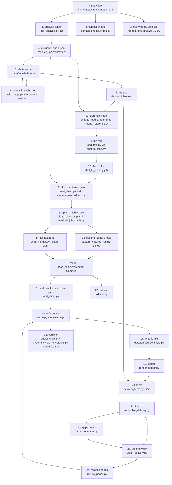

# The masked lane's data flow, from a new video to the cut

**Every stage, its tool, what it reads and writes, and the record that says it ran.** To find what made a frame of the
cut, go down the stages for that frame. This page has one job, the data flow; how a job runs and why is
[`overview.md`](overview.md), and the steps of a load are [`running_a_job.md`](running_a_job.md). It is the masked lane
only, one use of this repo ([`docs/index.md`](../index.md) routes to the rest).

Written by hand on 2026-10-16 (the lead, mrtoon). `bench/masked_v2v_pipeline.py` is planned to hold the stages in code
(`status`, `trace FRAME`, `doc`) and write this page; until it exists, where this page and the code disagree the code
is right. Paths below are `fun`'s; another video has the same layout under its own name.

## The flow

## The stages

Inputs and outputs are as the code had them on 2026-10-16.

| # | stage | tool | reads | writes | record that says it ran |
|---|---|---|---|---|---|
| 1 | analysis folder | `bench/clip_analysis.py init` | the input video | `data/fun/` (identity, the copy jobs render from) | `data/fun/manifest.json` |
| 2 | contact sheets | `bench/contact_sheets.py make VIDEO` | the input video | `contact_sheets/fun/<stem>_<first>_<last>.jpg`, a tile every 6 frames | `contact_sheets/fun/sheets.json` |
| 3 | every frame as a still | ffmpeg (a one-off; to become `bench/frames_extract.py`) | the input video | `/mnt/hub/ai/img/output/Video/fun/frames/fun_NNNNN.jpg` (6395) | `.../frames/SHA256SUMS` |
| 4 | previews, one a shot | `bench/masked_job.py` (preview stage) | the copy, the shot's frames | `data/<date>_shot_c_<first>_job/`: a SAM 3.1 track per person (`subject_track.py`; phrase, pick and threshold in `h3_config.SUBJECT_TRACK`), Sapiens parts and class maps, pose, body mesh; nothing rendered | the job folder's records |
| 5 | shots record | merged by a session | the previews' cuts | `data/fun/shots.json` (shots, who per shot) | its `written_by` |
| 6 | who is in each shot | `bench/who_page.py`, `bench/page_answers_to_cast.py`; `bench/shots_look.py add` for a look | the previews, the owner's clicks | `present` in `shots.json`, `data/fun/cast/cast.jsonl`, `seen_looks` | the answers' times |
| 7 | the plan | written by sessions on the owner's word | the owner's rulings | `data/fun/plan.json`: each person's region, parts, give-backs (`restore`), voice | `restore_by`, `pieces_by` and the like; backups `plan.before_*` |
| 8 | reference video | `bench/shot_to_load.py` (reference step), `bench/head_reference.py` | the preview's body mesh and face points | `/mnt/hub/ai/img/output/Video/fun/references/<subject>_<first>_<last>/` (head cut, face points drawn) | its `.json` beside it |
| 9 | the text | `bench/load_text.py` (via `shot_to_load.py`) | the plan's voice, the shot, the reference | the load's text (byte for byte in the job's inputs) | its sha256 in the job's note |
| 10 | the job file | `bench/shot_to_load.py job` | the plan, the shots record, the preview, the reference, the text; a session's holds and drops with reasons | `data/<date>_fun_<...>_inputs/<load>.json` (span, person, holds, drops, defaults) | "THE DEFAULTS THIS LOAD CARRIES", printed and kept |
| 11 | first: capture and gate | `bench/load_chain.py` first, `bench/capture_masked_run.py` | the job, the preview's masks | `data/<date>_<load>/`: `subjects/<person>/` (track, parts, `per_frame.csv`, `part_grades.json`), `frames.csv`, `manifest.json` (held, emptied, dropped frames), `flags.json` | `manifest.json`, `status.json` |
| 12 | plan graph and gate | `bench/load_chain.py` plan, `workflows/masked_job_graph.py` | the capture | the queued plan graph (nothing sampled), the plan strip `Video/fun/looks/<date>_<load>/` | `data/<date>_<load>_job/<load>.plan.queued.json`, `flags.json` |
| 13 | second reader's look | `bench/capture_masked_run.py looked` | the plan strip | `data/<date>_<load>/looks.json` | its time; the render refuses a look older than the capture |
| 14 | full text read | `bench/what_h3_got.py --stage plan` | the queued plan graph | (printed) | its sha256 in the job's note |
| 15 | render | `bench/load_chain.py` render; ComfyUI (`video_mask.py`, `audio_freeze_song.py`, `masked_prompt.py`) | the capture, the reference, the still, the text; the composite (`h3_config.MASKED_LOAD_COMPOSITE`, "whole region" since fb6d7a79) | `Video/fun/<session>/<load>/<load>/<load>_00001.mp4` (+ `_zoomed`, `_with_mask`, `_windows/`) | `data/<date>_<load>_job/<load>.render.queued.json` (graph, prompt id, digests of inputs), `.render.built.json` |
| 16 | land | `bench/load_chain.py` | the render, the capture | `Video/fun/review_clips/<load>_<first>_<last>_stacked.mp4`, the pose pass | the job's records |
| 17 | sidecar | `bench/sidecar.py` | the video, its job and queue records | `<video>.json` beside every video: command, commit, inputs with sha256, each window's text and graph | itself (`video_sha256`) |
| 18 | what is laid | `bench/laid.py` (`seed`, `verify`, `refs`) | the owner's keeps | `data/fun/laid.jsonl`: one line a piece, with the file's sha256 and who chose it | the file and its sha256 |
| 19 | ledger | `bench/render_ledger.py` | every render's records, the verdicts | `data/<date>_fun_delivery_tables/ledger_fun_<stamp>.json` | its `made` |
| 20 | table | `bench/delivery_table.py --laid` | the ledger, `laid.jsonl` (every sha256 checked), the shots record, the plan (give-backs) | `t_fun_0000_6394_<stamp>.txt/.json`, the reading `.md` | the table's `made` line names the list and its sha256 |
| 21 | the cut | `bench/assemble_delivery.py` (the command the table prints) | the table, the source, each piece and its capture | `Video/fun/day_<date>/fun_0000_6394_joined_<stamp>_from_laid.mp4`, `.check.json` | the check record |
| 22 | gap check | `bench/frame_coverage.py` | the table's JSON, each piece's capture | `frame_coverage_fun_0000_6394_<stamp>.json/.md`: where a tracked person shows as the original, seams, frames emptied inside a piece | its `made` |
| 23 | the one view | `bench/stack_delivery.py build` | the source, the table, the cut, the gap check | `..._VIEW.mp4` (+ 1 fps parts), `..._VIEW.stack.json` | `stack_delivery.py check`, the sidecar |
| 24 | owner's pages | `bench/review_pages.py` | the table, the ledger, the items, the verdicts | `Video/fun/TO_REVIEW.html`, `Video/fun/PROVENANCE.html` (both name the laid list's sha256) | their top line |
| 25 | the owner's answers | `data/fun/poc/serve.py`, `bench/page_answers_to_verdicts.py` | the page's clicks | `data/fun/owner_answers.jsonl` (with the clip's sha256), `data/fun/verdicts/verdicts.jsonl` | each line's time |

The lead's day scripts that run 18-24: `internal/claude/2026-10-16_mrtoon/rebuild.sh` and `pages.sh` (not tracked).

## Where a frame's content is decided, and how (for root cause)

Most faults found on 2026-10-16 were decisions made automatically, frame by frame, that no file wrote down in advance:

- **Where the person is**: the preview's SAM 3.1 track (stage 4; [`sam31.md`](sam31.md)), then the capture's part from the Sapiens class map
  (stage 11). A frame where the part model finds too little face is emptied by the capture's floor and grade (listed in
  `manifest.json`), and the original shows there (1016-1018 of the kitchen lead).
- **What H3 changes**: the region the node is given (the part, grown by the load's margin, cut to 32-px tokens), less
  keep-outs (other people's tracks), then the composite: "whole region" keeps all of H3's picture inside the region;
  "only what changed" (every load until fb6d7a79) put the source back wherever H3 changed it too little.
- **What the cut lays**: `laid.jsonl` and the table (stage 20); at assembly, each row's give-backs (`restore=`) and,
  where pieces share frames, the assembler's own per-frame change test (`assemble_delivery.changed`), still open.
- **Which frames a load covers**: the job's span. A shot made of several short loads leaves the original between them
  (the kitchen lead, 681-750, 779-804, 834-851): the recipe is now one load a person a shot
  ([`running_a_job.md`](running_a_job.md), "A shot, made whole").

The code trace of every place a pixel inside a person's region can end up as the original:
`internal/gemini/2026-10-16_holes_trace.md` (not tracked; file and line for each).
