# 2026-11-06: Holistic Review of the H3 Control-Vector Stack & the 5 System-Wide Invariants

This note records the disk-verified convergence across all five active sessions (`cvman`, `mrprompt`, `dials`, `jlens`, and the fresh-eye audit session) on the H3 control-vector stack (`0d2ad8a9` on `main` plus `cvman-holistic-workbench` and `dials-holistic-checks`).

For active usage and file indexing, see [`docs/wiki/control_vectors.md`](../../wiki/control_vectors.md). For the detailed audit and implementation blueprint, see [`2026-11-06_fresh_eye_audit_and_holistic_resolution.md`](2026-11-06_fresh_eye_audit_and_holistic_resolution.md) and [`2026-11-06_holistic_resolution_proposal.md`](2026-11-06_holistic_resolution_proposal.md).

---

## 1. Item-by-Item Verification Against Disk (`0d2ad8a9`)

| Review Claim | Converged Verdict | Verification on Disk (`file:line`) |
| :--- | :--- | :--- |
| **2.1–2.5 What's Good & Why** (`diff_span` + shared lead-in wrappers, $\beta = 0.5$ broadcast attention value path + $J_{\text{Wiener}}$, RoPE-cursor-invariant `ref_vae_end_percent`, 32-px M-RoPE media grid matching, `mode="hold"` + section masks) | **Agree (100%)** | Matches measured figures in [`bench/results/2026-11-05_control_vectors_pika_and_ref2va.md`](../../../bench/results/2026-11-05_control_vectors_pika_and_ref2va.md) (`Arms 25..66`), [`2026-11-06_j_lens_and_refiner_jacobian.md`](2026-11-06_j_lens_and_refiner_jacobian.md), [`h3_pair_compiler.py`](../../../h3_pair_compiler.py), and [`control_vector_nodes.py`](../../../control_vector_nodes.py). |
| **3.1 `fingerprint_inputs` ignores cross-family sibling resolution** (`control_vector_nodes.py:2600-2640`) | **Agree on sibling `stat`; `validate_inputs` `fl2va` is benign** | `fingerprint_inputs` (`control_vector_nodes.py:2620-2632`) now stats `preferred_family in (None, "fl2va", "ref2va")` via `resolve_vector_file_path(raw, preferred_family=pref_fam)`, matching `attach_control_vector` (`control_vector_nodes.py:1654`). (`validate_inputs` passing `family="fl2va"` at `L2670` is benign because `fl2va` and `ref2va` share the identical `27,407`-token `vocab_union_indices` in `j_lens_h3.safetensors`.) |
| **3.2 & 4.1 Shipped workflow conditioning nodes & `@prompt_subject` fallback warning** (`workflows/build_workflows.py:1501-1635`, `control_vector_nodes.py:1272-1279`) | **Shipped workflows already wire `MiniMaxH3Conditioning` / `MiniMaxH3ReferenceConditioning`; add warning for manual core graphs** | `workflows/build_workflows.py:1501-1635` wires `MiniMaxH3Conditioning` (`t2va`) and `MiniMaxH3ReferenceConditioning` (`ref2va`) at node `"5"` on every shipped workflow, both of which call `attach_span_masks` (`conditioning.py:159`, `reference_conditioning.py:1248`). A downstream preflight node cannot reconstruct `_h3_span_masks` from core `CLIPTextEncode` because `cond` carries only `[1, L, 5120]` floats and binary `0/1` `minimax_token_tags`. Fix landed at `control_vector_nodes.py:1272-1279`: logs a one-time `logger.warning` if `deferred_against_prompt` is active and `_h3_span_masks` is missing. |
| **3.3 Setting both `vector_name != "none"` and non-empty `words` on the same node stacks both vectors** (`control_vector_nodes.py:1645-1652`) | **Agree** | Because `vector_name` defaults to `"film_16mm_1974__fl2va__diff_span.safetensors"` in the shipped workflow, typing into `words` without resetting `vector_name` to `"none"` appends two `_AppliedVectorSpec` entries with the same `strength`, `mode`, `mask`, and `hold_words`. Fix landed at `control_vector_nodes.py:1645-1652`: logs a clear warning when both `vector_name` and `words` are active on a single node, leaving multi-node chaining as the explicit way to stack a file vector with a word vector. |
| **3.4 Four conflicting norm & $\alpha$-bound semantics for hold projection** (`control_vector_nodes.py:884, 1694`, `control_vectors.py:1169, 2122`, `j_lens.py:686`) | **Strongly Agree** | Projecting out a nuisance subspace $v_\perp = (I - \alpha H H^\top) v$ reduces the Euclidean norm to $\lVert v_\perp\rVert_2 = \lVert v\rVert_2 \sin\theta$. Removed `vec_held * (orig_nrm / res_nrm)` at `control_vector_nodes.py:1694` and in `_apply_post_refiner_holds` (`bench/control_vector/helpers.py:114-142`), standardized $\alpha \in [0.0, 2.0]$ in `control_vectors.py::project_out` (`L1169`) and `_apply_holds_to_shift64` (`L2122-2127`), and updated `bench/check_control_vectors.py:1935-1945`. Magnitude restoration belongs exclusively to `mode="add_norm_matched"` (`NORM_MATCHED_TARGET = 67.5`). |
| **3.5 `vector.encoder` ignores `[[hold]]` and `--unit-mean` during `make` / `build`** (`control_vector_nodes.py:865-950`, `bench/control_vector/build_cmd.py:160-185`, `bench/control_vector/ui_state.py:210-235`) | **Strongly Agree** | `enc_raw_vec` now passes `unit_mean=use_unit_mean` and projects out the encoder-space `[[hold]]` basis (`cv.hold_basis` + `cv.project_out`) identically to `vector.post_refiner` across `make_control_vector_from_pairs`, `cmd_make`, `cmd_build`, and `_repool_cached_build` so `j_lens` refiner-transmission (`||J_ref @ v_enc||_2`) and forward-cosine metrics compare twin held spaces. |
| **3.6 AV stream split (`video_scale`, `audio_scale`) implementation vs. doc formula** (`control_vector_nodes.py:1321-1445` vs. `docs/wiki/control_vectors.md:110`) | **Keep per-stream conditioning (`ctx_video`, `ctx_audio`) + `[out_vid[0], out_aud[1]]` splice; clamp `hold` $\alpha \in [0, 2]$; update doc** | Per-stream conditioning + splicing evaluates multi-vector chains (e.g., visual vector `(1.0, 0.0)` + audio vector `(0.0, 1.0)` + audio hold `(0.0, 1.0)`) on the DiT's nonlinear conditioning manifold in at most 2 DiT passes total, which a single `(out_base, out_steered)` velocity blend cannot do. `_spec_stream_scale` stays active across all 5 `APPLY_MODES`, `_effective_spec_strength` (`control_vector_nodes.py:1328-1332`) clamps `s_val` to `[0.0, 2.0]` when `_effective_entry_mode(sp) == "hold"`, and `docs/wiki/control_vectors.md:110` is aligned with the code. |
| **3.7 `save_synthesized_vector` / `save_composed_recipe_vector` Pika LoRA recipe vs. base 30-step H3 UNet** (`j_lens.py:127-164, 1882, 2005`, `control_vectors.py:2036-2049`) | **Agree — Scope relaxation to `provenance.made_by.startswith("j_lens.")`** | Scoping the Pika-vs-base (`loras=[]`) compatibility warning relaxation in `check_vector_compatibility` (`control_vectors.py:2036-2049`) to `provenance.made_by.startswith("j_lens.")` lets CPU-synthesized/composed Jacobian vectors run on base UNets while preserving all `C5` `.safetensors` LoRA refusal assertions in `bench/check_control_vectors.py:1644-1748`. |
| **3.8, 3.9, 3.10 Stale doc links, `_DIFF_MASK_CACHE` eviction, and `cvman` `target_prompt` seam** | **Agree** | Updated `docs/wiki/control_vectors.md` line links; added pair-keyed caching + `else:` eviction when a pair is single-span at `h3_spans.py:708-724` and forwarded `other_ids` at `pooling_mask` call sites; and delegated `target_prompt` in `bench/control_vectors.py` directly to `h3_pair_compiler.py` (`93dbe8d3`). |
| **4.2 Intra-word cloze admissibility weighting & stemmer fix in `j_lens.py`** (`j_lens.py:1615-1717`) | **Agree — Preserve `1/N` across words and fix `"operatic" -> "opera"` stemmer** | `_mean_word_direction` (`j_lens.py:1697-1717`) preserves `F.normalize` (`1/N`) across `word_vecs` so modifiers (`"grain"` `-5.03`) do not outweigh nouns (`"blizzard"` `-16.45`), while `_resolve_word_indices` (`j_lens.py:1653-1661`) checks exact root candidates (`stem`, `stem[:-1]`, `stem + "e"`) in `word_to_idxs` before `vw.startswith(stem)` so `"operatic"` resolves to `"opera"` instead of `["operation", "operator", ...]`. |
| **4.3 Step-0 receptor scan logging in `MiniMaxH3ApplyControlVectors`** (`control_vector_nodes.py:1281-1305`) | **Already shipped (`ceb1913c`)** | `control_vector_nodes.py:1281-1305` runs `_j_lens.analyze_prompt_coupling` at Step 0 and logs `[h3] control vector %s prompt coupling: %s`. |
| **4.4 Within-clip temporal envelopes (`1, 4, 4, 4, 4` latent clock) in the 2-pass DiT wrapper** | **Agree (High-Leverage Next Step)** | Multiplying along $T_{\text{lat}}$ (and $T_{\text{aud}}$ at 40 Hz) by a temporal ramp $M(t) \in [0, 1]$ aligned to `FRAME_PER_TOKEN = (1, 4, 4, 4, 4)` lets post-dialogue action vectors ramp in after `<d>...</d>` dialogue finishes. |

---

## 2. Holistic Architecture & the 5 System-Wide Invariants

Viewed as a single system, the H3 control-vector stack has **four planes** governed by **five invariants**:

```mermaid
flowchart LR
    subgraph P1["1. Authoring & Compilation Plane"]
        W["Words / Short Spec\n(j_lens or h3_pair_compiler)"]
        T["Full Pair Bank (.toml)\n+ Optional target_prompt (Pair 0)"]
        M["Media Pair (Image/Video A->B)\n(32-px M-RoPE matched)"]
    end

    subgraph P2["2. Representation & Subspace Plane"]
        E["Stage-1 Encoder Diff (v_enc)\n+ Stage-2 Post-Refiner Diff (v_pr)\n(diff_span + differing_token_mask)"]
        H["Subspace Hold Projection\nv_perp = (I - alpha * H * H^T) v, alpha in [0, 2]\n(Applied identically to v_enc & v_pr,\nNO secret re-normalization)"]
    end

    subgraph P3["3. Diagnostic & Readiness Plane (J-Lens)"]
        D1["Basis-Consistent Readout\n• Unigram dict -> M_union cosine\n• Nonlinear/Pair -> Wiener J_63 + Cloze"]
        D2["Target-Scene Receptor Heatmap\ncos(v_pr, J_ref @ e_tok) across prompt"]
    end

    subgraph P4["4. Runtime Conditioning & DiT Plane"]
        R1["Scale Mode Resolution\n• add: raw ||v_perp|| * s\n• add_norm_matched: 67.5 * s"]
        R2["Token Masking (_h3_span_masks)\nnon_vision | scene_only |\ndescription_only | soundscape_only"]
        R3["DiT Step / Stream / Ref Gating\nstart..end% | ctx_video & ctx_audio splice |\nref_vae_end_percent (RoPE-invariant)"]
    end

    P1 --> P2 --> P3 --> P4
```

### The 5 Invariants

1. **Invariant 1 — Twin-Space Symmetry (`vector.encoder` and `vector.post_refiner` undergo identical operations)**:
   - Every operation performed at build or composition time (`unit_mean`, `project_out_holds`, `apply_soft_holds`, linear recipe combination) is applied identically to **both** `vector.encoder` (`5120`-d) and `vector.post_refiner` (`5376`-d).
   - *Guarantees*: `vector.encoder` and `vector.post_refiner` always represent the exact same held contrast, keeping `j_lens` refiner-transmission (`||J_ref @ v_enc||_2`) and `refiner_forward_cosine` exact on held banks.

2. **Invariant 2 — Orthogonal Hold Projection ($\alpha \in [0.0, 2.0]$) Never Secretly Re-Normalizes; `scale_mode` Owns Magnitude**:
   - Across all four hold entry points (`.toml` `[[hold]]`, `j_lens.apply_soft_holds`, `MiniMaxH3ApplyControlVectors` `hold_words`, and chained `mode="hold"`), projecting out a hold basis $H$ removes only the parallel subspace component $v_\perp = (I - \alpha H H^\top) v$ ($\alpha \in [0.0, 2.0]$) without rescaling $\lVert v_\perp\rVert_2$ back to $\lVert v\rVert_2$.
   - Magnitude standardization is owned exclusively by `mode="add_norm_matched"` (`NORM_MATCHED_TARGET = 67.5`).
   - *Guarantees*: `inspect --hold-words`, `j_lens.py`, `.toml` `[[hold]]`, and `MiniMaxH3ApplyControlVectors` agree bit-for-bit on post-hold norms and directions.

3. **Invariant 3 — One Compiler Owner (`h3_pair_compiler.py`) & Collision-Free Multi-Span Diff Masks (`h3_spans.py`)**:
   - All short-contrast compilation, `{props}`/`{surface}` binding, coupled `description + overall_soundscape` pairing, `hold:` / `hold(group):` compilation, and `target_prompt` `Pair 0` (`weight = 2.5`) injection route through `h3_pair_compiler.py` (`93dbe8d3`), while `h3_spans.py` evicts single-span cache entries and forwards `other_ids` at `pooling_mask` call sites.
   - *Guarantees*: Zero divergence between CLI/Python compilation and UI preview/build, and zero multi-span mask cache collisions.

4. **Invariant 4 — Basis-Aware J-Lens Readout, Intra-Word Cloze Weighting, & Stemmer Accuracy (`j_lens.py`)**:
   - Unigram dictionary vectors (`synthesize_from_words`) are graded in their native $M_{\text{union}}$ basis (`unigram_dictionary`) while nonlinear `TokenRefiner` vectors are graded via $\bar{J}_{49\to 63} J_{\text{Wiener}}$ + 7 cloze baselines (`post_refiner`) (`0d2ad8a9`); `_resolve_word_indices` (`L1658-1666`) checks exact stem/vowel-restored roots (`stem[:-1]` and `stem + "e"`, mapping `"operatic" -> "opera"`) before prefix expansion; and `_mean_word_direction` (`L1697-1725`) weights intra-word BPE variants `w_ids` by `piece_weights` (`torch.sigmoid((torch.log_softmax(cloze_base, dim=-1)[:, valid_pos].max(dim=0).values + 11.5) / 2.0)`) while preserving `1/N` unit-norm balance across distinct words.
   - *Guarantees*: No cross-basis grading artifacts, no BPE suffix dilution, no modifier-over-noun prior skew, and no prefix-expansion stemmer false matches.

5. **Invariant 5 — Per-Stream Conditioning + Splicing, Clamped Stream Holds, & `j_lens.*` Recipe Compatibility**:
   - `_make_control_vector_wrapper` evaluates `ctx_video` and `ctx_audio` across all 5 `APPLY_MODES` and splices `[out_vid[0], out_aud[1]]` while clamping stream-scaled `mode="hold"` weights to `[0.0, 2.0]`; `fingerprint_inputs` stats all family siblings `(None, "fl2va", "ref2va")`; warnings fire when `vector_name` and `words` are both set on one node or when `@prompt_subject` lacks `_h3_span_masks`; and `check_vector_compatibility` relaxes Pika-vs-base LoRA differences to a warning specifically for `provenance.made_by.startswith("j_lens.")` so `C5` `.safetensors` refusals stay intact.
