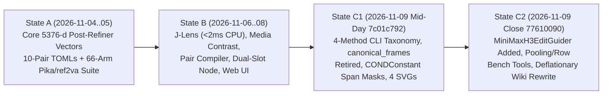

# 2026-11-10: Control Vectors & Edit Guidance — State History, Over-Correction Audit, Half-Baked Surface & Recommendations

**Scope:** Disk-verified audit of the H3 control-vector and edit-guidance stack across `2026-11-04`..`2026-11-10` (`HEAD` at `a3996113`), comparing our current state against prior milestones (`2026-11-05` verification suite, `2026-11-06` holistic expansion, `2026-11-09` mid-day `7c01c792`, and `2026-11-09` closing `77610090`).

This document answers six questions from code, commit diffs, and benchmark records on disk:

1. **How did we get to the current state (`2026-11-04` $\to$ `2026-11-10`), and why did we pivot yesterday (`2026-11-09`)?**
2. **Why did control vectors feel like they lost some of their "magic" yesterday, and why is `MiniMaxH3EditGuider` ("guide edit") sampling so slow?**
3. **What did we build yesterday that is definitely worth keeping?**
4. **What did we remove yesterday that was definitely worth removing?**
5. **What did we undo or demote yesterday that was worth keeping (where we over-corrected)?**
6. **What is half-baked in the codebase right now, what research directions (`2026-11-04`..`2026-11-09`) were partially or never implemented (and why), and what are our concrete recommendations?**

---

## 1. Executive Summary: Did We Over-Correct Yesterday?

**Yes—in three specific places, while simultaneously landing several genuine fixes and a promising but unoptimized new direction (`edit_guidance.py`).**

### Why the `2026-11-09` Pivot Happened (`docs/research/control_vectors/2026-11-09_control_vector_simplification_plan.md`)
Yesterday's session started from a real observation: the control-vector subsystem had grown to ~12,900 lines across 20 files, 13 CLI subcommands, and 4 creation methods, and some convenience wrappers (`canonical_frames.json` Mad-Libs slot splicing, silent `Pair 0` target-prompt splicing on `.toml` files, and hardcoded speaking-person prompts in `make-media`) were hiding what the math was actually doing.

When the session ran paired head-to-head visual/audio gates (`§23` and `§25` of `docs/research/control_vectors/2026-11-09_control_vector_simplification_plan.md`), it discovered a fundamental mechanism gap:
- Adding a pooled constant 1D vector $\mathbf{v}_{\text{PR}} \in \mathbb{R}^{5376}$ across refined text tokens (`MiniMaxH3ApplyControlVectors`) works well for **continuous global mood, camera energy, and colour/lighting grades** (`film_16mm_1974`, `noir_monochrome`, `handheld_urgency`).
- However, a pooled 1D offset added to existing tokens **cannot reliably replace a discrete noun/material or stop a scripted action** when the baseline words (`"A dark matte-black ceramic mug"`, `"checks her watch"`) remain intact in the prompt token stream (`§23.2` `mug1`..`mug5`: even at $3\times$ strength `s = 8.43`, the mug stayed matte-black ceramic; `§25.1` `diner1`: `slow_deliberate` could not stop the scripted watch-check).
- By contrast, **changing the words in the prompt** and steering the DiT velocity field with **2-pass Prompt-Edit Guidance** (`MiniMaxH3PromptEdit` + `MiniMaxH3EditGuider` in `edit_guidance.py`, landed in `eea0b84b`) cleanly produced the bright yellow glazed ceramic mug (`mug_edit_w2` / `mug_edit_w3`) and stopped the watch-check (`diner_edit_w2p5`).

### Where Yesterday Over-Corrected (and Why the "Magic" Felt Lost)
In reacting to those findings, yesterday's changes went too far in four ways:
1. **`scene_only` mask narrowing (`856d4ac8`) + eliminating the silent `non_vision` fallback (`3f35901e`) cut total steer energy by $35\%\text{–}55\%$ on structured prompts**:
   - In the `2026-11-05`/`06` verification campaign (`bench/results/2026-11-05_control_vectors_pika_and_ref2va.md`), **64 of 66 arms** were rendered with **`mask = "non_vision"`** (steering 100% of `tag == 1` text tokens, including `style:`, `summary:`, `subject_definitions:`, and `[Shot 1]`).
   - Prior to yesterday's `3f35901e`, `h3_spans.py:522-528` only attached `_h3_span_masks` via `setattr(tags_raw, "_h3_span_masks", span_masks)`, and `MiniMaxH3Conditioning` did **not** copy `h3_span_masks` into `CONDConstant`. Whenever `_h3_span_masks` did not survive onto `text_tag_mask` at sampling time, `control_vector_nodes.py::_resolve_custom_inference_mask` (`L1170-1173`) returned `None` for `scene_only`—**silently falling back to `non_vision` (all text tokens)**!
   - Yesterday (`3f35901e` + `856d4ac8`), `h3_span_masks` was properly wired as a `CONDConstant` **and** `scene_only` was narrowed (`h3_spans.py:499-513`) to exclude section headers, `[Shot N]` markers, `<Subject N>` / `<Picture N>` refs, `subject_definitions:`, `summary:`, `retention_analysis:`, and `non_diegetic_music:`. Because `apply_post_refiner` adds $\mathbf{v}_{\text{PR}}$ to each unmasked row, zeroing out $35\%\text{–}55\%$ of the text rows on a `ref2va` prompt cuts the total steer energy entering the 50 DiT cross-attention blocks roughly in half at the same `strength`.
2. **Deleting `canonical_frames.json` (`ed5f53fa`) replaced 10-scene context-averaged `--words` compilation with 1-pair (`N = 1`) single-prompt diffs**:
   - Previously (`690c6969`, `93dbe8d3`), `--words` compiled a contrast across 10 diverse H3 scene pairs so scene-specific nouns and bidirectional `TokenRefiner` self-attention bleed cancelled out (`split_half_cosine = 0.90–0.98`).
   - After `ed5f53fa`, `from-prompt` (`h3_pair_compiler.py:415-527`) builds a single 1-pair (`N = 1`) diff on `target_prompt`. An $N = 1$ pair has zero cross-scene context cancellation, requires `pole_a` to be an exact single-occurrence substring of `target_prompt`, and absorbs 100% of the length/elaboration shift when `pole_b` is longer than `pole_a` (`2026-11-09` plan `§25`).
3. **`film_16mm_1974.toml`'s `[[hold]]` groups scrubbed the warmth the user asked for in `diner16` (`2026-11-09` plan `§25.1`)**:
   - The earlier gate render (`05_film16mm_s2p71_double`) was built with `apply_holds=False` (`--no-holds`), whereas at `a3996113` the shipped `film_16mm_1974` bank vector applied two `[[hold]]` groups (`soft_focus` and `warm_colour_cast`, now preserved in `prompt_bank/control_vectors/film_16mm_1974_neutral.toml:142-254` while `prompt_bank/control_vectors/film_16mm_1974.toml:142-215` retains only `soft_focus`) that projected warmth *out* of the vector (`norm 76.26 -> 49.97`). When tested against an edit prompt that explicitly asked for *"faded warm colour"*, the hold-scrubbed control vector looked cooler and weaker.
4. **The closing wiki rewrite (`77610090`) erased the `2026-11-05`/`06` verified `Arms 01..66` record and unlinked all 4 animated SVG diagrams**:
   - Because the `77610090` session only counted what *that single session* ran on `2026-11-09`, it rewrote `docs/wiki/control_vectors/*.md` to label J-Lens `< 2 ms` CPU word synthesis (`words` / `from-words`) and `grade` alongside `hold_words`, `sculpt`, and `make-media` as *"Not run by a session / No session has rendered with such a vector on record here"* (`docs/wiki/control_vectors/examples_and_recipes.md:67-70`, `docs/wiki/control_vectors/j_lens_diagnostics_and_word_lab.md:18-24`), ignoring the verified `Arms 53, 54, 61..65` J-Lens `words` renders, `Arm 58` vector-on-vector `mode="hold"` render, and `grade --pika` runs in `bench/results/2026-11-05_control_vectors_pika_and_ref2va.md` (while `hold_words`, `sculpt`, and `make-media` are covered in `bench/check_control_vectors.py`), and unlinked all 4 SVG visual explainers in `docs/wiki/control_vectors/assets/`.

---

## 2. State Evolution Timeline (`2026-11-04` $\to$ `2026-11-10`)



| Dimension | State A (`2026-11-04`..`05`) | State B (`2026-11-06`..`08`) | State C1 (`2026-11-09` mid-day `7c01c792`) | State C2 / Current (`2026-11-10` `a3996113`) |
|---|---|---|---|---|
| **Primary Steering Mechanism** | 1-pass additive post-refiner vector (`vector.post_refiner`, `5376`-d) via `refiner_tweak` | Same + dual-slot `MiniMaxH3ApplyControlVectors` + runtime `hold_vector` + `video_scale`/`audio_scale` + inline J-Lens `words` | Same + `CONDConstant` `h3_span_masks` so `scene_only` / `description_only` / `soundscape_only` always activate | **Two separate mechanisms**: (1) 1-pass `MiniMaxH3ApplyControlVectors` (`control_vector_nodes.py`) and (2) 2-pass velocity `MiniMaxH3EditGuider` (`edit_guidance.py`) |
| **Default Inference Mask** | **`non_vision`** in **63 of 66** benchmark arms (`bench/results/2026-11-05_control_vectors_pika_and_ref2va.md`) | Widget default changed to `scene_only` (`93dbe8d3`), **but** missing `CONDConstant` caused silent fallback to `non_vision` at runtime | `CONDConstant` wired (`3f35901e`) + `scene_only` narrowed (`856d4ac8`) to exclude headers, `[Shot N]`, `<Subject N>`, `summary:`, `subject_definitions:` | Narrowed `scene_only` enforced on all shipped control-vector workflows |
| **Quick Clause Compilation (`--words`)** | Hand-authored 10-pair `.toml` files only (`prompt_bank/control_vectors/*.toml`) | `h3_pair_compiler.py` (`690c6969`, `93dbe8d3`) expanded clauses across 10 scenes (`canonical_frames.json`) + optional `Pair 0` target splice | `ed5f53fa` deleted `canonical_frames.json` (`1,106` lines) and replaced with in-place `N = 1` (or `---`-separated) `--target-prompt` substitution | In-place `from-prompt` (`N = 1` unless user supplies multiple `---` scenes) |
| **J-Lens (`j_lens.py`, `models/j_lens/j_lens_h3.safetensors`)** | Not yet built | Built (`2026-11-06`): `< 15 ms` 7-prefix cloze readout + `< 2 ms` CPU word synthesis (`Arms 53, 54, 61..65` verified on GPU) | `build-j-lens` added (`bench/control_vector/j_lens_builder.py`); full wiki guide + SVG diagram | Code still active, but wiki (`77610090`) demoted `words`/`from-words` as *"No session has rendered with such a vector on record here"* |
| **Shipped Workflows** | Control-vector Pika `t2v` and `ref2va` workflows (`length = 362` in `workflows/`, `121`–`141` in `bench/`) | Added dual-CV `t2v` and `P-H3-Image` `t2i`/`edit` CV workflows (`4B` encoder bug on image graphs) | Fixed `P-H3-Image` to use `32B` encoder (`b1570192`) and unwrapped tokenizer (`229dfae3`) | Added 4 `edit_guidance` workflows (`eea0b84b`); all 6 shipped video Pika CV and `edit_guidance` workflows default to **`length = 362` (`15.08s`)** (`MAX_LENGTH` in `h3_rules.py:23-64`) whereas `bench/edit_guidance_arms.py:218` defaults to `141` (`5.88s`) |

---

## 3. Root-Cause Diagnosis: The Two User Pain Points

### 3.1 Why `MiniMaxH3EditGuider` ("Guide Edit") Sampling Is Very Slow

When running the new edit-guidance workflows (`workflows/h3_text_to_video_pika_edit_guidance_api.json` and `workflows/h3_image_ref_plus_text_to_video_pika_edit_guidance_api.json`), sampling takes dramatically longer than the control-vector workflows for **three compounding reasons** verified in the code and workflow JSONs:

1. **Every denoising step runs 2 sequential 50-block DiT forward passes (`12` passes instead of `6` on Pika, `60` instead of `30` on stock H3)**:
   - In `edit_guidance.py:145-155`, `EditGuider.predict_noise` calls:
     ```python
     out = comfy.samplers.calc_cond_batch(
         self.inner_model, [original, edited], x, timestep, model_options
     )
     ```
   - Why doesn't `calc_cond_batch` batch `original` and `edited` into a single `B = 2` GPU kernel launch? First, `EditGuider._prepare` (`edit_guidance.py:120-125`) attaches `payload["h3_edit_pass"] = pass_name` (`"original"` vs. `"edited"`) inside `minimax_payload` (which is wrapped as a `CONDConstant`), so `CONDConstant.can_concat` compares the two payloads (`"original" != "edited"`) and forces ComfyUI to split them into two separate forward passes. Second, even without `h3_edit_pass`, `original` and `edited` almost always have different token lengths $L_{\text{orig}} \neq L_{\text{edit}}$, and at `1344x768` video sequence lengths (`36,288` to `95,000` tokens) a `B = 2` batch would exceed 24 GB VRAM or gain zero throughput because the GPU is already compute-saturated at `B = 1`.
   - Furthermore, `MiniMaxH3EditGuider.define_schema` (`edit_guidance.py:194-218`) only exposes `first_step` (default `0`, running on all steps `0..5`) and **has no `last_step` / early-cutoff parameter**. On Pika's 7-knot consistency schedule (`PIKA_MANUAL_SIGMAS = "1.0, 0.972973, 0.923077, 0.8, 0.571429, 0.333333, 0.0"` in `workflows/h3_config.py:1599`), once layout or object replacement is established during steps `0..2` (`sigma = 1.0 -> 0.8`), `EditGuider` continues paying for the second 50-block DiT pass on steps `3, 4, 5` (instead of dropping to a 1-pass `[edited]` forward pass with `scale = 1.0`).
2. **All 6 shipped Pika/guide video workflows run at `length = 362` frames (`15.08s`, $\sim 95,000$ video tokens), where the `2x` per-step pass multiplier hurts most (whereas all benchmark arms ran at `length = 121`–`141` frames, `5.04s–5.88s`)**:
   - In `workflows/h3_text_to_video_pika_edit_guidance_api.json:127-133` (`MiniMaxH3Resolution` node `"27"`), `workflows/h3_image_ref_plus_text_to_video_pika_edit_guidance_api.json` (node `"29"`), and the shipped `pika_control_vector` workflows, the shipped workflow length is `362` frames (`15.08s` at 24 fps, `MAX_LENGTH = 362` in `h3_rules.py:23-64`), whereas all test renders in `bench/edit_guidance_arms.py:218` (`--length 141`) and `bench/results/2026-11-05_control_vectors_pika_and_ref2va.md` (`121`–`141` frames) ran at `5.04s–5.88s`.
   - Because H3's 6 dense full-attention blocks (`38, 39, 40, 41, 42, 49`) and Sol block-sparse attention scale super-linearly/quadratically with sequence length ($362$ frames $= 91$ latent temporal frames vs. $141$ frames $= 36$ latent temporal frames), a single DiT pass at `362` frames is **$3.5\times\text{–}4.5\times$ slower** than at `141` frames. When `MiniMaxH3EditGuider` doubles every step from 1 pass to **2 sequential passes across all 6 steps**, a `362`-frame interactive UI run takes **$7\times\text{–}10\times$ longer** than the `141`-frame single-pass control-vector benchmark renders (`54–86 seconds`).
3. **Double 32B Qwen3-VL text encoding on `t2va`**:
   - In `workflows/h3_text_to_video_pika_edit_guidance_api.json`, nodes `"5"` and `"131"` are two separate `MiniMaxH3Conditioning` instances, running the 32B text encoder twice before sampling starts (whereas control-vector inference encodes the prompt once and adds a cached 1D tensor in `< 0.1 ms` during `TokenRefiner`).

### 3.2 Why Control Vectors Felt Like They Lost Their "Magic" Yesterday

Four concrete changes yesterday combined to make control vectors feel noticeably weaker or less capable than they did in State B (`2026-11-06`..`08`):

1. **Silent `non_vision` fallback was fixed (`3f35901e`) at the exact same time `scene_only` was narrowed (`856d4ac8`)**:
   - In `control_vector_nodes.py:926`, `apply_post_refiner` applies:
     $$\mathbf{r}'_t = \mathbf{r}_t + s_{\text{eff}} \, m_t \, \mathbf{v}_{\text{PR}}$$
     where $m_t \in \{0, 1\}$ is the token mask. In the 50 DiT blocks, video and audio latents attend over the entire refined text sequence $\mathbf{r}'_{0..L-1}$. The total steering shift in cross-attention value output is proportional to the attention mass landing on steered rows $\sum_{t} A_{q,t} m_t \mathbf{v}_{\text{PR}}$.
   - In `bench/results/2026-11-05_control_vectors_pika_and_ref2va.md`, **63 of 66 verified arms** used `mask = "non_vision"` ($m_t = 1$ on every `tag == 1` text token).
   - Even after `93dbe8d3` (`2026-11-08`) changed the node widget default from `"non_vision"` to `"scene_only"`, `MiniMaxH3Conditioning` (`h3_spans.py`) only attached `_h3_span_masks` as a Python attribute on `tags_raw` (`setattr(tags_raw, "_h3_span_masks", span_masks)` at `h3_spans.py:528`), which was stripped whenever ComfyUI cloned or moved `text_tag_mask` inside `CONDConstant`. When `_h3_span_masks` was absent, `control_vector_nodes.py:1170-1173` returned `None`, causing `apply_post_refiner` (`L946-947`) to **fall back to `non_vision` (`text_tag_mask == 1`)**!
   - Yesterday's `3f35901e` fixed `h3_spans.py:604-607` to pass `mc["h3_span_masks"] = comfy.conds.CONDConstant(span_masks)`, and `856d4ac8` narrowed `scene_only` (`h3_spans.py:499-513`) to `_h3_description_mask | _h3_soundscape_mask` minus headers, `[Shot N]` markers, and `<Subject N>` / `<Picture N>` tokens.
   - **Impact**: On a standard `ref2va` prompt (`subject_definitions:` + `summary:` + `detailed_description:` + `overall_soundscape:` + `retention_analysis:`), `scene_only` now zeroes out $35\%\text{–}55\%$ of the text tokens that previously carried $\mathbf{v}_{\text{PR}}$! Because video query tokens attend heavily to `summary:`, `subject_definitions:`, `[Shot 1]`, and `<Subject 1>` anchor tokens, leaving those rows unsteered anchors the DiT to the unsteered baseline look and cuts effective steering strength at `strength = 1.0`.
2. **Retiring `canonical_frames.json` (`ed5f53fa`) reduced `--words` from a 10-scene context-averaged expectation (`N = 10`) to a single-pair diff (`N = 1`)**:
   - In `TokenRefiner` (2 bidirectional self-attention blocks), every token in the differing span `[first_diff:end_diff]` attends to all surrounding words in the scene (`diner booth`, `formica table`, `rain outside`).
   - When averaging across $N = 10$ diverse scenes (`prompt_bank/control_vectors/*.toml` or the former 10-scene compiler), scene-specific bidirectional self-attention cross-terms cancel as $O(1/\sqrt{N})$, isolating the invariant concept direction (`split_half_cosine = 0.90–0.98`).
   - With `N = 1` in-place compilation (`from-prompt` after `ed5f53fa`), there is no cross-scene cancellation (`mean_pairwise_cosine = None`, `split_half_cosine = None`), and any token-length difference between `pole_a` and `pole_b` shifts the M-RoPE positions of all subsequent tokens in that single prompt (`2026-11-09` plan `§25`).
3. **Hold projection in `film_16mm_1974` at `a3996113` vs. un-held `05_film16mm_s2p71_double` (`2026-11-09` plan `§25.1`)**:
   - At `a3996113`, `film_16mm_1974.toml` included two `[[hold]]` groups (`soft_focus` and `warm_colour_cast`, now split into `prompt_bank/control_vectors/film_16mm_1974_neutral.toml:142-254`) designed to isolate photochemical grain/halation from a generic warm colour cast. Projecting out those two holds reduced `raw_norm` from `76.26` to `49.97` and removed the warm amber shift. When `diner16` compared the held `film_16mm_1974` vector against an edit prompt that explicitly added *"faded warm colour"*, the held vector looked less dramatic because its warmth component had been intentionally projected out!
4. **The closing wiki rewrite (`77610090`) hid proven capabilities and recipes**:
   - Reading the wiki after `77610090` gives the impression that only `.toml` bank builds and 1-pair `from-prompt` exist and work, while J-Lens `< 2 ms` word vectors, negative steering (`strength < 0`), step-window pose locking (`start_percent` / `end_percent`), `soundscape_only`, and cross-vector holds were either deleted from `examples_and_recipes.md` or labeled *"untested"* despite having full GPU verification records in `bench/results/2026-11-05_control_vectors_pika_and_ref2va.md`.

---

## 4. Categorized Audit of Yesterday's Changes (`2026-11-09`)

### 4.1 Definitely Worth Keeping (High-Value Additions & Bug Fixes)

| Change / Commit | Exact Code Location | Why It Is Worth Keeping |
|---|---|---|
| **1. 2-Pass Velocity Prompt-Edit Guidance (`MiniMaxH3PromptEdit` + `MiniMaxH3EditGuider`)** | `edit_guidance.py:95-228`, `h3_prompt_edit.py:1-114` (`eea0b84b`) | Solves the exact task where 1D additive control vectors fail: discrete noun/material replacement (`mug_edit_w2`: black mug $\to$ bright yellow glazed mug) and scripted action edits (`diner_edit_w2p5`: stops the watch-check) by computing $\mathbf{v}_{\text{orig}} + w(\mathbf{v}_{\text{edit}} - \mathbf{v}_{\text{orig}})$ in DiT velocity space (`edit_guidance.py:145-155`). |
| **2. `CONDConstant` Transport for `h3_span_masks`** | `h3_spans.py:604-607`, `control_vector_nodes.py:725-734` (`3f35901e`) | Previously, `_h3_span_masks` was attached via `setattr` on `tags_raw` and frequently lost before `refiner_tweak` ran. Passing `mc["h3_span_masks"] = comfy.conds.CONDConstant(span_masks)` guarantees `description_only`, `soundscape_only`, and `scene_only` masks are actually present at runtime. |
| **3. Tokenizer Unwrapping for Both 32B and 4B Encoders** | `h3_spans.py:446-470`, `control_vector_nodes.py:522-537` (`229dfae3`) | `unwrap_hf_tokenizer` walks wrapper layers consistently across both the 32B (`qwen3vl_32b_minimax_h3_int8_convrot.safetensors`) and 4B encoders so span masks never silently skip when `clip.tokenizer` is wrapped. |
| **4. 32B Default Encoder on All Shipped `P-H3-Image` Workflows** | `workflows/build_workflows.py:1203-1228`, `workflows/image/h3_p_h3_image_*_api.json` (`b1570192`) | `P-H3-Image` shares `condition_proj` (`5120 -> 5376`) and `TokenRefiner` with `fl2va` (`32B`). Previously, the shipped image control-vector graphs loaded the `4B` (`2560`-d) encoder, which crashed with a `2560 != 5120` matmul shape error as soon as a `5376`-d `fl2va` control vector was attached. |
| **5. Fixed `--ref-images` CLI Helper (`_load_encoded_references`)** | `bench/control_vector/helpers.py:125-186` (`c3e33292`) | Previously called a stale `MiniMaxH3AppendRefImage` signature and loaded the 3D Video VAE alongside the 32B encoder (causing 24 GB CUDA OOMs). Now passes `size_policy="max"`, `qwen_view={"qwen_view": "separate", "qwen_short_edge": 576}`, and `use_vae=False` by default (`bench/control_vector/helpers.py:133, 172-175`). |
| **6. Dual-Mode `strength_ranges` (`single_direction` vs. `double_with_opposite`)** | `control_vectors.py:553-577` (`cd3286da`) | Replaces the misleading single `[1.4, 2.8]` number with explicit `single_direction` (`0.08 * median_row_norm / raw_norm` $\approx 1.35$ on `film_16mm_1974`) and `double_with_opposite` (`0.16 * median_row_norm / raw_norm` $\approx 2.71$, matching the gate render `05_film16mm_s2p71_double`). |
| **7. Offline Pooling / Row-Cache / Lexicon / Arm Builders** | `bench/control_vector_rows.py`, `bench/control_vector_pooling.py`, `bench/control_vector_lexicon.py`, `bench/control_vector_arms.py`, `bench/edit_guidance_arms.py` (`cd3286da`, `842a4108`) | Lets sessions encode `.toml` pair rows once (`bench/control_vector_rows.py`), sweep pooling/holds/norms offline in milliseconds (`bench/control_vector_pooling.py`), check BPE single-token lexicon survival (`bench/control_vector_lexicon.py`), and generate reproducible arm manifests (`bench/control_vector_arms.py`, `bench/edit_guidance_arms.py`). |
| **8. `load_vector` Tensor `.clone()` Detach** | `control_vectors.py:678` (`856d4ac8`) | Clones tensors out of the `safe_open` mmap context so callers (`bench/control_vector/sculpt.py`, `bench/control_vector/make_cmds.py`) that mutate and overwrite the same `.safetensors` file never crash or corrupt memory-mapped pages. |
| **9. Hold-Empty-Mask & Unknown-LoRA Hard Refusals + Graph Walkers** | `control_vector_nodes.py:322-327, 811-817`, `h3_rules.py:266-300`, `bench/preflight_graph.py`, `bench/check_widget_deviations.py` (`856d4ac8`, `cd3286da`) | Prevents silent `NaN` hold vectors when a hold pair's pooling mask is empty (`L811-817`), refuses unknown LoRA key prefixes (`L322-327`), and teaches `workflows/prompts.py`, `bench/preflight_graph.py`, and `bench/check_prompt_guide_conformance.py` to trace through `MiniMaxH3PromptEdit` and `MiniMaxH3EditGuider`. |

---

### 4.2 Definitely Worth Removing (Good Cleanups Yesterday)

| Removed Feature / File | Commit & Location | Why Removing It Was Right |
|---|---|---|
| **1. Silent `Pair 0` Target-Prompt Splicing & `pairs[:9]` Truncation on `.toml` Banks** | `ed5f53fa` (`bench/control_vector/build_cmd.py:287-290`, `bench/control_vector/make_cmds.py:193-196`) | Previously, passing `--target-prompt` alongside a 10-pair `.toml` file silently dropped Pair 10 (`pairs[:9]`) and regex-spliced `pairs[0]`'s clause into `--target-prompt` at `weight = 2.5`. That mutated curated `.toml` banks behind the user's back. Refusing `--target-prompt` when building from a `.toml` file is much cleaner. |
| **2. Hardcoded `DEFAULT_MEDIA_SCENES` Speaking-Person Prompts in `make-media`** | `856d4ac8` (`control_vector_nodes.py:1039-1052`) | Previously, when `scene_prompt` was empty on `make-media` / `from-images`, it defaulted to 4 hardcoded speaking-person prompts (`"speaking with a steady expression"`, `"quiet room tone and clear voice"`), injecting human speech priors into non-portrait image contrasts. Replacing that with `_DEFAULT_MEDIA_SCENE_PROMPT` (a neutral still-camera room-tone prompt) is strictly cleaner. |
| **3. Fictional `.toml` Bank Names & `completely_preserved` Tag in System Prompts / Docs** | `856d4ac8`, `77610090` (`docs/wiki/system_prompts/h3_control_vector_system_prompt.md`) | Earlier docs referenced non-existent `.toml` stems (`anamorphic_flare.toml`, `golden_hour_grade.toml`) and a `completely_preserved` tag in `retention_analysis:` outside the closed set in `vendor_guides/ref_en.md:163-197` (`fully_preserved`, `partially_preserved`, `attribute_transfer`, `weak_reference`, `fully_copy`, `partially_copy`, `reference`). |
| **4. Fake `1.0` Pairwise / Split-Half Cosine Agreement on 1-Pair Builds** | `856d4ac8` (`control_vectors.py:424-441`) | Returning `mean_pairwise_cosine = 1.0` and `split_half_cosine = 1.0` when `N = 1` misrepresented a single unvalidated pair as having perfect cross-scene agreement. Returning `None` (`n/a (1 pair)`) when `N < 2` is honest. |

---

### 4.3 Undone or Demoted Yesterday That May Be Worth Restoring (Where We Over-Corrected)

#### 1. Multi-Scene Context Cancellation for Quick Clause Contrasts (`ed5f53fa`)
- **What was undone**: Commit `ed5f53fa` deleted `data/control_vectors/canonical_frames.json` (`1,106` lines) and stripped the 10-scene compiler out of `h3_pair_compiler.py`.
- **Why the old implementation had flaws**: The old `canonical_frames.json` used 5 rigid Mad-Libs slots (`camera_clause`, `lighting_clause`, `grade_clause`, `motion_clause`, `soundscape_sentence`) and regex heuristics (`_looks_like_camera_clause`, etc.) that produced awkward grammar when a user's clause didn't fit the guessed slot (`2026-11-09` plan `§3.2`).
- **Why deleting multi-scene compilation altogether over-corrected**:
  - In `h3_pair_compiler.py:296-308`, `from-prompt` now requires `--target-prompt` and builds **1 pair (`N = 1`)** unless the user manually pastes multiple full H3 prompts separated by `\n---\n`.
  - Worse, `h3_pair_compiler.py:322-357` requires `pole_a` to appear **verbatim and exactly once** inside `target_prompt`. If you want to quickly compile a reusable 5-to-10 scene vector from `'locked tripod -> handheld urgency'` without hand-writing 10 prompts or waiting ~90 seconds for an LLM `generate-pairs` run, the CLI can no longer do it.
- **Recommendation**: Do **not** restore Mad-Libs slot guessing (`canonical_frames.json`). Instead, add an opt-in `--multi-scene` / `--bank-scenes <K>` mode (or LLM micro-rewrite) that substitutes or pairs a clause across $K \in [4, 10]$ real prompts from `prompt_bank/` when the user wants a context-cancelled vector ($N > 1$) without authoring a full `.toml` file.

#### 2. `scene_only` Mask Narrowing (`856d4ac8` + `3f35901e`) vs. `non_vision` Full-Text Steering
- **What changed**: `h3_spans.py:499-513` (`856d4ac8`) narrowed `scene_only` to `_h3_description_mask | _h3_soundscape_mask` minus section headers, `[Shot N]` markers, and `<Subject N>` / `<Picture N>` tokens, and `3f35901e` made `scene_only` actually take effect at runtime (ending the silent fallback to `non_vision`).
- **Why this over-corrected for style/grade/camera vectors**:
  - For a narrow local nudge where you want `style:` and `summary:` to anchor the unsteered look, `scene_only` makes sense.
  - **However**, for a global film stock, lighting grade, monochrome conversion, or camera rig vector (`film_16mm_1974`, `noir_monochrome`, `bleach_bypass_grit`, `handheld_urgency`), leaving `style:`, `summary:`, `subject_definitions:`, `[Shot 1]`, and `<Subject 1>` **unsteered** means $35\%\text{–}55\%$ of the text tokens in cross-attention actively pull the DiT *back* toward the unsteered baseline style!
  - Every single winning render in `bench/results/2026-11-05_control_vectors_pika_and_ref2va.md` (`Arms 01..58` and `60..65`, i.e., **63 of 66** verified arms, with `Arm 59` using `soundscape_only` and `Arm 66` testing `ref_vae_end_percent`) used **`mask = "non_vision"`**.
- **Recommendation (3-Lever Prompt Section Masking in `h3_spans.py:58-70, 414-538`)**:
  - Instead of reverting to `non_vision` (which also steers `<d>...</d>` dialogue, `(S1)` tags, `<Picture N>:` labels, `overall_soundscape:`, and literal `non_diegetic_music: N/A` tokens), map the masks directly to H3's three prompt levers while excluding structural relationship prefixes (`vendor_guides/ref_en.md:163-205`) and `"N/A"` / `"None"` bodies:
    1. **`look_only`** *(new — Visual Look lever)*: steers `subject_definitions:` + `summary:` + visual `retention_analysis:` prose on `ref2va` (falling back to `description_only` on 3-section `t2va`/`fl2va` prompts).
    2. **`scene_only`** *(upgraded default)*: redefine from `desc_sub | sound_sub` to **`look_sub | desc_sub`** (all visual look + scene description prose across `subject_definitions:`, `summary:`, visual `retention_analysis:`, and `detailed_description:` / `integrated_multimodal_description:`, dropping `overall_soundscape:` out of `scene_only`).
    3. **`description_only`** *(Events / Actions / Camera lever)*: steers only `detailed_description:` / `integrated_multimodal_description:` non-dialogue prose while keeping `<Subject N>` appearance in `look_only` and audio untouched.
    4. **`soundscape_only`** *(Audio lever)*: steers `overall_soundscape:` prose, non-`"N/A"` `non_diegetic_music:` prose, and `<Audio N>:` lines inside `retention_analysis:`.

#### 3. Over-Scrubbing Primary Aesthetic Axes via `.toml` `[[hold]]` Groups (`film_16mm_1974.toml`)
- **What happened**: At `a3996113`, `film_16mm_1974.toml` projected out both `soft_focus` and `warm_colour_cast` (`raw_norm` dropped from `76.26` to `49.97`; now split into `prompt_bank/control_vectors/film_16mm_1974_neutral.toml:142-254` while `prompt_bank/control_vectors/film_16mm_1974.toml:142-215` keeps only `soft_focus`), which stripped the exact warm vintage look that made the un-held gate vector (`05_film16mm_s2p71_double`) pop.
- **Recommendation**: Keep `[[hold]]` groups in `.toml` banks strictly for **unintended side effects** (e.g., preventing `slow_deliberate` from dimming the room, or preventing `handheld_urgency` from changing lens focal length), and either remove `warm_colour_cast` from `film_16mm_1974.toml`'s default `[[hold]]` list or ship both `film_16mm_1974` (full warm 16mm stock) and `film_16mm_1974_neutral` (warmth held out).

#### 4. The `77610090` Deflationary Wiki Rewrite & Unlinked Animated SVGs
- **What was undone**: Commit `77610090` (`977` insertions, `1,252` deletions across `docs/wiki/`) deleted the verified recipes from `docs/wiki/control_vectors/examples_and_recipes.md`, marked J-Lens word synthesis (`words` / `from-words`) and `grade` (alongside `hold_words`, `sculpt`, and `make-media`, which have unit/CLI check coverage in `bench/check_control_vectors.py` rather than video render arms) as *"Not run by a session / No session has rendered with such a vector on record here"*, and removed all markdown image links to the 4 animated SVGs in `docs/wiki/control_vectors/assets/` (`docs/wiki/control_vectors/assets/control_vector_pipeline.svg`, `docs/wiki/control_vectors/assets/diff_span_extraction.svg`, `docs/wiki/control_vectors/assets/runtime_steering_and_masks.svg`, `docs/wiki/control_vectors/assets/sculpt_and_orthogonal_hold.svg`).
- **Why that violates repo evidence**: `bench/results/2026-11-05_control_vectors_pika_and_ref2va.md` (`Arms 01..66`) is on disk and records the exact GPU renders, visual/audio readouts, and `grade --pika` metrics for:
  - Negative steering removal (`Arm 08` `lettering` at `s = -1.0` scrubbing shopfront signage clean while keeping the red-brick street and subject trajectory intact),
  - Late step-window layout locking (`Arm 23` `film_16mm_1974` at `s = +2.20`, `start_percent = 0.33`, `MAD = 12.31` locking the baseline street layout, green awning, and modern VW while applying 16mm optical color/grain after step 2 of 6),
  - Inference-time cross-vector holds (`Arm 58` `mode = "hold"`),
  - `soundscape_only` audio isolation (`Arm 59`, pixel `MAD = 15.43` vs. `56.53` unmasked, audio RMS `0.0716`, `+27%` operatic boost),
  - Video-only / audio-only velocity split (`Arm 60` `audio_scale = 0.0`), and
  - `< 2 ms` CPU J-Lens word-synthesized vectors (`Arms 53, 54, 61..65`, e.g., `54_t2va_eightbit_led_steampunk_words` `MAD = 56.95`, `63_t2va_blizzard_words` `MAD = 48.84`, `64_t2va_disco_words` `MAD = 44.03`, `65_t2va_medieval_words` `MAD = 46.02` with zero `.toml` pairs).
- **Recommendation**: Restore the `Arms 01..66` verified recipes and re-embed the 4 animated SVGs in `docs/wiki/control_vectors/`, pairing them with the `2026-11-09` boundary findings (when to use a 1-pass control vector vs. when to use 2-pass `MiniMaxH3EditGuider`).

---

## 5. What Is Half-Baked / In-Between Right Now (and How to Finish Each)

### 5.1 `MiniMaxH3EditGuider` (`edit_guidance.py`) & Shipped Edit-Guidance Workflows
1. **All 6 shipped Pika/guide video workflows use `length = 362` (`15.08s`, `MAX_LENGTH` in `h3_rules.py:23-64`) whereas interactive benchmark runs use `length = 141` (`5.88s`)**:
   - *Where*: `workflows/h3_text_to_video_pika_edit_guidance_api.json:127-133` (node `"27"`), `workflows/h3_image_ref_plus_text_to_video_pika_edit_guidance_api.json` (node `"29"`), and `workflows/build_workflows.py:4883-4958`.
   - *Why it hurts `EditGuider` most*: While `length = 362` (`~95k` video tokens) is the catalog-wide default across all shipped Pika workflows, each DiT pass at `362` frames is $3.5\times\text{–}4.5\times$ slower than the `141`-frame (`5.88s`, `~36k` tokens) length used in `bench/edit_guidance_arms.py:218`—and `MiniMaxH3EditGuider` doubles every step from 1 pass to 2 sequential passes (`12` passes total).
   - *How to finish*: Keep `length = 362` in `workflows/` if full-catalog parity is required (or provide `141` for interactive guide workflows), and combine `last_step` cutoff with `MiniMaxH3Sol` / `MiniMaxH3LoRABranch` optimizations so 12-pass `362`-frame runs drop into a practical interactive envelope.
2. **No `last_step` / step-window cutoff on `MiniMaxH3EditGuider` (must transition `step > last_step` to 1-pass `[edited]` under `sample_lcm`)**:
   - *Where*: `edit_guidance.py:95-155, 192-228`.
   - *Why it's half-baked*: `MiniMaxH3EditGuider` has `first_step` (`0..1000`), which lets guidance turn **on** late (`first_step = 2` saves 2 passes on steps `0, 1`), but has **no `last_step`** to turn the second DiT pass **off** after early/mid steps (`steps 0..2` or `0..3`, where object identity, colour, and blocking are already locked).
   - *Critical `sample_lcm` constraint*: Because Pika uses `sample_lcm` consistency re-noising (`PIKA_MANUAL_SIGMAS = "1.0, 0.972973, 0.923077, 0.8, 0.571429, 0.333333, 0.0"` in `workflows/h3_config.py:1599`), where Steps 3 and 4 re-inject `57.1%` and `33.3%` fresh Gaussian noise, falling back to `[original]` (`scale = 0.0`) on `step > last_step` would actively pull $\hat{x}_0$ back toward the un-edited prompt! Instead, steps **`> last_step` must run 1-pass `[edited]` (`scale = 1.0`)**, saving the exact same `50%` late-step DiT passes while keeping the edited concept locked in and avoiding late-step `scale > 1.0` colour oversaturation.
3. **Un-gated interaction when `MiniMaxH3ApplyControlVectors` and `MiniMaxH3EditGuider` are combined**:
   - *Where*: `edit_guidance.py:51, 120` sets `PASS_KEY = "h3_edit_pass"` (`"original"` vs. `"edited"`), while `control_vector_nodes.py` never inspects `h3_edit_pass`.
   - *Why it's half-baked*: If a user wires both a control vector and `EditGuider`, `refiner_tweak` adds $\mathbf{v}_{\text{PR}}$ to **both** `original` and `edited`, so $(v_{\text{edit}} - v_{\text{orig}})$ cancels the first-order control vector out of the amplified difference term while keeping `1x` on $v_{\text{orig}}$ (or double-counting nonlinear cross-terms). Neither behavior is selectable or tested.
4. **`align_positions` only tested on 1 seed/prompt**:
   - *Where*: `edit_guidance.py:126-143` (`EditGuider._prepare`).
   - *Why it's half-baked*: On the single tested seed (`mug_edit_w2_align`), shifting the shorter prompt's media rows (`moved.position_ids[text_len:, 0] += float(longest - text_len)`) showed no benefit and degraded the handle (`2026-11-09` plan `§23.4`). It remains a widget on `MiniMaxH3EditGuider` (`default: False`) marked `"Untested on renders"`.

### 5.2 Half-Built `build-j-lens` (`bench/control_vector/j_lens_builder.py`)
- *Where*: `bench/control_vector/j_lens_builder.py:35-47, 357-477`.
- *Why it's half-baked*:
  1. The module docstring (`L36-38`) claims `layers.49 -> layers.63 -> lm_head` operators are *"computed from the full 64-layer Qwen3-VL-32B-Instruct checkpoint via `--qwen-64l-model`, or preserved from an existing `j_lens_h3.safetensors` bundle"*. In reality, `--qwen-64l-model` does not exist anywhere in the file or CLI parser (`bench/control_vector/cli.py:710-726`).
  2. `cmd_build_j_lens` (`L373-397`) **requires** `models/j_lens/j_lens_h3.safetensors` to already exist on disk so it can copy the 6 upper-Qwen tensors (`J_49_to_63`, `M_union`, `cloze_base_union`, `union_idx`, `valid_idx`, `valid_pos_in_union`) and `vocab_words_json`, recomputes only the 5 `TokenRefiner` tensors (`Sigma_49_p030`, `J_ref_*`, `J_wiener_*`) over 24 prompts, and then **overwrites `models/j_lens/j_lens_h3.safetensors` in place** (`L473`)—destroying the original calibration provenance of the bundle.

### 5.3 CLI Subcommand Proliferation & Duplicated Build Loops (`bench/control_vector/`)
- *Where*: `bench/control_vector/cli.py:126-728`, `bench/control_vector/build_cmd.py`, `bench/control_vector/make_cmds.py`.
- *Why it's half-baked*:
  - Instead of consolidating `make`, `from-md`, and `words` into `build` as proposed in `2026-11-09` plan `§6.2`, `bench/control_vector/cli.py` added 5 **more** subcommands (`from-prompt`, `from-toml`, `from-words`, `from-images`, `build-j-lens`), leaving **13 subcommands** (`ui`, `from-prompt`, `build`/`from-toml`, `words`/`from-words`, `make`, `make-media`/`from-images`, `from-md`/`import-md`, `rebuild`, `generate-pairs`, `sculpt`, `inspect`, `grade`, `build-j-lens`).
  - `bench/control_vector/build_cmd.py::cmd_build` (`L338-750`) and `bench/control_vector/make_cmds.py::cmd_make` (`L295-530`) still contain ~500 lines of duplicated pair-encoding, `TokenRefiner` execution, SVD hold projection, J-Lens readout, and `.safetensors` serialization loops.

### 5.4 Unsynced Standalone System Prompt (`docs/wiki/system_prompts/h3_control_vector_standalone_system_prompt.md`)
- *Where*: `bench/control_vector/llm_pairs.py:219-235` vs. `docs/wiki/system_prompts/`.
- *Why it's half-baked*: `bench/control_vector/llm_pairs.py::_extract_system_prompt_text()` loads `docs/wiki/system_prompts/h3_control_vector_system_prompt.md` (`144` lines, updated in `856d4ac8`), whereas `docs/wiki/system_prompts/h3_control_vector_standalone_system_prompt.md` (`388` lines) is never read by any code and still teaches the older `1.4 to 2.8` strength rule (`L372`).

### 5.5 `MiniMaxH3ApplyControlVectors` 16-Widget Node & Parked Studio UI
- *Where*: `control_vector_nodes.py:1278-1370` (`16` inputs on `MiniMaxH3ApplyControlVectors`) and `bench/control_vector/ui_server.py` + `bench/control_vector/ui_state.py` + `bench/control_vector/web/` (`3,991` lines).
- *Why it's half-baked*: The node still exposes all 16 widgets (primary slot + `words` + `hold_words` + secondary slot `vector_file_2` / `strength_2` + `hold_vector` + `video_scale` / `audio_scale` + `start_percent` / `end_percent`), while the 4,000-line browser UI (`bench/control_vectors.py ui`) was parked mid-flight yesterday (`2026-11-09` plan `§21`).

---

## 6. Research Directions Explored (`2026-11-04`..`2026-11-09`): Implemented vs. Partial vs. Unimplemented (and Why)

Every research note in `docs/research/control_vectors/` proposed specific mathematical or systems directions. The table below records the exact status of each direction and **why** we either shipped it, partially built it, or deliberately left it unimplemented:

| Research Direction | Source Note | Status on Disk (`a3996113`) | Why We Decided on This State |
|---|---|---|---|
| **1. Post-Refiner (`5376`-d) Contrastive Mean-Difference + Gram-Schmidt SVD Holds** | `2026-11-04_h3_control_vectors.md` `§1–§5` | **Fully Implemented** (`control_vectors.py`, `control_vector_nodes.py`) | Core foundation: linear directions in `TokenRefiner` output (`5376`-d) survive into all 50 DiT blocks via `refiner_tweak` with zero runtime encoder overhead (`< 0.1 ms`). |
| **2. Velocity-Space Audio/Video Split (`video_scale`, `audio_scale`)** | `2026-11-06_mainodes_comparison_and_pika_roadmap.md` `§4.3` | **Fully Implemented** (`control_vector_nodes.py:1182-1275`, `Arm 60`) | Because H3's 50 joint DiT blocks mix video and audio via full attention in blocks `38..42, 49`, splitting requires 2 DiT forward passes when `video_scale != audio_scale`; when both are `1.0`, it collapses to 1 pass (`0` overhead). |
| **3. Media-Contrast Control Vectors (`make-media` / `from-images`)** | `2026-11-06_mainodes_comparison_and_pika_roadmap.md` `§4.5` | **Fully Implemented** (`control_vector_nodes.py:975-1156`, `bench/control_vector/make_cmds.py:35-166`) | Resizes contrasting `<Picture 1>` images to identical `32`-px M-RoPE grid dimensions and pools `scene_text` (`tag == 1`) rows so visual lighting/grade differences transfer to text-only prompts at inference. |
| **4. Jacobian Lens (`J-Lens`) 7-Prefix Cloze Readout & `< 2 ms` CPU Word Synthesis** | `2026-11-06_j_lens_and_refiner_jacobian.md` `§1–§8` | **Implemented in `j_lens.py` (`Arms 53, 54, 61..65` verified); `bench/control_vector/j_lens_builder.py` half-baked; demoted in `77610090` wiki** | Spectral-filtered $\Sigma_{49, \text{filt}}^{0.30}$ + expected `TokenRefiner` Jacobian $\bar{J}_{\text{ref}}^{(f)}$ reaches `cos_5376 = 0.52–0.64` against 10-pair GPU vectors in `< 2 ms` on CPU. Works well for unigram sensory/grade axes; cannot encode word order (`A -> B` vs. `B -> A`). |
| **5. Soft Ridge Hold Attenuation ($\alpha \in [0, 2]$)** | `2026-11-06_detangle_comparison_and_borrowable_concepts.md` `§2.1` | **Fully Implemented** (`j_lens.py:424-441`, `bench/control_vector/sculpt.py`, `control_vector_nodes.py`) | Replaces hard binary projection ($\alpha = 1.0$) with continuous attenuation $\mathbf{v}(\alpha) = \mathbf{v} - \alpha U^\top(UU^\top + \lambda I)^{-1}U\mathbf{v}$ so users can dial back correlated nuisance concepts (`0.5`) without destroying the primary vector norm. |
| **6. Paired Two-Number Baseline-Subtracted Evaluation (Target Gain vs. Collateral Drift)** | `2026-11-06_detangle_comparison_and_borrowable_concepts.md` `§2.2` | **Partially Implemented** (`bench/control_vector/grading.py` computes velocity attribution, but not paired target-gain vs. collateral-drift plots) | Useful for automated strength sweeps, but for individual shots, direct `.1fps` visual strip + audio inspection (`video-understanding` skill) proved faster and more reliable than proxy scalar scores. |
| **7. Aimed `meter_score` Top-$k$ Token Mask at Inference** | `2026-11-04_h3_control_vectors.md` `§6` (Line 647) & `2026-11-09` plan `§10.1` | **Partially Implemented** (`meter_score` is computed in `control_vectors.py:512-527` for `inspect`/`grade`, **never** wired as an inference mask in `control_vector_nodes.py`) | Section-based structural masks (`non_vision`, `scene_only`, `description_only`, `soundscape_only`) were deterministic and didn't require tuning a top-$k$ threshold per prompt. However, top-$k$ `meter_score` masking remains a strong candidate for targeting specific subject/object tokens inside a long description. |
| **8. Within-Clip Temporal Envelopes Aligned to `1, 4, 4, 4, 4` Latent Frames** | `2026-11-04_h3_control_vectors.md` `§6` & `2026-11-06_mainodes_comparison_and_pika_roadmap.md` `§4.6` | **Not Implemented** (only denoising step windowing `start_percent` / `end_percent` is implemented in `control_vector_nodes.py:1218-1231`) | Text conditioning rows (`5376`-d) have no temporal frame axis; applying a frame-varying curve (`ramp_up`, `pulse`) requires scaling video/audio cross-attention values inside the 50 DiT blocks by each query token's 3D M-RoPE temporal index $t \in [0, T_{\text{lat}})$. Deferred to keep the DiT forward pass untouched. |
| **9. Unsupervised Direction Discovery (`D1`–`D5`: PCA/SVD of Prompt Bank & DiT Velocity Jacobian Ranking)** | `2026-11-04_h3_control_vectors.md` `§1` (Lines 93–153) & `2026-11-09` plan `§10.2` | **Not Implemented** | Supervised contrastive pairs (`.toml` banks and J-Lens word poles) gave immediate human-interpretable axes (`film_16mm_1974`, `handheld_urgency`), whereas unsupervised top eigenvectors of `TokenRefiner` are dominated by prompt length and structural section markers unless projected out first. |
| **10. Earlier Qwen3-VL Layers (`layers.27..45`) via `MiniMaxH3LayerNormMatch`** | `2026-11-04_h3_control_vectors.md` `§1, §6` | **Not Implemented for Control Vectors** (`layer_idx` exists in `h3_encoder_loader.py`, but all vectors extract at `layers.49` + `TokenRefiner`) | Post-refiner (`5376`-d) steering after `layers.49` + `TokenRefiner` passed the `E1` gate on the first try and required zero re-encoding at inference time, so earlier-layer extraction was never needed. |
| **11. Attention-Matrix Word Emphasis Hook (Direct $Q K^\top$ Logit Bias)** | `2026-11-04_h3_control_vectors.md` `§2` (Lines 232–233) | **Not Implemented** (`(word:1.5)` scalar row scaling in `MiniMaxH3Conditioning` is blocked right after by `TokenRefiner`'s `RMSNorm`, which is why post-refiner additive vectors were built instead) | Modifying internal DiT cross-attention logits across 50 blocks conflicted with Sol sparse attention kernels; 2-pass `MiniMaxH3EditGuider` now solves the "make one specific phrase hit harder" problem without patching attention kernels. |
| **12. Per-Speaker `(S1)` / `(S2)` Dialogue Span Masks** | `2026-11-09_control_vector_simplification_plan.md` `§10.5` | **Not Implemented** (`h3_spans.py` tags `description` and `soundscape`, not individual `"..." (S1)` dialogue spans) | Deferred because no dialogue-specific control vector (`.toml`) had been authored yet. Easy to add in `h3_spans.py` once needed. |
| **13. Velocity Norm Rescaling (`norm_mode`), Percentile Clipping (`p = 99.5%`) & Orthogonal Velocity Projection** | `2026-11-09_control_vector_simplification_plan.md` `§16.3, §18` | **Not Implemented** (`edit_guidance.py:154-155` computes raw linear velocity extrapolation `out[0] + (out[1] - out[0]) * self.edit_scale`) | In `77610090`, `EditGuider` was simplified to raw linear extrapolation (`scale = 1.5` default) after observing color oversaturation above `scale = 2.5`; L2 rescaling (`norm_mode = "rescaled"`), `99.5%` percentile clipping, and orthogonal velocity projection remain unimplemented if higher edit scales (`w > 2.5`) are desired. |
| **14. Rejected External Methods: Full-Token `5376x5376` Whitening (`DeTangle`) & Isotropic Gaussian Noise / `row 0` Steering (`MAINodes`)** | `2026-11-06_detangle_comparison_and_borrowable_concepts.md` `§3`, `2026-11-06_mainodes_comparison_and_pika_roadmap.md` `§2` | **Deliberately Rejected (Never Implemented)** | `DeTangle` full covariance whitening is rank-deficient at $d = 5376$ and amplifies off-manifold noise ($\Sigma^{-1}$); `MAINodes` steers `row 0` (`<|im_start|>` attention sink, norm `~511`) and injects isotropic Gaussian noise before `RMSNorm`, which corrupts H3 conditioning. |

---

## 7. Concrete Recommendations & Next Steps

To recover the full "magic" of the control vectors while making `MiniMaxH3EditGuider` fast and practical, we recommend executing the following targeted improvements in priority order:

### Priority 1: Make `MiniMaxH3EditGuider` ("Guide Edit") Fast
1. **Add `last_step` (default `1000` configurable, with `last_step = 2` or `3` for 6-step Pika) to `MiniMaxH3EditGuider` (`edit_guidance.py:95-155, 192-228`), transitioning `step > last_step` to 1-pass `[edited]` (`scale = 1.0`)**:
   - *Why*: On 6-step Pika (`PIKA_MANUAL_SIGMAS = "1.0, 0.972973, 0.923077, 0.8, 0.571429, 0.333333, 0.0"` in `workflows/h3_config.py:1599`), object replacement, material swap, and pose blocking are established in steps `0..2` (`first_step = 0, last_step = 2` or `3`). Because `sample_lcm` re-injects `57.1%` and `33.3%` fresh noise on Steps 3 and 4, transitioning `step > last_step` to **1-pass `[edited]` (`scale = 1.0`)** (rather than `[original]`) keeps the edit locked in while saving **3 full 50-block DiT forward passes** (`25%–50%` wall-clock reduction) and preventing late-step `scale > 1.0` colour oversaturation.
2. **Keep shipped `workflows/` at `length = 362` (`15.08s`) for catalog parity (`h3_rules.py:23-64`), and document `length = 141` (`5.88s`, `bench/edit_guidance_arms.py:218`) for fast interactive UI iteration**:
   - *Why*: Cuts sequence length from $\sim 95\text{k}$ tokens (`362` frames) to $\sim 36\text{k}$ video tokens (`141` frames) when iterating interactively, speeding up each DiT forward pass by **$3.5\times\text{–}4.5\times$**.

### Priority 2: Restore Control Vector "Magic" (3-Lever Section Masks, Holds & Multi-Scene Option)
1. **Upgrade `h3_spans.py` to the 3-Lever Section Architecture (`look_only`, `scene_only = look | description`, `description_only`, `soundscape_only`)**:
   - *Why*: Yesterday's `scene_only` (`desc_sub | sound_sub` in `h3_spans.py:502-513`) excluded `subject_definitions:`, `summary:`, and `retention_analysis:` (0% steer on the Visual Look fields) while including `overall_soundscape:`. Redefining `scene_only` as `look_sub | desc_sub` (excluding audio, `<d>dialogue</d>`, `"N/A"`, and the structural relationship markers in `vendor_guides/ref_en.md:163-205`), adding `look_only` (`subject_definitions:` + `summary:` + visual `retention_analysis:`), keeping `description_only` for Events/Actions, and upgrading `soundscape_only` to include non-`"N/A"` `non_diegetic_music:` + `<Audio N>:` retention lines fixes all existing workflows in place without the collateral contamination of `non_vision`.
2. **Stop over-scrubbing warmth from `prompt_bank/control_vectors/film_16mm_1974.toml` by default (and ship a neutral hold twin)**:
   - *Why*: The `warm_colour_cast` hold (`prompt_bank/control_vectors/film_16mm_1974_neutral.toml:178-254`) projects out the warm vintage colour cast that users expect from 1974 16mm stock (`raw_norm` drops from `76.26` to `49.97`).
3. **Add a clean multi-scene `--bank-scenes <K>` option to `from-prompt` / `h3_pair_compiler.py` (without restoring Mad-Libs `canonical_frames.json`)**:
   - *Why*: Gives users a fast way to average a clause contrast across $K \in [4, 10]$ real H3 scene prompts so scene-specific `TokenRefiner` context cancels out (`N > 1`), without bringing back the brittle 5-slot Mad-Libs regex guesses.

### Priority 3: Restore Verified Evidence & Visual Explainers in `docs/wiki/control_vectors/`
1. **Re-link the 4 animated SVGs in `docs/wiki/control_vectors/assets/`** (`docs/wiki/control_vectors/assets/control_vector_pipeline.svg`, `docs/wiki/control_vectors/assets/diff_span_extraction.svg`, `docs/wiki/control_vectors/assets/runtime_steering_and_masks.svg`, `docs/wiki/control_vectors/assets/sculpt_and_orthogonal_hold.svg`).
2. **Restore the `2026-11-05`/`06` verified `Arms 01..66` recipes** in `docs/wiki/control_vectors/examples_and_recipes.md` and `docs/wiki/control_vectors/j_lens_diagnostics_and_word_lab.md` (negative signage removal `Arm 08`, late step-window layout locking `Arm 23`, cross-vector holds `Arm 58`, `soundscape_only` `Arm 59`, AV velocity split `Arm 60`, and `< 2 ms` J-Lens word vectors `Arms 53, 54, 61..65`), alongside the `2026-11-09` boundary table showing when to use **1-Pass Control Vectors** (continuous mood/camera/grade, `0` extra DiT passes) vs. **2-Pass `MiniMaxH3EditGuider`** (discrete noun/material/action edits).

### Priority 4: Clean Up the Half-Baked Seams
1. **Fix `bench/control_vector/j_lens_builder.py`**: Never overwrite the input `models/j_lens/j_lens_h3.safetensors` in place without `--overwrite`, and clearly separate `--refresh-refiner` (which updates the 5 `TokenRefiner` matrices against a new DiT/LoRA while preserving the 6 upper-Qwen lexical tensors) from full 64-layer extraction.
2. **Deduplicate `bench/control_vector/build_cmd.py` and `bench/control_vector/make_cmds.py`** into a single shared build pipeline and sync or retire the unused `docs/wiki/system_prompts/h3_control_vector_standalone_system_prompt.md`.
