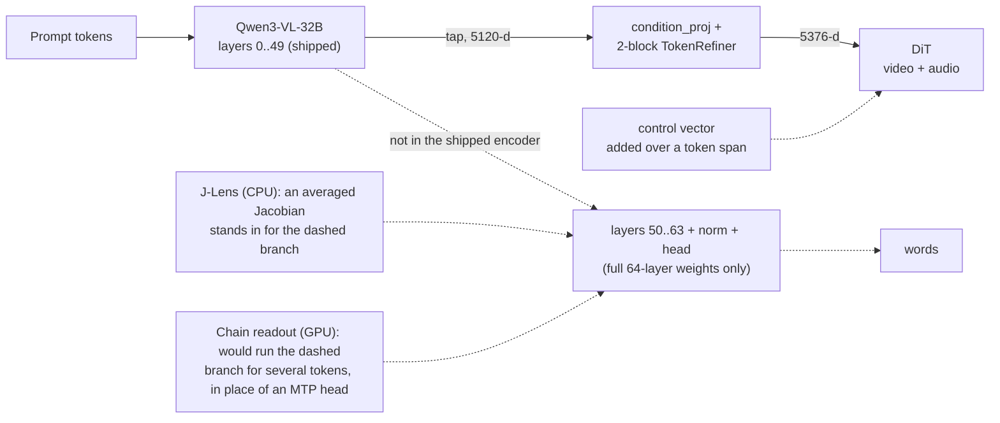

# 2026-11-12: The Chain Lens, WorkspaceBench, and an experiment plan for H3 readouts and steering

A reading of two LessWrong posts and the references behind them, followed by six experiments for this repo's
control vectors and J-Lens. Nothing here was run on a GPU, and no render was made. Every experiment outcome
below is a question, not a prediction.

- **The Chain Lens [interim]**, vgel and Raymond Douglas, 2026-11-11:
  <https://www.lesswrong.com/posts/Nr6fksEqqxNpdz6rk/the-chain-lens-interim>. The post calls itself an early
  draft of a paper.
- **WorkspaceBench: Evaluating Interpretability Methods for the Global Workspace**, camilablank, agam_bhatia,
  Euan Ong and Neel Nanda, 2026-09-23:
  <https://www.lesswrong.com/posts/Zeg2JztbdhguL48uH/workspacebench-evaluating-interpretability-methods-for-the>.
  The chain lens is scored on this benchmark. It is separate work by other people.

The reference notes this page draws on are in [`2026-11-12_chain_lens_refs/`](2026-11-12_chain_lens_refs/):
[`jlens_workspace_paper.md`](2026-11-12_chain_lens_refs/jlens_workspace_paper.md),
[`lens_variants.md`](2026-11-12_chain_lens_refs/lens_variants.md),
[`mtp_and_decoding.md`](2026-11-12_chain_lens_refs/mtp_and_decoding.md) and
[`workspacebench_and_verbalizers.md`](2026-11-12_chain_lens_refs/workspacebench_and_verbalizers.md). Section 12
says who read what and what was not read. Figures are not copied here; "Figure N" means the Nth image in the
post named, counted from the top.

For the repo's own J-Lens, start at
[`../../wiki/control_vectors/j_lens_diagnostics_and_word_lab.md`](../../wiki/control_vectors/j_lens_diagnostics_and_word_lab.md)
and [`2026-11-06_j_lens_and_refiner_jacobian.md`](2026-11-06_j_lens_and_refiner_jacobian.md).

**Owner's decision, 2026-11-12:** start with experiment 1 (section 11).

---

## 1. In short

- **The idea.** A single-token lens such as the J-lens turns a hidden state into a ranked list of words. The
  chain lens takes each top word as a seed and grows it into a short phrase with the model's own
  multi-token-prediction (MTP) head. At every step it picks the token that is most specific to this state
  compared with an average state.
- **What it buys.** Phrases, multi-digit values and multi-token words that single tokens cannot carry. On
  WorkspaceBench it is the best reader that needs no training, and on computed intermediates it matches or
  beats the trained oracle lens (section 3).
- **What it costs.** More confabulation than a single-token lens, and more as chains get longer. Its output
  is still fragments: it names pieces but not how they relate.
- **For H3.** The H3 text encoder has no MTP head, so the method does not run on it as published. The
  encoder's own upper layers can do the same job. The repo already has the two ends of the trade-off the post
  describes: single words from `j_lens.py`, and long steered rollouts from
  `docs/research/control_vectors/exl3_qwen3vl/label_h3_control_vectors.py`.
- **The most useful borrowings are the tests.** Blind scoring with nulls, the round-trip check, and the J-lens
  paper's split of a steering vector into a word-readable part and a remainder all apply directly, and most
  need no render.

One difference runs through everything below. The posts read a language model's states to learn what that
model will say. H3 hands the same kind of state to a diffusion transformer that never runs the upper layers.
A readout through those layers says what the encoder would have said next. It is evidence about what the DiT
receives, not a measurement of what the DiT does with it. Only a render settles that.

## 2. How the chain lens works

The post's pseudo-code for the plain version:

```text
hs = jlens_transport(initial_hs, layer)
seeds = jlens_topk(hs, K); phrases = []
for token in seeds:
  current_hs, phrase = hs, [token]
  for _ in range(STEPS):
    logits, current_hs = mtp_head(current_hs, token)
    token = argmax(logits); phrase.append(token)
  phrases.append(phrase)
return phrases
```

Figure 1 of the post draws it: the transported state feeds the LM head for a seed, then a row of MTP heads. A
second row of MTP heads runs on a corpus-mean state, and its log-probabilities are subtracted with weight λ.

Three refinements sit on top of the loop. The last column is what the post's ablation figure (Figure 13)
shows when the refinement is removed.

| Refinement | What it does | Why | When removed |
|---|---|---|---|
| Contrastive decoding | Pick `argmax log p(t) − λ log p_prior(t)`, the prior being the same head run on an average of many hidden states | Asks which token is evidence for this state, not which token is likely in general | A significant loss; the only refinement that clearly matters |
| Chain attention | The MTP head attends only to its own generated tokens, not to the prompt | Pushes the text to come from the state | No significant change against local attention; kept as the more principled choice |
| State re-injection | The transported state is added back at every step | Keeps later tokens tied to the state | No significant change; the authors say chains look better with it |

**What an MTP head is.** A small extra module trained alongside the model to predict the token after next.
Its input is the final-layer hidden state joined with the embedding of the next token. That passes through
one linear projection and one transformer block, then the model's ordinary output head. Applied to its own
output repeatedly, it rolls out a sequence. The post notes that Qwen3.5 and later and the DeepSeek-V3 family
ship with one.

Two details from the DeepSeek-V3 report (`2026-11-12_chain_lens_refs/mtp_and_decoding.md`, section 2) matter
for reading the method. The head is trained attending over the whole sequence, so chain-only attention and
re-injection both use it outside how it was trained. And the head conditions on a chosen next token, which is
what lets a seed steer the phrase.

## 3. Results on WorkspaceBench

Pass rate per task family, as the post's results table reports it. Conditions: Qwen3.6-27B, WorkspaceBench
commit `eb5a335`. Chain lens, J-lens and R-lens were rejudged by the authors with their fix for a byte-level
BPE decoding bug; the oracle lens and NLA columns are the benchmark's published figures. "Composite" is a
hindsight pick of the best training-free lens per family, and the oracle lens and NLA columns also take the
best variant per family. A dash means no published figure.

| Group | Family | Chain lens | J-lens | Composite | Oracle lens | NLA |
|---|---|---:|---:|---:|---:|---:|
| Basic | association | 0.61 | 0.43 | 0.58 | 0.87 | 0.65 |
| Basic | basic readout | 0.95 | 0.88 | 0.92 | 0.99 | 0.70 |
| Basic | directed modulation | 0.15 | 0.10 | 0.10 | 0.28 | 0.05 |
| Basic | multihop | 0.87 | 0.79 | 0.79 | 0.99 | 0.75 |
| Basic | multilingual | 0.98 | 0.97 | 0.97 | 1.00 | 0.81 |
| Basic | poetry | 0.24 | 0.06 | 0.07 | 0.55 | 0.21 |
| Basic | typo | 0.96 | 0.65 | 0.85 | 1.00 | 0.98 |
| Basic | wrong bridge (new) | 0.06 | 0.06 | - | - | - |
| Basic | wrong bridge true (new) | 0.06 | 0.04 | - | - | - |
| Basic, multi-token | basic readout mt | 0.38 | 0.24 | 0.27 | 0.71 | 0.53 |
| Basic, multi-token | multi-concept directed modulation | 0.24 | 0.16 | 0.16 | 0.32 | 0.12 |
| Basic, multi-token | multilingual mt | 0.25 | 0.10 | 0.10 | 0.62 | 0.44 |
| Basic, multi-token | multihop mt v2 (new) | 0.36 | 0.33 | - | - | - |
| Basic, multi-token | multilingual multihop | 0.09 | 0.05 | 0.13 | 0.40 | 0.34 |
| Basic, multi-token | multilingual typo | 0.10 | 0.03 | 0.03 | 0.78 | 0.60 |
| Basic, multi-token | typo mt | 0.50 | 0.17 | 0.30 | 0.84 | 0.75 |
| Computational | arithmetic intermediates | 0.40 | 0.17 | 0.17 | 0.35 | 0.25 |
| Computational | brew intermediates | 0.87 | 0.87 | 0.87 | 0.73 | 0.66 |
| Computational | buggy code (scored 1 to 10, shown as (score − 1)/9) | 0.31 | 0.22 | 0.22 | 0.29 | 0.25 |
| Computational | chain intermediates | 0.42 | 0.33 | 0.33 | 0.25 | 0.03 |
| Association | conjunctive association | 0.05 | 0.02 | 0.02 | 0.14 | 0.04 |
| Association | directed modulation, obscure (new) | 0.02 | 0.00 | - | - | - |
| Association | role-bound association | 0.17 | 0.09 | 0.18 | 0.63 | 0.40 |
| Association | user modeling | 0.82 | 0.72 | 0.79 | 0.97 | 0.72 |
| Anti bag of words | relational multihop | 0.25 | 0.05 | 0.05 | 0.50 | 0.37 |
| Logic | moral rationale v2 (new) | 0.24 | 0.15 | - | - | - |
| Safety | introspection | 0.50 | 0.42 | 0.42 | 0.86 | - |
| Safety | jailbreak recognition (J-lens figure is without the fix) | 0.93 | 0.88 | 0.95 | 0.96 | 0.89 |
| Precision | knowledge cutoff (new) | 0.29 | 0.18 | - | - | - |
| Lower is better | hallucination | 0.45 | 0.32 | 0.06 | 0.28 | 0.96 |
| **Macro** | all pass-rate families | 0.420 | 0.319 | - | - | - |
| **Macro** | families with published figures | 0.487 | 0.370 | 0.411 | 0.661 | 0.490 |

Read by column:

- **Where it is strong.** Computed intermediates (arithmetic, chained operations, the potion-color table,
  buggy code), where it ties or beats the trained oracle lens. Multi-token versions of the basic tasks, where
  a single token cannot spell the answer. Poetry lookahead, where the J-lens scores near the floor.
- **Where it is weak.** Anything that needs relations rather than names: on role-bound association (who did
  what to whom) it stays far below the oracle lens. On the hallucination family it makes more contradicted
  claims than any single-token lens. Conjunctive association and directed modulation stay low for every
  training-free reader.

## 4. Cost and confabulation

- **Cost (Figure 3).** The chain lens sits between the single-token lenses and the trained verbalizers on
  inference cost per readout. The post's own ratios, against a verbalizer and against a single-token lens, are
  in the paragraph above that figure.
- **Hallucination (Figure 4).** Among training-free readers the chain lens is on the score-against-hallucination
  frontier, but with a higher hallucination rate than the J-lens. The oracle lens scores higher at a lower
  rate. NLA variants hallucinate on nearly every readout.
- **Chain length (Figure 5).** Longer chains raise both the score and the hallucination rate. Most of the gain
  over the J-lens arrives with the shortest chains.
- **Two exceptions.** On introspection and on the authors' own poetry test, the chain lens confabulates less
  than the oracle lens.

## 5. Reading several plans at once (the poetry test)

The authors sample the three most likely next lines at each step of a four-line poem, keeping a tree of
candidate poems per topic (Figure 6), and read the hidden state at each trailing newline. The question is
whether a reader shows the content of all three candidate next lines or just one.

- **By layer (Figure 9).** Every reader sits near chance up to layer 48 of the model's 64, then rises sharply.
  By the last layers the chain lens matches or slightly passes the oracle lens, and both are well above the
  J-lens.
- **Supported share (Figure 10).** The J-lens says little, but most of what it says is in the next lines. The
  oracle lens covers more with the smallest supported share. The chain lens sits between.
- **The oracle lens on the same state (Figure 8).** It writes fluent lines, including a couplet that matches
  none of the sampled continuations and one that merges two of them.

## 6. Reading a direction rather than a state (the neuron section)

This section of the post is the closest match to a control vector. A neuron's write vector is a direction,
not a state, so the authors add it to a mean hidden state for that layer, scaled to the mean state's norm,
and run the chain lens on the result. They do the same with the negated vector, so every neuron gets a
readout for each pole.

They test the readouts two ways.

- **Round trip.** Feed the readout text back through the model. It passes when its best chain activates the
  neuron above a high percentile of the neuron's own activations on a reference corpus, and its top chains
  beat most readouts of other neurons from the same layer. The exact thresholds are in the post's "Neuron
  Lens" section. Most readouts do not round-trip; the rate by layer is Figure 11.
- **Steer and match.** A judge is given one readout and four responses, each produced by steering a different
  neuron, and must pick the response that matches the readout. For readouts that round-trip, the judge does
  better than twice the chance rate (Figure 12).

The post's examples show what a multi-token readout adds. One late-layer neuron reads as "calm before"
alongside "before" in Spanish, French, Russian and Indonesian and the Chinese phrase for the eve of a storm;
steering it produces text about the quiet before a storm. No single token says that.

## 7. Ablations and controls

- **Which parts matter (Figure 13).** Adding the MTP head to a lens is a bigger step than moving from the
  logit lens to the J-lens. Greedy decoding loses a little. Dropping the J-lens transport loses more.
- **Controls (Figure 15).** A larger J-lens token list, matched for text volume, still loses to the chains,
  so the gain is not just more text. Seeds taken from another item hurt. Running the chains from a
  corpus-mean state hurts more. Shuffling readouts between items collapses both lenses.
- **Neutral seeds work as well as lens seeds.** Starting chains from stop words, then swapping in the J-lens
  seed only for judging, scores the same. The state and the contrast do the work; the seed mostly sets how
  the phrase opens.
- **Re-injecting only the verbalizable part hurts (Figure 14).** Re-injection restricted to the verbalizable
  component is clearly worse than re-injecting the whole state. The part of a state the J-lens cannot name
  still carries information the head uses.
- **Chain length (Figure 14).** Only the shortest length tested is clearly worse than the default, and only
  the longest is clearly better, at the price of more hallucination.

**The loom lens.** The MTP head gives a full ranking at each step, so a seed can be grown into a small tree
instead of one chain, scored by the contrastive margin. In the post's example, on a sentence that misspells
"conformation", the J-lens seed is " which", the chain reads " which is correct?", and the tree reaches
" which of this conform" and then branches into candidate endings. It does not yet beat the chain lens
significantly; the authors have not written a summarizer for trees.

## 8. WorkspaceBench

The benchmark asks whether an activation-to-text tool surfaces an intermediate the model must have computed
but never wrote down. It was built for Qwen3.6-27B.

- **Ground truth by construction.** Tasks are chosen so the model needs the intermediate. The model must
  answer correctly in most no-chain-of-thought rollouts; the intermediate never appears in the prompt or in
  the model's own continuation.
- **Read at many cells.** Single-token lenses give their top tokens at a ladder of layers. A method passes an
  item if any cell passes.
- **Summarize, then judge blind.** A summarizer turns the bag of tokens into concepts without seeing the
  prompt. A judge then picks among the target, same-category distractors and "cannot tell", also without the
  prompt.
- **Baselines.** A lucky-guess pick, and a prompt-only baseline in which a model reads the prompt and guesses
  what would be in the workspace. The prompt-only baseline beats most readers on several families (Figure 3
  of the WorkspaceBench post), which the authors accept.
- **Hallucination.** A judge marks claims in the readout that the model's own response contradicts.

### 8.1 What the benchmark's repository adds

The posts describe the scoring loosely. The code is stricter, and most of it is about stopping a readout from
scoring for the wrong reason (`2026-11-12_chain_lens_refs/workspacebench_and_verbalizers.md`).

- **Floors from readers that see no activation.** A lucky-guess reader sees only the option lists. Options
  must pass a leakage standard: guessers stay close to a uniform pick. The prompt-only reader's guess goes
  through the same digest, judge and quote gates as a real lens. A separate subset keeps only items every
  text-only reader fails.
- **Pairs, with hits voided when the control also hits.** Several headline figures are differences against a
  twin. The introspection family is the nearest thing to steering: it adds a concept vector as
  `h += β·||h||·v̂` and pairs it with a norm-matched random vector. A hit counts only if the judge does not
  also name the target on the random twin.
- **Blind judges that must quote.** The judge never sees the item text, the target or the token that was
  read. Every pick needs a verbatim quote from one sample. A line that names two options singles out nothing.
  "Cannot tell" is always offered.
- **Empirical nulls, not chance lines.** Where a null exists it is measured: the same judging call on another
  item's digest, or a permutation over other items' answers. The repository warns that floors computed over a
  whole grid of cells saturate and should not be quoted.
- **The scoring the chain lens was measured under has since changed.** At commit `eb5a335` a per-cell
  summarizer turned token bags into prose and was told to commit to the most specific reading. That
  summarizer was later deleted in favor of one neutral digest for every method. The post's authors say they
  suspect the summarizer affects scores; the figures in section 3 predate the change.
- **The decoding bug is on record.** The repository has an issue and a fix for token readouts reaching judges
  as garbled byte-level BPE text, dated days after the commit the post used. Neither the post nor the issue
  says they are the same bug; the mechanism matches.
- **No chain lens, loom lens or MTP code is public** in the benchmark repository, its branches or the post's
  links, as of 2026-11-12.
- **Comments.** The Chain Lens post had none when read. On WorkspaceBench, one commenter asked for causal
  intervention tests and an author replied that those are much less method-agnostic and so out of scope.
- **A caution from CHIVE.** Agents given an activation oracle, an NLA or a sparse autoencoder predicted
  counterfactual edits no better than agents reading the transcript alone. A reader that scores well on
  naming can still add nothing to a decision.

## 9. From the references

The points that bear on steering. Each is in the notes file named.

### 9.1 The word-readable part of a vector does the steering, in a language model

`jlens_workspace_paper.md`, section 2. The J-lens paper splits difference-of-means concept vectors into a
sparse non-negative mix of J-lens word vectors plus a remainder. The word-readable part is a small share of
the vector's variance, yet at equal magnitude it swaps the model's answer far more often than the full vector
does, and the remainder barely works at all. Pure J-lens vectors do best. Injection strength is also
non-monotonic: every curve falls past its peak, and the full vector needs more strength than the
word-readable part to reach a lower peak.

This was measured on a language model's own output. Whether a diffusion transformer reading the same states
behaves the same way is not known. The notes flag that the paper's text and its figure data disagree on two of
these rates.

### 9.2 A swap operator, not just addition

`jlens_workspace_paper.md`, section 3. For a source and target token with lens vectors `V = [v_s v_t]`, read
coordinates `c = V⁺h` and set `h += V(σ(c) − c)`, where σ exchanges the two entries. It removes the source
concept where it is loaded and writes the target with the same weight, at every position. The part of `h`
outside the two directions is unchanged. It only works where the source is already loaded (measured as the
cosine of the state with the lens vector), and a doubled strength rescues many failures.

### 9.3 The template lens: multi-token words with one linear direction each

`jlens_workspace_paper.md`, section 5. For a word *w*, average the hidden state at the end of many passages
that stop just before *w*, then center and whiten:

```text
t_w = (Σ + λI)⁻¹ (μ_w − μ)
```

This is the linear discriminant direction for "about to say *w*". It holds its readout accuracy as words get
longer, where the J-lens collapses, and its swaps keep working on multi-token words. It needs a fixed
dictionary, many forward passes per word, and hand filtering of a few words that show up everywhere.

### 9.4 J-lens recipe details that affect a rebuild

`jlens_workspace_paper.md`, section 1, and `lens_variants.md`, sections 1 and 2.

- The published fit averages the Jacobian from each source position to all later positions, over a corpus of
  pretraining-like prompts. Restricting it to the same position was clearly the worst variant tested.
- Freezing the attention pattern (no gradient through query and key) raised causal effect.
- The page is inconsistent on whether the default target is the final or the penultimate layer; the
  penultimate variant did slightly better at extracting intermediates.
- R-lens changes the backward pass (the norm's scale held constant, a half rule on gated MLPs). It helps most
  in early layers and converges with the J-lens late.
- J++ fits one Jacobian per cluster of activations and mixes them with weights learned on a small labelled
  set, and drops tokens with no letter or digit from the readout. Removing the clustering cost it the most
  recall.
- A subagent's inference, not a source's claim: a tap as late as H3's is past where the R-lens and J++ gains
  concentrate, so gains there may be modest.

### 9.5 Does the lens predict what steering does?

`lens_variants.md`, section 4. The Neuron Lens repository adds a vector, records the mean change in
next-token log-probabilities, and correlates that with the lens's predicted logits for the same vector. The
control is another unit's readout. Agreement is low in early layers and high late. The same repository's blind
test had a model pick a steered text out of four using only the lens label.

### 9.6 Contrastive decoding needs its plausibility filter

`mtp_and_decoding.md`, section 3. The original method only considers tokens whose probability is at least a
fixed fraction of the top token's. Without that filter a rare token with a tiny probability under both models
can win on ratio alone, and output quality collapses. An average-state prior makes this worse, since it gives
rare tokens very little mass. With a shared linear unembedding the contrast ranking is close to the lens
applied to the state minus the mean, so a J-lens readout of a steering vector is already contrastive; what it
lacks is the filter.

### 9.7 Substitutes for a missing MTP head

`mtp_and_decoding.md`, sections 4 and 7. Future Lens showed one hidden state predicts tokens several steps
ahead, best with a small learned soft prompt and the model's own remaining layers. Ranked by training needed:
patching into the model's own later layers (none), linear maps (one fit), a soft prompt, a trained MTP-style
module, a fine-tuned verbalizer. A steering vector is a direction, not a state, so it is injected additively
onto a base state rather than patched in.

### 9.8 What the trained readers cost

`jlens_workspace_paper.md`, section 6, and `workspacebench_and_verbalizers.md`. The oracle lens needs two
fine-tuned copies of the subject model, a large phrase dictionary and reinforcement learning. The NLA paper
reports multi-day runs on multi-node clusters for a model of similar size. Its authors add that false claims
are usually on theme, and that claims recurring across token positions are more reliable. Neither is a fit
for a single-card setup.

## 10. Where it meets the repo



What was checked on disk and in the repo's records on 2026-11-12:

| In the posts | In this repo | Where to look |
|---|---|---|
| A model with an MTP head | The H3 encoder has none. Both shipped `qwen3vl_32b_minimax_h3_*` checkpoints stop at `layers.49` with no MTP, output head or final norm | The header check below; [`../../sol_upstream.md`](../../sol_upstream.md) |
| The same, elsewhere on the machine | `qwen3.5_9b_int8_convrot.safetensors` and `p-h3-image_prompt_upsampler_int8_convrot.safetensors` both carry `mtp.*` tensors, and core has the head's code. Neither is the H3 conditioning encoder | The header check below; `comfy/text_encoders/qwen35.py::MTPHead` in ComfyUI core |
| J-lens | `j_lens.py`: averaged Jacobian from the tap to the last layer, a linearized refiner, a Wiener inverse, cloze baselines. Reads a vector as words, writes a vector from words, scrubs words out | [`../../wiki/control_vectors/j_lens_diagnostics_and_word_lab.md`](../../wiki/control_vectors/j_lens_diagnostics_and_word_lab.md) |
| Single-token limit | The wiki names it: the word list holds only whole single-token words, and multi-token terms are dropped | Same page, section 3 |
| Contrastive decoding against a prior | Already present in one-step form: the readout scores a word by its gain over the unsteered cloze baseline and over the opposite pole | `docs/research/control_vectors/exl3_qwen3vl/label_h3_control_vectors.py::compute_top_logit_shifts` |
| Trained verbalizer (fluent, confabulates) | The nearest thing is the steered rollout with a blind self-report label. Its labels drift where the words stay on target | [`exl3_qwen3vl/h3_control_vector_report.md`](exl3_qwen3vl/h3_control_vector_report.md), summary table |
| Reading a direction on a mean state, both poles | How every vector is read today: added to a base state on cloze prefixes, plus and minus | `compute_top_logit_shifts` |
| A second word table from what the model sees | The rows table: mean post-refiner row per token across real prompts, less the mean of all rows. Kept as a second readout | `bench/control_vector_lexicon.py`; [`2026-11-09_control_vector_simplification_plan.md`](2026-11-09_control_vector_simplification_plan.md), section 20.1 |
| J-lens fitting recipe | The lexical half of the bundle has no tracked builder; rebuilding it from the full weights is an open item | The same plan, sections 17 and 20.1; [`../../wiki/next_steps.md`](../../wiki/next_steps.md) |
| Vectors that cannot replace a noun | Recorded on 2026-11-09: a pooled additive vector did not replace a discrete noun or stop a scripted action; the two-pass edit guider did | [`2026-11-10_control_vector_state_history_and_tradeoffs.md`](2026-11-10_control_vector_state_history_and_tradeoffs.md), section 1 |

The header check, run from the ComfyUI root with any Python (it reads only the safetensors header):

```bash
python3 -c '
import sys, json, struct, re
for p in sys.argv[1:]:
    f = open(p, "rb"); n = struct.unpack("<Q", f.read(8))[0]; h = json.loads(f.read(n))
    keys = [k for k in h if k != "__metadata__"]
    layers = sorted({int(m.group(1)) for k in keys for m in [re.search(r"layers\.(\d+)\.", k)] if m})
    print(p, "| mtp:", any(k.startswith("mtp.") for k in keys), "| lm_head:", any("lm_head" in k for k in keys),
          "| layers:", (layers[0], layers[-1]) if layers else None)
' models/text_encoders/*.safetensors
```

One caution on the plan's own records: section 17.4 of the simplification plan retires the
`exl3_qwen3vl/` folder apart from its report, and says the labels file shows vectors that no longer exist in
that form. Experiments 4 and 5 below need the full 64-layer weights, the same thing the open lexical-half
builder needs, so they belong with that builder and not with a revival of the old labeller.

## 11. Experiments

Ordered by what they decide per unit of cost. The first three need no GPU and no render. Experiments 4 and 5
share one GPU session with the full 64-layer weights.

### Experiment 1: score the readouts we already have, blind

- **Cost.** CPU, plus a text-only LLM judge.
- **Question.** Given only a vector's readout, can a judge pick that vector's intended concept out of five?
- **Build from.** WorkspaceBench's judging format on the built vectors. Readers: `j_lens.decode_vector` words
  and the rows table from `bench/control_vector_lexicon.py`. Options: the target's description, four other
  vectors' descriptions, and "cannot tell".
- **Controls**, taken from the benchmark's code (section 8.1):
  - a lucky-guess floor from the options alone;
  - a norm-matched random vector as each vector's twin, with a hit voided if the judge names the target on
    the twin too;
  - a shuffle null, the same call on another vector's readout;
  - every pick backed by a verbatim quote from the readout;
  - matched token counts whenever two readers differ in length.
- **Decides.** Gives each reader a pass rate on our own vectors and becomes the yardstick for experiments 3
  and 5. Today the comparison in plan section 20.1 is a person reading two columns.
- **Cannot see.** Whether the render shows the concept. It scores naming, not effect.
- **First run, 2026-11-12.** Recorded in
  [`../../../bench/results/2026-11-12_control_vector_readout_blind_score.md`](../../../bench/results/2026-11-12_control_vector_readout_blind_score.md).
  Both readers named most vectors and the controls behaved, but with random distractors the J-Lens words leave
  too little room for a better reader to show. The option lists need the nearest concepts as distractors
  before this is a yardstick.

### Experiment 2: how much of each vector can the words see?

- **Cost.** CPU for the split, then three renders per vector tested.
- **Question.** What share of a control vector is a sparse mix of J-lens word directions, and is that the
  share the DiT responds to?
- **Build from.** The J-lens paper's split (section 9.1): a non-negative mix of a small fixed number of word
  directions, fitted by pursuit, plus the remainder. Run it on `vector.encoder` from the dual vector files
  against the bundle's word matrix. Report the word-readable share beside every readout.
- **The render.** For two bank vectors that are known to work, render the word-readable part, the remainder
  and the full vector at matched norm, same prompt and seed.
- **Decides.** If the word-readable part carries the look, vectors can be cleaned by projecting onto it, and
  the Word Lab's ceiling is higher than its cosine against pair vectors suggests. If the remainder carries
  it, every word readout and every `hold_words` scrub is working on a minority of what the vector does, and
  the tools should say so.
- **Why it is open.** In a language model the word-readable part steered far better than the full vector
  (section 9.1). The chain lens post found evidence the other way for its head: re-injecting only the
  verbalizable part hurt (section 7). A DiT could go either way.

### Experiment 3: whiten the rows table and merge it into whole words

- **Cost.** CPU, on the existing row cache.
- **Question.** Does the template lens's math fix the two flaws plan section 20.1 records for the rows table:
  token pieces instead of words, and a minus side that reads the same plain words for many concepts?
- **Build from.** `t_w = (Σ + λI)⁻¹(μ_w − μ)` with `μ_w` pooled over a word's or phrase's whole token span
  (section 9.3). Centering and whitening are what remove a shared common direction. The span pooling gives
  multi-token entries, which the J-lens word list cannot hold.
- **Decides.** Whether a CPU-only multi-token dictionary readout is available now, scored with experiment 1.
  It reads "this word is in the prompt", which is what the DiT is given, where the J-lens reads "about to say
  this word".
- **Limit.** It only knows words the cached prompts contain. A true template table for chosen terms needs
  encoder passes over passages written to end just before each term. That uses only the shipped 50-layer
  encoder, and is the follow-up if this works.

### Experiment 4: does the CPU lens agree with the real upper layers?

- **Cost.** One GPU session with the full 64-layer weights, no render.
- **Question.** For each vector, how well does the bundle's predicted logit shift correlate with the shift
  the real `layers.50..63` produce?
- **Build from.** The Neuron Lens test (section 9.5): correlation over the word list between predicted and
  measured change, with another vector's prediction as the control.
- **Decides.** Gives each readout a trust figure, and gives the open lexical-half rebuild an acceptance test.
  The rebuild can then try the published recipe choices one at a time (section 9.4).
- **Unknown.** How the current `J_49_to_63` treated later positions. Plan section 17.4 says no tracked code
  holds that method, so it could not be checked.

### Experiment 5: a chain readout through the encoder's own upper layers

- **Cost.** The same GPU session as experiment 4, no render.
- **Question.** Do short contrastive chains name multi-token concepts that the word list drops, without the
  drift of the long rollouts?
- **Build from.** Seeds from the top shifted words on each cloze prefix. Append the seed, keep the vector
  added at the tap on every position, and extend a few tokens choosing
  `argmax log p(t | +v) − λ log p(t | base)`. Keep the plausibility filter (section 9.6). Read both poles.
- **How it differs from the post.** The real upper layers replace the MTP head, so it is slower per token and
  closer to what the model would say. Adding the vector at every position is the post's re-injection for
  free. A short cloze prefix stands in for chain-only attention.
- **Controls**, from the post (section 7): another vector's seeds, chains from the unsteered state, a longer
  word list against the chains, a shuffle null. Also neutral seeds, since the post found they do as well.
- **Decides.** Whether the middle point between words and rollouts is worth a place beside them, by
  experiment 1's score and by whether the dropped terms the wiki names appear for the vectors built from
  them.

### Experiment 6: swap a concept in lens coordinates instead of adding a vector

- **Cost.** A CPU pre-check, then node code and renders.
- **Question.** Can a per-token swap do in one pass what the additive vector could not on 2026-11-09 and the
  two-pass edit guider could?
- **Build from.** The J-lens paper's operator (section 9.2), applied to the refined tokens with word
  directions pushed through the refiner Jacobian, or with whitened rows-table directions for multi-token
  terms.
- **Pre-check.** On cached rows, measure whether the source word is loaded at its own tokens. The paper found
  swaps only work where it is. If it is not loaded, stop here.
- **The render.** The discrete-replacement case from the 2026-11-09 gate at normal and doubled strength,
  beside the existing unsteered, additive and edit-guider arms.
- **Decides.** Whether discrete replacements have a one-pass route. It is the highest-risk item: the DiT may
  read a noun's identity from the part of the state no word direction spans, which experiment 2 would already
  have shown.

### Not recommended now

- **Training an MTP head or an oracle lens for the 32B encoder.** The costs in the references are far beyond
  one card, and experiment 5 gets the same kind of output from layers that already exist.
- **Replicating the chain lens as published on Qwen3.5-9B.** The head is on disk and the code is in core, but
  that model is not the H3 conditioning encoder and would need its own J-lens fit. Worth it only as a
  calibration of experiment 5 if its results are hard to read.
- **Per-token chain readouts of prompt states.** In the post's model, planned-ahead content only becomes
  readable above layer 48 of 64 (section 5). H3's tap is at layer 49 of 64 in a different model, so this may
  show little. Untested either way.

## 12. What was read, and what was not

| Source | Read by | Coverage |
|---|---|---|
| The Chain Lens [interim] | Main session | All text, the results table, both inline formulas, every figure |
| WorkspaceBench | Main session | All text and every figure |
| J-lens / global workspace paper and its summary post | Opus subagent | Both pages and all appendices. Interactive figures read from their data for verbal report, introspection, ablation and template lens; others from text only. The linked code repository was not opened |
| R-lens, J++ lens and meta-tokens posts; Neuron Lens repository; K-lens tweet; tuned lens | Opus subagent | Posts and comment threads in full; repository README and design notes; the tweet through a mirror. The J++ code and several R-lens figures were not opened |
| MTP paper; DeepSeek-V3 report (MTP section); contrastive decoding; Future Lens; Patchscopes; Activation Oracles | Opus subagent | Method and results sections. Some Future Lens layer curves were read off a plot by eye |
| WorkspaceBench repository; NLA; CHIVE; oracle lens model card; comment threads on both posts | Opus subagent | Repository code, issues and branches; the NLA and CHIVE pages; the model card; all comments. The separate hallucination benchmark repository was read only through its vendored copy |

- The four notes files were written by subagents and are carried as written, apart from scratch-folder paths
  removed. They were not re-verified line by line by the main session. Each ends with its own list of what it
  could not read.
- Model names are given as the posts write them.
- The digest was first published as a private page; this file is the record.
