# Masked Video-to-Video Architecture, State-Flow & Simplification Map (STATUS - INCOMPLETE - NEEDS TO INCORPORATE THE REST OF 10/26 CHANGES)
**IMPORTANT**: INCOMPLETE - NEEDS TO INCORPORATE THE REST OF 10/26 CHANGES
**Generated**: `2026-10-26` at `HEAD` `ee8c1d8e` (`b461584e..ee8c1d8e` included — Read-Only Architecture, State-Flow & Simplification Map for Gemini Sessions) - INCOMPLETE - NEEDS TO INCORPORATE THE REST OF 10/26 CHANGES
**Target Scope**: Masked Video-to-Video Pipeline (`preview` → `job` → `reference` → `text` → `first` → `plan` → `on-plan` → `render` → `land` → `assemble_delivery` → `rebuild_delivery`) - INCOMPLETE - NEEDS TO INCORPORATE THE REST OF 10/26 CHANGES

> **How to use this document in a Gemini session (`~520 lines` total — fits in a single `read_file` call)**:
> - **[Part 3 — Subcommand & Function Jump Index (`L23–L133`)](internal/gemini/2026-10-26_code_map_and_simplification_plan.md#L23-L133)**: Exact `StartLine–EndLine` coordinates for all 38 files across Stages 1–5 so you never `read_file` 800-line chunks blindly.
> - **[Part 1 — End-to-End Mask & Tensor State Mutation Ledger (`L135–L170`)](internal/gemini/2026-10-26_code_map_and_simplification_plan.md#L135-L170)**: Chronological trace (`Stage 1.1a` → `Stage 5.4`) of every array mutation, threshold constant, and disk write/overwrite (including the carve-first `L2575` / fill-last `L2945 -> L5557` execution order).
> - **[Part 2 — Bench ↔ Server Boundary, Node Artifacts, 4-Way Window Contract & `cannot_see` Boundaries (`L172–L280`)](internal/gemini/2026-10-26_code_map_and_simplification_plan.md#L172-L280)**: Verified node JSON inputs/`_meta` keys from queued graphs (`2a.1`), server-side artifact writes on `$H3_OUTPUT_DIR` (`2a.2`), the 4-way window & padding contract (`2b`), dynamic imports / shared-name collisions (`2c`), and declared `cannot_see` boundaries across all tools (`2d`).
> - **[Part 4 — Duplicate Logic Inventory (`L282–L293`)](internal/gemini/2026-10-26_code_map_and_simplification_plan.md#L282-L293)**: Exact `file:line` for every duplicated `.mkv` reader, span parser, `.npz` unpacker, path resolver, and SHA-256 helper.
> - **[Part 5 — Today's 10 Commits (`b461584e..ee8c1d8e`), Tonight's Forensics §0 Corrections & Tomorrow's Phased Plan (`L295–end`)](internal/gemini/2026-10-26_code_map_and_simplification_plan.md#L295)**: Pure capture stage pipeline (`5a`), single `window_spec.py` module (`5b`), `bench/_lib/` consolidation & monolith split (`5c`), byte-for-byte replay verification gate (`5d`), and tomorrow's 3 settled rule/build targets from `decisions.md` & `handover.md`: retiring `hold_to_track` for the unified head-room part rule (`5e`), including SAM's `people.npz` detections in `strangers.py::run` (`5f`), and tracker post-occlusion re-finding (`--head-per-stretch` default + signature match) & `cast.jsonl` box withdrawal (`5g`).
>
> **Watch out for the 6 in-place overwrite, stale-record, and blind-spot traps documented in Part 1 and Part 2c–2d**:
> 1. **Job-step `hold_to_track` (`_on_track_8px.mkv`) clip, `4682-4685` forearm-only crop & `strangers.py` ignoring SAM `people.npz` where Sapiens misses**:
>    - Before `capture` ever runs, [`bench/shot_to_load.py:1102-1198, 3088-3090`](bench/shot_to_load.py#L1102-L1198) (`part_on_track`, `hold_to_track`, `make_part_on_track`) clips the subject's preview `parts` to `strangers.grown(kept, px=8)` into `<share>/Video/<video>/parts/<preview>/<stem>_on_track_8px.mkv` whenever `"strangers"` is kept out (costing a few hundred px/frame on `4912`, while same-color neighbor hair is already lost in the preview's Sapiens part at `Stage 1.1b`). On `4682-4685` (`t=11`, `forensics` §0.3), `second`'s person track (`765-1,082 px`) is only her bare forearm (`y=297-359`), so crop-Sapiens crops to the forearm (`y=289-367`), hallucinates `608-2,123 px` of `Face_Neck` on her arm (suppressed by `head_tube`), and leaves her emerging head edge on `4684-4685` unmasked (`0 px`).
>    - Meanwhile in [`bench/strangers.py:359-449, 521-654`](bench/strangers.py#L359-L449), `people_pass` (`359-392`) writes SAM 3.1's person detections to `<preview>_people.npz`, but `run` (`563`) sets `people[i] = c > 0` from **whole-frame Sapiens2 alone** (using `people.npz` only in `handed_back` at `171-234, 578`), so on `4686-4693` (`second_hfp_4647h`, `forensics` §0.4) a bystander woman detected by SAM (`2,000-3,500 px` in `shot_c_4647k_people.npz`, scores `0.54-0.81`) but missed by whole-frame Sapiens2 was `0 px` in `strangers.mkv`, letting `second`'s laid matte bleed `40-70 px` into the bystander!
> 2. **`parts_held__<by>.mkv` AND `track__<by>.mkv` are written twice in one `_files` run, while `part_grades.json` and `masks__<by>.npz` stay pre-fill** ([`bench/capture_masked_run.py:2488-3151`](bench/capture_masked_run.py#L2488-L3151)): `parts_held__<by>.mkv` is first written at [`L2843`](bench/capture_masked_run.py#L2843) (after `off_head` → `head_tube_for_capture` → depth clip → `grade_holds` → `drop=`), and then **overwritten in place** at [`L5557`](bench/capture_masked_run.py#L5557) by [`hair_in_hole_files`](bench/capture_masked_run.py#L5520-L5571) (called at [`L2945`](bench/capture_masked_run.py#L2945)). In addition (`00a3f1d8`), whenever `(held & ~given["track"]).any()`, `hair_in_hole_files` ([`L5558-L5559`](bench/capture_masked_run.py#L5558-L5559)) **also overwrites `subjects/<label>/track__<by>.mkv` in place** with `given["track"] | held` (originally written at [`L2742`](bench/capture_masked_run.py#L2742)), while `masks__<by>.npz["track"]` and `masks__<by>.npz["parts"]` ([`L2740-L2741`](bench/capture_masked_run.py#L2740-L2741)) remain pre-fill! Because `part_grades.json` is written at [`L2816`](bench/capture_masked_run.py#L2816) before `her_hair_in_hole` runs and is **never updated**, [`bench/frame_table.py:675-689, 948-986`](bench/frame_table.py#L675-L689) reports the pre-fill floor (`loaded_part_px = 0`, `outcome = "emptied"`) on frames where `her_hair_in_hole` later added pixels (`gemf` §3.4)!
> 3. **Carve-first (`L2575`), fill-last (`L2945`) execution order & `as_read` (uncarved) vs `track__<by>.mkv` (carved) two-consumer split**: In [`bench/capture_masked_run.py:2566-2585`](bench/capture_masked_run.py#L2566-L2585), keep-outs are carved **first** inside the per-mask loop (`carve_keep_out` at [`L2575`](bench/capture_masked_run.py#L2575) on `first`; `grid_carve` + `_bridge_severed` at [`L2580`](bench/capture_masked_run.py#L2580) on `on-plan`, `45f3eaf1`) and written to `subjects/<other>/track__<by>.mkv` ([`L2742`](bench/capture_masked_run.py#L2742)) for the ComfyUI node ([`bench/masked_job.py:636-665`](bench/masked_job.py#L636-L665)), while `as_read` ([`L2567`](bench/capture_masked_run.py#L2567)) preserves the **uncarved** tracks and hands them to `her_hair_in_hole` **last** after the loop ([`L2944-L2945`](bench/capture_masked_run.py#L2944-L2945), `data_inputs_trace.md` §4). Furthermore, `plan.json`'s `head_marks` are read only for the load's own subject ([`bench/shot_to_load.py:3643-3672`](bench/shot_to_load.py#L3643-L3672), called at [`L3067`](bench/shot_to_load.py#L3067)), never for a keep-out.
> 4. **Artifact side (`windows/<load>_window_N_region.npz`) vs Cache side (`data/<capture>/`) & Settled Judging Rule (`owner_4647_readings_for_gemv.md` §2)**: The node's own records written beside the render on `$H3_OUTPUT_DIR` (`<load>_windows/<load>_window_N_region.npz`: `mask`, `tokens`, `matte`, `kept` via [`video_mask.py:1026-1094`](video_mask.py#L1026-L1094)) are the **artifact** side of a load's record; `data/<capture>/` is the **cache** side (`data_inputs_trace.md` §1b). A mask is judged against the **region the node regenerates** (`blue` on the inspector's strip before render; `matte` in `<load>_window_N_region.npz` after render), not against `prt` (`green` on check strips, which is pre-floor-hold).
> 5. **Reference sheet & JSON double-write**: Inside [`bench/head_reference.py::run`](bench/head_reference.py#L717-L1200), `<stem>_sheet.jpg` and `<stem>.json` are first written by [`bench/draw_face_points.py:1830-1833`](bench/draw_face_points.py#L1830-L1833) (called at `L1082`) and then **overwritten in place** by [`bench/head_reference.py:1132, 1196`](bench/head_reference.py#L1132).
> 6. **`head_track` vs `head_tube["tube"]` aliasing (`b461584e`)**: `data/<capture>/subjects/<subj>/head_track__<by>.mkv` ([`L2744`](bench/capture_masked_run.py#L2744)) is the raw unbridged SAM 3.1 head track, whereas `head_tube__<by>.npz["tube"]` ([`bench/head_tube_parts.py:2249`](bench/head_tube_parts.py#L2249)) is clipped to `person_track` and dip-bridged. As of `b461584e` today, `capture_masked_run.py` (`hair_pass` at [`L2841`](bench/capture_masked_run.py#L2841) and `hair_in_hole` at [`L5650`](bench/capture_masked_run.py#L5650)) and [`bench/inspect_mask_steps.py:108-120`](bench/inspect_mask_steps.py#L108-L120) (`_read_head_mask`) now read `head_tube__<by>.npz["tube"]` first (falling back to `head_track__<by>.mkv`), matching [`bench/pick_frames.py:182`](bench/pick_frames.py#L182) and [`bench/facts_pass.py:323-325`](bench/facts_pass.py#L323-L325)—though all three readers still label the column `head_track_px`.

---

## Part 3 — Subcommand & Function Jump Index for Gemini `read_file` Calls

Use these exact `StartLine–EndLine` coordinates when calling `read_file` on the 6 core files (plus their Stage 1–5 counterparts).

### 3.1 `bench/capture_masked_run.py` (8,299 lines)

| CLI Subcommand (`mode`) | Entry Function | Line Range | Key Helpers Called & Their Line Ranges |
|---|---|---|---|
| *(Module constants & imports)* | top-level | `1–435` | Dynamic node-pack loader [`_pack`](bench/capture_masked_run.py#L426-L432) (`video_mask`, `sapiens2_parts`, `subject_track`, `h3_rules`, `loop_plan`); `cannot_see` constants (`SIZES_CANNOT_SEE` at `753`, `PIECES_CANNOT_SEE` at `759`, `OTHER_CANNOT_SEE` at `4044`, `HAIR_IN_HOLE_CANNOT_SEE` at `5152-5162`) |
| `files` | [`files`](bench/capture_masked_run.py#L2450-L2485) → [`_files`](bench/capture_masked_run.py#L2488-L3151) | `2450–3151` | Depth: [`read_depth_npz`](bench/capture_masked_run.py#L513-L557), [`_depth_medians_and_owner`](bench/capture_masked_run.py#L560-L612), [`owner_map`](bench/capture_masked_run.py#L615-L645)<br>Keep-out carve (runs **first** in loop at `2575, 2580`): [`_keep_in_front`](bench/capture_masked_run.py#L1308-L1331), [`carve_keep_out`](bench/capture_masked_run.py#L1334-L1362), [`_bridge_severed`](bench/capture_masked_run.py#L1470-L1506), [`grid_carve`](bench/capture_masked_run.py#L1509-L1554), [`step_keepout_carves`](bench/capture_masked_run.py#L1617-L1679)<br>Off-head & grades: [`off_head`](bench/capture_masked_run.py#L5728-L5866), [`grade_holds`](bench/capture_masked_run.py#L1006-L1239), [`word_shapes`](bench/capture_masked_run.py#L1242-L1285)<br>Hair-in-hole (runs **last** after loop at `2945` on uncarved `as_read`): [`her_hair_in_hole`](bench/capture_masked_run.py#L5177-L5432), [`hair_in_hole_files`](bench/capture_masked_run.py#L5520-L5571)<br>Regions: [`predict_regions`](bench/capture_masked_run.py#L1557-L1583), [`read_saved_regions`](bench/capture_masked_run.py#L2033-L2110), [`read_planned_regions`](bench/capture_masked_run.py#L2156-L2250) |
| `verify` | [`verify`](bench/capture_masked_run.py#L3410-L3454) | `3221–3454` | [`input_facts`](bench/capture_masked_run.py#L3221-L3228), [`readers_agreement`](bench/capture_masked_run.py#L3231-L3248), [`verify_checks`](bench/capture_masked_run.py#L3251-L3366), [`preview_first_of`](bench/capture_masked_run.py#L3369-L3379), [`at_checks`](bench/capture_masked_run.py#L3382-L3407) |
| `rules` | [`rules`](bench/capture_masked_run.py#L3673-L3681) | `3460–3681` | [`shot_edges`](bench/capture_masked_run.py#L3460-L3463), [`head_across`](bench/capture_masked_run.py#L3466-L3478), [`part_owners`](bench/capture_masked_run.py#L3481-L3498), [`rules_input`](bench/capture_masked_run.py#L3501-L3670) |
| `shots` | [`shots`](bench/capture_masked_run.py#L3746-L3793) | `3684–3793` | [`by_shot`](bench/capture_masked_run.py#L3684-L3714), [`by_load`](bench/capture_masked_run.py#L3717-L3743) |
| `preflight` | [`preflight`](bench/capture_masked_run.py#L6284-L6416) | `3796–6416` | [`flag_shots`](bench/capture_masked_run.py#L3852-L3912), [`flag_pose`](bench/capture_masked_run.py#L3978-L4021), [`flag_never`](bench/capture_masked_run.py#L4024-L4040), [`flag_track`](bench/capture_masked_run.py#L4069-L4123), [`flag_parts`](bench/capture_masked_run.py#L4234-L4263), [`flag_runs`](bench/capture_masked_run.py#L4333-L4464), [`flag_segments`](bench/capture_masked_run.py#L4467-L4546), [`dropped_or_unmasked_face_in_context`](bench/capture_masked_run.py#L4587-L4619), [`unmasked_head_hair_context`](bench/capture_masked_run.py#L4622-L4738), [`lays_nothing`](bench/capture_masked_run.py#L4741-L4783), [`flag_lent`](bench/capture_masked_run.py#L4786-L4853), [`flag_reference_figure`](bench/capture_masked_run.py#L4865-L4953), [`flag_held_tail`](bench/capture_masked_run.py#L4956-L5014), [`flag_kept`](bench/capture_masked_run.py#L5043-L5079), [`flag_mouth`](bench/capture_masked_run.py#L5082-L5107), [`flag_her_hair`](bench/capture_masked_run.py#L5574-L5624), [`flag_pieces`](bench/capture_masked_run.py#L5869-L5896), [`flag_face_size`](bench/capture_masked_run.py#L5938-L5966), [`flag_who`](bench/capture_masked_run.py#L5973-L6002), [`flag_keep`](bench/capture_masked_run.py#L6024-L6065), [`flag_cuts`](bench/capture_masked_run.py#L6082-L6121), [`flag_loads`](bench/capture_masked_run.py#L6155-L6203), [`flag_text`](bench/capture_masked_run.py#L6223-L6238) |
| `hair-in-hole` | [`hair_in_hole`](bench/capture_masked_run.py#L5627-L5700) | `5177–5700` | Read-only replay of [`her_hair_in_hole`](bench/capture_masked_run.py#L5177-L5432) on an existing capture |
| `sizes` | [`sizes`](bench/capture_masked_run.py#L5926-L5935) | `5899–5935` | [`sizes_of`](bench/capture_masked_run.py#L5899-L5923), [`part_sizes`](bench/capture_masked_run.py#L804-L831) |
| `looked` / `outcome` | [`looked`](bench/capture_masked_run.py#L6479-L6501) / [`outcome`](bench/capture_masked_run.py#L6504-L6530) | `6419–6530` | [`look_entry`](bench/capture_masked_run.py#L6419-L6441), [`strip_home`](bench/capture_masked_run.py#L6444-L6463), [`strip_of`](bench/capture_masked_run.py#L6466-L6476) |
| `changed` / `mouth` / `mask` / `diagnose` / `look` | [`changed`](bench/capture_masked_run.py#L6607-L6710), [`mouth`](bench/capture_masked_run.py#L6852-L6946), [`mask`](bench/capture_masked_run.py#L6963-L6992), [`diagnose`](bench/capture_masked_run.py#L6995-L7084), [`look`](bench/capture_masked_run.py#L7101-L7168) | `6533–7168` | Post-render and per-frame diagnostic subcommands |
| `video` | [`video`](bench/capture_masked_run.py#L7714-L8143) | `7173–8143` | [`load_capture`](bench/capture_masked_run.py#L7173-L7188), [`draw_masks`](bench/capture_masked_run.py#L7220-L7248), [`head_boxes`](bench/capture_masked_run.py#L7503-L7572), [`strip_records`](bench/capture_masked_run.py#L7627-L7711) |
| CLI Argument Parser | [`main`](bench/capture_masked_run.py#L8146-L8295) | `8146–8299` | All 15 subcommands and exact CLI flags |

### 3.2 `bench/shot_to_load.py` (5,330 lines)

| CLI Subcommand (`step`) | Entry Function | Line Range | Key Helpers Called & Their Line Ranges |
|---|---|---|---|
| `preview` | [`step_preview`](bench/shot_to_load.py#L4144-L4266) → [`preview_job`](bench/shot_to_load.py#L458-L565) | `288–565`, `3933–4266` | [`working_copy`](bench/shot_to_load.py#L288-L312), [`seed_of`](bench/shot_to_load.py#L444-L455), [`cuts_of_table`](bench/shot_to_load.py#L413-L441), [`check_pass2_source`](bench/shot_to_load.py#L3997-L4110) |
| `job` | [`step_job`](bench/shot_to_load.py#L4394-L4540) → [`load_job`](bench/shot_to_load.py#L2447-L3522) | `568–3930`, `4269–4540` | Keep-outs & track-clipped parts: [`keep_outs_of`](bench/shot_to_load.py#L568-L613), [`part_of`](bench/shot_to_load.py#L867-L938), [`track_not_of`](bench/shot_to_load.py#L954-L1000), [`make_track_not`](bench/shot_to_load.py#L1018-L1042), [`part_on_track`](bench/shot_to_load.py#L1102-L1137), [`hold_to_track`](bench/shot_to_load.py#L1154-L1174), [`make_part_on_track`](bench/shot_to_load.py#L1177-L1198), [`make_part`](bench/shot_to_load.py#L1200-L1237), [`make_keep_outs`](bench/shot_to_load.py#L1265-L1299), [`others_of_load`](bench/shot_to_load.py#L1302-L1319), [`run_strangers`](bench/shot_to_load.py#L4269-L4290), [`make_depth`](bench/shot_to_load.py#L4350-L4391)<br>Recipe, carry words & plan marks: settled `recipe` & `shot_overrides` enforcement (`cbd39fbe` at [`2711-2778, 3122-3141`](bench/shot_to_load.py#L2711-L2778)), [`carry_words_of`](bench/shot_to_load.py#L1722-L2282), [`check_partial_shot_coverage`](bench/shot_to_load.py#L2300-L2444), [`head_marks_of`](bench/shot_to_load.py#L3643-L3672), [`source_facial_hair_of`](bench/shot_to_load.py#L3695-L3718), [`defaults_carried`](bench/shot_to_load.py#L3822-L3930), [`check_job_pass2_source`](bench/shot_to_load.py#L4113-L4139) |
| `reference` | [`step_reference`](bench/shot_to_load.py#L4543-L4696) | `190–234`, `3721–3785`, `4543–4834` | [`reference_folder`](bench/shot_to_load.py#L217-L234), [`reference_form`](bench/shot_to_load.py#L3721-L3785), [`drawn_form`](bench/shot_to_load.py#L4699-L4834) |
| `text` | [`step_text`](bench/shot_to_load.py#L4895-L4945) | `4837–4945` | [`written`](bench/shot_to_load.py#L4837-L4892) |
| `pair` | [`step_pair`](bench/shot_to_load.py#L5043-L5111) → [`pair_job`](bench/shot_to_load.py#L4965-L5040) | `4965–5111` | Two-subject pair job builder |
| CLI Argument Parser | [`main`](bench/shot_to_load.py#L5117-L5326) | `5117–5330` | Exact flags for `preview`, `job`, `reference`, `text`, `pair` |

### 3.3 `bench/head_tube_parts.py` (2,356 lines)

| Responsibility | Function Name | Line Range | Notes |
|---|---|---|---|
| SAM 3.1 whole-head tube + re-seeding | [`sam31_head_tube`](bench/head_tube_parts.py#L395-L592) | `194–592` | Calls [`own_part_face_points`](bench/head_tube_parts.py#L353-L380) (`REGAIN_FACE_POINTS_MIN = 3`), [`_head_seed_from_person_mask`](bench/head_tube_parts.py#L335-L350) |
| Short dip bridging (`<= 6` frames) | [`bridge_short_tube_dips`](bench/head_tube_parts.py#L631-L720) | `595–720` | [`_short_dip_spans`](bench/head_tube_parts.py#L595-L628), `SHORT_DIP_MAX_FRAMES = 6`, `SHORT_DIP_RATIO = 0.6` |
| Logit temporal smoothing & 308-pt cross-check | [`smooth_seg_in_tube`](bench/head_tube_parts.py#L759-L1100), [`cross_check_face_points`](bench/head_tube_parts.py#L1126-L1414) | `723–1593` | Standalone/logit path via [`run_head_tube_parts`](bench/head_tube_parts.py#L1508-L1593) |
| Capture integration (`_files` path) | [`head_tube_for_capture`](bench/head_tube_parts.py#L1889-L2270) | `1596–2270` | [`_expand_track_with_attached_parts`](bench/head_tube_parts.py#L1646-L1671), [`_fill_unclassified_in_head_tube`](bench/head_tube_parts.py#L1674-L1776), [`face_piece_kept_whole`](bench/head_tube_parts.py#L1779-L1886) (`FACE_COLUMN_PAD_PX = 16`, `FACIAL_HAIR_CANNOT_SEE` at `163`) |
| Standalone CLI | [`main`](bench/head_tube_parts.py#L2273-L2352) | `2273–2356` | |

### 3.4 `video_mask.py` (2,970 lines)

| Responsibility | Function / Method | Line Range | Notes |
|---|---|---|---|
| Latent step run-lengths & growing | [`run_lengths`](video_mask.py#L514-L516), [`grow`](video_mask.py#L568-L605), [`margins`](video_mask.py#L634-L653) | `514–695` | `(1, 4, 4, 4, 4)` per 17-frame VAE clip; [`source_margins`](video_mask.py#L656-L674), [`motion_widening`](video_mask.py#L677-L687) |
| Per-step token pooling & cleanup | [`token_mask`](video_mask.py#L698-L723), [`drop_specks`](video_mask.py#L740-L761), [`close_lone_holes`](video_mask.py#L771-L795), [`drop_islands`](video_mask.py#L805-L817) | `698–817` | Quantizes to `16x16` cells and pools max over each latent step; subject's own part wins over `others` |
| Per-frame alpha & composite law | [`pixel_alpha`](video_mask.py#L820-L835), [`changed_alpha`](video_mask.py#L838-L870), [`composite`](video_mask.py#L873-L883), [`cut_gate`](video_mask.py#L904-L944), [`unlaid_frames`](video_mask.py#L947-L973), [`lay_window`](video_mask.py#L976-L1017) | `820–1017` | `unlaid_frames` zeroes `alpha` on any frame where `mask` is all-zero; otherwise whole step's region is laid |
| Saving & loading window `.npz` | [`save_window_region`](video_mask.py#L1026-L1094), [`load_window_region`](video_mask.py#L1110-L1137) | `1026–1137` | Writes `windows/<load>_window_N_region.npz` (and `_planned_region.npz`) |
| Context padding & held-edge guard | [`pad_context`](video_mask.py#L1456-L1466), [`hold_context`](video_mask.py#L1469-L1485), [`held_edge_source`](video_mask.py#L1497-L1535), [`held_edge_falls_back`](video_mask.py#L1538-L1543) | `1427–1565` | `HELD_EDGE_LEAST = 0.25`, `HELD_EDGE_EMPTY_RUN = 4` |
| Zoomed crop & lay-back | [`zoom_plan`](video_mask.py#L1696-L1746), [`motion_reference`](video_mask.py#L1760-L1818), [`zoom_box`](video_mask.py#L1932-L1990), [`zoomed_source`](video_mask.py#L2062-L2160), [`lay_back`](video_mask.py#L2163-L2207), [`window`](video_mask.py#L2215-L2280) | `1568–2280` | Computes zoomed box, crops source & masks for DiT, lays decoded crop back onto full canvas |
| `MiniMaxH3MaskedSource` Node | [`define_schema`](video_mask.py#L2325-L2586), [`execute`](video_mask.py#L2617-L2888), [`_settle_mask`](video_mask.py#L2891-L2970) | `2323–2970` | Node `104` in masked render graphs |

### 3.5 `audio_freeze_song.py` (1,151 lines)

| Responsibility | Function / Method | Line Range | Notes |
|---|---|---|---|
| Output MP4 & JSON writers | [`_write_pieces_mp4`](audio_freeze_song.py#L163-L188), [`_write_frames_mp4`](audio_freeze_song.py#L191-L194), [`_write_review_mp4`](audio_freeze_song.py#L197-L212), [`zoomed_record`](audio_freeze_song.py#L244-L262) | `163–262` | Writes `<load>_00001.mp4`, `_with_mask.mp4`, `_zoomed.mp4`, `_zoomed.json` |
| Audio silencing under held padding | [`heard_under_held`](audio_freeze_song.py#L265-L273), [`silenced`](audio_freeze_song.py#L276-L283) | `265–283` | Zeroes audio samples under `held_before` and `held_after` |
| Plan-only execution (`plan` stage) | [`write_plan`](audio_freeze_song.py#L286-L412) | `286–412` | Writes `<load>_plan.json` and `<load>_window_N_planned_region.npz` without running DiT |
| Reference slicing per window | [`window_references`](audio_freeze_song.py#L415-L458), [`reference_costs`](audio_freeze_song.py#L461-L499) | `415–499` | Slices `<Video 1>` to window frames and pads with held edge copies |
| `MiniMaxH3AudioFreezeSong` Node | [`define_schema`](audio_freeze_song.py#L504-L641), [`execute`](audio_freeze_song.py#L653-L1151) | `502–1151` | Node `74`: window loop, VAE encode, DiT sample, VAE decode, `lay_window`, `lay_back`, post-decode padding trim (`head`, `kept_frames`), and disk writes |

### 3.6 `bench/assemble_delivery.py` (3,354 lines)

| Responsibility | Function / Class | Line Range | Notes |
|---|---|---|---|
| Table & piece metadata readers | [`read_table`](bench/assemble_delivery.py#L555-L601), [`zoomed_of`](bench/assemble_delivery.py#L604-L635), [`read_intents`](bench/assemble_delivery.py#L638-L654), [`run_for`](bench/assemble_delivery.py#L657-L666) | `518–840` | Parses delivery table `.txt` and piece sidecars/zoomed records |
| Matte resolution | [`Matte`](bench/assemble_delivery.py#L843-L899), [`laid_by_of`](bench/assemble_delivery.py#L902-L931), [`_laid_by_of`](bench/assemble_delivery.py#L934-L980) | `843–985` | Resolves `<piece>_matte.mkv` or region matte for each laid piece |
| Capture & depth/owner loader | [`Captures`](bench/assemble_delivery.py#L992-L1253), [`owners`](bench/assemble_delivery.py#L1256-L1281) | `992–1281` | Reads `owners.npz`, `classes__*.npz`, `track__*.mkv`, `region.npz` from `--capture` dirs |
| Plane compositing & restore weights | [`weight_of`](bench/assemble_delivery.py#L1284-L1294), [`lay_plane`](bench/assemble_delivery.py#L1297-L1307), [`restore_weight`](bench/assemble_delivery.py#L1339-L1402), [`placements_of`](bench/assemble_delivery.py#L1545-L1622), [`merged`](bench/assemble_delivery.py#L1660-L1706), [`laid_over`](bench/assemble_delivery.py#L1728-L1806), [`fed_frames`](bench/assemble_delivery.py#L1881-2088), [`build`](bench/assemble_delivery.py#L2127-L2156) | `1284–2156` | YUV420p plane compositing, `restore=<other>:whole`, head-worn item placement, and ffmpeg encode |
| Post-assembly audit & sidecar | [`flags_of`](bench/assemble_delivery.py#L2182-L2377), [`shots_of`](bench/assemble_delivery.py#L2434-L2605), [`check`](bench/assemble_delivery.py#L2848-L3139), [`write_sidecar`](bench/assemble_delivery.py#L3197-L3227), [`main`](bench/assemble_delivery.py#L3237-L3350) | `2159–3354` | Writes `<out>.check.json` and `<out>.json` sidecar |

### 3.7 Other Stage 1–5 Files (Quick Function Jump Table)

| File | Total Lines | Key Entry Functions & Line Ranges |
|---|---|---|
| [`bench/strangers.py`](bench/strangers.py) | `709` | [`handed_back`](bench/strangers.py#L171-L234), [`sam_people`](bench/strangers.py#L307-L341), [`people_pass`](bench/strangers.py#L359-L392), [`people_on`](bench/strangers.py#L395-L416), [`others_of`](bench/strangers.py#L419-L437), [`held_others`](bench/strangers.py#L440-L449), [`run`](bench/strangers.py#L521-L654), [`main`](bench/strangers.py#L657-L705) |
| [`bench/measure_moge2_depth.py`](bench/measure_moge2_depth.py) | `526` | [`run_measurement`](bench/measure_moge2_depth.py#L280-L474), [`main`](bench/measure_moge2_depth.py#L477-L522) |
| [`bench/pose_along_shot.py`](bench/pose_along_shot.py) | `377` | [`run`](bench/pose_along_shot.py#L218-L288), [`read`](bench/pose_along_shot.py#L291-L329), [`main`](bench/pose_along_shot.py#L347-L373) |
| [`bench/crop_reference_to_head.py`](bench/crop_reference_to_head.py) | `630` | [`one_box`](bench/crop_reference_to_head.py#L166-L199), [`grey_head`](bench/crop_reference_to_head.py#L215-L236), [`cranium_box`](bench/crop_reference_to_head.py#L239-L313), [`run`](bench/crop_reference_to_head.py#L450-L577), [`main`](bench/crop_reference_to_head.py#L580-L626) |
| [`bench/head_reference.py`](bench/head_reference.py) | `1,311` | [`face_on_the_track`](bench/head_reference.py#L279-L317), [`class_mouths`](bench/head_reference.py#L501-L545), [`marks_against_the_body_model`](bench/head_reference.py#L639-L714), [`run`](bench/head_reference.py#L717-L1200), [`main`](bench/head_reference.py#L1216-L1307) |
| [`bench/draw_face_points.py`](bench/draw_face_points.py) | `1,950` | [`dark_irises`](bench/draw_face_points.py#L466-L474), [`open_lids`](bench/draw_face_points.py#L477-L514), [`sculpted_eye`](bench/draw_face_points.py#L527-L559), [`fit_mouth_shapes_to_head`](bench/draw_face_points.py#L759-L820), [`anchored_mouth`](bench/draw_face_points.py#L969-L984), [`anchored_closed_mouth`](bench/draw_face_points.py#L987-L1000), [`bend_mouth`](bench/draw_face_points.py#L1054-L1084), [`draw`](bench/draw_face_points.py#L1177-L1292), [`run`](bench/draw_face_points.py#L1456-L1863) |
| [`bench/load_text.py`](bench/load_text.py) | `505` | [`subject_2`](bench/load_text.py#L291-L337), [`text`](bench/load_text.py#L373-L459), [`for_job`](bench/load_text.py#L462-L483) |
| [`bench/cast_file.py`](bench/cast_file.py) | `512` | [`read`](bench/cast_file.py#L181-L195), [`drawn`](bench/cast_file.py#L276-L314), [`seeds`](bench/cast_file.py#L333-L416) |
| [`bench/load_chain.py`](bench/load_chain.py) | `1,652` | [`mask_specs`](bench/load_chain.py#L321-L423), [`step_first`](bench/load_chain.py#L1223-L1238), [`step_plan`](bench/load_chain.py#L1241-L1254), [`step_on_plan`](bench/load_chain.py#L1257-L1301), [`step_table`](bench/load_chain.py#L1382-L1390), [`step_render`](bench/load_chain.py#L1421-L1466), [`step_land`](bench/load_chain.py#L1498-L1556), [`step_page`](bench/load_chain.py#L1559-L1587) |
| [`bench/masked_job.py`](bench/masked_job.py) | `1,605` | [`loads_of`](bench/masked_job.py#L283-L305), [`capture_files`](bench/masked_job.py#L609-L698), [`build_loads`](bench/masked_job.py#L1060-L1146), [`build`](bench/masked_job.py#L1201-L1230), [`before_queue`](bench/masked_job.py#L1341-L1366), [`queue`](bench/masked_job.py#L1369-L1389), [`collect`](bench/masked_job.py#L1438-L1495) |
| [`workflows/masked_job_graph.py`](workflows/masked_job_graph.py) | `1,008` | [`preview`](workflows/masked_job_graph.py#L292-L355), [`window_for`](workflows/masked_job_graph.py#L545-L555), [`window_pad`](workflows/masked_job_graph.py#L558-L577), [`held_context`](workflows/masked_job_graph.py#L610-L624), [`check_load`](workflows/masked_job_graph.py#L681-L810), [`load`](workflows/masked_job_graph.py#L819-L1008) |
| [`workflows/h3_config.py`](workflows/h3_config.py) | `2,794` | [`output_dir`](workflows/h3_config.py#L2077-L2129), [`graph_paths`](workflows/h3_config.py#L2779-L2794) |
| [`bench/inspect_mask_steps.py`](bench/inspect_mask_steps.py) | `1,357` | [`_read_head_mask`](bench/inspect_mask_steps.py#L108-L120), [`inspect_capture`](bench/inspect_mask_steps.py#L209-L1021), [`render_diagnostic_strips`](bench/inspect_mask_steps.py#L1024-L1173), [`format_report`](bench/inspect_mask_steps.py#L1176-L1311) |
| [`bench/flags_before_render.py`](bench/flags_before_render.py) | `1,390` | [`unlaid_while_tracked_of`](bench/flags_before_render.py#L164-L288), [`unresolved_hair_in_hole_of`](bench/flags_before_render.py#L291-L350), [`unmasked_frame_diagnostics_of`](bench/flags_before_render.py#L353-L530), [`recipe_check_of`](bench/flags_before_render.py#L616-L771), [`print_capture_report`](bench/flags_before_render.py#L876-L1158), [`record_initial`](bench/flags_before_render.py#L1174-L1271), [`check_flags_read`](bench/flags_before_render.py#L1274-L1368) |
| [`bench/what_h3_got.py`](bench/what_h3_got.py) | `1,306` | [`one_file`](bench/what_h3_got.py#L259-L319), [`read`](bench/what_h3_got.py#L365-L494), [`audit_capture`](bench/what_h3_got.py#L627-L1124), [`said_lines`](bench/what_h3_got.py#L1159-L1263) |
| [`bench/frame_table.py`](bench/frame_table.py) | `1,491` | [`_read_sam_inputs`](bench/frame_table.py#L285-L417), [`build_frame_table`](bench/frame_table.py#L507-L1147), [`verify_table_fresh`](bench/frame_table.py#L1162-L1347) |
| [`loop_plan.py`](loop_plan.py) | `513` | [`segment_lengths`](loop_plan.py#L214-L250), [`plan_windows`](loop_plan.py#L253-L283), [`frames_kept`](loop_plan.py#L324-L334), [`frames_written`](loop_plan.py#L337-L365), [`plan_song`](loop_plan.py#L419-L430) |
| [`h3_rules.py`](h3_rules.py) | `259` | [`on_both_clocks`](h3_rules.py#L117-L120), [`chain_lengths`](h3_rules.py#L123-L129), [`snap_length`](h3_rules.py#L160-L182) |
| [`subject_track.py`](subject_track.py) | `2,999` | [`signature`](subject_track.py#L603-L613), [`auto_match`](subject_track.py#L663-L672), [`parse_head_mode`](subject_track.py#L833-L840), [`parse_seeds`](subject_track.py#L854-L895), [`_track_head_span`](subject_track.py#L1246-L1359), [`_span_head`](subject_track.py#L1362-L1391), [`follow`](subject_track.py#L1394-L1729), [`name_drawn`](subject_track.py#L1950-L2013), [`MiniMaxH3SubjectTrack.execute`](subject_track.py#L2875-L2985) |
| [`sapiens2_parts.py`](sapiens2_parts.py) | `842` | [`subject_parts`](sapiens2_parts.py#L373-L479), [`MiniMaxH3SubjectParts.execute`](sapiens2_parts.py#L797-L822) |
| [`sam31_corrections.py`](sam31_corrections.py) | `873` | [`MemorySelectionStep`](sam31_corrections.py#L285-L666), [`MiniMaxH3SAM31Corrections.execute`](sam31_corrections.py#L867-L873) |
| [`reference_conditioning.py`](reference_conditioning.py) | `1,276` | [`_compile_reference_records`](reference_conditioning.py#L574-L786), [`MiniMaxH3AppendRefImage.execute`](reference_conditioning.py#L1006-L1075), [`MiniMaxH3AppendRefVideo.execute`](reference_conditioning.py#L1128-L1143), [`MiniMaxH3ReferenceConditioning.execute`](reference_conditioning.py#L1223-L1276) |
| [`clip_folder.py`](clip_folder.py) | `373` | [`read_manifest`](clip_folder.py#L195-L206), [`verify`](clip_folder.py#L262-L283), [`check_manifest`](clip_folder.py#L286-L313) |
| [`bench/stack_delivery.py`](bench/stack_delivery.py) | `2,396` | [`KeptSquares`](bench/stack_delivery.py#L386-L552), [`build`](bench/stack_delivery.py#L689-L1332), [`compare`](bench/stack_delivery.py#L1437-L2226) |
| [`bench/laid.py`](bench/laid.py) | `1,335` | [`mutate_laid`](bench/laid.py#L525-L661), [`set_owner`](bench/laid.py#L727-L773), [`keeps`](bench/laid.py#L822-L1211) |
| [`bench/rebuild_delivery.py`](bench/rebuild_delivery.py) | `968` | [`verify_reused_clip`](bench/rebuild_delivery.py#L336-L426), [`verify_poc_on_disk`](bench/rebuild_delivery.py#L429-L480), [`rebuild`](bench/rebuild_delivery.py#L554-L914) |
| [`bench/delivery_table.py`](bench/delivery_table.py) | `892` | [`decide`](bench/delivery_table.py#L295-L590), [`assembly`](bench/delivery_table.py#L636-L722) |
| [`bench/frame_coverage.py`](bench/frame_coverage.py) | `1,351` | [`unkept_renders_of`](bench/frame_coverage.py#L424-L552), [`coverage`](bench/frame_coverage.py#L669-L1040) |
| [`bench/render_ledger.py`](bench/render_ledger.py) | `1,061` | [`agreement`](bench/render_ledger.py#L545-L579), [`ledger`](bench/render_ledger.py#L701-L838) |
| [`bench/review_pages.py`](bench/review_pages.py) | `2,855` | [`start_here`](bench/review_pages.py#L1386-L1773), [`to_review`](bench/review_pages.py#L2468-L2510), [`provenance`](bench/review_pages.py#L2619-L2783) |
| [`data/fun/poc/serve.py`](data/fun/poc/serve.py) | `202` | [`Page.do_GET`](data/fun/poc/serve.py#L94-L149), [`Page.do_POST`](data/fun/poc/serve.py#L151-L173) |
| [`bench/_lib/code_stamp.py`](bench/_lib/code_stamp.py) | `189` | [`writer_stamp`](bench/_lib/code_stamp.py#L93-L123), [`npz_writer_fields`](bench/_lib/code_stamp.py#L126-L135), [`check_upstream_mtime`](bench/_lib/code_stamp.py#L138-L160) |
| [`bench/_lib/face_points.py`](bench/_lib/face_points.py) | `183` | [`load`](bench/_lib/face_points.py#L30-L45), [`face_on_mask`](bench/_lib/face_points.py#L111-L119), [`table`](bench/_lib/face_points.py#L172-L183) |
# Part 1 — The End-to-End Mask & Tensor State Mutation Ledger (Execution Order)

> **How to use this table**: Follow a pixel or tensor chronologically from `preview` (`Stage 1.1`) → `strangers` / `depth` / `pose` / `reference` (`Stages 1.2–1.5`) → `job` (`Stage 1.6`) → `capture (first)` (`Stages 2.1–2.9`) → `plan (node plan_only)` (`Stage 3.1`) → `on-plan (capture rebuild)` (`Stages 3.2–3.3`) → `node render` (`Stages 4.1–4.5`) → `assemble_delivery` (`Stages 5.1–5.4`). Every in-memory array mutation and disk overwrite is flagged in **bold**.

| Stage # | Tool / Subcommand | File:Line (Start–End) | Function Name | Inputs Read (In-Memory Vars + Disk Files) | Exact Transformation / Threshold Constants | Outputs Mutated / Written (In-Memory Vars + Disk Files, noting any file written more than once!) | Audit Record Written (or "NONE — blind spot") |
| :--- | :--- | :--- | :--- | :--- | :--- | :--- | :--- |
| **1.1a** | `shot_to_load.py preview` → `masked_job.py build/run` (`preview` graph) | [`subject_track.py:833-895, 1246-1729, 1950-2013, 2875-2985`](subject_track.py#L1394-L1729) | `MiniMaxH3SubjectTrack.execute`, `follow`, `_track_head_span`, `_span_head`, `name_drawn` | Source `images [F, H, W, 3]`, `reference_image` (`still`), `shots.json` (`shot_table`), `cast.jsonl` seeds (`bench/cast_file.py:333-416`), `sam31_corrections.py` (`corrections`), `head_mode` (`"off"`, `"per_shot"`, `"per_stretch"` at `833-840`) | Runs SAM 3.1 propagation across shots (`SCORE_THRESHOLD = 0.30` at [`subject_track.py:57`](subject_track.py#L57)); matches drawn boxes via `name_drawn` (`1950-2013`, accepting any detection with `inside >= DRAWN_INSIDE (0.50)` at `82` even if `covers` is `0.16`, as on `cast.jsonl` line `186` for `4647_4725`, `forensics` §0.1); when `track_head=True`, runs `_track_head_span` (`1246-1359`, `HEAD_SEED_MIN_PX = 64` at `83`, `HEAD_IOU_FLOOR = 0.25` at `84`). Unless `head_mode == "per_stretch"` (`--head-per-stretch`, `_span_head` at `1362-1391`, `follow` at `1545`), seeds once per shot and does **not** re-find a subject after mid-shot occlusion (`4647-4689`). | In-memory: `mask [F, H, W]`, `head_mask [F, H, W]`, `cropped_images`, `crop_region`. Disk (via VHS `VHS_VideoCombine` nodes in [`workflows/masked_job_graph.py:239-250`](workflows/masked_job_graph.py#L239-L250)): `<share>/Video/<video>/previews/<preview>/<preview>_<subj>_track_00001.mkv`, `<preview>_<subj>_head_track_00001.mkv`. | `<share>/Video/<video>/previews/<preview>/<preview>_<subj>_shots.json` & `.md` ([`shot_table.py:397-417`](shot_table.py#L397-L417)) |
| **1.1b** | `preview` graph (Sapiens2-Seg on subject crop) | [`sapiens2_parts.py:373-479`](sapiens2_parts.py#L373-L479), [`797-822`](sapiens2_parts.py#L797-L822) | `subject_parts`, `MiniMaxH3SubjectParts.execute` | `cropped_images` (with `blank_other_tracks`: other subjects' tracks zeroed in the crop at [`workflows/masked_job_graph.py:300-310`](workflows/masked_job_graph.py#L300-L310)), `subject_mask`, `crop_region` | Runs Sapiens2-Seg (`1024x768`, 28 body classes `CLASS_NAMES` at [`sapiens2_parts.py:42-71`](sapiens2_parts.py#L42-L71)) on `subject_mask`'s bounding box (`crop_region`); maps selected `parts` (`"head and hair"` → `Face_Neck`, `Hair`, `Upper_Lip`, `Lower_Lip`, `Teeth`, `Tongue`, `Eyeglass`, `Hearing_Aid`) and uncrops back to `[F, H, W]` clipped to `subject_mask`. **Two preview blind spots**: 1) Where her hair meets a same-colored neighbor (`4912`, `analysis_and_path.md` §18), the preview's saved part already loses the boundary hair. 2) Where `subject_mask` is only an arm (`4682-4685` on `4647h`, `forensics` §0.3: `765-1,082 px` on forearm `y=297-359`), `crop_region` crops only the forearm (`y=289-367`), hallucinating `608-2,123 px` `Face_Neck` on the arm while missing her emerging head (`4684-4685`) completely! | In-memory: `part_mask [F, H, W]`, palette `class_map_rgb [F, H, W, 3]`, `held_things [F, H, W]`. Disk: `<preview>_<subj>_parts_00001.mkv`, `<preview>_<subj>_classes_00001.mkv`, `<preview>_<subj>_held_00001.mkv`. | **NONE — blind spot** for raw per-frame `parts` and `classes` counts, same-colored neighbor hair boundary loss, or arm-only crop box mismatch at preview time until `capture` runs (`shots.json` only records SAM `track` scores/boxes). |
| **1.2** | `bench/strangers.py` (two-pass: `people` pass + `run` pass) | [`bench/strangers.py:171-234, 307-449, 521-654`](bench/strangers.py#L359-L449) | `sam_people`, `people_pass`, `people_on`, `others_of`, `held_others`, `handed_back`, `run` | Source video frames `[first..first+count-1]`, preview `<preview>_<subj>_track_*.mkv` for all tracked subjects in `preview_job`, `<preview>_people.npz` | **Two-pass split (`forensics` §0.4)**: 1) `people_pass` (`359-392`, via `sam_people` at `307-341`) runs SAM 3.1 with text prompt `"person"` (`PEOPLE_ARE = ("person", "man", "woman", ...)` at `108-113`, `SCORE_FLOOR = 0.30`) and saves bit-packed per-detection masks to `<preview>_people.npz`. 2) `run` (`521-654`) runs **whole-frame Sapiens2-Seg** (`PERSON_CLASSES = 1..27` at `72-97`) and sets `people[i] = c > 0` (`563`) from **Sapiens2 alone**! It reads `<preview>_people.npz` (`people_on` at `395-416`, `others_of` at `419-437`, `held_others` at `440-449`, `HOLD_OTHERS_EMPTY_FRAMES = 8` at `70`) **only** inside `handed_back` (`171-234`, called at `578`) to test whether a Sapiens piece touching a subject lies on another SAM detection — **never unioning SAM's `others` into `strangers.mkv` where whole-frame Sapiens2 finds nobody** (`4686-4693` on `4647h`: SAM detected the bystander woman at `2,000-3,500 px`, `strangers.mkv` had `0 px`)! | Disk: `<share>/Video/<video>/keep_outs/<preview>/<preview>_people.npz` (SAM 3.1 person detections), `<preview>_strangers.mkv` (**raw** uncarved strangers mask from whole-frame Sapiens2 only), `<preview>_strangers_classes.npz` (`classes [T, H, W] uint8`). | `<share>/Video/<video>/keep_outs/<preview>/<preview>_strangers.json` & `<preview>_people.json` (`388, 600-650`; `what_it_cannot_see` at [`strangers.py:57-61`](bench/strangers.py#L57-L61)). |
| **1.3** | `bench/measure_moge2_depth.py` | [`bench/measure_moge2_depth.py:217-526`](bench/measure_moge2_depth.py#L217-L526) | `main` | Source video frames `[first..last]`, capture `owners.npz` / subject `masks__<by>.npz` (when `--capture` given) | Runs MoGe-2 (`Ruicheng/moge-2-vitl-normal`) on frames where subjects' tracks overlap or keep-outs touch replaced subjects; computes metric depth `depth [N, H, W] float16` and `mask [N, H, W] bool` (`DEPTH_ORDER_MIN_M = 0.10`, `DEPTH_ORDER_REL = 0.05` at [`bench/measure_moge2_depth.py:55-56`](bench/measure_moge2_depth.py#L55-L56)). | Disk: `<share>/Video/<video>/depth/<preview>/<stem>_depth.npz` (`frames`, `depth`, `mask`, `size`) or `data/<capture>/depth.npz`. | `<stem>_depth.json` (`per_frame` depth medians and front/back order) |
| **1.4** | `bench/pose_along_shot.py` (or `shot_to_load.py pose`) | [`bench/pose_along_shot.py:218-329`](bench/pose_along_shot.py#L218-L329) | `run` | Source video (or cropped reference), `<preview>_<subj>_track_*.mkv` | Runs Sapiens-Pose-1B (`keypoints308`, 308 whole-body keypoints) on subject bounding box (`PAD = 0.25` at `46`, `HAND_BOX_PX = 96` at `47`); saves keypoints `[T, 308, 2] float16` and scores `[T, 308] float16`. | Disk: `<share>/Video/<video>/previews/<preview>/<preview>_<subj>_points.npz` & `_pose.json`. | `<preview>_<subj>_points.json` (`source_frames`, `size`, `model`) |
| **1.5** | `bench/head_reference.py` (or `shot_to_load.py reference`) | [`bench/head_reference.py:717-1200`](bench/head_reference.py#L717-L1200), [`bench/draw_face_points.py:1456-1836`](bench/draw_face_points.py#L1456-L1836), [`bench/crop_reference_to_head.py:450-559`](bench/crop_reference_to_head.py#L450-L559) | `head_reference.run` → `crop_reference_to_head.run` + `draw_face_points.run` | Reference mesh `.mp4`, `<preview>_<subj>_points.npz`, `<preview>_<subj>_head_track_*.mkv`, `<preview>_<subj>_classes_*.mkv`, source video | 1) `crop_reference_to_head.run` (`450-559`) computes fixed even crop box (`PAD = 0.35`, `HEAD_TRACK_PAD = 0.20` at [`bench/crop_reference_to_head.py:55-61`](bench/crop_reference_to_head.py#L55-L61)) and writes `<stem>_crop.mp4`. 2) `draw_face_points.run` (`1456-1836`) draws 68-point 2D face landmarks onto `<stem>_points.mp4` (`SCORE_THRESHOLD = 0.3` at `101`). 3) `head_reference.run` (`717-1200`) composites 3-layer `<stem>.mp4` (black canvas + dimmed head at `HEAD_DIM = 0.35` on `Face_Neck`/`Hair` + 68 face points + mouth interior on `open` frames where `MOUTH_OPEN_PX = 3` at [`bench/head_reference.py:92-125`](bench/head_reference.py#L92-L125)). | Disk (`$H3_INPUT_DIR/<ref_folder>/`): `<stem>_crop.mp4`, `<stem>_points.mp4`, `<stem>.mp4`. **DOUBLE-WRITES**: `<stem>_sheet.jpg` is written as a 2-row sheet by [`draw_face_points.py:1830`](bench/draw_face_points.py#L1830) and **OVERWRITTEN** as a 3-row sheet by [`head_reference.py:1132`](bench/head_reference.py#L1132); `<stem>.json` is written by [`draw_face_points.py:1833`](bench/draw_face_points.py#L1833) and **OVERWRITTEN** by [`head_reference.py:1196`](bench/head_reference.py#L1196)! | `<stem>.json` (final overwrite at [`head_reference.py:1196`](bench/head_reference.py#L1196) keeps `points_layer: made_pts` from the overwritten record) |
| **1.6a** | `bench/shot_to_load.py job` — **Pre-Capture Part Clip to Grown Track (`hold_to_track` / `_on_track_8px`)** | [`bench/shot_to_load.py:1102-1198`](bench/shot_to_load.py#L1102-L1198), [`3088-3090`](bench/shot_to_load.py#L3088-L3090), [`bench/load_chain.py:374-380`](bench/load_chain.py#L374-L380) | `part_on_track`, `hold_to_track`, `make_part_on_track` | Preview `<preview>_<subj>_parts_00001.mkv` (or subset `part` cut from `classes`), `<preview>_<subj>_track_00001.mkv`, `h3_config.MASKED_STRANGERS["grow_px"] = 8` | Whenever `"strangers"` is in `p.get("keep_outs")` (or `strangers_turned_off` is set), bridges empty track gaps up to `hold_frames` (`strangers.held_track`, `1165`) and **clips the subject's `part` to `a & strangers.grown(kept, px=8)` (`1168`) before the capture step ever sees it**! Measured on `4912` (`analysis_and_path.md` §18), this costs a few hundred px/frame (`px_taken_off_a_frame_median`), and whenever `person_track` narrows to the torso or drops the head (`decisions.md` 2026-10-26), `hold_to_track` slices her head/hair off before `head_tube` can see it. | Disk: `<share>/Video/<video>/parts/<preview>/<stem>_on_track_8px.mkv`. `shot_to_load.py:3090` sets `mine["parts_file"] = on_track["file"]`, so `load_chain.py:375-380` hands `_on_track_8px.mkv` to `capture_masked_run.py` as `parts=` (`parts_from=<preview_parts>`). | `<share>/Video/<video>/parts/<preview>/<stem>_on_track_8px.json` (`px_taken_off_a_frame_median`, `px_taken_off_most`, `frames_with_any_taken_off`). |
| **1.6b** | `bench/shot_to_load.py job` — **Job Record, Settled `recipe` Enforcement (`cbd39fbe`) & `head_marks_of` (Own-Subject Only)** | [`bench/shot_to_load.py:2447-3522`](bench/shot_to_load.py#L2447-L3522), [`1722-2282`](bench/shot_to_load.py#L1722-L2282), [`2711-2778`](bench/shot_to_load.py#L2711-L2778), [`3122-3141`](bench/shot_to_load.py#L3122-L3141), [`3643-3672`](bench/shot_to_load.py#L3643-L3672) | `load_job`, `carry_words_of`, `head_marks_of` | `shots.json`, `plan.json` (`subjects.<subj>.recipe`, `shot_overrides`, `head_marks`), preview `<preview>_<subj>_shots.json`, reference `<stem>.json`, strangers `<preview>_strangers.json`, prior capture (if any) | Computes load `first`, `frames`, `margin` (`MARGIN_FACE = 48`, `MARGIN_HAIR = 64` at [`bench/shot_to_load.py:216-217`](bench/shot_to_load.py#L216-L217)), carry words (`hold=`, `drop=`, `word=`, `noface=`, `facial_hair=keep`), and `keep_outs` (`others`). **Landed in `cbd39fbe` (`2711-2778, 3122-3141`)**: reads settled `plan.json["subjects"][<subj>]["recipe"]` (`margin`, `zoom_up_to`, `crop`, `open_mouth`, `closed_mouth`) and `shot_overrides`, and **refuses** any CLI `--margin` (`2761-2766`) or `--zoom-up-to` (`3124-3129`) that differs from the settled recipe unless recorded in `shot_overrides` (enforced pre-render by `flags_before_render.py::recipe_check_of` at [`616-771`](bench/flags_before_render.py#L616-L771)). **Own-subject-only marks (`3067`, `3643-3672`)**: `head_marks_of(p, subject, a, b)` reads `plan.json["subjects"][<s>]["head_marks"]` (`hidden`, `hers`, `not hers`) **for the load's own `subject` only, never for `others` / keep-outs**. | Disk: `data/<day>_<load>_job/job.json` (or `data/<day>_gemlead_jobs/<load>.json`). | `job.json` (carries `defaults` and `recipe_diff` provenance blocks). |
| **2.1** | `bench/capture_masked_run.py` (`capture` first pass & `on-plan`) — **Pre-Loop Depth & Owner Settlement** | [`bench/capture_masked_run.py:2513-2558`](bench/capture_masked_run.py#L2513-L2558), [`560-645`](bench/capture_masked_run.py#L560-L645) | `_files` → `owner_map`, `_depth_medians_and_owner` | All `--mask` `track` and `classes` `.mkv` files; `--depth` `.npz` (`depth_path`) | Sorts `masks` so people (`replaced` or with `shots`/`classes`) come before pure keep-outs (`2513`). Pre-reads `(tr, _cov), cm` into `_pre_masks[(label, by)]` (`2522-2525`). Computes `owner_map(tr_dict, pre_cmaps)` (`2555`): pixels claimed by 1 track belong to it; pixels claimed by `>1` track (`shared`) go to the one whose Sapiens class map is non-background (`cmap > 0`), else `CONTESTED = 254` (`NOBODY = 255`, [`489`](bench/capture_masked_run.py#L489)). Then `_depth_medians_and_owner` (`560-612`, called at `2557`) settles contested pixels where `z_max - z_min > max(DEPTH_ORDER_MIN_M (0.03), DEPTH_ORDER_REL (0.05) * z_min)` ([`503-504, 594-605`](bench/capture_masked_run.py#L503-L504)). | In-memory: `_pre_masks`, `depth_arr`, `valid_arr`, `pre_owner_data = (ow, lbls, sh_px, contested_px, z_bf, settled_bf)` (`2558`). | Written at end of `_files` to `data/<capture>/owners.npz` (`3136`) and `manifest.json["owners"]` (`3142-3146`). |
| **2.2** | `capture_masked_run.py::_files` — **Raw Track Read (`as_read`) vs Keep-Out Canvas/Grid Carve & Severed-Bridge (`track__<by>.mkv`)** | [`bench/capture_masked_run.py:2566-2585`](bench/capture_masked_run.py#L2566-L2585), [`1334-1362`](bench/capture_masked_run.py#L1334-L1362), [`1470-1554`](bench/capture_masked_run.py#L1470-L1554), [`bench/masked_job.py:636-665`](bench/masked_job.py#L636-L665) | `carve_keep_out`, `_bridge_severed` (`1470-1506`), `grid_carve` (`1509-1554`), `masked_job.capture_files` | `m["track"]` (`_pre_masks` or `read_mask`), `sightings[s]` for `s in replaced`, `depth_arr`, `valid_arr`, `on_plan` (`plan_file(x["preview"])`) | **Two consumers, two versions (`data_inputs_trace.md` §4)**: 1) Saves the **uncarved** `track` in `as_read.setdefault(label, track)` (`2567`) and hands `as_read` to `her_hair_in_hole` (`2944`). 2) For every keep-out (`label in kept_out and not m.get("shots") and label not in replaced`), `carve_keep_out` (`1334-1362`, called at `2575`) zeroes `keep` on any `16x16` canvas cell where `cell_means(mine & ~front) > OWN_TRACK_CELL_SHARE (0.5)` (`1327`), and on `on-plan` (`2578-2581`), `grid_carve` (`1509-1554`) zeroes `keep` under any zoomed latent token/cell (dilated `3x3` when zoomed) where `mine & ~front > 0.5` on **any frame of the 4-frame latent step** — plus (`45f3eaf1`) `_bridge_severed` (`1470-1506`, called at `1540`) carves a shortest 4-connected bridge inside `grown_s` whenever keep-out units `theirs_s` outside `on | own_s` would pinch off a unit of `on & grown_s` from `own_s` into `video_mask.drop_islands` (`805-817`). `masked_job.py::capture_files` (`636-665`) hands the **carved** `subjects/<other>/track__<by>.mkv` to the node! | **In-memory mutation**: `track` is overwritten in place at `2575` and `2580` while `as_read[label]` stays uncarved! Disk (written at `2740, 2742`): `subjects/<label>/masks__<by>.npz["track"]` and `subjects/<label>/track__<by>.mkv` hold the **CARVED** track (and are **OVERWRITTEN** when `on-plan` re-runs `capture` on the same folder!). | `manifest.json` sighting `carved_out_of_own_track` (`2863-2867`) & `frames.csv` `keep_out_carved_px__<label>`, `keep_out_carved_on_the_node_grid_px__<label>` (`3117-3118`). **Blind spot**: raw uncarved keep-out is never saved in `<capture>/subjects/<label>/`. |
| **2.3** | `capture_masked_run.py::_files` — **Off-Head Component Filter (`off_head`)** | [`bench/capture_masked_run.py:2607-2615`](bench/capture_masked_run.py#L2607-L2615), [`5728-5866`](bench/capture_masked_run.py#L5728-L5866) | `off_head` | `parts [T, H, W]` (from `m["parts"]`, already clipped to `_on_track_8px.mkv` at `Stage 1.6a`), `head_track_arr` (`m["head_track"]`), `m["points"]` (`.npz` face keypoints), `OFF_HEAD_MARGIN = 64` | Finds 8-connected components of `parts[k]` (`cv2.connectedComponentsWithStats`). When `head_track[k].any()`, keeps only components overlapping `head_track[k]`; else when scored face keypoints (`SCORE = 0.3`, `LEAST_POINTS = 5`) exist on frame `k`, keeps only components intersecting the face-point box padded by `OFF_HEAD_MARGIN = 64` px. Components failing the check are zeroed; if all components on frame `k` are dropped, `k` is added to `off_frags`. | **In-memory mutation**: `parts` mutated in place at `2610`; `off_said`, `off_frags`, `off_blind` populated. | `manifest.json` sighting `parts_dropped_off_her_head` (`2892-2897`). **Blind spot**: pre-`off_head` `parts` is never written to `<capture>/subjects/<label>/`. |
| **2.4** | `capture_masked_run.py::_files` → `head_tube_parts.py` — **SAM 3.1 Head Tube & Sapiens Class Remaking** | [`bench/capture_masked_run.py:2616-2679`](bench/capture_masked_run.py#L2616-L2679), [`bench/head_tube_parts.py:1889-2270`](bench/head_tube_parts.py#L1889-L2270) | `head_tube_for_capture` → `sam31_head_tube` (`395-592`), `bridge_short_tube_dips` (`631-720`), `smooth_seg_in_tube` (`759-1100`), `cross_check_face_points` (`1126-1414`), `face_piece_kept_whole` (`1779-1886`) | `track`, `parts`, `cmap`, `head_track_arr`, `points_path`, `drop_rel`, `noface_rel`, `word_rel`, `hidden_rel`, `facial_hair_others` | 1) Clips `head_track` to `person_track`; on empty `head_track` frames where `person_track` has pixels inside previous head box + `PERSON_TRACK_REGAIN_PAD_FRAC = 0.35` (`74`) and face points (`score >= 0.30`) lie inside, regains head from `person_track` (`528-568`). 2) `bridge_short_tube_dips` (`631-720`) bridges dips of `1..SHORT_DIP_MAX_FRAMES (6)` frames where `tube_px < SHORT_DIP_RATIO (0.6) * min(left_px, right_px)`, skipping `hidden_frames`. 3) If `"Hair"` in `head_parts` and `head_track` given (`head_and_hair_on_head_track`), relabels all non-face pixels in `tube` as `Hair` and sets `part_mask = tube_full.copy()`. Else runs `_fill_unclassified_in_head_tube` (`1674-1776`) + 3-frame temporal smoothing `smooth_seg_in_tube` (`PROB_THRESHOLD = 0.35`). 4) When `keep_facial_hair=True` (`facial_hair=keep`), `face_piece_kept_whole` (`1779-1886`) restores below-jaw `Face_Neck`/`Upper_Lip`/`Lower_Lip` within `FACE_COLUMN_PAD_PX = 16` and `JAW_BEARD_PAD_FRAC = 0.35` less `others`. | **In-memory mutation**: `parts = ht_res["part_mask"]` (`2654`), `cmap = ht_res["class_map"]` (`2657`), `off_frags` updated (`2655`). (`raw_cmap` saved at `2589` before mutation). Disk: `subjects/<label>/head_tube__<by>.npz` (`tube`, `part_mask`, `face_neck_mask`, `hair_mask`) & `head_tube__<by>.json`. | `subjects/<label>/head_tube__<by>.json` (`2648`) and `manifest.json` sighting `head_tube_summary` (`2898-2922`). |
| **2.5** | `capture_masked_run.py::_files` — **Depth Clip of `parts` Against Front Subjects** | [`bench/capture_masked_run.py:2680-2713`](bench/capture_masked_run.py#L2680-L2713) | `_files` (inline depth clip) | `parts`, `pre_owner_data` (`ow_pre, lbls_pre, ..., z_bf`) | For every other subject `other_lbl` and frame `f_idx`, if `z_s - z_o > max(DEPTH_ORDER_MIN_M (0.03), DEPTH_ORDER_REL (0.05) * min(z_s, z_o))` (`2694-2695`), adds `ow_pre[f_idx] == i_other` to `front_other_mask[f_idx]` (`2699`) and clips `parts = parts & ~front_other_mask` (`2703`). | **In-memory mutation**: `parts` mutated in place at `2703`; `front_other_mask` saved for `held` (`2839`) and `hair_pass` (`2842`). | `manifest.json` sighting `parts_clipped_by_depth` (`2869`). |
| **2.6** | `capture_masked_run.py::_files` — **Largest Piece Filter (`pieces=largest`) & Starting Floor (`starting_floor`)** | [`bench/capture_masked_run.py:2714-2763`](bench/capture_masked_run.py#L2714-L2763), [`721-737`](bench/capture_masked_run.py#L721-L737), [`763-791`](bench/capture_masked_run.py#L763-L791), [`5119-5129`](bench/capture_masked_run.py#L5119-L5129) | `largest_piece`, `starting_floor`, `_files` | `parts`, `cmap`, `track`, `covered`, `head_track_arr` | 1) If `m.get("pieces") == "largest"` (refused on head/face parts by `refuse_pieces_on_a_head`, `774-791`), `largest_piece` (`5119-5129`) keeps only the largest 8-connected component per frame (`2718`). 2) If `m.get("least") is None`, `starting_floor` (`721-731`, called at `2722`) computes `PART_LEAST_PX = 4096` (`4 * 32 * 32` at `687`) scaled by the zoom scale (`ceil(4096 / scale^2)` via `floor_on_the_canvas`, `734-737`). | In-memory: `sightings[label][by] = (track, covered, parts)` (`2736`). Disk: `subjects/<label>/classes__<by>.npz` (`2728`), `segments.csv`/`.json` (`2729`), `held__<by>.mkv` (`2733`), `masks__<by>.npz` (`2740`: packed `track`, `covered`, `parts`), `track__<by>.mkv` (`2742`), `head_track__<by>.mkv` (`2744`), `parts__<by>.mkv` (`2763`). | `manifest.json` sighting `parts_pieces_taken` (`2874`), `part_sizes` (`2924`), `floor_zoom` (`2926`). |
| **2.7** | `capture_masked_run.py::_files` — **Hold Candidates (`held_parts`), Hold Grading (`grade_holds`), & Pre-Fill `part_grades.json`** | [`bench/capture_masked_run.py:2766-2843`](bench/capture_masked_run.py#L2766-L2843), [`4146-4231`](bench/capture_masked_run.py#L4146-L4231), [`1006-1239`](bench/capture_masked_run.py#L1006-L1239) | `held_parts`, `under_doubted`, `grade_holds` | `track`, `parts`, `cmap` (`class_maps[label]`), `made` (`made_of[label]`), `least`, `off_frags`, `boh_rel` (`back_of_head_frames`), `m["points"]`, `m["hold"]`, `m["word"]`, `m["noface"]`, `m["drop"]`, `front_other_mask` | 1) `held_parts` (`4146-4200`) builds candidate fills for empty/doubted frames (`COLLAPSE_SHARE = 0.15` at `878`) by shifting previous/next kept frame's part box to `track[f]`'s box center. 2) `grade_holds` (`1006-1239`): on `noface` frames, strips non-`Hair` classes (`NO_FACE_HAIR_KEPT`); on `word=FIRST-LAST@FRAME` (`word_in_place`), places donor `FRAME`'s part unmoved; on doubted frames (`< least` or `off_frags` or `< 0.15` of neighbor), accepts candidate fill if class-map share `>= HOLD_INSIDE (0.5)` (`672`) or holds on floor rule (`least_px`) if face keypoints lie inside (`face_points.in_masks`) or `back_of_head`; otherwise empties frames `< least` (`1209-1213`). 3) Applies `drop=` spans (`held[...] = False`, `2835`) and `held = held & ~front_other_mask` (`2838`). 4) **Landed in `b461584e` (`2841`)**: `hair_pass[label]["head"]` is set to `ht_res["tube"]` (the bridged/regained `head_tube`) when `head_tube` ran, else `head_track_arr`. | In-memory: `held_masks[label] = held` (`2839`). Disk: **WRITES `subjects/<label>/parts_held__<by>.mkv` FIRST TIME at [`2843`](bench/capture_masked_run.py#L2843)**! | `subjects/<label>/part_grades.json` (`2816`) and `subjects/<label>/doubted_frames.json` (`2829`). **STALE RECORD TRAP (`gemf` §3.4)**: `part_grades.json` is written at `2816` **before** `her_hair_in_hole` (`2945` → `5557`) runs and is **never updated**, so [`bench/frame_table.py:675-689, 948-986`](bench/frame_table.py#L675-L689) reports the pre-fill floor (`loaded_part_px = 0`, `outcome = "emptied"`) where `her_hair_in_hole` later added pixels! |
| **2.8** | `capture_masked_run.py::_files` — **Her Hair in the Hole (`her_hair_in_hole` / `hair_in_hole_files`)** | [`bench/capture_masked_run.py:2934-2945`](bench/capture_masked_run.py#L2934-L2945), [`5177-5432`](bench/capture_masked_run.py#L5177-L5432), [`5520-5571`](bench/capture_masked_run.py#L5520-L5571) | `hole_of_the_load` (`5468-5492`), `whole_frame_hair` (`5495-5517`), `her_hair_in_hole` (`5177-5432`), `hair_in_hole_files` (`5520-5571`) | `held_masks[label]`, `given["track"]`, `given["head"]` (`head_tube["tube"]` when `head_tube` ran, else `head_track_arr` per `b461584e` at `2841`), `given["others"]` (**UNCARVED `as_read` tracks** passed at `2944`!), `<preview>_strangers_classes.npz` (`whole_frame_hair`), `raw_cmap`, `shots.json` (`score`), `front_other_mask`, `drop`, `noface`, `head_hidden`, `hair_hers`, `hair_not_hers` | Runs when `"Hair" in made_of[label]`. Computes `hole(f)` = `held[f]` dilated by `margin_px = round(load_margin / zoom_scale)` (`5304, 5542`). 1) **Part 1 (`5306-5323`)**: skips `drop` and `hidden` frames; adds `(head[f] & ~hole(f)) & ~taken[f]` (ignoring specks `< SEGMENT_PX = 64` at `373, 5222`, less `face[f]` on `noface` frames), where `taken` is union of **uncarved `as_read` `others`** + `front`. 2) **Part 2 (`5324-5366`)**: on frames where `head` is empty (or `< HEAD_WHOLE_SHARE (0.5) * median` at `5151`) while SAM shot score `> TRACK_PRESENT_OVER (0.0)` (`5147`), adds `(head[nearest_whole] | crown_room_on_track) & ~taken[k] & ~out[k]` if marked `hers` (`b461584e` restored full `~taken[k]` subtraction), else logs to `lost_asked_on_source_frames`. 3) **Part 3 (`5367-5406`)**: skips `drop` and `hidden` (`5373`, `b461584e`); inside `room` (`HAIR_ROOM_HEADS = 0.5` head heights around `head`), adds 8-connected components of `free = hair[f] & room & ~hole(f) & ~track[f] & ~taken[f]` not touching `theirs` within `HAIR_TOUCH_PX = 2` (`5144`) (or marked `hers`). | **In-memory mutation**: `held_masks[label] = held` (`5556`). **TWO IN-PLACE DISK OVERWRITES (`5557-5559`)**: 1) **OVERWRITES `subjects/<label>/parts_held__<by>.mkv` SECOND TIME at [`5557`](bench/capture_masked_run.py#L5557)**! 2) **Landed in `00a3f1d8` (`5558-5559`)**: when `bool((held & ~given["track"]).any())`, **ALSO OVERWRITES `subjects/<label>/track__<by>.mkv` SECOND TIME at [`5559`](bench/capture_masked_run.py#L5559)** with `given["track"] | held` (so `video_mask.py` does not drop or un-hold `hers` pixels on empty-track frames), while `subjects/<label>/masks__<by>.npz` (`2740`) and `part_grades.json` (`2816`) are **NOT** updated! | `subjects/<label>/hair_in_hole__<by>.json` (`5555`) and `manifest.json` sighting `hair_in_hole` (`5564`). **Blind spot**: pre-`hair_in_hole` `parts_held__<by>.mkv` (`2843`) and `track__<by>.mkv` (`2742`) are overwritten in place at `5557-5559`, while `masks__<by>.npz` stays pre-fill. |
| **2.9** | `capture_masked_run.py::_files` — **Unplanned Region Prediction (`planned_region` on `capture (first)`)** | [`bench/capture_masked_run.py:2990-3151`](bench/capture_masked_run.py#L2990-L3151), [`1696-1716`](bench/capture_masked_run.py#L1696-L1716) | `planned_region` → `video_mask.grow` | `carried` (`held_masks[label]` when `carried="held"`, else `parts` or `track`), `others` (`[lead[o][0] for o in others]` — carved!), `keep` (`[lead[o][0] for o in kept_labels]`), `margin` | Calls `video_mask.grow` (`1703`): dilates `carried` by `2 * margin + 1`, subtracts `others & ~carried`, pools onto `16x16` cells (`> 0.0`), snaps to `2x2` tokens (`whole_tokens=True`), and zeroes out cells/tokens overlapping `keep & ~carried`. | In-memory: `region [T, lh, lw] bool`, `carried [T, H, W] bool`, `read [T] bool`. Disk (`3048-3052`): `runs/<name>/region.npz` (`region`, `carried` packed bits, `read`, `given_back__<o>`), `runs/<name>/region.mkv`, `runs/<name>/carried.mkv`, `runs/<name>/per_frame.csv`/`.json` (**cache side** under `data/`). | `manifest.json["runs"]` (`3076-3091`), `frames.csv`/`.json` (`3149`). |
| **3.1** | `load_chain.py` Step 2 (`plan`) → `masked_job.py queue` (`preview=True` on Node `"74"`, `:8188`) | [`video_mask.py:2617-2888`](video_mask.py#L2617-L2888), [`audio_freeze_song.py:286-412`](audio_freeze_song.py#L286-L412), [`loop_plan.py:253-283`](loop_plan.py#L253-L283) | `MiniMaxH3MaskedSource.execute`, `MiniMaxH3AudioFreezeSong.execute` → `write_plan` (`preview=True`) | Source `frames [win_frames, H, W, 3]` (from Node `"28"`), `mask` (`track__<by>.mkv`, `[frames, H, W]` from `"151"`), `parts` (`parts_held__<by>.mkv`, `[frames, H, W]` from `"161"`), `others` (union of carved keep-out `track__<by>.mkv` from `"171"`/`"210"`), Node `"104"` `_meta` (`pad_before`, `pad_after`, `held_before`, `held_after`) | 1) `MiniMaxH3MaskedSource.execute` (`2617-2888`): reads `pad_before`, `pad_after`, `held_before`, `held_after` from `prompt["104"]["_meta"]` (`2660-2678`); runs `held_edge_source(mask, held_before, held_after)` (`1497-1535`, called at `2738`: `HELD_EDGE_LEAST = 0.25`, `HELD_EDGE_EMPTY_RUN = 4`); pads `tracked`/`mask`/`keep`/`others` from `frames` to `win_frames` via `pad_context` (`1456-1466`, `2753-2776`); replaces outer `held_before`/`held_after` frames with edge copies via `hold_context` (`1469-1485`, `2781-2784`); packs `source` dict (`2843-2884`). 2) `write_plan` (`audio_freeze_song.py:286-412`): computes zoomed crop `zoomed_source` (`video_mask.py:2062-2160`), calls `video_mask.window(...)` (`2215-2280`) per window, and exits before DiT/VAE loads (`preview=True`). | Disk (`$H3_OUTPUT_DIR/Video/<video>/<session>/<load>/<load>_plan_windows/`): `<load>_plan.json` (`audio_freeze_song.py:409`) and `<load>_plan_window_N_planned_region.npz` (`368-371`, via `video_mask.save_window_region` at `1026-1094`). | `<load>_plan.json` (`windows`, `source`, `cuts`, `zoom`, `held_fell_back`). |
| **3.2** | `load_chain.py` Step 3 (`on-plan`) → `capture_masked_run.py` (with `preview=<load>_plan.json`) | [`bench/capture_masked_run.py:2578-2583`](bench/capture_masked_run.py#L2578-L2583), [`1470-1679`](bench/capture_masked_run.py#L1470-L1679), [`2968-2989`](bench/capture_masked_run.py#L2968-L2989) | `_bridge_severed` (`1470-1506`), `grid_carve` (`1509-1554`), `predict_regions` (`1557-1583`), `node_taken_inside` (`1586-1614`), `step_keepout_carves` (`1617-1679`) | `<load>_plan.json` & `*_planned_region.npz`, subject masks, `depth_arr` (after `load_chain.py:1265` copies `data/<capture>` to `data/<capture>_first`) | 1) In `_files` loop (`2578-2583`), `grid_carve` (`1509-1554`, with `_bridge_severed` at `1470-1506` from `45f3eaf1`) carves keep-outs on the node's own zoomed `32x32` token / `16x16` cell x 4-frame latent-step grid wherever `mine & ~front > OWN_TRACK_CELL_SHARE (0.5)` on any frame of the step (plus any 4-connected bridge needed to keep `on & grown_s` connected to `own_s`). 2) In `runs` loop (`2968-2989`), `predict_regions` (`1557-1583`) remakes each window's token region on the newly `grid_carve`d `others` and `keep` via `video_mask.window(...)` and writes `runs/<name>/predicted/`. 3) `node_taken_inside` (`1586-1614`) verifies 0 units inside subject's own track (`> 0.5`) are lost to keep-outs. 4) `step_keepout_carves` (`1617-1679`) records per-step carved unit counts (`carved_touching_head_units`). | **DISK OVERWRITES**: Re-running `capture_masked_run.py` on `data/<capture>/` **OVERWRITES** `subjects/<keep_out>/track__<by>.mkv` (`2742`) and `masks__<by>.npz` (`2740`) with the `grid_carve`d keep-outs, **OVERWRITES** `subjects/<subj>/parts_held__<by>.mkv` twice again (`2843`, `5557`) and `track__<by>.mkv` (`2742`, `5559`), and **OVERWRITES** `runs/<name>/region.npz` (`3048`), `manifest.json` (`3150`), and `frames.csv`/`.json` (`3149`)! Also writes `runs/<name>/predicted/<load>_plan.json` + `*_planned_region.npz` (`1578-1582`) and `runs/<name>/step_carves.json` (`3072`). | `runs/<name>/step_carves.json` (`3072`), `manifest.json`, `frames.csv` (`node_units_given_back_inside_own_track__<name>` at `3122`), `<job_folder>/<load>.plan.masks.json` (`load_chain.py:1286`). |
| **3.3** | `load_chain.py` Step 3 (`on-plan`) — **Pre-Render Gate Checks, `what_h3_got.py` Capture Audit & `frame_table.py`** | [`bench/capture_masked_run.py:6284-6416`](bench/capture_masked_run.py#L6284-L6416), [`bench/inspect_mask_steps.py:209-1021`](bench/inspect_mask_steps.py#L209-L1021), [`bench/flags_before_render.py:1173-1367`](bench/flags_before_render.py#L1173-L1367), [`bench/what_h3_got.py:627-1263`](bench/what_h3_got.py#L627-L1263), [`bench/frame_table.py:507-1147`](bench/frame_table.py#L507-L1147) | `preflight`, `inspect_capture`, `check_flags_read`, `audit_capture` (`ac803f92`), `build_frame_table` | `data/<capture>/` (`manifest.json`, `runs/<name>/region.npz`, `step_carves.json`, `subjects/*`), `job.render.json` | Runs pre-render gates (`capture_masked_run.py preflight`, `inspect_mask_steps.py` reading `head_tube__<by>.npz["tube"]` via `_read_head_mask` at `108-120` per `b461584e`, `flags_before_render.py`, `what_h3_got.py` joining capture records & active-step `0 px` checks via `audit_capture` at `627-1124` per `ac803f92`, and `frame_table.py` via `step_table` at `load_chain.py:1382-1390`). **Note (`gemf` §3.4)**: `frame_table.py:675-689, 948-986` reads `subjects/<subj>/part_grades.json` (written at `Stage 2.7` before `her_hair_in_hole`) and reports `loaded_part_px = 0` (`outcome = "emptied"`) on frames that `her_hair_in_hole` (`Stage 2.8`) later filled! | Disk: `data/<capture>/flags.json` (`6408`), `data/<capture>/mask_step_audit.json` & `MASK_STEP_AUDIT.md`, `data/<capture>/flags_before_render.json`, `data/<capture>/frame_table.json` & `.md`. | All 4 JSON + Markdown reports in `data/<capture>/` plus `what_h3_got.py --job-folder ... --load ...` joined output. |
| **4.1** | `load_chain.py` Step 4 (`render`) → `MiniMaxH3MaskedSource.execute` (Node `"104"` on `:8188`) | [`video_mask.py:2617-2888`](video_mask.py#L2617-L2888), [`1456-1535`](video_mask.py#L1456-L1535) | `MiniMaxH3MaskedSource.execute`, `held_edge_source`, `pad_context`, `hold_context` | Source `frames [win_frames, H, W, 3]` (`["28", 0]`), `mask` (`track__<by>.mkv`, `["151", 0]`), `parts` (`parts_held__<by>.mkv`, `["161", 0]`), `others` (carved keep-outs `["171", 0]` or `["210", 0]`), `motion_video` (`["180", 0]` or `["220", 0]`), Node `"104"` `_meta` (`pad_before`, `pad_after`, `held_before`, `held_after`) | Reads `grid_carve`d keep-out `.mkv` files (`subjects/<o>/track__<by>.mkv`) and post-`hair_in_hole` `parts_held__<by>.mkv` that `on-plan` (`Stage 3.2`) overwrote in place! Pads `tracked`, `mask`, `keep`, and `others` from `frames` (`n_shot`) to `win_frames` (`n_frames`) via `pad_context` (`2753-2776`), applies `held_edge_source` (`2738`) and `hold_context` (`2781-2784`), and packs `source` dict (`2843-2884`, including `pad_before`, `pad_after`, `held_before`, `held_after`). | In-memory: `source` (`H3_MASKED_SOURCE` dict) handed to Node `"74"` (`MiniMaxH3AudioFreezeSong`). | Verified post-render against Stage 3.2's `predicted/` by `load_chain.py::regions_match` ([`bench/load_chain.py:782-827`](bench/load_chain.py#L782-L827)). |
| **4.2** | `MiniMaxH3AudioFreezeSong.execute` (Node `"74"`) — **Per-Window Token Mask & Cut Gating (`video_mask.window`)** | [`audio_freeze_song.py:750-780`](audio_freeze_song.py#L750-L780), [`video_mask.py:2215-2280`](video_mask.py#L2215-L2280), [`568-605`](video_mask.py#L568-L605), [`698-817`](video_mask.py#L698-L817), [`904-944`](video_mask.py#L904-L944) | `video_mask.window` → `grow`, `token_mask`, `drop_specks`, `close_lone_holes`, `drop_islands`, `cut_gate` | Window slices `w_mask [F_w, H_z, W_z]` (in zoomed crop from `zoomed_source`, `2062-2160`), `w_others`, `w_keep`, `w_cuts` | 1) `grow` (`568-605`): dilates `w_mask` by `2 * each + 1`. 2) `token_mask` (`698-723`): pools spatial `(H_z, W_z)` by `16x16` (`edge="latent cells"`) or `32x32` (`edge="whole tokens"`) and pools temporal frames `[0]`, `[1..4]`, `[5..8]`... via `run_lengths(lt)` (`514-516`) taking the **max across each 4-frame latent step** (`> 0.0` — so **1 masked pixel on 1 frame activates the cell across all 4 frames of that latent step**!); cells overlapping `w_others` or `w_keep` stay source (`0.0`) unless the subject's own `w_mask` is in them (`715-722`). 3) Runs `drop_specks` (`740-761`), `close_lone_holes` (`771-795`), `drop_islands` (`805-817`), and `cut_gate` (`904-944`). | In-memory: `w_tokens [t, lh, lw] float32` (`0.0` or `1.0`), `w_alpha [F_w, H_z, W_z, 1] float32` (feather-blurred spatial region from `pixel_alpha`, `820-835`). | Saved in `<load>_window_N_region.npz` (`tokens`, `mask`, `meta["cuts"]`) at [`audio_freeze_song.py:1024-1030`](audio_freeze_song.py#L1024-L1030). |
| **4.3** | `MiniMaxH3AudioFreezeSong.execute` — **VAE Source Encoding, Context Pinning & DiT In-Step Replacement (`step_callback`)** | [`audio_freeze_song.py:730-910`](audio_freeze_song.py#L730-L910), [`video_mask.py:1140-1240`](video_mask.py#L1140-L1240) | `step_callback`, `window_references` (`415-458`) | `source_video_latent [1, C, lt, lh, lw]`, `w_tokens [t, lh, lw]`, `references` (`<Picture 1>` from Node `"50"` + `<Video 1>` sliced/held per window by `window_references` at `415-458`) | 1) Encodes zoomed window source `w_frames` with video VAE and silences audio under `held_before`/`held_after` via `heard_under_held` (`265-273`, called at `702`). 2) During Euler denoising, pins outside-region latents (`w_tokens == 0`) and context latents to the noisy source latent at each sigma step. | In-memory: `video_latent [1, 128, lt, lh, lw]` denoised by H3 DiT. Disk (when `keep_windows=True`): `<load>_windows/<load>_window_N.safetensors`. | `meta["source"]` in `<load>_window_N_region.npz`. |
| **4.4** | `MiniMaxH3AudioFreezeSong.execute` — **Post-VAE Decode Frame Lay (`lay_window`, `unlaid_frames`, `lay_back`)** | [`audio_freeze_song.py:920-965`](audio_freeze_song.py#L920-L965), [`video_mask.py:947-1017`](video_mask.py#L947-L1017), [`2163-2207`](video_mask.py#L2163-L2207) | `lay_window` → `unlaid_frames`, `changed_alpha`, `composite`, `lay_back` | `decoded [F_w, H_z, W_z, 3]`, `w_source [F_w, H_z, W_z, 3]`, `w_mask`, `w_tokens`, `w_alpha`, `w_cuts`, `composite` (`"whole region"` or `"only what changed"`) | 1) `unlaid_frames(w_mask, w_tokens, w_cuts)` (`947-973`): inside any active latent step (`reached`), any frame `f` cut off by `cut_gate` is added to `across`, and any other frame `f` where `(w_mask[f] > 0.5).any()` is `False` is added to `bare`! 2) `lay_window` (`976-1017`): builds `kept` (`w_alpha` for `"whole region"` or `changed_alpha` at `838-870` for `"only what changed"`), then **ZEROES `kept[across + bare] = 0.0`** (`998-999`)! (Thus a frame with `0` mask pixels lays nothing, while a frame with `>= 1` mask pixel lays the entire 4-frame latent step's region!). 3) When zoomed, `lay_back` (`2163-2207`) resizes the zoomed crop back into full canvas `frames` (`AREA` when shrinking, `BICUBIC` when enlarging) and maps `matte` onto the full canvas `[F_w, H, W]`. | In-memory: `composited [F_w, H, W, 3]`, `w_matte [F_w, H, W] float32`, `w_kept [F_w, H_z, W_z] float32`, `w_cuts_meta` (`across`, `bare`). | Saved in `<load>_window_N_region.npz` (`matte`, `kept`, `meta["cuts"]`) at [`video_mask.py:1026-1094`](video_mask.py#L1026-L1094). |
| **4.5** | `MiniMaxH3AudioFreezeSong.execute` — **Post-Decode Padding Trim (`head`, `kept_frames`, `writes`) & Artifact Writes** | [`audio_freeze_song.py:695-706`](audio_freeze_song.py#L695-L706), [`928-929`](audio_freeze_song.py#L928-L929), [`1010-1145`](audio_freeze_song.py#L1010-L1145), [`loop_plan.py:337-365`](loop_plan.py#L337-L365) | `MiniMaxH3AudioFreezeSong.execute`, `loop_plan.frames_written` | Per-window `composited`, `w_matte`, `w_kept`, `pad_before = int(source.get("pad_before", 0))` (`695`), `pad_after = int(source.get("pad_after", 0))` (`696`) | 1) Sets `head = context_frames if continue_from else pad_before` (`697`) and `kept_frames = (total - pad_after) if (pad_before or pad_after) else loop_plan.frames_kept(total, track_seconds)` (`705`). 2) `writes = loop_plan.frames_written([w.frames for w in windows], context_frames, kept_frames, head)` (`706`) computes each window's `(trim, end, first_frame, frames)` in piece coordinates (`1012-1022`). 3) Slices `video_Write = video_Write[pad_before:]` (`929`) and `video_Write = video_Write[:kept_frames - pad_before]` (`1082`) so all `pad_before` and `pad_after` (including `held_before`/`held_after`) frames are tossed after decode! | Disk (`$H3_OUTPUT_DIR/Video/<video>/<session>/<load>/<load>/`): `<load>_00001.mp4`, `<load>_00001.png`, `<load>_00001_with_mask.mp4` (`1093`), `<load>_00001_zoomed.mp4` & `.json` (`1108-1129`), and `<load>_windows/<load>_window_N_region.npz` (`1024-1030`: `mask`, `tokens`, `matte`, `kept`). **Artifact side vs Cache side (`data_inputs_trace.md` §1b)**: `<load>_window_N_region.npz` is the **artifact** side of a load's record; `data/<capture>/` is the **cache** side! | `<load>_windows/<load>_window_N_region.npz` (`meta` JSON contains `writes = {"trim": trim, "end": end, "first": first_out, "frames": n_out}`). |
| **5.1** | `bench/assemble_delivery.py` — **Per-Piece Lay Rule Selection (`Matte` vs `region` vs `changed`) & Unmasked Frame Gate** | [`bench/assemble_delivery.py:843-980`](bench/assemble_delivery.py#L843-L980), [`1881-1960`](bench/assemble_delivery.py#L1881-L1960) | `Matte`, `laid_by_of`, `_laid_by_of`, `fed_frames` | Piece `<load>_00001.mp4` + `.png`, `<load>_windows/<load>_window_N_region.npz`, capture `runs/<run>/region.npz` (`carried`, `region`, `read`) | For each active piece row on frame `f`: 1) Checks `captures.carried_nothing(run, f)` (`1082-1090`): if `carried[f]` is all `False`, sets `unmasked = True` (`1913`) and lays **nothing** from this piece on frame `f`! 2) Selects lay rule (`laid_by_of`, `902-931`): **Rule A (`"matte"`)**: if `<load>_window_N_region.npz` has `"matte"`, reads `m = z["matte"][w["trim"] + k - w["first"]] / 255.0` (`887-900`) and sets `hard[i] = m > 0` (`1925`). **Rule B (`"region"`)**: if `composite == "masked region"` and no matte, upscales `runs/<run>/region.npz["region"][f]` (`16x16` cells) to `[H, W]` (`1059-1080`). **Rule C (`"changed"`)**: fallback (`changed(piece, orig, mean_Floor=CHANGE_MEAN (5), diff_floor=CHANGE (6.0))` at `600-632`, dropping specks `< SPECK = 64`). | In-memory: per-piece `hard[i] [H, W] bool`, `mats[i] [H, W] float32` (when Rule A `"matte"`), `exact[i] bool`. | `<out>.check.json` (`laid_by` per piece, `unmasked_frames`). |
| **5.2** | `bench/assemble_delivery.py` — **Cross-Subject Region Give-Up, Pixel Ownership (`owners`) & Feathering (`weight_of`)** | [`bench/assemble_delivery.py:1949-1962`](bench/assemble_delivery.py#L1949-L1962), [`1256-1294`](bench/assemble_delivery.py#L1256-L1294) | `owners`, `weight_of` | `hard [N, H, W]`, `holds [N, H, W]` (`captures.owned(subj, f)` from `owners.npz` or `captures.mask(subj, f)` from `masks__<by>.npz["track"]`), `exact [N]` | 1) Cross-subject region give-up (`1951-1955`): for any two active pieces `i != j`, if `holds[j]` is known, strips `hard[i] &= ~(holds[j] & ~holds[i])` so piece `i`'s dilated token region cannot overwrite pixels owned by subject `j`! 2) `owners(hard, holds)` (`1256-1281`): assigns each pixel in `hard` to one piece index `0..N-1` (`-1` outside). On `shared = sum(hard) > 1`, pieces whose `holds[i]` contains the pixel win over pieces that don't; ties go to the later row in the delivery table. 3) `weight_of(owner, i, exact=exact[i], taken=taken)` (`1284-1294`): for `"matte"` (`exact=True`), returns `(owner == i).astype(float32)` with **no grow or blur**; for `"region"` / `"changed"` (`exact=False`), dilates `owner == i` by `disc(GROW = 8)` into `free` and blurs with `GaussianBlur(FEATHER = 3.0)`. | In-memory: `owner [H, W] int32`, per-piece `keep [H, W] float32`. | `<out>.check.json` (`shared_pixels_settled`). |
| **5.3** | `bench/assemble_delivery.py` — **Restoration Masks (`restore_weight`) & Head-Worn Accessory Placement (`placements_of`, `worn_layer`)** | [`bench/assemble_delivery.py:1339-1402`](bench/assemble_delivery.py#L1339-L1402), [`1545-1657`](bench/assemble_delivery.py#L1545-L1657), [`1963-2010`](bench/assemble_delivery.py#L1963-L2010) | `restore_weight`, `placements_of`, `worn_layer` | `row["restore"]` (`<other>:whole`, `<other>`, `<subj>.<Class>[@head][:filmed]`), `captures.owned`, `captures.classes`, `captures.carried`, `<run>_render_points.npz`, film `points.npz` | 1) `restore_weight` (`1339-1402`): builds soft restore mask `[H, W] float32` (`0..1`, dilated by `RESTORE_GROW = 2`, blurred by `RESTORE_FEATHER = 1.0`) for other subjects (`captures.owned`, subtracting `captures.carried(run, f)` if `wanted == "whole"` and `in_front(mine, label)`) and non-worn classes (`captures.classes`). 2) `placements_of` (`1545-1622`) + `worn_layer` (`1625-1657`): shifts head-worn classes (`Eyeglass`, `Apparel@head` touching `Hair`/`Face_Neck` within `RESTORE_ON_HEAD_PX = 6`) from source film coordinates to rendered head coordinates using `center_of_nose_root` / `left_eye`+`right_eye` / `left_ear`+`right_ear` (`PLACE_SCORE = 0.5`, `JUMP_PX = 12.0`); falls back to `"as filmed"` on frame `f` if shifted mask spills past subject (`past_px > PAST_SHARE (0.10) * area`) or touches another person (`touch_px > TOUCH_SHARE (0.01) * area`, `1989`). | In-memory: `held [N, H, W] float32` (`1 - restore_weight` multiplied into piece weight), `worn` list of shifted `(pixels, alpha)` layers. | `<out>.check.json` (`restores`, `worn_placements`). |
| **5.4** | `bench/assemble_delivery.py` — **Source-Resolution Composite (`laid_over`, `lay_plane`, `carry_edge_rows`) & FFmpeg Encode (`build`)** | [`bench/assemble_delivery.py:1297-1307`](bench/assemble_delivery.py#L1297-L1307), [`1728-1855`](bench/assemble_delivery.py#L1728-L1855), [`2127-2156`](bench/assemble_delivery.py#L2127-L2156) | `lay_plane`, `laid_over`, `carry_edge_rows`, `build` | Source frame `base [H_src, W_src, 3]`, canvas original `orig [H, W, 3]`, piece frames `pieces[i]` (and high-res `<stem>_zoomed.mp4` `zoomed[i]` when present), `keep`, `mats`, `worn` | 1) Upscales canvas weights `keep` and `mats` to loader crop `box = (cw, ch, x0, y0)` on the source frame (`1754-1778`). When `zoomed[i]` (`<stem>_zoomed.mp4`) is present, pastes the zoomed render directly into `box_at_the_source` at native source resolution (`1767-1777`) so zoom detail is not lost to canvas downscaling! 2) `lay_plane(view, piece, was, keep, m)` (`1297-1307`): when `m is None`, `view += keep * (piece - view)`; when `m` is a matte (`0..1`), un-premultiplies `piece = m * render + (1 - m) * was` via `view += keep * ((piece - (1 - m) * was) - m * view)` (`1306`). 3) Lays `worn` layers (`1795-1803`) and calls `carry_edge_rows` (`1817-1855`, `CARRY_FULL_PX = 8`, `CARRY_FADE_PX = 8`) when `W_src % 16 != 0` or `H_src % 16 != 0`. 4) Encodes via `ffmpeg` (`libx264 -preset slow -crf 18 -pix_fmt yuv420p` + BT.709 tags) with copied source audio (`2127-2156`). | Disk: `<out>.mp4` (`fun_delivery_latest.mp4`), `<out>.mp4.check.json` (`3336`), `<out>.mp4.json` (`3227`), and when `--write-captures` is set (`2670-2701`), writes `<capture>/runs/<run>/changed__<stem>.csv` and `<capture>/delivery__<stem>.json`. | `<out>.mp4.check.json`, `<out>.mp4.json` (`h3_sidecar/1`), and `data/<video>/tables/coverage_latest.json` (via `frame_coverage.py` in `rebuild_delivery.py:735-753`). |

---

# Part 2 — The Bench ↔ Server Boundary, Node Artifact Writes & 4-Way Window Contract

## 2a. Inputs Handed In & Artifacts Written Back

### 2a.1 ComfyUI API Prompt JSON Contract (`workflows/masked_job_graph.py` → `:8188` Nodes)

`bench/masked_job.py::build` ([`bench/masked_job.py:926-995`](bench/masked_job.py#L926-L995)) calls `workflows/masked_job_graph.py::preview_graph` ([`269-388`](workflows/masked_job_graph.py#L269-L388)) or `render_graph` ([`580-1008`](workflows/masked_job_graph.py#L580-L1008)) starting from base workflow [`workflows/h3_video_to_video_masked_parts_song_pdd8_api.json`](workflows/h3_video_to_video_masked_parts_song_pdd8_api.json) and writes `<job_folder>/<load>.render.json` and `<job_folder>/<load>.render.built.json`. When queued via `masked_job.py::run` ([`1153-1226`](bench/masked_job.py#L1153-L1226)), `:8188` receives `{"prompt": graph, "extra_data": {"extra_pnginfo": {"workflow": ...}}}` ([`bench/masked_job.py:981-988`](bench/masked_job.py#L981-L988)). Verified directly against queued/built graphs `data/2026-10-25_second_hfp_4647g_job/second_hfp_4647g.render.json`, `data/2026-10-25_second_hfp_5114k_job/second_hfp_5114k.render.json`, and `data/2026-10-25_third_fp_4479e_job/third_fp_4479e.render.json` (and printed by `bench/what_h3_got.py --job-folder ... --load ...` at [`bench/what_h3_got.py:258-490`](bench/what_h3_got.py#L258-L490)):

| Node ID | `class_type` | Graph Builder (`file:line`) | Key Widget Inputs & `_meta` Keys (Verified on `4647g`, `5114k`, `4479e`) | Server-Side Reader (`file:line`) |
| :--- | :--- | :--- | :--- | :--- |
| **`"1"`, `"2"`, `"3"`, `"4"`, `"7"`, `"8"`, `"19"`, `"58"`, `"21"`** | Base DiT / Encoder / VAE / Sampler / Sol Stack | [`workflows/h3_video_to_video_masked_parts_song_pdd8_api.json:2-135`](workflows/h3_video_to_video_masked_parts_song_pdd8_api.json#L2-L135), [`workflows/masked_job_graph.py:665-734`](workflows/masked_job_graph.py#L665-L734) | `"1"` `UNETLoader` (`minimax_h3_28b_fp8_e4m3fn_scaled_pdd8.safetensors`), `"2"` `MiniMaxH3EncoderLoader` (`qwen3_omni_30b_a3b_bf16.safetensors`, `attention_backend: "flash_attn"`), `"3"` `VAELoader` (video), `"4"` `VAELoader` (audio), `"7"` `KSamplerSelect` (`"euler"`), `"8"` `BasicScheduler` (`steps: 12`), `"19"` `MiniMaxH3SigmaShift`, `"58"` `ModelAttentionBackend`, `"21"` `MiniMaxH3Sol`. | Stock ComfyUI & H3 model/attention loader nodes; wired into Node `"74"` (`MiniMaxH3AudioFreezeSong`). |
| **`"28"`** | `VHS_LoadVideoFFmpegPath` (`LOADER = "28"`) | [`workflows/masked_job_graph.py:113, 155-169, 846-847`](workflows/masked_job_graph.py#L846-L847) | `video` (source clip path, e.g. `fun_pass1_kept_only_v16.mp4`), `force_rate: 24`, `custom_width: 1344`, `custom_height: 768`, `start_time: seek(win_first)` (`(first - before - MASKED_JOB_SEEK_BACK) / 24`), `frame_load_cap: win_frames` (`90` on `4647g`, `39` on `5114k` and `4479e`), `format: "AnimateDiff"`, `videopreview.params.first_frame: win_first`. | Stock VHS loader; outputs `IMAGE` (`["28", 0]`, `[win_frames, H, W, 3]`) to Node `"104"` and `AUDIO` (`["28", 2]`) to Node `"146"`. |
| **`"15"` / `"50"`** | `LoadImage` + `MiniMaxH3AppendRefImage` (`STILL = "50"`) | [`workflows/masked_job_graph.py:472, 495-537, 943-960`](workflows/masked_job_graph.py#L943-L960) | Node `"15"` loads `image` (`"fun_mom_edit.jpg"` on `4647g`/`5114k`, `"fun_dad.jpg"` on `4479e`); Node `"50"` sets `image: ["15", 0]`, `size_policy: "max"`, `size_policy.dit_short_edge: 2048`, `qwen_view: "shared"` (`MASKED_JOB_STILL_VIEW`). For a two-subject pair load (`also`), allocates a second `LoadImage` + `MiniMaxH3AppendRefImage` from `counter` (`150+`). | [`reference_conditioning.py:1006-1075`](reference_conditioning.py#L1006-L1075) (`MiniMaxH3AppendRefImage.execute`): builds `<Picture 1>` (and `<Picture 2>`) reference conditioning wired to Node `"74"` `inputs["references"]`. |
| **`"150"`..`"220"`** | `VHS_LoadVideoFFmpegPath` + `ImageToMask` + `MaskComposite` (`MASK_FILES = 150`, step `10`) | [`workflows/masked_job_graph.py:472, 489-492, 854-929`](workflows/masked_job_graph.py#L854-L929) | Allocated via `counter = iter(range(150, 1150, 10))` (`from_file`, `join_masks`):<br>• **`"150"` / `"151"`**: subject `track` (`subjects/<subj>/track__<by>.mkv`, `ImageToMask` `channel: "red"`), wired to Node `"104"` `mask: ["151", 0]`<br>• **`"160"` / `"161"`**: subject `parts` (`subjects/<subj>/parts_held__<by>.mkv` when `carried == "held"`), wired to Node `"104"` `parts: ["161", 0]`<br>• **`"170"`..`"210"` (`others`)**: on 1-other loads (`5114k`, `4479e`), `"170"`/`"171"` loads the 1 other's carved `track__<by>.mkv` and wires `["171", 0]` directly to Node `"104"` `others` (and `"180"` loads `motion_video`). On 3-other load `4647g` (`lead`, `third`, `strangers`), `"170"`/`"171"` (`lead`) and `"180"`/`"181"` (`third`) combine at **`"190"`** (`MaskComposite`, `operation: "add"`), and `"200"`/`"201"` (`strangers`) combines with `"190"` at **`"210"`** (`MaskComposite`, `operation: "add"`), wiring `["210", 0]` to Node `"104"` `others` (and **`"220"`** loads `motion_video`)<br>• **Critical span distinction**: All `150..220` mask/motion loaders load `first`, `frames` (`frame_load_cap: 79` on `4647g`, `16` on `5114k`, `31` on `4479e`), **NOT** `win_first`/`win_frames`! | Stock `VHS_LoadVideoFFmpegPath`, `ImageToMask`, `MaskComposite`; outputs wired into Node `"104"` (`MiniMaxH3MaskedSource`). |
| **`"104"`** | `MiniMaxH3MaskedSource` (`SOURCE = "104"`) | [`workflows/masked_job_graph.py:471, 845-941`](workflows/masked_job_graph.py#L845-L941) | `frames: ["28", 0]`, `mask: ["151", 0]`, `parts: ["161", 0]`, `others` (`["210", 0]` on `4647g`, `["171", 0]` on `5114k`/`4479e`), `replace` (`"hair, face and neck"` or `"face and neck"`), `grow_pixels: 8`, `feather_pixels: 3`, `composite: "whole region"`, `edge: "follow mask"` (`MASKED_JOB_EDGE`), `motion_reference: "replace"` (`MOTIONS[motion]`), `motion_vae: ["3", 0]`, `motion_video` (`["220", 0]` on `4647g`, `["180", 0]` on `5114k`/`4479e`), `motion_short_edge: 160` (`4647g`/`5114k`) or `128` (`4479e`), `render_region: "zoomed in on what is replaced"`, `zoom_up_to: 4.0`, `context_shows: "full frame"`.<br>**`_meta` keys** (written on Node `"104"` at [`848-853`](workflows/masked_job_graph.py#L848-L853)):<br>• `_meta["pad_before"] = before` (`0` on `4647g`/`5114k`/`4479e`)<br>• `_meta["pad_after"] = after` (`11` on `4647g`, `23` on `5114k`, `8` on `4479e`)<br>• `_meta["held_before"] = held_before` (`0`)<br>• `_meta["held_after"] = held_after` (`11` on `4647g`, `23` on `5114k`, `8` on `4479e`) | [`video_mask.py:2617-2888`](video_mask.py#L2617-L2888) (`MiniMaxH3MaskedSource.execute`). Reads `prompt[str(unique_id)]["_meta"]` (`pad_before`, `pad_after`, `held_before`, `held_after` at `2724-2735`), runs `held_edge_source` (`1497-1535, 2738`), pads/holds masks & motion via `pad_context` (`1456-1466, 2753-2776`) & `hold_context` (`1469-1485, 2781-2784`), and packs `H3_MASKED_SOURCE`. |
| **`"146"` (or `"145"`)** | `TrimAudioDuration` (`AUDIO_CUT = "146"`) or `VHS_LoadAudio` (`AUDIO_FILE = "145"`) | [`workflows/masked_job_graph.py:472, 486, 978-1006`](workflows/masked_job_graph.py#L978-L1006) | Node `"146"` trims `audio: ["28", 2]` (`start_index: 0.0`, `duration: round((win_frames - AUDIO_SHORT_BY) / 24, 6)` where `AUDIO_SHORT_BY = 0.5`: `3.729167` for 90 frames on `4647g`, `1.604167` for 39 frames on `5114k`/`4479e`). When `one.get("audio")` is set, deletes `"146"` and adds Node `"145"` (`VHS_LoadAudio`). | Stock audio trim/loader; wired to Node `"74"` `inputs["audio"]`. |
| **`"74"` & `"75"`** | `MiniMaxH3AudioFreezeSong` (`SONG = "74"`) + `PreviewAny` (`"75"`) | [`workflows/masked_job_graph.py:471, 966-1008`](workflows/masked_job_graph.py#L966-L1008) | `source: ["104", 0]`, `references: ["50", 0]`, `audio: ["146", 0]`, `prompt` (`text`), `width: 1344`, `height: 768`, `window_frames` (`90` on `4647g`, `39` on `5114k`/`4479e`), `context_frames: 16`, `filename_prefix` (`"Video/fun/second_hfp_4647g"`, etc.), `crf: 18`, `timeline: ""`, `preview: bool(plan)`, `keep_windows: True`, `seed: 42`, `extent: "first_seconds"`, `extent.seconds: win_frames / 24` (`3.75` or `1.625`), `save_kept: True` (when `one.get("save_kept")`). Node `"75"` (`PreviewAny`) previews `["74", 1]` (`summary`). | [`audio_freeze_song.py:653-1151`](audio_freeze_song.py#L653-L1151) (`MiniMaxH3AudioFreezeSong.execute`): silences audio under `held_before`/`held_after` (`heard_under_held`, `silenced` at `265-283, 702`), runs `write_plan` (`286-412`) when `preview=True`, or runs window loop, `lay_window`, `lay_back`, trims `pad_before`/`pad_after`, and writes `.mp4`/`.npz`/`.json` directly to disk. |

---

### 2a.2 Server-Side Artifact Writes on `$H3_OUTPUT_DIR` & Their `bench/` Readers

> **Artifact vs Cache Distinction (`docs/masked_v2v/verifying_raw_frames_and_keeps.md`, `data_inputs_trace.md` §1b)**: The node's own records written beside the render on `$H3_OUTPUT_DIR` (`<load>_windows/<load>_window_N_region.npz`: `mask`, `tokens`, `matte`, `kept`) are the **artifact** side of a load's record (what the node actually saw and laid); the capture under `data/<capture>/` is the chain's **cache** side.

| Artifact Path on `$H3_OUTPUT_DIR` | Writer (`file:line`) | Exact Contents / Keys | `bench/` & Node Consumers (`file:line`) |
| :--- | :--- | :--- | :--- |
| `Video/<video>/<load>_plan/windows/<load>_plan.json` | [`audio_freeze_song.py:391-409`](audio_freeze_song.py#L391-L409) (`plan_only=True`) | JSON dict: `name`, `frames`, `window_frames`, `context_frames`, `source` (`grow_pixels`, `grow_by`, `edge`, `feather`, `replace`, `composite`, `first_frame`), `cuts`, `held_edges` (`before`, `after`, `first_frame_with_held`, `frames_with_held`), `zoom` (`mode`, `up_to`, `each_window`, `box`), `windows` list (`number`, `first_frame`, `frames`, `writes`, `region_file`, `zoom`). | • [`bench/capture_masked_run.py:1470-1540`](bench/capture_masked_run.py#L1470-L1540) (`grid_carve`, `predict_regions`, `node_taken_inside`, `step_keepout_carves`)<br>• [`bench/capture_masked_run.py:5442-5466`](bench/capture_masked_run.py#L5442-L5466) (`hole_of_the_load`)<br>• [`bench/load_chain.py:782-827`](bench/load_chain.py#L782-L827) (`regions_match`) |
| `Video/<video>/<load>_plan/windows/<load>_window_N_planned_region.npz` | [`audio_freeze_song.py:362-363`](audio_freeze_song.py#L362-L363) → [`video_mask.py:1026-1091`](video_mask.py#L1026-L1091) | Compressed `.npz`: `mask` (packed bits `[F_w, H_z, ceil(W_z/8)]`), `tokens` (`[t, lh, lw] uint8`), `meta` (JSON string). (No `matte` or `kept` key because `plan_only=True` stops before VAE decode). | • [`bench/capture_masked_run.py:2115-2175`](bench/capture_masked_run.py#L2115-L2175) (`read_planned_regions`)<br>• [`bench/load_chain.py:797`](bench/load_chain.py#L797) (`regions_match`)<br>• [`bench/measure_blocks.py:154`](bench/measure_blocks.py#L154) |
| `Video/<video>/<load>_windows/<load>_window_N_region.npz` (**Artifact Side of Load Record**) | [`audio_freeze_song.py:1024, 1048`](audio_freeze_song.py#L1024) → [`video_mask.py:1026-1091`](video_mask.py#L1026-L1091) | Compressed `.npz`:<br>• `mask`: packed bits `[F_w, H_z, ceil(W_z/8)]` (the per-frame mask the node was given)<br>• `tokens`: `[t, lh, lw] uint8` (per-step token mask)<br>• `matte`: `[F_w, H, W] uint8 0..255` (the laid matte post-`lay_window` & post-`uncrop_matte`)<br>• `kept`: `[t, lh, lw] uint8` (when `save_kept=True` at `video_mask.py:1066-1067`)<br>• `meta`: JSON string with `window`, `window.writes`, `source`, `cuts` (`unlaid_across_cut_frames`, `unlaid_bare_frames`), `piece`. | • [`bench/assemble_delivery.py:843-900, 964`](bench/assemble_delivery.py#L843-L900) (`Matte`, `_laid_by_of`)<br>• [`bench/capture_masked_run.py:1872-1998`](bench/capture_masked_run.py#L1872-L1998) (`read_saved_regions`)<br>• [`bench/stack_delivery.py:378-552`](bench/stack_delivery.py#L378-L552) (`KeptSquares`)<br>• [`bench/load_chain.py:797`](bench/load_chain.py#L797) (`regions_match`)<br>• [`bench/what_h3_got.py:424`](bench/what_h3_got.py#L424)<br>• [`video_mask.py:1898`](video_mask.py#L1898) (`latent_continuation` on resume) |
| `Video/<video>/<load>_windows/<load>_window_N.safetensors` & `<load>_window_N.mp4` | [`audio_freeze_song.py:888`](audio_freeze_song.py#L888), [`1006`](audio_freeze_song.py#L1006) | Raw denoised window latent (`video_latent`) and per-window composited `.mp4` (`[F_w, H, W, 3]`, including held edges and overlap). | • [`loop_resume.py:61-95`](loop_resume.py#L61-L95) (window resume)<br>• [`bench/assemble_delivery.py:856`](bench/assemble_delivery.py#L856) (`Matte` scans `<stem>_window_*.mp4` to enumerate windows)<br>• [`bench/recomposite_window.py:410-520`](bench/recomposite_window.py#L410-L520) |
| `Video/<video>/<load>_00001.mp4` & `<load>_00001.png` | Node `"74"` (`MiniMaxH3AudioFreezeSong`, [`audio_freeze_song.py:1076-1091`](audio_freeze_song.py#L1076-L1091)) | Trimmed render `[kept_frames - pad_before, H, W, 3]` at canvas resolution (`1344x768`) + PNG holding `im.info["prompt"]` and `im.info["workflow"]`. | • [`bench/assemble_delivery.py:934-975, 1881-2088`](bench/assemble_delivery.py#L934-L975)<br>• [`bench/render_ledger.py:205-362, 572`](bench/render_ledger.py#L205-L362)<br>• [`bench/what_h3_got.py:350-478`](bench/what_h3_got.py#L350-L478)<br>• [`bench/laid.py:127-161`](bench/laid.py#L127-L161) |
| `Video/<video>/<load>_00001_with_mask.mp4` | Node `"74"` (`MiniMaxH3AudioFreezeSong`, [`audio_freeze_song.py:1093`](audio_freeze_song.py#L1093)) | Vertically stacked review video (`[kept_frames - pad_before, 2*H_z, W_z, 3]`: top = composited output, bottom = source with green token grid & red carried mask). | • [`bench/stack_delivery.py:995-1065`](bench/stack_delivery.py#L995-L1065) (`WHAT H3 SAW` column)<br>• [`bench/capture_masked_run.py:1735-1834`](bench/capture_masked_run.py#L1735-L1834) (`read_region` fallback reader) |
| `Video/<video>/<load>_00001_zoomed.mp4` & `<load>_00001_zoomed.json` | [`audio_freeze_song.py:1108-1129`](audio_freeze_song.py#L1108-L1129) | High-resolution zoomed crop before downscaling to the full-frame canvas (`[kept_frames - pad_before, H_z, W_z, 3]`), plus JSON with `box`, `box_at_the_source`, `scale`, `piece_sha256`. | • [`bench/assemble_delivery.py:749-827, 1767-1777`](bench/assemble_delivery.py#L749-L827) (`zoomed_piece`: splices native zoomed pixels into the source-resolution cut)<br>• [`bench/laid.py:155-159`](bench/laid.py#L155-L159) (`zoomed_sha256` verification) |

---

## 2b. The 4-Way Window & Padding Contract (`masked_job_graph.py` → `video_mask.py` → `loop_plan.py` → `audio_freeze_song.py`)

> **Why this is the #1 source of off-by-N frame bugs**: Four separate files compute, expand, shift, or slice the frame span of a load. Two different padding/holding mechanisms exist inside the same `pad_before` / `pad_after` span:
> 1. **Graph-Level Window Padding (`pad_before`, `pad_after`, `held_before`, `held_after` on Node `"104"` `_meta`)**: `workflows/masked_job_graph.py::window_pad` ([`558-577`](workflows/masked_job_graph.py#L558-L577)) computes `(before, after)` so `win_frames = frames + before + after` hits a valid H3 dual-clock length (`39, 90, 141, 192, 243, 294, 345`). When the shot starts or ends on a scene cut (`cut_before` / `cut_after`), `render_graph` ([`600-601, 852-853`](workflows/masked_job_graph.py#L600-L601)) also sets `held_before = before` / `held_after = after` in Node `"104"`'s `_meta`. Node `"28"` loads `win_frames` of source video, while the `.mkv` mask/motion loaders (`150..220`) load only the `frames` of the shot!
> 2. **Node-Level Context Padding & Cut-Edge Source Holding (`held_edge_source`, `pad_context`, `hold_context`)**: In `MiniMaxH3MaskedSource.execute` ([`video_mask.py:2724-2785`](video_mask.py#L2724-L2785)), `pad_context` ([`1456-1466`](video_mask.py#L1456-L1466)) extends the `[frames, H, W]` masks (`mask`, `parts`, `others`) and `motion_video` to `[win_frames, H, W]` by repeating their edge frame across `pad_before`/`pad_after`. When `held_before` or `held_after` is non-zero, `held_edge_source` ([`1497-1535, 2738`](video_mask.py#L1497-L1535)) overwrites the `pad_before`/`pad_after` source video frames in-place with the shot's boundary frame (`frames[pad_before]` or `frames[total - pad_after - 1]`) and `hold_context` ([`1469-1485, 2781-2784`](video_mask.py#L1469-L1485)) zeroes `mask` on the held frames so H3 does not replace across a scene cut!

```mermaid
flowchart TD
    A["1. Job Request (data/&lt;load&gt;_job/job.json)<br/>requested first, frames"] --> B["2. Graph Builder (workflows/masked_job_graph.py:540-605, 846-929)<br/>window_for(frames, continues) -> target window length (39, 90, 141, ...)<br/>window_pad(first, frames, window, source_frames) -> (before, after)<br/>Node 28 loads [win_first .. win_first + win_frames - 1]; Nodes 150..220 load [first .. first + frames - 1]<br/>Stashes _meta: {pad_before, pad_after, held_before, held_after} on Node 104"]
    B --> C["3. MiniMaxH3MaskedSource.execute (video_mask.py:2724-2888)<br/>Reads _meta['pad_before', 'pad_after', 'held_before', 'held_after']<br/>held_edge_source(frames, mask, pad_before, pad_after, held_before, held_after) (1497-1535)<br/>pad_context extends mask, parts, others, motion_video from [frames] to [win_frames] (1456-1466)<br/>hold_context zeroes mask on held_before / held_after frames (1469-1485)"]
    C --> D["4. MiniMaxH3AudioFreezeSong.execute (audio_freeze_song.py:695-720)<br/>Reads pad_before, pad_after, held_before, held_after from source<br/>Audio: heard_under_held &amp; silenced zeroes waveform under held_before/held_after (265-283, 702)<br/>head = context_frames if continue_from else pad_before (697)<br/>kept_frames = (total - pad_after) if (pad_before or pad_after) else frames_kept(...) (705)<br/>writes = loop_plan.frames_written([w.frames for w in windows], context_frames, kept_frames, head) (706)"]
    D --> E["5. Per-Window Sampling &amp; Lay (audio_freeze_song.py:765-1055)<br/>Samples [w.start .. w.start + w.frames), decodes, runs video_mask.lay_window<br/>Records writes[idx] = {trim, end, first_frame, frames} in window_N_region.npz['meta']['window']['writes'] (1012-1025)<br/>Appends video_Piece[w_trim:w_end] to video_Out (1055)"]
    E --> F["6. Final Piece Trim (audio_freeze_song.py:928-929, 1081-1085)<br/>video_Write = video_Out[:kept_frames]<br/>if pad_before: video_Write = video_Write[pad_before:]<br/>audio_Write sliced to [pad_before : kept_frames]"]
```



### Step-by-Step Line Trace of the 4-Way Contract

| Step | File & Function (`file:line`) | Exact Formula / Mutation | What Can Go Wrong / Edge Cases |
| :--- | :--- | :--- | :--- |
| **1. Dual-Clock Snap (`on_both_clocks`)** | [`h3_rules.py:92-129`](h3_rules.py#L92-L129) (`on_both_clocks`, `snapped`) | H3 requires `F % 4 == 1` (video VAE `4k + 1` clock) AND exact integer audio latent frames at `24 fps` (`F * 25 % 17 == 3`, i.e., `17m + 5`). The intersection (`on_both_clocks`) gives `51n + 39`: **`39, 90, 141, 192, 243, 294, 345`** (capped at `MAX_LENGTH = 362`, [`h3_rules.py:42`](h3_rules.py#L42)). | Any window length not in `{39, 90, 141, 192, 243, 294, 345}` has a video/audio latent clock mismatch unless audio is stretched or padded. |
| **2. Target Window Length (`window_for`)** | [`workflows/masked_job_graph.py:540-555`](workflows/masked_job_graph.py#L540-L555) (`both_clocks`, `window_for`) | For a single-window load (`continues=False`), picks the smallest value in `both_clocks(windows)` (`39, 90, 141, 192, 243, 294, 345`) that is `>= frames` (else `max(clocks) = 345`). For a multi-window load (`continues=True`), snaps to `h3_rules.snapped(frames)` (`4k + 1` up to `129`). | Single-window loads always pad up to the next `51n + 39` boundary (e.g. `4647g`'s 79-frame shot pads to `90` frames with `after = 11`; `5114k`'s 16-frame shot pads to `39` frames with `after = 23`; `4479e`'s 31-frame shot pads to `39` frames with `after = 8`). |
| **3. Graph Padding & Cut-Edge Meta (`window_pad`)** | [`workflows/masked_job_graph.py:558-605, 846-929`](workflows/masked_job_graph.py#L558-L605) (`window_pad`, `render_graph`) | Given `extra = max(0, window - frames)`:<br>• Places as much padding as possible **AFTER** the shot: `after = min(extra, max(0, source_frames - (first + frames)))` (`572-573`).<br>• Only places the remainder **BEFORE** the shot if hitting the end of the source clip: `before = min(extra - after, first)` (`574`).<br>• Sets `win_first = first - before`, `win_frames = frames + before + after` (`598-599`), `held_before = before if one.get("cut_before", True) else 0`, `held_after = after if one.get("cut_after", True) else 0` (`600-601`), and writes `_meta = {"pad_before": before, "pad_after": after, "held_before": held_before, "held_after": held_after}` on Node `"104"` (`852-853`). | Node `"28"` (`VHS_LoadVideoFFmpegPath`) loads `win_first`, `win_frames` from the source video, whereas the `.mkv` mask/motion loaders (`150..220`) load `first`, `frames` (`854-929`) and `MiniMaxH3MaskedSource` extends them from `frames` to `win_frames` via `pad_context` / `hold_context` (`1456-1485`). |
| **4. Audio Duration Trim (`AUDIO_SHORT_BY = 0.5`)** | [`workflows/masked_job_graph.py:486, 978-984`](workflows/masked_job_graph.py#L486) | Node `"146"` (`TrimAudioDuration`) sets `duration = round((win_frames - AUDIO_SHORT_BY) / 24, 6)` where `AUDIO_SHORT_BY = 0.5` (half a frame at `24 fps`) so the trimmed audio duration stays inside the last frame boundary when source audio ends up to half a frame early. | Avoids off-by-1 audio sample truncation at the end of the source clip. |
| **5. Cut-Edge Source Holding & Context Padding (`held_edge_source`, `pad_context`, `hold_context`)** | [`video_mask.py:114-115, 1456-1535, 2724-2785`](video_mask.py#L1456-L1535) | Called inside `MiniMaxH3MaskedSource.execute`:<br>1. `held_edge_source(frames, mask, pad_before, pad_after, held_before, held_after)` (`1497-1535, 2738`): checks whether `mask` is empty near the shot edge (`HELD_EDGE_LEAST = 0.25` of peak mask area across `HELD_EDGE_EMPTY_RUN = 4` edge frames). If empty across those 4 frames, drops `held_before = 0` / `held_after = 0` so continuous adjacent-shot footage plays (`1519-1524`); otherwise repeats the shot's first/last source frame (`frames[pad_before]` / `frames[total - pad_after - 1]`) across the `held_before` / `held_after` slice!<br>2. `pad_context` (`1456-1466, 2753-2776`): extends `mask`, `parts`, `others`, and `motion_video` from `[frames]` to `[win_frames]` by repeating their edge frame across `pad_before` and `pad_after`.<br>3. `hold_context` (`1469-1485, 2781-2784`): zeroes `mask` (`0.0`) on `[:held_before]` and `[total - held_after:]` so H3 does not replace held cut-edge frames. | If `mask` is non-empty at the cut (`>= 0.25` of peak area), `held_before`/`held_after` stays active: `frames` holds a frozen boundary frame and `mask` is zeroed (`hold_context`), while `parts` and `others` keep their repeated edge frame from `pad_context`. |
| **6. Audio Silencing Under Held Edges (`heard_under_held`, `silenced`)** | [`audio_freeze_song.py:265-283, 702`](audio_freeze_song.py#L265-L283) (`heard_under_held`, `silenced`) | In `MiniMaxH3AudioFreezeSong.execute` (`702`): `heard_under_held(total, held_before, held_after)` (`265-270`) returns `(start_frame, end_frame) = (held_before, total - held_after)`. When `held_before > 0` or `held_after > 0`, `silenced(audio, heard_start, heard_end, fps=24.0)` (`273-283`) clones `waveform` and zeroes `waveform[..., :first_sample]` and `waveform[..., last_sample:]` so audio from the next/previous scene is not heard under the held boundary frames! | Must be stripped back out by the exact `[pad_before : kept_frames]` audio slice after sampling (`930-934, 1083-1087`). |
| **7. Window Planning & Per-Window Write Ranges (`plan_windows`, `frames_written`)** | [`loop_plan.py:134-182, 232-270`](loop_plan.py#L134-L182) & [`audio_freeze_song.py:695-706`](audio_freeze_song.py#L695-L706) | In `audio_freeze_song.py:695-706`:<br>• `head = context_frames if continue_from is not None else pad_before` (`697`).<br>• `kept_frames = (total - pad_after) if (pad_before or pad_after) else loop_plan.frames_kept(total, track_seconds)` (`705`).<br>• `windows = loop_plan.plan_windows(total, window_frames, context_frames)` (`701`).<br>• `writes = loop_plan.frames_written([w.frames for w in windows], context_frames, kept_frames, head)` (`706`): for each window `idx`, computes `(w_trim, w_end)` inside `[0..w.frames)` that land in the final trimmed piece! | When `w_trim >= w_end` (a trailing window falls completely inside `pad_after`), `writes[idx]` has `frames = 0` (`loop_plan.py:260-268`). |
| **8. Per-Window Metadata (`writes`) & Final Piece Trim (`video_Write`)** | [`audio_freeze_song.py:928-934, 1012-1025, 1055, 1081-1087`](audio_freeze_song.py#L1012-L1025) | • For each window `idx`, `w_trim, w_end = writes[idx]` (`1012`), `w_first = (first_source_frame + pad_before) + piece_written` (`1013`), and `<load>_window_N_region.npz["meta"]["window"]["writes"]` records `{"trim": w_trim, "end": w_end, "first_frame": w_first, "frames": w_written}` (`1015-1022`).<br>• `video_Out` accumulates `video_Piece[:w_end]` on window `0` and `video_Piece[blend_frames:w_end]` on later windows (`1042, 1055`).<br>• Final piece slice (`928-929, 1081-1082`): `video_Write = video_Out[:kept_frames]`; `if pad_before: video_Write = video_Write[pad_before:]` (leaving `kept_frames - pad_before == requested_frames`). | `bench/assemble_delivery.py::Matte` ([`868-900`](bench/assemble_delivery.py#L868-L900)) indexes `z["matte"][w["trim"] + k - w["first"]]` using `meta["window"]["writes"]`. If `writes` and `video_Write` ever disagree by 1 frame, the matte is misaligned against the rendered `.mp4`! |

---

## 2c. Dynamic Imports & Shared-Name Collisions

### 2c.1 Dynamic Imports of Node-Pack Modules in `bench/` (Disk vs `:8188` Memory Split)

Because root node-pack files (`video_mask.py`, `subject_track.py`, `sapiens2_parts.py`, `audio_freeze_song.py`, `loop_plan.py`) use relative imports (`from . import h3_rules`), `bench/` scripts cannot `import video_mask` directly without a synthetic package wrapper. Four different mechanisms are used across `bench/`:

| Mechanism | Definitions (`file:line`) | Node-Pack Modules Loaded | Why It Matters |
| :--- | :--- | :--- | :--- |
| **1. Synthetic `_h3pack` package (`types.ModuleType("_h3pack")`)** | • [`bench/capture_masked_run.py:426-432`](bench/capture_masked_run.py#L426-L432) (`_pack`, also called as `cap._pack(...)` from [`bench/shot_to_load.py:619, 632`](bench/shot_to_load.py#L619), [`bench/load_chain.py:792`](bench/load_chain.py#L792), [`bench/head_reference.py:376`](bench/head_reference.py#L376), [`bench/delivery_table.py:329`](bench/delivery_table.py#L329), [`bench/stack_delivery.py:1003`](bench/stack_delivery.py#L1003))<br>• [`bench/strangers.py:319-326`](bench/strangers.py#L319-L326) (`_pack`)<br>• [`bench/assemble_delivery.py:2166-2176`](bench/assemble_delivery.py#L2166-L2176) (`latent_step`)<br>• [`bench/recomposite_window.py:101-106`](bench/recomposite_window.py#L101-L106)<br>• [`bench/patch_render_window.py:97-102`](bench/patch_render_window.py#L97-L102)<br>• [`bench/measure_blocks.py:104-114`](bench/measure_blocks.py#L104-L114) | `_h3pack.video_mask`, `_h3pack.sapiens2_parts`, `_h3pack.loop_plan`, `_h3pack.subject_track`, `_h3pack.sam31_corrections`, `_h3pack.shot_table`, `_h3pack.audio_freeze_song` | `bench/` loads these from **disk** at CLI invocation time, whereas `:8188` executes them from **server process memory**. If `video_mask.py` or `loop_plan.py` is edited on disk without restarting `:8188`, `capture_masked_run.py::predict_regions` computes a different region from what `:8188` renders, tripping `load_chain.py::regions_match` ([`bench/load_chain.py:782-827`](bench/load_chain.py#L782-L827)). |
| **2. `importlib.util.spec_from_file_location`** | • [`bench/load_text.py:118-120`](bench/load_text.py#L118-L120) (`_masked_text` → `masked_prompt_text.py`)<br>• [`bench/masked_job.py:258-262`](bench/masked_job.py#L258-L262) (`_h3_rules_for_masked_job` → `h3_rules.py`)<br>• [`bench/render_ledger.py:111-117`](bench/render_ledger.py#L111-L117) (`_module` → `frame_coverage.py`, `shot_coverage.py`, `assemble_delivery.py`)<br>• [`bench/stack_delivery.py:175-182`](bench/stack_delivery.py#L175-L182) (`_assembler` → `assemble_delivery.py`) | `masked_prompt_text.py`, `h3_rules.py`, `assemble_delivery.py`, `frame_coverage.py` | Bypasses `sys.modules` caching unless explicitly registered, re-executing module top-level code on repeated calls. |
| **3. `ast.parse` Constant Scraping** | • [`bench/assemble_delivery.py:830-840`](bench/assemble_delivery.py#L830-L840) (`node_words` parses `video_mask.py` for `COMPOSITE_REGION`, `COMPOSITE_CHANGED`)<br>• [`bench/masked_job.py:272`](bench/masked_job.py#L272) (parses `audio_freeze_song.py`)<br>• [`bench/what_h3_got.py:149`](bench/what_h3_got.py#L149) | `video_mask.py`, `audio_freeze_song.py` | Avoids importing `torch` / ComfyUI when reading string constants, but breaks if a constant expression is anything other than an `ast.Constant` literal. |
| **4. Direct `sys.path` Root Imports** | • [`bench/capture_masked_run.py:5718`](bench/capture_masked_run.py#L5718) (inserts `REPO / "workflows"` into `sys.path` inside `off_head` on every call!)<br>• Direct `import clip_folder` in `shot_to_load.py:297`, `masked_job.py:157`, `load_chain.py:459` | `clip_folder.py`, `h3_rules.py`, `workflows/h3_config.py` | Only works for standalone root modules that have zero relative imports (`from . import ...`). |

---

### 2c.2 Shared-Name & Multi-Stage File Collisions Across `data/` and `$H3_OUTPUT_DIR`

| Colliding Name / Concept | Variant 1 (Path, Producer `file:line`, Exact Semantics) | Variant 2 (Path, Producer `file:line`, Exact Semantics) | Variant 3 (Path, Producer `file:line`, Exact Semantics) | Bugs / Confusion Caused |
| :--- | :--- | :--- | :--- | :--- |
| **`strangers` Mask** | **Raw Whole-Frame Strangers**:<br>`$H3_OUTPUT_DIR/Video/<video>/keep_outs/<preview>/<preview>_strangers.mkv`<br>• **Producer**: [`bench/strangers.py:521-654`](bench/strangers.py#L521-L654)<br>• **Semantics**: Whole-frame Sapiens2 person classes minus dilated preview subject tracks (`TRACK_DILATE_PX = 6`), **before** any cell-level or token-grid carving. | **Canvas-Carved Strangers (`capture` first pass)**:<br>`data/<capture>/subjects/strangers/track__<by>.mkv` & `masks__<by>.npz["track"]`<br>• **Producer**: [`bench/capture_masked_run.py:2575, 2740-2742`](bench/capture_masked_run.py#L2575) (`carve_keep_out`)<br>• **Semantics**: Zeroed on every `16x16` canvas cell where replaced subject's `track & ~front > 0.5`. | **Node-Grid-Carved Strangers (`on-plan` rebuild)**:<br>**Overwrites** `data/<capture>/subjects/strangers/track__<by>.mkv` & `masks__<by>.npz["track"]` in place!<br>• **Producer**: [`bench/capture_masked_run.py:2580, 2740-2742`](bench/capture_masked_run.py#L2580) (`grid_carve`)<br>• **Semantics**: Also zeroed under every zoomed token/cell (dilated `3x3`) where replaced subject's `track & ~front > 0.5` on any frame of a 4-frame latent step. | `her_hair_in_hole` ([`capture_masked_run.py:2944`](bench/capture_masked_run.py#L2944)) must use `as_read` (Variant 1) so carved cells don't turn a stranger's hair into the subject's hair; `inspect_mask_steps.py` ([`292-305`](bench/inspect_mask_steps.py#L292-L305)) has to load both Variant 1 (`raw_strangers`) and Variant 2/3 (`str_carved`). Overwriting Variant 2 with Variant 3 destroys the pre-plan carved file. |
| **`parts` vs `parts_held`** | **Capture `parts__<by>.mkv` & `masks__<by>.npz["parts"]`**:<br>`data/<capture>/subjects/<subj>/parts__<by>.mkv` & `masks__<by>.npz["parts"]`<br>• **Producer**: [`bench/capture_masked_run.py:2740, 2763`](bench/capture_masked_run.py#L2740)<br>• **Semantics**: `parts` **after** `off_head` (`2610`), `head_tube_for_capture` (`2654`), depth clip (`2703`), and `largest_piece` (`2718`), but **before** `grade_holds`, `drop=`, and `her_hair_in_hole`! | **Pre-Hair-Fill `parts_held__<by>.mkv` (Transient Write #1)**:<br>`data/<capture>/subjects/<subj>/parts_held__<by>.mkv`<br>• **Producer**: [`bench/capture_masked_run.py:2843`](bench/capture_masked_run.py#L2843)<br>• **Semantics**: `parts` after `grade_holds` (`2778`), `drop=` (`2835`), and depth clip (`2838`), **before** `her_hair_in_hole`. | **Post-Hair-Fill `parts_held__<by>.mkv` (Overwrite #2)**:<br>**Overwrites** `data/<capture>/subjects/<subj>/parts_held__<by>.mkv` in place!<br>• **Producer**: [`bench/capture_masked_run.py:5557`](bench/capture_masked_run.py#L5557) (`hair_in_hole_files`)<br>• **Semantics**: Variant 2 plus head-in-hole, lost-head fill, and unclaimed whole-frame hair (`her_hair_in_hole`). | 1) Variant 2 is overwritten in place at `5557` for any subject with `"Hair"`, so no disk file holds the post-`grade_holds` / pre-`hair_in_hole` mask. 2) `masks__<by>.npz["parts"]` (`2740`) never receives `grade_holds` or `hair_in_hole`, yet [`bench/facts_pass.py:866-883`](bench/facts_pass.py#L866-L883) looks for `"parts_held"` in `masks__<by>.npz` (which does not exist) and falls back to `masks__<by>.npz["parts"]`! |
| **`head_track` vs `head_tube["tube"]`** | **Preview & Capture Raw SAM 3.1 `head_track`**:<br>`<preview>_<subj>_head_track_*.mkv` & `data/<capture>/subjects/<subj>/head_track__<by>.mkv`<br>• **Producer**: [`subject_track.py:1246-1359`](subject_track.py#L1246-L1359), copied at [`capture_masked_run.py:2744`](bench/capture_masked_run.py#L2744)<br>• **Semantics**: Raw SAM 3.1 head propagation mask (not clipped to `person_track` and not dip-bridged). | **Bridged & Regained `head_tube["tube"]`**:<br>`data/<capture>/subjects/<subj>/head_tube__<by>.npz["tube"]`<br>• **Producer**: [`bench/head_tube_parts.py:395-712, 2249`](bench/head_tube_parts.py#L395-L712)<br>• **Semantics**: Clipped to `person_track`, regained on empty frames from `person_track` + face points (`528-568`), and short dips (`1..6` frames) bridged (`bridge_short_tube_dips`). | **Consumer Aliasing as `head_track_px`**:<br>• [`bench/pick_frames.py:178-182, 346`](bench/pick_frames.py#L178-L182) loads `head_tube__*.npz["tube"]` into `masks["head_track"]` and calls it `head_track_px`!<br>• [`bench/facts_pass.py:280-362`](bench/facts_pass.py#L280-L362) and [`bench/inspect_mask_steps.py:108-120`](bench/inspect_mask_steps.py#L108-L120) (`b461584e`) load `head_tube__<by>.npz["tube"]` before `head_track__<by>.mkv` and call it `head_track_px`! | Calling `head_tube["tube"]` `head_track_px` across consumers hides whether a frame's head mask came from raw SAM `head_track` (`head_track__<by>.mkv`) or from `head_tube`'s dip-bridging / `_head_seed_from_person_mask` fallback! |
| **`region.npz` vs `*_window_N_region.npz` vs `*_planned_region.npz`** | **Capture Run `region.npz`**:<br>`data/<capture>/runs/<run>/region.npz`<br>• **Producer**: [`bench/capture_masked_run.py:3004`](bench/capture_masked_run.py#L3004)<br>• **Keys**: `region [T, lh, lw] bool/uint8` (on full-canvas `16x16` cells), `carried` (packed bits `[T, H, ceil(W/8)]`), `read [T] bool`, `given_back__<o>`. | **Node Dry-Run `*_window_N_planned_region.npz`**:<br>`$H3_OUTPUT_DIR/Video/<video>/<load>_plan/windows/<load>_window_N_planned_region.npz` (and copied to `data/<capture>/runs/<run>/predicted/`)<br>• **Producer**: [`audio_freeze_song.py:362-363`](audio_freeze_song.py#L362-L363)<br>• **Keys**: `mask` (packed bits in **zoomed** crop coordinates `[F_w, H_z, ceil(W_z/8)]`), `tokens [t, lh, lw] uint8` (per-step!), `meta` JSON. No `matte`. | **Node Render `*_window_N_region.npz`**:<br>`$H3_OUTPUT_DIR/Video/<video>/<load>_windows/<load>_window_N_region.npz`<br>• **Producer**: [`audio_freeze_song.py:1024, 1048`](audio_freeze_song.py#L1024)<br>• **Keys**: `mask` (zoomed packed bits), `tokens [t, lh, lw] uint8`, `matte [F_w, H, W] uint8 0..255` (full-canvas laid alpha), `meta` JSON. | Variant 1 (`runs/<run>/region.npz`) is indexed by **capture frame `[T]`** on **full-canvas cells**, whereas Variants 2 & 3 (`*_window_N_region.npz`) have `tokens` indexed by **4-frame latent step `[t]`** on the **zoomed grid** and `matte` indexed by **window frame `[F_w]`** (including `held_before` and `pad_before` until sliced by `meta["window"]["writes"]`). |

---

# Part 4 — Duplicate Logic Inventory

| Category | Canonical / Best Implementation (`file:line`) | Duplicate Implementations Across `bench/` & Root Node Pack (`file:line`) | Subtle Divergences Between Copies |
| :--- | :--- | :--- | :--- |
| **4.1 `.mkv` / Video Mask Readers** | [`bench/_lib/frames.py:79-89`](bench/_lib/frames.py#L79-L89) (`read_mask(path, size, mask_first, first, frames)`: spawns `ffmpeg -f rawvideo -pix_fmt gray`, slices `[first - mask_first : ...]`, returns `(arr > 127, covered)`). | • [`bench/inspect_mask_steps.py:75-93`](bench/inspect_mask_steps.py#L75-L93) (`_read_mkv_bool`: `cv2.VideoCapture` loop reading `frame[..., 0] > 127`)<br>• [`bench/facts_pass.py:155-183`](bench/facts_pass.py#L155-L183) (`_read_video_mask_bool`: `cv2.VideoCapture` loop with `cv2.resize`)<br>• [`bench/frame_table.py:209-231`](bench/frame_table.py#L209-L231) (`_read_mkv_area_per_frame`: `cv2.VideoCapture` loop summing `frame[:, :, 0] > 127`)<br>• [`bench/look_carry.py:313-331`](bench/look_carry.py#L313-L331) (`pixel_frames` / `frames`: spawns `ffmpeg -f rawvideo -pix_fmt gray`)<br>• [`bench/measure_blocks.py:315-379`](bench/measure_blocks.py#L315-L379) (`read_luma_at_canvas`)<br>• [`bench/measure_subject_yaw.py:354-363`](bench/measure_subject_yaw.py#L354-L363) (`mask_from_video`)<br>• [`plate_restore.py:82-96`](plate_restore.py#L82-L96) (`stream_masks`) | `read_mask` scales to `size` via FFmpeg `scale=W:H:flags=neighbor` and tracks `covered` booleans when `mask_first != first`, whereas the `cv2.VideoCapture` copies (`_read_mkv_bool`, `_read_mkv_area_per_frame`) silently stop or pad `False` on frame count mismatches without reporting `covered`. |
| **4.2a Frame Span Parsers (`"A-B+C-D"` / `"A-B,C-D"`)** | [`bench/capture_masked_run.py:917-938`](bench/capture_masked_run.py#L917-L938) (`word_spans`, `word_frames`) & [`bench/_lib/pick_frames.py:445-446`](bench/_lib/pick_frames.py#L445-L446) (`frames_of`) | • [`bench/inspect_mask_steps.py:55-72`](bench/inspect_mask_steps.py#L55-L72) (`_parse_frames`)<br>• [`bench/flags_before_render.py:120-141`](bench/flags_before_render.py#L120-L141) (`_extract_frame_set`)<br>• [`bench/frame_table.py:148-155, 171-179`](bench/frame_table.py#L148-L155) (`_expand_spans`, `_parse_drop_spans`)<br>• [`bench/facts_pass.py:524-540`](bench/facts_pass.py#L524-L540) (`_expand_spans`)<br>• [`bench/frame_coverage.py:249-256`](bench/frame_coverage.py#L249-L256) (`frames_of`)<br>• [`bench/laid.py:282-298, 779-787`](bench/laid.py#L282-L298) (`_parse_frames`, `_spans_of_laid`)<br>• [`bench/measure_moge2_depth.py:71-91`](bench/measure_moge2_depth.py#L71-L91) (`_parse_frames`)<br>• [`bench/stack_delivery.py:1377-1384`](bench/stack_delivery.py#L1377-L1384) (`_parse_only`)<br>• [`bench/measure_blocks.py:122-137`](bench/measure_blocks.py#L122-L137) (`_parse_only`)<br>• Inline comprehension repeated 4 times in [`bench/capture_masked_run.py:2578-2583, 2790-2793, 5512-5513`](bench/capture_masked_run.py#L2578-L2583) | `word_spans` strips `@DONOR` suffixes (`word_plain` at `941-943` for `FIRST-LAST@FRAME`), whereas naive `split("+")` / `split("-")` parsers crash with `ValueError: invalid literal for int()` if handed a `word=100-110@99` string! |
| **4.2b Contiguous-Run Groupers (`sorted(frames) -> [[a, b], ...]`)** | [`bench/capture_masked_run.py:3777-3785`](bench/capture_masked_run.py#L3777-L3785) (`frame_spans`) | **27 separate copies**:<br>• [`shot_table.py:240-249`](shot_table.py#L240-L249) (`_runs`), [`subject_track.py:1029-1039, 1090-1100`](subject_track.py#L1029-L1039) (`empty_runs`, `filled_runs`), [`video_mask.py:1557-1565`](video_mask.py#L1557-L1565) (`runs_said`)<br>• [`bench/_lib/pick_frames.py:151-159`](bench/_lib/pick_frames.py#L151-L159) (`_runs`)<br>• [`bench/assemble_delivery.py:722-729`](bench/assemble_delivery.py#L722-L729) (`frame_spans`)<br>• [`bench/shot_to_load.py:2285-2297, 3550-3560`](bench/shot_to_load.py#L2285-L2297) (`_runs_of_frames`, `_fmt_runs`, `runs`)<br>• [`bench/flags_before_render.py:70-117`](bench/flags_before_render.py#L70-L117) (`format_spans`, `_runs_of_frames`)<br>• [`bench/frame_table.py:158-168, 1350-1353`](bench/frame_table.py#L158-L168) (`_to_spans`, `_fmt_spans`)<br>• [`bench/delivery_table.py:241-248`](bench/delivery_table.py#L241-L248) (`runs`), [`bench/laid.py:392-399, 790-791`](bench/laid.py#L392-L399) (`_runs_of_frames`, `_fmt_spans`), [`bench/review_pages.py:176-183`](bench/review_pages.py#L176-L183) (`runs`), [`bench/frame_coverage.py:1225-1226`](bench/frame_coverage.py#L1225-L1226) (`fr`), [`bench/head_reference.py:491-498`](bench/head_reference.py#L491-L498) (`spans_of`), [`bench/pose_along_shot.py:332-339`](bench/pose_along_shot.py#L332-L339) (`spans`), [`bench/facts_pass.py:701-751`](bench/facts_pass.py#L701-L751) (`_contiguous_spans`), [`bench/who_view.py:159-166`](bench/who_view.py#L159-L166) (`frames_to_spans`). | Some return `list[list[int]]` (`[[a, b], ...]`), some return `list[tuple[int, int]]`, and some format single-frame spans `[a, a]` as `"a"` vs `"a-a"`. |
| **4.3 `.npz` Bit-Packed Mask & `head_tube` Unpackers** | [`video_mask.py:1110-1137`](video_mask.py#L1110-L1137) (`load_window_region`) & [`bench/inspect_mask_steps.py:96-105`](bench/inspect_mask_steps.py#L96-L105) (`_unpack_npz_mask(npz_path, key, w)`) | • [`bench/assemble_delivery.py:1053, 1249`](bench/assemble_delivery.py#L1053) (`Captures._carried`, `Captures.mask`)<br>• [`bench/delivery_table.py:597-617`](bench/delivery_table.py#L597-L617) (`tracked_in`)<br>• [`bench/frame_coverage.py:294-307, 324`](bench/frame_coverage.py#L294-L307) (`POP` lookup table + `np.unpackbits`)<br>• [`bench/flags_before_render.py:203`](bench/flags_before_render.py#L203)<br>• [`bench/frame_table.py:604, 653`](bench/frame_table.py#L604)<br>• [`bench/facts_pass.py:74-98, 280-362`](bench/facts_pass.py#L74-L98) (`_unpack_mask`, `_load_head_track`)<br>• [`bench/pick_frames.py:103-105, 178-182`](bench/pick_frames.py#L103-L105) (`unpack`)<br>• [`bench/sam_memory_selection.py:373-391`](bench/sam_memory_selection.py#L373-L391) (`unpack_capture_mask_npz`)<br>• 14 inline `np.unpackbits(..., axis=-1)[..., :w]` calls in [`bench/capture_masked_run.py`](bench/capture_masked_run.py#L3482) (`3482, 3495, 4254, 4870, 5055, 5889, 5923, 6022, 6071, 6595, 6601, 6842, 7084, 7150`). | `masks__<by>.npz` and `region.npz["carried"]` are bit-packed along `axis=-1` (`ceil(W/8)` bytes) and **require slicing `[..., :w]`** after `np.unpackbits(..., axis=-1)` when `W % 8 != 0`. Meanwhile `head_tube__<by>.npz["tube"]` is saved as unpacked `uint8 (0/1)` ([`bench/head_tube_parts.py:2249`](bench/head_tube_parts.py#L2249)), so `facts_pass.py:_unpack_mask` has to guess whether an array is bit-packed by comparing `arr.shape[-1]` against `w` vs `ceil(w/8)`! |
| **4.4 Job / Capture / Share / Input Path Resolvers** | [`bench/_paths.py:158-200`](bench/_paths.py#L158-L200) (`output_dir`, `input_dir`, `temp_dir`, `capture_root`) | • **Share/Input**: [`bench/masked_job.py:834-851`](bench/masked_job.py#L834-L851) (`output_dir`, `input_dir`), [`bench/laid.py:246-259`](bench/laid.py#L246-L259) (`_resolve_share`), [`bench/rebuild_delivery.py:76-96`](bench/rebuild_delivery.py#L76-L96) (`resolve_share`, `resolve_inputs`), [`data/fun/poc/serve.py:38`](data/fun/poc/serve.py#L38) (hardcoded `SHARE = Path("<H3_OUTPUT_DIR>")`).<br>• **Job/Capture**: [`bench/shot_to_load.py:1566-1592`](bench/shot_to_load.py#L1566-L1592) (`_resolve_old_capture_dir`), [`bench/flags_before_render.py:582-613`](bench/flags_before_render.py#L582-L613) (`_find_job_docs`), [`bench/frame_table.py:182-206`](bench/frame_table.py#L182-L206) (`_find_job_file`), [`bench/laid.py:465-494`](bench/laid.py#L465-L494) (`_find_load_job_source`), [`bench/render_ledger.py:537-542`](bench/render_ledger.py#L537-L542) (`_capture_of`), [`bench/stack_delivery.py:577-590`](bench/stack_delivery.py#L577-L590) (`job_folders`), [`bench/look_carry.py:142-160`](bench/look_carry.py#L142-L160) (`job_of`), [`bench/look_rooms.py:165-185`](bench/look_rooms.py#L165-L185) (`capture_of`). | Each tool searches a slightly different subset of `data/<load>`, `data/<load>_job`, `data/<video>/<load>`, `data/<video>/<load>_job`, and `job.render.json` vs `job.json` vs `<load>.render.built.json`. |
| **4.5 SHA-256 & Git Commit / `writer_stamp` Helpers** | [`bench/what_h3_got.py:113-124`](bench/what_h3_got.py#L113-L124) (`sha256` cached by `(path, size, mtime_ns)`) & [`bench/_lib/code_stamp.py:55-123`](bench/_lib/code_stamp.py#L55-L123) (`writer_stamp`) | • **19 SHA-256 copies**: [`bench/frame_table.py:135-145`](bench/frame_table.py#L135-L145) (`_sha256_once`), [`data/fun/poc/serve.py:43-52`](data/fun/poc/serve.py#L43-L52) (`sha256_of`), [`bench/laid.py:115-120`](bench/laid.py#L115-L120) (`sha256`), [`bench/rebuild_delivery.py:56-61`](bench/rebuild_delivery.py#L56-L61) (`sha256_file`), [`bench/who_page.py:119-123`](bench/who_page.py#L119-L123), [`bench/who_view.py:82-83`](bench/who_view.py#L82-L83), [`bench/timeline_page.py:41-46`](bench/timeline_page.py#L41-L46), [`clip_folder.py:86-88, 316-321`](clip_folder.py#L316-L321), [`checkpoint_overlay.py:62-70`](checkpoint_overlay.py#L62-L70), etc.<br>• **16 Git commit copies**: [`bench/sidecar.py:115-121`](bench/sidecar.py#L115-L121) (`git_state`), [`bench/masked_job.py:233-235`](bench/masked_job.py#L233-L235) (`head`), [`bench/head_reference.py:182-190`](bench/head_reference.py#L182-L190) (`_git`, `ran_on`), [`bench/inspect_mask_steps.py:175-191`](bench/inspect_mask_steps.py#L175-L191) (`_git_latest_commit`), [`subject_track.py:2988-2995`](subject_track.py#L2988-L2995) (`ran_code`), [`provenance.py:170-187`](provenance.py#L170-L187) (`_git_head`), [`substrate.py:102-123`](substrate.py#L102-L123) (`git_head`). | Only 3 of the 19 SHA-256 functions cache by `(path, size, mtime_ns)`; the rest re-hash multi-hundred-MB `.mp4` files from disk on every check. |

---

# Part 5 — Concrete, Phased Simplification & Refactoring Plan (Optimized for Gemini Navigation & Zero-Regression Verification)

> **Owner's Constraint on Every Change (2026-10-26)**:
> 1. **No change built from one scene**: Every behavioral change (`5e`, `5f`, `5g`, or any capture/mask rule) must **name a second shot it helps before it is built**, and **replay byte-identical on a kept capture before it lands**. Yesterday's one edge-case change (the class filter in `449b17f1`) was reversed inside Build A today (`b461584e`) for that reason; the other seven commits stand.
> 2. **100% Byte-for-Byte Compatibility on Structural Refactorings (`5a`–`5d`)**: Every refactoring phase below preserves **100% byte-for-byte compatibility** on all existing `.mkv`, `.npz`, and `.json` files read by downstream tools (`assemble_delivery.py`, `load_chain.py`, `masked_job.py`, `frame_coverage.py`, `render_ledger.py`), while adding immutable per-stage artifacts and decomposing the 5,000–8,270 line monoliths into `< 500 line` single-responsibility modules so a Gemini session can read an entire stage in a single `read_file` call.

---

## 5a. Phase 1 — Pure Capture Stage Pipeline (`bench/_capture/stages.py`)

### The Problem Today
In [`bench/capture_masked_run.py::_files` (`2488-3152`)](bench/capture_masked_run.py#L2488-L3152):
1. `track` for keep-outs (`strangers`, `held`, `hands`, `clothes`) is mutated in place by `carve_keep_out` (`2575`) and `grid_carve` (`2580`) before being written to `subjects/<label>/track__<by>.mkv` (`2742`), and **overwritten** when `on-plan` re-runs `capture` on the same folder. Meanwhile `as_read` (uncarved) is handed to `her_hair_in_hole` (`2944`) while the carved file is handed to the node (`masked_job.py:628-643`).
2. `parts` for replaced subjects is mutated in place across 4 stages (`off_head` at `2610` → `head_tube_for_capture` at `2654` → depth clip at `2703` → `largest_piece` at `2718`) before `parts__<by>.mkv` (`2763`) and `masks__<by>.npz` (`2740`) are written.
3. `held` (`parts_held__<by>.mkv`) is written **twice** in a single run: first at `2843` after `grade_holds` + `drop=` + depth clip, and then **overwritten in place** at `5557` by `hair_in_hole_files` (`2945`). Meanwhile `masks__<by>.npz` (`2740`) and `part_grades.json` (`2816`) are never updated after `her_hair_in_hole`, causing `bench/frame_table.py:675-689` to report `loaded_part_px = 0` (`outcome = "emptied"`) on frames filled by `her_hair_in_hole` (`gemf` §3.4).

### Target Architecture (`StageIn -> (StageOut, StageRecord)`)
Extract the body of `_files` into a declared pipeline of pure functions in `bench/_capture/stages.py`, where every stage takes an immutable `SubjectStageState` / `KeepOutStageState` dataclass and returns `(next_state, StageAuditRow)`:

```python
@dataclass(frozen=True)
class MaskStageTrace:
    stage_name: str                  # e.g. "01_as_read", "02_off_head", "03_head_tube", ...
    px_per_frame: tuple[int, ...]    # [T] pixel count after this stage
    delta_px_per_frame: tuple[int, ...] # [T] signed change vs previous stage
    changed_frames: list[list[int]]  # contiguous source-frame spans [[lo, hi], ...]
    artifact_file: str | None        # stage-named file written beside legacy files
    details: dict[str, Any]          # threshold constants & stage-specific provenance
```

#### Declared Stage Sequence & Non-Overwriting Stage Filenames

| Stage ID | Pure Function (`bench/_capture/stages.py`) | Replaces (`capture_masked_run.py` lines) | New Non-Overwriting Stage Artifact (Beside Legacy File) | Legacy File Preserved Byte-for-Byte |
| :--- | :--- | :--- | :--- | :--- |
| **`K1_raw`** | `stage_keepout_read(m, size, first, frames)` | `2566-2567` | `subjects/<label>/stages/01_track.raw__<by>.npz` (packed bits) | In-memory `as_read[label]` (passed to `S7_hair_in_hole`) |
| **`K1b_keepout_fill`** | `stage_keepout_fill(state, keepout_marks, ...)` *(Target `5f`, no-op when no `hers` marks)* | New (`5f`) | `subjects/<label>/stages/01b_track.filled__<by>.npz` | — |
| **`K2_canvas_carve`** | `stage_keepout_canvas_carve(state, mine, depth, valid)` | `2573-2576`, `1357-1402` | `subjects/<label>/stages/02_track.carved_canvas__<by>.npz` | `subjects/<label>/track__<by>.mkv` (on `capture` first pass) |
| **`K3_grid_carve`** | `stage_keepout_grid_carve(state, mine, on_plan, depth, valid)` | `2577-2585`, `1470-1554` | `subjects/<label>/stages/03_track.carved_grid__<by>.npz` | `subjects/<label>/track__<by>.mkv` (on `on-plan` pass) |
| **`S1_raw`** | `stage_subject_read(m, size, first, frames)` | `2566, 2586-2597` | `subjects/<label>/stages/01_parts.raw__<by>.npz` | — (previously lost in memory!) |
| **`S2_off_head`** | `stage_off_head(state, points, first, margin)` | `2607-2615`, `5701-5816` | `subjects/<label>/stages/02_parts.off_head__<by>.npz` | — (previously lost in memory!) |
| **`S3_head_tube`** | `stage_head_tube(state, m, first, frames, out_dir)` | `2616-2676` | `subjects/<label>/head_tube__<by>.npz` & `.json` | `subjects/<label>/head_tube__<by>.npz` & `.json` |
| **`S4_depth_clip`** | `stage_depth_clip(state, pre_owner_data)` | `2680-2713` | `subjects/<label>/stages/04_parts.depth_clipped__<by>.npz` | — |
| **`S5_largest_piece`** | `stage_largest_piece(state, pieces_mode)` | `2714-2719` | — (only when `pieces=largest`) | `subjects/<label>/parts__<by>.mkv` & `masks__<by>.npz` (`2740, 2763`) |
| **`S6_grade_holds`** | `stage_grade_holds(state, m, least, first, frames)` | `2766-2843`, `1098-1305` | `subjects/<label>/stages/06_parts_held.graded__<by>.mkv` | `subjects/<label>/part_grades.json` & `doubted_frames.json` |
| **`S7_hair_in_hole`** | `stage_hair_in_hole(state, given, as_read_others, ...)` | `2934-2945`, `5159-5569` | `subjects/<label>/stages/07_parts_held.hair_in_hole__<by>.mkv` | `subjects/<label>/parts_held__<by>.mkv` (**written ONCE** at the end of `S7` instead of writing at `2843` and overwriting at `5557`!) & `hair_in_hole__<by>.json` (and records `post_fill_px` in `stage_ledger.json` / `part_grades.json` so `frame_table.py` sees post-fill counts). |

At the end of `_files`, a single unified ledger file `data/<capture>/stage_ledger.json` is written containing the ordered list of `MaskStageTrace` records for every subject and keep-out, so any Gemini session can inspect `stage_ledger.json` and see the exact pixel count `px_per_frame[f]` at every stage `S1..S7` and `K1..K3` without loading a single `.mkv`!

---

## 5b. Phase 2 — Single Window & Padding Contract Module (`window_spec.py`)

### The Problem Today
As traced in **Part 2b**, window sizing (`window_for`), continuous-footage padding (`window_pad` → `pad_before`, `pad_after`, `held_before`, `held_after` on Node `"104"`'s `_meta`), cut-edge source holding & context padding (`held_edge_source`, `pad_context`, `hold_context`), audio duration trim & silencing (`AUDIO_SHORT_BY = 0.5` on Node `"146"`, `heard_under_held` & `silenced` on Node `"74"`), and post-decode frame slicing (`head`, `kept_frames`, `writes`, `video_Write`) are split across 4 files (`workflows/masked_job_graph.py:540-605, 846-984`, `video_mask.py:1456-1535, 2724-2785`, `loop_plan.py:134-182, 232-270`, and `audio_freeze_song.py:265-283, 695-706, 928-934, 1012-1025, 1081-1087`) and communicated via untyped `_meta` keys (`pad_before`, `pad_after`, `held_before`, `held_after`) on Node `"104"`.

### Target Architecture (`window_spec.py` at Repo Root)
Create one pure, zero-torch/zero-ComfyUI module `window_spec.py` at the repo root (alongside `h3_rules.py` and `loop_plan.py`) that owns the entire window, padding, held-edge, audio, and trim contract:

```python
@dataclass(frozen=True)
class WindowSliceSpec:
    number: int             # 1-based window number
    w_start: int            # start index in win_frames (0-based)
    w_frames: int           # window length (on 4k+1 / dual-clock)
    blend_frames: int       # overlap frames blended with previous window
    write_trim: int         # start index within [0..w_frames) that lands in final piece (writes[idx][0])
    write_end: int          # end index within [0..w_frames) that lands in final piece (writes[idx][1])
    piece_first_frame: int  # source frame of write_trim ((first_source_frame + pad_before) + piece_written)
    piece_frames: int       # max(0, write_end - write_trim)

@dataclass(frozen=True)
class LoadWindowSpec:
    requested_first: int    # shot/load first source frame (first)
    requested_frames: int   # shot/load frame count (frames = kept_frames - pad_before)
    window_frames: int      # target H3 window size (from window_for)
    context_frames: int     # overlap between windows (16)
    pad_before: int         # frames loaded before requested_first (Node 104 _meta["pad_before"])
    pad_after: int          # frames loaded after requested_first + requested_frames (Node 104 _meta["pad_after"])
    win_first: int          # requested_first - pad_before (loaded by Node 28)
    win_frames: int         # requested_frames + pad_before + pad_after (loaded by Node 28)
    held_before: int        # cut-edge hold count before shot (Node 104 _meta["held_before"], refined by held_edge_source)
    held_after: int         # cut-edge hold count after shot (Node 104 _meta["held_after"], refined by held_edge_source)
    heard_start: int        # held_before (audio_freeze_song.py::heard_under_held)
    heard_end: int          # win_frames - held_after
    head: int               # context_frames if continue_from else pad_before
    kept_frames: int        # win_frames - pad_after (when pad_before or pad_after)
    windows: tuple[WindowSliceSpec, ...]
```

1. **In `workflows/masked_job_graph.py`**: Replace `window_for` (`545-555`) and `window_pad` (`558-577`) with `spec = window_spec.build_graph_spec(first, frames, source_frames, cut_before=..., cut_after=..., continues=...)` and write `spec.to_node104_meta()` (`{"pad_before": ..., "pad_after": ..., "held_before": ..., "held_after": ...}`) onto Node `"104"`'s `_meta` (`852-853`).
2. **In `video_mask.py::MiniMaxH3MaskedSource.execute` (`2724-2785`)**: Read `spec = window_spec.from_node104_meta(...)`, refine `held_before`/`held_after` via `held_edge_source` (`1497-1535`), run `pad_context` (`1456-1466`) and `hold_context` (`1469-1485`), and attach `spec` to `source["window_spec"]`.
3. **In `audio_freeze_song.py::MiniMaxH3AudioFreezeSong.execute` (`695-706, 928-934, 1012-1025, 1081-1087`)**: Read `spec = source.get("window_spec") or window_spec.from_source(source, window_frames, context_frames, continue_from)`. All window ranges (`spec.windows`), per-window `writes` (`w.write_trim`, `w.write_end`, `w.piece_first_frame`, `w.piece_frames`), `heard_under_held` (`spec.heard_start`, `spec.heard_end`), and final video/audio slicing (`video_Out[:spec.kept_frames][spec.pad_before:]`) become 1-line reads off `spec`.

---

## 5c. Phase 3 — Subcommand Module Split & Shared `bench/_lib/` Readers

### 5c.1 Consolidate Duplicate Readers into `bench/_lib/` (4 Shared Modules)

| New / Expanded `bench/_lib/` Module | Consolidates (from Part 4) | Public API |
| :--- | :--- | :--- |
| **`bench/_lib/spans.py`** | All 27 contiguous-run groupers (`frame_spans`, `_runs_of_frames`, `runs`) and all 14 span-word parsers (`word_spans`, `word_frames`, `_parse_frames`, `frames_of`) across `bench/` and root modules. | `to_spans(frames: Iterable[int]) -> list[list[int]]`<br>`format_spans(frames_or_spans, sep="+") -> str`<br>`parse_spans(text: str, allow_donor: bool = False) -> list[tuple[int, int, int | None]]`<br>`parse_frame_set(text: str, clip_range: tuple[int, int] | None = None) -> set[int]` |
| **`bench/_lib/frames.py`** (existing, expand) | All 11 `.mkv` / rawvideo mask readers (`_read_mkv_bool`, `_read_video_mask_bool`, `_read_mkv_area_per_frame`, `pixel_frames`) + cached `sha256_of`. | `read_mask(path, size, mask_first, first, frames) -> tuple[np.ndarray, np.ndarray]`<br>`read_mask_px(path) -> np.ndarray`<br>`write_mask_video(path, mask)`<br>`sha256_file(path: Path) -> str` (cached by `(path, size, mtime_ns)`) |
| **`bench/_lib/capture_io.py`** | All 25 `np.unpackbits` `.npz` mask/region/tube/classes readers (`_unpack_npz_mask`, `Captures.mask`, `Captures._carried`, `_load_head_track`, `read_classes`) and `_pack(name)` dynamic loader. | `load_pack_module(name: str) -> ModuleType` (single `_h3pack` loader for all of `bench/`)<br>`read_subject_mask_npz(capture_dir, label, key="track", by=None) -> np.ndarray`<br>`read_head_track_raw(capture_dir, label, by=None) -> np.ndarray` (always `head_track__<by>.mkv`)<br>`read_head_tube(capture_dir, label, by=None) -> np.ndarray` (always `head_tube__<by>.npz["tube"]` — **ending the `head_track_px` vs `head_tube` naming collision!**)<br>`read_run_region(capture_dir, run_name) -> RunRegionData` |
| **`bench/_lib/load_paths.py`** | All 18 job/capture/share/input path resolvers (`_paths.py`, ` _find_job_docs`, `_find_job_file`, `_resolve_old_capture_dir`, `capture_of`, `job_of`). | `resolve_share(cli_arg=None) -> Path`<br>`resolve_inputs(cli_arg=None) -> Path`<br>`resolve_load_paths(load_name: str, video: str = "fun") -> LoadPaths` (returns `job_dir`, `job_json`, `capture_dir`, `plan_dir`, `render_mp4`, `windows_dir`). |

### 5c.2 Split the 3 Monoliths into Focused `< 500 Line` Submodules (Keeping CLI Entrypoints Intact)

Keep `bench/capture_masked_run.py`, `bench/shot_to_load.py`, and `bench/assemble_delivery.py` as thin CLI dispatchers (`< 250 lines` each) that re-export public symbols for backward compatibility, while moving each stage/subcommand into its own `< 500 line` file:

1. **`bench/capture_masked_run.py` (8,270 lines) → `bench/_capture/`**:
   - `bench/_capture/owners_depth.py` (~350 lines): `owner_map`, `_depth_medians_and_owner`, `read_depth_npz`, `_keep_in_front`, `whose_rows`.
   - `bench/_capture/holds_grade.py` (~450 lines): `starting_floor`, `held_parts`, `under_doubted`, `grade_holds`, `part_sizes`, `largest_piece`, `off_head`.
   - `bench/_capture/keepout_carve.py` (~380 lines): `carve_keep_out`, `grid_carve`, `predict_regions`, `node_taken_inside`, `step_keepout_carves`.
   - `bench/_capture/hair_in_hole.py` (~460 lines): `hole_of_the_load`, `whole_frame_hair`, `her_hair_in_hole`, `hair_in_hole_files`, `flag_her_hair`.
   - `bench/_capture/regions_io.py` (~420 lines): `planned_region`, `read_saved_regions`, `read_planned_regions`, `read_region`, `taken_back`.
   - `bench/_capture/flags_preflight.py` (~550 lines): `flags_of`, `preflight`, `preflight_md`, `readme`.
   - `bench/_capture/views_sheets.py` (~580 lines): `view`, `panel`, `sheet`, `compare`, `compare_table`.
   - `bench/_capture/pipeline.py` (~480 lines): `_files`, `run`, `files`.
2. **`bench/shot_to_load.py` (5,312 lines) → `bench/_shot_to_load/`**:
   - `bench/_shot_to_load/preview_strangers.py` (~380 lines): `preview_job`, `preview`, `strangers_for`, `strangers`.
   - `bench/_shot_to_load/pose_reference.py` (~480 lines): `pose_for`, `pose`, `reference_for`, `reference`, `mouth_for`, `mouth`, `face_points_for`, `face_points`.
   - `bench/_shot_to_load/carry_words.py` (~560 lines): `carry_words_of`, `head_marks_of`, `capture_face_frames`.
   - `bench/_shot_to_load/load_job.py` (~650 lines): `load_job`, `job`, `pair_job`, `pair`.
   - `bench/_shot_to_load/step_one.py` (~620 lines): `step_job`, `step`, `one`.
   - `bench/_shot_to_load/prompts_cast.py` (~520 lines): `prompts_for_video`, `prompts`, `cast_from_who`, `cast`, `Order`.
3. **`bench/assemble_delivery.py` (3,354 lines) → `bench/_delivery/`**:
   - `bench/_delivery/matte_rules.py` (~320 lines): `Matte`, `laid_by_of`, `_laid_by_of`, `zoomed_piece`.
   - `bench/_delivery/captures_owners.py` (~360 lines): `Captures`, `owners`, `weight_of`, `lay_plane`, `restore_weight`.
   - `bench/_delivery/worn_placement.py` (~310 lines): `placements_of`, `shifts_of`, `worn_layer`.
   - `bench/_delivery/compositor.py` (~450 lines): `merged`, `laid_over`, `carry_edge_rows`, `fed_frames`, `build`.
   - `bench/_delivery/flags_check.py` (~520 lines): `flags_of`, `check_of`, `write_sidecar`, `write_to_captures`.

---

## 5d. Phase 4 — Byte-for-Byte Replay Verification Gate (`bench/check_refactor_replay.py`)

Before and after every refactoring commit in Phases 1–3 (and before landing any of `5e`, `5f`, `5g`), run an automated replay harness (`bench/check_refactor_replay.py`, registered in `docs/checks.md`) that replays both **kept loads** and **faulted controls** on CPU/offline capture data (without touching `:8188`) and verifies zero behavioral drift:

### Target Benchmark Loads for Replay Gate
1. **Kept Load 1 — `second_hfp_5114k` (`data/second_hfp_5114k` & `data/2026-10-25_second_hfp_5114k_job`)**:
   - Exercises: multi-subject overlap (`second` + `lead`), MoGe-2 depth settlement (`owners.npz`, `settled_by_depth_px`), `head_tube_for_capture` (`head_and_hair_on_head_track`), `carve_keep_out` + `grid_carve` on `lead`, `her_hair_in_hole` (`parts_held__<by>.mkv`), `predict_regions`, `step_keepout_carves`, `preflight`, `inspect_mask_steps`, and `flags_before_render`.
2. **Kept Load 2 — `second_hfp_1039h` (`data/second_hfp_1039h` & `data/second_hfp_1039h_job`)**:
   - Exercises: single-subject load with `hold=` / `word=` / `noface=` / `head_marks`, `grade_holds`, `her_hair_in_hole`, `window_pad`, and `Matte` delivery assembly.
3. **Faulted Control 1 — `second_hfp_4912g` (`data/second_hfp_4912g`)**:
   - Exercises: preflight / mask-step fault detection (`inspect_mask_steps.py` and `capture_masked_run.py preflight` must produce the exact same flag codes, frame spans, and non-zero exit status).
4. **Faulted Control 2 — `second_hfp_4647g` (`data/2026-10-25_second_hfp_4647g` & `data/2026-10-25_second_hfp_4647g_job`)**:
   - Exercises: short head-tube dip bridging vs `hidden` marks (`short_dips_left_on_hidden`) and unclaimed hair / lost-head gate checks (`flag_her_hair`).

### Exact Verification Assertions in `bench/check_refactor_replay.py`

| Check Step | Command Replayed into Temp Dir `tmp_replay/<load>/` | Byte-for-Byte Diff Assertion Against Baseline `data/<load>/` |
| :--- | :--- | :--- |
| **1. Graph & Window Spec Replay** | `masked_job.py build <load>_job/job.json` (into temp copy) | Every node input and Node `"104"`'s `_meta` (`pad_before`, `pad_after`, `held_before`, `held_after`) in `<load>.render.built.json` matches baseline JSON (`json.loads` equality excluding build timestamp). |
| **2. Capture Pipeline Replay (`_files`)** | `capture_masked_run.py files ... --out tmp_replay/<load>` using the exact args recorded in `data/<load>_job/job.json` + `<load>_plan.json` | • **`.mkv` files**: `sha256` (or decoded frame-by-frame `read_mask` boolean array equality) on `subjects/*/track__*.mkv`, `parts__*.mkv`, `parts_held__*.mkv`, `runs/*/region.mkv`, `carried.mkv`.<br>• **`.npz` files**: Exact `np.array_equal` on every key in `owners.npz`, `subjects/*/masks__*.npz`, `classes__*.npz`, `head_tube__*.npz`, and `runs/*/region.npz`, `predicted/*_planned_region.npz`.<br>• **`.json` & `.csv` files**: Exact JSON structure equality (excluding `"commit"` SHA if tested on a worktree branch) on `manifest.json`, `frames.json`, `subjects/*/head_tube__*.json`, `part_grades.json`, `doubted_frames.json`, `hair_in_hole__*.json`, `runs/*/step_carves.json`. |
| **3. Pre-Render Gate Replay** | `capture_masked_run.py preflight`, `inspect_mask_steps.py`, `flags_before_render.py` on `tmp_replay/<load>` | Exact equality of exit codes (`0` on kept loads, `!= 0` on faulted controls) and exact equality of `preflight.json["flags"]`, `mask_step_audit.json["flags"]`, and `flags_before_render.json`. |
| **4. Delivery Matte & Region Reader Replay** | `assemble_delivery.py::laid_by_of` & `Matte(piece).at(k)` across all frames of `second_hfp_5114k` and `second_hfp_1039h` | Exact `np.array_equal` on every frame's `m = matte.at(k)`, `owner`, `keep` weight, and `restore_weight`. |

---

> **[2026-10-26 Close-of-Day Note: Sections `5e`, `5f`, and `5g` Below Are Superseded by `docs/wiki/handover.md` and `docs/wiki/decisions.md`]**
> Sections `5e`, `5f`, and `5g` below were drafted earlier on `2026-10-26` before the pass-1 contamination premise was disproved (`forensics` §0.1) and before `second_hfp_4647h` and `HAIR_IN_HOLE_CANNOT_SEE` (`bench/capture_masked_run.py:5132`) were measured. Do **not** build the `5e`/`5f`/`5g` text below; instead follow the three morning builds settled in [`docs/wiki/handover.md`](../../docs/wiki/handover.md) ("Tomorrow, in order") and [`docs/wiki/decisions.md`](../../docs/wiki/decisions.md) (`2026-10-26`):
> 1. **Part definition (`bench/shot_to_load.py`)**: retire `hold_to_track` (`_on_track_8px.mkv`); define her part at the job step from her Sapiens face and hair on her crop unioned with her SAM head track within a room anchored to her head (never unioning `Upper_Clothing`/`Torso` from `person_track` into a face+hair part, and never anchoring the head room to an arm-only crop), less every other person's SAM detection.
> 2. **Strangers keep-out (`bench/strangers.py`)**: include SAM 3.1's other-person detections (`people.npz`) in the strangers keep-out where whole-frame Sapiens finds nobody.
> 3. **Tracker post-occlusion re-finding & box withdrawal (`subject_track.py`, `bench/shot_to_load.py`, `data/fun/cast/cast.jsonl`)**: make `--head-per-stretch` the default and re-find a subject after an occlusion via the tracker's own head detection per stretch and the still signature match, withdrawing the screenshot/sheet boxes (`cast.jsonl` lines `175-192`, `194-196`, `197-209`).

## 5e. [Superseded — see banner above] Target 1 — Geometry from the Film for an Unreplaced Subject (Per-Subject Preview Routing)

### The Problem Today (`4647`, Forensics §2.1 & `analysis_and_path.md` §19)
Today every pass-2+ load re-tracks **every** subject on the newest cut (`fun_pass1_kept_only_v16.mp4` via `preview_pass2_v16_*`), and `check_pass2_source` ([`bench/shot_to_load.py:3979-4092`](bench/shot_to_load.py#L3979-L4092)) / `check_job_pass2_source` ([`4095-4121`](bench/shot_to_load.py#L4095-L4121)) enforces a single global preview matching the cut. When a pass-1 render (`lead` in `4647e`) alters pixels near an **unreplaced** subject (`second`), re-running SAM 3.1 and Sapiens2 on the pass-1 cut collapses `second`'s track and parts on the next pass (`4647g`). The pass-2 rule's reason — *a replaced subject's silhouette changes on the cut, so her keep-out must follow the cut* — applies to **already-replaced subjects only**, never to subjects whose pixels on the shot are still supposed to be the film's!

### Proposed Rule & Placement Against the Stage Split (`5c.2` `bench/_shot_to_load/load_job.py` & `bench/load_chain.py`)
Per subject on a shot `[first, first+frames)`:
- **Unreplaced subject** (the load's own subject `subject`, plus any other subject `o` who has no kept piece laid on `[first, first+frames)` in the cut's sidecar `<cut>.mp4.json` / `laid.jsonl`): route her `track`, `head_track`, `parts`, `classes`, `points.npz`, and `depth.npz` from the **film's preview** (`film_preview`, e.g. `preview_4647_4725`).
- **Already-replaced subject** (any other subject `o` who was already replaced in `<cut>.mp4.json` / `laid.jsonl` on `[first, first+frames)`, plus `strangers` on the cut): route her keep-out `track` from the **newest cut's preview** (`cut_preview`, e.g. `preview_pass2_v16_4647_4725`).

#### Exact File:Line Map Where Two Source Previews Enter

| Component | Exact Function & `file:line` | How It Routes Today | How Two Source Previews (`film_preview` vs `cut_preview`) Enter |
| :--- | :--- | :--- | :--- |
| **1. Per-Subject Preview Resolver (`load_job`)** | [`bench/shot_to_load.py:2447-3504`](bench/shot_to_load.py#L2447-L3504) (`load_job` → `bench/_shot_to_load/load_job.py`) | Takes a single `preview` dict and `preview_folder` (`3473`). `track_not_of` (`954-1000`) and `make_track_not` (`1018-1042`) already copy a subject's track with provenance keys `cut_from`, `hash`, and `cut_from_hash` (`1035-1040`). | Add optional `--film-preview` (or resolve the film preview alongside the cut preview when `source != default_source`). Build a per-subject map `preview_of[s] = film_preview` if `s not in replaced_in_cut` else `cut_preview`, and record per-subject `preview`, `cut_from`, and `hash` (`load_chain.frame_hash`) in `job.json`. |
| **2. Keep-Out & On-Track Clipping (`keep_outs_of`, `track_not_of`, `part_on_track`, `make_part_on_track`)** | [`bench/shot_to_load.py:568-613, 954-1042, 1102-1198`](bench/shot_to_load.py#L568-L613) | Looks up every subject `s` in the single `preview` (`preview_files`). | `part_on_track` / `make_part_on_track` (`1102-1198`) clips the load subject's film `parts` to her film `track` grown 8 px (`_on_track_8px.mkv`); `keep_outs_of` (`568-613`) and `track_not_of` / `make_track_not` (`954-1042`) pull each other subject `o`'s track from `preview_of[o]` (cut preview if `o` was replaced on the cut, film preview if `o` is unreplaced). |
| **3. Pass-2 Source Provenance Check (`check_pass2_source`, `check_job_pass2_source`)** | [`bench/shot_to_load.py:3979-4121`](bench/shot_to_load.py#L3979-L4121) | Requires the single `given_source` (`preview["source"]` at `preview`, `j["source"]` at `job`) to equal the post-Pass-1 cut whenever any `other_subjects` row is laid in `laid.jsonl` (`4053-4063`). | Split the check by role: 1) `j["source"]` (the video Node `"28"` loads) MUST be the current pass-1 cut; 2) for each subject `o in laid_hits`, her keep-out preview's `source` MUST equal the cut; 3) for the load's own (unreplaced) subject and any unreplaced `o not in laid_hits`, her geometry preview's `source` MUST equal the raw film (`default_source`)! |
| **4. Orchestrator Capture Arg Builder (`preview_files`, `mask_specs`)** | [`bench/load_chain.py:249-330, 356-435`](bench/load_chain.py#L249-L330) (`preview_files`, `mask_specs`) | Resolves all subject files from a single `job["preview"]` (`256-310`). | Allow `preview_files` and `mask_specs` to read per-subject preview folders when `job.json` names both a film preview (for unreplaced subjects) and a cut preview (for replaced subjects' keep-outs and `strangers`), falling back to single `job["preview"]` when all subjects share one preview. |

- **Constraint Check**: Names a second pass-2 multi-subject shot alongside `4647` before building; replays **100% byte-identical** on all pass-1 kept captures (`5114k`, `1039h`) where `film_preview == cut_preview`.

---

## 5f. Target 2 — The Keep-Out Fill (`hers` Mark Holds Its Subject Out of Another Subject's Region)

### The Problem Today (`analysis_and_path.md` §19 & `data_inputs_trace.md` §4)
Today `head_marks` from the plan (`HEAD_MARK_KEYS = {"hidden": "head_hidden", "hers": "hair_hers", "not hers": "hair_not_hers"}` at [`bench/capture_masked_run.py:5395`](bench/capture_masked_run.py#L5395)) are read **only for a load's own replaced subject** (`bench/shot_to_load.py::head_marks_of` at [`3625-3654`](bench/shot_to_load.py#L3625-L3654), called in `load_job` at [`3059-3064`](bench/shot_to_load.py#L3059-L3064) → `bench/load_chain.py::MASK_OPTIONS` → `bench/capture_masked_run.py::her_hair_in_hole` at [`2901, 5134-5389`](bench/capture_masked_run.py#L5134-L5389)), **never for a keep-out**. When another subject's SAM `track` drops out on a frame where she is marked `hers` (as `second`'s track dropped to `0 px` on frames `4647-4689` during `lead`'s pass-1 load `4647e`), her keep-out `track__<by>.mkv` is empty on those frames, so `lead`'s region expands across `second`'s head and hair.

### Placement Against the Stage Split (`5a` Stage `K1b_keepout_fill` & `5c.2` `bench/_capture/hair_in_hole.py`)
Reuse the existing `her_hair_in_hole` fill logic ([`bench/capture_masked_run.py:5134-5389`](bench/capture_masked_run.py#L5134-L5389): nearest-whole-head + crown-room fill on `hers` frames, plus unclaimed hair in `room`) and apply it to each other subject's keep-out `track` on her `hers` frames:

1. **In `bench/shot_to_load.py::head_marks_of` ([`3625-3654`](bench/shot_to_load.py#L3625-L3654)) & `load_job` ([`3059-3064`](bench/shot_to_load.py#L3059-L3064))**:
   - In addition to calling `head_marks_of(p, subject, a, b)` for the replaced subject (`3059`), call `head_marks_of(plan["subjects"][other_subj], other_subj, a, b)` for each other subject `other_subj` in `subjects`.
   - When `other_subj` has `hair_hers` (`hers`) spans on `[a, b]`, attach those marks to `other_subj`'s entry in `job["subjects"]` so `load_chain.py::mask_specs` ([`356-435`](bench/load_chain.py#L356-L435)) passes `hair_hers=` (and `head_track=` / `classes=`) on that other subject's `--mask` spec.
2. **In `bench/_capture/stages.py` (`K1b_keepout_fill`, inside `capture_masked_run.py::_files` before `carve_keep_out` at [`2530`](bench/capture_masked_run.py#L2530))**:
   - After reading `as_read[other]` (`K1_raw` at `2524`) and **before** `carve_keep_out` (`K2_canvas_carve` at `2532`) and `grid_carve` (`K3_grid_carve` at `2537`), if `other` has `hair_hers` frames on its `--mask` spec, run the existing `her_hair_in_hole` fill on `other`'s `hers` frames (bounded against the replaced subject's `front` depth ownership) and union the filled pixels into `other`'s `track` (and `as_read[other]`).
   - Because `K1b_keepout_fill` runs before `K2_canvas_carve`, `K3_grid_carve`, and `S7_hair_in_hole`, the filled keep-out automatically holds `other` out of:
     1. the carved keep-out `subjects/<other>/track__<by>.mkv` handed to Node `"104"` `others`,
     2. the replaced subject's `her_hair_in_hole` fill (`as_read`), and
     3. the predicted region (`predict_regions`).
   - Audit record: writes `subjects/<other>/keepout_fill__<by>.json` and records `K1b_keepout_fill` in `stage_ledger.json`.
- **Control & Second-Shot Requirement**: On every kept capture with no keep-out `hers` marks (`second_hfp_5114k`, `second_hfp_1039h`), `K1b_keepout_fill` is a strict no-op and replays **100% byte-identical**. Name a second shot with keep-out track dropout alongside `4647` before building.

---

## 5g. Target 3 — A Pre-Lay Gate (Pass-1 Render Compared Against Source Inside Every Other Subject's Visibility)

### The Problem Today (`4647e`, Forensics `changed_within_16px_of_second` & `analysis_and_path.md` §19–§20)
Today no tool checks a render against another subject's **visibility** (`shots.json` `who` / `plan.json` `head_marks`) where that subject's SAM `track` is empty. In `4647e` (`lead`'s pass-1 render), `second` was present and visible on frames `4647-4689`, her SAM track was `0 px`, and `lead`'s region altered pixels within `16 px` of `second` (`changed_within_16px_of_second`), which forensics had to measure by hand after `4647e` had already been kept into `v16`.

### Placement Against the Stage Split (`5c`) & Window Module (`5b`)
Build a read-only pre-lay gate in the family of `bench/inspect_mask_steps.py` (e.g. `bench/inspect_mask_steps.py --check-render-on-others` or `bench/laid.py pre-lay`, registered in `docs/checks.md` and called by `load_chain.py` / `render_ledger.py` before a piece is marked `kept`):

1. **Inputs Read (via `window_spec.py` `5b` and `bench/_lib/capture_io.py` `5c.1`)**:
   - The rendered piece `<load>_00001.mp4` and its node artifact `<load>_windows/<load>_window_N_region.npz` (`mask`, `tokens`, `matte`, `meta["window"]["writes"]`), mapped to source frames `[first .. first+frames-1]` via `window_spec.py` / `assemble_delivery.py::Matte` ([`843-900`](bench/assemble_delivery.py#L843-L900)).
   - The source video frames `orig [T, H, W, 3]` at canvas resolution (`1344x768`).
   - For every other subject `o != subject` in the shot (`shots.json` `who` / `cast.json` / `job.json`):
     - Her **visibility** from `shots.json` (`shot["who"][o]["present"] == "yes"`) and plan `head_marks` (`HEAD_MARK_KEYS`: `hers`, and not `hidden`).
     - Her **film-preview geometry** on those visible frames: (a) uncarved `as_read` SAM `track`, (b) `head_tube__<by>.npz["tube"]`, (c) Sapiens2 face/body keypoints (`points.npz`) dilated by `16 px` (`changed_within_16px_of_<other>`), and (d) Sapiens2 person/hair classes near her last valid position.
2. **Exact Measurement & Gate**:
   - On each frame `f` where `o` is visible (`present == "yes"` and not marked `hidden` in `head_marks`) and not occluded behind the replaced subject (`owners.npz`):
     - Compute `changed_mask = assemble_delivery.changed(render[f], orig[f], mean_floor=5, diff_floor=6.0) & (matte[f] > 0)` ([`bench/assemble_delivery.py:600-632`](bench/assemble_delivery.py#L600-L632)).
     - Measure overlap of `changed_mask` (and `matte[f] > 0`) against `o`'s visibility footprint (her track, her `head_tube`, and within `16 px` of her Sapiens keypoints/classes), explicitly separating frames where `o`'s keep-out `track` was **present** vs **empty (`0 px`)**.
   - Writes `<capture>/runs/<run>/pre_lay_others.json` with per-subject, per-frame `changed_on_track_px`, `changed_within_16px_of_other_px`, and `changed_on_visible_untracked_other_px`, and exits non-zero (hard gate before `keep`) whenever a render alters pixels inside a visible other subject whose track was empty!
- **Constraint Check**: Read-only check (`bench/` tool, modifies zero capture or render files); test on `4647e` (must flag `second` on `4647-4689`) and a second multi-subject render before landing, and verify zero false positives on kept renders (`second_hfp_5114k`, `second_hfp_1039h`).
