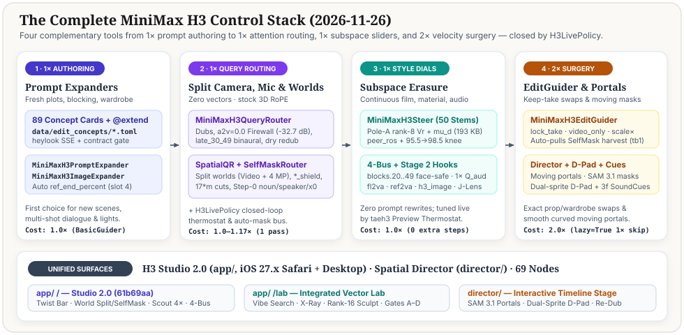
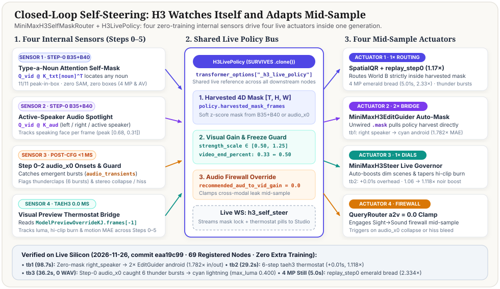
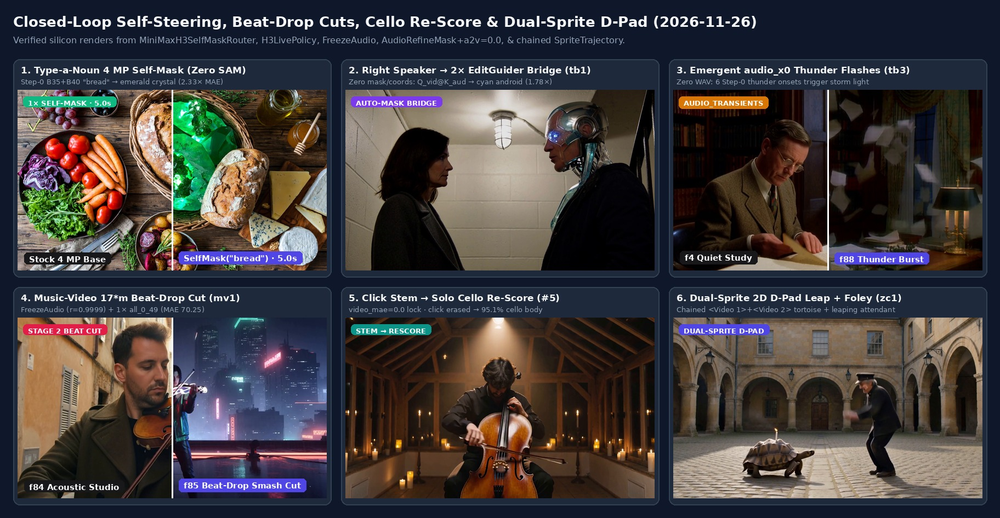
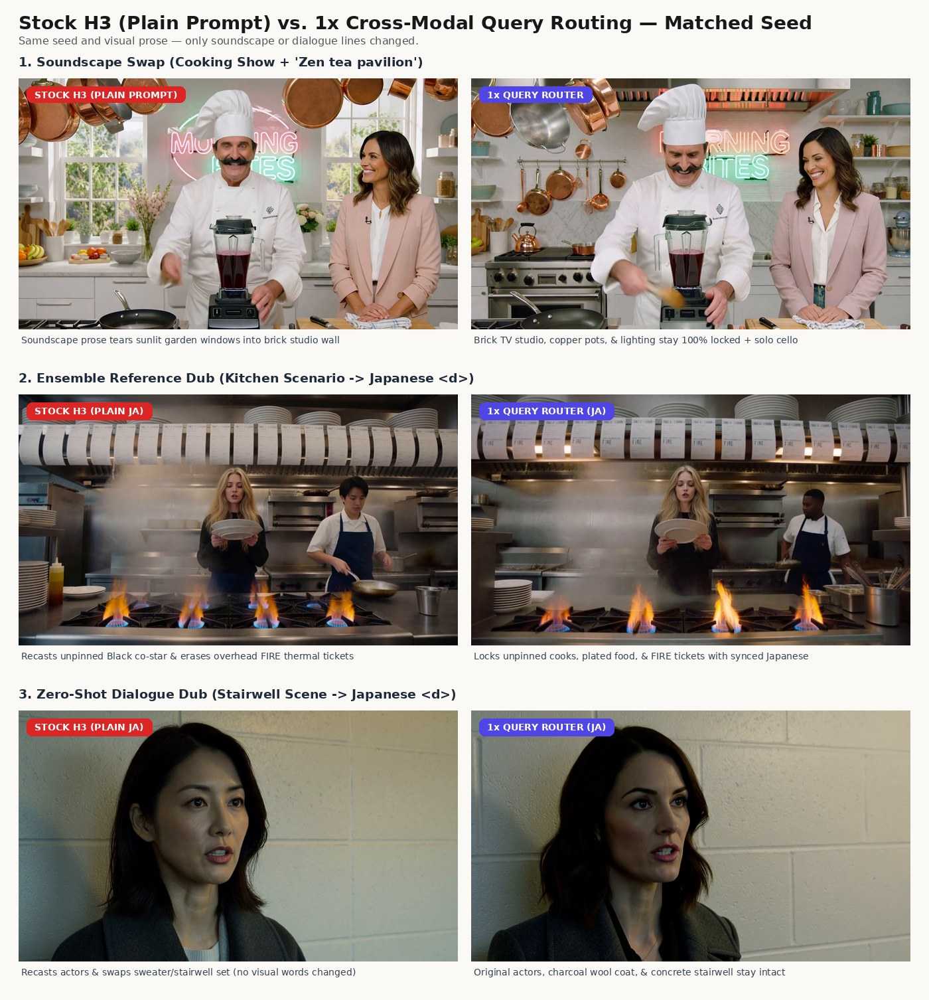
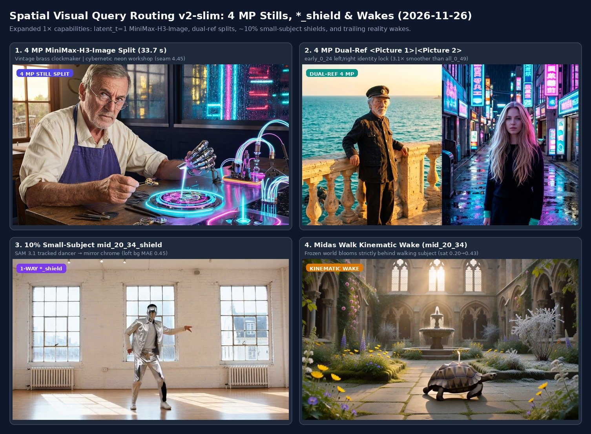
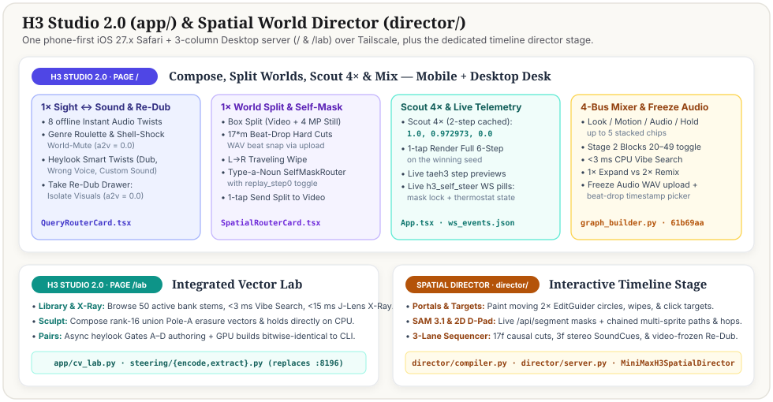

# What Works Right Now in `ComfyUI-h3-explorations`

Structured overview of every proven capability in this repository (`69` registered nodes in [`nodes.py`](../../nodes.py), `133` validated API workflows in [`workflows/INDEX.md`](../../workflows/INDEX.md), `50` active control-vector stems, plus **H3 Studio 2.0** [`app/`](../../app/README.md) and **Spatial Director** [`director/`](../../director/AGENTS.md)), ordered by **what you want to build** rather than chronological history. For the full subsystem map across core clocks, images, attention kernels, prompting, and archives, see [`index.md`](index.md).

---

## 1. Which Tool Should You Pick?

| What You Want to Do | Best Tool | Cost | Start Here |
| :--- | :--- | :-: | :--- |
| **Generate a fresh scene, wardrobe, lighting look, or multi-shot dialogue** | [`MiniMaxH3PromptExpander`](../../h3_prompt_expander.py) + `89` concept cards | `1.0×` | [`steering/heylook_auto_edit_guidance_design.md`](steering/heylook_auto_edit_guidance_design.md) · [`prompting/prompting.md`](prompting/prompting.md) |
| **Target a noun, speaking actor, or emergent thunder burst with zero masks/SAM — or auto-govern steering mid-sample** | [`MiniMaxH3SelfMaskRouter`](../../steering/live_policy.py) + `H3LivePolicy` | `1.0–1.17×` (`2×` w/ EditGuider) | [`self_steering.md`](self_steering.md) · [`h3_text_to_video_pika_self_mask_speaker_edit_guider_api.json`](../../workflows/h3_text_to_video_pika_self_mask_speaker_edit_guider_api.json) · [`h3_image_t2i_self_mask_router_api.json`](../../workflows/image/h3_image_t2i_self_mask_router_api.json) |
| **Split Camera vs. Microphone** (dubbing, soundscape swaps, `a2v=0.0` fire-mute / wrong-voice / dry redub, binaural L/R) | [`MiniMaxH3QueryRouter`](../../steering/query_router.py) | `1.0×` | [`query_routing.md`](query_routing.md) · [`query_routing_recipes.md`](query_routing_recipes.md) · [`h3_text_to_video_pika_query_router_api.json`](../../workflows/h3_text_to_video_pika_query_router_api.json) |
| **Put two worlds inside one shot, `4 MP` split still, `10%` `*_shield` subject, or `17*m` beat-drop hard cut** | [`MiniMaxH3SpatialQueryRouter`](../../steering/spatial_query_router.py) | `1.1–1.35×` | [`spatial_query_routing.md`](spatial_query_routing.md) · [`h3_text_to_video_pika_spatial_query_router_api.json`](../../workflows/h3_text_to_video_pika_spatial_query_router_api.json) · [`h3_image_t2i_spatial_query_router_api.json`](../../workflows/image/h3_image_t2i_spatial_query_router_api.json) |
| **Push continuous style, medium, motion, or audio dials without rewriting prompts** | [`MiniMaxH3Steer`](../../steering/nodes.py) (`50` Pole-A erasure stems) | `1.0×` | [`h3_steering_and_architecture.md`](h3_steering_and_architecture.md) · [`steering.md`](steering.md) |
| **Keep an existing take (`lock_take`), paint smooth curved moving portals, or choreograph sprites & `3f` foley** | [`MiniMaxH3EditGuider`](../../edit_guidance.py) + [`MiniMaxH3SpatialDirector`](../../spatial_director.py) + [`MiniMaxH3SoundCues`](../../sound_cues.py) | `2.0×` (`1×` cues/D-pad) | [`spatial_director_guide.md`](spatial_director_guide.md) · [`edit_guidance.md`](edit_guidance.md) |
| **Lock a real WAV track for video, or lock video pixels to re-score the audio** | [`MiniMaxH3FreezeAudio`](../../audio_freeze.py) / [`MiniMaxH3AudioRefineMask`](../../audio_refine.py) | `1.0×` | [`core/h3_audio_freeze.md`](core/h3_audio_freeze.md) · [`h3_text_to_video_pika_audio_freeze_beat_cut_api.json`](../../workflows/h3_text_to_video_pika_audio_freeze_beat_cut_api.json) |

---

## 2. Closed-Loop Self-Steering (`MiniMaxH3SelfMaskRouter` + `H3LivePolicy`)

MiniMax H3 already knows where every noun sits, which person is speaking, when thunder hits, and whether a frame is under-steered — **by Step 0**. [`MiniMaxH3SelfMaskRouter`](../../steering/live_policy.py) turns H3's own internal attention, `audio_x0` denoised stream, and `taeh3` step previews into a live sensor-actuator loop inside a single render ([`self_steering.md`](self_steering.md), [`bench/results/2026-11-26_full_unlock_scout_self_mask_and_thermostat.md`](../../bench/results/2026-11-26_full_unlock_scout_self_mask_and_thermostat.md)).

- **Zero-Mask Type-a-Noun (`text_phrase`, Step-0 `B35+B40`):** Extracts `Q_vid @ K_txt[noun]^T` (`11/11` peak-in-box, `3.54×–3.67×` contrast) and routes World B strictly onto that object with zero `SAM 3.1` or bounding boxes. With `replay_step0=True` (`1.17×`), turns `"bread"` in a `4 MP` still into a glowing emerald crystal geode in **`5.01 s`** (`2.334×` inside/outside MAE; shipped [`workflows/image/h3_image_t2i_self_mask_router_api.json`](../../workflows/image/h3_image_t2i_self_mask_router_api.json)).
- **Zero-Mask Speaker Localization → `2× EditGuider` Bridge (`tb1`):** For small `< 9%` faces where `1×` spatial routing loses contrast, leave `MiniMaxH3EditGuider.mask` unwired and attach `MiniMaxH3SelfMaskRouter(mask_source="right_speaker", region_conditioning=None)` upstream. `EditGuider` pulls the Step-0 `Q_vid @ K_aud` speaker mask automatically (`peak=[0.6786, 0.3125]`, `hard_cov=0.227`), transforming strictly the right speaker into a cyan-cobalt crystal android (`in_mask_mae = 38.50`, `out_mask_mae = 21.61`, **`1.782×`**) with exact lip-sync and a photoreal co-star (`98.71 s`, `141f`; shipped [`workflows/h3_text_to_video_pika_self_mask_speaker_edit_guider_api.json`](../../workflows/h3_text_to_video_pika_self_mask_speaker_edit_guider_api.json)).
- **Emergent Audio-Driven Visual Bursts (`audio_transients`, `tb3`):** With **zero WAV input**, Step-0 `_post_cfg` catches `6` emergent thunderclap onsets inside H3's own `audio_x0` (`active_latent_steps = [4, 5, 9, 11, 18, 26]`) and erupts electric-blue lightning + flying papers strictly on those bursts (`max_luma = 0.3998` at `f38` vs `0.1682` mean, `36.2 s`).
- **`0.01 s` Live Preview Thermostat (`tb2`):** Bridges `ModelPreviewOverrideKJ(taeh3.safetensors)` frames (`0.0 ms` extra decode) into `H3LivePolicy`, ramping `MiniMaxH3Steer(noir)` `strength_scale` live (`1.06 → 1.1181`, `mae_vs_openloop = 9.361`) and governing `0.33 ↔ 0.50` anti-copy-freeze release at `29.16 s` vs `29.15 s` open-loop while streaming live `h3_self_steer` WS pills to H3 Studio 2.0.

---

## 3. `1×` Cross-Modal Query Routing (`MiniMaxH3QueryRouter` — Split Camera & Mic)

Because MiniMax H3 packs video (`24 fps`) and stereo audio (`40 Hz`) into one shared `50`-block self-attention sequence, editing a dialogue language or soundscape in a plain prompt leaks into actors, sets, and props — and loud visual priors (flames, giant bikers, underwater caustics) overpower quiet or contrasting audio. [`MiniMaxH3QueryRouter`](../../steering/query_router.py) routes `Q_vid` to Prompt A and `Q_aud` to Prompt B inside the **same `1×` forward pass** ([`query_routing.md`](query_routing.md), [`query_routing_recipes.md`](query_routing_recipes.md)).

| Showcase Case (Matched Seed, `192f 1344×768`) | Plain Prompt Only (No Router) | With `1×` `MiniMaxH3QueryRouter` | Picture Drift (Plain / Routed) | Audio Signal |
| :--- | :--- | :--- | :-: | :--- |
| **Shell-Shock World-Mute (`a2v=0.0`)** | Leaked fire roar & broke `"DANGER"` sign (`-23.09 dBFS` at `g=1.0`) | Blazing warehouse flames & `"DANGER"` sign locked over anechoic breathing | `0.00` / `38.86` *(vs plain)* | **`-55.75 dBFS` (`-32.66 dB`, `55×` less crackle)** |
| **Wrong-Voice Casting (`biker`, `a2v=0.0`)** | Deep male voice (`168.70 Hz`) ignored grandma tags | Scarred 6'5" biker & `"NO CREDIT"` locked; squeaky grandma voice synced across 3 shots | `0.00` / `32.08` *(vs plain)* | **`260.21 Hz` (`+7.5 st` monotonic curve)** |
| **Pixel-Locked Dry Redub (`AudioRefineMask`)** | Frozen underwater `K_vid` pumped `4.2×` water hiss (`HF>2k = 0.1458`) | Exact source pixel lock (`2.34` MAE) + crisp dry speech, `26 s` faster uncached | `2.34` / `2.34` | **`5.8×` less HF hiss (`0.0250`), `+39%` speech** |
| **Chaos Visuals + Zen Audio (`cooking_show`)** | `"Zen tea pavilion"` tore sunlit garden windows into brick TV studio | Windowless brick TV studio locked while solo cello + whisper sync to explosion | `47.99` / `39.50` | `-16.89 dBFS`, `HF>2k = 0.0247` |
| **Ensemble `ref2va` JA Dub (`scene_kitchen`)** | Kept `<Picture 1>` blonde while recasting unpinned cooks & erasing `"FIRE"` tickets | Locks `<Subject 1>`, unpinned cooks, dishes & `"FIRE"` tickets across 4 shots | `40.03` / `28.55` | Synced overlapping + sung JA + `<\|cutoff\|>` |
| **Zero-Shot Dub (`police` / `stairwell` / `ES`)** | Translating `<d>` lines recast actors and shifted lighting/sets | Original cast, wardrobe & set locked (`ES` verified on `2` seeds + bilingual `(S1)/(S2)`) | `54.04→21.68` · `26.79→11.96` | `11.4–21.2 dB` clean acoustic shift |
| **Sitcom / Storm / Cathedral (`3` seeds)** | `overall_soundscape:` leaked 70s hair/lamps or church facades | Gritty stairwell / London street locked under laughs, storm, or reverb | `35.66→9.95` · `41.28→19.67` | Clean acoustic swap (`3/3` seeds) |
| **Underwater Video + Dry Speech (`a2v=0.0`)** | Submerged visuals dragged even dry plain prompt & `g=1.0` underwater | Keeps turquoise caustics & bubbles with close-mic dry speech | `23.40` *(vs UW base)* | **`-22.85 dBFS` (`+9.43 dB` vs `g=1.0`)** |
| **`1×` Binaural Split (`radio_drama`, `late_30_49`)** | Impossible in plain stereo (`41.70` drift, flat `H2 HF`) | Exact 1948 booth locked; Left = dry studio, Right = haunted storm mansion, 0 echo | `41.70` / `16.01` | `lr_corr = 0.1167` (`L -13.7 / R -14.4 dBFS`) |

- **Honest plain-prompting boundaries:** Plain H3 already works cleanly for pure music-genre clashes (`victorian_trap`, zero neon bleed), explicit voice-quality adjectives (`android`), visually over-specified `JA → EN` period pieces (`samurai`), heavily anchored `EN → ES` (`delta_blues`), tight single-headshot `ref2va`, and sealed-mouth narration. Avoid `audio_time_start=0.5` directly on active speech (can repeat a spoken line).
- **Shipped workflows & reels:** [`t2va`](../../workflows/h3_text_to_video_pika_query_router_api.json) · [`fl2va`](../../workflows/h3_first_last_frame_to_video_pika_query_router_api.json) · [`ref2va`](../../workflows/h3_image_ref_plus_text_to_video_pika_query_router_api.json) · [`heylook` diff presets](system_prompts/h3_query_router/README.md) · `$H3_OUTPUT_DIR/Video/h3_explorations_best_of_2026-11-25/reel_h3_explorations_best_of_2026-11-25.mp4` (`88 s`) & `query_router_showcase_2026-11-25/reel_h3_query_router_showcase_2026-11-25.mp4` (`86 s`).

---

## 4. `1×` Spatial Visual Query Routing (`MiniMaxH3SpatialQueryRouter` `v2-slim`)

Put two opposite visual worlds inside **one** seamless video shot or **`4 MP` still** in a single `1×` pass with **100% stock 3D RoPE** (zero `17f` VAE shimmer, zero paste seams; [`spatial_query_routing.md`](spatial_query_routing.md), [`bench/results/2026-11-26_spatial_qr_v2_and_showcases.md`](../../bench/results/2026-11-26_spatial_qr_v2_and_showcases.md)).

- **Seamless splits & portals (`early_0_24`, `+4.2 s` on `90f`):** Isolates World A vs. World B across `blocks 0..24` via half-length `comfy_kitchen.int8_attention` (zero dense mask) and reopens shared `K_vid_all` across `25..49` so cobblestones morph into wet neon asphalt and pedestrians cross the portal cleanly ([classic street proofs](assets/h3_spatial_query_routing_proofs.jpg)).
- **`4 MP` `MiniMax-H3-Image` splits & dual-ref `<Picture 1>|<Picture 2>`:** Splits `2368×1760` stills in **`33.7 s`** (`seam_1px_col_mae = 4.45`), and locks dual identities side-by-side (`3.1×` smoother than `all_0_49`; shipped [`workflows/image/h3_image_t2i_spatial_query_router_api.json`](../../workflows/image/h3_image_t2i_spatial_query_router_api.json)).
- **1-Way `*_shield` (`early_0_24_shield`, `mid_20_34_shield`):** Protects `~10%` small subjects (`SAM 3.1` tracked chrome dancer with spotless loft `bg_margin_mae = 0.45`, or `4 MP` Step-0 Self-Mask emerald bread `4.30×` in/out MAE) while Base keeps full canvas context.
- **Hard `17*m` multi-shot cuts, kinematic wakes, `MoGe-2` depth waves & firewalled binaural audio:** `all_0_49 + follow_mask` delivers a clean 1-frame AV smash cut at `f85` (`MAE 88.61`, `+10.56 dB` audio jump); `mid_20_34` drives trailing reality wakes (`Midas Walk`, `sat 0.203 → 0.433`) and `50.6..722.6 m` `MoGe-2` depth waves; `binaural_split` adds a visual-to-ear firewall across `30..49` (`lr_corr = 0.1406`).

---

## 5. Audio-Driven Music Videos, Stem Re-Scoring & Dual-Sprite Choreography

- **Stage 2 Music-Video Recipes ([`bench/results/2026-11-26_stage2_music_video_and_studio_unlock.md`](../../bench/results/2026-11-26_stage2_music_video_and_studio_unlock.md)):** Lock any real WAV via [`MiniMaxH3FreezeAudio`](../../audio_freeze.py) (`ref_env_corr = 0.999905`), then pair with **`1× SpatialQR(all_0_49, audio_zone="base")`** for exact `17*m` causal beat-drop smash cuts (`f84→f85` `MAE 70.25`; shipped [`h3_text_to_video_pika_audio_freeze_beat_cut_api.json`](../../workflows/h3_text_to_video_pika_audio_freeze_beat_cut_api.json)) or **`2× MiniMaxH3EditGuider(streams="video_only", first_step=1, last_step=3)` + `MiniMaxH3SpatialDirector`** for silky curved moving portals without `32×32` patch aliasing ([`h3_text_to_video_pika_audio_freeze_spatial_portal_api.json`](../../workflows/h3_text_to_video_pika_audio_freeze_spatial_portal_api.json)).
- **Click/Drum Stem Choreography → Clean Solo Cello Re-Score (`#5`):** Freeze a rhythmic `120 BPM` click/heartbeat track in Pass 1 so the cellist bows on exact beat ticks, then freeze Pass 1's video via uncached `MiniMaxH3AudioRefineMask` + `MiniMaxH3QueryRouter(a2v=0.0)` in Pass 2 — **`video_mae_vs_pass1 = 0.0`**, click erased completely (`click_env_corr = -0.078`), replaced by studio baroque solo cello (`95.08%` cello-body energy) synced to every bow stroke.
- **Dual-Sprite 2D D-Pad + `3f` Sound Cues (`zc1`):** Chain two [`MiniMaxH3AppendSpriteTrajectory`](../../sprite_trajectory.py) actors (`<Video 1>` tortoise L→C + `<Video 2>` station attendant R→C with `hop 78..102`) + `MiniMaxH3ReleaseReferences(video_end_percent=0.33)` + [`MiniMaxH3SoundCues`](../../sound_cues.py) (`"78: hop @0.85\n102: thud @0.80"`) for zero-identity-bleed multi-character choreography and synced boot-landing foley (`174.11 s`, `141f`).

---

## 6. Control Vectors, `2×` Surgical Editing, High-Res Images & Attention Stack

| Subsystem | Proven Capabilities | Canonical Docs |
| :--- | :--- | :--- |
| **`1×` Control Vectors (`MiniMaxH3Steer`)** | `50` active Pole-A Subspace Erasure stems (`fl2va`/`ref2va`/`h3_image`, `193 KB`), Stage 1 `peer_ros` + `95.5→98.5` smooth knee, Stage 2 `blocks.20..49` face-safe band + `1× Q_aud` bypass, `< 15 ms` CPU J-Lens X-Ray & `Model2Vec` holds | [`h3_steering_and_architecture.md`](h3_steering_and_architecture.md) · [`steering.md`](steering.md) · [`steering/paper/manuscript.md`](steering/paper/manuscript.md) |
| **`2×` Surgical Edit Guidance & Director** | `MiniMaxH3AutoEditPrompt` + `MiniMaxH3EditGuider` (`lock_take`, `video_only`, `[F,H,W]` masks, zero-mask `SelfMaskRouter` bridge), `MiniMaxH3SpatialDirector`, `MiniMaxH3DirectorHUD`, live GPU `SAM 3.1` | [`edit_guidance.md`](edit_guidance.md) · [`spatial_director_guide.md`](spatial_director_guide.md) |
| **Single-Frame Images (`4–16 MP`)** | `MiniMax-H3-Image` (`16 → 4 MP`, `PH3_IMAGE_VAE`, 16-still split cache, `1×` Spatial/SelfMask splits) & `P-H3-Image` (`4–8 MP`, lazy `Qwen3.5-9B` upsampler) | [`image/h3_image.md`](image/h3_image.md) · [`image/p_h3_image.md`](image/p_h3_image.md) · [`image/workflows_matrix.md`](image/workflows_matrix.md) |
| **Sparse Attention & Clocks** | `MiniMaxH3Sol` (`SOL_DENSE_TAIL="49"`, `video_reference_rows` default), `comfy-kitchen` `int8_convrot` (`int64`-safe past `99,864` tokens), `24 fps` / `40 Hz` `17n+5` & `39+51m` grid laws | [`attention/SOLATTN.md`](attention/SOLATTN.md) · [`attention/h3_quant_policy.md`](attention/h3_quant_policy.md) · [`core/h3_frame_rules.md`](core/h3_frame_rules.md) |
| **Masked V2V & Perception** | Reusable `SAM 3.1` (`SAM3-DMS`), `Sapiens2`, `SAM 3D Body`, `MoGe-2`, `MiniMaxH3RestorePlate`, & Tier-1 SQLite `bench/lane_db/` (`'fun'` campaign parked) | [`masked_v2v/AGENTS.md`](masked_v2v/AGENTS.md) · [`masked_v2v.md`](masked_v2v.md) |

---

## 7. Interactive Studio Surfaces (`app/` & `director/`) & Navigation

- **H3 Studio 2.0 ([`app/README.md`](../../app/README.md), [`steering/studio_ui_guide.md`](steering/studio_ui_guide.md), `app/.git` `61b69aa`):** Phone-first iOS 27.x Safari + 3-column Desktop server (`/` + `/lab`) unifying `1×` Query Router Twist Bar, World Split (`Box` / `17*m` WAV Beat Cut / `L→R Wipe` / `Type-a-Noun SelfMask` + `Send Split to Video`), 2-step `Scout 4×` -> 1-tap `Render Full 6-Step`, `Freeze Audio` beat analyzer, `Re-Dub Isolate Visuals (a2v=0.0)`, 4-Bus Mixer, live `taeh3` + `h3_self_steer` WS telemetry pills, and the 3-tab `/lab` Vector Studio.
- **Spatial World Director ([`director/AGENTS.md`](../../director/AGENTS.md), [`spatial_director_guide.md`](spatial_director_guide.md)):** Standalone timeline stage for painting moving `2×` portals, live `SAM 3.1` `/api/segment` masks, dual-sprite 2D D-Pad paths, `3f` stereo `SoundCues`, and video-frozen Re-Dub.

### Quick Navigation
- **Full LLM Wiki Router:** [`index.md`](index.md) · **Pending Handoffs & Queue:** [`handoffs/`](handoffs/README.md) · [`next_steps.md`](next_steps.md) · [`decisions.md`](decisions.md)
- **Rules & Inventories:** [`../../AGENTS.md`](../../AGENTS.md) · [`../../nodes.py`](../../nodes.py) (`69` nodes) · [`../../workflows/INDEX.md`](../../workflows/INDEX.md) (`133` graphs) · [`../../bench/results/INDEX.md`](../../bench/results/INDEX.md)
- **Repository Home:** [`../../README.md`](../../README.md)
