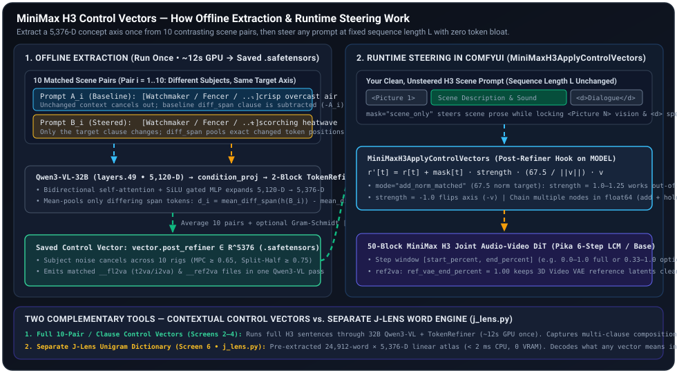

# Control Vectors for MiniMax H3 — Start Here

Activation control vectors steer MiniMax H3 video + audio generation (`t2va`, `fl2va`, `ref2va`) and single-frame `P-H3-Image` generation & editing (`p_h3_image_t2i`, `p_h3_image_edit`, `p_h3_image_guide_edit`) by adding, projecting out, or amplifying a **5376-dimensional direction** in the post-`TokenRefiner` text-conditioning space — **without changing your prompt text or token length $L$**.

Because Qwen3-VL causal attention changes every downstream token whenever you edit a single word in a prompt, ordinary prompt edits reshuffle camera framing, actor blocking, and lip-sync timing on the same seed. A control vector leaves your prompt tokens untouched and shifts only the semantic concept direction (weather, lighting, film stock, era props, motion energy, or acoustic space) across the tokens you choose.



> **More Animated Visual Explainers (Lightweight Inline SVGs)**:
> - [Surgical `diff_span` Token Pooling (`B - A`)](control_vectors/assets/diff_span_extraction.svg) — in [`2. Building Pairs & Control Vectors`](control_vectors/building_pairs_and_vectors.md#3-token-pooling-modes-pooling)
> - [Runtime Token Masks (`scene_only`), Step Windows & `ref2va` 3D VAE Gate](control_vectors/assets/runtime_steering_and_masks.svg) — in [`3. ComfyUI Nodes & Runtime Controls`](control_vectors/comfyui_nodes_and_controls.md#2-minimaxh3applycontrolvectors-inputs-explained-control_vector_nodespyminimaxh3applycontrolvectors)
> - [Gram-Schmidt Orthogonal `hold`, `< 5 ms` CPU Inversion (`--invert`) & `67.5` Norm Matching](control_vectors/assets/sculpt_and_orthogonal_hold.svg) — in [`2. Building Pairs & Control Vectors`](control_vectors/building_pairs_and_vectors.md#4-orthogonal-holds-hold---hold---hold-words) and [`4. J-Lens Diagnostics & Word Lab`](control_vectors/j_lens_diagnostics_and_word_lab.md)

---

## 1. What Control Vectors CAN and CANNOT Do

| Capability | What Control Vectors **CAN** Do Well | What Control Vectors **CANNOT** Do (Use Another Tool Instead) |
|---|---|---|
| **Atmosphere, Weather & Lighting** | Shift a scene into a blizzard, scorching heatwave, golden hour, sodium-vapor rain, noir chiaroscuro, or 16mm film grain while keeping the same shot composition. | Cannot place a specific object at exact pixel coordinates $(x, y)$ or enforce a frame-accurate silhouette mask (use the [masked V2V lane](../masked_v2v/AGENTS.md) or reference images). |
| **Invert or Combine Any Concept** | Invert any existing vector (`strength = -1.0`, e.g., flipping `blizzard` toward warm/dry air) or build its true opposite (`"calm clear air -> scorching desert heatwave"`), and stack up to 6 vectors with orthogonal holds. | Multiplying `blizzard` by `-1.0` removes snow/cold toward neutral dry air, whereas authoring `"clear mild day -> scorching desert heatwave with shimmering heat haze"` actively injects heat haze and sun glare. |
| **Independent Video vs. Audio Steering** | Steer video and audio together (`video_scale = 1.0, audio_scale = 1.0`), steer **only video** while keeping baseline dialogue/foley (`audio_scale = 0.0`), or steer **only the soundscape** (`video_scale = 0.0`). | Cannot transcribe or rewrite spoken dialogue words — dialogue words are locked by the `<|speech_start|>...<|speech_end|>` tokens in your prompt. |
| **Lock Early Composition & Geometry** | Delay steering until 33% of denoising (`start_percent = 0.33`) so the first 2 Pika steps lock identical actor pose and camera framing, applying the vector only to optical texture and lighting. | Cannot turn a single-character `ref2va` portrait into a multi-character crowd if the reference image conditioning strongly anchors a single subject at `start_percent = 0.0`. |
| **Strip Unwanted Concept Drift (`hold`)** | Project out nuisance directions (`mode = "hold"`, `--hold-words`, or `[[hold]]` pairs) such as unwanted wardrobe shifts, gender/age drift, or indoor/outdoor background bleed. | Cannot invent a brand-new character identity or face likeness from a vector alone (use `<Picture 1>` reference conditioning in `ref2va`). |

---

## 2. Control Vectors vs. J-Lens: How They Differ & How They Work Together

A common question is how a **Control Vector** differs from **J-Lens** ([`j_lens.py`](../../j_lens.py)). They are two distinct artifacts that work together:

| Dimension | **Control Vector** (`models/control_vectors/*.safetensors`) | **J-Lens** (`models/j_lens/j_lens_h3.safetensors`) |
|---|---|---|
| **What It Is** | A **single `5,376`-dimensional steering direction** (`vector.post_refiner`, plus optional `5,120`-d `vector.encoder`) representing one specific concept shift ($B - A$). | A **pre-computed `24,912 × 5,376` lexical vocabulary atlas + `TokenRefiner` Jacobian** mapping 24,912 single English words into H3's encoder and post-refiner spaces. |
| **Role in the Pipeline** | **The steering payload applied at render time** by `MiniMaxH3ApplyControlVectors` to shift video and/or audio conditioning tokens inside the DiT. | **The `< 2 ms` CPU diagnostic lens, word scrubber, and fast unigram synthesizer** used to inspect, clean, or quickly approximate control vectors without loading the 32B GPU encoder. |
| **How It Is Built** | Extracted from **10 full contrasting H3 scene prompts** (`Prompt A` vs. `Prompt B`) or **contrasting `<Picture 1>` reference images** passed through the full **32B Qwen3-VL (`layers.49`) + 2-block bidirectional `TokenRefiner`** (`~12 s` on GPU). | Pre-extracted once offline across 24,912 words in neutral cloze frames. Loaded on CPU in milliseconds with **zero GPU VRAM**. |
| **Contextual Depth** | **Full multi-clause & cross-modal context**: captures how an entire phrase or coupled visual + `soundscape:` change interacts across realistic 180-token H3 scenes (e.g., how 1974 16mm stock couples halation, grain, and color warmth, or how cryogenic flash-freeze couples rime frost with crystalline ice-cracking audio). | **Unigram (single-word) linear superposition**: knows single English words in isolation (`"blizzard"`, `"neon"`, `"cavern"`), not multi-sentence grammar or `<Subject 1>` scene structure. |
| **What You Use It For** | 1. **Production video/audio & single-frame `P-H3-Image` steering** in ComfyUI (`t2va`, `fl2va`, `ref2va`, `p_h3_image_t2i`, `p_h3_image_edit`).<br>2. **Coupled visual + soundscape steering** (`opening_framing:` + `soundscape:`).<br>3. **Reference-image look transfer** (`make-media`). | 1. **Decoding any Control Vector into English words** (`j_lens (+)` / `j_lens (-)` readout on `inspect` and `.md` sidecars).<br>2. **Pre-render readiness scoring** (`top1_gain`, `refiner_transmission`, `echo_ratio`).<br>3. **Scrubbing unwanted drift (`hold_words`)** on CPU in `< 1 ms`.<br>4. **Instant `< 2 ms` CPU word vectors** (`bench/control_vectors.py words` or the `words` field on `MiniMaxH3ApplyControlVectors`). |

> [!TIP]
> **Rule of thumb**:
> - Use a **10-pair Control Vector** (`build` or `make` from `.toml`, `.md`, or `--words "Pole A -> Pole B"`) whenever you want the highest-fidelity contextual steer across film stock, weather/atmosphere, physics/world dynamics, camera rig motion, coupled visual + audio `soundscape:` steering, or single-frame `P-H3-Image` T2I/Edit look steering.
> - Use **J-Lens** (`inspect`, `--hold-words`, or `words`) to **read out** what any control vector is doing in plain English words, **project out** unwanted nuisance words (`--hold-words "coat, parka"`) in `< 1 ms` on CPU, or **synthesize** a quick zero-GPU vector from 3–5 words when iterating on CPU.

---

## 3. Shipped Runtime Defaults (`MiniMaxH3ApplyControlVectors` & Canonical Workflows)

Every `MiniMaxH3ApplyControlVectors` node ([`h3_rules.py:266-288`](../../h3_rules.py#L266-L288), [`control_vector_nodes.py:1612-1852`](../../control_vector_nodes.py#L1612-L1852), [`control_vector_nodes.py:2502-2845`](../../control_vector_nodes.py#L2502-L2845)) and the five canonical control-vector workflows ([`workflows/build_workflows.py:4830-4908`](../../workflows/build_workflows.py#L4830-L4908)) ship with these defaults:

| Input / Setting | Shipped Default | Why This Is the Default |
|---|---|---|
| **`mode`** | **`add_norm_matched`** | Normalizes the vector to `NORM_MATCHED_TARGET = 67.5` post-refiner shift norm at `strength = 1.0`, so `strength = 1.0–1.25` behaves consistently across `diff_span`, `scene_text`, `from_first_diff`, and J-Lens vectors without manual norm math. |
| **`mask`** | **`scene_only`** | Steers scene prose while leaving tag-0 `<Picture N>` vision tokens, `<d>[Language] ...</d>` spoken dialogue, `(S1)` speaker tags, `<Picture 1>:` labels, and `<0.0 seconds>` timestamps bitwise untouched. |
| **`ref_vae_end_percent`** (`ref2va` & `P-H3-Image` Edit) | **`1.00`** (`ref_vae_aug = 0.999`) | Keeps the 3D Video VAE / `PH3ImageVAE` reference latents (`cond_video_latents` / `minimax_refs`) pinned at `0.999` across all sampling steps so frames `0` and `1` (or edited single frames) never inherit late-step noise from `seg_t["ref_img"] = max(t_v, vis_aug)`. |
| **Same-Family Video/Image Recipe Compatibility** | **`fl2va` $\leftrightarrow$ `P-H3-Image` T2I/Edit**<br>**`ref2va` $\leftrightarrow$ Guide Edit** | [`control_vectors.py::_is_same_family_h3_recipe_compatible`](../../control_vectors.py#L2169-L2196) accepts same-family H3 checkpoints (`minimax_h3_{fl2va,ref2va}_{pruned_int8_convrot,int8_convrot,bf16}.safetensors` and `p-h3-image_int8_convrot.safetensors`) and full-refiner unit-strength LoRAs (base `[]`, `pika_h3_flex_<family>_*`, `p-h3-image_lora_bf16.safetensors`, and `ref2va` Guide Edit LoRAs) out of the box (`allow_recipe_mismatch = False`), and [`control_vector_nodes.py::resolve_vector_file_path`](../../control_vector_nodes.py#L1535-L1605) auto-selects the matching `__fl2va__`/`__ref2va__` and LoRA/base sibling. |
| **Canonical `t2va` Workflows (2)** | `film_16mm_1974__fl2va__diff_span__lora_2a8c2b52.safetensors` (`strength = 1.15`) | [`workflows/h3_text_to_video_pika_control_vector_api.json`](../../workflows/h3_text_to_video_pika_control_vector_api.json) and dual-vector [`workflows/h3_text_to_video_pika_dual_control_vectors_api.json`](../../workflows/h3_text_to_video_pika_dual_control_vectors_api.json) (chaining `film_16mm_1974` + `chaos_panic` at `1.0` each). |
| **Canonical `ref2va` Workflow (1)** | `film_16mm_1974__ref2va__diff_span__lora_865ee189.safetensors` (`strength = 1.15`, `ref_vae_end_percent = 1.00`) | [`workflows/h3_image_ref_plus_text_to_video_pika_control_vector_api.json`](../../workflows/h3_image_ref_plus_text_to_video_pika_control_vector_api.json) on the 4-shot kitchen scene. |
| **Canonical `P-H3-Image` T2I & Edit Workflows (2)** | `film_16mm_1974__fl2va__diff_span__lora_2a8c2b52.safetensors` (`strength = 1.15`) | [`workflows/image/h3_p_h3_image_t2i_control_vector_api.json`](../../workflows/image/h3_p_h3_image_t2i_control_vector_api.json) (`2912x2912` single-frame T2I) and [`workflows/image/h3_p_h3_image_edit_control_vector_api.json`](../../workflows/image/h3_p_h3_image_edit_control_vector_api.json) (multi-reference single-frame edit with `ref_vae_end_percent = 1.00`). Both use `__fl2va__` vectors because `p-h3-image_int8_convrot.safetensors` is an `fl2va`-family checkpoint. |

---

## 4. How to Create Your Own Control Vector (Three Ways)

You do **not** need pre-canned scenes from `prompt_bank/` to use control vectors. The Studio UI and CLI are built for authoring **your own** vectors:

### Way A — From a Short Clause Contrast (`Pole A -> Pole B`) *(Recommended, ~12s)*
Write the baseline phrase (`Pole A`) and the target phrase (`Pole B`), for example:
- **Pole A (Baseline)**: `bathed in cool overcast daylight with crisp neutral air`
- **Pole B (Target)**: `drenched in scorching desert heatwave glare with shimmering heat-haze mirages`

The pair compiler ([`h3_pair_compiler.py`](../../h3_pair_compiler.py)) automatically embeds your contrast into **10 diverse, structurally matched H3 scene templates** (and optionally your own target prompt as Pair 0), runs them through the actual contextual **Qwen3-VL-32B (`layers.49`) + 2-block `TokenRefiner`**, and saves both `fl2va` and `ref2va` `.safetensors` vectors (`--families both` default, with convenient image/video aliases like `image`, `p-h3-image`, `t2i`, `image_edit`, `t2va`, `i2va` $\rightarrow$ `fl2va` in [`bench/control_vector/helpers.py:175-227`](../../bench/control_vector/helpers.py#L175-L227), and default Pika LoRA branches automatically attached unless `--no-lora` is passed).

### Way B — From Full Custom or LLM-Authored Prompt Pairs (`.md` / `.toml`) *(Highest Precision, ~12s)*
When you want complete control over all 10 Prompt A / Prompt B scenes (for example, zero-gravity physics, bioluminescent caverns, post-dialogue action triggers, or multi-clause transformations with `[[hold]]` pairs):
1. Follow **[7. Prompting Generative LLMs for Control Vectors](control_vectors/llm_prompting_guide.md)** (which provides copy-paste input prompt templates for [`docs/wiki/system_prompts/h3_control_vector_system_prompt.md`](system_prompts/h3_control_vector_system_prompt.md)) using either our built-in local LLM generator (`transformers` or `exllamav3` in **Studio Screen 3** / `generate-pairs`) or any external LLM service.
2. Each pair holds all non-target sections byte-identical between Prompt A and Prompt B so `pooling = "diff_span"` isolates only your changed clause.

### Way C — From Browser-Uploaded Reference Images (`Image A -> Image B`) *(Visual Look Extraction, ~15s)*
Upload or drag-and-drop two contrasting reference images directly in the **Studio UI → Create from Reference Images** screen (or pass `--image-a` and `--image-b` to `make-media`):
- **Image A**: Baseline look (e.g., flat daylight frame)
- **Image B**: Target look (e.g., graded film frame or stylized lighting reference)
Both images are snapped to an identical 32-px M-RoPE vision token grid (`short_edge = 512`) and encoded through `Qwen3-VL` + `TokenRefiner` to extract the visual difference direction.

---

## 5. What Types of Control Vectors Can You Make & How to Use Them

Different creative concepts act on different token spans, DiT denoising steps, and audio/video streams. The table and cards below show the **8 types of control vectors** you can build, **how each one works under the hood**, **which ComfyUI knobs to set on `MiniMaxH3ApplyControlVectors`**, and **direct links to the full worked example** in **[6. Practical Examples & Recipes](control_vectors/examples_and_recipes.md)**:

| Vector Type | What It Steers | Authoring Slot / Method | Key ComfyUI Runtime Settings (`MiniMaxH3ApplyControlVectors`) | Worked Example |
|---|---|---|---|---|
| **[Type 1: Film Stock, Lenses & Color Grade](#type-1-film-stock-optical-lenses--color-grade)** | 16mm halation/grain (`film_16mm_1974`), VHS tape bleed (`vhs_1991_camcorder`), noir chiaroscuro, infrared foliage, bleach bypass | `opening_framing:` (`--words`) or `.toml` bank | `strength = 1.15`, `mask = "scene_only"`, `0.00–1.00` *(or `0.33–1.00` to lock exact baseline pose on steps `0..1`)* | **[Recipe 1 →](control_vectors/examples_and_recipes.md#type-1-film-stock-optical-lenses--color-grade)** |
| **[Type 2: Coupled Sight + Sound Atmosphere](#type-2-coupled-sight--sound-atmosphere--weather)** | Scorching heatwave + cicadas, blizzard + howling wind, bioluminescent cavern + water drips, underwater caustics | Coupled `opening_framing:` + `; soundscape:` | `strength = 1.15`, `mask = "scene_only"`, `video_scale = 1.0, audio_scale = 1.0` *(or split streams independently)* | **[Recipe 2 →](control_vectors/examples_and_recipes.md#type-2-coupled-sight--sound-atmosphere--weather)** |
| **[Type 3: Physics, World Rules & `{props}` Transforms](#type-3-physics-world-rules--scene-adaptive-props-transforms)** | Zero-gravity levitation, cryogenic flash-freeze, time-freeze, miniature tilt-shift | `subject_behavior:` with `{props}` / `{surface}` or 10 LLM pairs | `strength = 1.10–1.25`, `start_percent = 0.00`, `mask = "scene_only"` *(or `mask = "after_dialogue"` for post-speech triggers)* | **[Recipe 3 →](control_vectors/examples_and_recipes.md#type-3-physics-world-rules--scene-adaptive-props-transforms)** |
| **[Type 4: Camera Rig, Motion & Framing Energy](#type-4-camera-rig-motion--framing-energy)** | Frantic handheld camcorder shake, kinetic action energy, slow-motion float, dolly zoom | `camera_motion:` (`--words`) or 10 LLM pairs | `strength = 1.00–1.20`, `start_percent = 0.00`, `mask = "scene_only"`, `audio_scale = 0.0` (visual-only) | **[Recipe 4 →](control_vectors/examples_and_recipes.md#type-4-camera-rig-motion--framing-energy)** |
| **[Type 5: Vocal Delivery & Acoustic Space](#type-5-vocal-delivery--acoustic-space)** | Whispered or panicked `(S1)` delivery, cathedral reverb, vinyl crackle, muffled underwater audio | `speech_delivery:` or `soundscape:` | `mask = "scene_only"` for vocal delivery; `mask = "soundscape_only"` or `video_scale = 0.0, audio_scale = 1.0` for audio-only | **[Recipe 5 →](control_vectors/examples_and_recipes.md#type-5-vocal-delivery--acoustic-space)** |
| **[Type 6: Visual Look Transfer from Two Stills](#type-6-visual-look-transfer-from-two-reference-images-make-media)** | Color grade, lighting mood, or texture difference between `Image A` (flat) and `Image B` (graded) | `make-media` / Studio **Screen 4** (`pooling = "scene_text"`) | `strength = 1.10–1.25`, `mode = "add_norm_matched"`, `mask = "scene_only"` | **[Recipe 6 →](control_vectors/examples_and_recipes.md#type-6-visual-look-transfer-from-two-reference-images-make-media)** |
| **[Type 7: `< 5 ms` CPU Sculpting: Flip, Blend & `hold`](#type-7-instant--5-ms-cpu-sculpting-flipping---invert-blending--orthogonal-hold)** | Flip `blizzard` $\rightarrow$ `anti_blizzard`, stack `neon + kinetic_energy`, scrub out unwanted coat/rain drift | `sculpt --invert`, `--modes`, `--hold-words` (or Studio **Screen 5**) | Outputs a single pre-orthogonally-cleaned `.safetensors` ready for `strength = 1.15` | **[Recipe 7 →](control_vectors/examples_and_recipes.md#type-7-instant--5-ms-cpu-sculpting-flipping---invert-blending--orthogonal-hold)** |
| **[Type 8: Subject Material, Era Prop, or Attire Overrides](#type-8-subject-material-era-prop-or-attire-overrides-ref2va--t2va)** | Anachronistic props (`1970s rotary phones`), marble/chrome material shifts, or `<Subject 1>` attire overrides in `ref2va` | `opening_framing:` / `subject_behavior:` with concrete baseline nouns in Pole A | `strength = 1.25–2.50`, `start_percent = 0.00, end_percent = 0.50`, `ref_vae_end_percent = 1.00` | **[Recipe 8 →](control_vectors/examples_and_recipes.md#type-8-subject-material-era-prop-or-attire-overrides-ref2va--t2va)** |

---

### Type 1: Film Stock, Optical Lenses & Color Grade
- **How it works**: Contrasts a neutral digital baseline (`Pole A`) against a physical lens or emulsion signature (`Pole B`, such as 1974 16mm Kodak Ektachrome halation and grain, 1993 VHS tracking bleed, silver-gelatin noir, or Aerochrome infrared).
- **How to use it in ComfyUI**:
  - **Full optical + lighting shift (`0.00–1.00`)**: Keep `start_percent = 0.00, end_percent = 1.00, strength = 1.15` so lighting ratios and halation shape the whole shot.
  - **Pose-locked optical grade (`0.33–1.00`)**: Set `start_percent = 0.33, end_percent = 1.00` on an 8-step Pika workflow. Steps `0` and `1` run unsteered—locking the exact actor pose, camera framing, and blocking of your baseline seed—and steps `2..7` apply the 16mm grain, halation, and color grade on top.
- **Full walkthrough & commands**: **[Type 1 in Examples & Recipes →](control_vectors/examples_and_recipes.md#type-1-film-stock-optical-lenses--color-grade)**

### Type 2: Coupled Sight + Sound Atmosphere & Weather
- **How it works**: MiniMax H3 is a joint audio-video DiT whose text conditioning contains both `integrated_multimodal_description:` (visual) and `overall_soundscape:` (audio). When you pass a coupled contrast (`opening_framing: <Pole A> -> <Pole B>; soundscape: <Audio A> -> <Audio B>`), `diff_span` extracts the joint visual + acoustic direction while leaving `<d>[Language] ...</d>` dialogue tokens untouched (`mask = "scene_only"`).
- **How to use it in ComfyUI**:
  - **Joint sight + sound (`video_scale = 1.0, audio_scale = 1.0`)**: Shifts both the visual weather (heat haze, blizzard snow, glowing cavern spores) and the ambient audio bed (cicada drone, howling wind, cavern water drips) in one pass.
  - **Split-stream control**: Set `video_scale = 1.0, audio_scale = 0.0` to steer **only the visuals** while preserving baseline audio, or `video_scale = 0.0, audio_scale = 1.0` to steer **only the soundscape** (triggers a two-pass velocity splice `[out_vid[0], out_aud[1]]`).
- **Full walkthrough & commands**: **[Type 2 in Examples & Recipes →](control_vectors/examples_and_recipes.md#type-2-coupled-sight--sound-atmosphere--weather)**

### Type 3: Physics, World Rules & Scene-Adaptive `{props}` Transforms
- **How it works**: Global physical laws (zero-gravity levitation, cryogenic flash-freeze, sudden time-stop) must act on whatever objects exist in the scene. In `--words`, the `subject_behavior:` and `interpersonal_dynamics:` slots expand scene-adaptive placeholders (`{props}`, `{surface}`, `{poss}`, `{obj}`) across all 10 canonical frames (so kitchen mugs, workshop tools, and desk papers all levitate or freeze), or you can author 10 bespoke pairs with an LLM.
- **How to use it in ComfyUI**:
  - **Start at step 0 (`start_percent = 0.00`)**: Because 3D object trajectories are committed during the first 2 denoising steps, physics vectors must be active from `start_percent = 0.00`.
  - **Post-dialogue trigger (`mask = "after_dialogue"`)**: If your prompt has a character speak a line (`<d>[English] ...</d>`) and then react, setting `mask = "after_dialogue"` restricts the vector to tokens *after* the last `</d>`, keeping the speaking performance calm before the physical effect hits.
- **Full walkthrough & commands**: **[Type 3 in Examples & Recipes →](control_vectors/examples_and_recipes.md#type-3-physics-world-rules--scene-adaptive-props-transforms)**

### Type 4: Camera Rig, Motion & Framing Energy
- **How it works**: Targets the `camera_motion:` slot (contrasting locked-off tripod framing against frantic handheld camcorder shake, whip-pans, or slow-motion floating camera drift) while holding lighting, subject wardrobe, and `overall_soundscape:` identical between Prompt A and Prompt B.
- **How to use it in ComfyUI**: Apply with `start_percent = 0.00, end_percent = 1.00, strength = 1.00–1.20, mask = "scene_only"`. Because camera trajectory is decided in the earliest denoising steps, keep `start_percent = 0.00`.
- **Full walkthrough & commands**: **[Type 4 in Examples & Recipes →](control_vectors/examples_and_recipes.md#type-4-camera-rig-motion--framing-energy)**

### Type 5: Vocal Delivery & Acoustic Space
- **How it works**:
  - **Vocal delivery (`speech_delivery:` slot)**: Contrasts the clause right before `<d>[English] ...</d>` on the 5 speaking canonical frames (e.g., `speaks in a calm measured tone` $\rightarrow$ `whispers in a hushed breathless voice`). Even with `mask = "scene_only"` (which leaves the words inside `<d>...</d>` unperturbed so lip-sync and transcript stay locked), steering the surrounding delivery clause shifts vocal timbre and facial cadence.
  - **Acoustic environment (`soundscape_only`)**: Contrasts `overall_soundscape:` (e.g., dry room tone $\rightarrow$ vast stone cathedral reverb or vinyl crackle) and applies with `mask = "soundscape_only"`.
- **Full walkthrough & commands**: **[Type 5 in Examples & Recipes →](control_vectors/examples_and_recipes.md#type-5-vocal-delivery--acoustic-space)**

### Type 6: Visual Look Transfer from Two Reference Images (`make-media`)
- **How it works**: Instead of writing text pairs, `make-media` (`MiniMaxH3MakeMediaControlVector` / Studio **Screen 4**) takes two still frames (`Image A` baseline vs. `Image B` graded/stylized), snaps both to an identical `32-px` M-RoPE vision grid (`short_edge = 512`), runs them through `Qwen3-VL` + `TokenRefiner` across the 10 `ref2va` canonical frames, and pools the post-refiner shift.
- **How to use it in ComfyUI**: Apply the resulting `.safetensors` on any `t2va`, `ref2va`, or `P-H3-Image` T2I/Edit workflow at `strength = 1.15, mode = "add_norm_matched", mask = "scene_only"`.
- **Full walkthrough & commands**: **[Type 6 in Examples & Recipes →](control_vectors/examples_and_recipes.md#type-6-visual-look-transfer-from-two-reference-images-make-media)**

### Type 7: Instant `< 5 ms` CPU Sculpting: Flipping (`--invert`), Blending & Orthogonal `hold`
- **How it works**: Once you have built a library of vectors, `sculpt` (and Studio **Screen 5**) combines them in `float64` on CPU in `< 5 ms`:
  - **Flip (`--invert` or `strength = -1.0`)**: Reverses any vector (e.g., `blizzard` $\rightarrow$ `anti_blizzard`).
  - **Blend (`--modes add_norm_matched,add_norm_matched`)**: Sums multiple concepts on the equal `67.5` norm circle (e.g., `1.0 * scorching_heatwave + 0.5 * golden_hour`).
  - **Orthogonal `hold` (`--hold` or `--hold-words`)**: Runs Gram-Schmidt projection (`project_out`) to strip unwanted collateral directions (e.g., removing `"coat, parka, heavy clothing"` from `blizzard` so indoor characters keep their normal clothes while snow blows outside).
- **Full walkthrough & commands**: **[Type 7 in Examples & Recipes →](control_vectors/examples_and_recipes.md#type-7-instant--5-ms-cpu-sculpting-flipping---invert-blending--orthogonal-hold)**

### Type 8: Subject Material, Era Prop, or Attire Overrides (`ref2va` & `t2va`)
- **How it works**: Replaces concrete object/material/garment nouns named in `Pole A` with target nouns in `Pole B` (for example, replacing modern smartphones/laptops with 1970s brass rotary phones and CRT monitors, or overriding `<Subject 1>`'s outfit in `ref2va`).
- **How to use it in ComfyUI**: Apply on the early layout window (`start_percent = 0.00, end_percent = 0.50`, `strength = 1.25–2.50`) while keeping `ref_vae_end_percent = 1.00` (`ref_vae_aug = 0.999`) so frames `0` and `1` stay clean.
- **Full walkthrough & commands**: **[Type 8 in Examples & Recipes →](control_vectors/examples_and_recipes.md#type-8-subject-material-era-prop-or-attire-overrides-ref2va--t2va)**

---

## 6. Launching the Control Vector Studio UI

```bash
COMFY="$(cd ../.. && pwd)"
"$COMFY/.venv/bin/python" bench/control_vectors.py ui
```

The Studio UI opens in your browser and is organized into **6 focused task screens** so you only see the controls you need when you need them:
1. **Vector Library & Quick Actions** — Browse built `.safetensors` and `.toml` banks, inspect quality metrics (`split_half_cosine`, `raw_norm`, recommended strength), or one-click **Invert (`-1x`)** / **Open in Sculpt**.
2. **Quick Clause Builder (`Pole A -> Pole B`)** — Build a new vector from a `Pole A -> Pole B` contrast (with optional `soundscape:` and `hold:` clauses and `target_prompt` Pair 0 injection).
3. **Full Pair & LLM Studio** — Edit all 10 Prompt A / Prompt B pairs side by side, generate pairs with a local LLM (`transformers` or `exllamav3`), or paste Markdown from any external LLM with live token-diff highlighting and `< 1 ms` CPU pair re-pooling.
4. **Media Contrast (`Image A -> Image B`)** — Drag-and-drop **Image A (Baseline)** and **Image B (Target)** in the browser to build an image-contrast vector.
5. **Subspace Sculptor (`< 5 ms` CPU)** — Stack, invert, or orthogonalize (`hold`) existing vectors in `< 5 ms` on CPU.
6. **J-Lens & Receptor Meter** — Paste your own H3 scene prompt to see per-token cosine alignment before rendering, or run `< 2 ms` CPU unigram word synthesis and lexical readouts (`models/j_lens/j_lens_h3.safetensors`).

---

## 7. Sub-Guides & Reference Index

| Guide | What It Covers |
|---|---|
| **[1. Studio UI Guide](control_vectors/studio_ui_guide.md)** | Screen-by-screen walkthrough of the 6 Studio screens, progressive disclosure, tooltips, and interactive `< 1 ms` pair re-pooling. |
| **[2. Building Pairs & Vectors](control_vectors/building_pairs_and_vectors.md)** | How pairs are built: `Pole A -> Pole B` template compilation (`h3_pair_compiler.py`), the LLM system prompt (`h3_control_vector_system_prompt.md`), why Qwen3-VL + `TokenRefiner` is used, pooling modes (`diff_span` vs. `scene_text`), and `[[hold]]` de-biasing. |
| **[3. ComfyUI Nodes & Controls](control_vectors/comfyui_nodes_and_controls.md)** | Using `MiniMaxH3MakeControlVector`, `MiniMaxH3MakeMediaControlVector`, and `MiniMaxH3ApplyControlVectors` in ComfyUI (`strength`, `mode = "add_norm_matched"`, `mask = "scene_only"`, `ref_vae_end_percent = 1.00`, `video_scale`, `audio_scale`, `words`). |
| **[4. J-Lens Diagnostics & Word Lab](control_vectors/j_lens_diagnostics_and_word_lab.md)** | How J-Lens (`j_lens.py`) differs from full 10-pair control vectors, when to use `< 2 ms` CPU word synthesis vs. 10-pair Qwen builds, and how to read `assess_steering_readiness` observables (`top1_gain`, `refiner_transmission`, `echo_ratio`) and lexical readouts. |
| **[5. Preset Catalog & CLI Reference](control_vectors/preset_catalog_and_cli_reference.md)** | Complete CLI command & flag reference (`--dit`, `--words`, `--save-toml`, `generate-pairs`, `make-media`, `sculpt --invert`, `inspect`, `grade`), file naming & JSON metadata contract, and the starter `.toml` banks in `prompt_bank/control_vectors/`. |
| **[6. Practical Examples & Recipes](control_vectors/examples_and_recipes.md)** | 8 end-to-end recipes by vector type: 1974 16mm film stock (full vs. pose-locked `0.33–1.00`), coupled visual + soundscape weather (`scorching_heatwave`), physics & `{props}` flash-freeze/zero-G, handheld camera rig motion, vocal delivery & acoustic space, reference-image look transfer (`make-media`), `< 5 ms` multi-vector sculpting with holds, and era prop / `ref2va` attire overrides. |
| **[7. Prompting Generative LLMs for Control Vectors](control_vectors/llm_prompting_guide.md)** | Copy-paste input prompts for local LLMs (`transformers`, `exllamav3`) or external LLM services using [`h3_control_vector_system_prompt.md`](system_prompts/h3_control_vector_system_prompt.md) across atmosphere, physics/zero-G, camera motion, `--words` compiler specs, and `ref2va` overrides. |

---

## 8. Common Questions (FAQ)

- **Do I have to use pre-canned `prompt_bank/` scenes like the violin busker scene?**
  **No.** The Studio UI and CLI are designed to build control vectors for **your own** concepts and scenes. In **Studio Screen 2 (`Clause Contrast Builder`)** and **Screen 3 (`Full Pair & LLM Studio`)**, you can paste your own target scene prompt as Pair 0 (`target_prompt`), write your own `Pole A -> Pole B` contrast, or edit all 10 Prompt A / Prompt B pairs directly. In **Studio Screen 6 (`Prompt Receptor Meter & Separate J-Lens Word Lab`)**, you test any vector against your own H3 prompt.
- **How do I make the opposite of an existing preset (e.g., `"scorching"` vs. `"blizzard"`)?**
  - To **flip** `blizzard` immediately (`< 5 ms` CPU), click **Invert (`-1x`)** in the Studio Library or run `"$PY" bench/control_vectors.py sculpt blizzard --invert --name anti_blizzard` (or set `strength = -1.0` in ComfyUI).
  - To **author a true opposite concept** with its own positive optical signature (shimmering heat haze, sun glare, parched ground), build `"calm mild air -> scorching desert heatwave"` via **Studio Screen 2** or `bench/control_vectors.py build --words ... --name scorching --save-toml`.
- **Are J-Lens and Control Vectors separate?**
  **Yes.** Core control vectors encode 10 full contrasting H3 scenes through the 32B contextual `Qwen3-VL` (`layers.49`) + `TokenRefiner`. **J-Lens (`j_lens.py`)** is an optional, separate `< 2 ms` CPU unigram lookup table (`24,912` single words) and linear readout (`models/j_lens/j_lens_h3.safetensors`). It lives in its own separate Studio screen (**Screen 6**) and sub-guide ([`j_lens_diagnostics_and_word_lab.md`](control_vectors/j_lens_diagnostics_and_word_lab.md)).
- **Does pair compilation (`--words`) call an LLM?**
  **No.** `--words "pole_a -> pole_b"` uses the deterministic template compiler ([`h3_pair_compiler.py`](../../h3_pair_compiler.py)) in `< 1 ms` on CPU, and then encodes the 10 compiled scenes through `Qwen3-VL-32B` + `TokenRefiner`. When you want an LLM to author 10 bespoke multi-clause scenes, use [`docs/wiki/system_prompts/h3_control_vector_system_prompt.md`](system_prompts/h3_control_vector_system_prompt.md).
- **Why does the CLI use `--dit` and `--check-dit` instead of `--unet`?**
  MiniMax H3 is a 50-block joint audio-video **Diffusion Transformer (DiT)** (`MiniMaxH3Model`), even though ComfyUI's internal folder is named `diffusion_models` / `UNETLoader`. The CLI uses `--dit` and `--check-dit` (while keeping `--unet` and `--check-unet` as hidden backwards-compatible aliases).

---

## 9. Quick CLI Cheat Sheet

| Task | Command (`PY="$(cd ../.. && pwd)/.venv/bin/python"`) |
|---|---|
| Launch the 6-screen Studio UI | `"$PY" bench/control_vectors.py ui` |
| Rebuild **all** control vectors in the default folder | `"$PY" bench/control_vectors.py rebuild` |
| Rebuild **all** control vectors in a specific folder | `"$PY" bench/control_vectors.py rebuild /path/to/control_vectors` |
| Rebuild a **single** control vector (by stem or path) | `"$PY" bench/control_vectors.py rebuild film_16mm_1974` |
| Build a vector from `Pole A -> Pole B` | `"$PY" bench/control_vectors.py build --words "calm air -> scorching heatwave" --name scorching --save-toml --overwrite` |
| Build a vector from `.toml` or `.md` | `"$PY" bench/control_vectors.py build prompt_bank/control_vectors/film_16mm_1974.toml --families both --overwrite` |
| Build a vector from two reference images | `"$PY" bench/control_vectors.py make-media --image-a flat.png --image-b graded.png --output-name look_grade --overwrite` |
| Invert an existing vector (`-1.0x`) | `"$PY" bench/control_vectors.py sculpt blizzard --invert --name anti_blizzard` |
| Combine vectors + project out hold words | `"$PY" bench/control_vectors.py sculpt scorching golden_hour --modes add_norm_matched,add_norm_matched --strengths 1.0,0.5 --hold-words "coat, parka" --name desert_gold` |
| Inspect a vector & meter a target prompt | `"$PY" bench/control_vectors.py inspect film_16mm_1974__fl2va__diff_span__lora_2a8c2b52.safetensors --prompt "A wide shot..."` |

---

## 10. Code & Research Map

- **Core math & `.safetensors` I/O**: [`control_vectors.py`](../../control_vectors.py) (`NORM_MATCHED_TARGET = 67.5`, `mean_difference`, `hold_basis`, `project_out`, `apply_post_refiner`)
- **ComfyUI nodes & runtime hooks**: [`control_vector_nodes.py`](../../control_vector_nodes.py) (`resolve_vector_file_path`, per-stream `[out_vid[0], out_aud[1]]` velocity splice when `video_scale != audio_scale`)
- **Token-span partitioner**: [`h3_spans.py`](../../h3_spans.py)
- **Deterministic 10-pair compiler**: [`h3_pair_compiler.py`](../../h3_pair_compiler.py) & [`prompt_bank/control_vectors/canonical_frames.json`](../../prompt_bank/control_vectors/canonical_frames.json)
- **J-Lens CPU engine**: [`j_lens.py`](../../j_lens.py)
- **CLI & Studio UI server**: [`bench/control_vectors.py`](../../bench/control_vectors.py) & [`bench/control_vector/`](../../bench/control_vector/__init__.py) ([`web/index.html`](../../bench/control_vector/web/index.html), [`web/style.css`](../../bench/control_vector/web/style.css), [`web/app.js`](../../bench/control_vector/web/app.js))
- **Contract check (`C7`)**: [`bench/check_control_vectors.py`](../../bench/check_control_vectors.py)
- **Research memos & measured results**: [`docs/research/control_vectors/2026-11-04_h3_control_vectors.md`](../research/control_vectors/2026-11-04_h3_control_vectors.md), [`docs/research/control_vectors/2026-11-06_j_lens_and_refiner_jacobian.md`](../research/control_vectors/2026-11-06_j_lens_and_refiner_jacobian.md), [`docs/research/control_vectors/exl3_qwen3vl/h3_control_vector_report.md`](../research/control_vectors/exl3_qwen3vl/h3_control_vector_report.md), [`bench/results/2026-11-05_control_vectors_pika_and_ref2va.md`](../../bench/results/2026-11-05_control_vectors_pika_and_ref2va.md)
