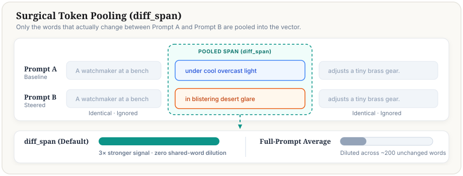
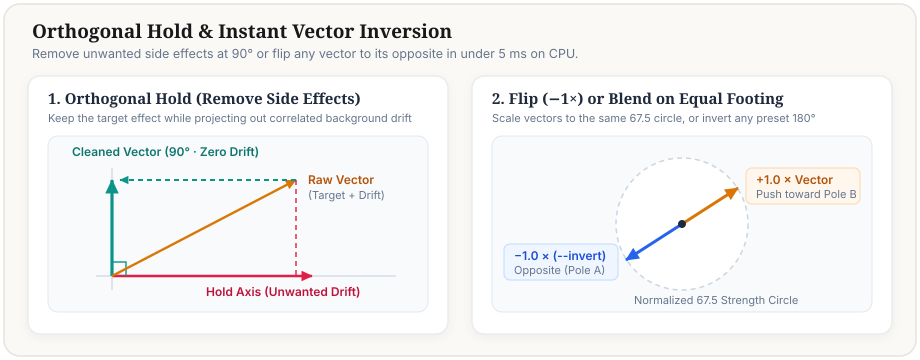

# 2. Building Pairs & Control Vectors — How It Works

**Parent guide**: [`docs/wiki/control_vectors.md`](../control_vectors.md)
**Source files**: [`h3_pair_compiler.py`](../../../h3_pair_compiler.py), [`control_vectors.py`](../../../control_vectors.py), [`control_vector_nodes.py`](../../../control_vector_nodes.py), [`h3_spans.py`](../../../h3_spans.py), [`docs/wiki/system_prompts/h3_control_vector_system_prompt.md`](../system_prompts/h3_control_vector_system_prompt.md)

---

## 1. How Are Contrastive Pairs Built?

A control vector is extracted from **8–10 contrasting prompt pairs** $(\text{Prompt A}_i, \text{Prompt B}_i)$ across diverse scenes (interior, exterior, portrait, action, architectural) where **only the target concept changes** between A and B while camera framing, subject identity, blocking, and timing stay identical.

Averaging $\mathbf{d}_i = \bar{\mathbf{h}}(\text{B}_i) - \bar{\mathbf{h}}(\text{A}_i)$ across 10 diverse scenes cancels out scene-specific nouns (faces, rooms, streets) and isolates the pure concept direction $\mathbf{v}$.

There are **two ways** to generate those 10 scene pairs:

### Method 1: Deterministic Clause Compiler (`--words "pole_a -> pole_b"`, `< 1 ms` CPU)
When you pass `--words "calm mild air -> scorching desert heatwave"` (or use **Clause Contrast** in the Studio UI), **no external LLM is called**. Instead, [`h3_pair_compiler.py`](../../../h3_pair_compiler.py) deterministically slots your `Pole A` and `Pole B` clauses into one of 6 structural H3 prompt slots across 10 diverse scene templates stored in [`prompt_bank/control_vectors/canonical_frames.json`](../../../prompt_bank/control_vectors/canonical_frames.json):
1. `opening_framing` — camera lens, film stock, lighting, color grade, and atmospheric look.
2. `subject_behavior` — physical motion, posture, expression, or environmental interaction.
3. `interpersonal_dynamics` — multi-subject interaction or spatial tension.
4. `camera_motion` — dolly, pan, crane, handheld, or focal-length dynamics.
5. `speech_delivery` — vocal tone, cadence, whisper/shout delivery around dialogue.
6. `soundscape` — ambient room tone, weather acoustics, foley, and score.

If `--slot auto` (default) is used, `resolve_slot_name` inspects your keywords and selects the matching structural slot automatically, keeping the other 5 slots of each template 100% byte-identical between Prompt A and Prompt B.

### Method 2: LLM-Authored Surgical Pairs (`h3_control_vector_system_prompt.md`)
When a concept requires bespoke physical interaction with each scene's environment (for example, `reverse_entropy` where shattered glass reassembles in one scene and spilled coffee climbs back into a mug in another), deterministic slot insertion is too rigid.

Use [`docs/wiki/system_prompts/h3_control_vector_system_prompt.md`](../system_prompts/h3_control_vector_system_prompt.md) with any capable local or frontier LLM:
- **Configurable Local Backends (Zero Hardcoded Paths)**:
  - **ExLlamaV3 (`exllamav3`)**: Users with a quantized `exl3` checkpoint can point `H3_LLM_MODEL` or `H3_EXL3_MODEL_DIR` (or `--llm-model`) and `EXLLAMAV3_ROOT` to their local folders, reusing the `ComboSampler` (`temperature=0.7, top_p=0.8, top_k=20, rep_p=1.05`) infrastructure in [`docs/research/control_vectors/exl3_qwen3vl/label_h3_control_vectors.py`](../../research/control_vectors/exl3_qwen3vl/label_h3_control_vectors.py).
  - **HuggingFace `transformers` (`transformers`)**: Users without `exllamav3` can load the full unpruned 64-layer `MiniMax-H3/text_encoder` directory or any local/HuggingFace causal or vision-language instruct model via `transformers` (configurable via `H3_LLM_MODEL` or `--llm-model`), with optional 4-bit `BitsAndBytesConfig(load_in_4bit=True)` to fit in `~18 GB` VRAM or `device_map="auto"`.
  - **Manual Copy/Paste**: Copy the system prompt from **Screen 3** of the UI into any external LLM chat and paste the generated `#### Pair N` markdown or TOML back into the editor.
- The system prompt instructs the LLM to output a **Test Scene Prompt** plus **10 Contrastive Pairs (`#### Pair 1` .. `#### Pair 10`)** and optional **Hold Pairs (`#### Hold 1 (group)`)**.
- Each pair obeys the **Single-Clause Surgical Substitution Rule**: 5 of the 6 H3 prompt sections are copied verbatim from Prompt A to Prompt B, and only the target clause changes.
- Pass the saved `.md` file directly to `"$PY" bench/control_vectors.py build my_concept.md` (or paste it into **Screen 3: Full Pair & LLM Studio** in the Studio UI).

---

## 2. Which Model Encodes the Pairs Into a `.safetensors` Vector?

Regardless of whether your 10 pairs were created via `--words` templates or via `h3_control_vector_system_prompt.md`, **building the `.safetensors` vector always uses the exact same MiniMax H3 text conditioning stack**:

1. **Stage 1 — Causal Text Encoder (`Qwen3-VL-32B-Instruct` truncated at `layers.49`, `5120`-d)**:
   Loaded via `MiniMaxH3EncoderLoader` (`h3_config.MODELS["clip"]`). Because Stage 1 is strictly causal (`is_causal = True`), every token before `first_diff` is bitwise identical between Prompt A and Prompt B (`||Delta e|| = 0.0000`).
2. **Stage 2 — DiT Condition Projection + 2-Block Bidirectional `TokenRefiner` (`5120 -> 5376`-d)**:
   Extracted directly from the target DiT checkpoint (`fl2va` or `ref2va`, plus Pika LoRA deltas when active) via [`control_vector_nodes.py::build_refiner_runner`](../../../control_vector_nodes.py) without loading the 50 DiT transformer blocks (`< 0.3 GB` RAM instead of `24 GB` VRAM).

> [!IMPORTANT]
> **Why `fl2va` and `ref2va` have separate `.safetensors` files**:
> `fl2va` (`t2va`/`i2va`) and `ref2va` have different `condition_proj` and `token_refiner` weights (cross-family cosine on identical pairs is only `~0.19`). `bench/control_vectors.py build` encodes your 10 pairs through `Qwen3-VL` **once** and runs both lightweight `TokenRefiner` runners (`--families both`) so you get matched `fl2va` and `ref2va` files in a single pass.

---

## 3. Token Pooling Modes (`pooling`)

Controlled by [`h3_spans.py::pooling_mask`](../../../h3_spans.py):

| Pooling Mode | What Tokens Are Averaged into $\bar{\mathbf{h}}(\text{A}_i), \bar{\mathbf{h}}(\text{B}_i)$ | When to Use |
|---|---|---|
| **`diff_span`** *(Default)* | Only the differing token span `[first_diff : end_diff]` between Prompt A and Prompt B (excluding chat template boilerplate and row 0 attention sink). | **Best default for all surgical pairs.** Produces high pair consistency (`MPC ~ 0.65–0.85`) and natural raw norms (`~50–85`) where ComfyUI `strength = 1.0` equals one full pair edit. |
| **`from_first_diff`** | Every scene-text token from `first_diff` to the end of the prompt. | Useful when an early clause edit intentionally re-contextualizes downstream clauses via causal attention. |
| **`scene_text`** | All user prompt tokens (dilutes a 15-token clause edit across ~220 unchanged tokens). | Required for **Media Control Vectors (`make-media`)** where text is identical and `<Picture 1>` vision tokens re-contextualize the scene text through the bidirectional `TokenRefiner`. |

---

## 4. Orthogonal Holds (`[[hold]]`, `--hold`, `--hold-words`)

If a concept direction accidentally pulls in a correlated nuisance attribute (for example, `"blizzard"` pulling indoor scenes outdoors, or `"cyberpunk"` changing acoustic dialogue), you can project out the nuisance subspace:
- **In `.toml` / `.md` pairs**: Add `[[hold]]` pairs labeled with `group = "environment"` or `group = "wardrobe"`. [`control_vectors.py::hold_basis`](../../../control_vectors.py) computes an orthonormal SVD basis $\mathbf{U}_{\text{hold}}$ and projects it out of $\mathbf{v}$.
- **On the CLI or Studio UI**: Pass `--hold <other_vector.safetensors>` or `--hold-words "coat, parka"` with `--hold-alpha 1.0` (soft attenuation $\alpha \in [0, 1]$, or over-projection $\alpha \in (1, 2]$).
