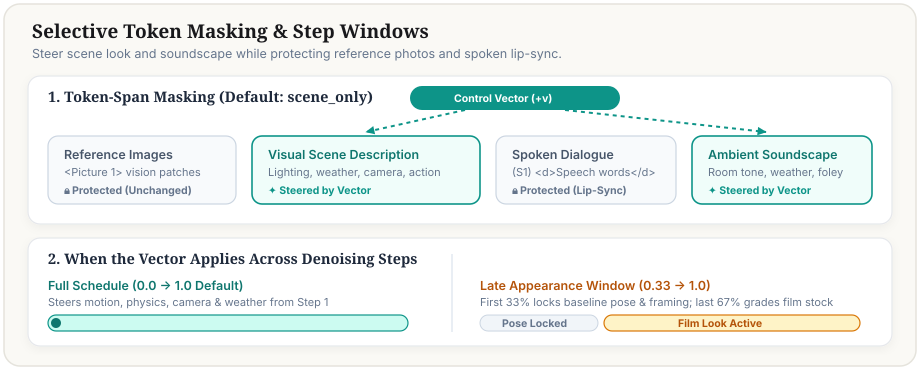

# The control vector nodes

last updated: 2026-11-11

[Back to the start page](../control_vectors.md)

Four nodes in `control_vector_nodes.py`. Each node's inputs, ranges, defaults and tooltips are its own
`define_schema`, which is what ComfyUI shows; this page says what each node is for and what to know before
using it. "The plan" is
[`../../research/control_vectors/2026-11-09_control_vector_simplification_plan.md`](../../research/control_vectors/2026-11-09_control_vector_simplification_plan.md).

| Node | Takes | Gives | For |
|---|---|---|---|
| `MiniMaxH3ApplyControlVectors` | a model and a vector file | a model | Applying a vector at render time. It goes on the model wire before the guider. Several can be chained |
| `MiniMaxH3MakeControlVector` | a model, an encoder, and a pair file or a prompt with edit clauses | the built file's name and a report | Building a vector inside a graph. It can take encoded references for a prompt that names a picture |
| `MiniMaxH3MakeMediaControlVector` | a model, an encoder and two pictures | the built file's name and a report | Building a vector from two pictures |
| `MiniMaxH3LayerNormMatch` | a conditioning and a reference conditioning | a conditioning | Scaling the text rows of a conditioning taken from an earlier encoder layer so their typical length matches the reference's; an experiment's helper, not part of steering |

Of the two build nodes, neither was run by a session on 2026-11-09; the vectors that day were built from
the command line, which runs the same build code. The second and the fourth are untested here.

## The apply node

Its defaults are `h3_rules.CONTROL_VECTOR_DEFAULTS` and `h3_rules.CONTROL_VECTOR_OPTIONAL_DEFAULTS`. What
each input is for:

- `vector_name`: the file under the models folder's `control_vectors/`. A file is built for one family and
  one recipe, and its name says which. The node refuses a file whose recipe does not match the loaded model
  unless `allow_recipe_mismatch` is on.
- `mode`: how the vector is used. `add_norm_matched`, the default, rescales the vector to one fixed length
  (`control_vectors.NORM_MATCHED_TARGET`) and adds it times `strength`, so a strength is the same push for
  any vector. `add` adds the vector as stored. `hold` takes this vector's direction out of the push the
  nodes before it in the chain have added. `project_out` and `amplify` remove or scale what the prompt's
  own rows already carry along the vector. `control_vectors.py::apply_post_refiner` is the definition.
- `strength`: the multiplier. A build prints a recommended range for the default mode
  (`control_vectors.strength_ranges`). A negative strength pushes the other way.
- `mask`: which rows are pushed (`h3_spans.py::inference_mask`). On sectioned H3 prompts, the **3-lever
  section masks** separate Visual Look, Events/Actions, and Audio while always protecting `<Picture N>` /
  `<Video N>` / `<Audio N>` / `<Subject N>`, `[Shot N]`, `<d>dialogue</d>`, `(S1)` speaker tags, section
  headers, `ref_en.md` task brackets (`[reference generation]`, etc.), and `retention_analysis:` relationship
  prefixes (`fully_preserved -`, etc.):

  | Mask mode | Lever | Rows steered |
  |---|---|---|
  | `look_only` | **Visual Look** | `subject_definitions:` + `summary:` + visual lines of `retention_analysis:` (excludes `<Audio N>:` retention lines; falls back to `description_only` on 3-field `t2va`/`fl2va` prompts) |
  | `scene_only` *(default)* | **All Visual Prose** | `look_only \| description_only` — all visual prose across the prompt, excluding `overall_soundscape:` and `non_diegetic_music:` |
  | `description_only` | **Events / Actions** | `detailed_description:` / `integrated_multimodal_description:` non-dialogue prose only |
  | `soundscape_only` | **Audio** | `overall_soundscape:` + `non_diegetic_music:` (when its body is not `"N/A"` / `"None"`) + `<Audio N>:` lines in `retention_analysis:` |
  | `after_dialogue` | Post-speech visual tail | `scene_only` rows strictly after the last `<d>...</d>` dialogue token |
  | `non_vision` | Every text row | All tag-1 non-vision tokens (including headers, tags, and dialogue) |
  | `all_rows` | Text + vision | Every row, including tag-0 vision prefix tokens |

  **One field at a time** (owner, 2026-11-11: a vector should be able to target any part of the prompt
  structure). A field's own header name is a mask for that field's prose alone, under the same protections as
  the lever masks (`h3_spans.py::FIELD_MASK_MODES`):

  | Mask mode | Rows steered |
  |---|---|
  | `subject_definitions` | The prose of every `<Subject N>` / `<Picture N>` definition line |
  | `summary` | The summary sentence, without its task bracket |
  | `retention_analysis` | The prose of every retention line, its `<Audio N>:` lines too |
  | `description_only` | `detailed_description:` or `integrated_multimodal_description:` (the lever mask above is already one field) |
  | `overall_soundscape` | The soundscape field alone |
  | `non_diegetic_music` | The music field alone |

  - A field the prompt does not have, or one that reads `N/A`, steers no rows, and the node's log says the vector had
    no effect. These masks never fall back to another field, where `look_only` does on a three-field prompt.
  - **Several fields at once: the `fields` input** (owner, 2026-11-11). It is a multi-select of the six fields
    (`h3_spans.py::PROMPT_FIELDS`; `description` is whichever description section the prompt has). With any field
    ticked, the node steers exactly the ticked fields and `mask` is not used; with none ticked, `mask` decides. The
    same selection on the CLI is `--mask subject_definitions+summary` on `inspect` and `grade`
    (`h3_spans.py::fields_mask`). The lever masks stay as the common unions: `look_only` is `subject_definitions` +
    `summary` + the visual retention lines.
  - Not possible yet: one subject and not another, or the phrases inside the description that restate a subject's
    look. Those are narrower than a field.
  - Held by `bench/check_control_vectors.py` (C2): each mask stays inside its own section, no two share a row,
    together they are the three levers, and a selection is the union of its fields.
  - **In a graph sent through the API, a ticked `fields` value is written `{"__value__": ["description"]}`.** A plain
    list there is read as a link to another node and refused (ComfyUI `execution.py`). The page wraps it itself.
  - **Rendered 2026-11-11, one seed and one picture, read from stills and from three frames a clip, so a first
    look and not a ranking.** A one-frame Pika reference still, then the 2026-11-09 diner reference shot as video
    (`Video/edit_guidance/diner16_*`), every arm rendered that day.
    - **A look vector built from description wording did not change the subject on any field.**
      `film_16mm_1974` (and `claymation_stopmotion` on the still) under `subject_definitions`, `summary`,
      `retention_analysis`, `look_only` or the multi-select of her fields: the room came out as a different draw and
      she did not change, at the shipped strength and well above it. Under the description alone, or the whole
      prompt, the room took the vector's look at the higher strength; on the still her clothing changed too, on the
      video it did not. The description alone gave about what the whole prompt gave.
    - **A vector built from her own line changed her only on the prompt that carried that line.** Built in place
      with her picture in the sequence, from one change in a sentence of `subject_definitions` saying what she wears
      (a sentence added to the shot's prompt for the build). On that prompt, on `subject_definitions` alone at the
      higher strength, her clothing changed (not to the colour the words named) and the diner stayed a diner of the
      same kind; at the shipped strength nothing changed; on the description alone she stayed as she was; on the
      whole prompt she, the room and the other patrons changed. On the shot's own prompt, which names no clothing,
      the same vector on her field changed nothing at any strength tried, with the picture held or released.
    - **A general wardrobe vector did not change her on any field.** `wardrobe_1970s`, six pairs with no picture and
      no diner wording (kept beside the clips, not in the bank). On `subject_definitions` it changed nothing on
      either prompt. On the description alone the room came out differently and she did not change. On the whole
      prompt the room and the patrons took a 1970s look, she kept the top her picture shows, and a red mark
      appeared across her face. Not tried: the whole prompt with the picture released.
    - **More of the general vector did not do it either.** On the prompt that names her clothing, the in-place
      vector began to change her between the two strengths either side of the middle of its tried range, and the
      general one left her as she was at well above that, picture held or released. So the general vector was not
      merely under-dosed along the direction that works (`render_diner16_clothed_dose.py` beside the clips holds
      the strengths).
    - **Changing her line in words changed her and nothing else**: the prompt with that sentence rewritten, alone
      and under `MiniMaxH3EditGuider`, gave the named clothing with her face, hair and the diner kept.
    - What this shows, and what it does not. With a reference picture her clothing comes from the picture unless
      the prompt names it, and the one vector that changed it was the exact difference of a sentence the prompt
      contained. That is not a rule that a vector must be built in the field it is aimed at (the next item
      measures the opposite: the field barely changes the direction), and an earlier wording of this note that said
      so was wrong; the Gemini reviewer caught it. A film look did not dress her because it is a film look, not
      because of the field its pairs were written in. The clips, stacked comparisons, frame sheets, graphs and the
      pair file are on the output share under `Video/edit_guidance` (`diner16f_*`, `diner16g_*`, `stacked/`, the
      two `how_it_was_made` folders); the stills are under `Image/field_mask_trial`.
  - **The same wording change gives nearly the same direction whichever field it is made in** (measured 2026-11-11
    on in-place builds of two contrasts, one pair each, the reference family, no picture): close between the subject
    line, the description and a three-field prompt, lower when the change sits in a retention line, and unrelated
    between the two contrasts. That is about the direction one wording change gives. It does not make a vector
    from one kind of change (a film look in the description) do another kind's job (her clothing) when moved to her
    field. Two different wordings of the same kind of change are less alike than one wording in two fields: the
    in-place clothing vector and the general wardrobe vector above sit well apart. The figures were not kept in a
    tracked record.
- `start_percent`, `end_percent`: the part of the run in which the vector is on.
- `video_scale`, `audio_scale`, `split_end_percent`: separate multipliers for the video and audio streams.
- `ref_vae_end_percent`, `ref_vae_aug`: for renders carrying 3D Video VAE visual conditioning (`ref2va`
  reference images, `fl2va` keyframes, `P-H3-Image` edits, or `MiniMaxH3GuideLatent`), how long and how
  strongly those visual VAE rows stay packed (`bench/check_control_vectors.py` holds the defaults `1.0` and
  `0.999` to core's). During `[0.0, ref_vae_end_percent)` (`step_idx / n_steps`), `ref_vae_aug` sets
  `visual_cond_noise_aug` (`aug * clean + (1 - aug) * noise`). Once `step_idx / n_steps >= ref_vae_end_percent`,
  the wrapper drops `'cond'` and `'ref_img'` segments from `PackedLayout` and clears `cond_video_latents`
  while preserving every surviving token's 3D RoPE `position_ids` and any speaker/audio reference rows
  (`ref_audio` / `cond_audio`), keeping `MiniMaxH3Sol` and `SageAttention` on their unmasked fast paths at the
  shorter sequence length (`control_vector_nodes.py::_drop_visual_cond_from_layout`, fixed on 2026-11-10 in
  `85aba935`; earlier runs with `ref_vae_end_percent < 1.0` set `visual_cond_noise_aug = 0.0` with zeroed
  latents, which injected fixed-seed Gaussian noise onto frame 0 or frames 0–1).
- `words`, `against_words`, `hold_words`, `hold_alpha`: build a vector from words at run time, or take
  words out of a loaded one, through J-Lens. See the J-Lens page for what that can and cannot be trusted
  for.

## What to know before turning things

- The push is one size on every row it reaches. A wider mask is therefore a larger total change at the
  same strength, not only a change of where (the plan, section 24).
- Which mask is right depends on the aim. `scene_only` (`look_only | description_only`) is the default
  because it steers all visual prose while protecting structural/reference/dialogue tags and excluding
  `overall_soundscape:` / `non_diegetic_music:` (visual-vs-audio section isolation verified in `Arms 59..60`
  of [`../../../bench/results/2026-11-05_control_vectors_pika_and_ref2va.md`](../../../bench/results/2026-11-05_control_vectors_pika_and_ref2va.md)).
  On a `ref2va` shot, keeping a vector off `subject_definitions:` and `retention_analysis:` (`description_only`)
  leans toward preserving the reference's prose description, while reaching them (`scene_only`) steers both
  subject look and action prose; on the 2026-11-10 reference batch (`balloon_head_inflate`), `look_only` alone
  was overridden by unsteered `detailed_description:` whereas `scene_only` applied the geometry change. Two
  cases require setting `mask` explicitly:
  - **Audio-only vectors** (`reverb_cathedral`, `pyro_klaxon_audio`, whose `pairs.differing_sections` is
    `["overall_soundscape"]`): set `mask = "soundscape_only"`, because `scene_only` excludes audio sections and
    steers `0` rows on them.
  - **Unsectioned one-sentence prompts** (`workflows/image/h3_probe_pika_image_guide_edit_control_vector_api.json`):
    set `mask = "non_vision"`, because bare edit instructions carry no H3 section headers.
- **When to adjust `ref_vae_end_percent` and `ref_vae_aug`:** On reference, keyframe, and guide-latent shots,
  the input image enters through both Qwen3-VL vision tokens and clean 3D Video VAE latents (`cond_video_latents`),
  which no text `mask` touches:
  - **Keep defaults (`ref_vae_end_percent = 1.0`, `ref_vae_aug = 0.999`):** Film stock, color grade, lighting,
    weather, lens mood (`film_16mm_1974`, `noir`, `vhs_1991_camcorder`, `wes_anderson_symmetry`), or audio
    vectors where face identity, wardrobe, and layout should stay locked across every step.
  - **Lower `ref_vae_end_percent` (`0.33` or `0.16` on 6-step Pika):** Heavy geometry, material, or world
    replacements (`claymation_stopmotion`, `felt_muppet`, `paper_origami`, `molten_lava_golem`,
    `balloon_head_inflate`, `sunken_coral_reef`) where clean VAE latents on late steps pull textures and
    silhouettes back toward the live-action input. Because `_step_in_window` tests `step_idx / n_steps < end_percent`
    (`0.000, 0.1667, 0.3333, 0.500, ...` on 6 steps), `0.16` (`0.01..0.16`) holds step `0` only (`1/6` steps),
    `0.33` (`0.17..0.33`) holds steps `0..1` (`2/6` steps), and `0.50` (`0.34..0.50`) holds steps `0..2`
    (`3/6` steps) before releasing visual VAE rows cleanly.
  - **Lower `ref_vae_aug`:** gives the model a noisier copy of the picture on the steps where it is held. Core
    mixes each condition row as that share of the picture and the rest noise, and labels the row with the larger of
    the share and the stream's own time (`comfy/ldm/minimax/model.py`, `_cond_video_rows` and `seg_t`). The node
    sends core the larger of the weight and the stream's time, so the share mixed and the label written are equal
    on every step: the picture sits at the weight until the frame being made is cleaner than that, and follows the
    frame after (`control_vector_nodes.py::_stream_time`; `bench/check_control_vectors.py` walks a schedule and holds
    it). It needs no pairing with `ref_vae_end_percent`. What a low weight does to a picture is read on stills in
    [`docs/h3_image_editing.md`](../../h3_image_editing.md); those were rendered before this change.
  - **A clothing change on a reference video, rendered 2026-11-11** (one seed, one picture, three frames a clip and
    full-size face crops; the 2026-11-09 diner shot, vectors on `subject_definitions` alone, mostly at a strength
    above the shipped one). The owner's expectation was that the picture's hold, the picture's weight and the
    vector's own `end_percent` all need to come down. What these arms show for this shot:
    - **The vector's `end_percent` removed a face artifact.** With the in-place clothing vector on for every step
      her clothing changed and a red tint appeared at her eyes. On for the first three or four of the six steps,
      the clothing changed the same way and the tint was gone.
    - **Releasing the picture was not what allowed the change, and did not allow it where it failed.** On the
      prompt that carries the sentence the vector was built from, the clothing changed with the picture held at the
      defaults, with only the hold or only the weight lowered, and with the picture held two steps at a lower weight
      and the vector on for two more. On the shot's own prompt, which names no clothing, it did not change under
      any of those. The arms with the picture released framed her closer and drew a different room than the held
      ones.
    - **The first batch's "all three lowered" arms did not stagger anything.** Its `ref_vae_end_percent = 0.34` is a
      three-step hold by the rule above (step 2 of 6 is below 0.34), the same three steps its `end_percent = 0.5`
      kept the vector on, so the picture and the vector left together. The Gemini reviewer caught this. By the same
      rule `end_percent = 0.66` is four steps and `0.67` is five.
    - At the shipped strength nothing changed in any arm. With no vector and the picture released she stayed as in
      the picture.
    - Not tried: the one-frame still, where the picture is sized to the output and may pin more, and a second seed
      or picture. The clips and stacks are on the output share under `Video/edit_guidance` (`diner16f_release_*`,
      `diner16g_*`, `stacked/`).
- A `hold` node with nothing before it in the chain has nothing to take a direction out of.
- The shipped graphs set a strength above the node's default on purpose, so a first render shows the grade
  plainly; `bench/check_widget_deviations.py` declares it.

## Where the node acts

The node wraps the model so that, at each step it is on, the refined text rows are changed before the main
blocks run (`control_vector_nodes.py`, the wrapper; `control_vectors.py::apply_post_refiner` and
`resolve_post_refiner_row_mask`, which also drives the `[h3] control vector (...) steered X/L context rows`
log line). It reads which rows are which from the span masks the conditioning node attached, and refuses when
they are missing. Nothing in ComfyUI core is patched.

With edit guidance (`MiniMaxH3EditGuider`), both `[base]` and `[edited]` carry `h3_edit_pass` metadata on
`minimax_payload` and are treated as conditioned passes (never misclassified as unconditioned CFG passes)
across active steps.
