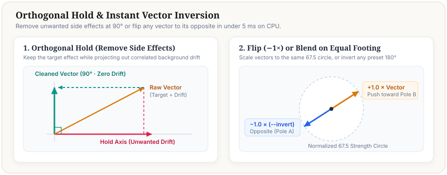

# 4. J-Lens Diagnostics & Word Lab (Separate Optional Tool)

**Parent guide**: [`docs/wiki/control_vectors.md`](../control_vectors.md)
**Source files**: [`j_lens.py`](../../../j_lens.py), [`bench/check_control_vectors.py`](../../../bench/check_control_vectors.py), [`docs/research/control_vectors/2026-11-06_j_lens_and_refiner_jacobian.md`](../../research/control_vectors/2026-11-06_j_lens_and_refiner_jacobian.md)

---

## 1. How Does J-Lens Differ from Core Control Vectors?

Core control vectors (`bench/control_vectors.py build`) run **10 full contrasting H3 scene prompts** through the **32B causal `Qwen3-VL` encoder (`layers.0..49`, `5120`-d) + 2-block `TokenRefiner` (`5376`-d)**. Because Qwen3-VL sees full multi-sentence clauses in context, 10-pair vectors capture multi-word physical relationships, camera motion, and structural context.

**J-Lens (`j_lens.py`) is a separate, optional `< 2 ms` CPU linear readout and unigram lookup table** stored in `models/j_lens/j_lens_h3.safetensors` (`~492 MB`):
- It contains a precomputed **24,912-word English vocabulary bank** (`M_union`) where each single word was probed across 7 neutral cloze prefixes through `Qwen3-VL` (`layers.49`, `5120`-d) + `TokenRefiner` (`J_ref_fl2va` and `J_ref_ref2va`, `5376`-d).
- Because it operates on **isolated unigram words** via linear ridge regression (`rank-512` Wiener readout `J_wiener_fl2va` / `J_wiener_ref2va` and `J_49_to_63`), it runs in **`< 2 ms` on CPU** without loading the 32B Qwen encoder.

### When to Use Core 10-Pair Control Vectors vs. J-Lens

| Task | Use **Core 10-Pair Build** (`build --words` or `.toml`) | Use **J-Lens Word Lab** (`words` or Studio Screen 6) |
|---|---|---|
| **Production weather, lighting, film look, camera motion, or behavioral vectors** | **Yes (Recommended)** — Full contextual Qwen3-VL encoding across 10 scenes (`~12s`). | Only for rapid `< 2 ms` rough prototyping when you don't want to load Qwen3-VL. |
| **Creating `"scorching"` (or the opposite of `"blizzard"`)** | **Yes** — Use `build --words "calm mild air -> scorching desert heatwave"` (or `sculpt blizzard --invert`). | You can prototype `"scorching, heatwave, sun, arid, desert"` in `< 2 ms`, then promote to a 10-pair build for best quality. |
| **Inspecting what an existing `.safetensors` vector points toward in English** | Automatically attached to every `.safetensors` build report (`j_lens_readout`). | **Yes** — `j_lens.decode_safetensors()` decodes any `5376`-d vector into its top `positive_words` (`+gain`) and `negative_words` (`-gain`) in `< 2 ms`. |
| **Checking pre-render observables or unigram prompt coupling** | Use **Screen 6 Sub-tab A (Contextual Prompt Receptor Meter)** for exact Qwen3-VL token metering. | **Yes** — Computes objective `assess_steering_readiness()` and `analyze_prompt_coupling()` metrics on CPU. |

---

## 2. How to Read J-Lens Diagnostics (`j_lens.py`)

When you inspect a vector in **Studio Screen 6 (J-Lens Word Lab)** or via `"$PY" bench/control_vectors.py inspect <vector>`, `j_lens.py` reports objective observables with zero fuzzy traffic-light tiers (`AGENTS.md`):

1. **Top Positive (`positive_words`) & Negative (`negative_words`) Vocabulary Readout (`j_lens.py::decode_vector`)**:
   - Returns `{space, family, norm_before_holds, norm_after_holds, alpha, positive_words: [{"word": str, "gain": float}, ...], negative_words: [...], pos_summary, neg_summary, readiness}`.
   - Each `gain` is the log-odds shift at `scale = 90` after projecting through `J_49_to_63` (and `J_wiener_{family}` for `5376`-d `post_refiner` vectors).
2. **Pre-Render Readiness Observables (`j_lens.py::assess_steering_readiness`)**:
   - Returns `{basis, basis_note, top1_gain, top3_mean_gain, refiner_transmission, echo_ratio, off_target_words, is_replacement_concept, recommended_mode, recommended_strength, summary, recommendations}`:
     - `basis`: `"unigram_synthesis"` (built in `row(M_centered)`, typical `top1_gain = 2.6..5.2`) vs. `"post_refiner"` / `"encoder"` (contextual `Qwen3-VL-32B` pair vectors, typical `top1_gain = 1.0..2.6`).
     - `refiner_transmission`: `||J_ref @ (v_enc / ||v_enc||_2)||_2` when `vector.encoder` (`5120`-d) is present (`None` when only `5376`-d `vector.post_refiner` is present).
     - `echo_ratio` & `off_target_words`: Fraction of top-8 decoded words matching the requested `pos_words`, plus any off-target words that can be scrubbed via `hold_words`.
3. **Unigram Prompt Coupling (`j_lens.py::analyze_prompt_coupling`)**:
   - Matches words in your scene prompt against the `24,912`-word bank and returns `{prompt_words_analyzed, top_receptors, mean_top3_abs_cos, max_abs_cos, receptor_note, token_heatmap}`. For exact contextual token-by-token metering through Qwen3-VL, use **Screen 6 Sub-tab A (`POST /api/prompt-meter`)**.

---

## 3. Using J-Lens `< 2 ms` Word Synthesis & `--hold-words` from the CLI



If `models/j_lens/j_lens_h3.safetensors` is installed, you can synthesize an exploratory vector from 3–6 single words in `< 2 ms` on CPU:

```bash
COMFY="$(cd ../.. && pwd)"
PY="$COMFY/.venv/bin/python"

# Synthesize a fast unigram vector for "scorching" against cool/snowy words:
"$PY" bench/control_vectors.py words \
  "scorching, heatwave, desert, sun, glare" \
  --against-words "blizzard, snow, frost, freezing, winter" \
  --hold-words "coat, parka" \
  --name scorching_quick
```

> [!TIP]
> **Single words work best in J-Lens `words`**: Because the J-Lens vocabulary bank stores `24,912` single English words, pass comma-separated single words (`"scorching, heatwave, desert, glare"`). If you want multi-word phrases (`"shimmering heat-haze mirages rising from cracked asphalt"`), use `"$PY" bench/control_vectors.py build --words "..."` instead so the full Qwen3-VL encoder processes the entire phrase in context!
