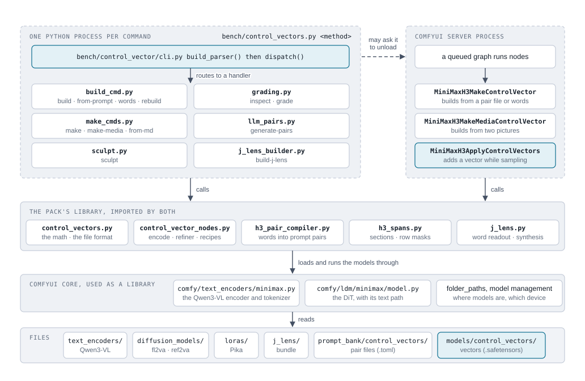
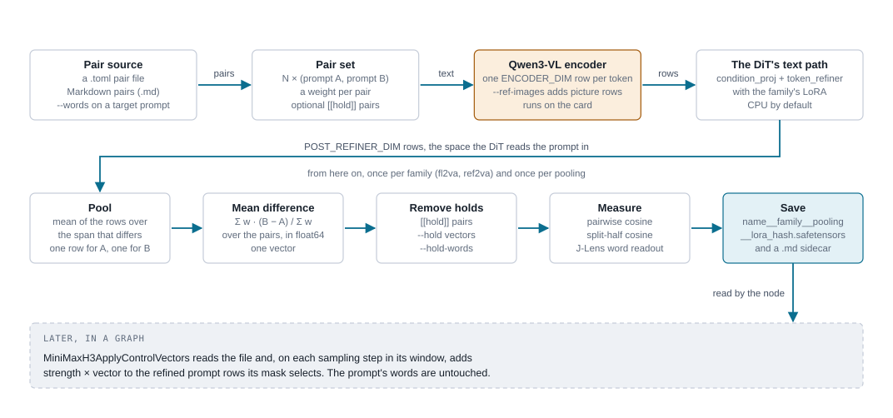
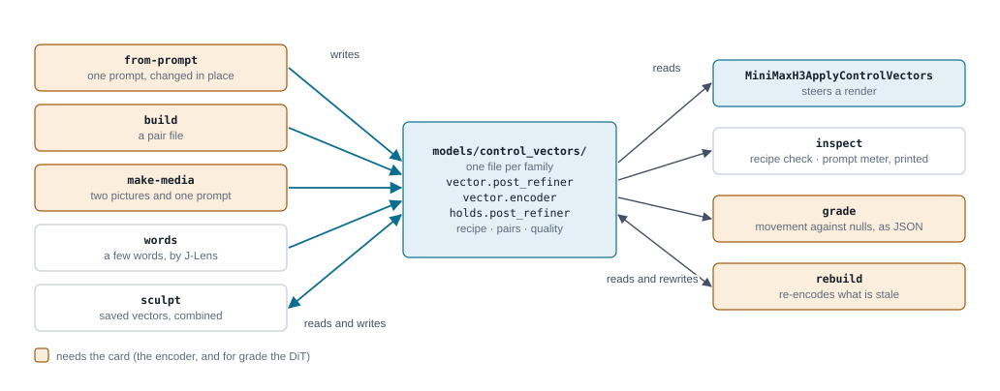
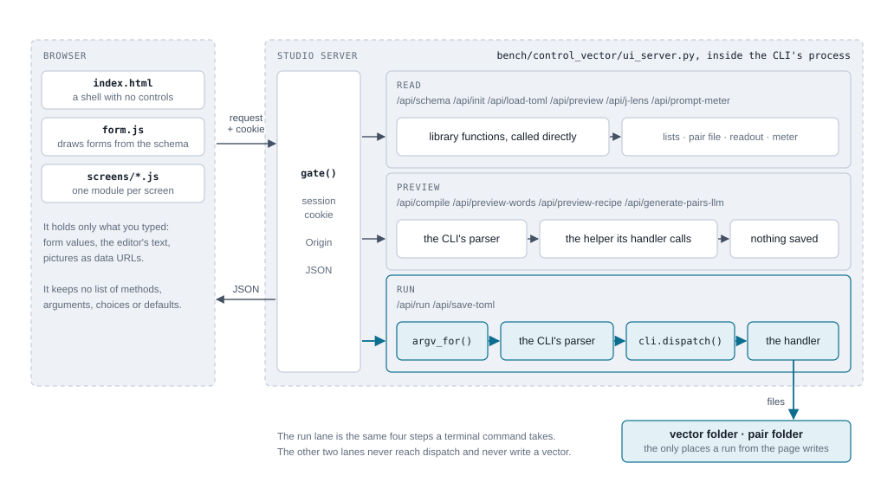
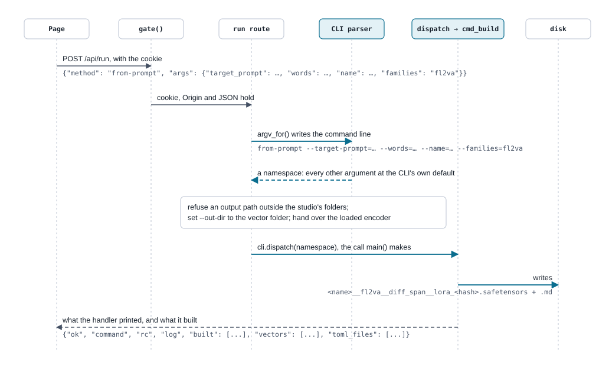

# The browser UI

last updated: 2026-11-11

[Back to the start page](../control_vectors.md)

The Control Vector Studio is the control vector command line as a page. Every control on it is drawn from the CLI's
own parser, and every button that builds or saves runs the CLI's own handler, so the page and the command line cannot
say different things about a method. It was rebuilt on 2026-11-11 on the owner's word; until then it was a hand-written
page that had fallen behind the code ([`../decisions.md`](../decisions.md), 2026-11-11).

It starts with:

```bash
<comfy-venv-python> bench/control_vectors.py ui
```

## The CLI the page stands on

The page is a second way to reach the CLI's handlers, so the CLI comes first. The five figures on this page were drawn
from the code on 2026-11-11 (`dd262ffb`).

### The layers



A command starts its own Python process. The parser in `bench/control_vector/cli.py` picks a method, `dispatch()` calls
its handler, and the handler calls the pack's library. ComfyUI's nodes call that same library from inside the server.
Neither side has model code of its own: both run the Qwen3-VL encoder and the DiT's text path through ComfyUI core.

The CLI does not need the server running. If the card is short on memory and an idle server answers, the CLI asks it to
unload first (`bench/control_vector/helpers.py::_free_idle_comfy_vram`); that is the only message between them.

### What a build does to the data



Every pair-based method follows this path. The prompts in a pair differ in one thing. Both are encoded, both are
refined the way the DiT refines a prompt, and the rows of the wording that changed are averaged on each side. The
vector is the difference, averaged over the pairs. Nothing is trained.

The row sizes are the constants `ENCODER_DIM` and `POST_REFINER_DIM` in `control_vectors.py`. A file is tied to the
checkpoint and LoRA it was refined with: that recipe is in its metadata and in the hash in its name. The figure shows
what a pair build does; it does not show that the CLI holds two copies of it (`build` and `make`) and the node a third.

### Every method: what it reads, does and writes



Five methods make vectors. The rest read them, prepare pair files, or maintain the library. A file made by any of the
five is the same kind of file, so the node, `inspect` and `grade` do not care which method made it.

| Method | Reads | Does | Writes | Runs on |
|---|---|---|---|---|
| `from-prompt` | one prompt (text or file), --words "a -> b", optional reference pictures | compile pairs in place; encode, refine, pool, save | vector files; a .toml with --save-toml | card |
| `build / from-toml` | a pair file (.toml or .md), or --words, --from-words, --all | the same build, over every pair in the file | vector files; a .toml when given Markdown | card |
| `make` | a pair file or --words | a second copy of the pair build | one vector file | card |
| `make-media / from-images` | picture A, picture B, a scene prompt | encode each picture with the prompt; pool; difference | vector files | card |
| `words / from-words` | a few words | J-Lens synthesis from its bundle | vector files | CPU |
| `sculpt` | saved vectors, a mode and strength for each | add, norm-match, or hold out; compose | a new vector file | CPU |
| `rebuild` | the vector folder and the pair folder | re-runs build for whatever is stale | vector files, refreshed | card when stale |
| `inspect` | a vector; optional prompts to meter | recipe and compatibility check; prompt meter | a printed report | CPU; card to meter |
| `grade` | a vector and a prompt | moves the prompt's rows and compares with nulls; optional DiT passes | a JSON report | card |
| `generate-pairs` | a concept | a local LLM with the pair-writing system prompt | Markdown pairs; optional .md and .toml | the LLM's |
| `from-md / import-md` | Markdown pairs | validates each pair and its differing span | a .toml pair file | CPU |
| `build-j-lens` | the encoder and both DiTs | builds or verifies the J-Lens bundle | models/j_lens/ bundle | card; CPU to verify |

## How it stays in step with the CLI

- **The page asks the server what the CLI takes.** `GET /api/schema` is the parser walked
  (`bench/control_vector/ui_schema.py::method_schema`): each subcommand, each argument, its help, default and choices.
  `bench/control_vector/web/form.js` draws a method's form from that. Add a flag to `bench/control_vector/cli.py` and it is on the page.
- **A button posts arguments, and the CLI runs them.** `POST /api/run` takes a method and an `{argument: value}` map,
  writes the argument list the command line would carry (`bench/control_vector/ui_schema.py::argv_for`), parses it with the CLI's parser and
  calls `bench/control_vector/cli.py::dispatch`, the same routing `main` uses. The result shows the command the request
  stood for.
- **A preview runs the method's own code.** "Preview the pairs" returns what `from-prompt` would encode
  (`bench/control_vector/helpers.py::_compile_pair_set_from_args`, which `build` and `make` call too); the words and sculpt previews read
  out what `words` and `sculpt` would save, without saving.
- **The node's lists come from the node.** The sculpt screen's modes are `control_vectors.APPLY_MODES` and the prompt
  meter's masks and default are the node's (`h3_rules.CONTROL_VECTOR_DEFAULTS`). Where a method cannot use a choice, the
  method refuses it and the page shows the reason.

[`bench/check_control_vector_studio.py`](../../../bench/check_control_vector_studio.py) holds all of that with the card
masked: the schema against the parser, a page request against a command line for every method, every route, and the
page's scripts against the routes. It fails if a form control or a list of modes is written into the page by hand.

## What the page talks to

The page talks only to its own server. That server is the CLI's code in a long-lived process, and its routes fall into
three lanes. Only the first reaches a CLI handler, and only the first writes a file.



- **Run.** Builds and saves go through the CLI's parser and `dispatch()`, the same steps a terminal command takes.
- **Preview.** The same parser reads the arguments, then the route calls the helper the method's handler calls and
  returns the result without saving.
- **Read.** The schema, the listings, a pair file, a word readout and the prompt meter call the library directly. No
  CLI method has the same shape as these; `inspect` prints a similar meter, but not per token.

| Route | Lane | The page sends | The server returns | Written to disk |
|---|---|---|---|---|
| `POST /api/run` | run | a method name and {argument: value} | the command line it stood for, exit code, printed log, rows for what was built, fresh listings | whatever the method writes, inside the two folders |
| `POST /api/save-toml` | run | the editor's Markdown, and from-md's arguments | the same as a run, plus the saved file's path | one .toml in the pair folder |
| `POST /api/compile` | preview | from-prompt's arguments | the compiled pairs, the sections that differ, the pairs as Markdown | nothing |
| `POST /api/preview-words` | preview | words' arguments | per family: matched words, the word readout, a suggested strength | nothing |
| `POST /api/preview-recipe` | preview | sculpt's arguments | the recipe's steps and its word readout per family | nothing |
| `POST /api/generate-pairs-llm` | preview | generate-pairs' arguments | Markdown pairs for the editor | nothing |
| `GET /api/schema` | read | nothing | every method and argument from the parser; the node's modes, masks and defaults | nothing |
| `GET /api/init` | read | nothing | the vectors and pair files on disk, the folders, LLM defaults | nothing |
| `POST /api/load-toml` | read | a pair file's name | its pairs, as rows and as Markdown | nothing |
| `POST /api/preview` | read | Markdown pairs | pair count, mode, lint warnings | nothing |
| `POST /api/j-lens` | read | a vector's name | the words it leans toward and away from | nothing |
| `POST /api/prompt-meter` | read | a vector, a prompt, a mask | a score for each token of the prompt | nothing |

### One click, traced



A Build on the Pairs screen, from the click to the files. The run route adds three things a terminal does not: it
refuses an output path outside the studio's two folders, it sets the output folder, and it hands the handler an encoder
that is already loaded, so a second build in one session does not load it again.

## The screens

| Screen | What it runs |
|---|---|
| Library | lists the vectors and pair files; `rebuild` |
| Pairs | `from-prompt` with a preview of the compiled pairs; a pair file editor that saves with `from-md`; `build`; `generate-pairs` into the editor |
| Images | `make-media` |
| Words | `words`, with a preview |
| Sculpt | `sculpt`, with a preview |
| Inspect | a saved vector's word readout; the prompt meter; `inspect`; `grade` |
| All methods | every subcommand as its own form, including `make` and `build-j-lens` |

Two things the page decides that the parser does not: which folder the studio writes to (`bench/control_vector/ui_schema.py::SERVER_SET`,
the vector and pair folders given at launch), and how a control is drawn (`WIDGETS`, `PRIMARY`). Neither is an option
or a default.

## Who may call the server

The run route executes any method, so nothing is served without the session's key
(`bench/control_vector/ui_server.py::gate`):

- **The launch link carries the key.** The server makes a token at start and prints a link ending in `?token=...`.
  Opening it once sets a cookie the page's scripts cannot read, and the token leaves the address bar. Every request
  after that, the page's own files included, must bring the cookie.
- **Nothing else gets in.** A page on another site cannot use the cookie (the browser does not send it on that site's
  requests), and a machine that can merely reach the port is refused everything.
- **It can sit behind an HTTPS front on the tailnet, as the phone studio does.** Leave it bound to `127.0.0.1` and
  open the front's address with the same `?token=...`. The server works under whatever name it is reached by.
  `--token` sets the token, so one link survives a restart.
- **A method run from the page writes only inside the studio's two folders.** An output path elsewhere is refused
  before the method runs (`bench/control_vector/ui_schema.py::OUTPUT_PATHS`). Use the command line to write elsewhere,
  or start the studio with `--vec-dir` and `--toml-dir`. Paths a method reads are not restricted.

## What changed for someone who used the old page

- **Edited pairs go through a pair file.** The old page let pairs be edited in the page and built from memory. Now
  "Edit as a pair file" moves the compiled pairs into the editor, the editor saves a `.toml`, and `build` reads it, so
  what was built can always be built again from the command line.
- **Re-pool is gone.** It had no command line form, and with nothing cached it started a full build. It returns when
  the CLI has a method for it.
- **Nothing overwrites unless `--overwrite` is ticked**, as on the command line. The old page always overwrote.
- **The families setting is per method**, at the method's own default. The old page had one setting for every screen,
  which built image contrasts for both families where the method's default is `ref2va`.

## What has been run, and what has not

Run on 2026-11-11: the page in headless Chrome against a server with the card masked (every screen drawn, a words save,
a sculpt save, a pairs preview and a pair file save, a word readout), and one `from-prompt` build on the card through
`/api/run`. Not run through the page on the card: `build` from a pair file, `make-media`, `rebuild`, `inspect`, `grade`,
the prompt meter and `generate-pairs`.

The page shows the CLI as it is, so the CLI's own gaps show too: `from-prompt --frame` has no effect, `--mode l2va` is
offered and refused, and `--ref-role` and `generate-pairs --load-in-4bit` are read by nothing. Those are the CLI's to
fix. One was fixed on 2026-11-11: `grade` has a `--mode` that defaults to the node's (`add_norm_matched`), where it used
to apply in `add` whatever a graph ran.

A mask on the page is one control, a named mask or prompt fields ticked, on `inspect`, `grade` and the prompt meter
(`bench/control_vector/web/form.js`, `maskControl`). It is the node's `mask` and `fields` inputs together and gives
the CLI's `--mask` value.
