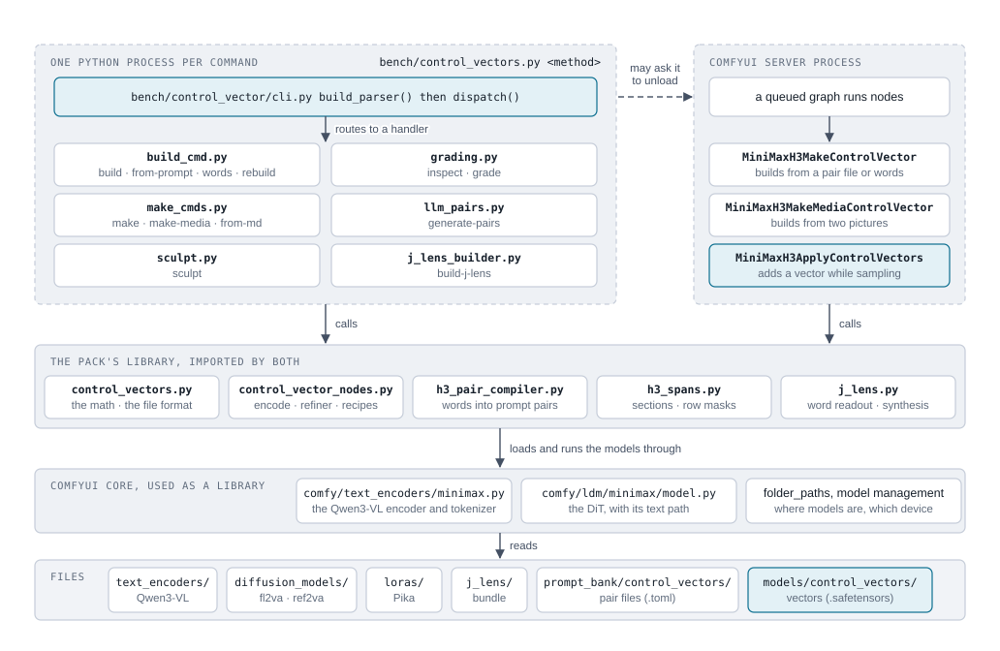
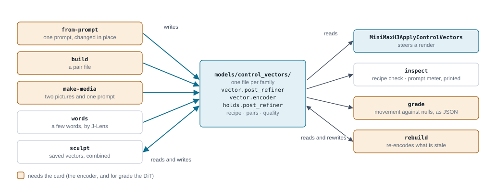
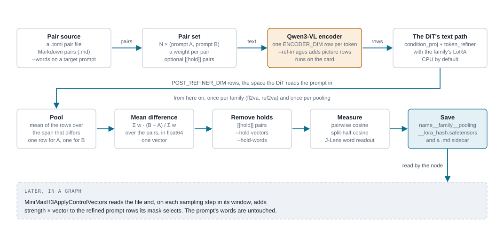
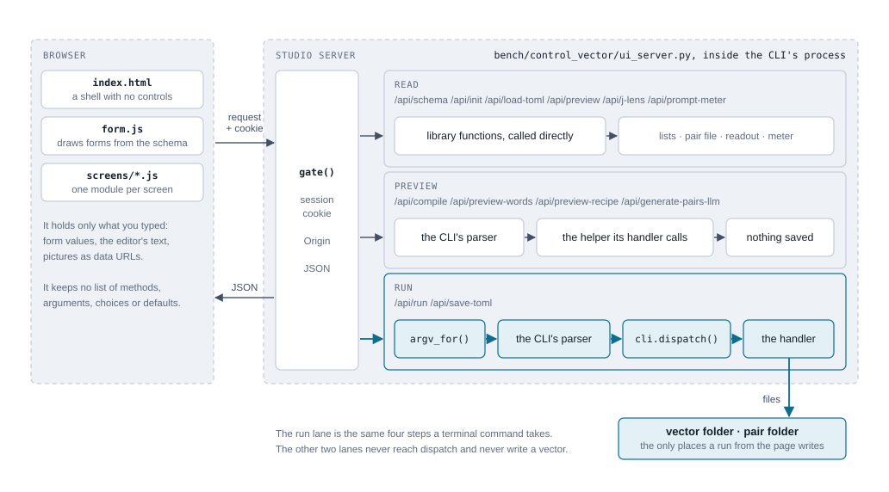
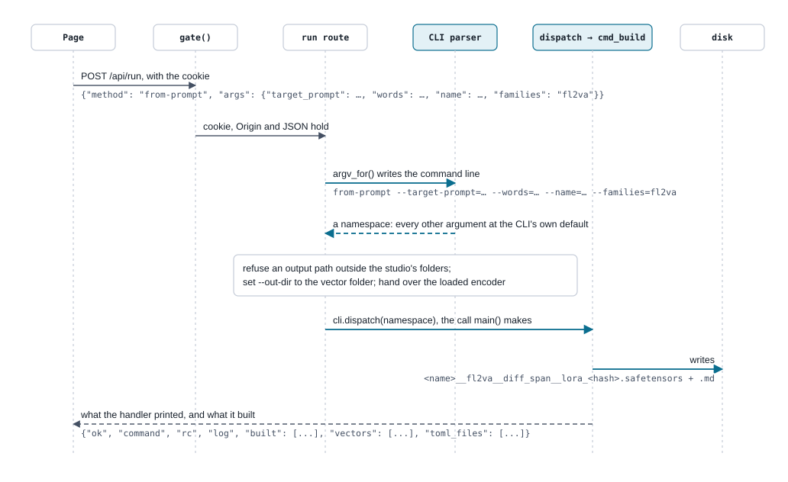

# Control Vector Studio (`bench/control_vectors.py ui`)

Last updated: 2026-11-21 (Subspace X-Ray `X-Ray` drawer in Library/Inspect/Word Lab, rank-16 `sculpt` erasure composition, and per-token `||E(h_i)||_2` meter).

`bench/control_vectors.py ui` launches a self-contained local browser workbench (`bench/control_vector/ui_server.py` + `bench/control_vector/web/`) for authoring, inspecting, sculpting, metering, and grading H3 control vectors without leaving your browser.

```bash
/path/to/comfy-venv/bin/python bench/control_vectors.py ui
```

By default, the server binds only to `127.0.0.1` on an ephemeral free port, prints a tokenized launch URL (`http://127.0.0.1:<port>/?token=<random>`), and opens a browser tab (pass `--no-browser` on a headless box or `--port 8765 --token <fixed>` to keep a bookmarkable localhost port).

---

## 1. The CLI the page stands on

<a id="the-cli-the-page-stands-on"></a>



Studio is a thin, schema-driven front end over `bench/control_vectors.py`—not a forked implementation:

1. **Live parser introspection**: On startup, Studio inspects `bench/control_vectors.py`'s `argparse` subparsers (`ui_state.py`) so every flag, default, and enum dropdown (`mask`, `mode`, `pooling`, `families`) stays automatically synchronized with `h3_rules.py`, `h3_spans.py`, and `control_vectors.py`.
2. **Exact CLI provenance**: Every action executed in Studio returns the exact `bench/control_vectors.py <subcommand> ...` command line it ran (`res["command"]`), verified end-to-end by `bench/check_control_vector_studio.py`.
3. **One shared pair-build implementation (`fb3c978d`, 2026-11-11)**: Studio's build routes, CLI `build` / `from-prompt` / `make`, and ComfyUI's `MiniMaxH3MakeControlVector` node all call the **single** [`control_vector_nodes.py::encode_pair_set`](../../../control_vector_nodes.py) + [`control_vectors.py::pool_pair_set`](../../../control_vectors.py) + [`control_vectors.py::pairs_record`](../../../control_vectors.py) pipeline in-process (so Studio and CLI builds work even when the ComfyUI server on `:8188` is stopped, while producing bitwise-identical tensors to `:8188`).

---

## 2. Screens and workflows inside Studio



| Screen | Backed by | What you do there |
|---|---|---|
| **Library & Inspect** | `inspect` + `j_lens.py` | Browse every `.safetensors` vector in `models/control_vectors/`, see its `erasure` rank (`r=8` / `r=16` vs. `1D only`), click **X-Ray** for an instant `< 15 ms` **Subspace X-Ray** (`Adds mu_d` + `Erases Pole A: vr[0..3]`), preview live `--hold-words` / `--hold` scrubbing, and run a **Token-Wise Prompt Receptor & Erasure Scan** against any prompt. |
| **Word Lab (`words`)** | `words` (`j_lens.synthesize_from_words`) | Type single words, `Model2Vec` multi-token terms/phrases (`silver gelatin`, `paper origami`, `muppet`), `against_words` (`@replace_digital, sunlit, warm`), and `hold_words` on CPU (`< 2 ms`), preview both the 1D readout and synthesized `against`-SVD **Subspace X-Ray**, and save `fl2va` + `ref2va` `.safetensors` files. |
| **Sculpt (`sculpt`)** | `sculpt` (`control_vectors.APPLY_MODES`) | Combine multiple library vectors (`add_norm_matched_erasure`, `add_norm_matched`, `add`, `hold`) and `hold_words` in `< 5 ms` on CPU into a single Ready-to-Render `.safetensors` file preserving up to **`COMPOSED_ERASURE_MAX_RANK = 16`** union erasure directions. |
| **Build (`from-prompt`, `from-toml`, `make-media`, `from-md`)** | `build`, `from-prompt`, `make-media`, `from-md`, `generate-pairs` | Author or import LLM Markdown pairs, preview exact `diff_span` token highlights before loading the GPU, or upload two contrasting `<Picture 1>` images (`make-media` `ColQwen`-style patch erasure) and build `fl2va`/`ref2va`/`h3_image` `.safetensors` files. |
| **Meter & Grade** | `inspect --meter` & `grade` | Unified `maskControl` picker (`scene_only` default) supporting lever masks, single H3 fields (`subject_definitions`, `description_only`, `overall_soundscape`, ...), and multi-field `a+b` selections, reporting both 1D projection and **Top Erased Prompt Tokens (`||E(h_i)||_2`)**, plus `--mode` (`add_norm_matched_erasure` supported in `grade`). |
| **Methods Reference** | Parser schema (`methods.js`) | Auto-generated interactive reference of every `bench/control_vectors.py` subcommand and argument. |



---

## 3. Concurrency, GPU lane serialization, and security



1. **Two execution lanes (`CPU` vs. serialized `GPU` lock)**:
   - CPU endpoints (`inspect`, `words`, `sculpt`, `from-md`, receptor scans, library listing) run immediately in `< 15 ms` without touching CUDA.
   - GPU endpoints (`build`, `from-prompt`, `make-media`, `grade`, `inspect --meter`, `generate-pairs`) acquire a single server-side GPU lock so two browser clicks never load `Qwen3-VL-32B` + H3 DiT simultaneously and OOM the card. (Check `nvidia-smi` / `:8188` queue before running heavy GPU builds while ComfyUI is actively sampling.)
2. **Loopback binding, session cookie gate, and path confinement**:
   - Every HTTP request is gated by an `HttpOnly; SameSite=Strict` session cookie exchanged from the one-time `?token=...` launch URL (`gate` in `ui_server.py`), blocking cross-origin browser requests (`Origin` / `Host` / DNS-rebinding safe).
   - File reads and writes are strictly confined (`OUTPUT_PATHS`) to `models/control_vectors/`, `prompt_bank/`, `data/control_vectors/`, and comparison clips under `$H3_OUTPUT_DIR/Video/control_vectors/`.



---

## 4. Offline Studio verification

`bench/check_control_vector_studio.py` boots Studio on an ephemeral localhost port with `CUDA_VISIBLE_DEVICES=` masked, verifies cookie/origin gates, path-confinement refusals, unified `maskControl` (`a+b`) parity, `words`, `sculpt`, `from-md`, and headless/API contracts:

```bash
CUDA_VISIBLE_DEVICES= /path/to/comfy-venv/bin/python bench/check_control_vector_studio.py
```
