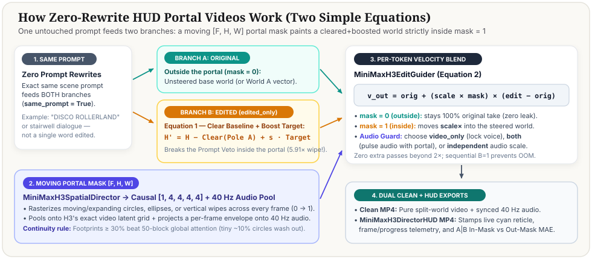
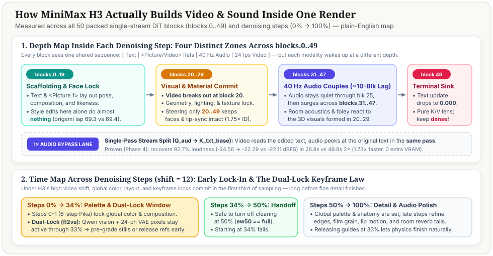
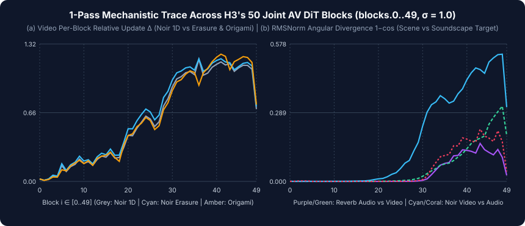
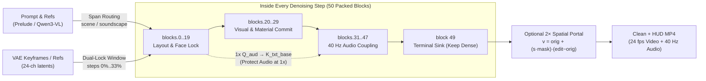

# Inside H3's 50-Block Audio-Video Brain & Zero-Rewrite HUD Portals: The "So What" Guide

**Last verified:** `2026-11-22` (verified against `comfy/ldm/minimax/model.py`, `sol_attn_h3.py`, `edit_guidance.py`, `spatial_director.py`, `control_vectors.py`, `j_lens.py`, Phase 3 `stage_c`/`stage_d`, Phase 4 `showcase_b`/`showcase_c`/`showcase_d`, and Wave 2 `spotlights` JSON logs on disk)  
**Audience:** Anyone exploring or building on MiniMax H3 in this repo — **one single plain-English, visual "So What" entry** consolidating how H3's 50-block audio-video brain works, how the zero-rewrite HUD portal videos work, what all of it unlocks beyond steering, and what is proven without hype. Deep linear algebra and formal papers are linked at the bottom.

---

## The So What (60-Second Plain-English Summary Across Everything)

MiniMax H3 is not a video generator with audio bolted on. It packs **text**, **reference pictures/videos**, **40 Hz stereo audio**, and **24 fps video** into **one shared stack of 50 Transformer blocks (`blocks.0..49`)** and denoises them together. Five discoveries from probing that shared stack change how you use every workflow in this repository:

1. **H3 builds the picture first (`blocks.20..29`), then builds the sound to match it (`blocks.31..47`), and finishes through one readout bottleneck (`block 49`).**
   - `blocks.0..19` lay out pose, composition, and `<Picture 1>` likeness — material edits there alone do almost nothing.
   - `blocks.20..29` is where visual geometry, lighting, and surface materials actually commit. Routing style only from `blocks.20..49` lets you restyle clothing and sets while keeping a reference person's face and lip-sync intact.
   - `40 Hz` audio wakes up roughly **10 blocks behind video** (`blocks.31..47`), matching acoustics and foley to the 3D scene that just formed.
   - At `block 49`, text stops updating completely (`0.000` change) and acts purely as a terminal readout lens — explaining why `block 49` must stay dense in [`MiniMaxH3Sol`](../../../sol_attn_h3.py) (`dense_blocks="49"`) and rotated in INT8 ([`h3_block49_quant_error.md`](../attention/h3_block49_quant_error.md)).
2. **You can split what video listens to and what audio listens to inside a *single* render pass (`1x`).**
   - Because video and audio share all 50 blocks, dark or moody visual edits often drag audio loudness down (`-2.5` to `-13.4 dB`). Previously, protecting dialogue meant running **`2x` guidance** (`streams="video_only"`).
   - Letting audio queries peek at the *original* unsteered text while video queries read the *edited* text inside one pass (`1x Q_aud → K_txt_base`) recovered **`92.7%` of lost audio loudness** (`-24.56 → -22.29 dBFS` vs. `-22.11 dBFS` base) at **`1.73×` the speed** (`28.8s` vs. `49.9s`) and **zero extra VRAM**.
3. **Global color, layout, and keyframes lock in during the first third of denoising (`0%–34%`), and keyframes carry *two* locks.**
   - Under H3's `shift = 12` schedule, steps `0%–34%` lock global palette and layout; starting after `34%` misses the train.
   - On `fl2va` and `ref2va`, reference pictures enter through **both** Qwen vision tokens (`tags == 0`) **and** raw 24-channel Video VAE latents (`cond_video_latents` / `ref_img`). Even when you release VAE references at `33%`, unsteered `tags == 0` vision tokens + clean `0.999` early VAE latents still veto text-only color changes (which is why Showcase 3's `ref2va` bookstore & `fl2va` noodle strips looked unchanged). Full keyframe re-grading means either pre-grading the still (`MiniMax-H3-Image`, `~3s`) or steering vision tokens + releasing refs early.
4. **In a frozen-prompt generator, clearing beats shouting — and you can X-ray any `193 KB` dial on CPU in `< 15 ms`.**
   - Because H3 re-reads the exact same prompt tokens at every step and block, adding a new look (`noir`, `claymation`) gets vetoed whenever the prompt describes warm daylight or live-action skin. Subtracting the opposing baseline variation out of your prompt first (`add_norm_matched_erasure`) breaks that veto in `1` pass — and our CPU Jacobian-lens X-Ray ([`j_lens.py`](../../../j_lens.py)) shows what any dial *adds* and *clears* in `< 15 ms` before you touch the GPU.
5. **Combining baseline clearing with one simple spatial velocity equation powers our Zero-Rewrite HUD Portal Videos.**
   - Feed the **exact same untouched prompt** into two branches (`original` = base world, `edited` = cleared + boosted world via `MiniMaxH3Steer(edit_pass="edited_only")`), sweep a moving `[F, H, W]` mask from [`MiniMaxH3SpatialDirector`](../../../spatial_director.py) across [`MiniMaxH3EditGuider`](../../../edit_guidance.py) (`v_out = orig + (scale × mask) × (edit − orig)`), and stamp live reticle + A|B telemetry with `MiniMaxH3DirectorHUD` — splitting a scene cleanly between two worlds (`5.91×` Disco Wipe, moving/expanding Wave 2 HUD spotlights) without rewriting a single word of the prompt!

---

## Quick Map: Code, Workflows, & Supporting Docs

| What You Want | Jump Straight Here |
| :--- | :--- |
| **Zero-Rewrite HUD Portals & Spatial Director** | [`spatial_director.py`](../../../spatial_director.py) · [`edit_guidance.py`](../../../edit_guidance.py) · [`spatial_director_guide.md`](../spatial_director_guide.md) · [`edit_guidance.md`](../edit_guidance.md) · [`workflows/h3_spatial_portal_pika_erasure_api.json`](../../../workflows/h3_spatial_portal_pika_erasure_api.json) · [`workflows/h3_spatial_portal_pika_api.json`](../../../workflows/h3_spatial_portal_pika_api.json) |
| **Core H3 50-Block DiT & `PackedLayout`** | ComfyUI `comfy/ldm/minimax/model.py` (`MiniMaxH3Model`, `FinalLayer`) · [`h3_conditioning_end_to_end.md`](h3_conditioning_end_to_end.md) · [`h3_frame_rules.md`](h3_frame_rules.md) |
| **Sparse Attention & `block 49` Protection** | [`sol_attn_h3.py`](../../../sol_attn_h3.py) (`dense_blocks="49"`) · [`attention.py`](../../../attention.py) · [`SOLATTN.md`](../attention/SOLATTN.md) · [`h3_block49_quant_error.md`](../attention/h3_block49_quant_error.md) |
| **References, Keyframes & `0.33` Release** | [`conditioning.py`](../../../conditioning.py) · [`reference_conditioning.py`](../../../reference_conditioning.py) · [`h3_references.md`](h3_references.md) · [`workflows/h3_first_last_frame_pika_api.json`](../../../workflows/h3_first_last_frame_pika_api.json) |
| **Audio Freeze, Re-Dub & Audio Refinement** | [`audio_freeze.py`](../../../audio_freeze.py) · [`audio_refine.py`](../../../audio_refine.py) · [`frozen_video_cache.py`](../../../frozen_video_cache.py) · [`h3_audio_freeze.md`](h3_audio_freeze.md) |
| **`1x` Steering, X-Ray & `4 MP` Image Workflows** | [`control_vectors.py`](../../../control_vectors.py) · [`j_lens.py`](../../../j_lens.py) · [`workflows/h3_text_to_video_pika_control_vector_api.json`](../../../workflows/h3_text_to_video_pika_control_vector_api.json) · [`workflows/image/h3_image_t2i_control_vector_api.json`](../../../workflows/image/h3_image_t2i_control_vector_api.json) |
| **`MiniMaxH3Steer` `blocks.20..49` + `1x Q_aud` Hooks (Shipped `340e8ded`)** | [`steer_attention_hooks.py`](../../../steer_attention_hooks.py) · [`control_vector_nodes.py`](../../../control_vector_nodes.py) (`block_band`, `split_backend="auto_1x_kv"`) · [`2026-11-22_unified_steer_attention_hook_spec.md`](../research/control_vectors/2026-11-22_unified_steer_attention_hook_spec.md) |
| **Full Math, Paper v4, & Independent Critique** | [`how_pole_a_erasure_works.md`](../steering/how_pole_a_erasure_works.md) · [`2026-11-21_from_late_interaction_retrieval_to_av_dit_steering.md`](../research/control_vectors/2026-11-21_from_late_interaction_retrieval_to_av_dit_steering.md) · [`2026-11-22_paper_v4_critical_review_prior_art_and_revision_plan.md`](../research/control_vectors/2026-11-22_paper_v4_critical_review_prior_art_and_revision_plan.md) |

---

## Part 1: How the Zero-Rewrite HUD Portal Videos Actually Work

Everyone who sees the sweeping Disco B&W Wipe (`5.91×` left/right contrast) or the moving/expanding Wave 2 spotlight portals (`spot_blizzard_courtyard`, `spot_bricks_dancer`, `spot_chaos_cafe`, `spot_cyberpunk_noodle`) asks the same question: **how do two completely different realities coexist cleanly inside one moving boundary — with synced audio and live HUD telemetry — without rewriting the prompt?**

The entire pipeline comes down to **two simple equations working together**:

1. **Equation 1 — Break the Prompt Veto on Branch B (`edit_pass = "edited_only"`):**
   - You feed the **exact same untouched scene prompt** into both branches (`same_prompt = True`).
   - Branch A (`original`) stays unsteered (or gets World A via `edit_pass = "original_only"`).
   - Branch B (`edited`) runs `MiniMaxH3Steer(mode="add_norm_matched_erasure", edit_pass="edited_only")`: it **clears** the conflicting baseline variation out of the prompt (`- Clear(Pole A)`) and **boosts** the target world (`+ s · Target`). Without clearing, a bright prompt like `"DISCO ROLLERLAND"` vetoes Branch B (`1D` only got `0.600 vs 0.429` saturation); with clearing, Branch B flips cleanly (`0.601 vs 0.102`, **`5.91×` contrast**).
2. **Equation 2 — Paint Branch B Strictly Inside a Moving `[F, H, W]` Portal (`MiniMaxH3EditGuider`):**
   - [`MiniMaxH3SpatialDirector`](../../../spatial_director.py) turns your dragged keyframes (`circle`, `ellipse`, or `vertical_split`) into a continuous `[F, H, W]` mask in `[0, 1]`.
   - [`edit_guidance.py`](../../../edit_guidance.py) pools that mask onto H3's exact causal `[1, 4, 4, 4, 4]` video latent grid (and projects a per-frame temporal envelope onto `40 Hz` audio) and blends the two DiT branches per token at every denoising step:
     `v_out = orig + (scale × mask) × (edit − orig)`
   - Where `mask = 0` (outside the portal), the difference term multiplies by zero — holding the original take cleanly. Where `mask = 1` (inside the portal), the velocity moves `scale×` into the cleared+boosted world.
   - **Audio Guard (`streams`):** Choose `video_only` (lock original dialogue/music untouched), `both` (pulse the edited soundtrack only when/where the portal is active), or `independent` (custom `audio_scale`).
3. **Dual Clean + HUD Exports (`MiniMaxH3DirectorHUD`):**
   - Every portal graph exports two synchronized MP4s from the exact same latents: a **Clean MP4** (pure split-world video + stereo audio) and a **HUD MP4** stamped by `MiniMaxH3DirectorHUD` (`director_card`, `canvas_reticle_only`, or `split_ab_card`) showing the live cyan portal reticle, frame/step progress, and A|B In-Mask vs. Out-Mask MAE telemetry.
   - **One hard physical rule (the `>= 30%` continuity floor):** Because all 50 DiT blocks run full-sequence global 3D self-attention, a tiny `~10%` vector-only circle gets pulled back toward the surrounding `90%` untouched scene. Giving the moving portal or split wipe **`>= 30%` of the canvas** (or pairing a tiny circle with explicit prose edits) lets the transformed reality win cleanly.

*(For the hands-on 6-level Spatial Director UI tutorial, see [`spatial_director_guide.md`](../spatial_director_guide.md); for exact `[T, H, W]` pooling and `GrowMask` protection math, see [`edit_guidance.md`](../edit_guidance.md).)*

---

## Part 2: Inside H3's 50-Block Audio-Video Brain

### Step 1: One Shared Room, Four Distinct Zones (`blocks.0..49`)

Before denoising starts, H3 runs your prompt (plus any `<Picture N>` or `<Video N>` references) through **Qwen3-VL-32B** (`layers 0..49` of `64`) and a 2-layer bidirectional **TokenRefiner**. Inside the 50-block DiT, every modality rides in **one packed sequence**:

`[ Text Tokens | Reference Image/Video/Audio Tokens | Target 40 Hz Audio Tokens | Target 24 fps Video Tokens ]`

Tracing every block (`blocks.0..49`) on a real speaking clip (`39f` `t2va_sitcom_kitchen`, `10,991` packed tokens) and then causally swapping text keys/values by block band uncovered four distinct zones inside H3:

- **Zone 1 (`blocks.0..19`) — Layout & Subject Scaffolding:** Video barely diverges here and audio stays nearly flat (`0.0005` through block `25`). Applying material edits *only* in `blocks.0..19` produced zero visible material shift (`69.31` vs. `69.39` base).
- **Zone 2 (`blocks.20..29`) — Visual & Material Commitment Window:** Video breaks upward sharply at **block 20**. Applying material edits *only* in `blocks.30..49` also failed (`77.94` vs. `69.39` base) because geometry was already committed by block `30`. Routing style only to **`blocks.20..49`** commits material geometry (`140.66`) while letting `blocks.0..19` lock `<Picture 1>`'s face and lip-sync (`1.52×` mean / `1.75×` peak DINOv3 identity retention vs. steering all `0..49`).
- **Zone 3 (`blocks.31..47`) — 40 Hz Audio Couples (~10 Blocks Behind Video):** Once the visual room and actors emerge in `blocks.20..30`, audio wakes up across `blocks.31..47` to match acoustics and foley to the 3D scene. Targeting audio prompts strictly to `overall_soundscape:` (`soundscape_only`) keeps mid-network video updates **`3.2×` quieter** (`0.208` vs. `0.661`) and makes audio divergence overtake video across `blocks.35..39`.
- **Zone 4 (`block 49`) — Terminal Conditioning Sink:** `FinalLayer` slices only `(video, audio)` and discards text rows, so `block 49`'s text update drops to **identically `0.000`** — acting purely as the final K/V readout lens. That causally explains why [`MiniMaxH3Sol`](../../../sol_attn_h3.py) keeps `dense_blocks="49"` and why INT8 attention errors peak at `block 49` ([`h3_block49_quant_error.md`](../attention/h3_block49_quant_error.md)).

### Step 2: Splitting Video & Audio Inside One Pass (`1x Q_aud → K_txt_base`)

Because audio attends to packed text across `blocks.31..47`, heavy visual mood edits can muffle speech loudness (`-2.45` to `-13.38 dB`). Letting **audio queries** (`Q_aud`, only `~130–300` rows out of `10,000+`) attend to the *original* unsteered text keys/values while **video queries** attend to the *edited* text inside **one** DiT pass solves this without paying `2x` render time:

- **Base (`90f` `t2va_box_office`):** `25.92s`, `-22.11 dBFS`
- **Steered `1x` (shared text):** `25.97s`, dropped to `-24.56 dBFS` (`-2.45 dB`)
- **Old `2x` `streams="video_only"`:** `49.94s` (`1.93×` slower), `-23.42 dBFS`
- **New `1x Q_aud → K_txt_base`:** **`28.80s`** (**`1.73×` faster than `2x`**, `0` extra VRAM), **`-22.29 dBFS`** (**`92.7%`** loudness recovery, within `0.18 dB` of base, `YIN` F0 `+0.63 st` pass).

### Step 3: The Early-Step Clock (`0%–34%`) & The Dual-Lock Keyframe Law

Under H3's `shift_video = 12.0` schedule:
- **Steps `0%–34%` lock global color and layout:** Turning baseline clearing off at `50%` (`ew50`) matched `[0..100%]` across `42` paired stills (`noir` `0.0476` vs. `0.0472`), while starting at `34%` failed completely (`0.2974` color).
- **Why `fl2va`/`ref2va` pictures resist text-only color changes (Dual-Lock):** Reference images enter through **both** `tags == 0` Qwen vision tokens **and** raw 24-ch Video VAE latents. Even when `MiniMaxH3ReleaseReferences(end_percent=0.33, clean_level=0.999)` releases VAE refs after step 1, clean `0.999` VAE pixels during `[0..33%]` plus unsteered `tags == 0` Qwen vision tokens across all 6 steps still hold the original color palette (verified in Showcase 3's unchanged bookstore/noodle strips). Pre-grading endpoint stills (`MiniMax-H3-Image`, `~3.0s` at `4.0 MP`) or steering `tags == 0` vision patches (`ColQwen`) + earlier/noisier reference release is required for full visual takeover on `fl2va`/`ref2va`.

---

## Part 3: What This Unlocks Across ALL of H3 (Beyond Steering)

1. **Attention Speed & Quantization (`MiniMaxH3Sol`, `MiniMaxH3SageAttention`, `MiniMaxH3ExactBlocks`):** `block 49`'s `0.000` text-sink behavior causally validates `dense_blocks="49"` and opens the door to depth-aware sparse/quant budgets (`0..19` coarse layout vs. `20..29` geometry vs. `31..47` audio).
2. **References, Keyframes & Portraits (`fl2va`, `ref2va`, `MiniMax-H3-Image`):** Knowing the `0%–33%` Dual-Lock window explains *when* to pre-grade stills (`~3s` on `MiniMax-H3-Image`), *when* to release references early, and how `blocks.20..49` preserves `<Picture 1>` face/lip-sync during restyling.
3. **Audio Freeze, Re-Dubbing & Second-Pass Audio Refine (`audio_freeze.py`, `audio_refine.py`, `frozen_video_cache.py`):** Audio coupling downstream in `blocks.31..47` explains why frozen-video K/V caching works cleanly (`41.58 dB` PSNR in Wave 2 `exp7`), and `1x Q_aud` query-slicing unlocks future `1x` audio-only re-dubbing or video-only editing without doubling DiT passes.
4. **Prompting, `EditGuider`, & `SpatialDirector` Portals (`h3_spans.py`, `edit_guidance.py`, `spatial_director.py`):** Keeping acoustics in `overall_soundscape:` keeps mid-network video `3.2×` quieter; `>= 30%` spatial portals + `add_norm_matched_erasure` create zero-rewrite multi-world wipes (`5.91×`) with Clean + HUD exports.
5. **Masked Video-to-Video & Remakes (`masked_v2v/`):** Separates early-step (`0%–34%`) palette seam conflicts from mid-block (`20..29`) material/lighting inheritance ([`docs/wiki/masked_v2v.md`](../masked_v2v.md)).
6. **Pre-Render CPU Diagnostics (`j_lens.py`, `app/`):** `< 15 ms` CPU X-Ray exposes what any vector adds and clears *before* queuing a GPU render — catching drifted concepts early.

---

## Part 4: Proof Ledger — What Is Proven vs. Honest Boundaries (Zero Hype)

| Finding | Verified Source on Disk | Measured Result |
| :--- | :--- | :--- |
| **Zero-Rewrite HUD Portal Wipe (`edit_pass="edited_only"`)** | `showcase2_disco_wipe_stacked_141f.mp4` ([`how_pole_a_erasure_works.md`](../steering/how_pole_a_erasure_works.md)) & Wave 2 `spotlights` (`wave2_summary.json`) | **`5.91×`** L/R saturation contrast (`0.6012` vs `0.1018`) on untouched `"DISCO ROLLERLAND"` prompt (`1D` vetoed at `0.4286`); `4/5` Wave 2 moving/expanding HUD portals (`spot_chaos_cafe`, `spot_blizzard_courtyard`, `spot_bricks_dancer`, `spot_cyberpunk_noodle`) delivered crisp split-world video + HUD telemetry. |
| **50-Block AV Depth Map (`20..29` video, `31..47` audio, `49` sink)** | `dit_blocks_50_trace.json` (`39f` `t2va_sitcom_kitchen`) | Video breaks out at `blk 20`; audio lags ~10 blocks (`0.0005` @ `blk 25` → surges `31..47`); `blk 49` text update = `0.000`; `soundscape_only` keeps mid-net video `3.2×` quieter (`0.208` vs `0.661`). |
| **`blocks.20..29` Causal Material Window + Face Lock** | `stage_d_shadow_text_kv.json` & `dinov3_m1_phase3_stage_cd.json` | `blocks.0..19` alone = `69.31` (no effect vs `69.39` base); `blocks.30..49` alone = `77.94` (no effect); **`blocks.20..49`** = `140.66` with **`1.52×` mean / `1.75×` peak DINOv3 face retention** over `0..49` (`0.1611/0.3235` vs `0.1059/0.1845`). |
| **`1x` Single-Pass Audio Protection (`Q_aud → K_txt_base`)** | `showcase_c_qaud_audio_split.json` (Phase 4) | Recovers **`92.7%`** of audio loss (`-24.56 → -22.29 dBFS` vs `-22.11 dBFS` base) in **`28.80s`** vs `49.94s` `2x` (**`1.73×` faster**, `0` extra VRAM, `YIN` F0 `+0.63 st` pass). |
| **Early-Step Palette Lock (`0%–34%`) & Cross-Checkpoint `1x` Clearing** | `gpu_ablations_1_to_5.json`, `showcase_d_ew50_and_h3_image.json`, `metrics_specificity.json`, `gate2b2` | `ew50` matches full across `42` paired stills (`noir` `0.0476` vs `0.0472`), late `[34%..100%]` fails (`0.2974`); `5/5` `noir` B&W stills, `3/3` `192f` AV B&W (`YIN` F0 `-0.02 st`), `2/2` B&W on undistilled 50-step Base H3 (`5.3×` sat drop), `3.0s` full claymation on `4.0 MP` `MiniMax-H3-Image`. |

### Honest Limits & What Is NOT Ready Yet

- **Stage 2 hooks just shipped (`340e8ded`):** Both `block_band` (`blocks.20..49`) and `split_backend="auto_1x_kv"` (`1x Q_aud → K_txt_base`) are now live on `MiniMaxH3Steer` ([`steer_attention_hooks.py`](../../../steer_attention_hooks.py), `+0` added `malloc_graph` breaks and `0` rogues across all 4 attention backends; `1.003×` `1x` audio protection `-23.19` vs `-23.11 dBFS`, `-0.014 st` YIN F0). Restart ComfyUI (`:8188`) once to load the updated node inputs.
- **Dual-Lock on `fl2va`/`ref2va`:** `MiniMaxH3ReleaseReferences(0.33)` alone did *not* break Dual-Lock on Showcase 3 (`s3_ref2va_gear2_rel033` & `s3_fl2va_noodle` stayed unchanged); full restyling of referenced pictures requires pre-grading stills or Track 2 `ColQwen` `tags == 0` vision-token erasure + earlier/noisier ref release.
- **Stacking `3+` competing same-span visual sliders:** Still under active Stage 1–3 stabilization (Phase 4 Showcase A erased a clerk on `box_office s=730451892` and `claymation + noir` split `4 MP` `lighthouse` into a diptych at peak shift `133.42` before `ROS` + smooth norm capping).
- **Concept quality matters as much as math:** Weak or drifted concepts (`wes_anderson_symmetry`, `paper_origami` cardboard mask on `ref2va`, `lettering`, static micro-looks) have been retired into `_retired/`; showcases now stick to **untouched, adult-only, dynamic multi-shot `prompt_bank/` scenes** (`192f`/`243f`) like [`prompt_bank/t2va_stairwell_dialogue.txt`](../../../prompt_bank/t2va_stairwell_dialogue.txt).
- **MiniMax H3 only:** Every measurement here is on MiniMax H3; cross-architecture transfer to other DiTs or looped transformers is an untested hypothesis.

---

## Where to Go Next (Deep Math, Papers, & Hands-On Tutorials)

- **Hands-on HUD Portal Studio (6-level UI tutorial):** [`docs/wiki/spatial_director_guide.md`](../spatial_director_guide.md) · Technical reference: [`docs/wiki/edit_guidance.md`](../edit_guidance.md)
- **Step-by-step `1x` subspace clearing math & 4-lab tutorial:** [`docs/wiki/steering/how_pole_a_erasure_works.md`](../steering/how_pole_a_erasure_works.md) · [`docs/wiki/steering/tutorials_progressive_guide.md`](../steering/tutorials_progressive_guide.md)
- **Research Paper v4 & our independent peer review (what is prior art vs. genuinely novel):** [`2026-11-21_from_late_interaction_retrieval_to_av_dit_steering.md`](../research/control_vectors/2026-11-21_from_late_interaction_retrieval_to_av_dit_steering.md) · [`2026-11-22_paper_v4_critical_review_prior_art_and_revision_plan.md`](../research/control_vectors/2026-11-22_paper_v4_critical_review_prior_art_and_revision_plan.md)
- **Applied multi-vector roadmap & 10-showcase adult-only proof plan:** [`2026-11-22_fresh_eye_audit_de_slop_erasure_and_multivector_future.md`](../research/control_vectors/2026-11-22_fresh_eye_audit_de_slop_erasure_and_multivector_future.md)
- **Core H3 conditioning, clocks, references, audio freeze, & Sol attention:** [`h3_conditioning_end_to_end.md`](h3_conditioning_end_to_end.md) · [`h3_frame_rules.md`](h3_frame_rules.md) · [`h3_references.md`](h3_references.md) · [`h3_audio_freeze.md`](h3_audio_freeze.md) · [`SOLATTN.md`](../attention/SOLATTN.md)
