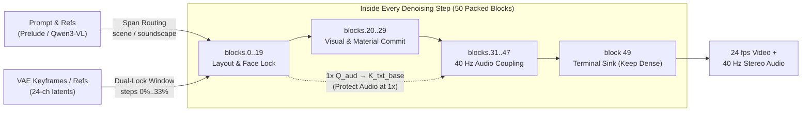

# Inside H3's 50-Block Audio-Video Brain: What We Found & What It Unlocks

**Last verified:** `2026-11-22` (verified against `comfy/ldm/minimax/model.py`, `sol_attn_h3.py`, `control_vectors.py`, `j_lens.py`, Phase 3 `stage_c`/`stage_d`, and Phase 4 `showcase_b`/`showcase_c`/`showcase_d` JSON logs on disk)  
**Audience:** Anyone using or extending MiniMax H3 in this repo — **even if you never touch control vectors**. This page keeps the explanation plain and visual; links at the bottom point to the linear algebra and formal research papers.

---

## The So What (30-Second Plain-English Version)

MiniMax H3 is not a video model with an audio generator bolted onto the side. It packs **text**, **reference images/videos**, **40 Hz stereo audio**, and **24 fps video** into **one single stack of 50 Transformer blocks (`blocks.0..49`)** and runs all of them together.

While probing how to steer H3 in a single render pass (`1x`), we mapped out **how those 50 blocks actually divide the labor** — and uncovered four practical truths about H3 that aren't in any published paper yet:

1. **H3 builds the picture first (`blocks.20..29`), then builds the sound to match it (`blocks.31..47`), and finishes through one readout bottleneck (`block 49`).**
   - `blocks.0..19` set up layout and identity — changing visual material there alone does almost nothing.
   - `blocks.20..29` is where visual geometry, lighting, and material actually commit. Changing style *only* from `blocks.20..49` lets you restyle clothing and backgrounds while keeping a reference person's face and lip-sync intact.
   - `40 Hz` audio wakes up roughly **10 blocks behind video** (`blocks.31..47`), matching acoustics and foley to the 3D scene that just formed.
   - At `block 49`, text tokens stop updating completely (`0.000` change) and act purely as a terminal readout lens — which explains why keeping `block 49` dense in sparse attention (`MiniMaxH3Sol`) and rotated in INT8 (`MiniMaxH3SageAttention`) is non-negotiable.
2. **You can split what video listens to and what audio listens to inside a *single* render pass (`1x`).**
   - Because visual and audio tokens share the same blocks, dark or desaturated visual edits often muffle the soundtrack (`-2.5` to `-13.4 dB`). Previously, protecting audio meant paying **`2x` render time** (`streams="video_only"`).
   - Letting audio queries peek at the *original* unsteered text while video queries read the *edited* text inside one pass (`1x Q_aud → K_txt_base`) recovered **`92.7%` of lost audio loudness** (`-24.56 → -22.29 dBFS` vs. `-22.11 dBFS` base) at **`1.73×` the speed** (`28.8s` vs. `49.9s`) and **zero extra VRAM**.
3. **Color, layout, and keyframes lock in during the first third of denoising (`0%–34%`), and keyframes carry *two* locks.**
   - Under H3's `shift = 12` video schedule, the opening `0%–34%` of steps decide global palette and layout; intervening after `34%` misses the window completely.
   - On `fl2va` first/last keyframes, the image enters through **both** Qwen vision tokens **and** raw 24-channel Video VAE pixels (`cond_video_latents`). Even if you edit the text/vision side, the raw VAE pixels stay active through `33%` and stamp the original colors back in — so full keyframe re-grading means either pre-grading the still (`MiniMax-H3-Image`, `~3s`) or releasing the reference early (`MiniMaxH3ReleaseReferences`).
4. **In a frozen-prompt generator, clearing beats shouting — and you can X-ray a `193 KB` dial on CPU in `< 15 ms`.**
   - Because H3 re-reads the same prompt tokens at every step and block, simply *adding* a new look (`noir`, `paper_origami`) gets vetoed whenever the prompt describes warm daylight or live-action skin. Clearing the conflicting baseline variation out of the prompt first breaks that veto in `1` pass — and our CPU Jacobian-lens X-Ray ([`j_lens.py`](../../../j_lens.py)) lets you inspect what any dial *adds* and *clears* before spending a single second on the GPU.

---

## Quick Map: Code, Workflows, & Supporting Docs

| What You Want | Jump Straight Here |
| :--- | :--- |
| **Core H3 50-block DiT & `PackedLayout`** | ComfyUI `comfy/ldm/minimax/model.py` (`MiniMaxH3Model`, `FinalLayer`) · [`h3_conditioning_end_to_end.md`](h3_conditioning_end_to_end.md) · [`h3_frame_rules.md`](h3_frame_rules.md) |
| **Sparse Attention & `block 49` Protection** | [`sol_attn_h3.py`](../../../sol_attn_h3.py) (`dense_blocks="49"`) · [`attention.py`](../../../attention.py) · [`SOLATTN.md`](../attention/SOLATTN.md) · [`h3_block49_quant_error.md`](../attention/h3_block49_quant_error.md) |
| **References, Keyframes & `0.33` Release** | [`conditioning.py`](../../../conditioning.py) · [`reference_conditioning.py`](../../../reference_conditioning.py) · [`h3_references.md`](h3_references.md) · [`workflows/h3_first_last_frame_pika_api.json`](../../../workflows/h3_first_last_frame_pika_api.json) |
| **Audio Freeze, Re-Dub & Audio Refinement** | [`audio_freeze.py`](../../../audio_freeze.py) · [`audio_refine.py`](../../../audio_refine.py) · [`frozen_video_cache.py`](../../../frozen_video_cache.py) · [`h3_audio_freeze.md`](h3_audio_freeze.md) |
| **Prompt Sections, Edit Guidance & Spatial Portals** | [`h3_spans.py`](../../../h3_spans.py) · [`edit_guidance.py`](../../../edit_guidance.py) · [`spatial_director.py`](../../../spatial_director.py) · [`edit_guidance.md`](../edit_guidance.md) · [`workflows/h3_spatial_portal_pika_erasure_api.json`](../../../workflows/h3_spatial_portal_pika_erasure_api.json) |
| **`1x` Steering, X-Ray & `4 MP` Image Workflows** | [`control_vectors.py`](../../../control_vectors.py) · [`j_lens.py`](../../../j_lens.py) · [`workflows/h3_text_to_video_pika_control_vector_api.json`](../../../workflows/h3_text_to_video_pika_control_vector_api.json) · [`workflows/image/h3_image_t2i_control_vector_api.json`](../../../workflows/image/h3_image_t2i_control_vector_api.json) |
| **Upcoming `blocks.20..49` + `1x Q_aud` Production Hook** | [`2026-11-22_unified_steer_attention_hook_spec.md`](../research/control_vectors/2026-11-22_unified_steer_attention_hook_spec.md) (compiler-safe `comfy_aimdo` design) |
| **Math, Paper v4, & Independent Paper Critique** | [`how_pole_a_erasure_works.md`](../steering/how_pole_a_erasure_works.md) · [`2026-11-21_from_late_interaction_retrieval_to_av_dit_steering.md`](../research/control_vectors/2026-11-21_from_late_interaction_retrieval_to_av_dit_steering.md) · [`2026-11-22_paper_v4_critical_review_prior_art_and_revision_plan.md`](../research/control_vectors/2026-11-22_paper_v4_critical_review_prior_art_and_revision_plan.md) |

---

## Progressive Walkthrough: What Is Actually Happening Inside H3?

### Step 1: One Shared Room, Not Two Separate Models

Before denoising even begins, H3 runs your prompt (plus any `<Picture N>` or `<Video N>` references) through **Qwen3-VL-32B** (`layers 0..49` of `64`) and a 2-layer bidirectional **TokenRefiner**. That produces a table of conditioning tokens — one row per word or visual patch.

When the 50-block DiT starts denoising, it packs **every modality into one single sequence**:

`[ Text Tokens | Reference Image/Video/Audio Tokens | Target 40 Hz Audio Tokens | Target 24 fps Video Tokens ]`

Every one of H3's `50` self-attention blocks lets all of those tokens talk to each other directly. That is why H3 produces lip-synced speech, footsteps timed to camera motion, and room reverb that matches the room size on screen — **and** it is why changing one part of the prompt can ripple unexpectedly into another modality unless you understand *when* and *where* each modality listens.

### Step 2: The Four Zones of the 50-Block Stack

When we traced every block (`blocks.0..49`) on a real speaking audio-video render (`39f` `t2va_sitcom_kitchen`, `10,991` packed tokens = `493` text + `130` audio + `10,368` video) and then causally swapped text keys/values inside specific block bands on a `90f` `<Picture 1>` street walk (`ref2va_woman_blonde_street.txt`), four clear functional zones emerged:

Look at what that real measurement curve shows in plain English:

- **Zone 1 (`blocks.0..19`) — Scene Layout & Subject Scaffolding:** Video tokens barely diverge from baseline here, and audio tokens stay nearly flat (`0.0005` divergence through block `25`). When we applied heavy `paper_origami` styling **only** to `blocks.0..19` on a `<Picture 1>` portrait walk, the output looked completely unchanged (border texture energy `69.31` vs. `69.39` base — zero origami).
- **Zone 2 (`blocks.20..29`) — The Visual & Material Commitment Window:** Right at **block 20**, video divergence suddenly breaks upward and climbs sharply through block `30`. Crucially, applying `paper_origami` **only** to `blocks.30..49` also produced almost no origami (`77.94` vs. `69.39` base) — because by block `30`, live-action geometry was already committed! Applying it to **`blocks.20..49`** produced crisp folded-paper geometry (`140.66`) while leaving `<Picture 1>`'s nose, mouth, skin tone, and lip-sync live-action (`1.52×` mean / `1.75×` peak DINOv3 face-identity preservation over steering all `0..49` blocks).
- **Zone 3 (`blocks.31..47`) — 40 Hz Audio Couples to the Emergent Scene:** Audio follows roughly **10 blocks behind video**. Once the visual room and actors take shape across `blocks.20..30`, audio tokens wake up across `blocks.31..47` to match room acoustics, ambient sound, and voice timber to what is on screen. Even better: when you target an audio edit strictly to the `overall_soundscape:` section (`soundscape_only`), mid-network video updates stay **`3.2×` quieter** and audio divergence actually overtakes video divergence across `blocks.35..39`.
- **Zone 4 (`block 49`) — The Terminal Readout Sink:** After `block 49`, H3's `FinalLayer` slices out only the video and audio tokens to predict the denoising velocity — it discards the text rows. As a result, `block 49`'s text update drops to **identically `0.000`**, and `block 49` consolidates all of the accumulated text/reference guidance into the final video and audio velocity outputs. That independently explains two major earlier discoveries in this repo: why `block 49` is the #1 sensitivity point for INT8 attention outliers ([`h3_block49_quant_error.md`](../attention/h3_block49_quant_error.md)) and why [`MiniMaxH3Sol`](../../../sol_attn_h3.py) keeps `dense_blocks="49"` by default ([`SOLATTN.md`](../attention/SOLATTN.md)).

### Step 3: Splitting Video & Audio Inside One Pass (`1x Q_aud → K_txt_base`)

Because audio tokens attend to the same packed text tokens during `blocks.31..47`, heavy visual mood edits (like darkening a bright street or stripping warm neon) can quietly drag the soundtrack down with them (`-2.45 dB` to `-13.38 dB` on speaking clips).

Previously, if you wanted a visual edit that left dialogue loudness untouched, you had to run **`2x` guidance** (`streams="video_only"` in [`edit_guidance.py`](../../../edit_guidance.py)) — literally running the 50-block DiT twice per step and throwing away half the audio output.

Phase 4 Showcase C tested a much cleaner idea grounded in Step 2: inside a **single** DiT pass, let **video queries** attend to the steered text keys/values, while **audio queries** (`Q_aud`, only `~130–300` rows out of `10,000+`!) peek at the original unsteered text keys/values (`K_txt_base`, `V_txt_base`):

- **Base render (`90f` `t2va_box_office`):** `25.92s`, audio `-22.11 dBFS`, `sat = 0.3842`
- **Steered `1x` (shared text):** `25.97s`, audio dropped to **`-24.56 dBFS`** (`-2.45 dB`), `sat = 0.2796`
- **Old `2x` `streams="video_only"`:** `49.94s` (**`1.93×` slower**), audio `-23.42 dBFS`, `sat = 0.2854`
- **New `1x Q_aud → K_txt_base`:** **`28.80s`** (**`1.73×` faster than `2x`**, `0` extra VRAM!), audio **`-22.29 dBFS`** (recovered **`92.7%`** of lost loudness, within `0.18 dB` of base), `sat = 0.2783`, `YIN` pitch shift `+0.63 st` (`<= 1.5 st` pass).

### Step 4: The Early-Step Clock (`0%–34%`) and the Dual-Lock Keyframe Law

Depth (`blocks.0..49`) is one axis; **denoising time (`0% → 100%`)** is the second. Under H3's `shift_video = 12.0` schedule:

- **Steps `0%–34%` commit global color and layout.** Turning off baseline clearing at `50%` (`ew50`, `[0.0, 0.50)`) matched running it through `100%` visually and numerically across `42` paired stills (`noir` `box_office`: `0.0476` vs. `0.0472`). Conversely, waiting until `34%` to start (`[0.34, 1.0]`) failed completely (`noir` stayed full color at `0.2974`).
- **The Dual-Lock Keyframe Law (`fl2va` vs. `ref2va`):**
  - On **`ref2va` (`<Picture 1>`)**, leaving the reference image's vision tokens untouched while steering the scene text gives you **Selective-Color Subject Lock** for free (for example, turning a bookstore monochrome while keeping the `<Picture 1>` person warm and lifelike).
  - On **`fl2va` (first + last frame video)**, however, keyframes enter the DiT through **two separate pipes at once**: Qwen vision tokens (`tags == 0`) **and** raw 24-channel Video VAE latents (`cond_video_latents`). Even if you strip color out of the Qwen vision tokens directly (`-10.4%` saturation on a `141f` neon noodle clip), the raw VAE pixels stay pinned during steps `0%–33%` — right inside the `0%–34%` palette-commit window — and stamp neon colors right back into the video.
  - **Practical rule:** If you want a `fl2va` clip to change global color/medium cleanly, either pre-grade the endpoint stills first (`MiniMax-H3-Image` takes `~3.0s` at `4.0 MP`) or release the reference early via `MiniMaxH3ReleaseReferences` (`end_percent = 0.17..0.33`).

### Step 5: Why Clearing Beats Shouting — and the `< 15 ms` CPU X-Ray

Because H3 re-injects the exact same prompt tokens at every step and block, simply *adding* a style vector (`+noir` or `+paper_origami`) gets outvoted whenever the prompt describes warm tungsten lighting or live-action human skin (`0/5` B&W stills and `0/3` B&W `192f` videos with plain 1D addition).

Subtracting the conflicting baseline variation out of your prompt's tokens first — while keeping the perturbation energy locked — breaks that veto in `1` pass (`5/5` B&W stills, `3/3` `192f` B&W videos, `5/5` character retention on single-frame `paper_origami` stills vs. `1D` character deletion — though note `ref2va` video `paper_origami` only added a cardboard mask on a live-action street and is now retired from flagship showcases — and `2/2` B&W on undistilled 50-step Base H3). And because H3's `Qwen3-VL` + `TokenRefiner` mapping can be inverted analytically on CPU ([`j_lens.py`](../../../j_lens.py)), you can **X-ray** any `193 KB` dial in **`< 15 ms`** before rendering to see both what it **Adds** and what prompt words it **Clears** (for example, seeing that `noir` clears `wall, warm, brown, tungsten` while leaving `father, daughter, retriever` alone).

*(For the full mechanics and equations behind clearing, see [`how_pole_a_erasure_works.md`](../steering/how_pole_a_erasure_works.md).)*

---

## What This Unlocks Across All of H3 (Beyond Steering)

The map below summarizes how these four levers fit together — not just for control vectors, but across **every** workflow in this repository:

### 1. Attention Speed & Quantization (`MiniMaxH3Sol`, `MiniMaxH3SageAttention`, `MiniMaxH3ExactBlocks`)
- **Why `block 49` is special is now explained causally:** Text stops updating at `block 49` (`0.000`) and acts as the final conditioning sink before `FinalLayer`. That validates keeping `dense_blocks="49"` in [`sol_attn_h3.py`](../../../sol_attn_h3.py) and Q/K rotation in [`attention.py`](../../../attention.py) ([`h3_block49_quant_error.md`](../attention/h3_block49_quant_error.md)).
- **Future unlock:** Knowing that `blocks.0..19` carry coarse layout while `blocks.20..29` carry fine material geometry and `blocks.31..47` couple audio opens the door to **depth-aware sparse attention and quantization budgets** (spending precision where visual/audio commitment actually happens instead of uniformly across all 50 blocks).

### 2. Keyframes, Reference Portraits, & Image-to-Video (`fl2va`, `ref2va`, `MiniMax-H3-Image`)
- **Stop fighting the Dual-Lock:** When a `fl2va` render refuses to drop keyframe lighting or neon colors despite prompt rewrites, it is not a prompting failure — it is `cond_video_latents` stamping RGB chroma during steps `0%–33%`. Pre-grading endpoint stills with [`workflows/image/h3_image_t2i_control_vector_api.json`](../../../workflows/image/h3_image_t2i_control_vector_api.json) (`~3s` at `4.0 MP`) or dialing `MiniMaxH3ReleaseReferences` (`0.17..0.33`) solves it cleanly.
- **Identity-safe restyling for `ref2va`:** Steering only `blocks.20..49` lets `blocks.0..19` lock `<Picture 1>`'s face and lip movement before material stylization kicks in — valuable for character continuity in storyboards, wardrobe changes, and stylized portraits.

### 3. Audio Freeze, Second-Pass Audio Refine, & Re-Dubbing (`audio_freeze.py`, `audio_refine.py`, `frozen_video_cache.py`)
- **Why frozen-video audio refinement works so cleanly:** Because audio emerges in `blocks.31..47` *downstream* of video formation in `blocks.20..29`, freezing video latents and caching video K/V ([`frozen_video_cache.py`](../../../frozen_video_cache.py)) naturally matches H3's internal causal flow.
- **Future `1x` re-dubbing & video-only editing:** The exact same `1x Q_aud → K_txt_base` query-slicing mechanism proven in Phase 4 Showcase C can work in reverse too — letting **audio** follow a new acoustic/re-dub prompt while video stays locked to the original text (or protecting speech during aggressive visual `EditGuider` passes) at `1.00×` speed instead of `2.00×`!

### 4. Prompting, `EditGuider`, & `SpatialDirector` Portals (`h3_spans.py`, `edit_guidance.py`, `spatial_director.py`)
- **Keep acoustic prose in `overall_soundscape:`:** On sectioned prompts, steering `soundscape_only` keeps mid-network video updates **`3.2×` quieter** (`0.208` vs. `0.661`) than mixing acoustic adjectives into the visual description.
- **Early-step editing & regional portals:** Because palette and layout settle in `[0%..34%]`, global visual edits don't need full-step force after `50%`, whereas spatial portals ([`workflows/h3_spatial_portal_pika_erasure_api.json`](../../../workflows/h3_spatial_portal_pika_erasure_api.json)) need `>= 30%` canvas area so global 50-block self-attention doesn't wash out a tiny region (`5.91×` L/R contrast on half-frame splits).

### 5. Masked Video-to-Video & Remakes (`masked_v2v/`)
- Knowing that `blocks.20..29` commit local material/geometry while steps `0%–34%` lock global palette gives masked V2V remakes ([`docs/wiki/masked_v2v.md`](../masked_v2v.md)) a clean diagnostic mental model: palette seams come from early-step (`0%–34%`) reference/keyframe conflicts, while mid-block (`20..29`) conflicts govern whether a replacement subject inherits the source scene's skin/lighting or adopts the target style.

### 6. Faster Diagnostics Before Rendering (`j_lens.py`, `app/`)
- The `< 15 ms` CPU Jacobian-lens X-Ray ([`j_lens.py`](../../../j_lens.py)) turns trial-and-error prompting and vector building into an inspectable engineering loop: you can spot lexical drift (like `de_llm_slop` accidentally carrying `document / institutional` words) or check which words in your prompt will be modified *before* queuing a GPU render.

---

## Proof Ledger: What Is Actually Proven (and What Isn't Yet)

No hype — every claim on this page separates **verified results on disk** from **known boundaries and work still in progress**.

### Proven on Disk Today

| Finding | Exact Test Run & Source on Disk | Measured Result |
| :--- | :--- | :--- |
| **50-Block AV Depth Map (`20..29` video, `31..47` audio, `49` sink)** | `39f` `t2va_sitcom_kitchen` 50-block hook (`dit_blocks_50_trace.json`) | Video breaks out at `blk 20`; audio lags ~10 blocks (`0.0005` @ `blk 25` → surges `31..47`); `blk 49` text update = `0.000`; `soundscape_only` keeps mid-net video `3.2×` quieter (`0.208` vs `0.661`). |
| **`blocks.20..29` Causal Material Window + Face Preservation** | `90f` `<Picture 1>` `ref2va` `paper_origami` (`stage_d_shadow_text_kv.json`, `dinov3_m1_phase3_stage_cd.json`) | `blocks.0..19` alone = `69.31` (no origami vs `69.39` base); `blocks.30..49` alone = `77.94` (no origami); **`blocks.20..49`** = **`140.66`** crisp origami glasses with **`1.52×` mean / `1.75×` peak DINOv3 identity** over `0..49` (`0.1611/0.3235` vs `0.1059/0.1845`). |
| **`1x` Single-Pass Audio Protection (`Q_aud → K_txt_base`)** | `90f` `t2va_box_office` (`showcase_c_qaud_audio_split.json`, Phase 4) | Recovers **`92.7%`** of audio loss (`-24.56 → -22.29 dBFS` vs `-22.11 dBFS` base) in **`28.80s`** vs `49.94s` for `2x` `video_only` (**`1.73×` faster**, `0` extra VRAM, `YIN` F0 `+0.63 st` pass). |
| **Early-Step Palette Lock (`0%–34%`) & `ew50` Parity** | `noir`/`origami`/`de_llm_slop` ablations (`gpu_ablations_1_to_5.json`, `showcase_d_ew50_and_h3_image.json`) | `[0..50%]` matches `[0..100%]` across `42` paired stills (`noir` `0.0476` vs `0.0472`); starting late at `[34%..100%]` fails completely (`0.2974` color). |
| **Dual-Lock `fl2va` Keyframe Law** | `141f` `fl2va_noodle` vision-token erasure (`stage_c_vision_erasure.json`) | Erasing `tags == 0` vision tokens cuts saturation only `-10.4%` (`0.4346 → 0.3894`) while `cond_video_latents` stay pinned in `[0..33%]`; pre-grading on `MiniMax-H3-Image` flips cleanly (`0.2355 → 0.0330` B&W). |
| **`1x` Conflict Clearing Across Checkpoints** | Double dissociation (`metrics_specificity.json`), `192f` AV (`gate2b2`), `Base50`, `P-H3-Image`, `4 MP` `h3_image` | `5/5` `noir` B&W + `5/5` `paper_origami` character preservation (vs `0/5` on swapped/random/isotropic controls); `2/2` B&W on undistilled 50-step Base H3 (`5.3×` sat drop); `3.0s` full claymation on `4.0 MP` `h3_image`; `YIN` F0 drift `-0.02 st` on `192f` dialogue. |

### Honest Limits & What Is NOT Ready Yet

- **Not yet wired as ComfyUI node widgets:** Both `blocks.20..49` shadow routing and `1x Q_aud → K_txt_base` are proven in benchmark scripts (`run_phase3_steering_experiments.py`, `run_phase4_stacked_and_stream_probes.py`) and designed for `comfy_aimdo` zero-break safety in [`2026-11-22_unified_steer_attention_hook_spec.md`](../research/control_vectors/2026-11-22_unified_steer_attention_hook_spec.md), but have **not** yet shipped as inputs on `MiniMaxH3Steer`.
- **Masking boundary on `ref2va` (`blocks.20..49`):** In Phase 4 Showcase B (`showcase_b_inverted_blocks20.json`), restricting `blocks.20..49` to `description_only` while holding `<Picture 1>` through `50%` (`ReleaseReferences(0.50)`) kept the render mostly photorealistic (only subtle hair/awning changes) — strong material conversion on `ref2va` still requires `scene_only` or earlier reference release (`0.17..0.33`).
- **Stacking `3+` competing visual dials on the same span:** Still a live engineering problem (Phase 4 Showcase A erased a ticket clerk on `box_office s=730451892`, and `claymation + noir` split `4 MP` `h3_image` `lighthouse` into a two-panel diptych at high shift norm `133.42`). Fixing this requires per-slider `ROS` protection, norm-cliff capping, and disjoint routing — tracked in [`2026-11-22_fresh_eye_audit_de_slop_erasure_and_multivector_future.md`](../research/control_vectors/2026-11-22_fresh_eye_audit_de_slop_erasure_and_multivector_future.md).
- **MiniMax H3 only:** Every measurement here was gathered on MiniMax H3 (`fl2va`, `ref2va`, `Base50`, `P-H3-Image`, `MiniMax-H3-Image`). Whether other multimodal DiTs or looped transformers share the exact same block-depth split is a testable hypothesis, not a proven fact.

---

## Where to Go Next (Math, Papers, & Hands-On Guides)

- **Want the step-by-step math & intuition for `1x` subspace clearing?** Read [`docs/wiki/steering/how_pole_a_erasure_works.md`](../steering/how_pole_a_erasure_works.md) and the 4-lab tutorial [`docs/wiki/steering/tutorials_progressive_guide.md`](../steering/tutorials_progressive_guide.md).
- **Want the formal research paper & our candid peer review of what is novel vs. prior art?** Read Paper v4 [`2026-11-21_from_late_interaction_retrieval_to_av_dit_steering.md`](../research/control_vectors/2026-11-21_from_late_interaction_retrieval_to_av_dit_steering.md) alongside its standalone critique [`2026-11-22_paper_v4_critical_review_prior_art_and_revision_plan.md`](../research/control_vectors/2026-11-22_paper_v4_critical_review_prior_art_and_revision_plan.md).
- **Want the applied multi-vector roadmap & 10-showcase creative proof plan?** Read [`2026-11-22_fresh_eye_audit_de_slop_erasure_and_multivector_future.md`](../research/control_vectors/2026-11-22_fresh_eye_audit_de_slop_erasure_and_multivector_future.md) and the Phase 4 probe ledger [`bench/results/2026-11-22_phase4_clamped_stacking_and_audio_split_probes.md`](../../../bench/results/2026-11-22_phase4_clamped_stacking_and_audio_split_probes.md).
- **Want the rest of H3's core mechanics?** Read [`h3_conditioning_end_to_end.md`](h3_conditioning_end_to_end.md), [`h3_frame_rules.md`](h3_frame_rules.md), [`h3_references.md`](h3_references.md), [`h3_audio_freeze.md`](h3_audio_freeze.md), and [`SOLATTN.md`](../attention/SOLATTN.md).
