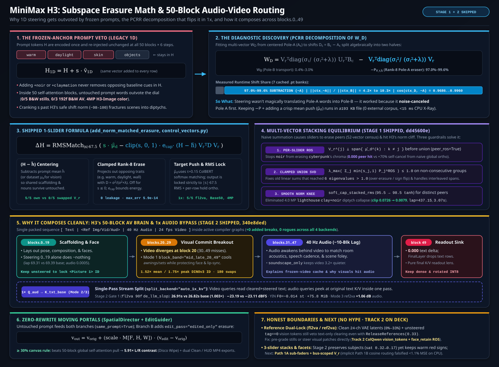
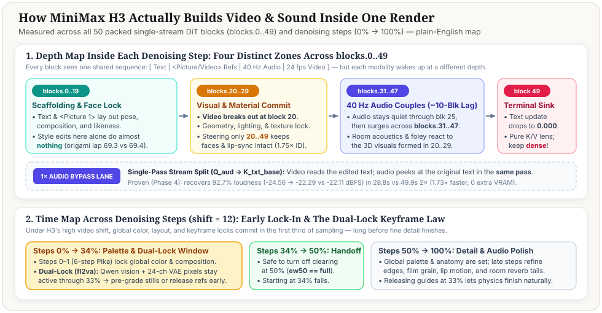
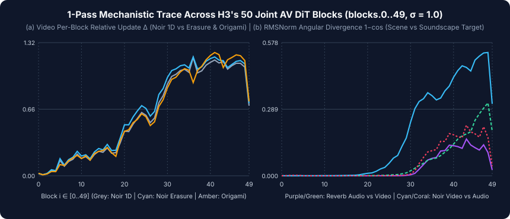
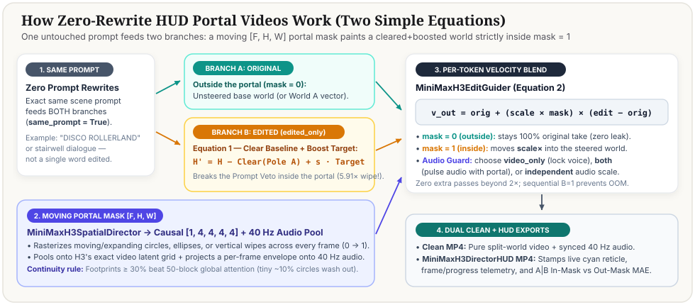
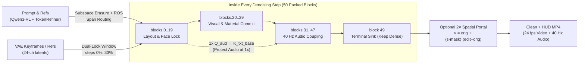

# Inside MiniMax H3: Subspace Erasure, the 50-Block Audio-Video Brain, & Zero-Rewrite Portals

**Last verified:** `2026-11-22` (verified against [`control_vectors.py`](../../control_vectors.py), [`control_vector_nodes.py`](../../control_vector_nodes.py), [`steer_attention_hooks.py`](../../steer_attention_hooks.py), [`sol_attn_h3.py`](../../sol_attn_h3.py), [`edit_guidance.py`](../../edit_guidance.py), [`spatial_director.py`](../../spatial_director.py), [`j_lens.py`](../../j_lens.py), [`bench/verify_pole_a_erasure.py`](../../bench/verify_pole_a_erasure.py), [`data/exp_unpooled_sliders/stage2_2026_11_22/stage2_verification.json`](../../data/exp_unpooled_sliders/stage2_2026_11_22/stage2_verification.json), [`data/exp_unpooled_sliders/phase5_cpu_audits/stage3_cpu_prototypes.json`](../../data/exp_unpooled_sliders/phase5_cpu_audits/stage3_cpu_prototypes.json), and ComfyUI `comfy/ldm/minimax/model.py`)  
**Role:** **The single canonical plain-English & LLM-wiki guide** to how MiniMax H3's 50-block audio-video brain works, why clamped Pole-A subspace erasure breaks the frozen-prompt steering veto in `1x`, how multi-slider equilibrium and single-pass (`1x`) stream/depth routing work, how zero-rewrite moving HUD portals work, which tool to choose, and what is proven vs. still open.

---

## The Plain-English "So What" (Start Here)

In a video-and-audio generator like MiniMax H3, your text prompt is encoded **once** and then re-injected unchanged at every denoising step across all 50 Transformer blocks. Because of that, traditional `1D` control vectors — taking one average direction and adding it on top of your prompt (`H + s · v`) — get **outvoted** whenever your prompt describes something conflicting, like bright daylight, warm tungsten fill, or neon reflections. Trying to dial up black-and-white `noir` or `claymation` by shouting louder just leaves the original lighting sitting inside the prompt at full volume until the image tears apart. When we tried fitting a smarter multi-vector mapping to translate prompt tokens directly into a new style, the linear algebra unexpectedly split cleanly in half and proved that **`97.0%–99.6%` of the working shift wasn't adding style at all — it was subtracting out the conflicting baseline variation first** (noise-canceling "daylight / warm / live-action" before applying a sharp target push). Packaging that rank-8 subspace eraser plus target push into a self-contained `193 KB` file — and guarding multi-slider mixes with per-slider orthogonality (`ROS`), eigenvalue clamping (`λ_max ≤ 1.0`), and a smooth energy ceiling (`95.5 → 98.5`) — lets you flip an untouched scene's entire look or medium in a single render pass (`1x`) and stack multiple dials without sliders erasing each other or splitting frames into diptychs.

That math becomes even more powerful once you map how MiniMax H3 actually thinks inside its **50 shared audio-video blocks (`blocks.0..49`)**, where text, reference media, `40 Hz` stereo audio, and `24 fps` video all share one sequence. Tracing all 50 blocks showed that H3 builds layout and faces first (`blocks.0..19`), commits visual materials and lighting in the middle (`blocks.20..29`), wakes up `40 Hz` audio roughly 10 blocks behind video (`blocks.31..47`) to match acoustics to the room it just built, and freezes text at `block 49` (`0.000` change) as a pure terminal readout lens. Pairing subspace erasure with that 50-block map unlocks four practical capabilities in one unified stack: **(1) face-safe restyling** by injecting style only from `blocks.20..49` while keeping `blocks.0..19` locked to a reference person's face and lip-sync; **(2) single-pass (`1x`) audio protection** by letting audio queries peek at the original unsteered text while video queries read the edited text (`1.003×` runtime, `+75.8 MiB` Mode 2 / `+236.2 MiB` Mode 3 VRAM); **(3) reduced-interference multi-bus mixing** across `4` active buses (`Look`, `Motion`, `Audio`, `Hold`); and **(4) zero-rewrite moving HUD portals** that sweep a second reality across an untouched scene with synced audio and live telemetry.



---

## Quick Map: Code, Shipped Workflows, & Deep-Dive Companions

| What You Need | Owning Code, Workflows, or Companion Docs |
| :--- | :--- |
| **`1x` Subspace Erasure & Stage 1 Stacking (`ROS`, Knee)** | [`control_vectors.py`](../../control_vectors.py) (`_erasure_row_shift64`, `_stacked_erasure_block_shift64`, `soft_cap_stacked_rms`) · [`control_vector_nodes.py`](../../control_vector_nodes.py) (`MiniMaxH3Steer`) · [`workflows/h3_text_to_video_pika_control_vector_api.json`](../../workflows/h3_text_to_video_pika_control_vector_api.json) · [`workflows/h3_text_to_video_pika_stacked_erasure_api.json`](../../workflows/h3_text_to_video_pika_stacked_erasure_api.json) |
| **Stage 2 `blocks.20..49` & `1x Q_aud` Hooks (Shipped `340e8ded`)** | [`steer_attention_hooks.py`](../../steer_attention_hooks.py) · [`control_vector_nodes.py`](../../control_vector_nodes.py) (`block_band`, `split_backend="auto_1x_kv"`) · [`2026-11-22_unified_steer_attention_hook_spec.md`](steering/research/2026-11-22_unified_steer_attention_hook_spec.md) · [`2026-11-22_stage1_stage2_ros_norm_cap_and_unified_steer_hooks.md`](../../bench/results/2026-11-22_stage1_stage2_ros_norm_cap_and_unified_steer_hooks.md) |
| **Zero-Rewrite Moving HUD Portals & Spatial Director** | [`spatial_director.py`](../../spatial_director.py) · [`edit_guidance.py`](../../edit_guidance.py) · [`spatial_director_guide.md`](spatial_director_guide.md) · [`edit_guidance.md`](edit_guidance.md) · [`workflows/h3_spatial_portal_pika_erasure_api.json`](../../workflows/h3_spatial_portal_pika_erasure_api.json) |
| **CPU Subspace X-Ray, Word Vectors & Pocket Console** | [`j_lens.py`](../../j_lens.py) · [`app/README.md`](../../app/README.md) · [`steering/studio_ui_guide.md`](steering/studio_ui_guide.md) · [`steering/j_lens_diagnostics_and_word_lab.md`](steering/j_lens_diagnostics_and_word_lab.md) · [`steering/preset_catalog_and_cli_reference.md`](steering/preset_catalog_and_cli_reference.md) |
| **Core H3 50-Block DiT, Clocks, References & Audio Freeze** | ComfyUI `comfy/ldm/minimax/model.py` (`MiniMaxH3Model`, `FinalLayer`) · [`core/h3_frame_rules.md`](core/h3_frame_rules.md) · [`core/h3_conditioning_end_to_end.md`](core/h3_conditioning_end_to_end.md) · [`core/h3_references.md`](core/h3_references.md) · [`core/h3_audio_freeze.md`](core/h3_audio_freeze.md) |
| **Sparse Attention (`Sol`), INT8 Rotation & `block 49`** | [`sol_attn_h3.py`](../../sol_attn_h3.py) (`dense_blocks="49"`) · [`attention.py`](../../attention.py) · [`SOLATTN.md`](attention/SOLATTN.md) · [`h3_block49_quant_error.md`](attention/h3_block49_quant_error.md) |
| **Hands-On Tutorials, Historical Showcases & Formal Papers** | [`steering/paper/README.md`](steering/paper/README.md) (**Paper v5 Canonical Home** — [`manuscript.md`](steering/paper/manuscript.md), [`main.tex`](steering/paper/main.tex)) · [`steering/tutorials_progressive_guide.md`](steering/tutorials_progressive_guide.md) · [`steering/how_pole_a_erasure_works.md`](steering/how_pole_a_erasure_works.md) · [`2026-11-21_from_late_interaction_retrieval_to_av_dit_steering.md`](steering/research/2026-11-21_from_late_interaction_retrieval_to_av_dit_steering.md) (Paper v4) · [`2026-11-22_paper_v4_critical_review_prior_art_and_revision_plan.md`](steering/research/2026-11-22_paper_v4_critical_review_prior_art_and_revision_plan.md) · [`2026-11-22_track1_track2_multivector_erasure_blueprint.md`](steering/research/2026-11-22_track1_track2_multivector_erasure_blueprint.md) |

---

## Part 1: The Math Behind Subspace Erasure & Multi-Vector Stacking

### 1.1 The Frozen-Anchor Prompt Veto (Why Legacy `1D` Fails)

Before denoising begins, H3 encodes your prompt (and any reference media) through **Qwen3-VL-32B** (`layers.0..49`, width `5120`) and a 2-block bidirectional **TokenRefiner** (width `5376`). Every block of the 50-block DiT then re-reads that same `context` tensor on every denoising step.

Legacy `1D` steering (`add_norm_matched`) computes one average arrow (`mean(B) - mean(A)`) across training pairs and broadcasts it uniformly onto every selected token row:

$$\mathbf{H}_{\text{1D}} = \mathbf{H} + s \cdot \hat{\mathbf{v}}_{\text{1D}}$$

Because nothing in $\mathbf{H}$ was removed, every warm daylight, studio floodlight, gold-lamé, or live-action skin token already written into the prompt remains at full strength and **vetoes** the slider inside H3's 50 self-attention blocks:
- On `noir`, `1D` stayed **full color on `5/5` stills (`0/5` B&W)**, stayed **full color on `3/3` `192f` AV clips**, stayed **bright studio color on the TV cooking show (`sat_mean = 0.2141`)**, and stayed **warm full color on native `4.0 MP` `MiniMax-H3-Image` (`sat_mean = 0.2355`, `red_excess = +5.85`)**.
- Cranking `strength` past H3's safe conditioning shift norm (`~98–100`) doesn't defeat the veto — it destabilizes the prompt rows and fractures frames into double-panel diptychs or washed-out artifacts.

### 1.2 The Diagnostic Discovery: Classical PCRR Proved `97%–99.6%` Erasure Dominance

When we originally tried to map centered Pole-A token states $\mathbf{A}_c$ onto paired target shifts $\mathbf{D}_c = \mathbf{B}_c - \mathbf{A}_c$ via truncated **Principal Components Ridge Regression (`PCRR`)**, the linear operator split algebraically into two distinct halves:

$$\mathbf{W}_D = \underbrace{\mathbf{V}_r^\top \operatorname{diag}\!\left(\frac{\sigma_i}{\sigma_i^2 + \lambda}\right) \mathbf{U}_r^\top \mathbf{B}_c}_{\mathbf{W}_B\;\text{(Pole-B cross-covariance: }0.4\%\text{–}3.0\%\text{)}} \;-\; \underbrace{\mathbf{V}_r^\top \operatorname{diag}\!\left(\frac{\sigma_i^2}{\sigma_i^2 + \lambda}\right) \mathbf{V}_r}_{\mathbf{P}_{\mathbf{V}_r,\lambda}\;\text{(Tikhonov Pole-A subspace eraser: }97.0\%\text{–}99.6\%\text{)}}$$

- **Honest attribution & real "So What":** PCRR is classical textbook linear algebra, and concept-erasure / orthogonal steering connects directly to prior art (`ACE`, `LEACE`, `RASteer`, `MUTE`, `CURE`, `Safree`, `Linear-AcT`, `FADE`, `STAS`, `TADA!`; full lineage in [`2026-11-22_paper_v4_critical_review_prior_art_and_revision_plan.md`](steering/research/2026-11-22_paper_v4_critical_review_prior_art_and_revision_plan.md)). What was genuinely surprising was **measuring both halves on H3's `7` cached `.pt` banks** in [`bench/verify_pole_a_erasure.py`](../../bench/verify_pole_a_erasure.py) (`max_err = 5.862e-14`): **`97.0%–99.6%` of the working shift came from subtracting $-\mathbf{P}_{\mathbf{V}_r,\lambda}$** (`||ctx_{-A}|| / ||ctx_B|| = 4.2×` to `10.3×`, `min cos(ctx_D, -A) = +0.9686`), directly refuting our own initial hypothesis that Pole-B transport $\mathbf{W}_B$ was doing the heavy lifting.
- **Why Balanced Optimal Transport regressed:** The same proof script showed that Balanced Sinkhorn OT's uniform marginals collapse algebraically right back to legacy `v_1d` (`max_err = 8.882e-16`, `cos = 1.000000`), explaining why replacing asymmetric row-softmax (`tau = 0.15`) with Balanced Sinkhorn dropped B&W success from `3/3` to `1/3`.

### 1.3 The Shipped Single-Slider Formula (`add_norm_matched_erasure`)

Instead of shipping a heavy `5376 × 5376` matrix or an external text corpus, `control_vectors.py::build_pole_a_erasure` stores three compact `float32` tensors (`~193.5 KB` total) inside every bank `.safetensors` file: `erasure.mu_d [5376]`, `erasure.vr [r, 5376]` (`r = 8`), and `erasure.diag [r]` (plus optional `erasure.mu_a [5376]` for `tags == 0` vision-token banks).

At render time, `_erasure_row_shift64` ([`control_vectors.py:3501-3562`](../../control_vectors.py#L3501-L3562)) transforms every selected token row in `float64`:

$$\Delta \mathbf{H} = \operatorname{RMSMatch}_{|s|\cdot 67.5}\!\Big(s\,\hat{\boldsymbol{\mu}}_d \;-\; \operatorname{clip}(s, 0, 1)\,e_{\text{cap}}\,(\mathbf{H} - \bar{\mathbf{h}})\,\mathbf{V}_r^\top \mathbf{D}\,\mathbf{V}_r\Big)$$

1. **Sharp token-matched target push (`s · μ̂_d`):** `erasure.mu_d` pairs each Pole-A token to its closest Pole-B partners via asymmetric ColBERT-style row-softmax at `tau = 0.15`. Across the bank, `cos(mu_d, v_1d)` has `median = 0.9935` (only `4 / 52` earlier stems fell below `0.980`), while on concepts with fragmented multi-facet shifts (`noir`, `film_16mm_1974`) softmax matching rescues key target nouns/adjectives such as `black`, `footage`, and `archival` on `noir` and `grain, tape` on `film_16mm_1974`.
2. **Centered, clamped rank-8 baseline clearing (`-clip(s, 0, 1) · e_cap · (H - h̄) V_r^T D V_r`):**
   - **Per-batch prompt centering (`H - h̄`)** subtracts your own prompt's mean row (or dataset Pole-A mean `erasure.mu_a` on `tags == 0` `vision_tokens` so uniform image color casts are preserved) so shared prompt scaffolding and scene nouns stay intact (`M <= 1` falls back cleanly to `1D`).
   - **Polarity & energy clamps:** For negative `strength` (`s ≤ 0`), erasure switches off cleanly (`clip(s, 0, 1) = 0`) to invert toward Pole A bit-for-bit; above `s = 1.0`, erasure caps at `1.0` and `e_cap = min(1.0, 67.5 / rms(e_own))` keeps energy bounded so pushing `s = 1.3..1.6` deepens the look without shredding scene geometry.
3. **Strict energy lock & per-row holds:** The combined shift is RMS-matched to `|s| · 67.5` (`NORM_MATCHED_TARGET`), and any `hold_vector` or `hold_words` are projected out of **every token row** (`_apply_holds_to_rows64`) so erasure never leaks into a trait you asked to protect.
   *(Zero-file sketching: `MiniMaxH3WordVector` with `against_words` synthesizes `< 2 ms` CPU `against`-SVD `erasure.{mu_d,vr,diag}` via `Model2Vec` + `j_lens_h3.safetensors`. Vectors without `erasure.*`, `s ≤ 0`, and cross-family `h3_image` encoder auto-projections fall back automatically to pure `1D` without errors.)*

### 1.4 Multi-Vector Stacking Equilibrium (Stage 1 Shipped, `dd45600e`)

Stacking multiple erasure sliders naively causes two concrete failures measured in our `52`-vector bank census (`2,652` ordered pairs, [`data/exp_unpooled_sliders/phase5_cpu_audits/bank_cross_interference_audit.json`](../../data/exp_unpooled_sliders/phase5_cpu_audits/bank_cross_interference_audit.json)):
- **Cross-slider erasure collision:** One slider's Pole-A eraser $\mathbf{V}_r^{(j)}$ can delete a peer slider's target $\hat{\boldsymbol{\mu}}_d^{(i)}$ (up to **`0.4240`** raw / `0.3520` weighted; e.g., `V_r(noir)` overlaps `0.3166` raw with `cyberpunk_neon_rain`), while naive linear summation of parallel erasers pushes eigenvalues past `1.0` (`6` eigenvalues `> 1.0`, flipping signs!) and blows past H3's `~98–100` diptych cliff.
- **Why naive global orthogonalization fails:** Self-overlap $\|\mathbf{V}_r^{(i)} \hat{\boldsymbol{\mu}}_d^{(i)}\|_2^2$ averages **`15.9%`** (up to `32.8%`). Orthogonalizing a union against *all* active targets strips each slider's **own** erasure (`+34%` to `+70%` self-cancellation!).

Stage 1 (`dd45600e`, [`control_vectors.py:3211-3226,3565-3646`](../../control_vectors.py#L3565-L3646) & [`control_vector_nodes.py`](../../control_vector_nodes.py)) solves this automatically whenever you chain `MiniMaxH3Steer` nodes on the same resolved `(mask, prompt)` (including non-consecutive interleaved chains and separated prompt vs. `erasure.mu_a` vision unions):

1. **Per-slider `ROS` (`peer_ros=True`):** Orthogonalize each slider $j$'s eraser $\mathbf{V}_r^{(j)}$ strictly against its **other** non-collinear peers $\hat{\boldsymbol{\mu}}_d^{(-j)}$ *before* unioning (`0.000` peer-target hit while keeping each slider's own erasure intact).
2. **Clamped Union SVD ($\lambda_{\max} \le 1.0$):** Concatenate $\sqrt{\min(s_j, 1)\,\mathbf{D}_j^{\text{ROS}}}\,\mathbf{V}_{r,j}^{\text{ROS}}$ and cap singular values at `1.0` so overlapping baselines never double-erase or flip sign.
3. **Smooth Norm Knee (`soft_cap_stacked_rms`, `95.5 → 98.5` `tanh`):** Smoothly compresses distinct multi-slider RMS past `95.5` into a `98.5` ceiling — **completely eliminating the `4.0 MP` `MiniMax-H3-Image` `lighthouse` (`claymation_stopmotion 1.20 + noir 1.15`, `3.07s`) diptych collapse (`0` diptychs, `hsv_sat = 0.1136`, `lap = 437.15`, `clip = 0.00790` vs. old `0.07255`)**.

*(Use `bench/control_vectors.py sculpt` — which preserves up to `COMPOSED_ERASURE_MAX_RANK = 16` union directions — when baking a single portable preset with `hold_words`; use chained `MiniMaxH3Steer` nodes with `peer_ros=True` when live-mixing orthogonal Look, Motion, and Audio buses.)*

### 1.5 Pre-Render CPU Subspace X-Ray (`< 15 ms`, No GPU Needed)

Before queuing a render, [`j_lens.py::decode_erasure_payload`](../../j_lens.py) — **a Jacobian-lens word readout for H3 control vectors, adapted from Anthropic's Jacobian lens (J-lens)** — together with `control_vectors.py::per_token_erasure_profile` decodes both halves of any `.safetensors` dial (`Adds` from `erasure.mu_d` and `Erases` from `erasure.vr`) in `< 15 ms` on CPU:

```text
# Historical Lab 1 workflow fixture (t2va_sitcom_kitchen.txt)
$ CUDA_VISIBLE_DEVICES="" "$PY" bench/control_vectors.py inspect noir --prompt prompt_bank/t2va_sitcom_kitchen.txt
  erasure payload : rank=8  cos(mu_d,v_1d)=0.9702  diag=[0.87, 0.811, 0.802, 0.744, 0.709, 0.67, 0.635, 0.629]  [rescued vs 1D: black, footage, archival]
  j_lens (mu_d +) : vintage (+1.77), stark (+1.60), noir (+1.56), black (+1.52), film (+1.49), footage (+1.49), grain (+1.42), archival (+1.23)
  erases (Pole A) : warm, natural, lighting, pattern, gray, uniform, street, nighttime
    vr[1] (d=0.81): warm (+2.02), natural (+1.91), lighting (+1.67), warmth (+1.63), tone (+1.54), tones (+1.50)
  prompt coupling : receptors=[black (+0.35), white (+0.23), golden (+0.20), tungsten (+0.17)]
                    subject=[suburban (+0.06), father (+0.10), golden (+0.20), retriever (+0.04)]
                    erases=[wall (0.41), warm (0.36), brown (0.33), tungsten (0.33)]
```

Notice the surgical behavior: `erasure.vr` targets `wall (0.41)`, `warm (0.36)`, `brown (0.33)`, and `tungsten (0.33)` while sparing the characters (`father`, `retriever`). Keep two empirical caveats in mind:
- **Linear encoder approximation:** The word readout reports what the text encoder would predict next, *not* what the 50-block DiT will draw — only a render confirms visual behavior.
- **Calibration note on `b_side_alignment.coverage`:** Earlier audits divided top-`8` hit counts over unfiltered `14–25+` prompt tokens (`8 / 52` clearing `>= 0.25`). Commit `48031b0e` updated [`j_lens.py::check_b_side_alignment`](../../j_lens.py#L774-L884) to normalize by `min(len(target_words), max(8, len(pos_words)))` (`max` achievable denominator), tighten short prefix matching on `inverted_target`, and merge `erasure.mu_d` positive words — always treat J-Lens alignment as an advisory diagnostic alongside top-5 `Adds` words and rendered AV deltas.

---

## Part 2: Inside H3's 50-Block Audio-Video Brain & Stage 2 4D Routing

### 2.1 One Shared Sequence, Four Distinct Functional Zones (`blocks.0..49`)

MiniMax H3 does not bolt audio onto video after the fact. Inside every denoising step, all 50 Transformer blocks process **one packed single-stream sequence**:

`[ Text Tokens | Reference Image/Video/Audio Tokens | Target 40 Hz Audio Tokens | Target 24 fps Video Tokens ]`

Tracing every block (`blocks.0..49`) on a speaking clip (`39f`, `10,991` packed tokens) and then causally swapping steered vs. unsteered text keys/values by block band uncovered **four distinct zones**:





- **Zone 1 (`blocks.0..19`) — Layout & Subject Scaffolding:** Video barely diverges here and audio stays nearly flat (`0.0005` through block `25`). Steering material edits *only* in `blocks.0..19` produced zero visible material shift (`69.31` vs. `69.39` base). Leaving `blocks.0..19` unsteered locks pose, framing, and `<Picture 1>` facial likeness.
- **Zone 2 (`blocks.20..29`) — Visual & Material Commitment Window:** Video breaks upward sharply at **block 20**. Starting too late (`blocks.30..49` alone) misses the commitment window (`77.94` vs. `69.39` base). Routing style into **`blocks.20..49`** (`block_band="mid_late_20_49"`) commits material/lighting geometry (`140.66`) while keeping `<Picture 1>` identity & lip-sync intact (**`1.52×` mean / `1.75×` peak DINOv3 face retention** over steering all `0..49` in Stage D `N=1` `ref2va` `paper_origami`; still below unsteered base `0.399 / 0.657`).
- **Zone 3 (`blocks.31..47`) — `40 Hz` Audio Couples (~10 Blocks Behind Video):** Once the visual room and actors crystallize in `blocks.20..30`, audio wakes up across `blocks.31..47` to match room acoustics, vocal cadence, and foley to the 3D scene. Keeping sound cues in `overall_soundscape:` (`soundscape_only`) leaves mid-network video **`3.2×` quieter** (`0.208` vs. `0.661`) and makes audio divergence overtake video across `blocks.35..39`.
- **Zone 4 (`block 49`) — Terminal Conditioning Readout Sink:** `FinalLayer` slices only `(video, audio)` and discards text rows, so `block 49`'s text residual drops to **identically `0.000`** — acting purely as the final K/V readout lens. That causally explains why [`MiniMaxH3Sol`](../../sol_attn_h3.py) keeps `dense_blocks="49"` and why INT8 K-outlier errors peak at `block 49` ([`h3_block49_quant_error.md`](attention/h3_block49_quant_error.md)).

### 2.2 Single-Pass (`1x`) Stream Split & `block_band` Routing (Stage 2 Shipped, `340e8ded`)

Because audio attends to packed text across `blocks.31..47`, heavy visual mood edits can muffle speech loudness (`-2.45` to `-13.38 dB`). Previously, protecting dialogue meant paying **`2x` render time** (`streams="video_only"`).

Stage 2 (`340e8ded`, [`steer_attention_hooks.py`](../../steer_attention_hooks.py)) shipped both **block-band routing (`block_band`)** and **single-pass audio query routing (`split_backend="auto_1x_kv"`)** directly on `MiniMaxH3Steer` inside ComfyUI's compiled attention path:
- **How `1x Q_aud → K_txt_base` works:** Only the `130–810` stereo audio query rows (`2 × audio_t`: `130` at `39f`, `300` at `90f`, `640` at `192f`, `810` at `243f`) out of `10,000+` packed tokens compute attention against the *original* unsteered text K/V, while video queries attend to the *cleared + steered* text K/V inside **one** DiT pass.
- **Phase 4 Proof (`showcase_c_qaud_audio_split.json`, `90f` `t2va_box_office`):** Recovered **`92.7%`** of lost speech loudness (`-24.56 → -22.29 dBFS` vs. `-22.11 dBFS` base) in **`28.80s`** vs. `49.94s` `2x` (**`1.73×` faster**, matched `2.77 GB` peak vs. `2x`; `YIN` F0 `+0.630 st` global / `+0.781 st` paired residual `Q_aud → K_vid` coupling vs. `2x` `+0.007 st`).
- **Stage 2 Production Verification ([`stage2_verification.json`](../../data/exp_unpooled_sliders/stage2_2026_11_22/stage2_verification.json)):**
  - **Compiler & 4-Backend Parity (Gates 1–2):** **`+0` added `malloc_graph_breaks`** (`99/0` `fl2va`, `149/0` `ref2va`), `0` rogues, `clone_isolation_ok = True`, and `block_49_touched = True` across all `4` backends (`sol_plus_sage`, `sage_standalone`, `kitchen_only`, `exact49_sol_sage`).
  - **Mode 2 (`fl2va` `90f` `de_llm_slop +1.15`, `video_only`, `auto_1x_kv`):** **`26.91s` vs. `26.82s` base (`1.003×`)**, **`-23.19` vs. `-23.11 dBFS`**, **`YIN F0 = -0.014 st` global / `+0.533 st` paired median** (`voiced_frac 0.396 → 0.488`), `+75.80 MiB` VRAM.
  - **Mode 3 (`ref2va` `90f` `noir +1.5`, `description_only`, `block_band="mid_late_20_49"` + `video_only`, `end_percent=0.50`):** Turns dark-green street awnings monochrome black and cools pavement/buildings (`border_sat 0.2254 → 0.1931`) while preserving `<Picture 1>` face, blonde hair, and speaking lip-sync (`center_vs_ref_sat_diff = 0.0501` vs. base `0.0644`) AND boosting speech loudness **`+1.06 dB`** over shared-audio Mode 1 (`-21.29` vs. `-22.35 dBFS`).

### 2.3 The Early-Step Palette Clock (`0%–34%`) & The Reference Dual-Lock Law

Under H3's `shift_video = 12.0` schedule:
- **Steps `0%–34%` lock global color and layout:** Turning subspace clearing off at `50%` (`ew50`) matched `[0..100%]` across `42` paired stills (`noir` `0.0476` vs. `0.0472`) while preventing high-strength facial red burn on late steps, whereas starting at `34%` missed the color commit entirely (`0.2974`).
- **The Reference Dual-Lock Law (`fl2va` & `ref2va`):** Reference pictures enter H3 through **two separate channels**: (1) `tags == 0` Qwen3-VL vision tokens (`843` tokens per frame) and (2) raw 24-channel Video VAE latents (`cond_video_latents` / `ref_img`). Even when `MiniMaxH3ReleaseReferences(end_percent=0.33, clean_level=0.999)` releases VAE references after step 1 (freeing motion at unshifted midpoint `b = 0.50`), clean `0.999` VAE pixels during `[0%..33%]` plus unsteered `tags == 0` vision tokens across all 6 steps still veto text-only color flips (and centering `tags == 0` alone via `erasure.mu_a` removed `-10.4%` saturation on `fl2va` Noodle Counter while raw VAE latents held the neon palette). Full re-grading of referenced pictures requires either pre-grading input stills (`MiniMax-H3-Image`, `~3.0s` at `4.0 MP`) or Track 2 `ColQwen` `tags == 0` vision-token erasure paired with earlier/noisier reference release.

---

## Part 3: Zero-Rewrite Moving HUD Portals (`SpatialDirector` + `EditGuider`)

How do two completely different realities coexist cleanly inside one moving boundary — with synced audio and live HUD telemetry — without rewriting a single word of the prompt? Two equations work together:



1. **Equation 1 — Break the Prompt Veto on Branch B (`edit_pass = "edited_only"`):**
   - Feed the **exact same untouched prompt** into both branches (`same_prompt = True`).
   - Branch A (`original`) stays unsteered (or runs World A via `edit_pass = "original_only"`).
   - Branch B (`edited`) runs `MiniMaxH3Steer(mode="add_norm_matched_erasure", edit_pass="edited_only")`, clearing conflicting baseline traits before boosting World B. On untouched `"DISCO ROLLERLAND"`, legacy `1D` stayed vetoed (`0.6003` vs. `0.4286` saturation), whereas subspace erasure flipped Branch B cleanly to silver-gelatin B&W (`0.6012` vs. `0.1018`, **`5.91×` left/right contrast**).
2. **Equation 2 — Paint Branch B Strictly Inside a Moving `[F, H, W]` Portal (`MiniMaxH3EditGuider`):**
   - [`MiniMaxH3SpatialDirector`](../../spatial_director.py) interpolates dragged keyframes (`circle`, `ellipse`, or `vertical_split`) into a continuous `[F, H, W]` mask in `[0, 1]`.
   - [`edit_guidance.py`](../../edit_guidance.py) pools that mask onto H3's exact causal `[1, 4, 4, 4, 4]` video latent grid (and projects a temporal envelope onto `40 Hz` audio) and blends the two DiT velocities per token at every denoising step:

$$\mathbf{v}_{\text{out}} = \mathbf{v}_{\text{orig}} + (\text{scale} \cdot \mathbf{M}[F, H, W]) \cdot (\mathbf{v}_{\text{edit}} - \mathbf{v}_{\text{orig}})$$

   - **Audio Guard (`streams`):** Choose `video_only` (keep original dialogue/music untouched), `both` (pulse the edited soundtrack only when/where the portal is active), or `independent` (custom `audio_scale`).
   - **Dual Clean + HUD Exports (`MiniMaxH3DirectorHUD`):** Every portal graph exports both a **Clean MP4** and a **HUD MP4** (`director_card`, `canvas_reticle_only`, or `split_ab_card`) stamped with the live cyan reticle, frame/step progress, and A|B In-Mask vs. Out-Mask MAE telemetry.
   - **Hard physical rule (`>= 30%` canvas continuity floor):** Because all 50 DiT blocks run full-sequence 3D self-attention, a tiny `~10%` vector-only circle (`rx = 0.24`, `10.3%` area) gets pulled back toward the untouched `89.7%` surround (`sat 0.4278 → 0.4134`). Giving the moving portal or `vertical_split` wipe **`>= 30%` of the canvas** (or pairing a tiny circle with explicit prose edits) lets the transformed world win cleanly.

---

## Part 4: Choosing the Right Tool & What This Unlocks Across All of H3

### 4.1 Which Tool to Reach For (4-Tool Boundary)

| Tool | Where It Acts & Cost | Best For | Clear Boundary (Do NOT Use For) |
| :--- | :--- | :--- | :--- |
| **`MiniMaxH3PromptExpander`** ([`h3_prompt_expander.py`](../../h3_prompt_expander.py)) | Before `Qwen3-VL` (`1x` `BasicGuider`) | Fresh multi-shot scenes, mutually exclusive lighting setups, wardrobe, blocking, multi-speaker dialogue (`1152x768 @ 192f`, `0 FAIL / 0 WARN` via [`h3_prompt_contract.py`](../../h3_prompt_contract.py)) | Preserving the exact step-0 seed/take trajectory of an already-rendered clip |
| **`MiniMaxH3Steer` + `4`-Bus Console** ([`control_vectors.py`](../../control_vectors.py), [`steer_attention_hooks.py`](../../steer_attention_hooks.py), [`app/`](../../app/README.md)) | Post-refiner `5376`-d text rows (`1x`, `~193.5 KB` bank files, Stage 1 `peer_ros`/smooth knee + Stage 2 `block_band`/`auto_1x_kv`) | Reusable orthogonal **Look / Motion / Audio / Hold** dials (`48` active bank stems across `4` buses), conflicting whole-scene overrides (`noir`, `claymation_stopmotion`, `charcoal_sketch_animated`), face-safe `blocks.20..49` restyling, `1x` voice-preserving style transfers | Re-choreographing limbs, swapping exact garments/dialogue scripts, or breaking `fl2va` Dual-Lock keyframes without vision steering / pre-graded stills |
| **`MiniMaxH3EditGuider` + `SpatialDirector`** ([`edit_guidance.py`](../../edit_guidance.py), [`spatial_director.py`](../../spatial_director.py)) | Inside DiT predicted velocity (`2x` per guided step; `lazy=True` `original` skip on unmasked `1x`) | `lock_take` surgical edits, exact garment/prop color-noun binding (`"black sweater -> rust-orange blouse"`), continuous `0 < scale < 1`, moving `[F, H, W]` zero-rewrite HUD portals | Reusable zero-overhead `1x` presets across arbitrary scenes |
| **Word Readout (`j_lens.py`) & Procedural Timeline Nodes** ([`j_lens.py`](../../j_lens.py), [`sound_cues.py`](../../sound_cues.py), [`sprite_trajectory.py`](../../sprite_trajectory.py)) | CPU (`< 15 ms` X-ray / `< 2 ms` `Model2Vec` word vector) or `t < 0` timeline cues (`1x`) | Pre-render `Adds` vs. `Erases` inspection, `hold_words` scrubbing (`"coat, parka"`), `< 2 ms` sketching; exact `3`-frame impacts (`MiniMaxH3SoundCues`) & 2D `(x, y, face)` paths (`MiniMaxH3AppendSpriteTrajectory`) with `0.33` selective release | Replacing 8–12 pair `.toml` subspace erasure on hard global palette/material flips (Ablation 6 static word boundary) |

*(Public naming note from [`steering/which_tool_and_what_to_call_it.md`](steering/which_tool_and_what_to_call_it.md): outside internal shorthand, introduce the readout in full as **"a Jacobian-lens word readout for H3 control vectors, adapted from Anthropic's Jacobian lens (J-lens)"**, then say **"the word readout"** for reading/scrubbing and **"a word vector"** for synthesizing from words.)*

### 4.2 Six Cross-H3 Unlocks Beyond Steering



1. **Attention Speed & Quantization ([`sol_attn_h3.py`](../../sol_attn_h3.py), [`attention.py`](../../attention.py), [`exact_blocks.py`](../../exact_blocks.py)):** `block 49`'s `0.000` text-sink behavior causally justifies `dense_blocks="49"` and INT8 K-rotation (`qk_rotate`), and guides depth-aware sparse/quant budgets across `0..19` vs. `20..29` vs. `31..47`.
2. **References, Keyframes & Portraits (`fl2va`, `ref2va`, `MiniMax-H3-Image`):** The `0%–33%` Dual-Lock window explains *when* to pre-grade stills (`~3s` on `MiniMax-H3-Image`), *when* to release references (`0.33`), and how `blocks.20..49` protects `<Picture 1>` face/lip-sync during restyling.
3. **Audio Freeze, Re-Dubbing & Audio Refinement ([`audio_freeze.py`](../../audio_freeze.py), [`audio_refine.py`](../../audio_refine.py), [`frozen_video_cache.py`](../../frozen_video_cache.py)):** Downstream `blocks.31..47` audio coupling explains why frozen-video K/V caching preserves pixels cleanly (`41.58 dB` PSNR in Wave 2 `exp7`), and `1x Q_aud` query-slicing unlocks `1x` audio-protected visual edits and future `1x` re-dubbing.
4. **Prompting & `SpatialDirector` Portals ([`h3_spans.py`](../../h3_spans.py), [`edit_guidance.py`](../../edit_guidance.py), [`spatial_director.py`](../../spatial_director.py)):** Placing acoustic descriptions strictly in `overall_soundscape:` keeps mid-network video `3.2×` quieter; combining `>= 30%` portals with `edit_pass="edited_only"` erasure delivers `5.91×` zero-rewrite split worlds.
5. **Masked Video-to-Video & Remakes ([`masked_v2v.md`](masked_v2v.md)):** Separates early-step (`0%–34%`) palette seam conflicts from mid-block (`20..29`) material/lighting inheritance.
6. **Pre-Render CPU Diagnostics ([`j_lens.py`](../../j_lens.py), [`app/`](../../app/README.md)):** `< 15 ms` CPU X-Ray and `< 3 ms` Vibe Search expose drifted or redundant builds before burning GPU time.

---

## Part 5: Proof Ledger, Bank Architecture, & Honest Boundaries

### 5.1 Verification Ledger (5 Falsification Checks + 50-Block & Stage 1/2 Production Proof)

| Verification Check | Source on Disk | Measured Result (Zero Hype) |
| :--- | :--- | :--- |
| **1. Exact CPU Algebraic & OT Falsification** | [`bench/verify_pole_a_erasure.py`](../../bench/verify_pole_a_erasure.py) | `W_D = W_B - P_{V_r,λ}` verified to **`max_err = 7.994e-15`** (synthetic) & **`5.862e-14`** across all `7` `.pt` banks (`97.0%–99.6%` minus-A share, `min cos(ctx_D, -A) = +0.9686`); proved Balanced Sinkhorn OT collapses identically to `v_1d` (`max_err = 8.882e-16`). |
| **2. Zero-Leakage Verifier Arms** | `data/exp_unpooled_sliders/verifier_controls/metrics_controls.json` | Strict training-bank-only PCA/SVD (zero test-prompt leakage), seed `730451892`: **`A3_erase_prompt_clp` flipped `noir` (`87.0` crisp B&W)** while `A0_1d` (`64.7`), `A1_1d` (`70.5`), `A2_1d*CleanSIF` (`79.0`), and `A5_pure_poleB` (`58.0`) stayed color. |
| **3. Double-Dissociation Specificity Control** | `data/exp_unpooled_sliders/specificity_control/metrics_specificity.json` | RMS-matched (`101.25`) arms `S1_own_Vr` vs. `S2_swapped_Vr` vs. `S3_random_Vr` vs. `S4_iso_shrink` vs. `S5_prompt_top8`: **`S1_own_Vr` won `5/5` B&W on `noir` and `5/5` intact figures on `paper_origami` (synthetic 2D stills; stem later archived from video showcases)** while swapped/random/blunt-shrink arms failed (`0/5`). |
| **4. Cross-Checkpoint & Multi-Seed `1x` Proof** | `gpu_ablations_1_to_5.json`, `showcase_d_ew50_and_h3_image.json`, `gate2b2` | `5/5` `noir` B&W stills (`ew50` `0.0476` vs full `0.0472`, late `[34%..100%]` fails `0.2974`); `3/3` `192f` `fl2va` B&W (`sat 0.078–0.140`, `3.6×–5.5×` lower flicker, `YIN F0 = -0.02 st`); `2/2` B&W on undistilled 50-step Base H3 (`5.3×` sat drop); `4.1 MP` `P-H3-Image` (`0.04` vs `0.20`); native `4.0 MP` `MiniMax-H3-Image` (`sat 0.033`, `red_excess -0.04` vs `1D` `0.2355`, `+5.85`; `3.0s` full claymation). |
| **5. Varied Showcases & Zero-Rewrite HUD Portals** | `erasure_showcase_2026-11-21/`, Wave 2 `wave2_summary.json` | TV Cooking Show (`192f`, `noir + chaos_panic + reverb_cathedral`): **`-67%` saturation (`0.2141 → 0.0715`)** in `1x`; Disco `vertical_split` Wipe (`141f`, `same_prompt=True`): **`5.91×` L/R contrast (`0.6012` vs `0.1018`)** vs. vetoed `1D` (`0.4286`); `4/5` Wave 2 moving/expanding HUD portals succeeded with dual Clean + HUD exports. |
| **6. 50-Block AV Depth Map & `blocks.20..29` Causal Swap** | `dit_blocks_50_trace.json`, `stage_d_shadow_text_kv.json`, `dinov3_m1_phase3_stage_cd.json` | Video breaks out at `blk 20`; audio lags ~10 blocks (`31..47`); `blk 49` text delta = `0.000`; `soundscape_only` keeps video `3.2×` quieter (`0.208` vs `0.661`); `blocks.0..19` alone (`69.31`) and `30..49` alone (`77.94`) miss vs. **`blocks.20..49` (`140.66`, `1.52×` mean / `1.75×` peak DINOv3 face retention in Stage D `N=1` `paper_origami`; below base `0.399 / 0.657`)**. |
| **7. Stage 1 (`dd45600e`) & Stage 2 (`340e8ded`) Production Gates** | [`stage2_verification.json`](../../data/exp_unpooled_sliders/stage2_2026_11_22/stage2_verification.json), [`2026-11-22_stage1_stage2_ros_norm_cap_and_unified_steer_hooks.md`](../../bench/results/2026-11-22_stage1_stage2_ros_norm_cap_and_unified_steer_hooks.md) | **`4.0 MP` `lighthouse` (`claymation 1.20 + noir 1.15`, `3.07s`)**: `0` diptychs (`clip 0.07255 → 0.00790`, `hsv_sat = 0.1136`, `lap = 437.15`); **`+0` added `malloc_graph_breaks` & `0` rogues across all `4` backends**; `fl2va` Mode 2 (`auto_1x_kv`) runs `1.003×` (`26.91s`, `-23.19` vs `-23.11 dBFS`, `YIN F0 = -0.014 st` global / `+0.533 st` paired); `ref2va` Mode 3 cools awnings black while preserving `<Picture 1>` face (`0.0501`) and `+1.06 dB` audio. |

### 5.2 Bank Architecture & Standing Showcase Discipline

- **Self-contained `4`-bus organization (`Look` / `Motion` / `Audio` / `Hold`):** Every active bank `.safetensors` embeds its `vector.post_refiner`, optional `vector.encoder`, and compact `~193.5 KB` `erasure.{mu_d, vr, diag}` payload across `fl2va`, `ref2va`, and native `h3_image` families (`bench/control_vectors.py status`), while weak or drifted stems are retired cleanly to `_retired/`.
- **Standing showcase discipline (`7541fb55`):** Net-new showcases focus strictly on **multi-vector + subspace erasure** (no `1D` comparison re-runs), run against **untouched, adult-only, dynamic multi-shot `prompt_bank/` scenes** (such as [`prompt_bank/t2va_stairwell_dialogue.txt`](../../prompt_bank/t2va_stairwell_dialogue.txt) and [`prompt_bank/t2va_restaurant_kitchen.txt`](../../prompt_bank/t2va_restaurant_kitchen.txt)), and default to **`192f` (`8.0s`)** or **`243f` (`10.125s`)** (`h3_rules.on_both_clocks == True`).
- **Live catalog & active queues:** See [`steering/preset_catalog_and_cli_reference.md`](steering/preset_catalog_and_cli_reference.md), [`handover.md`](handover.md), and [`next_steps.md`](next_steps.md) for current bank stem inventories and active GPU evaluation queues.

### 5.3 Honest Boundaries & Track 2 Horizon

1. **Reference Dual-Lock on `fl2va`/`ref2va`:** `MiniMaxH3ReleaseReferences(end_percent=0.33)` alone did *not* break Dual-Lock on Showcase 3 (`s3_ref2va_gear2_rel033` and `s3_fl2va_noodle` kept source color). **Next (`Track 2 Path 1C`):** Multi-pair `N >= 6` `ColQwen` spatial `vision_tokens` (`tags == 0`) banks paired with a `RASteer` `face_retain` subspace + earlier/noisier reference release ([`2026-11-22_track1_track2_multivector_erasure_blueprint.md`](steering/research/2026-11-22_track1_track2_multivector_erasure_blueprint.md)).
2. **Cross-Bus Overlap & `3+` Competing Visual Sliders on Shared `scene_only`:** Stage 1 eliminated the `4.0 MP` `lighthouse` diptych and preserved the clerk on `box_office` `stack3` (`hsv_sat 0.3187 → 0.1661`), though warm red signage/brick highlights still linger when `3` competing visual sliders share `scene_only` on a 3-field prompt. **Next (CPU-verified in [`stage3_cpu_prototypes.json`](../../data/exp_unpooled_sliders/phase5_cpu_audits/stage3_cpu_prototypes.json)):** **Bus-scoped `V_r`** (cuts `look↔audio` Grassmann overlap **`7.94×`** and drives `look→audio` erosion to **`0.0000`** while retaining `100%` of Look clearing) + **explicit `Path 1A` atomic sub-faders** + syntactic [`h3_spans.py`](../../h3_spans.py) clause routing. *(Note: implicit `Path 1B` unsupervised cosine token routing was honestly falsified on CPU at `< 1.1%` MSE due to stop-word bleed.)*
3. **MiniMax H3 Scope Only:** Every measurement in this guide is verified on MiniMax H3 (Pika 6-step, Base 50-step, `P-H3-Image`, `MiniMax-H3-Image`); transfer to other DiTs or looped transformers remains an untested hypothesis until verified separately.

---

## Deep-Dive Companions (When You Need Implementation Details or Formal Proofs)

- **Steering hub & workflow matrix:** [`docs/wiki/steering.md`](steering.md) · **Tool boundaries & naming:** [`docs/wiki/steering/which_tool_and_what_to_call_it.md`](steering/which_tool_and_what_to_call_it.md)
- **Hands-on labs & studios:** [`docs/wiki/steering/tutorials_progressive_guide.md`](steering/tutorials_progressive_guide.md) · [`docs/wiki/spatial_director_guide.md`](spatial_director_guide.md) · [`docs/wiki/steering/studio_ui_guide.md`](steering/studio_ui_guide.md)
- **Historical `2026-11-21` showcase logs & CLI/node specs:** [`docs/wiki/steering/how_pole_a_erasure_works.md`](steering/how_pole_a_erasure_works.md) · [`docs/wiki/steering/comfyui_nodes_and_controls.md`](steering/comfyui_nodes_and_controls.md) · [`docs/wiki/steering/preset_catalog_and_cli_reference.md`](steering/preset_catalog_and_cli_reference.md)
- **Formal papers, prior-art critique & roadmap:** [`steering/paper/README.md`](steering/paper/README.md) (**Paper v5 Canonical Home** — [`manuscript.md`](steering/paper/manuscript.md), [`main.tex`](steering/paper/main.tex)) · [`2026-11-21_from_late_interaction_retrieval_to_av_dit_steering.md`](steering/research/2026-11-21_from_late_interaction_retrieval_to_av_dit_steering.md) (Paper v4) · [`2026-11-22_paper_v4_critical_review_prior_art_and_revision_plan.md`](steering/research/2026-11-22_paper_v4_critical_review_prior_art_and_revision_plan.md) · [`2026-11-22_paper_to_codebase_promotion_spec.md`](steering/research/2026-11-22_paper_to_codebase_promotion_spec.md) · [`2026-11-22_track1_track2_multivector_erasure_blueprint.md`](steering/research/2026-11-22_track1_track2_multivector_erasure_blueprint.md)
- **Core H3 invariants:** [`core/h3_frame_rules.md`](core/h3_frame_rules.md) · [`core/h3_conditioning_end_to_end.md`](core/h3_conditioning_end_to_end.md) · [`core/h3_references.md`](core/h3_references.md) · [`core/h3_audio_freeze.md`](core/h3_audio_freeze.md) · [`SOLATTN.md`](attention/SOLATTN.md)
