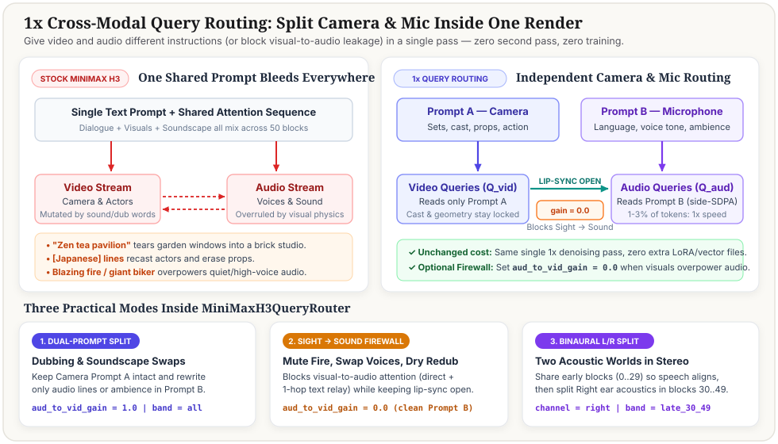
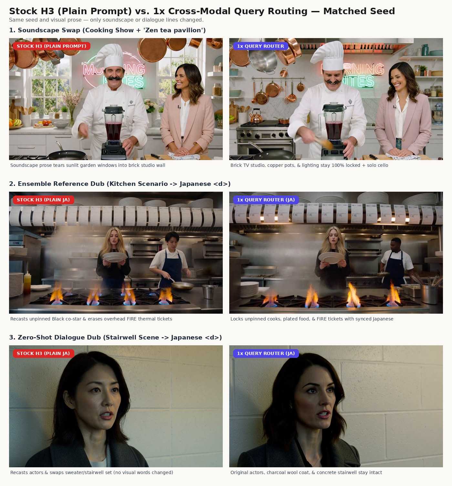
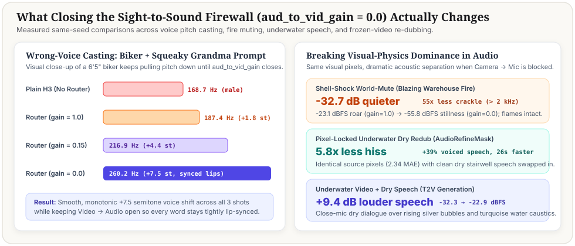

# Cross-Modal Query Routing (`1x` Single-Pass Camera & Mic Split)

**Cross-Modal Query Routing** lets you give the **camera** and the **microphone** completely different prompts—or block visuals from leaking into audio—inside a single normal MiniMax H3 render (`1x` speed, zero LoRAs, zero trained control vectors).

**Quick links:** [Practical Recipe Cookbook](query_routing_recipes.md) · [H3 Studio 2.0 (`app/`)](../../app/README.md) · [T2V Workflow](../../workflows/h3_text_to_video_pika_query_router_api.json) · [FL2VA Workflow](../../workflows/h3_first_last_frame_to_video_pika_query_router_api.json) · [Ref2VA Workflow](../../workflows/h3_image_ref_plus_text_to_video_pika_query_router_api.json)

---

## 1. Why Stock H3 Leaks Between Picture and Sound

MiniMax H3 generates video (`24 fps`) and stereo audio (`40 Hz`) together inside **one shared self-attention sequence** across 50 Transformer blocks. That joint design gives H3 great natural lip-sync and audio reactivity, but it creates an all-or-nothing coupling when you edit prompts:

- **Soundscapes remodel the set:** Writing `"tranquil Zen tea pavilion"` inside `overall_soundscape:` makes H3 tear sunlit garden windows straight into a windowless brick TV studio. Writing `"1970s sitcom studio"` changes hair, props, and lighting.
- **Dialogue languages recast the cast:** Translating spoken `<d>` lines from English to Japanese—without changing a single visual word—quietly turns actors into a Japanese cast, swaps wardrobe, and erases English signage or tickets.
- **Loud visuals overpower quiet audio:** Putting roaring warehouse flames or a submerged underwater swimmer on screen forces roaring fire or muffled underwater acoustics into the soundtrack even when your audio prompt asks for silence or crisp studio speech.

Cross-Modal Query Routing ([`MiniMaxH3QueryRouter`](../../steering/query_router.py)) keeps **one** forward pass (`1x`), lets video queries read **Prompt A (Camera)**, lets stereo audio queries read **Prompt B (Mic)**, and gives you a **Sight-to-Sound Firewall** dial (`aud_to_vid_gain`) when visuals try to bully the audio track.

---

## 2. What It Unlocks (Real Results)

### A. Swap Soundscapes Without Remodeling the Set
Keep your brick studio, concrete stairwell, or London street locked while rewriting the acoustic world:
- **Chaos Visuals + Zen Audio (`t2va_cooking_show_meltdown`):** Plain H3 tore bright sunlit garden windows and blossoms through the studio backdrop (`47.99` drift MAE). Routing Prompt B keeps the windowless brick studio, copper pots, and beetroot explosion locked while syncing a serene solo cello and whispered voiceover.
- **Sitcom Laugh Track, Thunderstorm, & Cathedral Reverb:** Swapping `overall_soundscape:` alone normally adds retro 1970s hairstyles/lamps (`35.66` MAE) or shifts lighting and sets; `1x` routing cleanly locks the scene (`9.91–9.95` MAE).

### B. Dub Dialogue Without Recasting Actors or Erasing Props
Translate spoken `<d>` tags—even per-speaker—while preserving unpinned background actors, lighting, and readable props:
- **Zero-Shot `EN -> JA` and `EN -> ES` Dubs:** Stock H3 recast stairwell speakers and transformed precinct lighting (`54.04 -> 21.68` MAE), whereas `1x` routing kept the original cast, coats, and window views while speaking synced Japanese or Spanish.
- **Ensemble `ref2va` Cast & Prop Lock:** Even with a `<Picture 1>` reference pinning the lead chef, plain Japanese dubbing recast her unpinned co-stars and erased `"FIRE"` thermal tickets overhead (`40.03` MAE). Splitting Camera and Mic kept the Black pan-tossing cook, plated dishes, and `"FIRE"` tickets intact across all 4 shots (`28.55` MAE).

### C. The Sight-to-Sound Firewall (`aud_to_vid_gain = 0.0`)

Normally, audio queries peek at video keys (`Q_aud -> K_vid`) across all 50 blocks. Setting **`aud_to_vid_gain = 0.0`** closes both that direct link *and* the 1-hop text relay back from video—while leaving **Video → Audio (`Q_vid -> K_aud`) open** so speech still stays lip-synced to the speaker's mouth.

- **Wrong-Voice Casting (`biker`):** Closing `aud_to_vid_gain` released voice pitch smoothly across four steps (`plain 168.7 Hz` → `gain=1.0 187.4 Hz` → `gain=0.15 216.9 Hz` → **`gain=0.0 260.2 Hz`, `+7.5 st`**)—giving a scarred 6'5" biker a squeaky elderly grandmother voice synced cleanly to his lips across all 3 shots.
- **Shell-Shock World-Mute (`shellshock`):** Over a raging warehouse fire with flying sparks and a `"DANGER"` sign intact, `aud_to_vid_gain = 0.0` dropped audio by **`-32.7 dB`** (`-23.1` → **`-55.8 dBFS`**, **`55×` less high-frequency crackle**).
- **Pixel-Locked Frozen-Video Dry Re-Dub ([`MiniMaxH3AudioRefineMask`](../../audio_refine.py)):** Using uncached `AudioRefineMask` plus the firewall locks exact underwater pixels (`2.34` MAE) while cutting frozen-video water hiss **`5.8×`**, boosting voiced speech **`+39%`**, and running `26 s` faster.
- **Dry Speech Underwater (`uwvid_dryaud`):** Close-mic crisp stairwell dialogue over submerged turquoise caustics and silver bubbles, **`+9.4 dB`** louder and clearer than `gain = 1.0`.

> **Important clean-text rule for `aud_to_vid_gain = 0.0`:** When the Sight-to-Sound Firewall is at `0.0`, Prompt B (`audio_conditioning`) becomes the audio stream's whole world. Strip conflicting visual-action prose (like `"roaring fire"` or `"underwater bubbles"`) out of Prompt B—if Prompt B itself mentions fire or bubbles, H3 will still synthesize them from Prompt B.

### D. One-Pass Binaural Split (`late_30_49`, Headphones Recommended)
Want two distinct acoustic spaces in Left vs. Right ears with zero echo?
- Keep `blocks 0..29` shared so speech phase and lip-sync lock across both ears, and route only the Right ear (`audio_channel = "right"`, `audio_block_band = "late_30_49"`) in `blocks 30..49`.
- Tested on a 3-speaker 1948 radio drama: Left ear stays inside the bone-dry padded studio booth while Right ear sits in a storm-lashed Gothic mansion with horror strings (`L/R correlation = 0.117`, zero speech echo).

---

## 3. When Plain Prompting Already Works (No Router Needed)

Don't add extra wiring where stock H3 already handles the job cleanly:
- **Pure music genres & studio instruments (`victorian + 808 trap`):** Stock H3 kept an 1885 parlor and `"LONDON 1885"` mantel plaque period-accurate over heavy trap beats (`-14.25 dBFS`) with zero neon bleed. Plain prompting mainly leaks visuals when your soundscape names a conflicting **place or era** (*Zen garden pavilion*, *1970s TV studio*, *cathedral*).
- **Explicit natural voice cues on non-human looks (`android`):** Describing warm natural human speech on chrome androids works natively (`147.6` vs `149.5 Hz`)—save `aud_to_vid_gain = 0.0` for extreme vocal/physics clashes like the grandma-voiced biker or muting an explosion.
- **Tight single-portrait `ref2va` & sealed-mouth narration:** When one face fills the frame or lips are already closed, plain prompting locks likeness and silence cleanly.
- **Matching sight + sound styles (`Blueprint Ink`):** When visual and audio vibes agree, plain prompting matches routing.
- **Regional visual splits & portal worlds inside one frame:** Use sibling **`1x` [`MiniMaxH3SpatialQueryRouter`](spatial_query_routing.md)** for single-pass split-screens, sky splits, and portal boxes (two-phase `0..24` isolated -> `25..49` blended, 100% stock RoPE), or two-pass [`MiniMaxH3EditGuider`](edit_guidance.md) + [`MiniMaxH3SpatialDirector`](spatial_director_guide.md) when animating a moving swept portal or editing an existing take.

---

## 4. How It Works Under the Hood

Inside [`steering/hooks.py`](../../steering/hooks.py) and [`steering/query_router.py`](../../steering/query_router.py):

1. **Dual shadow text streams:** Both **Prompt A** and **Prompt B** run cleanly through Qwen3-VL, `TokenRefiner`, and all 50 DiT blocks in parallel (`pause_malloc_graph` workspace pre-allocation, zero added graph breaks). Prompt lengths can differ freely.
2. **Tiny stereo side-SDPA (`1–3%` of tokens):** Stereo audio tokens (`au_spans`) are only `130–810` rows out of tens of thousands of video tokens. Running a dedicated scaled dot-product attention pass strictly for those audio queries against Prompt B (or Left/Right slices) adds virtually zero speed cost (`~1x`).
3. **Firewall blocks direct + 1-hop leakage:** Because `TokenRefiner` and self-attention mix text and vision, simply zeroing `Q_aud -> K_vid` isn't enough—visual context still leaks through `K_vid -> text -> Q_aud`. When `audio_conditioning` is explicitly supplied alongside `aud_to_vid_gain = 0.0`, the shadow audio text (`shadow_a`) runs isolated from `K_vid`, closing both paths cleanly while keeping `Q_vid -> K_aud` lip-sync open.
4. **Why `late_30_49` avoids binaural echo:** In H3's 50-block stack, `blocks 0..29` synchronize speech timing and lip articulation while `blocks 30..49` render acoustic room tail and atmosphere. Splitting ears only at `30..49` locks words together without double-voice phasing.

---

## 5. `MiniMaxH3QueryRouter` Controls Reference

| Control | Default | What It Does | When to Change It |
| :--- | :---: | :--- | :--- |
| **`audio_conditioning`** | *optional* | Separate Prompt B read by stereo audio queries | Wire for all dubs, soundscape swaps, binaural splits, and dry `AudioRefineMask` re-dubs |
| **`video_conditioning`** | *optional* | Separate Prompt A override for video queries | Optional; if unwired, video keeps the main sampler prompt |
| **`aud_to_vid_gain`** | `1.0` | Cross-modal attention from audio to video (`0.0`–`1.0`) | Drop to **`0.0`** to mute loud visuals, force extreme voice mismatches, or stop underwater hiss (with clean Prompt B!) |
| **`section_split`** | `off` | Single-prompt filter (`soundscape_to_audio`, `sections_by_modality`) | Use `soundscape_to_audio` when running one prompt and wanting soundscape lines hidden from video |
| **`audio_channel`** | `both` | Target stereo ear for `audio_conditioning` (`both`, `left`, `right`) | Set to `right` (with `late_30_49`) for one-pass binaural split |
| **`audio_block_band`** | `all` | DiT blocks routed to Prompt B (`all`, `mid_late_20_49`, `late_30_49`) | Use **`late_30_49`** for phase-synced binaural or spatial-echo splits |
| **`start_percent` / `end_percent`** | `0.0` / `1.0` | Denoising step window where routing is active | Usually leave `0.0` → `1.0` |

*(Note: `video_block_band="all"` is recommended for normal renders, and `audio_time_start`/`audio_time_end` work best only on silence/music gaps rather than mid-dialogue.)*

---

## 6. Get Started

- **Fastest way (UI):** Open **H3 Studio 2.0** ([`app/README.md`](../../app/README.md)) and expand **`1x` Audio / Video Split** on Video Compose (`Instant Audio Twists`, `Surprise Me` Genre Roulette, clean `Shell-Shock Mute`, and `Heylook` Smart Twists), or use **Re-Dub Audio → Isolate Visuals (`a2v=0.0`)** on any existing take.
- **Step-by-step ComfyUI examples:** Follow the **[Practical Query Routing Cookbook](query_routing_recipes.md)** or load the shipped workflows directly:
  - [`h3_text_to_video_pika_query_router_api.json`](../../workflows/h3_text_to_video_pika_query_router_api.json) (`T2V`)
  - [`h3_first_last_frame_to_video_pika_query_router_api.json`](../../workflows/h3_first_last_frame_to_video_pika_query_router_api.json) (`fl2va`)
  - [`h3_image_ref_plus_text_to_video_pika_query_router_api.json`](../../workflows/h3_image_ref_plus_text_to_video_pika_query_router_api.json) (split-cached `ref2va`)
- **Automated LLM prompt rewriters:** See the zero-visual-edit diff presets in [`docs/wiki/system_prompts/h3_query_router/`](system_prompts/h3_query_router/README.md) (`h3-query-router-dub`, `h3-query-router-soundscape`).

---

## Further Reading & Benchmarks

- **Highlights & comparisons:** [`README.md`](README.md) (`88 s` All-Tracks Best-Of Reel & `86 s` Query Router Showcase Reel) · [`query_routing_recipes.md`](query_routing_recipes.md)
- **Measured benchmark logs:** [`2026-11-25_query_router_step1_bidirectional.md`](../../bench/results/2026-11-25_query_router_step1_bidirectional.md) · [`2026-11-25_query_router_phase2_sowhat.md`](../../bench/results/2026-11-25_query_router_phase2_sowhat.md) · [`2026-11-24_query_router_first_renders.md`](../../bench/results/2026-11-24_query_router_first_renders.md) · [`2026-11-24_query_router_live_probes_and_step2_gates.md`](../../bench/results/2026-11-24_query_router_live_probes_and_step2_gates.md) · [`2026-11-23_wave2_gpu_gates_bus_vr_path1c_and_qvid.md`](../../bench/results/2026-11-23_wave2_gpu_gates_bus_vr_path1c_and_qvid.md)
- **Test matrix & prior art:** [`steering/query_routing_test_matrix.md`](steering/query_routing_test_matrix.md) · [`steering/research/2026-11-24_outside_review_erasure_novelty_evidence_and_commits.md`](steering/research/2026-11-24_outside_review_erasure_novelty_evidence_and_commits.md)
- **Related wiki pages:** [`spatial_query_routing.md`](spatial_query_routing.md) (`1x` Split-Screen & Portal Worlds) · [`steering.md`](steering.md) (`1x` Control Vectors) · [`edit_guidance.md`](edit_guidance.md) (`2x` Regional Masks & Spatial Director) · [`attention/SOLATTN.md`](attention/SOLATTN.md) (`MiniMaxH3Sol` sparse attention) · [`decisions.md`](decisions.md)
