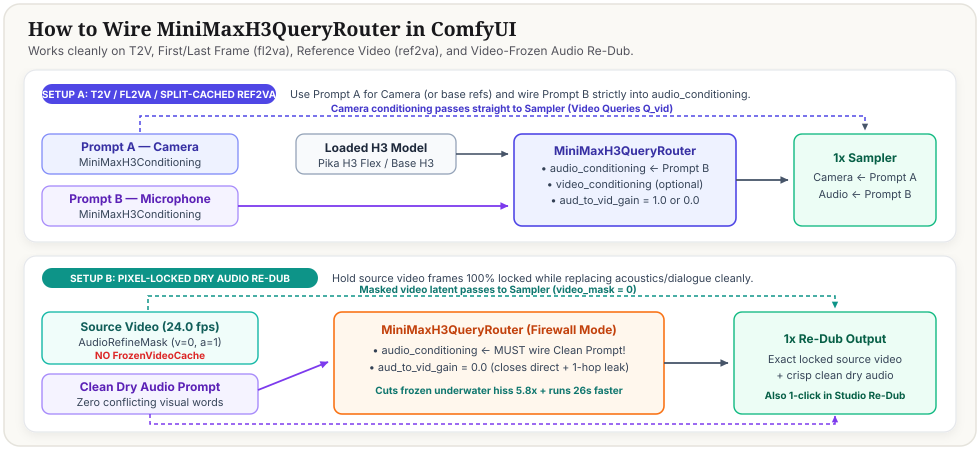
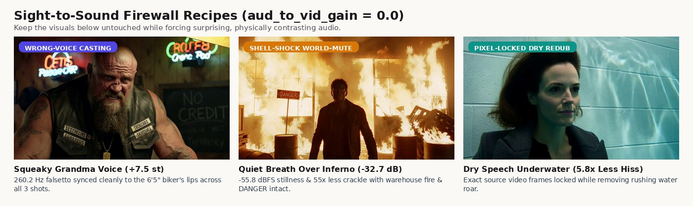

# Cross-Modal Query Routing Recipes (`1x` Cookbook)

Copy-paste setups for splitting **Camera** and **Microphone** prompts in MiniMax H3 (`1x` single pass, zero training) — covering soundscape swaps, multi-language dubbing, the `aud_to_vid_gain = 0.0` firewall, frozen-video re-dubs, and binaural splits.

For why it works and how the internals behave, see [**Cross-Modal Query Routing**](query_routing.md).

---

## Quick-Pick Recipe Finder

| Goal | Workflow / Tool | Key Router Settings | Critical Prompt Rule |
| :--- | :--- | :--- | :--- |
| **Swap soundscape / music vibe** without remodeling sets | `T2V` / `fl2va` / Studio `1x Split` | `gain = 1.0`, `band = all` | Edit only `overall_soundscape:` / `non_diegetic_music:` in Prompt B |
| **Dub speech** (EN → JA/ES) without recasting co-stars | `T2V` / `fl2va` / `ref2va` | `gain = 1.0`, `band = all` | Translate only `<d>[Lang] ... </d>` lines in Prompt B; zero visual changes |
| **Wrong-voice casting** (e.g., giant biker + squeaky voice) | `T2V` / Studio `Smart Twists` | **`gain = 0.0`**, `band = all` | Keep matching `<d>` lines in Prompt B; strip gruff/visual body cues |
| **World-mute** loud visuals (e.g., quiet breath over fire) | `T2V` / Studio `Shell-Shock Mute` | **`gain = 0.0`**, `band = all` | Remove every fire/explosion/water word from Prompt B! |
| **Dry speech underwater** (new generation) | `T2V` | **`gain = 0.0`**, `band = all` | Camera gets underwater prompt; Prompt B gets clean dry speech prompt |
| **Dry audio re-dub on locked video pixels** | `AudioRefineMask` / Studio `Re-Dub` | **`gain = 0.0`**, wire `audio_conditioning` | Omit `FrozenVideoCache`; wire clean dry Prompt B to **both** Sampler & Router |
| **Binaural L/R reality split** (headphones) | `T2V` | `channel = right`, **`band = late_30_49`** | Never use `band = all` on one ear alone (prevents double-voice echo) |
| **Single-prompt soundscape leak guard** | `T2V` / `fl2va` | `section_split = soundscape_to_audio` | Keep all visible props inside `integrated_multimodal_description:` |

---

## How to Wire It in ComfyUI



Pick the matching starter workflow—or open **H3 Studio 2.0** ([`app/README.md`](../../app/README.md)) and expand the **`1x` Audio / Video Split** card on any Video recipe:
- **Text-to-Video (`T2V`):** [`h3_text_to_video_pika_query_router_api.json`](../../workflows/h3_text_to_video_pika_query_router_api.json)
- **First + Last Frame (`fl2va`):** [`h3_first_last_frame_to_video_pika_query_router_api.json`](../../workflows/h3_first_last_frame_to_video_pika_query_router_api.json)
- **Reference Image / Cast (`ref2va`):** [`h3_image_ref_plus_text_to_video_pika_query_router_api.json`](../../workflows/h3_image_ref_plus_text_to_video_pika_query_router_api.json) *(encodes references once, then feeds two lightweight `MiniMaxH3PromptOnReferences` branches)*

---

## The Golden Rule: Clean Prompt Diffs

To get clean separation with zero collateral drift:
1. **Leave Camera Prompt A untouched.** Put your exact visual staging, wardrobe, lighting, props, and character tags in **Prompt A** (wired to the main Sampler).
2. **Change only what the microphone should hear in Prompt B.** Wire Prompt B into `MiniMaxH3QueryRouter.audio_conditioning`.
3. **Strip visual trigger words when using `aud_to_vid_gain = 0.0`.** At `gain = 0.0`, the audio stream ignores video pixels and relies entirely on Prompt B—so if Prompt B still contains `"roaring flames"` or `"submerged underwater"`, H3 will synthesize fire roar or water muffledness from the text itself.

Want an automated LLM helper to rewrite Prompt B cleanly? Use the shipped `heylook` presets in [`docs/wiki/system_prompts/h3_query_router/`](system_prompts/h3_query_router/README.md) (`h3-query-router-dub` and `h3-query-router-soundscape`).

---

## Part 1 — Soundscape & Dubbing Recipes (`aud_to_vid_gain = 1.0`)

### Recipe 1: Soundscape Swap Without Remodeling the Set
*Proven across Zen Cello over a TV Cooking Show (`p2_cooking_router_zen_g1`), 1970s Sitcom Laugh Track, and Violent Thunderstorm.*

- **Settings:** `aud_to_vid_gain = 1.0`, `audio_block_band = "all"`, `audio_channel = "both"`.
- **Prompt B diff:** Replace only `overall_soundscape:` (and `non_diegetic_music:` if adding score). Keep `integrated_multimodal_description:` verbatim so dialogue timing aligns with lips.

```diff
--- Prompt A (Camera — main conditioning)
+++ Prompt B (Mic — audio_conditioning)
@@ Swap soundscape only; keep visual scene prose identical @@
-overall_soundscape: Close handheld room tone in a hard concrete stairwell with a faint electrical hum.
+overall_soundscape: Bright 1970s three-camera sitcom studio recording; loud live studio audience bursts into warm laughter and applause after each deadpan pause, dry studio mic vocal tone.
```

> **Why it works:** Even `"tranquil Zen tea pavilion"` inside `overall_soundscape:` makes stock H3 tear garden windows into a brick cooking studio; `1x` routing locks the brick wall and copper pots while syncing solo cello and whispered delivery to the scene.

---

### Recipe 2: Dub Dialogue — Or Mix Two Languages Per Speaker (`(S1)` ES / `(S2)` EN)
*Locks actors, wardrobe, and background sets across zero-shot Japanese (`EN -> JA`), Spanish (`EN -> ES`), and per-speaker bilingual scenes.*

- **Settings:** `aud_to_vid_gain = 1.0`, `audio_block_band = "all"`.
- **Prompt B diff:** Translate only the `<d>[Language] ...</d>` spans. Keep speaker tags `(S1)` / `(S2)`, beat markers, and visual descriptions identical.

```diff
--- Prompt A (Camera — English)
+++ Prompt B (Mic — Bilingual (S1) Spanish / (S2) English)
@@ Translate ONLY (S1)'s <d> lines; leave (S2) and visuals untouched @@
-The woman (S1) says, <d>[English] You said tomorrow.</d>
+The woman (S1) says, <d>[Spanish] Dijiste mañana.</d>
 The man (S2) answers immediately, <d>[English] It moved.</d>
-She (S1) says at once, <d>[English] To when?</d>
+She (S1) says at once, <d>[Spanish] ¿Para cuándo?</d>
 He (S2) answers at once, <d>[English] Tonight.</d>
```

---

### Recipe 3: Ensemble `ref2va` Cast & Prop Lock
*Use when `<Picture 1>` pins one character in a multi-person scene, so dubbing doesn't recast everyone else or erase background signage.*

- **Workflow:** [`h3_image_ref_plus_text_to_video_pika_query_router_api.json`](../../workflows/h3_image_ref_plus_text_to_video_pika_query_router_api.json).
- **Wiring:** Attach your reference portrait/frame to `MiniMaxH3EncodeReferences`, keep Prompt A in English on the Camera branch, and feed only the `<d>`-translated copy into the `audio_conditioning` branch (`MiniMaxH3PromptOnReferences`).
- **Observed win (`ref2va_scene_kitchen`):** Stock `[Japanese]` kept `<Picture 1>`'s lead blonde chef while turning her unpinned co-stars East Asian and wiping `"FIRE"` text off the kitchen's thermal tickets; `1x` routing kept every cook, dish, and `"FIRE"` ticket intact while dubbing and singing in synced Japanese.

---

## Part 2 — Sight-to-Sound Firewall Recipes (`aud_to_vid_gain = 0.0`)



Lower **`aud_to_vid_gain = 0.0`** whenever what the camera sees would overpower what the microphone should record. Because **Video → Audio** attention stays open, characters still articulate the spoken words naturally.

### Recipe 4: Wrong-Voice Casting (Giant Biker + Elderly Falsetto)
- **Settings:** `aud_to_vid_gain = 0.0`, `audio_block_band = "all"`.
- **Prompt A (Camera):** Describe the giant 6'5" scarred biker shouting his `<d>` lines in a roadhouse bar (`"NO CREDIT"`).
- **Prompt B (Mic):** Rewrite the speaker framing to `"a frail 90-year-old grandmother in a squeaky, breathy falsetto soprano"`, keeping the **exact same `<d>` words** and **removing** `"gruff"`, `"deep baritone"`, or `"massive biker"` from Prompt B.
- **Measured payoff:** Pitch climbs smoothly from `168.7 Hz` (plain) to **`260.2 Hz` (`+7.5 st`)** at `gain = 0.0` while staying lip-synced across all 3 shots.

### Recipe 5: Shell-Shock World-Mute (Quiet Breath Inside a Raging Fire)
- **Settings:** `aud_to_vid_gain = 0.0`, `audio_block_band = "all"`.
- **Prompt A (Camera):** Blazing warehouse inferno, flying sparks, soot-covered survivor walking toward camera past a `"DANGER"` sign.
- **Prompt B (Mic):** Replace the visual description and `overall_soundscape:` with bone-dry anechoic room stillness—close-mic soft rhythmic breathing and slow heartbeat, with **zero** occurrences of `"fire"`, `"flames"`, `"sparks"`, `"roar"`, or `"warehouse"`.
- **Measured payoff:** Sound drops **`-32.7 dB`** (`-55.8 dBFS`, **`55×` less high-frequency crackle**) while every flame and spark stays blazing on screen.

### Recipe 6: Underwater Visuals + Dry Studio Speech (New Generation)
- **Settings:** `aud_to_vid_gain = 0.0`, `audio_block_band = "all"`.
- **Prompt A (Camera):** Scene rewritten for crisp bright underwater turquoise sunlight caustics and rising silver bubbles.
- **Prompt B (Mic):** Clean, dry close-mic dialogue prompt with **zero** underwater/water/bubble/submerged words anywhere.
- **Measured payoff:** Restores crisp `-22.9 dBFS` close-mic speech (`+9.4 dB` clearer than `gain = 1.0`).

### Recipe 7: Pixel-Locked Dry Audio Re-Dub (`MiniMaxH3AudioRefineMask` + Firewall)
*Swap loud underwater noise or bad room tone for crisp dry speech while holding your exact source video pixels 100% locked.*

- **In H3 Studio 2.0:** Open any video take → **Re-Dub Audio** drawer → edit the prompt cleanly → check **`Isolate Visuals (a2v=0.0)`** → hit **Run Re-Dub**.
- **In ComfyUI (see Setup B in diagram above):**
  1. Load your source clip (`24.0 fps`) into `MiniMaxH3AudioRefineMask(video_mask=0.0, audio_mask=1.0)` — **do not** use `MiniMaxH3FrozenVideoCache`.
  2. Build **one clean dry prompt** (strip every visual noise trigger like water/fire) and wire it to **BOTH** the main Sampler conditioning **AND** `MiniMaxH3QueryRouter.audio_conditioning` (explicitly wiring `audio_conditioning` is required so the shadow text path closes the 1-hop text relay).
  3. Set **`aud_to_vid_gain = 0.0`**.
- **Measured payoff:** Holds exact source frames (`2.34` MAE), cuts frozen-video water hiss **`5.8×`**, increases voiced speech **`+39%`**, and runs `26 s` faster than un-isolated `AudioRefineMask`.

---

## Part 3 — Binaural Split & Single-Prompt Guard

### Recipe 8: `1x` Binaural Stereo Reality Split (Headphones)
Put the dry story booth in the listener's Left ear and a thunderstorm or haunted space in their Right ear—in a single `1x` render with **zero echo**:
- **Settings:** `audio_channel = "right"`, **`audio_block_band = "late_30_49"`**, `aud_to_vid_gain = 1.0`.
- **Prompt A (Camera / Left Ear):** Base story prompt with dry booth `overall_soundscape:` and `non_diegetic_music: N/A`.
- **Prompt B (Right Ear Only):** Identical prompt with `overall_soundscape:` and `non_diegetic_music:` swapped to storm rain, howling wind, and horror strings.
- **Mandatory guardrail:** Always use `audio_block_band = "late_30_49"` (never `"all"`). Keeping `blocks 0..29` shared locks speech cadence and lip-sync across Left and Right while `30..49` separates room acoustics (`L/R correlation = 0.117`).

### Recipe 9: Zero-Second-Prompt Leak Guard (`section_split`)
If you only want to write **one** prompt and prevent `overall_soundscape:` from leaking into visuals:
- Leave `audio_conditioning` and `video_conditioning` unwired and set **`section_split = "soundscape_to_audio"`** (hides `overall_soundscape:` and `non_diegetic_music:` from video queries) or **`sections_by_modality`** (also hides visual scene prose from audio queries).
- **Watch out for hidden visual cues:** If `overall_soundscape:` mentions something visible that wasn't written into `integrated_multimodal_description:` (for example, a ringing neon signal or sizzling pan), hiding it from `Q_vid` will drop that visual detail from the picture. Put all visual details inside `integrated_multimodal_description:`.

---

## Troubleshooting

| Symptom | Likely Cause | Fix |
| :--- | :--- | :--- |
| **`aud_to_vid_gain = 0.0` still sounds fiery or underwater** | Conflicting visual words left inside Prompt B, or `audio_conditioning` wasn't wired | Strip all fire/water/action words from Prompt B, and ensure Prompt B is explicitly connected to `MiniMaxH3QueryRouter.audio_conditioning` |
| **Frozen-video re-dub ignores `a2v = 0.0`** | `MiniMaxH3FrozenVideoCache` bypassed `MiniMaxH3QueryRouter` | Omit `MiniMaxH3FrozenVideoCache` and use uncached `MiniMaxH3AudioRefineMask` (or use Studio's `Isolate Visuals` toggle) |
| **Binaural `Left`/`Right` sounds echoed or double-spoken** | `audio_block_band` was left on `"all"` | Switch `audio_block_band` to **`"late_30_49"`** so `blocks 0..29` stay phase-locked |
| **Sub-clip `audio_time_start` repeats a spoken phrase** | Cut timestamp landed mid-sentence | Set `audio_time_start` only on silence gaps or instrumental beats, or keep `0.0 -> 1.0` |
| **Router conflicts with `MiniMaxH3Steer`** | Hook-mode control vector (`streams != "both"` or `block_band != "all"`) stacked with Router | Keep `MiniMaxH3Steer` at `streams="both"`, `block_band="all"`, or rely on `MiniMaxH3QueryRouter` alone |

---

## Further Reading & Raw Measurements

- **Visual Proofs & Showcase Reels:** [`README.md`](README.md) (`88 s` All-Tracks Best-Of Showcase Reel & `86 s` Query Router Showcase Reel) · [`query_routing.md`](query_routing.md)
- **Prompt Presets:** [`docs/wiki/system_prompts/h3_query_router/`](system_prompts/h3_query_router/README.md) (`h3-query-router-dub`, `h3-query-router-soundscape`)
- **Full Benchmark Ledgers:** [`2026-11-25_query_router_step1_bidirectional.md`](../../bench/results/2026-11-25_query_router_step1_bidirectional.md) · [`2026-11-25_query_router_phase2_sowhat.md`](../../bench/results/2026-11-25_query_router_phase2_sowhat.md) · [`2026-11-24_query_router_live_probes_and_step2_gates.md`](../../bench/results/2026-11-24_query_router_live_probes_and_step2_gates.md)
