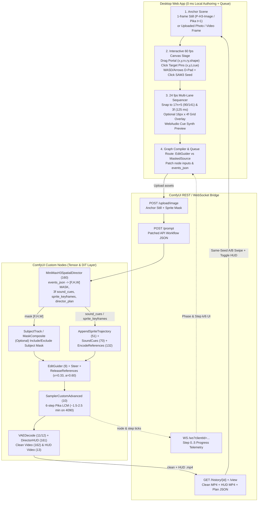
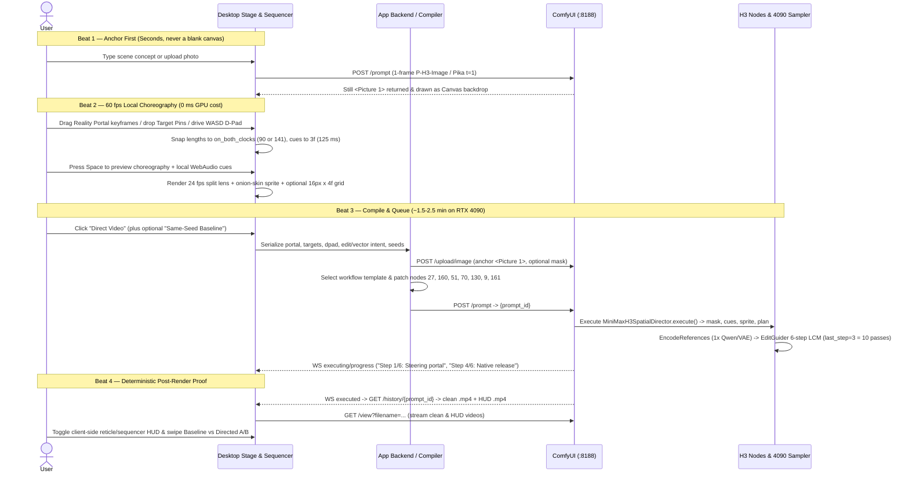

# Desktop Spatial Director App Architecture, Masking Compatibility, & End-to-End Pipeline (2026-11-16)

Companion to [`2026-11-15_spatial_world_director_and_3d_edit_guidance.md`](2026-11-15_spatial_world_director_and_3d_edit_guidance.md). This document evaluates turning **Draggable Reality Portals**, **Genie D-Pad locomotion**, **Point-and-Click World Targets**, and our **masking / steering stack** into a standalone desktop web application backed by ComfyUI on an RTX 4090 (`~54s`–`~2.5 min` render latency), grounded strictly in the `.py`, `.js`, and `.json` files on disk.

---

## 1. Executive Answers: Masking Coverage & Why the Sprite Node Exists

### 1.1 Will `MiniMaxH3SpatialDirector` Handle All Our Masking Features?

**No — not as a single unified pass out of the box.** The pack has **two fundamentally different masking engines** that operate in incompatible spaces, plus several wiring gaps inside [`spatial_director.py`](../../../spatial_director.py) and [`web/h3_spatial_director.js`](../../../web/h3_spatial_director.js):

1. **Velocity-Space Continuous Steering (`MiniMaxH3EditGuider.mask`)**:
   - Evaluates `[original, edited]` on the full DiT sequence and blends predicted velocities via `v_out = v_orig + (eff_v * v_m) * (v_edit - v_orig)` ([`edit_guidance.py:422, 456, 476`](../../../edit_guidance.py#L422)).
   - Supports continuous `[0.0, 1.0]` cosine feathering (`feather = 0.08`), `SpatialDirector` `[F, H, W]` dynamic masks, `Steer(edit_pass="edited_only" | "original_only")`, `PromptEdit`, `SoundCues`, and `AppendSpriteTrajectory`.
2. **Latent-Inpaint Binary Masking (`MiniMaxH3MaskedSource` + `MiniMaxH3RestorePlate`)**:
   - Writes a binary per-`2x2`-patch `NestedTensor(video, audio)` `noise_mask` for two-sampler latent inpainting (`video_mask.py:2330–2993`) and restores clean plates between samplers (`plate_restore.py:111–187`).
   - `MiniMaxH3RestorePlate.binary_mask` (`plate_restore.py:114–125`) **hard-refuses** any fractional mask (`KEPT_BELOW < m < OPEN_ABOVE`) or non-uniform `2x2` patch. Therefore, `SpatialDirector`'s cosine-feathered `[F, H, W]` mask **cannot** feed `RestorePlate`, and `MiniMaxH3FrozenVideoCache` (`frozen_video_cache.py:291–339`) only caches `noise_mask == 0` inpaint rows, not `EditGuider` passes.

### 1.2 Why Does the Sprite Node Feel Like a Hack — and How Does the D-Pad Actually Work?

**Why it feels like a hack (`sprite_trajectory.py:300–620`)**:
MiniMax H3 (`ref2va`) has **no native `(x, y, box)` trajectory conditioning**; its trained channel for frame-exact motion transfer (`r = +0.97`) is `<Video N>` Video VAE `ref_img` tokens (`use_vae=True`). So `MiniMaxH3AppendSpriteTrajectory` extracts `<Picture 1>`'s foreground RGBA cutout (via wired `mask` or deterministic border-seeded GrabCut at `max_side=512`, `sprite_trajectory.py:309–377`), composites it with an elliptical ground shadow onto a **neutral grey vertical-gradient horizon** (`384x224` default, `_neutral_horizon_background`, `sprite_trajectory.py:388–489`), and appends that in-memory tensor as `<Video N>` (`RuntimeVideoReference`, `613–620`).

**Why the Interactive D-Pad + `0.33` Release Law turns the hack into articulated motion**:
- In [`web/h3_spatial_director.js:532–639`](../../../web/h3_spatial_director.js#L532-L639), clicking `◀`, `▲HOP`, `▼`, `▶` calls `nudgeOrInsertDpad(dx, dy, face)` to stamp `(frame, x, y, face=right|left|auto)` waypoints and parabolic jump arcs (`hop <start>..<end>: lift=...`). Holding `face=right` while moving `-x` encodes a **backpedal/moonwalk**; flipping `face=left` triggers a turn-around (`sprite_trajectory.py:272–285`).
- Pairing `<Video N>` with **`MiniMaxH3ReleaseReferences(end_percent=1.0, video_end_percent=0.33)`** (`control_vector_nodes.py:4666–4834`) holds `<Picture 1>` across all 6 Pika steps while **dropping the synthetic `<Video N>` cutout after step 1** (crossing the unshifted flow midpoint `b = 0.50` under `shift_video = 12.0`). Steps `0..1` lock trajectory, facing, and jump apex; steps `2..5` synthesize live 3D leg strides, cloth physics, and scene lighting without cutout edges.

---

## 2. Feature Matrix: What You Get vs. What You Don't Get (and Why)

| Feature / Capability | Supported? | Mechanism & How Desktop App Wires It | Why / Current Gap if Partial or Unsupported |
| :--- | :---: | :--- | :--- |
| **Reality Portal (`circle`, `ellipse`, `vertical_split`)** | **Yes** | `MiniMaxH3SpatialDirector` -> `EditGuider.mask` | Continuous `[F, H, W]` cosine-feathered mask; `first_step=0` gives `0.0` outside Step-0 leak. |
| **Point-and-Click World Targets + `3f` SoundCues** | **Yes** | `SpatialDirector(sound_cues)` -> `MiniMaxH3SoundCues` + `EditGuider` | `3`-frame (`125 ms`) impulse cues + `40 Hz` `t_env` audio gating (`audio_end_percent=0.60`). |
| **Genie D-Pad Locomotion (`◀ ▲HOP ▼ ▶`)** | **Partial** | `SpatialDirector(sprite_keyframes)` -> `AppendSpriteTrajectory` + `ReleaseReferences(video_end_percent=0.33)` | **Gap**: JS currently hides D-Pad in `portal_path` mode (`web/h3_spatial_director.js:646`) and overwrites `dpad.hops` with 1 hop (`630`). Trivial to fix in desktop UI. |
| **Control Vectors & Word Vectors (`Split-World`)** | **Partial** | `MiniMaxH3Steer(edit_pass="edited_only")` + `EditGuider(mask)` | **Gap**: `MiniMaxH3EditGuider` checks `same_text` (`edit_guidance.py:223`) and `workflows/build_workflows.py:2985` requires `edits` or `keyframe_differential` (or `same_prompt`). Needs `same_prompt` + active `Steer` delta wired in `build_workflows.py` (like `app/server.py:1879`). |
| **SAM 3.1 Subject Track & Sapiens2 Parts** | **Partial** | `SubjectTrack` / `SubjectParts` `MASK` -> `MaskComposite` + `SpatialDirector.mask` -> `EditGuider.mask` | **Gap**: `SpatialDirector` has no `mask` input (`spatial_director.py:473–502`). Needs `MaskComposite` in workflow or optional `include_mask`/`exclude_mask` sockets on `SpatialDirector`. |
| **Clean Sprite Cutout (no GrabCut tears)** | **Partial** | `SubjectTrack.mask[0]` -> `MiniMaxH3AppendSpriteTrajectory.mask` | Shipped `h3_world_targets_genie_pika_api.json` leaves `.mask` unwired (`GrabCut` fallback). Wiring SAM3/user brush mask at frame `0` eliminates cutout artifacts. |
| **`Keep my photo` (`how="steer"`)** | **Collision** | Both write to `EditGuider.mask` | `EditGuider` has one `mask` socket (`edit_guidance.py:565`). Must be combined via `MaskComposite` upstream. |
| **`MaskedSource` + `RestorePlate` Inpainting** | **Separate Track** | App routes subject-replacement jobs to `MaskedSource -> RestorePlate` graph | `RestorePlate.binary_mask` refuses feathered masks (`plate_restore.py:114–125`). Cannot share a sampler with `SpatialDirector` feathered masks. |
| **`MiniMaxH3GuideLatent` (`mask` input)** | **Different Role** | RGB-encodes mask (`mask_to_rgb`, `guide_latent.py:91`) for guide+mask LoRAs | Not a velocity or inpaint mask; `GuideLatent(audio)` and `SoundCues` share Audio RoPE and must not overlap (`validate_audio_keyframe_spans`). |
| **`AudioRefineMask` + `FrozenVideoCache`** | **Separate Pass** | Post-render 2nd-pass audio re-dubbing workflow | Caches `noise_mask == 0` video latents while reopening `40 Hz` audio; run as a follow-up stage after video lock. |
| **Different Prompts per Target Pin in 1 Render** | **No** | N/A | `EditGuider` evaluates `[original, edited]` (`2` passes). `K` distinct target concepts would require `K+1` DiT passes, blowing past the 4090 budget. |
| **Sub-`16 px` / Sub-`4-frame` Crisp Edges** | **No (Physics)** | Pooled to `(16 px, [1, 4, 4, 4, 4])` (`edit_guidance.py:186–212`) | Hard VAE + `2x2` DiT patch quantization; UI should preview the `16 px` × `4`-frame grid so users see exact boundaries. |

---

## 3. Concrete Gaps in Current Nodes & Workflows (and Holistic Fixes)

Inspecting [`spatial_director.py`](../../../spatial_director.py), [`web/h3_spatial_director.js`](../../../web/h3_spatial_director.js), [`workflows/build_workflows.py`](../../../workflows/build_workflows.py), and both shipped API graphs reveals 6 concrete gaps between today's ComfyUI widget and a production desktop Spatial Director app:

1. **No `<Picture 1>`-anchored `ref2va` Portal or `fl2va` (`i2v`) Spatial Workflows**:
   - `h3_spatial_portal_pika_api.json` is `t2va`-only (`MiniMaxH3Conditioning` without a still anchor); `build_workflows.py:1829, 2810` explicitly blocks `task == "i2v"` from creating `MiniMaxH3Resolution` (`"27"`) required by `spatial_director`.
   - *Fix*: Add `<Picture 1>`-anchored `ref2va` `portal_path` and `fl2va` (`canvas="explicit"` + `"27"`) spatial graphs in `build_workflows.py`.
2. **HUD Burn-In Discards the Clean Video**:
   - `workflows/build_workflows.py:2874` overwrites `g["13"]["inputs"]["images"] = ["161", 0]`, so `/history` only receives the HUD-burned `.mp4`.
   - *Fix*: Emit a second `VHS_VideoCombine` (`"162"`) reading clean `VAEDecode` `["11", 0]` so the desktop app can toggle its interactive HTML5 HUD and Same-Seed A/B wipe cleanly on top of raw `.mp4` playback.
3. **`MiniMaxH3SpatialDirector` Mode Exclusivity & Ignored `backdrop`**:
   - `DIRECTOR_MODES = ("portal_path", "point_targets")` (`spatial_director.py:42`) prevents combining a moving portal and timed world targets in one mask; `backdrop` (`spatial_director.py:501, 523`) executes `del backdrop` and `h3_spatial_director.js:685–703` always paints a dark grid.
   - *Fix*: In the standalone app, render the real still/video backdrop directly on the HTML5 canvas and emit unified `events_json`; on the node side (`AGENTS.md` §5 compliant, appended at end of `inputs`), add `"combined"` to `DIRECTOR_MODES` plus optional `include_mask` / `exclude_mask` sockets.
4. **Silent Audio Gating Side-Effect in `point_targets`**:
   - Any `F > 1` mask causes `EditGuider` to project `t_env = raw.amax(dim=(1, 2))` onto `40 Hz` audio (`edit_guidance.py:331–334`), muting edited audio between target windows unless `streams` is `"video_only"` or `"independent"`.
   - *Fix*: Default `point_targets` workflows to `streams="video_only"` (letting `MiniMaxH3SoundCues` + `audio_end_percent=0.60` drive foley) and expose an explicit *"Gate audio to target windows"* toggle in the UI.
5. **Single-Hop & Uneditable Timing in `web/h3_spatial_director.js`**:
   - The in-node widget cannot delete keyframes/targets, add portal keyframes, edit `target.start/end/ramp/gain`, unlink ellipse `ry = rx * 1.15`, or store >1 hop (`dpad.hops = [...]` at `632`).
   - *Fix*: The standalone desktop app owns the full multi-lane sequencer state and serializes complete `events_json` directly before `POST /prompt`.
6. **Workflow Routing for Incompatible Mask Engines**:
   - *Fix*: The app acts as a **workflow router**: Portal / World Target / Steer jobs compile to `EditGuider` graphs; subject-replacement / plate-locked jobs compile to `SubjectTrack -> SubjectParts -> MaskedSource -> RestorePlate`; post-render foley tweaks compile to `FrozenVideoCache -> AudioRefineMask`.

---

## 4. End-to-End UX & Code-Level Architecture

### 4.1 Three-Layer Division of Labor (App ↔ Workflows ↔ Nodes)



### 4.2 Full End-to-End User Experience & Code Execution Lifecycle



### 4.3 Spatiotemporal Grid & 6-Step Pika Budget Alignment

To make multi-minute 4090 latency predictable, the desktop UI exposes H3's real hardware boundaries visually instead of hiding them behind raw floats:

```text
Time (24 fps, 141f = 5.875s on_both_clocks)
├── Video Latent Steps: [f0] [f1..4] [f5..8] [f9..12] [f13..16] | [f17] [f18..21] ... (17n+5 causal amax)
├── Audio Cue Grid:     |0  |3  |6  |9  |12 |15 |18 |21 |24 ...  (3-frame = 125 ms = 5 x 40 Hz tokens)
└── Spatial Patch Grid: 16 px VAE cells / 32 px DiT patches (amax pooled inside EditGuider)

6-Step Pika H3 Flex Schedule (RTX 4090)
Step:  0 (sig=1.00) ──▶ 1 (0.973) ──▶ 2 (0.923) ──▶ 3 (0.800) ──▶ 4 (0.571) ──▶ 5 (0.333) ──▶ 0.0
       │                │             │             │             │             │
       ├─ <Video 1> Sprite active (0..0.33) ───────▶ DROPPED at b=0.50 (native 3D gait steps 2..5)
       ├─ SoundCues active (0..0.60) ────────────────────────────▶ DROPPED (clean native foley)
       └─ EditGuider 2-pass steering (first_step=0..last_step=3) ─▶ 1-pass tail release (10 total passes)
```

---

## 5. Recommended Desktop Layout & 4090 Workflow

1. **Three-Pane NLE Desktop Layout**:
   - **Center Stage (`16:9` / `7:4` anchored canvas)**: Shows the real `<Picture 1>` still or scrubbed input video frame, draggable `circle`/`ellipse`/`vertical_split` Reality Portals, numbered Target Pins with live radius handles, WASD/arrow D-Pad sprite path with facing badges, click-to-seed SAM3 subject protection, and a toggleable `16 px × 4f` grid overlay.
   - **Bottom 24 fps Multi-Lane Sequencer**: Separate lanes for **Portal Keyframes**, **Targets + `3f` Sound Cues**, **D-Pad Waypoints + Multi-Hop Arcs**, and **Subject Mask / Vector Window**, with `Space` playing a local 60 fps canvas + WebAudio preview at `0` GPU cost.
   - **Right Rail (Steering & Non-Blocking Queue)**: Toggle between **Vector Split-World** (no prompt diffing) and **Inline Prompt Diff** (`old -> new` word highlighting), interactive **6-Step Window Selector (`first_step` / `last_step`)**, **"90f Scout (`3.75s`) → 141f Hero (`5.875s`)"** lock-seed escalation, and a non-blocking **Render Queue** opening into a **Same-Seed A/B Swipe Cinema** with toggleable HUD overlay.

---

## 6. Project Context, Phase-by-Phase Roadmap, & Longer-Term Vision

### 6.1 Where This Fits in the Repo (`VISION.md` Alignment)

Per [`VISION.md`](../../../VISION.md), this repo exists to push what a single RTX 4090 box can achieve with MiniMax H3 and leave behind reproducible workflows, measurements, and tools—always anchored to a **same-seed baseline** (`Truth`), driven from **one generated source of truth** (`workflows/build_workflows.py`, node schemas) rather than duplicated UI hacks (`Structure`).

- [`app/`](../../../app) (H3-Image Studio) proved that a standalone web front end can talk directly to ComfyUI's API graphs (`workflows/image/`) with workflow-inherited controls, zero hardcoded prompt banks, and non-blocking session queues.
- [`MiniMaxH3SpatialDirector`](../../../spatial_director.py) and [`web/h3_spatial_director.js`](../../../web/h3_spatial_director.js) proved 3D `(x, y, t)` velocity steering, `3f` sound cues, and D-Pad locomotion inside ComfyUI—but LiteGraph widgets lack real image/video backdrops, multi-lane timing editors, clean-vs-HUD dual outputs, and masking-engine routing.
- **The Desktop Spatial Director App** unifies both: an NLE-style desktop web studio that gives creators deterministic `60 fps` local pre-visualization before spending `~54s`–`~2.5 min` of 4090 render time.

### 6.2 Phase-by-Phase Execution Plan

#### Phase 1 — Anchored Spatial Stage & Dual-Save Core (MVP)
*Goal: Real `<Picture 1>`-anchored Reality Portals, World Targets, and WASD D-Pad choreography with zero node schema changes.*
- **Workflows ([`build_workflows.py`](../../../workflows/build_workflows.py))**:
  - Add `<Picture 1>`-anchored `ref2va` `portal_path` and `fl2va` (`i2v`, `canvas="explicit"` + `"27"`) spatial director graphs.
  - Add `same_prompt` Split-World support (`MiniMaxH3Steer(edit_pass="edited_only")` + `EditGuider.mask`).
  - Add a second `VHS_VideoCombine` (`"162"`) saving the clean `VAEDecode` output alongside `MiniMaxH3DirectorHUD` (`"161"`).
- **Desktop App**:
  - 3-pane NLE layout (`Center Stage` with real `<Picture 1>` / `first_frame` backdrop, `24 fps Multi-Lane Sequencer`, `Right Rail` steering + queue).
  - Direct manipulation: draggable `circle`/`ellipse`/`vertical_split` portals, Target Pins with WebAudio `3f` cue synthesis, `WASD`/Arrow multi-hop D-Pad path recording, `16 px × 4f` grid overlay toggle, and a **Same-Seed A/B Swipe Cinema** with toggleable HTML5 HUD.

#### Phase 2 — Full Masking Union, V2V Inpainting, & Audio Re-Dubbing
*Goal: Bridge all repo masking engines cleanly behind one unified UX.*
- **Node Enhancements (`AGENTS.md` §5 backwards-compatible, appended at end of `inputs`)**:
  - Extend `MiniMaxH3SpatialDirector` with `"combined"` mode (portal + targets together) and optional `include_mask` / `exclude_mask` inputs for native subject composition.
- **Masking & Routing**:
  - **Interactive SAM 3.1 / Sapiens2 Seeding**: Click/box-select actors or garments on an uploaded clip or still -> feed `MiniMaxH3SubjectTrack.seeds` and `MiniMaxH3SubjectParts`, wire frame-`0` subject mask into `MiniMaxH3AppendSpriteTrajectory.mask` (eliminating GrabCut tears), and protect subjects inside portals via `InvertMask(GrowMask(...))`.
  - **Engine-Aware Workflow Router**: Route semantic/portal/target/vector jobs to `EditGuider`, binary subject-replacement jobs to `MaskedSource -> RestorePlate`, and post-render foley/dialogue tweaks to `FrozenVideoCache -> AudioRefineMask` (keeping the locked video take).

#### Phase 3 — Chained Multi-Shot Storyboards & Two-Speed Escalation
*Goal: Scale beyond single `5.875s` clips into coherent multi-shot sequences on one 4090.*
- **Seed-Locked Escalation**: One-click **`90f` Scout (`3.75s`) → `141f` Hero (`5.875s`)** and multi-variant Director's Take queues (e.g., sweeping `first_step` or `scale` on one locked choreography).
- **Multi-Shot Continuity**: Chain `on_both_clocks` windows (`chain_lengths()`: `141..345` frames with `39`/`90`-frame contexts, `h3_rules.py:124–130`) and `MiniMaxH3AudioFreezeSong` tracks where Shot `N`'s tail frame seeds Shot `N+1`'s Spatial Director stage.

### 6.3 Longer-Term Vision

- **From Prompting Clips to Directing Persistent Worlds**: Treat H3 as a **stateful spatial world engine** rather than a one-shot prompt box—where cast identity (`<Picture 1..N>`), acoustic beats (`40 Hz` `SoundCues`), locomotion (`<Video N>` released at `0.33`), semantic physics (`EditGuider` + `Steer`), and object segmentation (`SAM 3.1` + `Sapiens2`) are authored on one continuous timeline and verified against same-seed baselines.
- **Drop-In Speed Scaling**: Keeping `events_json`, `director_plan`, and ComfyUI's generated API graphs as the strict contract means any future 4090 speedup (fewer sampling steps, faster sparse attention, or next-gen distills) compresses the `~1.5–2.5 min` loop toward near-real-time playable world slices **without rewriting the authoring UX**.

---

## 7. Phase 1 Shipped (`719a062f`) & UI Polish Notes

### 7.1 What Shipped in `719a062f`

- **Standalone Desktop Web App (`director/`)**: [`director/server.py`](../../../director/server.py) (`127.0.0.1:8195` HTTP, optional `:8194` Tailscale HTTPS via [`director/studio.sh`](../../../director/studio.sh)), [`director/compiler.py`](../../../director/compiler.py), [`director/routes.py`](../../../director/routes.py) (`POST /h3_spatial_director/forget` temp/orphan cleanup protecting `$H3_OUTPUT_DIR/Video/`), and the Strict Light Mode UI under `director/static/` ([`director/static/index.html`](../../../director/static/index.html), [`director/static/js/stage.js`](../../../director/static/js/stage.js), [`director/static/js/app.js`](../../../director/static/js/app.js)). Live `:8188` and `:8193` remain untouched.
- **Engine & Shipped Workflow Extensions**: Generated [`workflows/h3_r2v_spatial_portal_pika_api.json`](../../../workflows/h3_r2v_spatial_portal_pika_api.json) and [`workflows/h3_i2v_spatial_portal_pika_api.json`](../../../workflows/h3_i2v_spatial_portal_pika_api.json), clean `VAEDecode` (`"162"` alongside HUD `"13"` with `save_output=False` drafts), concentric outer halo (`halo_radius`, `halo_weight`) + bounded portal spans (`portal_start`/`end`/`ramp`) in [`spatial_director.py`](../../../spatial_director.py), and Cross-Entity Spatial Halo Coupling in `director/compiler.py::compile_spatial_take` (offsetting `AppendSpriteTrajectory` waypoints radially by `halo` coupling strength).
- **Live Masked Sampler Preview & Gates**: Dynamic `ModelPreviewOverrideKJ` (`taeh3.safetensors` at `preview_fps=7` for video, `taeh3_image.safetensors` at `preview_frames=1, preview_fps=1` for stills) streamed over per-`clientId` WebSocket and composited inside the feathered portal ring on `<canvas>`, verified by the two-tier offline + Chrome CDP harness [`bench/check_director_studio.py`](../../../bench/check_director_studio.py).

### 7.2 UI Polish Notes (Archived Visual Reference)

Visual design references and our live `1280×800` verification capture are archived under the gitignored `internal/` tree (`internal/research/2026-11-16_spatial_director/stitch_1f0c1f17_floating_hud.png`, `internal/research/2026-11-16_spatial_director/stitch_1f0c1f17_floating_hud.html`, and `internal/research/2026-11-16_spatial_director/director_live_portal_1280x800.png`) for the next UI polish pass:

1. **Trim floating `#portal-card` vertical density**: The Phase 1 capture packs synthesized operator buttons, prompt box, two meter dials, compiled-node readout, cue selector, and dual action buttons tightly on the right rail; adopt the cleaner card rhythm, compact old `->` new prompt diff preview, and dotted portal-to-card/pill visual tether from `stitch_1f0c1f17_floating_hud.png` while preserving real H3/Pika 6-step `LCM` (`euler`/`simple`), `EditGuider`, `AppendSpriteTrajectory`, and `3f` `SoundCues` parameters (never simulated labels).
2. **Fix `"Tool Synth (37..."` header truncation at `1280×800`**: `#portal-card-heading` clips slightly against `#synth-latency-badge` and `#card-time-badge` inside the floating card width — give the heading full shrink/wrap space or move telemetry badges onto a compact sub-row.
3. **Neutral Interactive Spatial Director product branding**: Standardize user-facing chrome (`director/static/index.html`, `director/static/js/app.js`, and docs) on **Interactive Spatial Director** rather than scratch names (`"Genie Direct"` or internal `"H3"` / `"tae-h3"` labels in stage badges).
