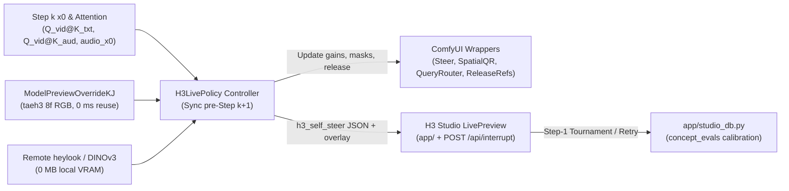

# Closed-Loop Self-Steering & 4D Spatial Query Routing Blueprint (`2026-11-26`)

**Status:** Active architectural blueprint (`HEAD >= b510ba6b`) unifying today's empirical `MiniMaxH3SpatialQueryRouter` findings ([`2026-11-26_bucket3_spatial_qr_and_sam3.md`](../../../bench/results/2026-11-26_bucket3_spatial_qr_and_sam3.md)), `ModelPreviewOverrideKJ` (`kj_preview_override`) live streaming, and `app/` H3 Studio 2.0 into a **4-layer closed-loop Sensor -> Policy -> Actuator architecture**, alongside the evidence-gated **Beat 1 -> Beat 2 -> Beat 3** build ladder.

**Design rule:** Every actuator and sensor anchor below is verified directly against `.py` code on disk and `bench/results/` measurements. No speculative node bloat (`VISION.md`): each layer promotes only after its upstream diagnostic probe or zero-code baseline passes on GPU.

---

## 1. Core Architectural Shift: From Manual Knobs to `H3LivePolicy`

Until `2026-11-26`, every steering and routing primitive in this pack operated **open-loop** (parameters frozen before Step `0`):

- **Actuators already shipped on disk:**
  - [`steering/nodes.py`](../../../steering/nodes.py) (`MiniMaxH3Steer` — `50` bank erasure vectors, `STEER_MODES = ("add_norm_matched_erasure", "add_norm_matched", "add", "project_out")`, `MiniMaxH3WordVector`, `MiniMaxH3ReleaseReferences`),
  - [`steering/query_router.py`](../../../steering/query_router.py) (`MiniMaxH3QueryRouter` — `1x` camera/mic routing + `aud_to_vid_gain = 0.0` Sight-to-Sound Firewall),
  - [`steering/spatial_query_router.py`](../../../steering/spatial_query_router.py) (`MiniMaxH3SpatialQueryRouter` — `1x` 4D `(t, h, w, modality)` token routing with soft `[0..1]` seam feathering, `binaural_split`, `mid_20_34`, and Beat 2 `mid_20_49` / 1-way `*_shield` / `MiniMax-H3-Image` / `cond` exclusion).
- **Sensors already shipped or zero-cost on disk:**
  - `ComfyUI-KJNodes/nodes/preview_override_node.py` (`ModelPreviewOverrideKJ`, injected automatically by [`app/graph_builder.py`](../../../app/graph_builder.py) `_inject_kj_preview_override`): decodes `taeh3` / `taeh3_image` (`preview_frames = 8` video / `1` still) synchronously into `self.frames.append(pil_first)` (`L816-831`), computes step `delta` (`L913-916`), supports optional live `audio_vae` decode (`L736-762, L842-848`), streams `kj_preview_override` to Studio (`L918-940`), and invokes upstream callbacks synchronously at `L944` **before Step `k + 1` starts** (`0.0 ms` extra `taeh3` decode cost).
  - [`step_x0_observer.py`](../../../step_x0_observer.py) (`set_model_sampler_post_cfg_function`): hands packed clean `(video_x0, audio_x0)` directly to Python after every step (`< 1 ms` pure-latent `audio_x0` energy/onset inspection, zero VAE decode).
  - [`bench/probe_h3_sensors.py`](../../../bench/probe_h3_sensors.py): read-only attention/text probe reading `Q_vid @ K_txt[noun]^T`, `Q_vid @ K_aud[t]^T`, Step-`0/1` `audio_x0` transients, and block-by-block CPU `J-Lens` ([`steering/xray.py`](../../../steering/xray.py) `decode_vector`, `< 15 ms` on CPU).
  - Remote `heylook` VLM (`$H3_HEYLOOK_URL`, `0 MB` local GPU VRAM) + [`bench/probe_dinov3_copy_freeze.py`](../../../bench/probe_dinov3_copy_freeze.py) (`DINOv3` likeness) + [`bench/probe_yin_f0_drift.py`](../../../bench/probe_yin_f0_drift.py) (`YIN` $F_0$).

Because every steering/routing wrapper (`steering/nodes.py`, `steering/query_router.py`, `steering/spatial_query_router.py`) already executes fresh at the top of every denoising step, exposing one shared mutable **`H3LivePolicy`** dict inside `transformer_options` — updated between Step `k` and Step `k + 1` and mirrored to Studio via `PromptServer.instance.send_sync("h3_self_steer", ...)` right alongside `kj_preview_override` — closes the loop without patching ComfyUI core.

---

## 2. Four-Layer Closed-Loop Self-Steering Architecture

### Layer 1 — Inner-Loop Mid-Denoise Self-Steering (Step `k` -> Step `k + 1`)

All inner-loop policies must obey the **24 GB RTX 4090 VRAM invariant**: manipulate only already-encoded `context` tensors, `5376`-D bank `.safetensors` / `< 3 ms` CPU `Model2Vec` `WordVector` shifts, scalar gains, release flags, or `[F, H, W]` masks — **never reload `Qwen3-VL-32B` mid-sample**.

1. **Visual Steering Thermostat:**
   - Reads regional HSV saturation, highlight clip fraction, and Laplacian sharpness from `kj_wrapper.frames[-1]` (or a 1-frame `taeh3` fallback when headless) at Steps `0..2`.
   - Boosts under-responding dark scenes on Step `2` (fixing Wave 2's dim `stairwell` under-steer vs. bright `kitchen`, [`2026-11-23_wave2_gpu_gates_bus_vr_path1c_and_qvid.md`](../../../bench/results/2026-11-23_wave2_gpu_gates_bus_vr_path1c_and_qvid.md)) and tapers `MiniMaxH3Steer` strength toward `0.0` once target contrast/saturation locks (preventing late-step facial red burn and specular overcook).
   - **Small-mask auto-shield:** If a `SpatialQueryRouter` region shows `< 5` luma/chroma separation vs. surround at Step `1`, flips `early_0_24` -> `early_0_24_shield` (1-way surround shield) for Steps `2..5`.
2. **Adaptive Reference Release ("Anti-Copy-Freeze Governor"):**
   - Measures inter-frame motion (`mean(|f[t+1] - f[t]|)`) across `ModelPreviewOverrideKJ`'s `8` evenly-spaced `taeh3` frames after Step `1` (`33%`):
     - Frozen onto `<Picture 1>` -> drops visual refs at `end_percent = 0.33` (and optional mild Motion-bus nudge).
     - Brisk motion with slipping `<Picture 1>` `DINOv3` cosine -> holds refs through `end_percent = 0.50`.
3. **Audio & Acoustic Thermostat:**
   - Uses zero-decode Step-`1` `audio_x0` (`[1, 32, 2, T_aud]`, `< 1 ms`) or optional `ModelPreviewOverrideKJ` `audio_vae` decode (`preview_override_node.py:L736-762, L842-848`):
     - Unwanted visual-to-audio hiss/scrape -> auto-clamp `aud_to_vid_gain` `1.0 -> 0.0` on Steps `2..5`.
     - Quiet `-35 dBFS` binaural/firewall mix -> auto-apply verified `+8.1 dB` inward-`w` audio RoPE proximity boost ([`2026-11-25_rope_warp_falsification.md`](../../../bench/results/2026-11-25_rope_warp_falsification.md)).
     - Pure-`t2va` emergent sound transients (thunderclap, slam, shout peaks in `audio_x0`) -> trigger a `SpatialQueryRouter` rift or `MiniMaxH3Steer` pulse on those exact `25 ms` frames with no external `.wav`.
4. **Remote `heylook` Step-0 Vector Aimbot & `project_out` Artifact Auto-Scrub (`0 MB` local VRAM):**
   - Sends Step `0`'s `672 px` `kj_wrapper.frames[-1]` JPEG (`~25 KB`) to remote `$H3_HEYLOOK_URL`:
     - **Vector Aimbot ("Vector Gremlin"):** Picks an emergent background object `[x0, y0, x1, y1]` + bank stem or `< 3 ms` CPU `Model2Vec` `WordVector` phrase -> applies `5376`-D erasure shift inside `SpatialQueryRouter` for Steps `1..5` (zero Qwen reload; scope boundary: styles/materials/word-vectors, not brand-new multi-noun prose sentences).
     - **Artifact Auto-Scrub:** Spots literal split-screen white borders, floating watermarks, or color bleed -> synthesizes `< 3 ms` `WordVector` and applies `MiniMaxH3Steer(mode="project_out")` on Steps `1..5`.
5. **Zero-Coordinate Self-Masking (`Q_vid @ K_txt[noun]^T` & `Q_vid @ K_aud[t]^T`):**
   - Extracts a 4D `[latent_t, patch_h, patch_w]` probability mask from Step `0` (`blocks 25..40`) targeting either a named noun span (`"mirror"`, `"jacket"`) or active `40 Hz` audio tokens (whoever is speaking/making sound right now), smooths it, feeds it into `SpatialQueryRouter` for Steps `1..5`, and streams the polygon contour in `h3_self_steer` so Studio draws the live lock-on overlay directly over `kj_preview_override`.
   - **Mandatory Gate:** Calibrated first by [`bench/probe_h3_sensors.py`](../../../bench/probe_h3_sensors.py) in Beat 2 before writing any production router code.

---

### Layer 2 — Outer-Loop Multi-Seed Search & Self-Healing Retries (Pure `app/server.py`, `0` New Nodes)

Built directly on `app/server.py`'s existing `/api/ws` `ws_proxy` (`kj_preview_override` tap, relayed to [`app/web/src/App.tsx`](../../../app/web/src/App.tsx) and hydrated onto takes in [`app/web/src/takes.ts`](../../../app/web/src/takes.ts)) and `prompt_id`-scoped `POST /api/interrupt` ([`app/server.py`](../../../app/server.py)):

1. **Live Step-1 Telemetry Pills:** Score every incoming Step-`1` `kj_preview_override` clip in `< 20 ms` (motion, L/R contrast, saturation/burn risk, optional `DINOv3` likeness) and display live badges on `LivePreview.tsx`.
2. **Step-1 "4-Seed Tournament Scout":** Run `4` seeds only through Step `1` (`~12–15 s` each), interrupt via `POST /api/interrupt` right after Step `1` arrives, rank automatically (or let the user tap the winner on a `2x2` preview grid), and run only the winning seed to Step `6` *(upgrade path: cache winning `x_1` latent in RAM `~20 MB` to resume directly at Step `2`)*.
3. **Diagnosed Auto-Retry:** Map detected Step-`1` failure modes to targeted knob fixes (divider border -> relax `early_0_24` to `early_0_16` or `project_out`; frozen `<Picture 1>` -> drop `end_percent` to `0.33`; washed-out `< 15%` region -> switch to `*_shield` or escalate to `2x EditGuider(last_step=3)`).
4. **3-Second `MiniMax-H3-Image` Preflight Gate:** Once Beat 2 unlocks `3 s` `4 MP` `H3-Image` Spatial QR, Studio can pre-verify multi-world or multi-character composition in `3 s` before committing to a `100 s` video pass.

---

### Layer 3 — Multi-Window Continuity Governor (Chained Song Loops)

In [`2026-11-16_lse_attention_balance_ab.md`](../../../bench/results/2026-11-16_lse_attention_balance_ab.md), unanchored chained windows drifted `+71.96%` luma by Window `4`. Comparing Window `k`'s Step-`1` `kj_preview_override` against Window `k - 1`'s tail lets a loop controller dynamically raise `anchor_weight` (`1.0 -> 4.0`) or lower `context_noise` strictly on windows that drift, keeping stable windows free to move.

---

### Layer 4 — Cross-Session Self-Calibration ([`app/studio_db.py`](../../../app/studio_db.py))

[`app/studio_db.py`](../../../app/studio_db.py) already ships `concept_evals(concept_slug, workflow_key, rating, notes, source_shot_id, target_shot_id, job_id, metadata_json, created_utc)`:

- **Auto-calibrated starting defaults:** Record `(scene_luma_bucket, vector_slug, mask_area_frac, thermostat_final_strength, rating)` per render so Studio predicts optimal starting strength and isolation preset (`*_shield` on `< 20%` masks, higher `noir` gain on dim interiors) before Step `0` starts.
- **Passive background vector mining:** Every thumbs-up `2x EditGuider` or `SpatialQR` remake already stores `(source_shot_id, target_shot_id)` pairs ready for `MiniMaxH3MakeMediaControlVector` distillation into `1x` dials.

---

## 3. Verified Physical Boundaries & Non-Starters (Do Not Re-Pitch)

| Boundary / Constraint | Verified Evidence on Disk | Design Consequence |
| :--- | :--- | :--- |
| **`lse_subset_balance_bhnd` inside `SpatialQueryRouter`** | [`attention.py`](../../../attention.py) (`L606-625`): falls back to `_flash_or_exact_lse_bhnd` when `sage_kernel is None`; `SpatialQR` refuses `MiniMaxH3SageAttention`. | Implement 1-way region shield via `k_b_world = idx_region_kv` (`100%` `Sol + comfy_kitchen.int8_attention`, zero SDPA float `attn_mask`, and compute matching `reg_kv_aud_*_pos` for `binaural_split`). |
| **`1x` unanchored small (`~10-15%`) sliding circles / specular chrome** | [`2026-11-26_bucket3_spatial_qr_and_sam3.md`](../../../bench/results/2026-11-26_bucket3_spatial_qr_and_sam3.md) (`3191f95a`, `25e9f4e4`): `g3c_portal_sweep` parked in center; `10%` chrome dancer stayed human under `early_0_24` and `mid_20_34`. | Test 1-way `*_shield` on `10%` chrome in Beat 2; keep pixel-locked existing-take subject/limb edits on `2x EditGuider(first_step=1, last_step=3, scale=1.55)` and use monotonic `0% -> 100%` wipes (`Midas Walk`) instead of floating circles. |
| **Mid-denoise `Qwen3-VL-32B` prose prompt re-encoding** | `24 GB` RTX 4090 cannot co-locate `bf16` `Qwen3-VL-32B` and active DiT; full-`345f` `taeh3` decode is `2.5 s` ([`2026-09-26_vae_decoders_345f.md`](../../../bench/results/2026-09-26_vae_decoders_345f.md)). | Restrict mid-denoise steering to `5376`-D bank/`WordVector` shifts, gains, and masks; reuse `ModelPreviewOverrideKJ`'s already-decoded frames (`0.0 ms`). |
| **Causal Video VAE `token_overlap = 2` on `all_0_49` temporal cuts** | `ComfyUI/comfy/ldm/minimax/vae.py` (`L598-602, L933-955`): `decode_temporal` overlaps `2` latent tokens (`5` frames, `f85..89`) across `k = 25`. | Test `early_0_24` (smooth match-cut) vs. `all_0_49` (hard cut, inspect `f85..89`) in Beat 1; add split-chunk VAE decode only if `all_0_49` ghosts. |
| **Dual-payload `minimax_refs` splicing before baseline check** | [`steering/nodes.py`](../../../steering/nodes.py) (`MiniMaxH3ReleaseReferences` mutates `minimax_payload` per step) & `ComfyUI/comfy/model_base.py` (`layout.signature` excludes `len(refs)`). | Test 0-LOC stock `[Photo A, Photo B]` (`<Picture 1>` Left / `<Picture 2>` Right) in `3 s` on `MiniMax-H3-Image` first; build dual-payload merge (with `cond_video_latents` rebuild + `layout=None`) only if Qwen `tags == 0` actually bleeds. |
| **Parked low-ROI tracks** | [`docs/wiki/next_steps.md`](../next_steps.md), [`2026-11-25_rope_warp_falsification.md`](../../../bench/results/2026-11-25_rope_warp_falsification.md). | Keep `MiniMaxH3SigmaCurve` / Gate 3A, Paper v6 sweeps, live MIDI VJing on 6-step Pika, and Valve Portal non-Euclidean `(h, w)` RoPE parked. (Keep *Tenet* right-ear audio reversal strictly as a 10-line scratch demo.) |

---

## 4. Holistic Beat 1 -> Beat 2 -> Beat 3 Execution Ladder

| Beat | Owner & Scope | Acceptance Gate / Downstream Unlock |
| :--- | :--- | :--- |
| **Beat 1 (Warm `:8188`, `0 LOC`, `0` restarts)** | `dbbfbf10` (after `a64ad237` finishes `b510ba6b` queue): 1. `141f` `1.1x` Zero-Rewrite Vector Lens (`t2va_cooking_show_meltdown.txt`, `50%` split, `invert=True`, `audio_zone="region"`, `claymation_stopmotion`). 2. `192f` Timed `(S1)/(S2)` `[Shot 1]` `binaural_split` (`t2va_stairwell_dialogue.txt` vs. `t2va_ferry_fog_deck.txt`, matched camera motion). 3. `192f` `1x` Temporal Multi-Shot (`f0..84` single-shot `t2va_silent_film.txt` -> `f85..191` single-shot `t2va_arena_rock_video.txt`: `early_0_24`, `all_0_49`, monotonic `0%->100%` wipe, + plain `[Shot 1]+[Shot 2]` control). 4. *Zero-code showcases:* Kinematic **Midas Walk** (`SpatialDirector` -> `AppendSpriteTrajectory` `0.33` + `SoundCues` `-28 dBFS` + monotonic wipe) & **Ghost-Heartbeat -> Clean Cello** (`FreezeAudio` *no `AudioAttentionGain`* -> `AudioRefineMask` + `a2v=0.0`). | Proves 1-prompt bank-vector portals, isolates `(S1)/(S2)` turn-taking vs. `_binaural_audio_outputs`, verifies `1x` cross-shot bleed elimination & `f85..89` overlap, and locks zero-code showcase recipes. |
| **Beat 2 (`Spatial QR v2-slim` + 4-Sensor Probe, `1` `:8188` bounce)** | `dbbfbf10` (`spatial_query_router.py`, `steering/nodes.py`, `check_spatial_query_router.py`, `:8188`): • `3 s` `4 MP` `MiniMax-H3-Image` unlock (`~5 LOC`), `"mid_20_49"` strict beam (`1 line`), 1-way `*_shield` (`k_b_world = idx_region_kv` + `reg_kv_aud_*_pos`), per-segment-`t` `cond` exclusion on `iso` blocks, `steering/nodes.py` `pause_malloc_graph_ctx()` wrap (`L1069-1071`), + conditional firewalled `binaural_split` / thresholded `0..29` soft `30..49` `[w_aud, w_aud]` `follow_mask`. `9c6ac2a0` (standalone): • [`bench/probe_h3_sensors.py`](../../../bench/probe_h3_sensors.py) + [`bench/check_probe_h3_sensors.py`](../../../bench/check_probe_h3_sensors.py) (`Q_vid @ K_txt[noun]^T`, `Q_vid @ K_aud[t]^T`, Step-`0/1` `audio_x0` transients, block-by-block `J-Lens`), diff review, and native clip/heatmap audit. | Closes all `1x` isolation gaps in 1 restart; empirically gates `3 s` stock `<Picture 1>|<Picture 2>`, `mid_20_49` strict beam, `10%` `*_shield` chrome dancer, `fl2va` dark mirror (`tenenbaum_mirror.jpg` + `0.5s: slam`), and all `4` internal sensors. |
| **Beat 3 (Closed-Loop Self-Steering & UX Promotion)** | **3A (Pure `app/`):** Live `kj_preview_override` Step-`1` telemetry pills + 4-Seed Tournament (`POST /api/interrupt`) + `3 s` `H3-Image` preflight. **3B (`H3LivePolicy`):** Visual Thermostat (`kj_wrapper.frames[-1]`), Anti-Copy-Freeze Governor, Acoustic Thermostat (`audio_x0` / `a2v=0.0` / RoPE inward-`w` `+8.1 dB`), Remote `heylook` Vector Aimbot & `mode="project_out"` scrub, + Self-Masking (`Q_vid @ K_txt/K_aud`) if Beat 2 probe pops. **3C (Spatial QR UX):** Procedural `motion_preset` (strictly appended *after* `mask` slot `#12`), Studio `SpatialSplitCard` sync + Camera-Lock Heylook, universal `MoGe-2` Depth + Audio-FFT `[F, H, W]` mask node, + conditional dual-payload `minimax_refs` / `K`-region / Contagion. **3D (`app/studio_db.py`):** `concept_evals` auto-calibration & passive media-vector distillation. | Each track ships only where Beat 1/2 measurements confirm clear creative or reliability gain. |
