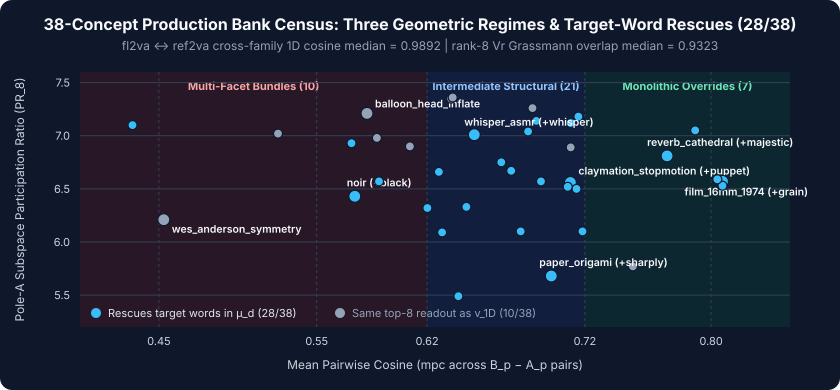
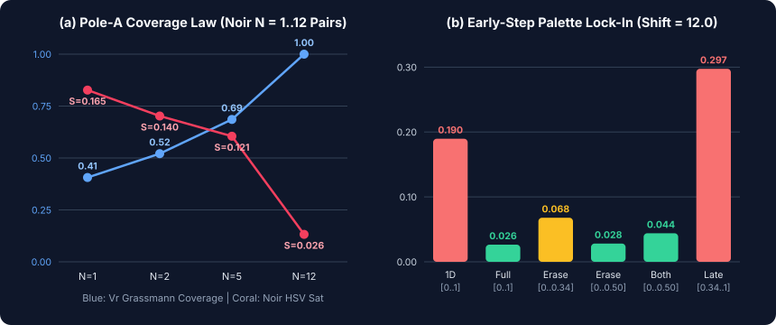
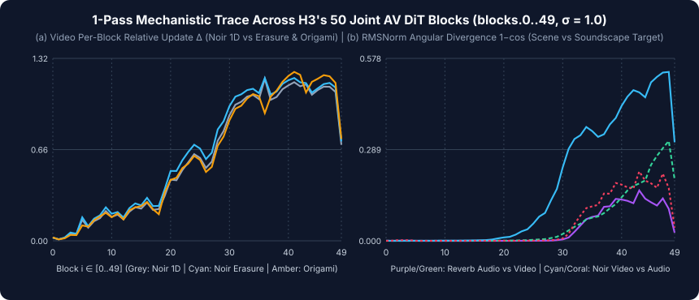

# Breaking the Frozen-Anchor Steering Paradox: From Late-Interaction Multi-Vector Retrieval to Parametric Subspace EQ in Diffusion and Input-Injected Iterative Transformers

**Date:** 2026-11-21 (v2 — expanded with 50-block DiT mechanistic trace, SVG figures, Looped/DLM theoretical unification, and pretrained prior elicitation analysis)  
**Authors:** MiniMax H3 Explorations Research Hub  
**Reproducible Code & Verifiers:** [`control_vectors.py`](../../../../control_vectors.py) · [`j_lens.py`](../../../../j_lens.py) · [`control_vector_nodes.py`](../../../../control_vector_nodes.py) · [`bench/verify_pole_a_erasure.py`](../../../../bench/verify_pole_a_erasure.py) · [`bench/control_vector/eval_multivector_erasure.py`](../../../../bench/control_vector/eval_multivector_erasure.py)  
**Empirical Benchmark Ledger:** [`bench/results/2026-11-21_multivector_erasure_benchmark.md`](../../../../bench/results/2026-11-21_multivector_erasure_benchmark.md)  
**Companion Investigation Logs & Practitioner Guides:** [`VISION.md`](../../../../VISION.md) · [`2026-11-20_unpooled_multivector_sliders.md`](2026-11-20_unpooled_multivector_sliders.md) · [`2026-11-20_multivector_retrieval_sota_to_dit_steering.md`](2026-11-20_multivector_retrieval_sota_to_dit_steering.md) · [`how_pole_a_erasure_works.md`](../../steering/how_pole_a_erasure_works.md) · [`tutorials_progressive_guide.md`](../../steering/tutorials_progressive_guide.md)

---

## Abstract

Why do simple rank-1 contrastive activation vectors ($\mathbf{h}' = \mathbf{h} + s\hat{\mathbf{v}}_{\text{1D}}$, *ActAdd* / `repeng`) steer autoregressive Language Models effortlessly, yet collapse whenever a Diffusion Transformer (DiT) prompt states an opposing lighting, color, or material attribute? We trace this failure to a structural divide across modern sequence architectures: **Autoregressive Self-Steering vs. Frozen-Anchor Input Injection**. In causal LLMs, steering only needs to tip a handful of early discrete token choices; once sampled, those generated pivot tokens enter the KV cache and *self-steer* subsequent generation. Conversely, iterative latent architectures — spanning **Multimodal Diffusion Transformers** (MiniMax H3, Flux, Wan), **Looped Diffusion Transformers** (*Looped-DiT*), **Masked Diffusion Language Models** (*LLaDA*, *Dream*), and **Recurrent-Depth Looped Language Models** (*Huginn*, *Ouro*, *LoopFormer*) — follow a **Prelude–Core–Coda** recurrence $\mathbf{z}^{(k+1)} = \mathcal{F}_\theta(\mathbf{z}^{(k)}, \mathbf{H}_{\text{prelude}})$ in which a static conditioning matrix $\mathbf{H}_{\text{prelude}}$ is re-injected or re-attended across every denoising step or recurrent loop. Whenever $\mathbf{H}_{\text{prelude}}$ encodes conflicting baseline cues (*warm tungsten kitchen*, *live-action skin*), un-erased baseline directions re-assert themselves at every step (*the Frozen-Anchor Prompt Veto*): across multi-seed image and `192`-frame (`8.0s`) joint audio-video evaluations on MiniMax H3 (`50` single-stream DiT blocks), rank-1 `1x` steering turns `0/5` natural-color stills and `0/3` speaking videos black-and-white (`noir`), and deletes foreground characters (`1/2` paired seeds, `5/5` specificity failures) when forcing sculptural materials (`paper_origami`), whereas `2x` differential velocity guidance resolves token conflicts only by doubling DiT forward passes.

We break this `1x` vs. `2x` paradox without extra DiT passes or weight LoRAs by establishing a **Retrieval–Steering Duality** between 2020–November 2026 late-interaction / static-embedding retrieval (**Khattab et al.** `ColBERTv2`/`PLAID`/`WARP`, **Chaffin, Sourty, Clavié & LightOn** `PyLate`/`FastPLAID`/`ColBERT-Zero`/Ward token pooling, **Clavié & Mixedbread** *Latent Terms*/`mxbai-edge-colbert-v0`, **Faysse et al.** `ColQwen`, **Google Research** `MUVERA`, and **Minish Lab / Tulkens & van Dongen** `Model2Vec`/`POTION`/`reach`) and in-place Prelude state editing in H3's `5376`-D bidirectional `TokenRefiner` space. First, we prove algebraically and empirically why naive retrieval and optimal-transport ports break as continuous sliders: appending virtual ColBERT/MUVERA keys violates $s = 0$ identity via softmax denominator drift (`MAE = 22.7–54.5`), while doubly-stochastic Sinkhorn Optimal Transport collapses identically back to $\mathbf{v}_{\text{1D}}$ (`max_err = 8.88e-16`), directly diagnosing why recent OT steering requires multi-point intervention. Second, we prove (`max_err <= 5.86e-14` in `float64`) that asymmetric right-stochastic ColBERT soft-MaxSim ($\tau_{\text{attn}} = 0.15$) coupled with rank-$r$ ridge regression decomposes into a sharpened target mean $\hat{\boldsymbol{\mu}}_d$ — rescuing target words washed out by 1D averaging on **`28 / 38`** production bank concepts — minus **Clamped Prompt-Centered Pole-A Subspace Erasure**, yielding a **Three-Subspace Parametric Conditioning EQ** (**Boost** $+\boldsymbol{\mu}_d$, **Notch-Erase** $-\mathbf{P}_{\mathbf{V}_r,\lambda}$ on Pole A, and **Retain-Hold** $\mathbf{I} - \mathbf{U}_{\text{hold}}\mathbf{U}_{\text{hold}}^\top$):

$$\Delta\mathbf{H}(s) = \operatorname{RMSMatch}_{|s|\tau}\!\Big(\mathcal{P}_{\perp\text{hold}}\!\big[s\,\mathbf{1}\hat{\boldsymbol{\mu}}_d^\top - \operatorname{clip}(s, 0, 1)\,\beta_{\text{cap}}(\mathbf{H} - \mathbf{1}\bar{\mathbf{h}}^\top)\mathbf{V}_r^\top\operatorname{diag}(\mathbf{g})\mathbf{V}_r\big]\Big)$$

Requiring only **`193.5 KB`** of `float32` tensors per concept (**`1,000x–6,000x` smaller** than `200 MB–1.2 GB` DiT weight LoRAs), zero training, zero external corpus files, and **`0` extra DiT passes**, `add_norm_matched_erasure` passes a 6-arm RMS-matched (`101.25`) double-dissociation control (`5/5` `noir` B&W; `5/5` `paper_origami` character preservation), traces mechanistically across H3's `50` joint audio-video DiT blocks (revealing single-stream text amplification through `blocks.0..48`, a 10-block video-before-audio emergence lag, and `block 49` conditioning-sink consolidation), transfers across `192f`/`90f` `24 fps` video + `40 Hz` stereo audio, `4.1 MP` `P-H3-Image`, `4.0 MP` `MiniMax-H3-Image`, and undistilled 50-step Base H3 (`loras=[]`), and establishes controlled negative boundaries for `< 2 ms` static lexical (`Model2Vec`) and single-pair ($N=1$) visual patch subspaces.

---

## 1. Introduction: Autoregressive Self-Steering vs. The Frozen-Anchor Paradox

### 1.1 Why Steering Diverges Between Causal LLMs and Iterative Latent Generators

Activation steering in causal autoregressive Language Models — adding a single contrastive mean-difference vector $\mathbf{h}' = \mathbf{h} + s\hat{\mathbf{v}}_{\text{1D}}$ across residual layers (*ActAdd*, Turner et al. 2023; *CAA*, Rimsky et al. 2024; *repeng*, Vogel 2024) — achieves striking behavioral shifts from rank-1 vectors alone. Recent mechanistic studies of causal LLM residual streams (**Vogel & Douglas**, *The Chain Lens*, Nov 2026; **Vogel**, *Words All The Way Down* and *shapes of model words*, Nov 2026) clarify *why* rank-1 nudges suffice in autoregressive text: causal decoding enjoys a **discrete self-steering feedback loop**. A small linear bias only needs to tip token probabilities across a handful of early pivot tokens (e.g., shifting a reasoning transition or stylistic opener); once sampled, those generated tokens enter the growing prefix and **rewrite the KV cache**, steering all downstream attention heads without fighting a contradictory frozen specification.

Iterative non-autoregressive and recurrent-depth generators break this feedback loop completely. Across four major 2025–2026 model families:
1. **Single- and Dual-Stream Multimodal Diffusion Transformers** (**MiniMax H3**, Flux, SD3/MMDiT, Wan 2.1/2.2),
2. **Weight-Tied Looped Diffusion Transformers** (**Chng et al.**, *Looped-DiT*, Sep 2026, `arXiv:2609.40305`),
3. **Masked Diffusion Language Models** (*LLaDA*, *Dream*; **Lek et al.**, ICLR 2026), and
4. **Recurrent-Depth / Looped Language Models** (*Huginn*, **Geiping et al.** `arXiv:2502.05171`; *Ouro*, **Zhu et al.** `arXiv:2510.25741`; *LoopFormer*, **Jeddi et al.** ICLR 2026),

computation factors into a **Prelude** encoder producing a conditioning anchor $\mathbf{H}_{\text{prelude}} \in \mathbb{R}^{L \times D}$, an iterative **Core** applying $K$ denoising steps or recurrent depth loops

$$\mathbf{z}^{(k+1)} = \mathcal{F}_\theta\!\big(\mathbf{z}^{(k)},\; \mathbf{H}_{\text{prelude}},\; \sigma_k\big), \qquad k = 0, \dots, K-1,$$

and a **Coda** decoder (`FinalLayer` + VAE or LM unembedding). Because $\mathbf{H}_{\text{prelude}}$ is **frozen before iteration begins** and re-consulted at every step $k$ (and across all `50` single-stream blocks per step in MiniMax H3, `comfy/ldm/minimax/model.py:508, 649-671`), any opposing attribute left alive inside $\mathbf{H}_{\text{prelude}}$ acts as a persistent restoring force.

In **MiniMax H3**, prompts first traverse `50` causal vision-language layers (`Qwen3-VL-32B` truncated after `layers.49` of `64`, width `5120`) and then pass through `condition_proj` plus a 2-block **bidirectional `TokenRefiner`** (width `5376`) before packing `[text | refs | audio | video]` into one shared self-attention sequence across `50` DiT blocks (`blocks.0..49`). Practitioners face an acute `1x` vs. `2x` dilemma:

- **`1x` Rank-1 Control Vectors (`add_norm_matched`):** Broadcasting $\mathbf{H} + s\hat{\mathbf{v}}_{\text{1D}}$ across Prelude text rows adds **zero DiT passes (`1x`)**, yet mean-pooling discards **`51.6%–78.1%`** of per-token shift energy (`phase1_spectra.json`) and leaves every conflicting Pole-A token inside $\mathbf{H}$ intact. When a scene prompt specifies *warm tungsten kitchen lighting*, *morning TV floodlights*, or *live-action human skin*, un-erased Pole-A directions inside $\mathbf{H}$ attend to `24 fps` video and `40 Hz` audio tokens across `50` blocks $\times$ $K$ steps and **veto** the additive vector. Cranking $s$ from default `1.0` (`67.5` RMS) to `2.0` (`135` RMS) still fails to turn `noir` monochrome (`0/5` seeds) while collapsing `watercolor_wash` into oversaturated close-ups.
- **`2x` Differential Velocity Guidance (`MiniMaxH3EditGuider`):** Evaluating $\mathbf{v}_{\text{orig}} + \text{scale}\cdot(\mathbf{v}_{\text{edit}} - \mathbf{v}_{\text{orig}})$ resolves token conflicts cleanly, **but doubles DiT compute (`2x`)** and requires per-prompt rewrites rather than a self-contained slider.

### 1.2 Eliciting Pretrained Priors as `193.5 KB` Zero-Training Micro-LoRA Alternatives

Beyond cost, solving `1x` Prelude conflict resolution unlocks a deeper capability articulated in [`VISION.md`](../../../../VISION.md) (*Exploration & Elicitation*): **playing pretrained weights as continuous instruments rather than training a `200 MB–1.2 GB` weight LoRA for every optical stock, material, or room acoustic**. Singular-value profiling of H3's `condition_proj` + `TokenRefiner` (`docs/wiki/research/control_vectors/2026-11-12_chain_lens_digest_and_experiment_plan.md`) reveals a steep spectral low-pass filter: **`81.4%` of post-refiner energy concentrates in the top `10%` of singular modes (`~538` dimensions)** while tail modes are attenuated **`64x–2,700x`**. Simultaneously, SFT/RL post-training narrows default phrasing and visual dialect ("slop"), causing dominant default modes inside $\mathbf{H}_{\text{prelude}}$ to drown out rich pretrained tail capabilities (1970s `16mm` halation, silver-gelatin `noir`, stop-motion armature physics, cathedral acoustic decay) already latent in `Qwen3-VL-32B` and Base H3. Measuring and **erasing the opposing Pole-A subspace first** unblocks those dormant pretrained modes using a **`193.5 KB`** file built in `~12 seconds` from 10 prompt pairs — zero backprop, zero optimizer state, and instant hot-swapping across 5 simultaneous sliders.

### 1.3 Contributions

1. **Unifying Theory & Retrieval–Steering Duality (§2–§4):** We formalize why Frozen-Anchor / Input-Injected architectures suffer the Prompt Veto, translate six 2020–November 2026 multi-vector and static retrieval mechanisms into H3's `[L, 5376]` Prelude space, and prove algebraically (`float64`) why appended ColBERT/MUVERA token bags (`s = 0` softmax drift) and balanced Sinkhorn OT (`max_err = 8.88e-16` collapse to $\mathbf{v}_{\text{1D}}$) fail while asymmetric right-stochastic ColBERT soft-MaxSim succeeds.
2. **Exact Ridge Split & Three-Subspace Parametric Conditioning EQ (§5):** We prove (`max_err <= 5.86e-14`) that regressing ColBERT soft-MaxSim token shifts onto Pole A acts **`96.9%–99.6%`** as a rank-$r$ Pole-A subspace projector, isolating `add_norm_matched_erasure` (**Boost** $+\hat{\boldsymbol{\mu}}_d$, **Notch-Erase** $-\mathbf{P}_{\mathbf{V}_r,\lambda}$, **Retain-Hold** $\mathcal{P}_{\perp\text{hold}}$, `193.5 KB` `float32`, rank-`16` union composition).
3. **38-Concept Bank Census, Subspace X-Ray, & 50-Block Mechanistic Trace (§3, §5.5, §6.8):** Across all `76` production `.safetensors` files (`38` stems $\times$ `{fl2va, ref2va}`), we map three spectral regimes, verify cross-family Grassmannian subspace invariance (`median = 0.9323`), ship a `< 15 ms` CPU Subspace X-Ray (`j_lens.py` + `WARP`-style per-token norms), and trace perturbations across all **`50` single-stream DiT blocks (`blocks.0..49`)**, uncovering text-stream depth amplification, a 10-block video-before-audio emergence offset, and `soundscape_only` vs. `scene_only` stream selectivity.
4. **9-Part Multi-Modal Benchmark & Boundary Laws (§6–§7):** We validate every component across Pika 6-step stills, `192f`/`90f` `24 fps` + `40 Hz` stereo AV, `4.1 MP` `P-H3-Image`, `4.0 MP` `MiniMax-H3-Image`, undistilled 50-step Base H3 (`loras=[]`), and controlled negative boundaries on `< 2 ms` `Model2Vec` static lexical vectors and $N = 1$ `ColQwen` visual patch pairs.

---

## 2. Related Work & Cross-Domain Taxonomy

### 2.1 Late-Interaction Multi-Vector & Static Retrieval (2020 – November 2026)

Single-vector bi-encoders compress an entire document into one pooled vector, hitting a combinatorial capacity ceiling formalized by **LIMIT** (2025). Six retrieval lineages directly inform our Prelude operator design:

- **Asymmetric MaxSim, Centroid-Residual Decomposition, and `WARP` Routing (MIT OASYS / Khattab et al.):** **Khattab & Zaharia** (*ColBERT*, SIGIR 2020) replaced sequence pooling with asymmetric query-to-document token `MaxSim` ($\sum_i \max_j \mathbf{q}_i^\top \mathbf{d}_j$). *ColBERTv2* (Santhanam, Khattab et al., NAACL 2022) and *PLAID* (CIKM 2022) decomposed token clouds into **cluster centroids plus quantized residuals**, while *WARP* (Scheerer, Zaharia, Potts, Alonso, & Khattab, SIGIR 2025 Best Paper) introduced `WARP_SELECT` dynamic similarity imputation over top-$k$ routed centroids.
- **Ward Hierarchical Token Pooling, `PyLate`, & `ColBERT-Zero` (LightOn & Benjamin Clavié):** **Clavié et al.** (*Reducing the Footprint of Multi-Vector Retrieval with Minimal Performance Impact via Token Pooling*, ECIR / `arXiv:2409.14683`; *LIR @ ECIR 2026* `arXiv:2511.00444`; `RAGatouille`) showed that **Ward hierarchical agglomerative clustering** compresses document token clouds by $50\%\text{–}66\%$ with $<1\%$ loss, whereas spherical $k$-means collapses onto high-frequency boilerplate. **Chaffin & Sourty** (*PyLate: Flexible Training and Retrieval for Late Interaction Models*, `arXiv:2508.03555`, plus `FastPLAID` and `LateOn-hpool-regularized`) standardized late-interaction training/indexing, while **Chaffin, Arnaboldi, Chatelain, & Krzakala** (*ColBERT-Zero: To Pre-train Or Not To Pre-train ColBERT models*, Feb 2026, `arXiv:2602.16609`) demonstrated how effective token-level alignment geometry emerges from pretrained representations once anisotropy is controlled.
- **Low-Rank Edge Projections & Zipfian *Latent Terms* (Mixedbread AI):** **Clavié, Lee, Shakir, & Kato** showed in `mxbai-edge-colbert-v0-17m/32m` (2025) that compact `48`-D token projections preserve `ColBERTv2`-grade accuracy, and in *Latent Terms: Dense Retrievers Contain Trivially Extractable BM25-ready Zipfian Vocabularies* (May/June 2026, `arXiv:2605.29384`) extracted sparse non-negative dictionary atoms competitive on BEIR and LIMIT without extra supervision.
- **Visual Patch Late Interaction (`ColPali` / `ColQwen` — Faysse, Sibille, Wu, Omrani, Viaud, Hudelot, & Colombo, ICLR 2025):** Kept VLM (`PaliGemma` / `Qwen2-VL` M-RoPE) visual patch rows unpooled — matching H3's `<Picture N>` (`tags == 0`) representation.
- **Fixed Dimensional Encodings (`MUVERA` — Dhulipala, Hadian, Jayaram, Lee, & Mirrokni, Google Research, NeurIPS 2024):** Reduced multi-vector sets to fixed-dimensional SimHash partition encodings.
- **PCA De-Coning, SIF Weighting, and Contextual Static Distillation (Minish Lab — Stéphan Tulkens & Thomas van Dongen, 2024–2026):** Across `Model2Vec`, `tokenlearn`, `POTION`, `reach`, and `StaRSE`, Tulkens & van Dongen operationalized *All-But-The-Top* PCA common-mode removal (Mu & Viswanath 2018), Smooth Inverse Frequency weighting (Arora et al. 2017), and contextual-to-static phrase distillation (`< 1 ms` CPU lookup).

### 2.2 Concept Erasure, Mechanistic Lenses, & Diffusion Steering (2020 – October 2026)

- **Linear Erasure & Residual Lenses in LLMs:** Closed-form concept erasure evolved from *INLP* (Ravfogel et al. 2020) and *RLACE* (Ravfogel et al. 2022) to *LEACE* (Belrose et al., NeurIPS 2023). In LLM residual streams, **Vogel** (*repeng*, 2024; *Small Models Can Introspect, Too* on 64-layer `Qwen-32B`, Dec 2025; *The Chain Lens* with R. Douglas, Nov 2026; *Words All The Way Down* and *shapes of model words*, Nov 2026) traced how middle-to-late transformer layers compress multi-token concepts into concentrated directions (`layers.42..54` peak in `Qwen-32B` — directly straddling H3's `layers.49` tap!) while RL post-training induces Zipfian lexical compression that erodes subtle tail modes.
- **Safety Unlearning, Orthogonal Spaces, & OT Steering in Diffusion / DLMs:** Weight-editing (*UCE*, Gandikota et al. WACV 2024) and inference-time attention/activation unlearning (*CASteer*, **Gaintseva et al.** `arXiv:2503.09630`; *EraseAnything*, Gao et al. ICML 2025; *LatentCompass*, **Dehdashtian et al.** ICML 2026 Workshop; *MUTE: Motion Concept Unlearning in Video Diffusion Models*, **Liu & Zhang** Sep 2026 `arXiv:2609.36832`; *RASteer: Retain-Aware Activation Steering for Concept Erasure in Diffusion Models*, **Wu, Lu, Wu, Luo, Zhu, & Liu** Oct 2026 `arXiv:2610.01969`) primarily target **negative safety removal** (deleting forbidden objects, motions, or styles inside DiT attention blocks while protecting retain concepts). Mechanistic DiT probing (**Takatsuki, Joseph, Fujisawa, & Kanai**, *Decoding Vision Transformers: the Diffusion Steering Lens*, `arXiv:2504.13763`) showed single-stream DiT blocks progressively refine conditioning into spatial features. Most relevant to our transport proof, **Lek, Zhu, Chen, Birke, & Chen** (*An Optimal Transport View of Activation Steering In Masked Diffusion Models*, ICLR 2026 Workshop) studied steering in non-autoregressive Masked Diffusion LMs (`LLaDA-Instruct`, `LLaDA 1.5`, `Dream-Instruct`), observing that naive additive mean-shift steering degrades under iterative masked denoising and proposing multi-point OT maps. **Our Proposition 2 & Theorem 1 supply the missing closed-form algebra:** balanced Sinkhorn OT still collapses to $\mathbf{v}_{\text{1D}}$ on average (`max_err = 8.88e-16`), whereas **asymmetric ColBERT soft-MaxSim + rank-$r$ Pole-A ridge erasure** achieves **positive creative conflict resolution** (`noir`, `paper_origami`, `reverb_cathedral`) directly on the `1x` Prelude conditioning matrix across joint `24 fps` video + `40 Hz` stereo audio, naturally unifying Boost, Pole-A Notch-Erase, and `RASteer`-style Retain-Hold in `193.5 KB`.

### 2.3 Orthogonal Frontier: Looped Transformers, Recurrent Depth, & `Looped-DiT` (2025 – November 2026)

A major architectural wave in 2025–2026 replaces fixed-depth stacks with weight-tied recurrent loops: **Geiping et al.** (*Scaling up Test-Time Compute with Latent Reasoning: A Recurrent Depth Approach* / *Huginn-3.5B*, NeurIPS 2025, `arXiv:2502.05171`), **Zhu et al.** (*Scaling Latent Reasoning via Looped Language Models* / ByteDance *Ouro*, `arXiv:2510.25741`), **Jeddi, Ciccone, & Taati** (*LoopFormer: Elastic-Depth Looped Transformers for Latent Reasoning via Shortcut Modulation*, ICLR 2026), and **Chng et al.** (*Looped Diffusion Transformer* / *Looped-DiT*, Sep 2026, `arXiv:2609.40305`). Crucially, Geiping et al. found that weight-tied recurrent cores **drift or collapse unless anchored at every loop iteration $k$ via Prelude Input Injection** ($\mathbf{z}^{(k+1)} = \mathcal{F}_\theta(\mathbf{z}^{(k)}, \mathbf{H}_{\text{prelude}})$ via adapter concatenation or cross-attention). This architectural stabilizer creates the **exact same Frozen-Anchor Steering Paradox** we observe in DiTs: steering a latent state $\mathbf{z}^{(k)}$ mid-loop is continually pulled back by re-injected $\mathbf{H}_{\text{prelude}}$, whereas applying our `193.5 KB` Three-Subspace Parametric EQ **once** to $\mathbf{H}_{\text{prelude}}$ before loop $k = 0$ steers all $K$ recurrent iterations cleanly at zero per-loop overhead.

---

## 3. Geometry of H3's `5376`-D Prelude Space & 38-Concept Bank Census

### 3.1 Two-Stage Prelude Geometry, Anisotropy Cone, and `int8_convrot` Invariance

Auditing all four shipped H3 checkpoints (`minimax_h3_fl2va_pruned_int8_convrot`, `minimax_h3_ref2va_pruned_int8_convrot`, `p-h3-image_int8_convrot`, and `minimax_h3_image_pruned_int8_convrot`) establishes four exact invariants:

1. **Causal `Qwen3-VL-32B` Sink (`layers.49`) vs. Bidirectional `TokenRefiner` Cone (`width = 5376`):** At H3's `layers.49` VLM tap (`width = 5120`, right inside `Qwen-32B`'s peak `layers.42..54` semantic abstraction band), token `0` carries a **`52.4x`** attention-sink norm ($\|\mathbf{e}_0\|_2 \approx 15,309$ vs. median `292.3`). Inside each DiT, `condition_proj` + the 2-block **bidirectional `TokenRefiner`** (`comfy/ldm/minimax/model.py:541-556`) dampens row `0` to `2.27x` median (`~164–270`) **while broadcasting sentence-wide room/palette context across every token row** (including prepositions and framing words). Raw post-refiner tokens sit inside a tight anisotropic cone (`mean pairwise cosine = 0.6088` on `covered_market`; `0.609–0.744` within Pole-B banks); fitting 2 principal components strictly on held-out Pole-A banks drops anisotropy **`14.5x` (`0.6088 -> 0.0419`)**.
2. **Unquantized `BF16` Refiner & Self-Cancelling Hadamard DiT Linears:** All `19` `condition_proj.*` and `token_refiner.*` tensors across all 4 checkpoints remain unquantized `BF16`. Across the `50` DiT blocks (`200` quantized linears in `blocks.0..49`), `int8_convrot` applies an orthogonal block-Hadamard rotation $\mathbf{x}\mathbf{H}_{256}(\mathbf{W}\mathbf{H}_{256}^\top)^\top = \mathbf{x}\mathbf{W}^\top$ that cancels identically per linear call, leaving `5376`-D Prelude coordinates unrotated.
3. **`PackedLayout` 3D RoPE Cursor Invariance:** H3's `PackedLayout` (`comfy/ldm/minimax/model.py:473-504`) starts non-text 3D RoPE coordinates at `text_len`. Editing `context[:, mask, :]` **in place** preserves `text_len` and every reference/audio/video 3D RoPE phase bit-for-bit, guaranteeing exact `0.0000` slider identity at $s = 0$.
4. **Cross-Family Subspace Invariance (`fl2va` $\leftrightarrow$ `ref2va` vs. `h3_image`):** Across all `38` concepts (`76` `.safetensors` files in `models/control_vectors/bank/`, `census_38_bank.json`), `fl2va` and `ref2va` post-refiner operators exhibit a median 1D cosine of **`0.9892`** and a median rank-8 `erasure.vr` Grassmannian overlap $\frac{1}{8}\|\mathbf{V}_{r,\text{fl2va}}\mathbf{V}_{r,\text{ref2va}}^\top\|_F^2$ of **`0.9323`** (enabling zero-rebuild transfer across video families), whereas `MiniMax-H3-Image` (`h3_image`, added to `_vector_file_fingerprint` in `control_vectors.py`) has genuinely rotated refiner weights (`1D cos ≈ 0.214`) and uses native `--families h3_image` builds.

### 3.2 Spectral Census of the 38-Concept Production Bank

Evaluating all `38` paired concepts (`8–14` pairs each, `diff_span` pooling) partitions Prelude steering into three geometric regimes (**Figure 2**, `census_38_bank.json`):

| Regime (Count / 38) | Defining Spectral Signature | Representative Concepts (`mpc` / `1D_E%` / `cos(mu_d, v_1d)`) | `1x` 1D vs. Pole-A Subspace Erasure Behavior |
| :--- | :--- | :--- | :--- |
| **1. Multi-Facet Bundles (`10 / 38`)** | `mpc < 0.62` or `1D_E% < 0.30` (high Pole-A diversity: `PR_8 = 6.1–7.2`) | `infomercial_fail` (`0.433` / — / `0.994`), `wes_anderson_symmetry` (`0.453` / `22.6%` / `0.995`), `noir` (`0.574` / `21.9%` / **`0.970`**), `balloon_head_inflate` (`0.582`), `zero_gravity` (`0.590`), `chaos_panic` (`0.711` / `29.6%` / `0.992`) | **1D hits the Prompt Veto** whenever Pole A spans diverse natural lighting/color states (`noir` at `s = 1.5`: `0/5` B&W in 1D vs. **`5/5` B&W** under `add_norm_matched_erasure`). |
| **2. Intermediate Structural / Acoustic (`21 / 38`)** | `0.62 <= mpc < 0.72` (`30% <= 1D_E% < 42%`) | `wind_tunnel_gale` (`0.628`), `cursed_cctv` (`0.630`), `underwater_submerged` (`0.645`), `whisper_asmr` (`0.650`), `paper_origami` (`0.699` / `36.3%` / `0.998`), `claymation_stopmotion` (`0.711`), `felt_muppet` (`0.715`) | 1D pushes surface texture yet collides with live-action anatomy (`paper_origami` 1D deletes foreground characters on `1/2` paired seeds and `5/5` specificity scenes; rank-8 `V_r` preserves `2/2` and `5/5`). |
| **3. Monolithic Overrides (`7 / 38`)** | `mpc >= 0.72` or `1D_E% >= 0.42` | `molten_lava_golem` (`0.709` / `44.8%`), `operatic_bellow` (`0.750`), `reverb_cathedral` (`0.772`), `vhs_1991_camcorder` (`0.790`), `rubber_hose_1930s` (`0.804`), `film_16mm_1974` (`0.807` / — / **`0.953`**), `film_16mm_1974_neutral` (`0.807` / — / **`0.948`**) | Coherent 1D direction already steers cleanly, while `erasure.mu_d` sharpens lexical grain (`film_16mm_1974` rescues `grain, tape`; `reverb_cathedral` rescues `majestic, mystical, ancient` and `+22.3%` tail decay). |

Across the full bank, **`28 / 38` concepts (`73.7%`)** rescue at least one domain-defining target word into `erasure.mu_d`'s top-8 J-lens readout that washed out of `v_1d` (`noir` rescues `black, footage, archival`; `claymation_stopmotion` rescues `puppet`; `whisper_asmr` rescues `whisper`; `cursed_cctv` rescues `grey, overhead, viewed`).

---

## 4. The Retrieval–Steering Duality: Why Direct Retrieval Ports Break (and What Survives)

In late-interaction retrieval, a query $\mathbf{Q} \in \mathbb{R}^{M \times D}$ scores a document $\mathbf{B} \in \mathbb{R}^{N_B \times D}$ **read-only** ($s(\mathbf{Q},\mathbf{B}) = \sum_{i=1}^M \max_j \mathbf{q}_i^\top \mathbf{b}_j$). In Prelude steering, we seek an **in-place operator** $\mathcal{T}_s: \mathbb{R}^{M \times D} \to \mathbb{R}^{M \times D}$ obeying (i) exact neutrality $\mathcal{T}_0(\mathbf{H}) \equiv \mathbf{H}$, (ii) sequence-length invariance ($L' = L$), and (iii) calibrated shift RMS across `50` joint-attention blocks. Testing five direct retrieval/OT translations establishes three impossibility results and two viable secondary operators:

### Proposition 1 (Softmax Partition Drift of Appended ColBERT / MUVERA Token Bags)
Appending $K = 12$ virtual concept centroids or `MUVERA` Fixed Dimensional Encodings ($\tilde{\mathbf{H}}(s) = [\mathbf{H};\; \mathbf{C}_0 + s\boldsymbol{\Delta}_K] \in \mathbb{R}^{(L+K)\times D}$) with 3D RoPE frozen at $L$ violates neutrality at $s = 0$: every latent query $\mathbf{q}$ sees its softmax denominator shift from $Z_L = \sum_{\ell=1}^L e^{\mathbf{q}^\top \mathbf{k}_\ell / \sqrt{d}}$ to $Z_L + \sum_{c=1}^K e^{\mathbf{q}^\top \mathbf{k}_{L+c} / \sqrt{d}}$, perturbing unsteered renders by **`MAE = 22.7–54.5` pixel levels at `s = 0.0`**.

### Proposition 2 (Mean-Shift Collapse of Doubly-Stochastic Sinkhorn Optimal Transport)
Suppose within each contrast pair $(\mathbf{A}_p \in \mathbb{R}^{n_A \times D}, \mathbf{B}_p \in \mathbb{R}^{n_B \times D})$, tokens are coupled via entropic Optimal Transport (Sinkhorn-Knopp) enforcing row sums $\mathbf{T}_p \mathbf{1}_{n_B} = \mathbf{1}_{n_A}$ **and** balanced column sums $\mathbf{T}_p^\top \mathbf{1}_{n_A} = \frac{n_A}{n_B}\mathbf{1}_{n_B}$. Then the pair's mean token shift collapses **identically** to the 1D difference of means for all $\varepsilon > 0$:

$$\frac{1}{n_A}\mathbf{1}_{n_A}^\top (\mathbf{T}_p \mathbf{B}_p - \mathbf{A}_p) = \frac{1}{n_A}\left(\frac{n_A}{n_B}\mathbf{1}_{n_B}^\top \mathbf{B}_p\right) - \bar{\mathbf{A}}_p \equiv \bar{\mathbf{B}}_p - \bar{\mathbf{A}}_p = \mathbf{v}_{\text{1D},p}$$

Verified in `float64` (`bench/verify_pole_a_erasure.py`): balanced Sinkhorn OT equals `v_1d` to **`max_err = 8.882e-16`** (`cos = 1.000000`), explaining both why Sinkhorn OT regressed `noir` from `3/3` B&W to `1/3` and why balanced OT in Masked Diffusion LMs (Lek et al., ICLR 2026) cannot sharpen pooled shift directions unless column conservation is relaxed or per-token state dependence is retained. **Right-stochastic ColBERT row-softmax is algebraically mandatory** so multiple Pole-A tokens route freely to salient Pole-B anchors (`"black-and-white"`, `"silver-halide"`) while ignoring Pole-B syntax filler.

### Proposition 3 (Sample-Floor Fragmentation of Sparse *Latent Terms*)
Decomposing `diff_span` banks into $K = 16$ sparse non-negative dictionary atoms (*Latent Terms*, `arXiv:2605.29384`, top-3 ReLU routing `M6`) yields crisp localized entities when $N_A \gg K$ (`paper_origami`, $N_A = 126$), but starves diffuse global medium overrides whenever $N_A / K < 2$ (`watercolor_wash`, $N_A = 22 \implies 1.38$ tokens/atom, staying photorealistic) and fails to erase dense color cones (`noir` stays color).

### Secondary Retrieval Operators That Survive (`Clean SIF` & `Ward + WARP_SELECT`)
1. **Minish Lab `-2PC` + Clean SIF (`A2_1d_clean_sif`):** Weighting tokens by angular distance from a held-out Pole-A mean while clamping non-alphanumeric punctuation/whitespace tokens (`'.'`, `' '`, which otherwise sit at $1.88\times\text{–}2.08\times$ mean distance) to `0.5` boosts 1D content salience (`watercolor_wash` flips painterly at `83.2`), **yet still fails the Prompt Veto (`0/5` B&W stills and `sat_mean = 0.2393` full color on `192f` `hardware_aisle` video)**.
2. **LightOn/Clavié Ward (`K = 8`) + Khattab `WARP_SELECT` (`M5` / `A7`):** Ward clustering on `-2PC` whitened Pole-A tokens plus top-2 `WARP_SELECT` routing + Clean SIF ranks **#2 overall** (`192f` `noir` `sat_mean = 0.1341` B&W), but requires external corpus PCA statistics and yields softer entity preservation on `paper_origami` than direct subspace erasure.

---

## 5. Three-Subspace Parametric Conditioning EQ (`add_norm_matched_erasure`)

### 5.1 Theorem 1 — Exact Ridge Split of ColBERT Soft-MaxSim Transport (`float64`)

Let $\mathbf{A} \in \mathbb{R}^{N_A \times D}$ stack Pole-A `diff_span` rows across $P$ pairs and $\mathbf{B}_m \in \mathbb{R}^{N_A \times D}$ denote their within-pair right-stochastic ColBERT soft-MaxSim matches:

$$\mathbf{P}_p = \operatorname{softmax}\!\left(\frac{\hat{\mathbf{A}}_p \hat{\mathbf{B}}_p^\top}{\tau_{\text{attn}}},\;\text{dim}=-1\right), \qquad \mathbf{D}_p = \mathbf{P}_p \mathbf{B}_p - \mathbf{A}_p, \qquad \boldsymbol{\mu}_d = \frac{\sum_p w_p \sum_i \mathbf{D}_{p,i}}{\sum_p w_p n_{A,p}}$$

Let $\mathbf{A}_c = \mathbf{A} - \mathbf{1}\boldsymbol{\mu}_A^\top = \mathbf{U}\boldsymbol{\Sigma}\mathbf{V}^\top$ be the centered thin SVD truncated to rank $r$ (`r = 8`), with ridge $\lambda = \lambda_{\text{rel}}\sigma_1^2$ ($\lambda_{\text{rel}} = 0.15$). Regressing centered shifts $\mathbf{D}_c = \mathbf{B}_c - \mathbf{A}_c$ onto $\mathbf{A}_c$ via $\mathbf{W}_D = \mathbf{V}_r^\top \operatorname{diag}\!\left(\frac{\sigma_i}{\sigma_i^2+\lambda}\right)\mathbf{U}_r^\top (\mathbf{B}_c - \mathbf{A}_c)$ splits **identically** into:

$$(\mathbf{h} - \boldsymbol{\mu}_A)\mathbf{W}_D \;\equiv\; \underbrace{(\mathbf{h} - \boldsymbol{\mu}_A)\mathbf{V}_r^\top \operatorname{diag}\!\left(\frac{\sigma_i}{\sigma_i^2+\lambda}\right)\mathbf{U}_r^\top \mathbf{B}_c}_{\text{Pole-B conditional transport }\mathbf{W}_B} \;-\; \underbrace{(\mathbf{h} - \boldsymbol{\mu}_A)\mathbf{V}_r^\top \operatorname{diag}\!\left(\frac{\sigma_i^2}{\sigma_i^2+\lambda}\right)\mathbf{V}_r}_{\text{rank-}r\text{ Pole-A ridge projector }\mathbf{P}_{\mathbf{V}_r,\lambda}}$$

Across all `7` saved post-refiner `.pt` banks (`bench/verify_pole_a_erasure.py`), Theorem 1 holds to **`max_err <= 5.862e-14`**, with $\|\text{ctx}_{-\mathbf{A}}\|_2$ exceeding $\|\text{ctx}_{\mathbf{B}}\|_2$ by **`4.2x–10.3x`** and $\cos(\text{ctx}_D, -\mathbf{A}) \in [+0.9686, +0.9960]$. Evaluating $\mathbf{W}_B$ alone (`A5_pure_poleB`) fails completely on `noir` (`MAE 58.0`, bright color), proving **Pole-A subspace erasure $-\mathbf{P}_{\mathbf{V}_r,\lambda}$ is the active conflict-resolving mechanism**.

### 5.2 Prompt-Local Centering, `[0, 1]` Polarity Clamping, Hold Scrubbing, & Strength Calibration

Combining Theorem 1 with orthogonal hold projections (`hold_vector` / `hold_words`, subsuming retain-subspace projection as in `RASteer` `arXiv:2610.01969` directly in Prelude space) yields a **Three-Subspace Parametric Conditioning EQ**:
1. **Prompt-Local Batch Centering ($\bar{\mathbf{h}} = \frac{1}{M}\sum_{i=1}^M \mathbf{H}_i$, $M > 1$):** Subtracting global $\boldsymbol{\mu}_A$ on unseen prompts injects a constant offset $(\bar{\mathbf{h}} - \boldsymbol{\mu}_A)\mathbf{P}_{\mathbf{V}_r,\lambda}$ (`71%` of contextual norm on 5-pair `watercolor_wash`) that erases background scenery. Prompt-local centering removes *within-prompt* conflicting attributes while leaving shared grammatical scaffolding intact.
2. **Sign-Safe `[0, 1]` Erasure Clamping & Reverse Fallback:** Scaling $-\mathbf{P}_{\mathbf{V}_r,\lambda}$ by $s = 1.5$ would invert erased Pole-A coordinates to $-0.5\times$ their sign (melting faces), while $s < 0$ would amplify Pole-A variance. Clamping erasure to $\operatorname{clip}(s_j, 0, 1)$ with $\beta_{\text{cap}} = \min(1.0, \tau / \operatorname{RMS}(\mathbf{E}(\mathbf{H})))$ ($\tau = 67.5$), scrubbing holds per-row via `_apply_holds_to_rows64`, and RMS-matching the combined shift to $|s_j|\tau$ guarantees exact $s = 0$ identity and exact 1D fallback for $s \le 0$.
3. **Strength Calibration (`s = 1.0` Default vs. `s = 1.35..1.55` Regime Override):** `MiniMaxH3Steer` ships with `strength = 1.0` (`67.5` RMS) as a conservative default so stacking multiple sliders does not overdrive prompts; on mild/monolithic concepts `s = 0.8..1.1` suffices, whereas overriding explicit conflicting color/material clauses on multi-facet concepts (`noir`, `paper_origami`) reaches full phase transition at **`s = 1.35..1.55` (`91–105` RMS)** (`metrics_pre_int.json`: `noir` `s = 1.0` partial desaturation `0.199–0.229` vs. `s = 1.5` crisp silver-gelatin B&W `0.026–0.041`).

### 5.3 Multi-Slider Composition (`COMPOSED_ERASURE_MAX_RANK = 16` vs. Chained Nodes)

Offline composition (`control_vectors.py::compose_erasure_payload`) forms the positive-weight Gram union $\mathbf{M} = \sum_k \alpha_k \mathbf{V}_{r,k}^\top \operatorname{diag}(\mathbf{g}_k)\mathbf{V}_{r,k}$ up to **`COMPOSED_ERASURE_MAX_RANK = 16`** (`[C7]` in `bench/check_control_vectors.py`), preserving both 8-D subspaces of two orthogonal sliders. Single-file `sculpt` composites share one `|s| * 67.5` RMS budget, whereas **chaining separate `MiniMaxH3Steer` nodes** (or using the 5-slot Mobile Steering Deck in `app/` + Spatial Director in `director/`) evaluates each slider's full $|s_k| \cdot 67.5$ shift against unsteered `base_rows64` before summing in `float64` (`control_vectors.py:3454-3492`), delivering `3.0x` lower saturation (`0.0715` vs. `0.2141`) when stacking `noir + chaos_panic + reverb_cathedral`.

### 5.4 Static Lexical (`Model2Vec`) & Visual Patch (`ColQwen`) Formulations + Subspace X-Ray

- **Static `Model2Vec` Lexicon + `against`-SVD (`MiniMaxH3WordVector`, `j_lens.py`):** `bench/control_vector/build_model2vec_lexicon.py` distills `180` multi-token words and 2-word film/material/audio phrases (`origami`, `chiaroscuro`, `silver gelatin`, `direct flash`) across non-market cloze templates through `Qwen3-VL-32B` + all 4 `TokenRefiner` families with `-2PC` common-mode removal (`model2vec_h3_lexicon.safetensors`). When $\ge 2$ `against_words` are provided, `synthesize_from_words` builds `erasure.{mu_d,vr,diag}` on CPU in **`< 2 ms`**.
- **`ColQwen`-Style Visual Patch Erasure (`MiniMaxH3MakeMediaControlVector`):** Retains unpooled `[L_p, 5376]` `<Picture 1>` token matrices per (`image_a`, `image_b`) pair and extracts rank-8 `erasure.{mu_d,vr,diag}` via `build_pole_a_erasure`.
- **`< 15 ms` CPU Subspace X-Ray (`j_lens.py::decode_erasure_payload`, `per_token_erasure_profile`):** Decodes `erasure.mu_d` (`rescued_words`) and `erasure.vr[0..3]` via H3's Wiener-regularized Jacobian lens alongside `WARP`-style per-token erasure norms $\|\mathbf{E}(\mathbf{h}_i)\|_2$: on `noir` + `t2va_sitcom_kitchen`, `mu_d` rescues `black (+1.52)` while `vr` targets `wall (0.41)`, `warm (0.36)`, `brown (0.33)`, and `tungsten (0.33)`, sparing `father`, `daughter`, and `retriever`.

---

## 6. Multi-Modal, Cross-Checkpoint & Mechanistic Experiments

All single-frame Pika ablations run on matched non-market scene prompts (`indoor_neutral`, `t2va_sitcom_kitchen`, `t2va_hardware_aisle_short`, `ref2va_scene_kitchen`) at `1152x768`, `6`-step `lcm`, `MiniMaxH3LoRABranch` (`pika_h3_flex_fl2va_svd995_bf16`, `1.0`), `MiniMaxH3SigmaShift(12.0, 3.0)`, `comfy kitchen attention`, `PH3_IMAGE_VAE` (`bf16`), and **strictly matched shift RMS = `101.25` (`s = 1.5`)** (`data/exp_unpooled_sliders/paper_2026_11_21/*.json`).

### 6.1 Double-Dissociation Specificity Proof (`S0`–`S5`)

Keeping `total_rms = 101.25` and `erase_rms` byte-for-byte identical across 6 arms (`metrics_specificity.json`, 5 seeds `[730451892, 101, 2026, 424242, 99991]`):
- **`noir` (`indoor_neutral`):** **`S1_own_Vr` flips `5/5` seeds to pure B&W (`hsv_sat = 0.017–0.033`)**, whereas `S0_1d` (`0/5`, `0.166–0.197`), `S2_swapped_Vr` (`paper_origami`'s $\mathbf{V}_r$), `S3_random_Vr` (random orthonormal rank-8), and `S5_prompt_top8` (prompt's own top-8 PCs) **all remain bright color**.
- **`paper_origami` (`5` seeds):** **`S1_own_Vr` preserves a folded-paper character + scene across `5/5` seeds**, whereas `S2_swapped_Vr` (`noir`'s $\mathbf{V}_r$), `S3`, `S5`, and `0`-byte uniform shrinkage `S4_iso_shrink` (`0/5`) collapse characters into empty geometric corridors.

### 6.2 Ablation 1 — Soft-MaxSim Temperature $\tau_{\text{attn}}$ & The De-Coning Trap

Varying $\tau_{\text{attn}} \in \{0.03, 0.07, 0.15, 0.50, \infty\}$ with fixed rank-8 `erasure.vr` across 3 seeds (**Figure 1**, `ablation1_tau_sweep_noir.png`):

| Arm ($\tau_{\text{attn}}$) | `cos(mu_d, v_1d)` | Rescued Words in `mu_d` (`noir`) | Seed `730451892` `hsv_sat` | Seed `101` `hsv_sat` | Seed `2026` `hsv_sat` | B&W Pass Rate (`< 0.06`) |
| :--- | :---: | :--- | :---: | :---: | :---: | :---: |
| **`1D` ($\tau = \infty$, no $\mathbf{V}_r$)** | `1.0000` | `[]` | `0.1896` | `0.1592` | `0.2260` | **`0 / 3`** |
| **$\tau = 0.50$ (soft)** | `0.995` | `['black', 'grayscale']` | **`0.0251`** | **`0.0223`** | **`0.0303`** | **`3 / 3`** |
| **$\tau = 0.15$ (shipped default)** | `0.9700` | `['black', 'footage', 'archival']` | **`0.0264`** | **`0.0223`** | **`0.0223`** | **`3 / 3`** |
| **$\tau = 0.07$ (sharp)** | `0.935` | `['black', 'footage', 'silent']` | **`0.0260`** | **`0.0236`** | **`0.0261`** | **`3 / 3`** |
| **Hard `MaxSim` ($\tau = 0.03$)** | `0.8609` | `['black', 'sharply', 'sharp']` | `0.1992` | **`0.0245`** | `0.1846` | **`1 / 3`** |
| **De-coned ($\tau = 0.15$, pair-mean centered)** | `0.9823` | `['primitive']` *(drops `'black'`!)* | `0.1702` | **`0.0211`** | `0.1943` | **`1 / 3`** |

1. **Wide Goldilocks plateau ($\tau_{\text{attn}} \in [0.07, 0.50]$):** All three soft temperatures hit `3/3` B&W, whereas taking the hard `ColBERT` $\tau \to 0$ argmax limit (`0.03`) regresses to `1/3` (`cos = 0.8609`) via single-token nearest-neighbor noise.
2. **De-coning helps *clustering* (`Ward`), NOT within-pair soft alignment:** Subtracting pair means before cosine matching (`tau=0.15 deconed`) strips shared chromatic axes so `"black"` drops out of `mu_d` (`rescued = ['primitive']`), regressing `noir` to `1/3` B&W and twisting `watercolor_wash` (`cos = 0.8637`).

### 6.3 Ablation 2 — Pole-A Subspace Construction (`svd_ac` vs. ColBERT Skiplist vs. Contested SVD)

Because `noir`'s `vr[0]` (`diag = 0.87`) loads partially onto framing tokens (`possibly, likely, shot, with`) while `vr[1]` (`0.81`) loads onto `warm, natural, lighting`, we compared unsupervised `svd_ac` against **ColBERT Skiplist** (`skiplist_svd`, filtering stopwords/framing words, Grassmann overlap `0.657`) and **Contested SVD** (`contested_svd`, weighting Pole-A rows by $\|\mathbf{d}_i\|_2$, overlap `0.600`):

| Concept (Non-Market Scene) | Seed & Metric | `1D (r=0)` | `svd_ac (r=8)` *(shipped)* | `skiplist_svd (r=8)` | `contested_svd (r=8)` |
| :--- | :--- | :---: | :---: | :---: | :---: |
| **`noir`** (`indoor_neutral`) | `730451892` / `101` `hsv_sat` | `0.1896` / `0.1592` *(0/2)* | **`0.0264` / `0.0223` *(2/2)*** | `0.1187` *(wood leak!)* / **`0.0239`** *(1/2)* | **`0.0233` / `0.0244` *(2/2)*** |
| **`paper_origami`** (`t2va_sitcom_kitchen`) | `730451892` / `101` anatomy | `0.6371` *(daughter deleted!)* / `0.5904` *(present)* *(1/2)* | **`0.5706` / `0.5687` *(2/2 father+daughter+dog)*** | **`0.5418` / `0.5983` *(2/2 preserved)*** | **`0.5826` / `0.5317` *(2/2 preserved)*** |

**Why `skiplist_svd` leaked warm wood (`0.1187`) on `noir`:** Unlike retrieval encoders where stopwords carry negligible semantics, H3's **bidirectional `TokenRefiner`** mixes room-lighting context into functional/framing tokens (`shot, filmed, with`). Skipping them leaves warm-lighting components un-erased! Meanwhile `svd_ac` and `contested_svd` tie at `2/2` crisp B&W on `noir` and `2/2` multi-character preservation on `paper_origami` (restoring the daughter, her chair, horn-rimmed glasses, toast, and `"SUNBEAM"` clock deleted by `1D` on `seed 730451892`).

### 6.4 Ablations 3, 4 & 5 — Rank/Ridge Spectrum, Pole-A Coverage Law, & Early Step Lock-In

1. **Rank $r$ & Ridge $\lambda_{\text{rel}}$ (`ablation3_clean_rank_and_ridge.png`):** On `noir`, **`r = 1`** already flips `indoor_neutral` to B&W (`hsv_sat = 0.0258` vs. `r = 0` `0.1896`), holding across `r = 2..16` (`0.0245–0.0287`), whereas over-damping ridge to $\lambda_{\text{rel}} = 1.50$ leaks color (`0.1643`). On `paper_origami` (`sitcom_kitchen`), `r = 0` deletes the daughter (`seed 730451892`); `r = 1..4` restores her at the table with live-action skin; and **`r = 8..16` folds both father and daughter into crisp faceted geometric paper** (`0.5706 -> 0.5395`), proving multi-entity material overrides actively utilize dimensions `5..8`.
2. **The Pole-A Coverage Law (**Figure 3a**, `cpu_math M3` + `ablation4`):** Monte-Carlo subsampling across $N \in \{1, 2, 5, 12\}$ pairs exposes a steep sample-complexity gap between 1D directions and rank-8 subspaces: on `noir`, $\cos(\boldsymbol{\mu}_d^{(N)}, \boldsymbol{\mu}_d^{(12)})$ reaches `0.889` by $N = 2$, **yet Grassmannian `V_r` coverage grows slowly** (`0.406` at $N=1 \to 0.521$ at $N=2 \to 0.686$ at $N=5 \to 0.805$ at $N=8 \to 1.000$ at $N=12$), and rendered saturation tracks coverage monotonically (`0.1654 -> 0.1404 -> 0.1210 -> 0.0264`).
3. **Early-Step Palette Lock-In (**Figure 3b**, `ablation5`):** Under `shift = 12.0`, Pika's first two steps (`[0, 0.34]`, unshifted $b \in [0.50, 1.0]$) commit scene palette: `Erase [0..0.50] + mu_d [0..1]` (`noir` `hsv_sat = 0.0281`) matches `[0..1]` (`0.0264`), whereas **`Late Erase [0.34..1]` fails completely (`0.2974`, `red_excess = +20.40`)**.

### 6.5 Ablations 6 & 7 — Negative-Boundary Confirmations on Static Lexical (`Model2Vec`) & $N=1$ Visual Patch Subspaces

- **Ablation 6 (`MiniMaxH3WordVector`, `ablation6_wordvector_model2vec_erasure.png`):** Distilled `Model2Vec` phrase lookup + `< 2 ms` `against`-SVD cleanly resolves multi-token BPE concepts (`origami`, `chiaroscuro`, `silver gelatin`) and shifts mood/props without GPU encoding, **but stays warm color on `noir` (`hsv_sat = 0.3234` vs. `WordVec 1D` `0.3155` and 10-pair GPU `0.0264`) and retains human skin on `paper_origami` (`0.4539` vs. `0.4535`)**. Static lexical embeddings (`cos = 0.35–0.52` with contextual `diff_span`) span isolated word axes rather than 50-layer sentence-contextualized `TokenRefiner` room lighting — confirming `< 2 ms` `WordVector` is a zero-GPU lexical sketchpad rather than a substitute for 8–12 contextual prompt pairs.
- **Ablation 7 (`MiniMaxH3MakeMediaControlVector`, `ablation7_makemedia_colqwen_erasure.png`):** Extracting rank-8 patch `erasure.{mu_d,vr,diag}` from **`N = 1`** `<Picture 1>` pair (`image_a` vs. `image_b` on `ref2va_scene_kitchen`) yields `hsv_sat = 0.3446` vs. `MakeMedia 1D = 0.3457` (`s=730451892`) and `0.3435` vs. `0.3371` (`s=101`) — hitting the exact $N = 1$ (`~40.6%` Grassmannian coverage) ceiling predicted by §6.4 and motivating `N >= 8` multi-pair visual extraction.

### 6.6 Ablations 8a, 8b & 8c — Clean `192f` AV Retrieval Baselines, `40 Hz` Audio Erasure, & Stratified Bank

1. **Ablation 8a — Clean Qwen-BPE `pieces` `192f` (`8.00s`) AV Verification (`t2va_hardware_aisle_short.txt`, `31/268` non-alphanumeric tokens clamped):** Fixing earlier `['tok']*L` placeholder pieces settles the retrieval ranking cleanly: **`A2_1d_clean_sif_fixed_pieces` stays full color (`sat_mean = 0.2393 ± 0.0434`)** across all 3 shots; **`M5_ward_warp_clean_sif_fixed_pieces` (`0.1341 ± 0.0100`, `77.7s`)** and **`S1_pole_a_erasure` (`0.1362 ± 0.0093`, `78.2s`)** both render crisp 3-shot monochrome with verbatim 2-speaker dialogue and bolt/bag foley, with `S1` achieving lowest flicker and requiring **zero external corpus PCA or SIF weights**.
2. **Ablation 8b — `40 Hz` Stereo Audio-Stream Erasure (`90f` `t2va_sitcom_kitchen.txt`):** Targeting `reverb_cathedral` to `soundscape_only` preserves kitchen color (`0.3972` vs. `base = 0.4108`) while erasing dry close-mic tokens to extend high-frequency cathedral decay (**`tail_sustain = 0.3217`, `+22.3%` over 1D `0.2631`**, `centroid = 2409.4 Hz` vs. `1912.4 Hz`); `whisper_asmr` (`rescued = ['whisper']`) lifts breathy sibilance (`3425.4 Hz` vs. `1D` `3232.8 Hz`).
3. **Ablation 8c — Stratified Bank (`ablation8c_stratified_bank_concepts.png`):** Across `film_16mm_1974` (`0.3010 -> 0.4107` richer 1974 Kodak emulsion), `cursed_cctv` (`0.2346 -> 0.2521`), `bioluminescent_glow` (`0.2883 -> 0.3040`), and `felt_muppet` (`0.5212 -> 0.5250`), `add_norm_matched_erasure` never degrades coherent 1D concepts while sharpening rescued texture cues.

### 6.7 Cross-Checkpoint Generalization: `P-H3-Image`, `MiniMax-H3-Image`, & Undistilled 50-Step Base H3

Evaluating three undistilled (`loras=[]`) checkpoints proves Prelude subspace erasure is intrinsic to Base H3 and `Qwen3-VL-32B` + `TokenRefiner`, not a Pika LoRA artifact (`ablation9_base50_undistilled_h3.png`, `gpu_base50_and_stratified.json`):

| Checkpoint & Sampler (`loras=[]` Undistilled) | Task / Scene | `1D add_norm_matched` | `Pole-A Erasure` (`add_norm_matched_erasure`) | Verified Outcome |
| :--- | :--- | :---: | :---: | :--- |
| **50-Step Base `MiniMax-H3` (`fl2va`, Euler 50, `cfg=1.0`)** | `noir` still (`indoor_neutral`, `s=730451892` / `s=101`) | `0.2222` / `0.2398` *(0/2, warm wood & green plants)* | **`0.0402` / `0.0469` *(2/2 pure silver-gelatin B&W!)*** | **`5.3x` saturation drop** on undistilled 50-step Base H3. |
| **50-Step Base `MiniMax-H3` (`fl2va`, Euler 50, `cfg=1.0`)** | `paper_origami` still (`sitcom_kitchen`, 2 seeds) | `0.5864` / `0.4139` *(cubic paper heads)* | **`0.5536` / `0.4068` *(cleaner folded table, floor & percolator)*** | Both father & daughter rendered as faceted paper craft across both seeds. |
| **50-Step Base `MiniMax-H3` (`fl2va`, Euler 50, `cfg=1.0`, `39f` AV)** | `noir` speaking `39f` AV (`sitcom_kitchen`, explicit color nouns) | `sat_mean = 0.4138`, `audio_dbfs = -14.05` *(green cabinets, yellow chairs, duplicate-daughter glitch)* | **`sat_mean = 0.3599`**, `audio_dbfs = -25.18` *(cabinets/walls/chairs stripped to grey/white; duplicate daughter fixed)* | Strips background room color; explicit named subject colors (`blue dress`, `golden retriever`, skin) persist at `cfg=1.0` and un-CFG'd `scene_only` erasure attenuates audio `-11.1 dB`. |
| **8-Step `P-H3-Image` (`2304x1792`, `4.1 MP`, `shift=1.0`)** | `noir` & `paper_origami` (`Check C`) | `noir: 0.203` *(color)*; `origami`: half-human | **`noir: 0.041` *(B&W)***; **`origami`**: 2 full-body paper figures | Transfers cleanly to high-megapixel `shift=1.0` image schedule. |
| **4-Step Native `MiniMax-H3-Image` (`4.0 MP`, `--families h3_image`)** | `noir` (`verify_2026-11-21`, rotated `h3_image` refiner; `h3_image_{t2i,edit}_control_vector_api.json`) | `sat_mean = 0.2355`, `red_excess = +5.85` *(warm color)* | **`sat_mean = 0.0330`, `red_excess = -0.04` *(pure B&W!)*** | Holds across `MiniMax-H3-Image`'s rotated text-refiner weights. |

### 6.8 1-Pass Mechanistic Trace Across H3's `50` Joint AV DiT Blocks (`blocks.0..49`)

How does an in-place Prelude edit propagate through `50` packed single-stream `[text | audio | video]` DiT blocks? Hooking every `DiTBlock` (`blocks.0..49`, `comfy/ldm/minimax/model.py:544-548, 660-668`) at step `0` (`sigma = 1.0`, `10,991` packed rows = `493` text + `130` audio + `10,368` video on `39f` `t2va_sitcom_kitchen`, `RMS = 101.25`) and measuring Pre-RMSNorm angular divergence $1 - \overline{\cos}(\mathbf{h}_{\text{steered}}, \mathbf{h}_{\text{base}})$ plus relative block update norm $\|\Delta_{\text{steered}} - \Delta_{\text{base}}\|_F / \|\Delta_{\text{base}}\|_F$ (**Figure 4**, `dit_blocks_50_trace.json`) uncovers three architectural phenomena:

1. **Single-Stream Text Amplification (`blocks.0..48`) & Block-`49` Sink Terminal:** Unlike cross-attention DiTs with static KV projections, H3's packed text tokens co-evolve with audio/video latents through `blocks.0..48` (`noir_erasure` `text_ang_div`: `0.0237` @ `blk 0` $\to$ `0.0679` @ `blk 20` $\to$ **`0.1921` @ `blk 30`** $\to$ `0.3517` @ `blk 48`), expanding Pole-A erasure's angular lead over `noir_1d` (`+23.9%` text divergence and **`+20.9%` video divergence at `block 30`**: `0.2323` vs. `0.1921`). At **`block 49`**, `text_rel_inc` drops to **identically `0.000`** because `FinalLayer` (`comfy/ldm/minimax/model.py:344-365`) slices only `(video_seg, audio_seg)`: `blocks.49` text rows act purely as terminal K/V conditioning sinks (`MiniMaxH3Sol` `dense_blocks="49"`), consolidating `video_ang_div` (`0.5347 -> 0.3119`) and `audio_ang_div` (`0.1666 -> 0.0416`) into the velocity head.
2. **10-Block Video-Before-Audio Emergence Lag:** On `scene_only` arms (`noir_erasure`), `video_ang_div` breaks out at **`block 20` (`0.0107`)** and reaches **`0.2323` by `block 30`** (`vid_rel_inc = 0.975`), whereas `audio_ang_div` remains near zero through `block 25` (`0.0005`) and `block 30` (`0.0072`) before surging across **`blocks.31..47`** (`0.1091` @ `blk 35`, peak `0.2128` @ `blk 47`). Spatial geometry and palette form in mid-network (`blocks.20..34`) *before* `40 Hz` room acoustics lock onto the synthesized 3D scene in `blocks.35..47`.
3. **Mechanistic Stream Selectivity (`soundscape_only` vs. `scene_only`):** Routing `reverb_cathedral` to `soundscape_only` keeps mid-network (`blocks.15..34`) video updates **`3.2x` quieter** than `noir_erasure` (`mean vid_rel_inc = 0.208` vs. `0.661`; `blk 30 vid_ang = 0.0215` vs. `0.2323`), and causes **`audio_ang_div` to exceed `video_ang_div` across `blocks.35..39`** (`blk 39: 0.1327 > 0.1166`, audio `rel_inc` peak at `blk 39`), mechanistically explaining how section-masked Prelude steering edits `40 Hz` reverb sustain (`+22.3%`) without disturbing kitchen chrominance.

---

## 7. Design Laws, Pretrained Elicitation vs. LoRAs, & Future Directions

### 7.1 Where `193.5 KB` Prelude Subspace EQ Sits Relative to Weight LoRAs & Guidance

| Steering Mechanism | Artifact Size & Build Cost | Runtime DiT Cost | Resolves Prompt Veto? | Multi-Concept Stacking (`5+` Dials) | Primary Domain & Hard Boundary |
| :--- | :--- | :---: | :---: | :---: | :--- |
| **`1x` Rank-1 Vector (`add_norm_matched`)** | `21.5 KB`, `~12s` (0 training) | **`1.00x`** (`0` extra NFE) | **No** (`0/5` `noir`, character loss on `origami`) | Clean on monolithic moods (`mpc >= 0.72`) | Subtle nudges & negative polarity (`s < 0`). |
| **`1x` Three-Subspace Prelude EQ (`add_norm_matched_erasure`)** | **`193.5 KB`**, `~12s` (`N = 8..14` pairs, **0 training**) | **`1.00x`** (`0` extra NFE) | **Yes (`5/5` stills, `3/3` `192f` AV, `2/2` Base50)** | **Instant hot-swap & per-section routing** (`scene_only` vs. `soundscape_only`) | Eliciting latent optical stocks, monochrome, materials, motion energy, & `40 Hz` acoustics already in `Qwen3-VL-32B` + DiT. Cannot invent novel unseen identities or override `843+843` color `fl2va` vision tokens. |
| **Weight LoRA (`MiniMaxH3LoRABranch`)** | `200 MB – 1.2 GB`, hours of GPU backprop | `1.03x–1.12x` (pinned host/compute branch) | Partial (global across all tokens; cannot mask `soundscape_only`) | Weight interference & VRAM/RAM pressure past 2–3 LoRAs | Step/trajectory distillation (`Pika SVD995`), new character likenesses, or camera physics absent from base pretraining. |
| **`2x` Velocity Guidance (`MiniMaxH3EditGuider`)** | `0 KB` (prompt rewrite via `AutoEditPrompt`) | **`2.00x`** (doubles DiT passes) | **Yes** (exact clause-level replacement) | Shares single edited pass | Clause-bound garment/prop swaps, `lock_take`, & small `< 30%` `[F, H, W]` spatial portals. |

### 7.2 Operational Design Laws
1. **Pole-A Coverage Law (`N >= 8..12` Diverse Baselines):** Rank-8 $\mathbf{V}_r$ only erases baseline attributes that varied across Pole A (`N = 1..2` covers `40%–52%` of $\mathbf{V}_r$ and behaves like 1D on conflicting prompts).
2. **Regime-Aware Strength & Early-Step Windowing:** Keep `s = 0.8..1.1` for gentle tinting or `5`-slider mixes; use `s = 1.35..1.55` with `end_percent = 0.50` (`0.0439` B&W, zero late-step facial burn) when overriding opposing lighting/material prose.
3. **Vision-Token Palette Locks (`tags == 0`):** Text-only steering intentionally spares `tags == 0` `<Picture 1>` / keyframe vision rows (`[C6]`), enabling **Selective-Color Subject Lock** on `ref2va` while requiring `MiniMax-H3-Image` endpoint pre-grading (`0.2355 -> 0.0330` B&W) on color `fl2va` keyframes and $\ge 30\%$ mask area on vector-only Spatial Director wipes (`5.91x` L/R contrast).

### 7.3 High-Leverage Future Directions
1. **Prelude Subspace EQ for Looped Transformers (`Huginn`, `Ouro`, `LoopFormer`), `Looped-DiT`, & Masked Diffusion LMs (`LLaDA`, `Dream`):** Because our operator acts strictly on $\mathbf{H}_{\text{prelude}} \in \mathbb{R}^{L \times D}$ prior to loop $k = 0$, the exact `20`-line `add_norm_matched_erasure` projection ports unmodified to recurrent-depth reasoning LLMs (erasing verbose chain-of-thought hesitation subspaces before latent looping) and Masked Diffusion LMs without per-step Sinkhorn solves.
2. **10-Pair `ColQwen` Visual Micro-LoRAs (`tags == 0` Patch Erasure):** Extending `MiniMaxH3MakeMediaControlVector` from $N = 1$ to $N = 10$ diverse paired stills — and optionally applying `erasure.vr` directly to `<Picture N>` vision rows — turns 10 example images into a `193.5 KB` zero-training style micro-LoRA.
3. **Pretrained Tail Unlocker (`de_llm_slop` Vector):** Constructing a bank contrasting generic SFT/LLM-expanded boilerplate against raw archival cinema/foley captions to notch-erase post-training dialect compression (`VISION.md`) before sampling.

---

## References

1. **Khattab, O., & Zaharia, M.** (2020). *ColBERT: Efficient and Effective Passage Search via Contextualized Late Interaction over BERT.* SIGIR 2020.
2. **Santhanam, K., Khattab, O., Saad-Falcon, J., Potts, C., & Zaharia, M.** (2022). *ColBERTv2: Effective and Efficient Retrieval via Lightweight Late Interaction.* NAACL 2022; *PLAID*, CIKM 2022.
3. **Scheerer, J. L., Zaharia, M., Potts, C., Alonso, G., & Khattab, O.** (2025). *WARP: An Efficient Engine for Multi-Vector Retrieval.* SIGIR 2025 Best Paper.
4. **Clavié, B., Chaffin, A., & Sourty, R.** (2024–2026). *Reducing the Footprint of Multi-Vector Retrieval with Minimal Performance Impact via Token Pooling* (`arXiv:2409.14683`); *PyLate: Flexible Training and Retrieval for Late Interaction Models* (**Chaffin, A., & Sourty, R.**, `arXiv:2508.03555`); *LIR @ ECIR 2026* (`arXiv:2511.00444`).
5. **Chaffin, A., Arnaboldi, L., Chatelain, A., & Krzakala, F.** (2026). *ColBERT-Zero: To Pre-train Or Not To Pre-train ColBERT models.* (`arXiv:2602.16609`).
6. **Clavié, B., Lee, S., Shakir, A., & Kato, M. P.** (2025–2026). *mxbai-edge-colbert-v0* & *Latent Terms: Dense Retrievers Contain Trivially Extractable BM25-ready Zipfian Vocabularies.* Mixedbread AI (`arXiv:2605.29384`).
7. **Faysse, M., Sibille, H., Wu, T., Omrani, B., Viaud, G., Hudelot, C., & Colombo, P.** (2025). *ColPali: Efficient Document Retrieval with Vision Language Models* (`ColPali` / `ColQwen`). ICLR 2025.
8. **Dhulipala, L., Hadian, M., Jayaram, R., Lee, J., & Mirrokni, V.** (2024). *MUVERA: Multi-Vector Retrieval via Fixed Dimensional Encodings.* NeurIPS 2024.
9. **Tulkens, S., & van Dongen, T.** (2024–2026). *Model2Vec: Fast State-of-the-Art Static Embeddings*, *tokenlearn*, *POTION*, & *reach*. Minish Lab (`github.com/MinishLab/model2vec`).
10. **Vogel, T.** (2024–2026). *repeng* (`github.com/vgel/repeng`); *Small Models Can Introspect, Too* (`Qwen-32B`, Dec 2025); *The Chain Lens [interim]* (with **Douglas, R.**, Nov 2026); *Words All The Way Down* & *shapes of model words* (`vgel.me`, Nov 2026).
11. **Geiping, J., McLeish, S., Jain, N., Kirchenbauer, J., Singh, S., Bartoldson, B. R., Kailkhura, B., Bhatele, A., & Goldstein, T.** (2025). *Scaling up Test-Time Compute with Latent Reasoning: A Recurrent Depth Approach* (*Huginn*). NeurIPS 2025 (`arXiv:2502.05171`).
12. **Zhu, R.-J., Wang, Z., Hua, K., et al.** (2025). *Scaling Latent Reasoning via Looped Language Models* (*Ouro*). (`arXiv:2510.25741`); alongside **Jeddi, A., Ciccone, M., & Taati, B.** (2026), *LoopFormer: Elastic-Depth Looped Transformers for Latent Reasoning via Shortcut Modulation*, ICLR 2026, and **Chng, Y. X., Chen, T., Tong, W., et al.** (2026), *Looped Diffusion Transformer* (*Looped-DiT*, `arXiv:2609.40305`).
13. **Lek, G., Zhu, C., Chen, P.-Y., Birke, R., & Chen, L. Y.** (2026). *An Optimal Transport View of Activation Steering In Masked Diffusion Models.* ICLR 2026 Workshop.
14. **Belrose, N., Schneider-Joseph, D., Ravfogel, S., Cotterell, R., Raff, E., & Biderman, S.** (2023). *LEACE: Perfect Linear Concept Erasure in Closed Form.* NeurIPS 2023.
15. **Wu, Y., Lu, H., Wu, Y., Luo, J., Zhu, X., & Liu, Y.** (2026). *RASteer: Retain-Aware Activation Steering for Concept Erasure in Diffusion Models* (`arXiv:2610.01969`); alongside **Liu, P., & Zhang, C.** (2026), *Motion Concept Unlearning in Video Diffusion Models* (*MUTE*, `arXiv:2609.36832`), **Gaintseva, T., et al.** (2025), *CASteer* (`arXiv:2503.09630`), **Dehdashtian, S., et al.** (2026), *LatentCompass* (ICML 2026 Workshop), **Takatsuki, R., et al.** (2025), *Decoding Vision Transformers: the Diffusion Steering Lens* (`arXiv:2504.13763`), and **Gao, X., et al.** (2025), *EraseAnything* (ICML 2025).
