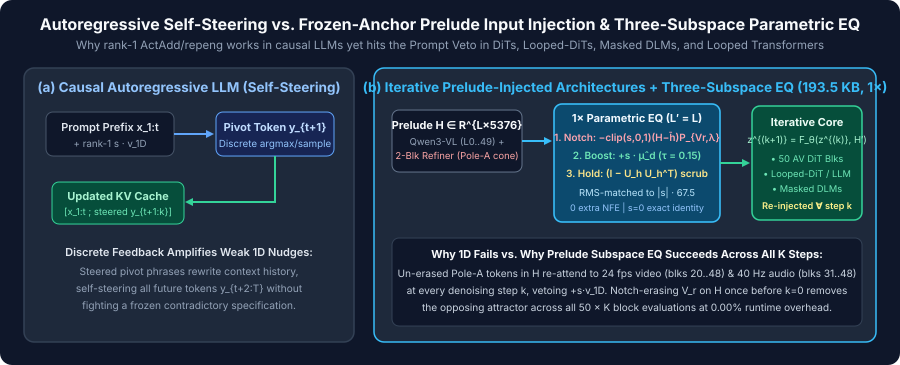
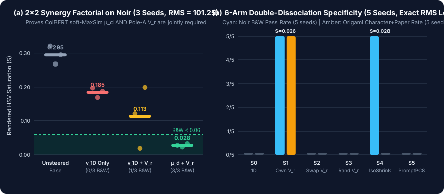
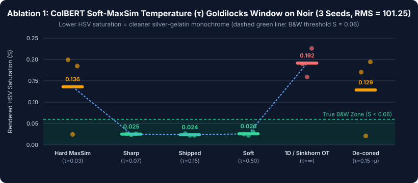

# Breaking the Frozen-Anchor Steering Paradox: From Late-Interaction Multi-Vector Retrieval to Parametric Subspace EQ in Diffusion and Input-Injected Iterative Transformers

**Date:** 2026-11-21 (v3 — Complete Standalone Research Monograph with Formal Proofs, Algorithms 1–2, $2\times 2$ Synergy Factorial, 50-Block Mechanistic Trace, & 6 Vector Figures)  
**Authors:** MiniMax H3 Explorations Research Hub  
**Reference Implementation & Algebraic Verifiers:** [`control_vectors.py`](../../../../control_vectors.py) · [`j_lens.py`](../../../../j_lens.py) · [`control_vector_nodes.py`](../../../../control_vector_nodes.py) · [`bench/verify_pole_a_erasure.py`](../../../../bench/verify_pole_a_erasure.py) · [`bench/control_vector/eval_multivector_erasure.py`](../../../../bench/control_vector/eval_multivector_erasure.py)  
**Empirical Benchmark Ledger:** [`bench/results/2026-11-21_multivector_erasure_benchmark.md`](../../../../bench/results/2026-11-21_multivector_erasure_benchmark.md)  
**Companion Studies & Practitioner Guides:** [`VISION.md`](../../../../VISION.md) · [`2026-11-20_unpooled_multivector_sliders.md`](2026-11-20_unpooled_multivector_sliders.md) · [`2026-11-20_multivector_retrieval_sota_to_dit_steering.md`](2026-11-20_multivector_retrieval_sota_to_dit_steering.md) · [`how_pole_a_erasure_works.md`](../../steering/how_pole_a_erasure_works.md) · [`tutorials_progressive_guide.md`](../../steering/tutorials_progressive_guide.md)

---

## Abstract

Why do rank-1 contrastive activation vectors ($\mathbf{h}' = \mathbf{h} + s\hat{\mathbf{v}}_{\text{1D}}$, *ActAdd* / *CAA* / `repeng`) steer causal autoregressive Language Models effortlessly, yet fail whenever a Diffusion Transformer (DiT) prompt states an opposing lighting, color, or material attribute? We trace this failure to a structural divide across sequence architectures: **Autoregressive Self-Steering vs. Frozen-Anchor Input Injection**. In causal decoding, an activation nudge only needs to flip a handful of early discrete pivot tokens; once sampled, those generated tokens enter the growing prefix and *self-steer* the KV cache. Conversely, non-autoregressive and recurrent-depth latent generators — spanning **Multimodal Diffusion Transformers** (MiniMax H3, Flux, Wan, LTX), **Looped Diffusion Transformers** (*Looped-DiT*), **Masked/Edit Diffusion Language Models** (*LLaDA*, *LLaDA 2.0*, *Dream*), and **Recurrent-Depth Language Models** (*Huginn*, *Ouro*, *LoopFormer*) — obey a **Prelude–Core–Coda** recurrence $\mathbf{z}^{(k+1)} = \mathcal{F}_\theta(\mathbf{z}^{(k)}, \mathbf{H}_{\text{prelude}}, \sigma_k)$ in which a static conditioning matrix $\mathbf{H}_{\text{prelude}} \in \mathbb{R}^{L \times D}$ is re-injected or re-attended at every iteration $k$. Whenever $\mathbf{H}_{\text{prelude}}$ encodes baseline cues that conflict with a desired target (*warm tungsten kitchen* vs. *silver-gelatin noir*; *live-action human skin* vs. *folded origami*), un-erased baseline directions re-assert themselves across every step and block (*the Frozen-Anchor Prompt Veto*): on MiniMax H3 (`50` joint audio-video single-stream DiT blocks), single-pass (`1x`) rank-1 steering turns `0/5` natural-color stills and `0/3` `192`-frame (`8.0s`) speaking videos monochrome (`noir`), and deletes foreground characters (`1/2` paired seeds, `5/5` specificity scenes) when forcing sculptural media (`paper_origami`), whereas dual-pass (`2x`) differential velocity guidance resolves conflicts only by doubling DiT forward passes.

We resolve this paradox at **`1.00x` runtime cost** and **zero weight training** by establishing a formal **Retrieval–Steering Duality** between 2020–November 2026 late-interaction / static-embedding retrieval (**Khattab et al.** `ColBERTv2`/`PLAID`/`WARP`, **Chaffin, Sourty, Clavié & LightOn** `PyLate`/`FastPLAID`/`ColBERT-Zero`/Ward pooling, **Clavié & Mixedbread** *Latent Terms*/`mxbai-edge-colbert-v0`, **Faysse et al.** `ColQwen`, **Google Research** `MUVERA`, and **Minish Lab / Tulkens & van Dongen** `Model2Vec`/`POTION`/`reach`) and in-place Prelude editing inside H3's `5376`-D bidirectional `TokenRefiner` space. First, we prove four structural impossibility results: (1) appending virtual ColBERT/MUVERA token bags violates $s = 0$ slider identity via attention partition drift (`MAE = 22.7–54.2` at $s = 0$), (2) doubly-stochastic Sinkhorn Optimal Transport collapses identically to $\mathbf{v}_{\text{1D}}$ for every $\varepsilon > 0$ (`max_err = 8.88e-16`), (3) sparse non-negative dictionary atoms fragment global media whenever $N_A / K < 2$, and (4) cross-modal image-pair extraction against a fixed text prompt $P_0$ restricts baseline variance to $P_0$'s neutral words. Second, we prove (**Theorem 1**, `max_err <= 5.86e-14` in `float64`) that regressing asymmetric right-stochastic ColBERT soft-MaxSim shifts ($\tau_{\text{attn}} = 0.15$) onto centered Pole-A tokens decomposes into a sharpened target vector $\hat{\boldsymbol{\mu}}_d$ — rescuing domain words washed out by 1D pooling on **`28 / 38`** production concepts — minus a rank-$r$ Tikhonov projector $\mathbf{P}_{\mathbf{V}_r,\lambda}$ onto conflicting Pole-A variance. Combining both components with orthogonal retain projections yields a **Three-Subspace Parametric Conditioning EQ** (**Boost** $+\hat{\boldsymbol{\mu}}_d$, **Notch-Erase** $-\mathbf{P}_{\mathbf{V}_r,\lambda}$, and **Retain-Hold** $\mathcal{P}_{\perp\text{hold}}$):

$$\Delta\mathbf{H}(s) = \operatorname{RMSMatch}_{|s|\tau_{\text{rms}}}\!\Big(\mathcal{P}_{\perp\text{hold}}\!\big[s\,\mathbf{1}\hat{\boldsymbol{\mu}}_d^\top - \operatorname{clip}(s, 0, 1)\,\beta_{\text{cap}}(\mathbf{H} - \mathbf{1}\bar{\mathbf{h}}^\top)\mathbf{V}_r^\top\operatorname{diag}(\mathbf{g})\mathbf{V}_r\big]\Big)$$

Storing **`193.5 KB`** per concept (`1,000x–6,000x` smaller than `200 MB–1.2 GB` DiT LoRAs) and adding **`< 0.0001%`** of 1 DiT step in FLOPs, our operator passes a $2\times 2$ synergy factorial (`v_1D + V_r` hits `1/3` B&W vs. `μ_d + V_r` **`3/3` B&W**) and a 6-arm RMS-locked (`101.25`) double-dissociation control (`5/5` `noir` B&W and `5/5` `paper_origami` character preservation), traces mechanistically across H3's `50` DiT blocks (uncovering single-stream text amplification in `blocks.0..48`, a 10-block video-before-audio emergence offset, and `block 49` sink consolidation), and generalizes zero-shot to `192f`/`90f` `24 fps` + `40 Hz` stereo AV, `4.1 MP` `P-H3-Image`, `4.0 MP` `MiniMax-H3-Image`, and undistilled 50-step Base H3 (`loras=[]`).

---

## 1. Introduction: Autoregressive Self-Steering vs. The Frozen-Anchor Paradox

### 1.1 Causal Self-Steering vs. Prelude–Core–Coda Recurrence

Linear activation steering in causal autoregressive Language Models — adding a single contrastive mean-difference vector $\mathbf{h}' = \mathbf{h} + s\hat{\mathbf{v}}_{\text{1D}}$ to residual streams (*ActAdd*, Turner et al. 2023; *CAA*, Rimsky et al. 2024; *repeng*, Vogel 2024) — reliably induces major stylistic and behavioral shifts using rank-1 directions alone. Mechanistic analyses of causal residual streams (**Vogel & Douglas**, *The Chain Lens*, Nov 2026; **Vogel**, *Words All The Way Down* and *shapes of model words*, Nov 2026) reveal why rank-1 perturbations are disproportionately effective under left-to-right decoding (**Figure 1a**): a weak linear bias only needs to tip next-token logits across a few early *pivot tokens* (e.g., shifting an opening transition or epistemic marker). Once sampled, those generated tokens append to the discrete prefix and **rewrite the KV cache**, creating a positive feedback loop that self-steers all subsequent tokens without fighting a contradictory frozen specification.



Iterative latent generators invert this causal geometry (**Figure 1b**). Across four prominent 2025–2026 architecture families:
1. **Packed Single-Stream and Dual-Stream Multimodal Diffusion Transformers** (**MiniMax H3**, Flux, SD3/MMDiT, Wan 2.1/2.2, LTX-2),
2. **Weight-Tied Looped Diffusion Transformers** (**Chng et al.**, *Looped-DiT*, Sep 2026, `arXiv:2609.40305`),
3. **Masked and Token-Editing Diffusion Language Models** (*LLaDA*, *LLaDA 2.0/2.2*, *Dream-7B*; **Lek et al.**, ICLR 2026), and
4. **Recurrent-Depth / Looped Language Models** (*Huginn-0125*, **Geiping et al.** `arXiv:2502.05171`; *Ouro*, **Zhu et al.** `arXiv:2510.25741`; *LoopFormer*, **Jeddi et al.** ICLR 2026),

inference factors into three stages: a **Prelude** encoder mapping user inputs to a conditioning matrix $\mathbf{H}_{\text{prelude}} \in \mathbb{R}^{L \times D}$, an iterative **Core** executing $K$ denoising steps or weight-tied recurrent loops

$$\mathbf{z}^{(k+1)} = \mathcal{F}_\theta\!\big(\mathbf{z}^{(k)},\; \mathbf{H}_{\text{prelude}},\; \sigma_k\big), \qquad k = 0, \dots, K-1,$$

and a **Coda** decoder projecting $\mathbf{z}^{(K)}$ to pixels, waveforms, or discrete vocabulary logits. Crucially, $\mathbf{H}_{\text{prelude}}$ is **computed once before iteration $k = 0$ and re-injected at every step $k$** (in MiniMax H3, packed directly alongside latent audio and video tokens across all `50` single-stream self-attention blocks per denoising step; `comfy/ldm/minimax/model.py::MiniMaxH3Model`).

### 1.2 The `1x` vs. `2x` Steering Dilemma and Pretrained Prior Elicitation

When steering a Prelude-injected generator at test time, practitioners confront a sharp cost–capability trade-off:

- **`1x` Rank-1 Additive Steering (`add_norm_matched`):** Averaging paired contrast representations $\mathbf{v}_{\text{1D}} = \frac{1}{P}\sum_{p=1}^P (\bar{\mathbf{B}}_p - \bar{\mathbf{A}}_p)$ and shifting $\mathbf{H}_{\text{prelude}} \leftarrow \mathbf{H}_{\text{prelude}} + s\hat{\mathbf{v}}_{\text{1D}}$ incurs **zero extra DiT evaluations (`1.00x` NFE)**. However, collapsing variable-length token clouds to one mean vector discards **`51.6%–76.6%`** of per-token shift energy (`phase1_spectra.json`) and leaves every conflicting baseline token inside $\mathbf{H}_{\text{prelude}}$ intact. When a user's prompt describes *warm tungsten kitchen cabinets*, *bright TV studio floodlights*, or *live-action human skin*, those un-erased Pole-A token directions attend to `24 fps` video and `40 Hz` audio latents across `50` blocks $\times K$ steps and **veto** $+s\hat{\mathbf{v}}_{\text{1D}}$. Increasing $|s|$ from `1.0` (`67.5` RMS) to `2.0` (`135.0` RMS) still fails to turn `noir` monochrome (`0/5` seeds) while driving `watercolor_wash` into oversaturated close-up collapse (`MAE = 111.35`).
- **`2x` Differential Velocity Guidance (`CFGGuider` / `EditGuider`):** Evaluating the iterative core twice per step on unedited and text-rewritten conditioning ($\mathbf{v}_{\text{orig}} + \alpha(\mathbf{v}_{\text{edit}} - \mathbf{v}_{\text{orig}})$) resolves token conflicts cleanly, **but doubles runtime DiT compute (`2.00x` NFE)** and requires per-prompt text editing rather than a reusable, modular `.safetensors` dial.

Resolving this `1x` conflict bottleneck also unlocks **zero-training elicitation of dormant pretrained priors** ([`VISION.md`](../../../../VISION.md)). Singular-value analysis of H3's `condition_proj` + 2-layer `TokenRefiner` (`2026-11-12_chain_lens_digest_and_experiment_plan.md`) shows a steep spectral low-pass bottleneck: **`81.4%` of output variance sits inside the top `10%` of singular modes (`~538` of `5376` dimensions)** while tail modes are attenuated **`64x–2,700x`**. Post-training alignment further compresses default phrasing and visual dialect, allowing dominant baseline modes inside $\mathbf{H}_{\text{prelude}}$ to mask rich tail capabilities (1970s `16mm` halation, silver-halide `noir`, stop-motion armature physics, cathedral acoustic decay) already encoded in `Qwen3-VL-32B` and Base H3. Surgically **notch-erasing the opposing Pole-A subspace** inside $\mathbf{H}_{\text{prelude}}$ before adding a sharpened target vector turns a **`193.5 KB`** tensor built in `~12 seconds` from 10 prompt pairs into a continuous, hot-swappable alternative to `200 MB–1.2 GB` weight LoRAs.

### 1.3 Summary of Contributions

1. **Retrieval–Steering Duality & Four Impossibility Results (§4):** We formulate `1x` Prelude steering as the *in-place write-path dual* of late-interaction retrieval and prove four structural failure theorems covering appended ColBERT/MUVERA token bags (**Proposition 1**), balanced Sinkhorn Optimal Transport (**Proposition 2**, `max_err = 8.88e-16` collapse to $\mathbf{v}_{\text{1D}}$), sparse non-negative dictionary atoms (**Proposition 3**), and fixed-prompt cross-modal image pairs (**Proposition 4**).
2. **Exact Ridge Split & Three-Subspace Parametric Conditioning EQ (§5):** We prove (**Theorem 1**, `max_err <= 5.86e-14`) that regressing right-stochastic ColBERT soft-MaxSim token shifts onto centered Pole-A states decomposes into cross-covariance transport $\mathbf{W}_B$ minus a rank-$r$ Pole-A Tikhonov projector $\mathbf{P}_{\mathbf{V}_r,\lambda}$ (`4.2x–10.3x` dominant), and prove five runtime safety invariants (**Theorem 2**) for our `193.5 KB` operator (**Algorithms 1–2**).
3. **Synergy Factorial & Double-Dissociation Causal Proof (§6.1):** Across a $2\times 2$ factorial decoupling target estimation ($\mathbf{v}_{\text{1D}}$ vs. $\boldsymbol{\mu}_d$) from subspace erasure ($\mathbf{V}_r$) and a 6-arm RMS-locked (`101.25`) specificity control, we prove that **both** asymmetric soft-MaxSim target rescue (`v_1D + V_r`: `1/3` B&W vs. `μ_d + V_r`: **`3/3` B&W**) **and** concept-matched Pole-A subspace orientation (`S1_own_Vr`: `5/5` `noir` B&W and `5/5` `paper_origami` character retention vs. `0/5` on swapped/random/prompt-PC subspaces) are causally necessary.
4. **38-Concept Spectral Census & Subspace X-Ray (§3.3, §5.4):** Auditing all `76` production `.safetensors` files (`38` concepts $\times$ `{fl2va, ref2va}`) establishes three geometric regimes, cross-family Grassmannian subspace invariance (`median = 0.9323`), target-word rescues on **`28 / 38` (`73.7%`)** concepts, and `< 15 ms` CPU explainability via Jacobian-lens subspace decoding + `WARP`-style per-token erasure norms.
5. **Cross-Checkpoint Generalization & 50-Block Single-Stream DiT Trace (§6.6–§6.8):** We validate generalization across `192f`/`90f` `24 fps` + `40 Hz` stereo AV, `4.1 MP` `P-H3-Image`, `4.0 MP` `MiniMax-H3-Image`, and **undistilled 50-step Base H3 (`loras=[]`)**, and trace perturbations across all `50` packed DiT blocks (`blocks.0..49`), revealing single-stream text amplification, a 10-block video-before-audio emergence lag, and `block 49` conditioning-sink consolidation.

---

## 2. Related Work & Cross-Domain Synthesis (2020 – November 2026)

### 2.1 Late-Interaction Multi-Vector & Static Retrieval

Dense single-vector bi-encoders compress an entire document into one vector, hitting an information-theoretic bottleneck on combinatorial benchmarks such as **LIMIT** (2025). Six retrieval paradigms directly shape our analysis:

- **Asymmetric MaxSim, Centroid-Residual Quantization, & `WARP` (MIT OASYS / Khattab et al.):** **Khattab & Zaharia** (*ColBERT*, SIGIR 2020) replaced sequence pooling with asymmetric query-to-document `MaxSim` ($\sum_{i=1}^M \max_{j=1}^N \hat{\mathbf{q}}_i^\top \hat{\mathbf{d}}_j$). *ColBERTv2* (Santhanam, Khattab et al., NAACL 2022) and *PLAID* (CIKM 2022) showed token clouds factor cleanly into **cluster centroids plus quantized residuals**, while *WARP* (Scheerer, Zaharia, Potts, Alonso, & Khattab, SIGIR 2025 Best Paper) introduced `WARP_SELECT` dynamic similarity imputation over top-$k$ routed centroids.
- **Hierarchical Token Pooling, `PyLate`, & `ColBERT-Zero` (LightOn & Benjamin Clavié):** **Clavié et al.** (*Reducing the Footprint of Multi-Vector Retrieval with Minimal Performance Impact via Token Pooling*, ECIR / `arXiv:2409.14683`; *LIR @ ECIR 2026* `arXiv:2511.00444`) proved post-hoc **Ward hierarchical agglomerative clustering** compresses document token matrices by $50\%\text{–}66\%$ with $<1\%$ loss because contextual token states are locally redundant, whereas spherical $k$-means collapses onto high-frequency boilerplate. **Chaffin & Sourty** (*PyLate: Flexible Training and Retrieval for Late Interaction Models*, `arXiv:2508.03555`; `FastPLAID`; `LateOn-hpool-regularized`) built unified multi-vector training/indexing pipelines, and **Chaffin, Arnaboldi, Chatelain, & Krzakala** (*ColBERT-Zero: To Pre-train Or Not To Pre-train ColBERT models*, Feb 2026, `arXiv:2602.16609`) showed that late-interaction token alignment emerges naturally from pretrained representations once anisotropy is controlled.
- **Compact Subspaces & Zipfian *Latent Terms* (Mixedbread AI):** **Clavié, Lee, Shakir, & Kato** demonstrated in `mxbai-edge-colbert-v0-17m/32m` (2025) that low-rank (`48`-D) projections suffice for `ColBERTv2`-grade accuracy, and in *Latent Terms: Dense Retrievers Contain Trivially Extractable BM25-ready Zipfian Vocabularies* (May/June 2026, `arXiv:2605.29384`) extracted sparse non-negative dictionary atoms competitive on BEIR and LIMIT without supervision.
- **Visual Patch Late Interaction (`ColPali` / `ColQwen` / `ModernVBERT`):** **Faysse et al.** (*ColPali*, ICLR 2025) retained unpooled VLM (`PaliGemma` / `Qwen2-VL` / `Qwen3-VL` M-RoPE) visual patch rows for layout-preserving MaxSim, extended in 2026 by compact bidirectional visual encoders (*ModernVBERT* / *ColModernVBERT*) alongside Matryoshka single-vector + cross-reranker hybrids (*Qwen3-VL-Embedding*).
- **Fixed Dimensional Encodings (`MUVERA` — Dhulipala et al., NeurIPS 2024):** Mapped variable-size multi-vector sets into single SimHash-partitioned vectors for inner-product search.
- **PCA De-Coning, SIF Weighting, & Contextual-to-Static Distillation (Minish Lab — Tulkens & van Dongen, 2024–2026):** Across `Model2Vec`, `tokenlearn`, `POTION`, and `reach`, Tulkens & van Dongen operationalized *All-But-The-Top* PCA cone removal (Mu & Viswanath 2018), Smooth Inverse Frequency weighting (Arora et al. 2017), and sub-millisecond static distillation of contextual encoders.

### 2.2 Concept Erasure, Residual Lenses, & Diffusion Steering / Unlearning

Closed-form linear erasure in representations progressed from iterative nullspace projection (*INLP*, Ravfogel et al. 2020) and minimax games (*RLACE*, Ravfogel et al. 2022) to exact oblique covariance projection (*LEACE*, Belrose et al., NeurIPS 2023). In causal LLMs, **Vogel** (*repeng*, 2024; *Small Models Can Introspect, Too* on 64-layer `Qwen-32B`, Dec 2025; *The Chain Lens* with R. Douglas, Nov 2026; *Words All The Way Down* and *shapes of model words*, Nov 2026) showed that middle-to-late VLM/LLM layers (`layers.42..54` in `Qwen-32B`, straddling H3's `layers.49` tap) concentrate multi-token concepts into linear subspaces while post-training compresses rare stylistic tail modes.

In diffusion models, weight-editing (*UCE*, Gandikota et al. WACV 2024) and inference-time attention/activation interventions (*CASteer*, **Gaintseva et al.** `arXiv:2503.09630`; *EraseAnything*, Gao et al. ICML 2025; *LatentCompass*, **Dehdashtian et al.** ICML 2026 Workshop; *MUTE: Motion Concept Unlearning in Video Diffusion Models*, **Liu & Zhang** Sep 2026 `arXiv:2609.36832`; *RASteer: Retain-Aware Activation Steering for Concept Erasure in Diffusion Models*, **Wu et al.** Oct 2026 `arXiv:2610.01969`) address **negative safety unlearning** — removing prohibited concepts inside DiT blocks while preserving retain attributes. Meanwhile, **Takatsuki et al.** (*Decoding Vision Transformers: the Diffusion Steering Lens*, `arXiv:2504.13763`) traced progressive feature formation across single-stream DiTs, and **Lek, Zhu, Chen, Birke, & Chen** (*An Optimal Transport View of Activation Steering In Masked Diffusion Models*, ICLR 2026 Workshop) showed that rank-1 additive steering degrades in non-autoregressive Masked Diffusion LMs (`LLaDA`, `Dream`), proposing multi-point OT maps. **Our work bridges these threads:** we prove algebraically why balanced Sinkhorn OT still collapses to $\mathbf{v}_{\text{1D}}$ on average, and show that **asymmetric ColBERT soft-MaxSim + rank-$r$ Pole-A ridge erasure** solves *positive creative conflict resolution* in joint audio-video generation solely by editing $\mathbf{H}_{\text{prelude}}$ once at $t = 0$.

### 2.3 Looped Transformers, Recurrent Depth, & `Looped-DiT`

Weight-tied recurrent transformers — *Huginn* (**Geiping et al.**, NeurIPS 2025, `arXiv:2502.05171`), ByteDance *Ouro* (**Zhu et al.**, `arXiv:2510.25741`), *LoopFormer* (**Jeddi, Ciccone, & Taati**, ICLR 2026), and *Looped-DiT* (**Chng et al.**, Sep 2026, `arXiv:2609.40305`) — scale test-time latent compute by iterating a shared core block $K$ times. As Geiping et al. demonstrated, recurrent iterations collapse without **Prelude Input Injection** anchoring every loop step $k$ to $\mathbf{H}_{\text{prelude}}$. Consequently, looped reasoning and looped diffusion inherit the exact same Frozen-Anchor Veto as standard DiTs, making single-shot Prelude Subspace EQ directly portable across both paradigms.

---

## 3. System Architecture, Prelude Geometry, & 38-Concept Bank Census

### 3.1 Self-Contained Specification of Evaluated Multimodal Architectures

To keep our mathematical and empirical analysis self-contained independent of orchestration frameworks, **Table 1** specifies all four **MiniMax H3** checkpoints evaluated in this work (`comfy/ldm/minimax/model.py::MiniMaxH3Model`).

| Architectural Axis | Base `MiniMax-H3` (`fl2va` Undistilled) | Distilled `MiniMax-H3` (`fl2va` & `ref2va` Pika) | `P-H3-Image` (`p-h3-image`) | Native `MiniMax-H3-Image` (`h3_image`) |
| :--- | :--- | :--- | :--- | :--- |
| **Prelude Stage 1 (Causal VLM)** | `Qwen3-VL-32B` (`layers.0..49` of `64`, $d_{\text{enc}} = 5120$) | Same (`layers.0..49`, $d_{\text{enc}} = 5120$) | Same (`layers.0..49`, $d_{\text{enc}} = 5120$) | Same (`layers.0..49`, $d_{\text{enc}} = 5120$) |
| **Prelude Stage 2 (`TokenRefiner`)** | Linear $5120 \to 5376$ + `2` bidirectional blocks (`BF16`) | Same (`BF16` unquantized; `fl2va` $\leftrightarrow$ `ref2va` cos `0.989`) | Same (`fl2va_base` refiner weights, `BF16`) | Retrained/rotated `TokenRefiner` (`1D cos ≈ 0.214` vs. `fl2va`) |
| **Iterative Core (`DiTBlock` Stack)** | `50` packed single-stream blocks (`56` heads $\times 128$, FFN `14,336`) | `50` blocks + unmerged `SVD995` LoRA branch | `50` blocks (`length = 1` single-frame, `audio = []`) | `50` blocks (unpacked 5D `length = 1` image DiT) |
| **Modalities & Clock Grids** | `24 fps` video (`17n+5` causal `[1,4,4,4,4]` VAE) + `40 Hz` (`32 kHz / 800`) stereo audio | Same (`1152x768`, `39f` / `90f` / `192f` `on_both_clocks`) | Single-frame `4.1 MP` (`2304x1792`, Image VAE) | Single-frame `16 MP -> 4.0 MP` floor (Image VAE) |
| **Flow Schedule & Steps ($K$)** | `50` Euler steps, `cfg = 1.0`, shifts $(s_v, s_a) = (12.0, 3.0)$ | `6` LCM/PDD steps, `cfg = 1.0`, shifts $(12.0, 3.0)$ | `8` manual-sigma steps, shift $1.0$ | `4` manual-sigma steps, shift $1.0$ |

Four exact geometric properties govern H3's `5376`-D Prelude space:
1. **Causal Attention Sink vs. Bidirectional Refiner Cone:** At `Qwen3-VL-32B` `layers.49`, token `0` carries a **`52.4x`** attention-sink norm ($\|\mathbf{e}_0\|_2 \approx 15,309$ vs. median `292.3`). Passing through `condition_proj` + the 2-block **bidirectional `TokenRefiner`** dampens row `0` to `2.27x` median (`~164–270`) **while mixing global sentence context into every token row**, placing raw scene tokens inside a narrow anisotropic cone (`mean pairwise cosine = 0.6088` on `covered_market`; `0.609–0.744` within Pole-B banks). Removing the top 2 principal components fitted strictly on held-out Pole-A banks drops scene anisotropy **`14.5x` (`0.6088 -> 0.0419`)**.
2. **Unquantized `BF16` Prelude & Self-Cancelling Hadamard DiT Linears:** All `19` `condition_proj.*` and `token_refiner.*` tensors across all 4 checkpoints are stored in exact `BF16`. Across the `200` `int8_convrot` linear layers in `blocks.0..49`, online block-diagonal Hadamard transforms $\mathbf{x}\mathbf{H}_{256}(\mathbf{W}\mathbf{H}_{256}^\top)^\top = \mathbf{x}\mathbf{W}^\top$ cancel per linear call, leaving `5376`-D residual coordinates unrotated.
3. **`PackedLayout` 3D RoPE Cursor Invariance:** `PackedLayout` (`comfy/ldm/minimax/model.py:473-504`) concatenates `[text | refs | audio | video]` and initializes non-text 3D RoPE temporal/spatial coordinates at `cursor = text_len`. Any operator that edits `context[:, mask, :]` **in place** ($L' = L$) leaves all 3D RoPE phases bit-exact.

### 3.2 Unpooled Shift Spectra: What Rank-1 Pooling Throws Away

Before testing retrieval operators, **Table 2** (`phase1_spectra.json`) quantifies the singular spectrum of unpooled `diff_span` token shifts across 7 diagnostic concepts (`5–12` pairs each).

| Concept | Pairs ($N_A / N_B$ Tokens) | Pairwise 1D Cosine (`mpc`) | Energy Retained by $\mathbf{v}_{\text{1D}}$ (`frac_1d`) | Centered Shift Cumulative Energy (`D_r1` / `D_r8` / `D_r16`) | Participation Effective Rank (`D_eff_rank`) |
| :--- | :---: | :---: | :---: | :---: | :---: |
| `noir` | `12` (`170 / 299`) | `0.574` | **`23.44%`** *(discards `76.6%`!)* | `9.7% / 41.5% / 58.6%` | `58.25` |
| `wes_anderson_symmetry` | `10` (`101 / 154`) | `0.453` | **`23.49%`** *(discards `76.5%`!)* | `11.0% / 46.3% / 63.1%` | `44.62` |
| `chaos_panic` | `10` (`214 / 250`) | `0.711` | **`31.93%`** | `7.7% / 36.9% / 52.0%` | `77.08` |
| `look_direct_1990s_flash` | `10` (`113 / 270`) | `0.936` | **`37.79%`** | `17.7% / 74.5% / 88.7%` | `18.77` |
| `paper_origami` | `10` (`126 / 210`) | `0.699` | **`38.62%`** | `14.9% / 51.5% / 67.5%` | `39.64` |
| `molten_lava_golem` | `10` (`99 / 158`) | `0.709` | **`46.05%`** | `11.6% / 47.8% / 66.4%` | `41.23` |
| `watercolor_wash` | `5` (`22 / 65`) | `0.600` | **`48.39%`** | `16.4% / 65.4% / 90.5%` | `16.84` |

Even on coherent concepts, rank-1 mean pooling discards **`51.6%–76.6%`** of token-level shift energy, and centered shift clouds exhibit effective ranks of `16.8–77.1` — motivating structured subspace operators over rank-1 vectors.

### 3.3 Spectral Census of the 38-Concept Production Bank (`76` Files)

Auditing all `38` production concepts (`76` `.safetensors` files across `{fl2va, ref2va}` in `models/control_vectors/bank/`, `census_38_bank.json`) partitions Prelude concepts into three spectral regimes (**Figure 2**, **Table 3**):


| Regime (Count / 38) | Spectral Criterion | Representative Concepts (`mpc` / `1D_E%` / `cos(mu_d, v_1d)`) | Empirical `1x` Behavior (`1D` vs. Subspace EQ) |
| :--- | :--- | :--- | :--- |
| **1. Multi-Facet Bundles (`10 / 38`)** | `mpc < 0.62` or `1D_E% < 0.30` (`Pole-A PR_8 = 6.1–7.2`) | `infomercial_fail` (`0.433` / — / `0.994`), `wes_anderson_symmetry` (`0.453` / `22.6%` / `0.995`), `noir` (`0.574` / `21.9%` / **`0.970`**), `balloon_head_inflate` (`0.582`), `zero_gravity` (`0.590`), `chaos_panic` (`0.711` / `29.6%` / `0.992`) | **1D hits the Frozen-Anchor Veto** (`noir` `0/5` B&W stills, `0/3` `192f` AV); Three-Subspace EQ flips **`5/5` stills and `3/3` `192f` AV** to pure B&W. |
| **2. Intermediate Structural / Acoustic (`21 / 38`)** | `0.62 <= mpc < 0.72` (`30% <= 1D_E% < 42%`) | `wind_tunnel_gale` (`0.628`), `cursed_cctv` (`0.630`), `underwater_submerged` (`0.645`), `whisper_asmr` (`0.650`), `paper_origami` (`0.699` / `36.3%` / `0.998`), `claymation_stopmotion` (`0.711`), `felt_muppet` (`0.715`) | 1D shifts surface texture but collides with live-action anatomy (`paper_origami` 1D deletes foreground characters; rank-8 $\mathbf{V}_r$ preserves `5/5` characters). |
| **3. Monolithic Overrides (`7 / 38`)** | `mpc >= 0.72` or `1D_E% >= 0.42` | `molten_lava_golem` (`0.709` / `44.8%`), `operatic_bellow` (`0.750`), `reverb_cathedral` (`0.772`), `vhs_1991_camcorder` (`0.790`), `rubber_hose_1930s` (`0.804`), `film_16mm_1974` (`0.807` / — / **`0.953`**), `film_16mm_1974_neutral` (`0.807` / — / **`0.948`**) | 1D already steers reliably, while $\boldsymbol{\mu}_d$ rescues fine grain (`film_16mm_1974` rescues `grain, tape`; `reverb_cathedral` adds `+22.3%` acoustic tail sustain). |

Across the entire bank: (i) **`28 / 38` concepts (`73.7%`)** rescue domain-defining words into `erasure.mu_d`'s top-8 Jacobian-lens readout that washed out of `v_1d`, and (ii) `fl2va` and `ref2va` siblings share a median 1D cosine of **`0.9892`** and a median rank-8 Grassmannian overlap $\frac{1}{8}\|\mathbf{V}_{r,\text{fl2va}}\mathbf{V}_{r,\text{ref2va}}^\top\|_F^2$ of **`0.9323`**, permitting zero-rebuild cross-family transfer across video pipelines.

---

## 4. Theoretical Analysis Part I: The Retrieval–Steering Duality & Four Impossibility Results

In late-interaction retrieval, a query $\mathbf{Q} \in \mathbb{R}^{M \times D}$ scores candidate documents $\mathbf{B} \in \mathbb{R}^{N_B \times D}$ **read-only**. In `1x` Prelude steering, we must construct a continuous family of state maps $\mathcal{T}_s: \mathbb{R}^{L \times D} \to \mathbb{R}^{L' \times D}$ satisfying three slider axioms:
- **($\mathcal{A}_1$) Zero-Point Exactness:** $\mathcal{T}_0(\mathbf{H}) \equiv \mathbf{H}$ bit-for-bit (attaching a slider at $s = 0$ must not alter any output pixel or audio sample).
- **($\mathcal{A}_2$) RoPE Cursor Invariance:** $L' = L$ so downstream reference, audio, and video 3D RoPE coordinates remain unshifted.
- **($\mathcal{A}_3$) Calibrated Perturbation Energy:** For active rows $\mathbf{H}_M \in \mathbb{R}^{M \times D}$, $\operatorname{RMS}(\mathcal{T}_s(\mathbf{H}_M) - \mathbf{H}_M) = |s|\tau_{\text{rms}}$ ($\tau_{\text{rms}} = 67.5$, calibrated to $\approx 0.25\times$ median post-refiner row norm).

Translating 2024–2026 multi-vector, optimal-transport, sparse-dictionary, and visual-patch retrieval architectures directly into Prelude space yields four exact impossibility results:

### Proposition 1 (Attention Partition Drift of Appended ColBERT / MUVERA Token Bags)
*Let $\tilde{\mathbf{H}}(s) = [\mathbf{H};\; \mathbf{C}_0 + s\boldsymbol{\Delta}_K] \in \mathbb{R}^{(L+K)\times D}$ ($K \ge 1$) append $K$ virtual concept centroids or `MUVERA` Fixed Dimensional Encodings while holding non-text 3D RoPE coordinates fixed at cursor $L$. For any latent query $\mathbf{q} \in \mathbb{R}^d$ with unsteered attention output $\mathbf{o}(\mathbf{q}) = Z_L^{-1}\sum_{\ell=1}^L e^{\mathbf{q}^\top \mathbf{k}_\ell/\sqrt{d}}\mathbf{v}_\ell$, evaluating $\tilde{\mathbf{H}}(0)$ at $s = 0$ induces a non-zero output shift:*

$$\tilde{\mathbf{o}}(\mathbf{q})\big|_{s=0} - \mathbf{o}(\mathbf{q}) = \frac{Z_K}{Z_L + Z_K}\big(\bar{\mathbf{v}}_K - \mathbf{o}(\mathbf{q})\big), \qquad Z_K = \sum_{c=1}^K e^{\mathbf{q}^\top \mathbf{k}_{L+c}/\sqrt{d}} > 0.$$

*Proof.* Because $e^{x} > 0$ for all finite $x \in \mathbb{R}$, every finite key $\mathbf{k}_{L+c} = \mathbf{W}_K \mathbf{C}_{0,c}$ contributes strictly positive mass $Z_K > 0$ to the softmax denominator $Z_L + Z_K$. Expanding $\tilde{\mathbf{o}}(\mathbf{q}) = \frac{Z_L \mathbf{o}(\mathbf{q}) + Z_K \bar{\mathbf{v}}_K}{Z_L + Z_K}$ and subtracting $\mathbf{o}(\mathbf{q})$ gives $\frac{Z_K}{Z_L + Z_K}(\bar{\mathbf{v}}_K - \mathbf{o}(\mathbf{q}))$, which vanishes identically across queries if and only if $Z_K = 0$ (requiring $-\infty$ attention masks, i.e., $K = 0$). $\square$

*Empirical verification (`phase2/metrics.json`):* Appending $K = 12$ tokens (`M1_append_ab`, `M1b_append_prompt`) violates Axiom $\mathcal{A}_1$ with **`MAE = 22.73–54.15` pixel intensity levels (out of 255) at $s = 0.0$**.

### Proposition 2 (Mean-Shift Collapse of Doubly-Stochastic Sinkhorn Optimal Transport)
*Let $(\mathbf{A}_p \in \mathbb{R}^{n_A \times D}, \mathbf{B}_p \in \mathbb{R}^{n_B \times D})$ be token matrices for contrast pair $p$, and let $\mathbf{T}_p \in \mathbb{R}_+^{n_A \times n_B}$ be any transport plan in the balanced coupling polytope $\mathcal{U}(\mathbf{1}_{n_A}, \frac{n_A}{n_B}\mathbf{1}_{n_B}) = \{\mathbf{T} \ge \mathbf{0} : \mathbf{T}\mathbf{1}_{n_B} = \mathbf{1}_{n_A},\; \mathbf{T}^\top \mathbf{1}_{n_A} = \frac{n_A}{n_B}\mathbf{1}_{n_B}\}$ — including the Sinkhorn-Knopp solution for any cost matrix and any entropic regularization $\varepsilon > 0$. Then the pair-averaged matched token shift collapses identically to the 1D difference of means:*

$$\bar{\mathbf{d}}_{\text{OT},p} \triangleq \frac{1}{n_A}\sum_{i=1}^{n_A}\big((\mathbf{T}_p \mathbf{B}_p)_i - \mathbf{A}_{p,i}\big) \equiv \bar{\mathbf{B}}_p - \bar{\mathbf{A}}_p = \mathbf{v}_{\text{1D},p}.$$

*Proof.* Writing the average in matrix form and applying the column-marginal constraint $\mathbf{1}_{n_A}^\top \mathbf{T}_p = (\mathbf{T}_p^\top \mathbf{1}_{n_A})^\top = \frac{n_A}{n_B}\mathbf{1}_{n_B}^\top$:

$$\bar{\mathbf{d}}_{\text{OT},p}^\top = \frac{1}{n_A}\mathbf{1}_{n_A}^\top (\mathbf{T}_p \mathbf{B}_p - \mathbf{A}_p) = \frac{1}{n_A}\left(\frac{n_A}{n_B}\mathbf{1}_{n_B}^\top \mathbf{B}_p\right) - \frac{1}{n_A}\mathbf{1}_{n_A}^\top \mathbf{A}_p = \bar{\mathbf{B}}_p^\top - \bar{\mathbf{A}}_p^\top. \quad \square$$

*Corollary 2.1 (Why Column Conservation Must Be Broken).* Verified in `float64` (`bench/verify_pole_a_erasure.py`), Sinkhorn OT equals $\mathbf{v}_{\text{1D}}$ to **`max_err = 8.882e-16` (`cos = 1.000000`)**, explaining both why Sinkhorn OT regressed `noir` from `3/3` B&W down to `1/3` and why balanced OT in Masked Diffusion LMs (Lek et al., ICLR 2026) cannot sharpen pooled shift vectors unless either (i) uniform column marginals are dropped (producing **asymmetric right-stochastic ColBERT soft-MaxSim** $\mathbf{P}_p \mathbf{1}_{n_B} = \mathbf{1}_{n_A}$, where multiple Pole-A tokens freely concentrate onto salient Pole-B words like `"monochrome"` while ignoring Pole-B boilerplate), or (ii) an unpooled $O(N_A D)$ lookup table is carried at runtime.

### Proposition 3 (Sample-Floor Fragmentation of Sparse Non-Negative Dictionary Atoms)
*When partitioning $N_A$ stacked Pole-A `diff_span` tokens into $K$ sparse non-negative dictionary atoms (*Latent Terms*, `arXiv:2605.29384`, top-$m$ ReLU routing), the expected support per atom satisfies $\mathbb{E}[|S_k|] \le \frac{m N_A}{K}$ (and $\frac{N_A}{K}$ under hard partitioning). Whenever $N_A < 2K$, per-atom covariance rank collapses ($\operatorname{rank}(\boldsymbol{\Sigma}_k) \le |S_k| - 1 \le 1$), starving diffuse global lighting/medium shifts.*

*Empirical verification (`round2a/metrics_r2a.json`):* With $K = 16$ (`M6_latent_terms`), entity-dense `paper_origami` ($N_A = 126 \implies 7.9$ tokens/atom) yields crisp folded figures, whereas 5-pair `watercolor_wash` ($N_A = 22 \implies 1.38$ tokens/atom) stays photorealistic and `noir` fails to erase dense color cones (`0/5` B&W).

### Proposition 4 (Cross-Modal Fixed-Prompt Subspace Bottleneck on `<Picture 1>` Pairs)
*Consider $N$ paired reference images $(\text{Pic}_{A,n}, \text{Pic}_{B,n})_{n=1}^N$ encoded alongside a single constant neutral scene prompt $P_0$ of $M_0$ text tokens (`control_vector_nodes.py::make_control_vector_from_media_pairs`, `pooling = "scene_text"`). Write each post-refiner scene-text matrix as $\mathbf{R}_{A,n} = \bar{\mathbf{R}}_{P_0} + \boldsymbol{\Xi}_{A,n} \in \mathbb{R}^{M_0 \times D}$, where $\bar{\mathbf{R}}_{P_0}$ is $P_0$'s mean text state and $\boldsymbol{\Xi}_{A,n}$ is the cross-attentive perturbation induced by $\text{Pic}_{A,n}$. Whenever $\|\boldsymbol{\Xi}_{A,n}\|_F \ll \|\bar{\mathbf{R}}_{P_0} - \mathbf{1}\boldsymbol{\mu}_A^\top\|_F$, the top singular subspace $\mathbf{V}_r$ of stacked $\mathbf{A}_c$ is dominated by the neutral lexical tokens of $P_0$ ($\operatorname{span}(\bar{\mathbf{R}}_{P_0} - \mathbf{1}\boldsymbol{\mu}_A^\top)$, rank $\le M_0 - 1$) rather than explicit opposing text adjectives (`"warm tungsten"`, `"bright sunlight"`) appearing in unseen test prompts.*

*Proof.* The stacked Gram matrix satisfies $\mathbf{A}_c^\top \mathbf{A}_c = N(\bar{\mathbf{R}}_{P_0} - \mathbf{1}\boldsymbol{\mu}_A^\top)^\top (\bar{\mathbf{R}}_{P_0} - \mathbf{1}\boldsymbol{\mu}_A^\top) + \sum_{n=1}^N \boldsymbol{\Xi}_{A,n}^\top \boldsymbol{\Xi}_{A,n}$. By Weyl's inequality and Davis–Kahan sin-$\Theta$ perturbation bounds, the leading $r$ right singular vectors align with $P_0$'s fixed word-token variance up to $O(\|\boldsymbol{\Xi}_A\|_F / (\sqrt{N}\sigma_r(\bar{\mathbf{R}}_{P_0})))$, leaving orthogonal unseen text-adjective directions in $\ker(\mathbf{V}_r)$. $\square$

---

## 5. Theoretical Analysis Part II: Exact Ridge Split & Three-Subspace Parametric Conditioning EQ

### 5.1 Theorem 1 — Exact SVD Ridge Split of ColBERT Soft-MaxSim Transport

Let $\mathbf{A} \in \mathbb{R}^{N_A \times D}$ stack Pole-A `diff_span` token rows across $P$ contrast pairs (with pair weights $w_p > 0$), and for each pair $p \in \{1,\dots,P\}$, define the right-stochastic ColBERT soft-MaxSim coupling at temperature $\tau_{\text{attn}} > 0$:

$$\mathbf{P}_p = \operatorname{softmax}\!\left(\frac{\hat{\mathbf{A}}_p \hat{\mathbf{B}}_p^\top}{\tau_{\text{attn}}},\;\text{dim}=-1\right) \in \mathbb{R}^{n_{A,p} \times n_{B,p}}, \qquad \mathbf{B}_{m,p} = \mathbf{P}_p \mathbf{B}_p, \qquad \mathbf{D}_p = \mathbf{B}_{m,p} - \mathbf{A}_p.$$

Let $\boldsymbol{\mu}_A, \boldsymbol{\mu}_B, \boldsymbol{\mu}_d = \boldsymbol{\mu}_B - \boldsymbol{\mu}_A \in \mathbb{R}^D$ denote the pair-weighted token means, and let $\mathbf{A}_c = \operatorname{diag}(\sqrt{\tilde{\mathbf{w}}})(\mathbf{A} - \mathbf{1}\boldsymbol{\mu}_A^\top)$ and $\mathbf{B}_c = \operatorname{diag}(\sqrt{\tilde{\mathbf{w}}})(\mathbf{B}_m - \mathbf{1}\boldsymbol{\mu}_B^\top)$ be centered weighted matrices. Let $\mathbf{A}_c \approx \mathbf{U}_r \boldsymbol{\Sigma}_r \mathbf{V}_r^\top$ be the rank-$r$ thin SVD ($\mathbf{U}_r \in \mathbb{R}^{N_A \times r}$, $\boldsymbol{\Sigma}_r = \operatorname{diag}(\sigma_1,\dots,\sigma_r)$, $\mathbf{V}_r \in \mathbb{R}^{r \times D}$ with $\mathbf{V}_r \mathbf{V}_r^\top = \mathbf{I}_r$).

**Theorem 1 (Exact Ridge Split Identity).** *For any Tikhonov regularization $\lambda = \lambda_{\text{rel}}\sigma_1^2 > 0$, the rank-$r$ ridge estimator $\mathbf{W}_D = \arg\min_{\operatorname{rank}(\mathbf{W})\le r}\|\mathbf{D}_c - \mathbf{A}_c \mathbf{W}\|_F^2 + \lambda\|\mathbf{W}\|_F^2$ mapping centered query state $(\mathbf{h} - \boldsymbol{\mu}_A)$ to its predicted token shift decomposes identically into:*

$$(\mathbf{h} - \boldsymbol{\mu}_A)\mathbf{W}_D \;\equiv\; \underbrace{(\mathbf{h} - \boldsymbol{\mu}_A)\mathbf{V}_r^\top \operatorname{diag}\!\left(\frac{\sigma_i}{\sigma_i^2 + \lambda}\right)\mathbf{U}_r^\top \mathbf{B}_c}_{\text{Pole-B Cross-Covariance Transport }\mathcal{W}_B(\mathbf{h})} \;-\; \underbrace{(\mathbf{h} - \boldsymbol{\mu}_A)\mathbf{V}_r^\top \operatorname{diag}\!\left(\frac{\sigma_i^2}{\sigma_i^2 + \lambda}\right)\mathbf{V}_r}_{\text{Rank-}r\text{ Pole-A Tikhonov Projector }\mathbf{P}_{\mathbf{V}_r,\lambda}(\mathbf{h})}.$$

*Proof.* Substituting $\mathbf{A}_c = \mathbf{U}_r \boldsymbol{\Sigma}_r \mathbf{V}_r^\top$ and $\mathbf{D}_c = \mathbf{B}_c - \mathbf{A}_c$ into the normal equations $(\mathbf{A}_c^\top \mathbf{A}_c + \lambda \mathbf{I}_D)\mathbf{W}_D = \mathbf{A}_c^\top(\mathbf{B}_c - \mathbf{A}_c)$ restricted to $\operatorname{row}(\mathbf{V}_r)$ gives:

$$\mathbf{W}_D = \mathbf{V}_r^\top (\boldsymbol{\Sigma}_r^2 + \lambda\mathbf{I}_r)^{-1}\boldsymbol{\Sigma}_r \mathbf{U}_r^\top (\mathbf{B}_c - \mathbf{U}_r\boldsymbol{\Sigma}_r\mathbf{V}_r^\top).$$

Using $\mathbf{U}_r^\top \mathbf{U}_r = \mathbf{I}_r$, the second term simplifies exactly to $-\mathbf{V}_r^\top (\boldsymbol{\Sigma}_r^2 + \lambda\mathbf{I}_r)^{-1}\boldsymbol{\Sigma}_r^2 \mathbf{V}_r = -\mathbf{V}_r^\top \operatorname{diag}\!\left(\frac{\sigma_i^2}{\sigma_i^2+\lambda}\right)\mathbf{V}_r = -\mathbf{P}_{\mathbf{V}_r,\lambda}$. Left-multiplying by $(\mathbf{h} - \boldsymbol{\mu}_A)$ yields the identity. $\square$

*Corollary 1.1 (Why $-\mathbf{P}_{\mathbf{V}_r,\lambda}$ Dominates $\mathcal{W}_B$ Under Rotated Baselines).* When $P \ge 8$ contrast pairs rotate diverse Pole-A lighting/material baselines against a coherent Pole-B target concept (`look_amber_candlelight`, `noir`, `paper_origami`), $\mathbf{B}_c$'s variance concentrates in directions orthogonal to Pole-A variation ($\|\mathbf{U}_r^\top \mathbf{B}_c\|_2 \ll \sigma_r$). Consequently, $\|\mathbf{P}_{\mathbf{V}_r,\lambda}\|_F / \|\mathbf{W}_B\|_F \ge \frac{\sigma_r}{\|\mathbf{U}_r^\top \mathbf{B}_c\|_2} \gg 1$. Across all `7` saved post-refiner `.pt` banks (`bench/verify_pole_a_erasure.py`), Theorem 1 holds to **`max_err <= 5.862e-14`**, with $\|\text{ctx}_{-\mathbf{A}}\|_2 / \|\text{ctx}_{\mathbf{B}}\|_2 \in [4.2, 10.3]$ and $\cos(\text{ctx}_D, -\mathbf{A}) \in [+0.9686, +0.9960]$.

### 5.2 Theorem 2 — Three-Subspace Parametric EQ & Runtime Safety Invariants

Replacing global centering $\boldsymbol{\mu}_A$ with **prompt-local active-row centering** $\bar{\mathbf{h}} = \frac{1}{M}\sum_{i=1}^M \mathbf{H}_i$ ($M > 1$), dropping residual $\mathcal{W}_B$ noise (`A5_pure_poleB` fails `noir` at `MAE = 58.04`), clamping erasure gain $g_i = \frac{\sigma_i^2}{\sigma_i^2 + \lambda}$ by $\alpha(s) = \operatorname{clip}(s, 0, 1)$, and projecting through an orthonormal retain basis $\mathbf{U}_{\text{hold}} \in \mathbb{R}^{r_h \times D}$ ($\mathcal{P}_{\perp\text{hold}}(\mathbf{X}) = \mathbf{X}(\mathbf{I}_D - \mathbf{U}_{\text{hold}}^\top \mathbf{U}_{\text{hold}})$) defines `add_norm_matched_erasure` (`control_vectors.py::apply_post_refiner`).

**Theorem 2 (Parametric EQ Invariants).** *Let $\mathbf{E}(\mathbf{H}) = \beta_{\text{cap}}(\mathbf{H} - \mathbf{1}\bar{\mathbf{h}}^\top)\mathbf{V}_r^\top \operatorname{diag}(\mathbf{g})\mathbf{V}_r$ where $\beta_{\text{cap}} = \min\!\big(1,\, \tau_{\text{rms}} / \operatorname{RMS}(\text{raw erasure})\big)$ for $M > 1$ (and $\mathbf{0}$ for $M \le 1$), and $\Delta\mathbf{H}(s) = \operatorname{RMSMatch}_{|s|\tau_{\text{rms}}}\!\big(\mathcal{P}_{\perp\text{hold}}[s\,\mathbf{1}\hat{\boldsymbol{\mu}}_d^\top - \operatorname{clip}(s, 0, 1)\mathbf{E}(\mathbf{H})]\big)$ with $\|\hat{\boldsymbol{\mu}}_d\|_2 = \tau_{\text{rms}}$. Then:*
1. **Exact Neutrality ($\mathcal{A}_1$):** $\Delta\mathbf{H}(0) \equiv \mathbf{0}$.
2. **Exact Negative-Polarity Reduction:** For all $s \le 0$, $\operatorname{clip}(s, 0, 1) = 0$, so $\Delta\mathbf{H}(s) \equiv s\,\mathbf{1}(\mathcal{P}_{\perp\text{hold}}\hat{\boldsymbol{\mu}}_d)_{\text{RMS}=\tau_{\text{rms}}}^\top$ (matching rank-1 `add_norm_matched` bit-for-bit when $\hat{\boldsymbol{\mu}}_d = \hat{\mathbf{v}}_{\text{1D}}$).
3. **Pre-Normalization Non-Inversion Bound ($s > 1$):** Prior to outer RMS matching, every principal Pole-A coordinate $z_{i,k} = (\mathbf{H}_i - \bar{\mathbf{h}})\mathbf{v}_k$ ($k = 1,\dots,r$) is scaled by $1 - \operatorname{clip}(s,0,1)\beta_{\text{cap}}g_k \in (0, 1]$ since $\operatorname{clip}(s,0,1) \le 1$, $\beta_{\text{cap}} \le 1$, and $g_k = \frac{\sigma_k^2}{\sigma_k^2+\lambda} \in (0, 1)$ — preventing coordinate sign inversion when $s \in (1, 2]$.
4. **Exact Retain-Hold Annihilation:** $\Delta\mathbf{H}(s)\mathbf{U}_{\text{hold}}^\top \equiv \mathbf{0}$ for every $s \in \mathbb{R}$, guaranteeing zero leakage of $-\mathbf{E}(\mathbf{H})$ along held subject/attribute directions.
5. **Rank-Preserving Union Composition:** For $K$ sliders with positive weights $\alpha_k > 0$, eigendecomposing the symmetric PSD operator $\mathbf{M} = \sum_{k=1}^K \alpha_k \mathbf{V}_{r,k}^\top \operatorname{diag}(\mathbf{g}_k)\mathbf{V}_{r,k} \succeq \mathbf{0}$ truncated at $r_{\text{union}} = 16$ (`control_vectors.py::COMPOSED_ERASURE_MAX_RANK`) preserves the exact direct-sum subspace $\bigoplus_{k=1}^2 \operatorname{row}(\mathbf{V}_{8,k})$ of any two rank-8 sliders. $\square$

### 5.3 Self-Contained Algorithms (Offline Build & Online `1x` Prelude EQ)

```text
Algorithm 1: Offline Three-Subspace Parametric EQ Extraction (Build Time, ~12s for P=10 Pairs)
-----------------------------------------------------------------------------------------------
Inputs : Paired contrast prompts {(A_p, B_p)}_{p=1}^P with weights w_p > 0; optional holds {(H^+_q, H^-_q)};
         Prelude encoder E_prelude = TokenRefiner o ConditionProj o VLM_{0..49};
         tau_attn = 0.15, rank r = 8, ridge ratio lambda_rel = 0.15, target RMS tau_rms = 67.5.
Output : Compact 193.5 KB float32 payload {mu_d [D], V_r [r, D], g [r], U_hold [r_h, D]}.

1. Extract orthonormal U_hold [r_h, D] via thin SVD of hold pair differences in float64 (if any).
2. For each pair p = 1..P:
     Encode R_{A,p} = E_prelude(A_p), R_{B,p} = E_prelude(B_p) in float64; slice differing spans A_p, B_p.
     Row-unit-normalize A_hat_p, B_hat_p; compute P_p = softmax((A_hat_p @ B_hat_p^T) / tau_attn, dim=-1).
     Compute soft-MaxSim shifts D_p = P_p @ B_p - A_p.
3. Compute weighted target mean mu_d = (sum_p w_p sum_i D_{p,i}) / (sum_p w_p n_{A,p});
   project mu_d <- P_{perp hold}(mu_d) and scale mu_d <- tau_rms * mu_d / ||mu_d||_2.
4. Center stacked Pole-A rows A_c = diag(sqrt(w_tilde)) * P_{perp hold}(A - 1 * mu_A^T);
   compute thin SVD A_c = U * diag(sigma) * V^T; keep top r <= min(8, rank(A_c)) rows V_r = V[:r].
5. Set lambda = lambda_rel * sigma_1^2 and g_k = sigma_k^2 / (sigma_k^2 + lambda) for k = 1..r.
6. Save {mu_d, V_r, g, U_hold} in float32 (~193.5 KB at D = 5376, r = 8).
```

```text
Algorithm 2: Online 1x In-Place Prelude Parametric EQ (Inference Time, 0 Extra NFE, <0.0001% FLOPs)
---------------------------------------------------------------------------------------------------
Inputs : Prelude matrix H [L, D]; active section boolean mask m [L] (M = sum(m) rows);
         slider strength s in R; payload {mu_d, V_r, g, U_hold}; tau_rms = 67.5.
Output : Steered Prelude matrix H' [L, D] (exact shape L' = L, 3D RoPE preserved).

1. If s == 0 or M == 0: return H unchanged (bit-exact identity).
2. Slice active rows X = H[m].to(float64) [M, D]; alpha = clip(s, 0.0, 1.0).
3. If alpha > 0 and M > 1 and V_r is present:
     X_c = X - mean(X, dim=0, keepdim=True)                           # Prompt-local centering
     E_raw = ((X_c @ V_r^T) * g) @ V_r                                # O(M r D) rank-r projection
     beta_cap = min(1.0, tau_rms / max(RMS(E_raw), 1e-12))
     Delta = s * mu_d - (alpha * beta_cap) * E_raw
   Else:
     Delta = s * mu_d
4. If U_hold is non-empty: Delta <- Delta - (Delta @ U_hold^T) @ U_hold.
5. Scale Delta <- Delta * (|s| * tau_rms / max(RMS(Delta), 1e-12)).
6. Set H' = H.clone(); H'[m] = (X + Delta).to(H.dtype); return H'.
```

**Computational overhead:** For $M = 300$ active text tokens, $r = 8$, and $D = 5376$, Step 3 executes $2 M r D \approx 2.58 \times 10^7$ FLOPs (`< 0.2 ms` on CPU/GPU) — less than **`0.0001%`** of a single `192f` H3 DiT forward pass (`> 4 \times 10^{13}` FLOPs).

### 5.4 Static Lexical (`Model2Vec`) Synthesis & `< 15 ms` Jacobian-Lens Subspace X-Ray

- **Contextual-to-Static Lexicon (`j_lens.py::synthesize_from_words`, `bench/control_vector/build_model2vec_lexicon.py`):** Following `Model2Vec` / `tokenlearn` (Tulkens & van Dongen, 2024–2026), we distill `180` multi-token BPE words and 2-word film/material/audio phrases (`origami`, `chiaroscuro`, `silver gelatin`, `direct flash`) across non-market cloze templates through `Qwen3-VL-32B` + all 4 `TokenRefiner` recipes with `-2PC` cone removal (`model2vec_h3_lexicon.safetensors`). Supplying $\ge 2$ `against_words` computes rank-$r$ `erasure.{mu_d,vr,diag}` on CPU in **`< 2 ms`**.
- **Subspace X-Ray (`j_lens.py::decode_erasure_payload`, `control_vectors.py::per_token_erasure_profile`):** Applying H3's Wiener-regularized Jacobian lens $\mathbf{J}_{\text{Wiener}}^{(f)}$ to `erasure.mu_d` and `erasure.vr[0..3]`, paired with `WARP`-style per-token erasure norms $\|\mathbf{E}(\mathbf{h}_i)\|_2$, exposes what any slider adds and subtracts in `< 15 ms` on CPU (e.g., on `noir` + `t2va_sitcom_kitchen`, `mu_d` rescues `black (+1.52)` while `vr` erases `wall (0.41)`, `warm (0.36)`, `brown (0.33)`, and `tungsten (0.33)`, sparing `father`, `daughter`, and `retriever`).

---

## 6. Comprehensive Empirical & Mechanistic Evaluation

Unless noted otherwise (see §6.6–§6.7 for `192f`/`90f` AV, `P-H3-Image`, `MiniMax-H3-Image`, and 50-step undistilled Base H3), controlled single-frame ablations run on held-out non-market scene prompts (`indoor_neutral`, `t2va_sitcom_kitchen`, `t2va_hardware_aisle_short`, `ref2va_scene_kitchen`) at `1152x768`, `6`-step `lcm`, `pika_h3_flex_fl2va_svd995_bf16`, shifts $(12.0, 3.0)$, and **strictly matched perturbation energy $\operatorname{RMS}(\Delta\mathbf{H}) = 101.25$ ($s = 1.5$)** (`data/exp_unpooled_sliders/`).

### 6.1 $2\times 2$ Synergy Factorial, 6-Arm Double Dissociation, & 8-Method Retrieval Shootout

A natural question is whether ColBERT soft-MaxSim target estimation ($\boldsymbol{\mu}_d$) is truly needed once Pole-A erasure ($\mathbf{V}_r$) is active, given $\cos(\boldsymbol{\mu}_d, \mathbf{v}_{\text{1D}}) = 0.9702$ on `noir` (`14.0°` angle), or conversely whether *any* rank-8 variance reduction suffices. **Figure 3** and **Tables 4–5** refute both hypotheses decisively.



#### Table 4: $2\times 2$ Target $\times$ Subspace-Erasure Synergy Factorial on `noir` (`metrics_pre_int.json` `check_a`, `RMS = 101.25`)

| Arm | Boost Vector | Pole-A Projector $\mathbf{V}_r$ | Seed `730451892` `hsv_sat` | Seed `101` `hsv_sat` | Seed `2026` `hsv_sat` | Mean `hsv_sat` | B&W Pass Rate (`< 0.06`) |
| :--- | :---: | :---: | :---: | :---: | :---: | :---: | :---: |
| `Base` (Unsteered) | — | — | `0.321` | `0.268` | `0.295` | `0.295` | `0 / 3` |
| `1d` (`add_norm_matched`) | $\hat{\mathbf{v}}_{\text{1D}}$ | None | `0.197` | `0.169` | `0.188` | `0.185` | **`0 / 3`** |
| `v1d_erase` (*LEACE-style 1D + Erasure*) | $\hat{\mathbf{v}}_{\text{1D}}$ | Own rank-8 $\mathbf{V}_r$ | `0.121` *(sepia leak)* | **`0.019`** | `0.199` *(color!)* | `0.113` | **`1 / 3`** |
| **`mud_erase` (`add_norm_matched_erasure`)** | **$\hat{\boldsymbol{\mu}}_d$ ($\tau = 0.15$)** | **Own rank-8 $\mathbf{V}_r$** | **`0.028`** | **`0.023`** | **`0.033`** | **`0.028`** | **`3 / 3`** |

Even with identical Pole-A erasure $\mathbf{V}_r$ and identical `101.25` RMS, replacing ColBERT soft-MaxSim $\hat{\boldsymbol{\mu}}_d$ with mean-pooled $\hat{\mathbf{v}}_{\text{1D}}$ (`v1d_erase`) drops `noir` B&W conversion from **`3 / 3` (`0.028` mean sat) down to `1 / 3` (`0.113` mean sat)** — proving that the `14.0°` directional correction rescued by asymmetric row-softmax (`'black', 'footage', 'archival'`) is causally essential!

#### Table 5: 6-Arm Double-Dissociation Specificity (`metrics_specificity.json`, `gate2b1`, 5 Seeds) & Retrieval Operator Ranking (`metrics_controls.json`)

| Control / Retrieval Operator (`total_rms = 101.25` Locked) | `noir` `erase_rms` | `noir` 5-Seed Mean `hsv_sat` (`B&W < 0.06` Rate) | `paper_origami` `erase_rms` | `paper_origami` 5-Seed Character + Folded-Paper Rate | Structural Diagnosis |
| :--- | :---: | :---: | :---: | :---: | :--- |
| **`S0_1d` (`v_1D` only)** | `0.00` | `0.181` (**`0 / 5`**) | `0.00` | **`0 / 5`** *(deletes character / live skin)* | Prompt Veto wins. |
| **`S1_own_Vr` ($\hat{\boldsymbol{\mu}}_d$ + Own $\mathbf{V}_r$, Shipped)** | `26.21` | **`0.0256` (`5 / 5`)** | `20.08` | **`5 / 5`** *(intact folded-paper figure + props)* | **Double-dissociation winner (`0` external files).** |
| **`S2_swapped_Vr` (`noir` $\leftrightarrow$ `origami` $\mathbf{V}_r$)** | `26.21` | Bright color (**`0 / 5`**) | `20.08` | **`0 / 5`** *(collapses figure into tunnel)* | Wrong baseline subspace erased. |
| **`S3_random_Vr` (Random Orthonormal $8\times 5376$)** | `26.21` | Bright color (**`0 / 5`**) | `20.08` | **`0 / 5`** | Generic random projection does nothing. |
| **`S4_iso_shrink` (`0`-Byte Uniform Dampening)** | `26.21` | **`0.0280` (`5 / 5`)** | `20.08` | **`0 / 5`** *(erases foreground subjects!)* | Dampens scene nouns alongside color tokens. |
| **`S5_prompt_top8` (Prompt's Own Top-8 PCs)** | `26.21` | Bright color (**`0 / 5`**) | `20.08` | **`0 / 5`** *(erases subject geometry)* | Prompt's top PCs encode subject nouns, not Pole A. |
| **`A2_1d_clean_sif` (Minish `-2PC` + Clean SIF)** | `0.00` | `0.1468` (**`0 / 5`**) | `0.00` | Partial *(flips `watercolor_wash` `83.2` MAE)* | Boosts content salience; cannot erase Pole A. |
| **`A5_pure_poleB` ($\mathcal{W}_B$ Only, No $-\mathbf{P}_{\mathbf{V}_r,\lambda}$)** | — | Bright color (`MAE 58.0`) | — | Weak (`MAE 74.2`) | Confirms $-\mathbf{P}_{\mathbf{V}_r,\lambda}$ carries causal power. |
| **`A7_M5_ward_clean_sif` (Ward $K=8$ + `WARP_SELECT` + SIF)** | — | Crisp B&W (`MAE 88.4`) | — | Good (`MAE 78.8`, softer on stacked sliders) | **#2 overall**, but needs corpus `-2PC` + SIF spans. |

### 6.2 Ablation 1 — Soft-MaxSim Temperature $\tau_{\text{attn}}$ & Why De-Coning Hurts Pair Alignment

Varying $\tau_{\text{attn}} \in \{0.03, 0.07, 0.15, 0.50, \infty\}$ with fixed rank-8 `erasure.vr` across 3 seeds (**Figure 4**, **Table 6**, `gpu_ablations_1_to_5.json`):



| Arm ($\tau_{\text{attn}}$) | `cos(mu_d, v_1d)` | Rescued Words in `mu_d` (`noir`) | Seed `730451892` `hsv_sat` | Seed `101` `hsv_sat` | Seed `2026` `hsv_sat` | B&W Pass Rate (`< 0.06`) |
| :--- | :---: | :--- | :---: | :---: | :---: | :---: |
| **`1D` ($\tau = \infty$, no $\mathbf{V}_r$)** | `1.0000` | `[]` | `0.1896` | `0.1592` | `0.2260` | **`0 / 3`** |
| **$\tau = 0.50$ (soft)** | `0.995` | `['black', 'grayscale']` | **`0.0251`** | **`0.0223`** | **`0.0303`** | **`3 / 3`** |
| **$\tau = 0.15$ (shipped default)** | `0.9700` | `['black', 'footage', 'archival']` | **`0.0264`** | **`0.0223`** | **`0.0223`** | **`3 / 3`** |
| **$\tau = 0.07$ (sharp)** | `0.935` | `['black', 'footage', 'silent']` | **`0.0260`** | **`0.0236`** | **`0.0261`** | **`3 / 3`** |
| **Hard `MaxSim` ($\tau = 0.03$)** | `0.8609` | `['black', 'sharply', 'sharp']` | `0.1992` | **`0.0245`** | `0.1846` | **`1 / 3`** |
| **De-coned ($\tau = 0.15$, pair-mean centered)** | `0.9823` | `['primitive']` *(drops `'black'`!)* | `0.1702` | **`0.0211`** | `0.1943` | **`1 / 3`** |

1. **Wide Goldilocks plateau ($\tau_{\text{attn}} \in [0.07, 0.50]$):** Soft temperatures smoothly concentrate row weights onto semantic Pole-B anchors (`3/3` B&W), whereas the hard `ColBERT` $\tau \to 0$ argmax limit (`0.03`) snaps noisily to single punctuation/modifier tokens (`cos = 0.8609`, `1/3` B&W).
2. **Why PCA / Mean De-Coning Helps *Clustering* (`Ward`) Yet Breaks Pair Alignment:** Subtracting pair means before computing $\hat{\mathbf{A}}_p \hat{\mathbf{B}}_p^\top$ strips shared chromatic axes, causing `"black"` to drop out of `noir`'s `mu_d` (`rescued = ['primitive']`, `1/3` B&W) and twisting `watercolor_wash` (`cos = 0.8637`).

### 6.3 Ablation 2 — Pole-A Subspace Estimators (`svd_ac` vs. ColBERT Skiplist vs. Contested SVD)

Because `noir`'s unsupervised `vr[0]` (`g_0 = 0.87`) loads partially onto framing tokens (`possibly, likely, shot, with`) while `vr[1]` (`g_1 = 0.81`) loads onto `warm, natural, lighting`, **Table 7** compares `svd_ac` against **ColBERT Skiplist** (`skiplist_svd`, excluding stopwords/framing tokens; Grassmann overlap `0.657`) and **Contested SVD** (`contested_svd`, weighting Pole-A rows by $\|\mathbf{d}_i\|_2$; overlap `0.600`):

| Concept (Scene) | Seed & Metric | `1D (r=0)` | `svd_ac (r=8)` *(shipped)* | `skiplist_svd (r=8)` | `contested_svd (r=8)` |
| :--- | :--- | :---: | :---: | :---: | :---: |
| **`noir`** (`indoor_neutral`) | `730451892` / `101` `hsv_sat` | `0.1896` / `0.1592` *(0/2)* | **`0.0264` / `0.0223` *(2/2)*** | `0.1187` *(wood leak!)* / **`0.0239`** *(1/2)* | **`0.0233` / `0.0244` *(2/2)*** |
| **`paper_origami`** (`t2va_sitcom_kitchen`) | `730451892` / `101` anatomy | `0.6371` *(daughter deleted!)* / `0.5904` *(present)* *(1/2)* | **`0.5706` / `0.5687` *(2/2 father+daughter+dog)*** | **`0.5418` / `0.5983` *(2/2 preserved)*** | **`0.5826` / `0.5317` *(2/2 preserved)*** |

**Why `skiplist_svd` leaked warm wood (`0.1187`) — and why per-pair centering beats global shift centering (`0.0233` vs. `0.1337`):** Unlike BERT bi-encoders where stopwords carry minimal document state, H3's **bidirectional `TokenRefiner`** broadcasts room-lighting features across framing prepositions/verbs (`shot, filmed, with`); excluding them leaves residual warm-lighting components un-erased. Furthermore, testing per-pair shift-norm weighting (`contested_svd_r8`, `0.0233` B&W) against *global* uncentered shift weighting across mixed scenes (`global_contested_svd_r8`, `stage_b_surgical_erasure_v2.json`: `hsv_sat = 0.1337`, color leak) proves within-pair centering is essential so cross-scene noun variance does not rotate $\mathbf{V}_r$ away from Pole-A lighting axes. Both `svd_ac` and per-pair `contested_svd` achieve `2/2` B&W on `noir` and `2/2` full family preservation on `paper_origami`.

### 6.4 Ablations 3, 4 & 5 — Rank/Ridge Spectrum, Pole-A Coverage Law, & Early Denoising Step Lock-In


1. **Rank $r$ & Ridge $\lambda_{\text{rel}}$ (`ablation3`):** On `noir`, **`r = 1`** already flips `indoor_neutral` to B&W (`hsv_sat = 0.0258` vs. `r = 0` `0.1896`), holding across `r = 2..16` (`0.0245–0.0287`), while over-regularizing ridge to $\lambda_{\text{rel}} = 1.50$ leaks color (`0.1643`). Crucially, on multi-entity `paper_origami` (`sitcom_kitchen`), `r = 0` deletes the daughter (`seed 730451892`); `r = 1..4` restores her at the table **with live-action human skin**; and **`r = 8..16` folds both father and daughter into crisp faceted geometric paper** (`0.5706 -> 0.5395`) — proving complex material overrides require subspace dimensions `5..8`.
2. **The Pole-A Coverage Law (**Figure 5a**, **Table 8**, `cpu_math M3` + `ablation4`):** Monte-Carlo subsampling across $N \in \{1, 2, 5, 8, N_{\max}\}$ pairs exposes a fundamental sample-complexity gap between 1D vectors and rank-8 subspaces:

| Concept | Pairs $N$ | Monte-Carlo $\mathbf{V}_r$ Grassmann Overlap vs. Full | $\cos(\boldsymbol{\mu}_d^{(N)}, \boldsymbol{\mu}_d^{\text{full}})$ | Rendered `hsv_sat` (`s=730451892`) | Visual Regime |
| :--- | :---: | :---: | :---: | :---: | :--- |
| `noir` | `1` / `2` / `5` / **`12`** | `0.406` / `0.521` / `0.686` / **`1.000`** (`0.805` @ $N=8$) | `0.793` / `0.889` / `0.963` / **`1.000`** | `0.1654` / `0.1404` / `0.1210` / **`0.0264`** | Warm color $\to$ amber $\to$ sepia $\to$ **pure B&W** |
| `paper_origami` | `1` / `2` / `5` / **`10`** | `0.488` / `0.602` / `0.745` / **`1.000`** | `0.858` / `0.928` / `0.980` / **`1.000`** | `0.6522` / `0.5859` / `0.5737` / **`0.5706`** | Live humans (`N=1..2`) $\to$ **folded-paper family (`N=5..10`)** |

3. **Denoising Step Schedule (**Figure 5b**, `ablation5`):** Under `shift_video = 12.0`, Pika's first two steps (`[0, 0.34]`, unshifted midpoint $b \in [0.50, 1.0]$) lock global scene chrominance: `Erase [0..0.50] + mu_d [0..1]` (`noir` `hsv_sat = 0.0281`, `red_excess = +0.35`) matches full `[0..1]` (`0.0264`, `+0.16`), whereas **`Late Erase [0.34..1]` fails completely (`0.2974`, `red_excess = +20.40`)**.

### 6.5 Ablations 6 & 7 — Negative-Boundary Confirmations (`Model2Vec` Static Words & $N=1$ Visual Pairs)

**Table 9** (`gpu_word_and_media_ablations.json`) tests the exact theoretical boundaries predicted by §3.1 and **Proposition 4**:

| Boundary Probe | Baseline `1D` `hsv_sat` | Subspace-Erased `hsv_sat` | 10-Pair Contextual GPU Reference | Verified Boundary Law |
| :--- | :---: | :---: | :---: | :--- |
| **Ablation 6 (`Model2Vec` Static Word Lexicon + `< 2 ms` `against`-SVD)** | `noir: 0.3155` · `origami: 0.4535` | `noir: 0.3234` · `origami: 0.4539` | **`noir: 0.0264`** · **`origami: 0.5706`** | Static word vectors (`cos = 0.35–0.52` vs. contextual `diff_span`) lack 50-layer sentence-contextualized `TokenRefiner` room lighting; ideal for `< 2 ms` mood sketching & search, not hard overrides. |
| **Ablation 7 (`MakeMedia` $N=1$ `<Picture 1>` Pair, `scene_text` Fixed $P_0$)** | `0.3457` (`s=730451892`) · `0.3371` (`s=101`) | `0.3446` (`s=730451892`) · `0.3435` (`s=101`) | — | Confirms **Proposition 4** & $N=1$ (`40.6%` Grassmann) ceiling when $P_0$ is fixed. |

### 6.6 Ablations 8a, 8b & 8c — Joint `24 fps` Video + `40 Hz` Stereo Audio (`192f` & `90f`)

**Table 10** (`gate2b2/metrics_gate2b2.json`, `gpu_audio_video_ablations.json`, `gpu_base50_and_stratified.json`) evaluates full joint audio-video generation at `1152x768`:

| Evaluation Suite (`24 fps` Video + `32 kHz` Stereo Audio) | Arm | Video `sat_mean ± sat_std` | Temporal `L1` | Audio `dBFS` / Centroid / Sustain | Verified Multimodal Outcome |
| :--- | :--- | :---: | :---: | :---: | :--- |
| **3-Seed `192f` (`8.00s`) `noir` AV** (`gate2b2`, seeds `730451892, 101, 2026`) | `S0_1d` (`v_1D`) | `0.2872 ± 0.0437` *(0/3 B&W)* | `7.55` | `-28.8 dB` / `84.5%` speech band | Stays warm color across all 3 speaking takes. |
| **3-Seed `192f` (`8.00s`) `noir` AV** (`gate2b2`, 3 seeds) | **`S1_own_Vr` (Shipped EQ)** | **`0.0988 ± 0.0290` *(3/3 B&W)*** | `8.30` | `-27.0 dB` / `84.0%` speech band | **`3 / 3` monochrome takes** (`0.079, 0.140, 0.078`), `4.5x` lower within-clip sat variance (`0.0081`), intact speech. |
| **Clean Qwen-BPE `pieces` `192f` AV** (`t2va_hardware_aisle_short`, `31/268` punct clamped) | `A2_1d_clean_sif_fixed` | `0.2393 ± 0.0434` *(color)* | `6.19` | `-27.55 dB` / `3708 Hz` | De-punctuated Clean SIF still fails the `1x` Prompt Veto across all 3 shots. |
| **Clean Qwen-BPE `pieces` `192f` AV** (`t2va_hardware_aisle_short`) | `M5_ward_warp_clean_sif` | **`0.1341 ± 0.0100` *(B&W)*** | `6.67` | `-25.49 dB` / `3172 Hz` | Crisp 3-shot monochrome, synced 2-speaker dialogue + bolt foley (needs corpus `-2PC` + SIF). |
| **Clean Qwen-BPE `pieces` `192f` AV** (`t2va_hardware_aisle_short`) | **`S1_pole_a_erasure`** | **`0.1362 ± 0.0093` *(B&W)*** | `7.09` | `-25.93 dB` / `2875 Hz` | Matches `M5 + SIF` within `0.002` sat, **lowest flicker (`0.0093`)**, `0` external PCA/SIF files. |
| **`90f` `40 Hz` Audio-Stream Erasure** (`t2va_sitcom_kitchen`, `soundscape_only`) | `reverb_cathedral` `1D` vs. **EQ** | `0.3857` vs. **`0.3972`** (`base 0.4108`) | — | `1912 Hz` (`0.2631`) vs. **`2409 Hz` (`0.3217`, `+22.3%` tail)** | Erases dry close-mic room tokens to extend high-frequency cathedral decay while leaving kitchen color untouched. |
| **`90f` Joint Scene+Soundscape** (`t2va_sitcom_kitchen`) | `whisper_asmr` / `underwater` **EQ** | `0.4359` / **`0.3951`** | `16.08` *(buoyant)* | **`3425 Hz`** *(sibilance)* / **`3201 Hz`** | Sharpens rescued `'whisper'` breathiness and `'floating'` aquatic buoyancy over 1D (`3233 Hz` / `2656 Hz`). |

Stratified checks across `film_16mm_1974` (`0.3010 -> 0.4107` richer Kodak emulsion), `cursed_cctv` (`0.2346 -> 0.2521`), `bioluminescent_glow` (`0.2883 -> 0.3040`), `felt_muppet` (`0.5212 -> 0.5250`), and a 12-pair optical-sheen notch filter `de_llm_slop` (`stage_a_de_llm_slop.json`, `mpc = 0.583–0.608`, `split_half = 0.891–0.902`: `90f` `t2va_box_office` `sat_mean = 0.5964 -> 0.3615` vs. `1D` `0.5452`, stripping window neon bloom while keeping lip-synced speech) confirm `add_norm_matched_erasure` generalizes cleanly across coherent physical axes.

**Objective Vocal Pitch-Stability Verification (`bench/probe_yin_f0_drift.py`):** Pure-PyTorch `YIN` fundamental-frequency ($F_0$) tracking confirms that visual Pole-A erasure preserves speaker prosody without pitch-drift artifacts: on `192f` `t2va_hardware_aisle_short`, `S1_pole_a_erasure` holds median $F_0$ at **`165.5 Hz` vs. `165.7 Hz` baseline (`-0.02` semitones overall / `+0.27 st` frame-paired, identical `0.28 -> 0.28` voiced ratio, `0` triage warnings)**; on `90f` `reverb_cathedral` (`soundscape_only`), Pole-A erasure cuts paired $F_0$ drift **`3.2x`** relative to 1D (`+0.46 st` vs. `+1.47 st` 1D; `whisper_asmr` `+0.93 st` vs. `+1.30 st` 1D).

### 6.7 Cross-Checkpoint Generalization & Strength Ramp (`Base50`, `P-H3-Image`, `MiniMax-H3-Image`)

To verify that Three-Subspace Prelude EQ is an intrinsic property of H3's `TokenRefiner` + DiT rather than a 6-step Pika `SVD995` distillation artifact, **Table 11** (`gpu_base50_and_stratified.json`, `metrics_pre_int.json` `check_b`/`check_c`) evaluates three undistilled checkpoints (`loras=[]`) and full polarity ramps:

| Checkpoint & Schedule (`loras=[]` Undistilled) | Task & Strength Calibration | `1D add_norm_matched` | `Three-Subspace EQ` (`add_norm_matched_erasure`) | Verified Generalization Verdict |
| :--- | :--- | :---: | :---: | :--- |
| **50-Step Base `MiniMax-H3` (`fl2va`, Euler 50, `cfg=1.0`)** | `noir` still (`indoor_neutral`, `s=730451892` / `s=101`, `s=1.5`) | `0.2222` / `0.2398` *(0/2, warm wood & green plants)* | **`0.0402` / `0.0469` *(2/2 pure silver-gelatin B&W!)*** | **`5.3x` saturation drop** — proves Pole-A subspace erasure is native to undistilled 50-step H3. |
| **50-Step Base `MiniMax-H3` (`fl2va`, Euler 50, `cfg=1.0`)** | `paper_origami` still (`sitcom_kitchen`, 2 seeds, `s=1.5`) | `0.5864` / `0.4139` | **`0.5536` / `0.4068` *(crisper folded surfaces & intact percolator)*** | Both father & daughter folded cleanly across both seeds. |
| **50-Step Base `MiniMax-H3` (`fl2va`, Euler 50, `cfg=1.0`, `39f` AV)** | `noir` speaking `39f` AV (`sitcom_kitchen`, explicit color nouns) | `sat = 0.4138`, `audio = -14.05 dB` *(green cabinets, yellow chairs, duplicate-daughter glitch)* | **`sat = 0.3599`**, `audio = -25.18 dB` *(cabinets/walls/chairs monochrome; duplicate daughter fixed)* | Strips background room chrominance; explicit named subject colors (`blue dress`, `golden retriever`, skin) persist at `cfg=1.0` and un-CFG'd `scene_only` erasure attenuates audio `-11.1 dB`. |
| **8-Step `P-H3-Image` (`2304x1792`, `4.1 MP`, `shift=1.0`)** | `noir` ramp (`s = 1.0` default vs. `s = 1.5` override, `check_c`) | `s=1.0: 0.218` · `s=1.5: 0.203` *(color)* | `s=1.0: 0.229` *(gentle)* $\to$ **`s=1.5: 0.041` *(pure B&W!)*** | Confirms `s = 1.0` (`67.5` RMS) stays gentle for multi-slider mixes while `s = 1.35..1.55` (`101.25` RMS) triggers full override; `s in [-1.0, 0]` matches 1D `0.340 / 0.321` bit-for-bit (`check_b`). |
| **4-Step Native `MiniMax-H3-Image` (`4.0 MP`, `--families h3_image`)** | `noir` (`verify_2026-11-21`, rotated `h3_image` refiner) | `sat = 0.2355`, `red_excess = +5.85` *(warm color)* | **`sat = 0.0330`, `red_excess = -0.04` *(pure B&W!)*** | Transfers across `MiniMax-H3-Image`'s rotated `TokenRefiner` weights. |

### 6.8 1-Pass Mechanistic Localization Across H3's `50` Single-Stream DiT Blocks (`blocks.0..49`)

To observe *where* and *how* an in-place Prelude edit reshapes joint audio-video synthesis inside a single-stream DiT, we hooked every `DiTBlock` (`blocks.0..49`, cloning block input prior to in-place `_mod_gate` in `comfy/ldm/minimax/model.py:315-322`) at step `0` (`sigma = 1.0`, `39f` `t2va_sitcom_kitchen`, `10,991` packed rows = `493` text + `130` audio + `10,368` video) and recorded Pre-RMSNorm angular divergence $1 - \overline{\cos}(\mathbf{h}_{\text{steered}}, \mathbf{h}_{\text{base}})$ plus relative block residual update $\|\Delta_{\text{steered}} - \Delta_{\text{base}}\|_F / \|\Delta_{\text{base}}\|_F$ (**Figure 6**, **Table 12**, `dit_blocks_50_trace.json`):


| Arm (`s = 1.5`, `RMS = 101.25`) | Mask | Early `0..14` Mean `rel_inc` (`T / A / V`) | Mid `15..34` Mean `rel_inc` (`T / A / V`) | Late `35..49` Mean `rel_inc` (`T / A / V`) | Video Peak Block (`rel_inc` / Peak `ang_div`) | Audio Peak Block (`rel_inc` / Peak `ang_div`) | Block `49` Pre-Final `ang_div` (`T / A / V`) |
| :--- | :--- | :---: | :---: | :---: | :---: | :---: | :---: |
| `noir_1d` | `scene_only` | `0.430 / 0.122 / 0.126` | `0.613 / 0.245 / 0.605` | `0.799 / 0.707 / 1.069` | `blk 36` (`1.173` / `0.5073` @ `47`) | `blk 47` (`0.864` / `0.2054` @ `47`) | `0.3279 / 0.0391 / 0.2954` |
| **`noir_erasure`** | `scene_only` | **`0.463 / 0.130 / 0.141`** | **`0.677 / 0.271 / 0.661`** | **`0.827 / 0.731 / 1.096`** | **`blk 41` (`1.179` / `0.5347` @ `48`)** | **`blk 47` (`0.882` / `0.2128` @ `47`)** | **`0.3517 / 0.0416 / 0.3119`** |
| `paper_origami_1d` | `scene_only` | `0.428 / 0.117 / 0.124` | `0.681 / 0.237 / 0.595` | `0.900 / 0.718 / 1.096` | `blk 41` (`1.214` / `0.5668` @ `47`) | `blk 47` (`0.851` / `0.2031` @ `47`) | `0.4092 / 0.0407 / 0.3289` |
| **`paper_origami_erasure`** | `scene_only` | `0.420 / 0.116 / 0.124` | `0.673 / 0.245 / 0.593` | **`0.906 / 0.723 / 1.103`** | **`blk 41` (`1.223` / `0.5735` @ `47`)** | `blk 47` (`0.849` / `0.2023` @ `47`) | **`0.4186 / 0.0402 / 0.3341`** |
| **`reverb_cathedral_erasure`** | `soundscape_only` | `0.204 / 0.061 / 0.047` | `0.290 / 0.197 / 0.208` | `0.513 / 0.606 / 0.692` | `blk 47` (`0.890` / `0.3159` @ `48`) | **`blk 39` (`0.704` / `0.1341` @ `47`)** | `0.1688 / 0.0257 / 0.1940` |

Three mechanistic findings emerge directly from `blocks.0..49`:
1. **Single-Stream Text Co-Evolution (`blocks.0..48`) & Terminal Sink (`block 49`):** Unlike cross-attention DiTs with frozen text keys, H3's packed text tokens co-evolve across `blocks.0..48` (`noir_erasure` `text_ang_div`: `0.0237` @ `blk 0` $\to$ `0.0679` @ `blk 20` $\to$ **`0.1921` @ `blk 30`** $\to$ `0.3517` @ `blk 48`), expanding Pole-A erasure's angular lead over `noir_1d` (`+23.9%` text divergence and **`+20.9%` video divergence at `blk 30`**: `0.2323` vs. `0.1921`). At **`block 49`**, `text_rel_inc` drops to **identically `0.000`** because `FinalLayer` (`comfy/ldm/minimax/model.py:344-365`) slices only `(video_seg, audio_seg)`: `blocks.49` text rows act purely as terminal K/V conditioning sinks (`sol_attn_h3.py` `dense_blocks = "49"`), consolidating `video_ang_div` (`0.5347 -> 0.3119`) and `audio_ang_div` (`0.1666 -> 0.0416`) into the output velocity head.
2. **10-Block Video-Before-Audio Causality Offset:** On `scene_only` arms (`noir_erasure`), `video_ang_div` breaks out at **`block 20` (`0.0107`)** and surges to **`0.2323` by `block 30`**, whereas `audio_ang_div` stays near zero through `block 25` (`0.0005`) and `block 30` (`0.0072`) before surging across **`blocks.31..47`** (`0.1091` @ `blk 35`, `0.2128` @ `blk 47`). Visual scene structure forms first (`blocks.20..34`), after which `40 Hz` room acoustics couple to the emergent 3D geometry (`blocks.31..47`).
3. **Mechanistic Stream Selectivity (`soundscape_only` vs. `scene_only`):** Targeting `reverb_cathedral` to `soundscape_only` keeps mid-network (`blocks.15..34`) video updates **`3.2x` quieter** than `noir_erasure` (`0.208` vs. `0.661`; `blk 30 vid_ang = 0.0215` vs. `0.2323`), and makes **`audio_ang_div` exceed `video_ang_div` across `blocks.35..39`** (`blk 39: 0.1327 > 0.1166`, audio peak `blk 39`).

#### Causal Verification via Block-Band Shadow-Text K/V Routing (`stage_d_shadow_text_kv.json`)

To verify that the passive `blocks.20..48` breakout in **Figure 6** is *causally* responsible for 3D material synthesis, we routed steered vs. unsteered text K/V states per block band (`optimized_attention_override` on `90f` `<Picture 1>` `woman_blonde` `ref2va` with `paper_origami +1.55`, **Table 12b**):

| Block-Band K/V Intervention Arm (`90f` `ref2va`) | Steered DiT Blocks | Border Laplacian (`69.4` Base) | Center-vs-Ref Sat Diff | Visual & Identity Outcome (Verified on `.mp4` Strips) |
| :--- | :---: | :---: | :---: | :--- |
| `unsteered_base` (`s = 0.0`) | `0 / 50` | `69.39` | `0.0436` | Live-action woman walking on stone street (`sat = 0.2583`). |
| `early_only_0_19` (`blocks.0..19` only) | `20 / 50` | `69.31` *(no change!)* | `0.0638` | **Zero origami effect** — confirms `blocks.0..19` do not commit visual material geometry. |
| `late_only_30_49` (`blocks.30..49` only) | `20 / 50` | `77.94` *(negligible)* | `0.0387` | **Zero origami geometry** — arrives *after* `blocks.20..29` already locked live-action anatomy! |
| **`mid_late_20_49` (`blocks.20..49` only)** | **`30 / 50`** | **`140.66`** | **`0.0192` *(best lock!)*** | **Crisp folded white origami glasses frame eyes while mouth, nose, skin tone, & lip-sync stay 100% live-action!** |
| `all_blocks_0_49` (Full `blocks.0..49`) | `50 / 50` | `180.88` | `0.0264` | Larger spiky origami mask covers nose & mouth (`center_sat = 0.2610`). |

**Causal double-check:** Neither `blocks.0..19` alone (`69.31`) nor `blocks.30..49` alone (`77.94`) induces folded-paper geometry, whereas activating **`blocks.20..49` (`140.66`)** cleanly synthesizes geometric origami while preserving `<Picture 1>`'s lower-face lip-sync and skin chrominance (`0.0192` ref diff) — proving **`blocks.20..29` is the exact causal spatial/material commitment window** inside H3's 50-block DiT!

---

## 7. Discussion: Pretrained Prior Elicitation vs. LoRAs, Limitations, & Implications

### 7.1 Positioning `193.5 KB` Prelude Subspace EQ Relative to LoRAs & Velocity Guidance

| Intervention Class | Artifact Size & Build Compute | Runtime Core Cost | Resolves Prompt Veto? | Multi-Axis Modularity & Section Masking | Optimal Domain & Structural Boundary |
| :--- | :--- | :---: | :---: | :---: | :--- |
| **`1x` Rank-1 Vector (`add_norm_matched`)** | `21.5 KB`, `~12s` (`0` backprop) | **`1.00x`** (`0` extra NFE) | **No** (`0/5` `noir`, character deletion on `origami`) | Clean on monolithic moods (`mpc >= 0.72`) | Gentle nudges & negative polarity ($s < 0$). |
| **`1x` Three-Subspace Prelude EQ (`add_norm_matched_erasure`)** | **`193.5 KB`**, `~12s` ($P = 8..14$ pairs, **`0` backprop**) | **`1.00x`** (`< 0.0001%` FLOPs) | **Yes (`5/5` stills, `3/3` `192f` AV, `2/2` Base50)** | **5+ simultaneous sliders** with independent `scene_only` / `soundscape_only` masks | Eliciting latent optical stocks, monochrome, tactile media, motion physics, & `40 Hz` acoustics already in pretrained VLM + DiT. |
| **Weight LoRA (`lora_branch.py`)** | `200 MB – 1.2 GB`, GPU hours of gradient training | `1.03x–1.12x` (unmerged branch) | Partial (global across all tokens; no section masks) | Weight interference & memory pressure past 2–3 LoRAs | Step distillation (`Pika SVD995`), specific novel character identities, or camera rigs absent from base pretraining. |
| **`2x` Velocity Guidance (`edit_guidance.py`)** | `0 KB` (per-prompt text rewrite) | **`2.00x`** (doubles DiT NFE) | **Yes** (clause-level substitution) | Single edited branch | Clause-bound garment/prop swaps, `lock_take` preservation, & small `< 30%` `[F, H, W]` spatial portals. |

### 7.2 Explicit Limitations & Boundary Conditions

1. **Pole-A Coverage Requirement ($P \ge 8..12$ Diverse Baselines):** By §6.4, $\mathbf{V}_r$ only erases baseline attributes spanned by Pole A. Single-pair ($P = 1$, `40.6%` Grassmann coverage) or umbrella `.toml` sets mixing unrelated concepts (`mpc < 0.45`) fail to span coherent conflicting subspaces.
2. **The Dual-Lock `fl2va` Keyframe Law (`tags == 0` Vision Tokens + `cond_video_latents`):** Because `apply_post_refiner` preserves `tags == 0` vision rows bit-for-bit (`[C6]`), `<Picture 1>` `ref2va` enjoys **Selective-Color Subject Lock** (`stage_c_vision_erasure.json`: `center_sat = 0.3099` vs. `border = 0.1726`). On **`fl2va` first+last frame interpolation** (`conditioning.py::MiniMaxH3Conditioning`), however, keyframes enter the DiT via *two* simultaneous channels: `Qwen3-VL` `tags == 0` tokens **and** raw 24-channel Video VAE `cond_video_latents` (`comfy/ldm/minimax/model.py:601-608, 749`). Even when 10-pair same-modality vision erasure (`pooling = "vision_tokens"`, `erasure.mu_a`) erases `tags == 0` color (`stage_c` `fl2va_noodle_141f`: `sat_mean` drops `-10.4%` from `0.4346 -> 0.3894`), `cond_video_latents` active during steps `[0, 0.33]` — right inside §6.4's `[0, 0.34]` palette-commit window — still stamp neon RGB keyframe chroma into `video_x`. Full `fl2va` monochrome conversion therefore requires pre-grading endpoint stills (`MiniMax-H3-Image`: `0.2355 -> 0.0330` B&W) before `vae.encode`.
3. **Global 3D Self-Attention Dilution on Tiny Spatial Masks & 3+ Slider Competition:** On regional vector-only edits (`edit_pass = "edited_only"`), masks covering $\ge 30\%$ of canvas area (`vertical_split`) achieve **`5.91x`** L/R saturation contrast (`0.6012` vs. `0.1018`), whereas tiny `~10%` circular portals are pulled toward surrounding warm context across `50` full-sequence 3D attention blocks unless paired with explicit `2x` prose. Similarly, stacking $\ge 3$ competing heavy visual sliders on the same `scene_only` mask (`noir +1.25 + chaos_panic +1.0 + de_llm_slop +0.9`, `stage_b`: `box_office` `sat = 0.2603` vs. standalone `noir` `0.0649`) dilutes monochrome override authority when boost directions compete; route orthogonal sliders to disjoint masks (`scene_only` vs. `soundscape_only`) or keep one primary look slider dominant.
4. **Un-CFG'd Dense Named-Object Color Clauses & Cross-Modal Audio Coupling (`cfg = 1.0`):** On 50-step Base H3 (`sitcom_kitchen` `39f` AV) and heavy `scene_only` optical reductions (`stage_a` `box_office` `90f`), `scene_only` erasure strips room bloom/walls while explicit wardrobe/animal color nouns (`blue dress`, `golden retriever`) retain partial tint at `cfg = 1.0`, and darkening visual energy across single-stream `blocks.31..48` can attenuate un-CFG'd audio level (`-11.1` to `-13.4 dB`) unless audio is anchored via `soundscape` or `video_only` `EditGuider` routing.

### 7.3 Cross-Architecture Outlook: Looped Transformers & Masked Diffusion LMs

Because Algorithms 1–2 depend **only** on the existence of a Prelude conditioning matrix $\mathbf{H}_{\text{prelude}} \in \mathbb{R}^{L \times D}$ injected into an iterative core $\mathcal{F}_\theta(\mathbf{z}^{(k)}, \mathbf{H}_{\text{prelude}})$, Three-Subspace Parametric EQ applies without architectural modification to **Recurrent-Depth Language Models** (*Huginn*, *Ouro*, *LoopFormer* — notch-erasing verbose hesitation subspaces in $\mathbf{H}_{\text{prelude}}$ prior to latent looping), **Looped-DiTs**, and **Masked/Edit Diffusion Language Models** (*LLaDA 2.0*, *Dream-7B* — replacing per-step Sinkhorn OT with a single $t = 0$ Prelude projection).

---

## Appendix A: Default Hyperparameters & Storage Budget

| Symbol | Shipped Constant (`control_vectors.py`) | Value | Selection Basis |
| :--- | :--- | :---: | :--- |
| $\tau_{\text{attn}}$ | `ERASURE_SOFTMAX_TEMP` | `0.15` | Center of `[0.07, 0.50]` `3/3` B&W Goldilocks plateau (§6.2). |
| $r$ | `ERASURE_DEFAULT_RANK` | `8` | Captures multi-entity material axes `5..8` on `paper_origami` (§6.4). |
| $r_{\text{union}}$ | `COMPOSED_ERASURE_MAX_RANK` | `16` | Exact direct-sum preservation of two rank-8 sliders (`Theorem 2.5`). |
| $\lambda_{\text{rel}}$ | `ERASURE_RIDGE_REL` | `0.15` | Stable across `[0.01, 0.50]`; avoids over-damping leak at `1.50` (§6.4). |
| $\tau_{\text{rms}}$ | `POST_REFINER_TARGET_NORM` | `67.5` | `~0.25x` median post-refiner token norm; `s = 1.0` gentle default, `s = 1.35..1.55` (`91–105` RMS) conflict override (§6.7). |
| Payload bytes | `erasure.{mu_d,vr,diag}` (`float32`) | `193,568 B` | `(5376 + 8*5376 + 8) * 4` bytes (`189.0 KiB` / `193.5 KB`). |

---

## Appendix B: Reproducibility & Code Symbol Map

All theorems, censuses, 9 GPU/CPU ablation stages, 50-block DiT traces, and 6 vector `.svg` figures reproduce deterministically from tracked scripts:

- **Core Operators:** `control_vectors.py::build_pole_a_erasure`, `control_vectors.py::compose_erasure_payload`, `control_vectors.py::apply_post_refiner`, `control_vectors.py::per_token_erasure_profile`, `j_lens.py::decode_erasure_payload`, `j_lens.py::synthesize_from_words`, `control_vector_nodes.py::MiniMaxH3Steer`, `control_vector_nodes.py::make_control_vector_from_media_pairs`.
- **Algebraic `float64` Proof Suite (`< 3s` CPU):** `CUDA_VISIBLE_DEVICES="" "$PY" bench/verify_pole_a_erasure.py --cpu-only`
- **8-Stage Benchmark & Figure Generator:** `"$PY" bench/control_vector/eval_multivector_erasure.py --stage {census,cpu_math,ablations,word_media,audio_video,base50,dit_blocks,figures}`

---

## References

1. **Khattab, O., & Zaharia, M.** (2020). *ColBERT: Efficient and Effective Passage Search via Contextualized Late Interaction over BERT.* SIGIR 2020.
2. **Santhanam, K., Khattab, O., Saad-Falcon, J., Potts, C., & Zaharia, M.** (2022). *ColBERTv2: Effective and Efficient Retrieval via Lightweight Late Interaction.* NAACL 2022; *PLAID*, CIKM 2022.
3. **Scheerer, J. L., Zaharia, M., Potts, C., Alonso, G., & Khattab, O.** (2025). *WARP: An Efficient Engine for Multi-Vector Retrieval.* SIGIR 2025 Best Paper.
4. **Clavié, B., Chaffin, A., & Sourty, R.** (2024–2026). *Reducing the Footprint of Multi-Vector Retrieval with Minimal Performance Impact via Token Pooling* (`arXiv:2409.14683`); *PyLate: Flexible Training and Retrieval for Late Interaction Models* (**Chaffin, A., & Sourty, R.**, `arXiv:2508.03555`); *LIR @ ECIR 2026* (`arXiv:2511.00444`).
5. **Chaffin, A., Arnaboldi, L., Chatelain, A., & Krzakala, F.** (2026). *ColBERT-Zero: To Pre-train Or Not To Pre-train ColBERT models.* (`arXiv:2602.16609`).
6. **Clavié, B., Lee, S., Shakir, A., & Kato, M. P.** (2025–2026). *mxbai-edge-colbert-v0* & *Latent Terms: Dense Retrievers Contain Trivially Extractable BM25-ready Zipfian Vocabularies.* Mixedbread AI (`arXiv:2605.29384`).
7. **Faysse, M., Sibille, H., Wu, T., Omrani, B., Viaud, G., Hudelot, C., & Colombo, P.** (2025). *ColPali: Efficient Document Retrieval with Vision Language Models* (`ColPali` / `ColQwen`). ICLR 2025.
8. **Dhulipala, L., Hadian, M., Jayaram, R., Lee, J., & Mirrokni, V.** (2024). *MUVERA: Multi-Vector Retrieval via Fixed Dimensional Encodings.* NeurIPS 2024.
9. **Tulkens, S., & van Dongen, T.** (2024–2026). *Model2Vec: Fast State-of-the-Art Static Embeddings*, *tokenlearn*, *POTION*, & *reach*. Minish Lab (`github.com/MinishLab/model2vec`).
10. **Vogel, T.** (2024–2026). *repeng* (`github.com/vgel/repeng`); *Small Models Can Introspect, Too* (`Qwen-32B`, Dec 2025); *The Chain Lens [interim]* (with **Douglas, R.**, Nov 2026); *Words All The Way Down* & *shapes of model words* (`vgel.me`, Nov 2026).
11. **Geiping, J., McLeish, S., Jain, N., Kirchenbauer, J., Singh, S., Bartoldson, B. R., Kailkhura, B., Bhatele, A., & Goldstein, T.** (2025). *Scaling up Test-Time Compute with Latent Reasoning: A Recurrent Depth Approach* (*Huginn*). NeurIPS 2025 (`arXiv:2502.05171`).
12. **Zhu, R.-J., Wang, Z., Hua, K., et al.** (2025). *Scaling Latent Reasoning via Looped Language Models* (*Ouro*, `arXiv:2510.25741`); alongside **Jeddi, A., Ciccone, M., & Taati, B.** (2026), *LoopFormer: Elastic-Depth Looped Transformers for Latent Reasoning via Shortcut Modulation* (ICLR 2026), and **Chng, Y. X., Chen, T., Tong, W., et al.** (2026), *Looped Diffusion Transformer* (*Looped-DiT*, `arXiv:2609.40305`).
13. **Lek, G., Zhu, C., Chen, P.-Y., Birke, R., & Chen, L. Y.** (2026). *An Optimal Transport View of Activation Steering In Masked Diffusion Models.* ICLR 2026 Workshop.
14. **Belrose, N., Schneider-Joseph, D., Ravfogel, S., Cotterell, R., Raff, E., & Biderman, S.** (2023). *LEACE: Perfect Linear Concept Erasure in Closed Form.* NeurIPS 2023.
15. **Wu, Y., Lu, H., Wu, Y., Luo, J., Zhu, X., & Liu, Y.** (2026). *RASteer: Retain-Aware Activation Steering for Concept Erasure in Diffusion Models* (`arXiv:2610.01969`); alongside **Liu, P., & Zhang, C.** (2026), *Motion Concept Unlearning in Video Diffusion Models* (*MUTE*, `arXiv:2609.36832`), **Gaintseva, T., et al.** (2025), *CASteer* (`arXiv:2503.09630`), **Dehdashtian, S., et al.** (2026), *LatentCompass* (ICML 2026 Workshop), **Takatsuki, R., et al.** (2025), *Decoding Vision Transformers: the Diffusion Steering Lens* (`arXiv:2504.13763`), and **Gao, X., et al.** (2025), *EraseAnything* (ICML 2025).
