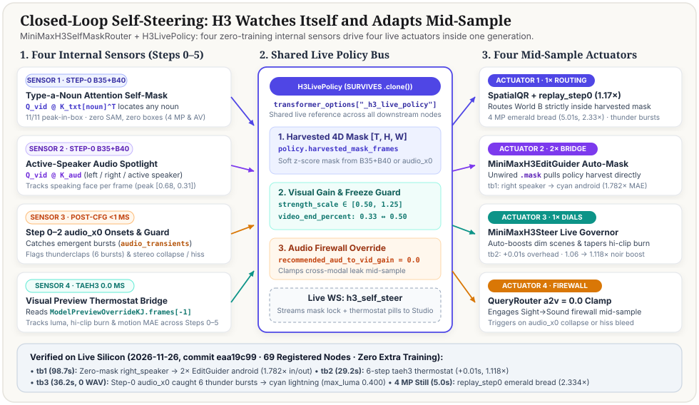
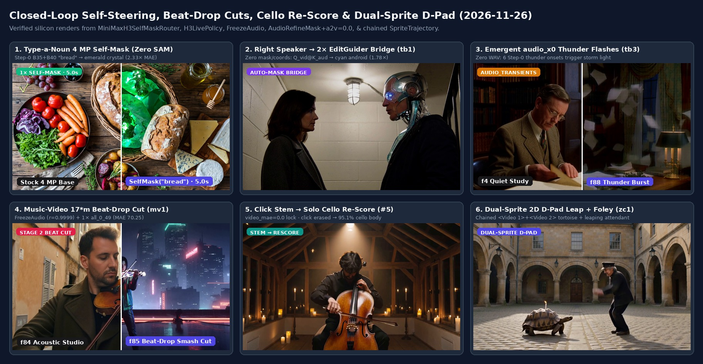

# Closed-Loop Self-Steering (`MiniMaxH3SelfMaskRouter` & `H3LivePolicy`)

Last updated: 2026-11-27.

**Let MiniMax H3 localize nouns, active speakers, and emergent sound bursts from its own Step-0 internal states — and regulate steering strength, reference release, and audio firewalls mid-sample with zero external segmentation models and zero extra training.**

**Quick links:** [Implementation (`steering/live_policy.py`)](../../steering/live_policy.py) · [Offline Gate (`bench/check_live_policy.py`)](../../bench/check_live_policy.py) · [Curated Video Workflow (`tb1` Speaker → Android)](../../workflows/h3_text_to_video_pika_self_mask_speaker_edit_guider_api.json) · [Emergent Audio Transients (`tb3_v2`)](../../workflows/h3_text_to_video_pika_self_mask_audio_transients_api.json) · [Curated 4 MP Image Workflow (`bread` → Emerald Crystal)](../../workflows/image/h3_image_t2i_self_mask_router_api.json) · [Silicon Calibration Gate (`2026-11-26`)](../../bench/results/2026-11-26_h3_4sensor_calibration.md) · [Closed-Loop GPU Slot 3 & Studio 2.0 Report (`2026-11-26`)](../../bench/results/2026-11-26_full_unlock_scout_self_mask_and_thermostat.md) · [Batch A/B Rescues, `MoGe-2` Portal Tear, & Showcase Reel (`2026-11-26`)](../../bench/results/2026-11-26_closed_loop_rescues_portal_tear_and_reel.md)

---

## 1. Visual Proofs (Verified on Live Silicon, `2026-11-26`)

| Silicon Arm | Mode & Sensors | Time | Measured Result | Honest Verdict |
| :--- | :--- | :-: | :--- | :--- |
| **`a1` (`4 MP` `MiniMax-H3-Image`)** | `mask_source="text_phrase"`, `target_phrase="bread"`, `isolation="mid_20_34_shield"`, `replay_step0=True` | `5.01 s` | `2.334×` inside/outside MAE (zero SAM, zero boxes) | Turns only the artisan bread loaf on a crowded wooden table into a glowing emerald crystal geode while keeping vegetables, cheese, and honey photoreal. |
| **`tb1` (`141f` Pika H3 Flex)** | `mask_source="right_speaker"`, `threshold_z=1.45`, `dilation_passes=1`, `region_conditioning=None` → `2× MiniMaxH3EditGuider(scale=1.95, first_step=1, last_step=3, streams="video_only")` | `98.71 s` | `peak=[0.6786, 0.3125]`, `centroid=[0.6311, 0.3221]`, `hard_cov=0.227`, `in/out MAE = 38.50 / 21.61` (**`1.782×`**) | **Breakthrough on `< 9%` faces:** Right speaker's head & neck turn into glowing cyan-cobalt crystal android plates with exact lip-sync while the left woman and stairwell stay photoreal. |
| **`tb2` (`90f` Open-Loop vs Thermostat)** | `SelfMaskRouter(region=None)` → `MiniMaxH3Steer(noir, +1.15)` → `ModelPreviewOverrideKJ(taeh3.safetensors)` | `29.15 s` vs `29.16 s` (`+0.01 s`) | `6/6` `taeh3` steps captured (`mean_luma 0.1894→0.2225`), `dim_understeer_risk` ramped `strength_scale: 1.06 → 1.1181`, `mae_vs_openloop = 9.361` | Zero latency penalty; modulates the live `noir` trajectory and shadow contrast mid-sample without highlight clipping (`hi_clip <= 0.006`). |
| **`tb3` (`90f`, zero `.wav`)** | `mask_source="audio_transients"`, `isolation="all_0_49"` + electric-cyan lightning storm `region_conditioning` | `36.2 s` | `6` emergent Step-0 `audio_x0` bursts (`active_latent_steps = [4, 5, 9, 11, 18, 26]`), `max_luma = 0.3998` at `f38` vs `0.1682` mean | Warm candlelit study erupts into blinding cyan lightning + whipping papers on the emergent thunderclaps and snaps back between flashes *(minor 1-frame strobe on non-`17*m` burst transitions)*. |

---

## 2. How the 4-Sensor Closed Loop Works

### The Four Internal Sensors
1. **Text-to-Video Self-Mask (`text_phrase`, Step-0 `blocks 35 + 40`):** Hooks `optimized_attention_override` during Step 0 only (with `pause_malloc_graph_ctx()`), pools `Q_vid @ K_txt[noun]^T` across `blocks 35` and `40` into a `[T, H, W]` spatial-temporal map (`11/11` `peak_in_box=True`, `3.54×–3.67×` contrast), and applies a soft `z`-score threshold (`threshold_z`, `softness`, optional `dilation_passes`).
2. **Audio-Spatial Speaker Spotlight (`left_speaker` / `right_speaker` / `active_speaker`, Step-0 `blocks 35 + 40`):** Pools `Q_vid @ K_aud` per stereo channel (`L`, `R`, or active energy envelope) so H3 automatically masks whichever face is speaking on every latent step (`peak=[0.6786, 0.3125]` on `tb1`).
3. **Step 0–2 `audio_x0` Transient & Collapse Monitor (`_post_cfg`, `< 1 ms`):** Inspects denoised stereo audio latents inside `set_model_sampler_post_cfg_function`:
   - In `mask_source="audio_transients"`, detects emergent flux peaks (`flux_z >= threshold_z`, `2.2` recommended for thunderclaps) at Step 0 and synthesizes a `[T, H, W]` burst mask for Steps `1..5` with **zero external WAV**.
   - Continuously checks stereo L/R collapse and high-frequency hiss bleed on Steps `0..2`, setting `policy.recommended_aud_to_vid_gain = 0.0` when cross-modal leakage is detected.
4. **`taeh3` Visual Preview Thermostat (`OUTER_SAMPLE` bridge, `0.0 ms` extra decode) & Optional `1.17×` Step-0 Visual Critic (`step0_critic=True` / `H3_LIVE_CRITIC=1`):**
   - Wraps `WrappersMP.OUTER_SAMPLE` (`_preview_bridge_outer`) to read `ModelPreviewOverrideKJ.frames[-1]` synchronously after each step (order-independent and Run-#2+ reset-safe whether KJ is wired upstream or downstream of `MiniMaxH3SelfMaskRouter`), boosting `strength_scale` (`→ 1.12×`) on `dim_understeer_risk` (`tb2`), tapering on highlight-clip burn, governing Step-1 `recommended_video_end_percent` (`0.33 ↔ 0.50`), and engaging Dynamic Step-1 Auto-Shield (`early_0_24 -> *_shield`) on washed-out small masks.
   - When `step0_critic=True` (or `H3_LIVE_CRITIC=1`), decodes the Step-0 midpoint latent frame (`x0 = x - sigma * v`) on CPU via `taeh3.safetensors` / `taeh3_image.safetensors` (`0 MB` local VRAM, works even without `ModelPreviewOverrideKJ`), inspects it via remote `heylook` for borders/seams/watermarks/color-bleed, and **only when a defect is flagged** scrubs the artifact nouns via CPU J-Lens `WordVector(project_out)` and triggers a single `1.17×` Step-0 rollback replay before the sampler advances (`1.00×` when clean; merged with `replay_step0=True` into one replay when both fire).

### Whose Attention This Is

The attention the self-mask reads is the DiT's own, over one sequence of text, video and audio rows. Qwen3-VL runs once before sampling and supplies the starting text rows; its tokenizer is used again only to find which rows spell the target words, which is why the node takes a `clip` wire. [`self_attention.md`](self_attention.md) section 1 has the full account.

### How the `text_phrase` Map Is Made, Step by Step

1. **When.** The first sampler call only, on the unmodified model (the Phase 1 branch of `_wrapper` inside `attach_self_mask_router`). A text-to-video latent is still pure noise then, so the map is the DiT's first guess at a layout and not a reading of a finished picture.
2. **Where.** The blocks named by `GOLDEN_SEMANTIC_BLOCKS` in `steering/live_policy.py`. The record that chose them is [`2026-11-26_h3_4sensor_calibration.md`](../../bench/results/2026-11-26_h3_4sensor_calibration.md).
3. **What is read.** `_make_harvest_attn_override` looks at a block's queries and keys after core has normalized and rotated them, and changes nothing. `_Step0HarvestState.probe_block` takes the queries of the video rows and the keys of the target word rows and computes their scaled dot products. Those are raw attention scores, before the softmax, so they do not show how the word competed with every other row for a patch's attention.
4. **How it is pooled.** One mean over all heads and all target word rows, then a mean over the harvest blocks (`_Step0HarvestState.fused_map`). Several words give one blended map, and nothing in it says which word scored on which patch.
5. **How it becomes a mask.** `synthesize_4d_attention_mask` blurs the map in space and time, scores each patch against the median and spread of its own latent frame, and passes that through a soft cutoff at `threshold_z`. Low values are set to exactly zero.
6. **How it is used.** The mask is held for the rest of the run in `policy.harvested_mask_frames`. Later steps route `region_conditioning` onto the masked rows, or `MiniMaxH3EditGuider` reads the mask (the actuators below). `replay_step0` runs the first step a second time with the routing on.

The speaker modes are the same reading with audio keys in place of text keys: each latent frame's video queries against the audio rows of its own time window (`video_latent_audio_windows`), for one ear or both. No text row and nothing from Qwen is involved.

### What the Map Cannot See

- **It is a score against a few word rows, not a segmentation.** A frame is judged against itself, so on frames where the target scores weakly the highest-scoring patches of that frame can still pass the cutoff.
- **It is fixed at the first step, and the first step is early for a moving subject.** On a figure crossing a wide shot the shipped reading does not follow her; the same words do two steps later, and one head at a later block already does at the first step. `start_percent` moves the harvest step with no code change, at the cost of a weaker edit.
- **In a mask strip the green is the mask, not the attention.**
- **`in_over_out_ratio` in the run reports compares against a separately rendered base clip,** so it mixes the edit with any difference in where the subject stands.

What was tried, what held, and what to build next: [`self_attention.md`](self_attention.md), with every figure in [`2026-11-27_self_mask_harvest_step_and_heads.md`](../../bench/results/2026-11-27_self_mask_harvest_step_and_heads.md).

### The Shared `H3LivePolicy` Bus & Four Actuators
`attach_self_mask_router(...)` attaches the live `H3LivePolicy` instance on **both** `model._h3_live_policy` and `model.model_options["transformer_options"]["_h3_live_policy"]` (preserved across ComfyUI `ModelPatcher.clone()` via `deepcopy_list_dict`) and streams `h3_self_steer` WebSocket events (`self_mask_locked`, `preview_thermostat`, `audio_x0_thermostat`) directly to H3 Studio 2.0:

1. **`1×` `SpatialVisualQRRuntime` + optional `replay_step0` (`steering/live_policy.py`):** When `region_conditioning` is wired and not inside a `2× EditGuider` pass, routes World B directly into `policy.harvested_mask_frames` across Steps `1..5` (or replays Step 0 immediately when `replay_step0=True`, adding `+17%` cost for razor-sharp Step-0 material swaps on `4 MP` stills).
2. **`2×` `MiniMaxH3EditGuider` Auto-Mask Bridge (`edit_guidance.py::_effective_raw_mask`):** When `region_conditioning` is left unwired (`None`) and `EditGuider.mask` is `None`, `EditGuider` skips Phase-2 `SpatialQR` and reads `model_patcher._h3_live_policy.harvested_mask_frames` directly for `v_out = orig + (scale * mask) * (edit - orig)`.
3. **`MiniMaxH3Steer` & `MiniMaxH3ReleaseReferences` Governor (`steering/nodes.py`):** Reads `policy.strength_scale` (clamped `[0.50, 1.25]` on non-hold specs) and `policy.recommended_video_end_percent` (`0.33 ↔ 0.50`) live on each step.
4. **`MiniMaxH3QueryRouter` Firewall Clamp (`steering/query_router.py`):** Reads `policy.recommended_aud_to_vid_gain` (clamped `[0.0, 1.0]`), engaging the Sight-to-Sound Firewall mid-sample even when `attach_query_router` started at `aud_to_vid_gain = 1.0`.

---

## 3. When to Use `1×` vs. `SelfMask → 2× EditGuider` (Calibrated Rules)

- **Large / contiguous objects (`>= ~9–18%` of canvas, e.g., `4 MP` centerpiece, full-body subject, sky, background):** Use **`1× MiniMaxH3SelfMaskRouter`** directly with `region_conditioning` wired (`isolation="mid_20_34_shield"` or `"early_0_24_shield"`). Turn **`replay_step0=True`** on `4 MP` stills and bold material transforms (`1.17×` cost).
- **Small targets (`< ~9%` of canvas, e.g., one actor's face/head in a two-shot):** Leave `region_conditioning` unwired on `MiniMaxH3SelfMaskRouter` (`dilation_passes=1`) and connect `model` into **`2× MiniMaxH3EditGuider`** (`first_step=1, last_step=3, scale=1.8–2.0, streams="video_only"`, `mask` left unwired). This solves the `< 8.5%` token washout of `1×` self-attention while still requiring zero coordinates and zero `SAM 3.1`.
- **Emergent audio-reactive flashes (no WAV required):** Set `mask_source="audio_transients"`, `isolation="all_0_49"`, `audio_zone="base"`, and wire a dramatic lighting/FX prompt to `region_conditioning`.
- **J-Lens block depth note (calibrated `2026-11-26`):** Deep DiT blocks (`B20..B48`) saturate lexical J-Lens projection; keep J-Lens X-Ray anchored on `TokenRefiner` / early `B00..B10`.
- **Requirements:** Use `ModelAttentionBackend("comfy kitchen attention")` with optional `MiniMaxH3Sol`; refuses `MiniMaxH3SageAttention` object-patched forwards and refuses sharing an active step with hook-mode `MiniMaxH3Steer` (`H3SteerRuntime`).

---

## 4. `MiniMaxH3SelfMaskRouter` Controls Reference (`16` Inputs)

| # | Input | Default | Role |
| :-: | :--- | :---: | :--- |
| 1 | **`model`** | *required* | Base H3 / `MiniMax-H3-Image` model (`comfy kitchen attention` + optional `MiniMaxH3Sol`) |
| 2 | **`region_conditioning`** | `None` *(optional)* | World B prompt for `1×` routing; leave unwired when bridging into `2× EditGuider` or running pure thermostat mode |
| 3 | **`mask_source`** | `text_phrase` | `text_phrase` · `active_speaker` · `left_speaker` · `right_speaker` · `audio_transients` · `thermostat_only` |
| 4 | **`target_phrase`** | `""` | Target noun/phrase for `text_phrase` mode (e.g., `"bread"`, `"woman in coat"`) |
| 5 | **`threshold_z`** | `1.35` | Z-score mask cutoff (`1.35` calibrated for spatial masks; `2.2` recommended for `audio_transients` onset bursts) |
| 6 | **`softness`** | `0.25` | Sigmoid feather width around `threshold_z` |
| 7 | **`dilation_passes`** | `0` | Spatial `3×3` patch dilations (`1` recommended for `right_speaker → 2× EditGuider`) |
| 8 | **`isolation`** | `early_0_24_shield` | All `9` `SpatialQueryRouter` isolation modes (`early_0_24_shield`, `mid_20_34_shield`, `all_0_49`, etc.) |
| 9 | **`audio_zone`** | `base` | `base` · `region` · `follow_mask` · `binaural_split` |
| 10 | **`invert`** | `False` | Flips harvested mask before routing (keep `False` on `*_shield`) |
| 11 | **`start_percent` / `end_percent`** | `0.0` / `1.0` | Active denoising step window |
| 13 | **`clip`** *(optional)* | `None` | H3 `Qwen3-VL` encoder wire (needed by `text_phrase` to align token indices) |
| 14 | **`base_prompt`** *(optional)* | `""` | Base prompt text (auto-reads `_h3_tail_text` if omitted on compatible conditioning) |
| 15 | **`replay_step0`** *(optional)* | `False` | Re-runs Step 0 with the freshly harvested mask (`1.17×`, ideal for `4 MP` stills & bold material swaps) |
| 16 | **`step0_critic`** *(optional)* | `False` | Zero-local-VRAM remote `heylook` Step-0 Visual Critic: decodes Step-0 `x0` on CPU via `taeh3`, inspects for borders/seams/watermarks/color-bleed, and ONLY on defect scrubs artifact words via CPU J-Lens and triggers a `1.17×` Step-0 rollback replay (`1.0×` when clean; also activatable via `H3_LIVE_CRITIC=1`) |
