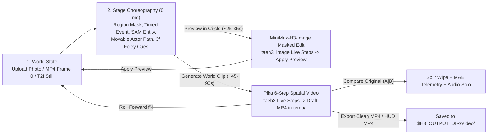

# Interactive Spatial Director: How It Works & Progressive Tutorial

Last updated: 2026-11-17.

Interactive Spatial Director (`director/`) is a standalone local web studio that runs alongside ComfyUI (`:8188`) on `:8195`. It lets you open any still scene (uploaded image, extracted MP4 Frame 0, or a generated 1-frame still), draw spatial masks, timed events, SAM 3.1 subject locks, 2D actor paths, and 3-frame sound cues on a `24 fps` timeline, test ideas on a fast 1-frame image preview, and then render localized MiniMax H3 / Pika H3 Flex video+audio takes with live step-by-step previews and A|B wipe verification.

> **Start & read in one place:** `./director/studio.sh start` -> open Spatial Director at `http://127.0.0.1:8195/` (requires ComfyUI on `:8188`), or click **Guide** in the top header (`http://127.0.0.1:8195/docs`) to read, search, and jump across this tutorial and all repo Markdown guides in one HTML viewer. For the enduring product vision and current-to-future roadmap, see [`director/VISION.md`](../../director/VISION.md) and [`director/ROADMAP.md`](../../director/ROADMAP.md); for architecture details and endpoint contracts, see [`director/AGENTS.md`](../../director/AGENTS.md) and [`edit_guidance.md`](edit_guidance.md).

---

## 1. How It Actually Works (Mental Model)

Spatial Director is split into two distinct layers so dragging shapes stays instant (`0 ms`) while GPU work runs on ComfyUI only when you ask for a preview or render:

### Under the hood: one equation + automatic prompt & graph synthesis

Every time you click **Preview in Circle** or **Generate World Clip**, [`director/server.py`](../../director/server.py) sends your canvas coordinates, masks, cues, and short **Action or Spawn Command** to [`director/compiler.py`](../../director/compiler.py), which builds a **two-branch** ComfyUI graph automatically:

1. **Synthesizes two matched H3 prompts (`original` vs. `edited`)**:
   - You never have to hand-write MiniMax H3's structured sections (`summary:`, `subject_definitions:`, `retention_analysis:`, `detailed_description:`, `overall_soundscape:`, `non_diegetic_music:`).
   - Using `director/compiler.py::synthesize_spatial_prompts` (video) or `director/compiler.py::synthesize_image_edit_prompts` (1-frame still preview), the compiler anchors `<Picture 1>` in `original` (a calm hold of your current World State) and injects your spatial region label, short command, sound cues, and any sprite push/pull reaction into `edited`.
   - You can still inspect or override the base description inside **Scene Context Override (optional)** below the prompt diff box.
2. **Generates an exact `[F, H, W]` mask + optional `3`-frame sound cues**:
   - For video renders, `spatial_director.py::MiniMaxH3SpatialDirector` rasterizes your keyframes across all frames, snapping audio cues to exact `3`-frame (`125 ms`) boundaries for `sound_cues.py::MiniMaxH3SoundCues`.
   - For 1-frame mask previews, [`director/server.py`](../../director/server.py) rasterizes a clean single-frame mask PNG (including SAM `Edit Obj` / `Protect` masks) and compiles a 1-frame `edit_guidance.py::MiniMaxH3EditGuider` graph.
3. **Steers `edit_guidance.py::MiniMaxH3EditGuider` selectively**:
   At each denoising step, H3 evaluates both prompts and blends them per token:

   `prediction = original + (scale * mask) * (edited - original)`

   - Where `mask = 0`: the scene follows **`original`** (holding your `<Picture 1>` World State steady).
   - Where `mask = 1`: the scene moves **`scale`x** toward **`edited`** (default `2.0x` video).
   - On video, **Audio Guard** (`streams`) controls whether `mask` also gates the `40 Hz` audio stream (`independent` keeps audio at `1.0x` edit pull while video scales higher, `video_only` keeps original audio, `both` gates audio to active mask pulses, `audio_only` re-dubs audio only).
4. **Auto-picks the video template (`resolvedWorkflowMode`)**:
   - Anchor loaded, no movable actor cutout -> **`i2v_portal`** (pins Frame 0 via `conditioning.py::MiniMaxH3Conditioning`, plus optional `last_frame` destination).
   - Movable actor cutout attached (`Movable` SAM role or `Stamp`) -> **`r2v_portal`** (binds `<Picture 1>` background + `sprite_trajectory.py::MiniMaxH3AppendSpriteTrajectory` `<Video 1>`, released cleanly at `video_end_percent = 0.33` by `control_vector_nodes.py::MiniMaxH3ReleaseReferences` so synthetic movement locks blocking early without making frames 0..89 look stiff).
   - No anchor loaded -> **`t2v_portal`** (text-to-video spatial portal).
   - You can override automatic selection anytime in **`Engine -> Scene -> Video Workflow Template`** (including `world_targets`).
5. **Streams live `taeh3` / `taeh3_image` step previews & recovers from page refreshes**:
   - [`director/compiler.py`](../../director/compiler.py) attaches KJNodes `ModelPreviewOverrideKJ` (`"165"`) when ComfyUI exposes it: `taeh3_image.safetensors` (`1` frame, multi-exit `max_resolution = 672`) for stills, and `taeh3.safetensors` via `director/compiler.py::video_preview_schedule` (up to `27` frames at `1.0x` real-time `preview_fps`) for video.
   - Your browser tab persists a `sessionStorage` `clientId` (`h3_director_client_id`), and `GET /api/takes` checks ComfyUI's live `/queue`, so refreshing the browser mid-render restores the progress bar (`Step N/6 · pace · Δ`), **Cancel** button, and incoming previews.

---

## 2. What It Can Do vs. What It Cannot Do

Understanding where Spatial Director shines—and where H3's physics/VAE architecture sets hard boundaries—saves hours of trial and error.

### What It Can Do

| Capability | How Spatial Director Does It |
|---|---|
| **Start from anything** | Drag/drop any PNG/JPG, drop an MP4 (extracts **Frame 0** as anchor and registers the clip in `Takes`), or generate a fresh `4 MP` anchor still (`MiniMax-H3-Image`, `Pika H3 Image`, or `P-H3-Image`). |
| **Test edits inside a region before rendering video** | **Preview in Circle** (`director/compiler.py::compile_masked_still_edit`) runs a localized 1-frame masked edit in `~25-35s`, blends cleanly inside your feathered shape or SAM object mask, and can be promoted directly into Frame 0 via **`Apply Preview ↪`**. |
| **Direct continuous, timed, or combined world events** | **Region** interpolates shape position/size/feather/halo across frames; **Timed Event** places fading `(x, y, t)` spans (`ramp` + `radius`); **Combined** unions both so a portal and timed bursts run together. |
| **Isolate or shield real scene objects (SAM 3.1)** | **Target Entity** runs `director/compiler.py::compile_sam3_segment` (`SAM 3.1` on GPU when loaded, GrabCut fallback offline): **`Movable`** lifts an RGBA sprite, **`Edit Obj`** isolates edits to that silhouette (**`Snap Edit to Entity`**), and **`Protect`** creates an `exclude_mask` keep-out. |
| **Move an actor + link portal push/pull** | Place destination arrows (**`Set Path →`**), steer frame-by-frame with **`WASD`** (`Actor Motion`), drop parabolic **`+ Hop`** arcs, and **`Shift+Drag`** from portal to actor (or click **`Couple`**) for push/pull impulse + prompt reaction. |
| **Snap frame-accurate foley & audition locally** | Keys **`1`-`9`** audition WebAudio foley locally (`0 ms`) and drop `3`-frame (`125 ms`) presets (`MiniMaxH3SoundCues`) synced to ComfyUI's `40 Hz` audio clock. |
| **Prove localization with A\|B split + audio solo** | Enable **Queue Same-Seed Baseline** in `Engine -> Scene` (or compare any same-seed take) to scrub a synchronized vertical wipe showing **`In-Mask MAE`**, **`Out-Mask MAE`**, and **`Focus`** ratio (`in / out`), solo A vs. B audio, and switch between Clean (`"162"`) and HUD (`"13"`) streams. |
| **Build multi-shot scenes & re-dub audio cleanly** | Pause any clip and click **`Roll Forward fN ↪`** to make that frame Shot N+1's anchor, click **`Pin → Last`** in `Takes` to bridge into a target ending frame, or click **`Re-Dub Audio`** (`Polish 0.5x` base H3 or `Fresh 1.0x` Pika) while `frozen_video_cache.py::MiniMaxH3FrozenVideoCache` keeps 100% of video pixels locked. |

### What It Cannot Do (Hard Boundaries & Where to Go Instead)

1. **It is NOT live-action video inpainting / frame-by-frame V2V replacement.**
   - Dropping an MP4 onto the empty card extracts **Frame 0** as an image anchor (`i2v_portal`)—H3 generates frames `1..N-1` fresh from Frame 0 rather than preserving the original camera panning or actors in frames `1..N-1` of your uploaded MP4. (The uploaded MP4 is still playable in `Takes` for **`Re-Dub Audio`** or **`Pin → Last`**.)
   - *Where to go instead:* If you need an actor tracked and replaced across an existing multi-shot video while restoring original plate pixels around them, use the **Masked V2V** node pipeline (`video_mask.py::MiniMaxH3MaskedSource` + `plate_restore.py::MiniMaxH3RestorePlate`) documented in [`docs/wiki/masked_v2v.md`](masked_v2v.md).
2. **It is NOT real-time (`60 fps`) generation, and switching image vs. video models swaps VRAM weights.**
   - UI dragging is `0 ms`, Step 1 live `taeh3` / `taeh3_image` previews arrive in `~5s` (still) or `~12-17s` (video), and full renders take `~25-35s` (still) or `~45-90s` (`90f-141f` video on RTX 4090).
   - On a single `24 GB` card, **Preview in Circle**'s default `MiniMax-H3-Image` UNET swaps weights against the Pika Video UNET (`~15 GB` weight streaming). For zero model-swap wait while iterating rapidly with video renders, open **`Engine -> Scene -> Mask Image Preview Model`** and switch to **`Pika H3 1-Frame Edit (6-step)`**.
3. **Masks have finite DiT patch granularity (`32×32` px × `[1, 4, 4, 4, 4]` causal frames) and global self-attention.**
   - Pixel masks pool onto H3's `32×32` px spatial grid and causal temporal steps (`1` standalone frame at `0, 17, 34...` and `4` frames per step in between). Toggle the **`32px`** scrubber button to see the exact token grid on canvas.
   - `mask = 0` holds *velocity guidance* to `original`, not an alpha composite cutout—so dramatic lighting, fog, or explosions spawned inside `mask = 1` still cast ambient glow/reflections onto nearby objects through DiT self-attention. Add **`Protect`** (`exclude_mask`) around sensitive foreground objects or verify `Out-Mask MAE` with **`Compare Original (A|B)`**.
4. **All regions/events in one render share ONE `edited` prompt.**
   - Placing two **Timed Event** pins (`E1`, `E2`) unions their masks into a single `[F, H, W]` mask tensor driven by one `Action or Spawn Command`. You cannot assign text prompt X to Pin 1 and completely different text prompt Y to Pin 2 in the same render pass. For two unrelated events at different moments, render Beat 1 first and use **`Roll Forward fN ↪`** for Beat 2.
5. **Only ONE movable 2D `<Video 1>` actor cutout is supported (no multi-actor 3D skeletal rigging).**
   - `Movable` / `Stamp` drives one RGBA sprite trajectory (`sprite_trajectory.py::MiniMaxH3AppendSpriteTrajectory`). Complex multi-person pose control uses `SAM 3D Body` in the ComfyUI node graph.
6. **Valid clip durations and cue timings are fixed to H3's clocks.**
   - Clip lengths must lie on `h3_rules.py::on_both_clocks` (`39, 90, 141, 192, 243, 294, 345` frames at `24 fps`), sound cues snap to `3`-frame (`125 ms`) steps, and sequence length must stay under `99,864` packed tokens (shown live under **`Engine -> System -> Packed Tokens`**).
7. **Draft takes live in ComfyUI `temp/` until explicitly exported.**
   - Switching clips or running **`Forget Temp`** deletes unexported `temp/` renders. Always click **`Export Clean MP4`** or **`Export HUD MP4`** (in **`Compare Original (A|B)`** or **`Engine -> Takes`**) to write permanent files to `$H3_OUTPUT_DIR/Video/`.

---

## 3. UI & Controls Cheat Sheet

### Screen Layout (4 Zones)

| Zone | Key Controls |
|---|---|
| **Top Header** | Scene resolution badge, **Dual-Clock Frame Length pills** (`39..345`), **`Live Preview`** badge (live step + `fps` + `Δ` norm), **Undo/Redo**, **`Engine`** drawer toggle, **`Generate World Clip`** primary CTA. |
| **Stage & Toolbar** | Top-left mode switcher (**`Region`**, **`Timed Event`**, **`Combined`**, **`Actor Motion`**), centered **`#render-status-overlay`** progress pill + **`Cancel`**, top-right **`Live Latents`**, **`Shot N`** history bridge, and **`Masked Preview` / `Full-Frame TAE`** toggle. On the right/left of your mask floats the **World Spawner card** (`#portal-card`). |
| **Scrubber Dock** | Play/Pause, Loop, **`32px`** token grid toggle, **`Audio: Indep / VideoOnly / Gated`** guard, **`Sound: On / Muted`**, **`Roll Forward / Apply Preview ↪`**, clickable **Event Chips** (`E1`, `Actor`, `3f`), 24 fps scrubber track, and **`Advanced ▴`** (3-lane causal/3f keyframe sequencer). |
| **Engine Drawer (`4` tabs)** | **Scene** (Video template, Preview model, Canvas size, Frame length + `Promote Seed`, Seed Lock, `Queue Same-Seed Baseline`), **Steering** (Portal shape, `streams`, `scale`, `audio_scale`, `first_step`, `feather`, `Invert Spatial Mask`, `Same-Prompt Vector Split-World`, `2nd-Pass Audio Refine`, `Control Vector`, `Drop 3f Foley Cue`, `Sprite Cutout Stamp`), **Takes** (Re-Dub recipe `Polish 0.5x` / `Fresh 1.0x`, Load Stage, Open A\|B, Export Clean, Tail → Shot, Pin → Last), **System** (`GPU VRAM`, `99,864` token meter, Capabilities badges, `Verify Compile`, `Interrupt`, `Forget Temp`). |

### Mouse Gestures & Keyboard Shortcuts

| Gesture / Key | What It Does |
|---|---|
| **Click / Drag on stage** | Moves active `Region` portal (`portal_path`) or `Timed Event` (`point_targets`); drag edge handle to resize (`target_radius` / `portal_resize`). |
| **Scroll Wheel** | Adjusts active **mask radius**. |
| **`Shift` + Scroll** | Adjusts soft **outer halo** (`halo_radius`). |
| **`Alt` + Scroll** | Adjusts **EditGuider Power `scale`** (`0.5x - 2.5x`). |
| **`Shift` + Drag** *(Portal / Combined)* | Links Cross-Entity **Coupling** (`Push` / `Pull`) from Portal toward the Movable Actor. |
| **`Shift` + Click** *(Timed Event)* | Drops a new timed eruption pin at the current frame. |
| **`Ctrl/Cmd` + Click** *(Combined)* | Adds a new timed eruption pin alongside the main Region portal. |
| **Click / `Alt` + Click** *(with `Target Entity` active)* | Positive (`+`) or negative (`-`) SAM 3.1 point prompt; press **`Esc`** to exit picking. |
| **Keys `1` – `9`** | Auditions and drops a `3`-frame foley preset snapped onto the nearest `3f` frame. |
| **`Space`** | Play / Pause loop — or triggers an actor **`+ Hop`** while playing in **`Actor Motion`** mode. |
| **`WASD`** *(in **`Actor Motion`** mode)* | Steers actor cutout position and facing left/right (`Shift` holds facing). |
| **`[` / `]`** or **`←` / `→`** | Steps timeline `1` frame (`Shift` jumps `3` frames). |
| **`↑` / `↓`** | Nudges `EditGuider scale` by `±0.1`. |
| **`L`** / **`M`** / **`Del`** / **`Ctrl+Z`** | **`L`** toggles **`Advanced ▴`** sequencer; **`M`** mutes audio; **`Del`** removes selected lane item; **`Ctrl+Z` / `Ctrl+Y`** undoes/redoes choreography. |

---

## 4. Progressive 6-Level Tutorial

Work through Levels 1 to 6 in order using the same scene—each level unlocks one new layer of control without throwing away what you already built.

### Level 1: Open a World State & Test an Idea with `Preview in Circle` (`~30s`)

**Goal:** Anchor a starting image, aim a circular edit zone, and preview an edit on 1 frame before paying for video.

1. On the opening **Open a World State** card, either:
   - Drop any photo onto **Upload or Drop Image / MP4**, or
   - Type a short scene description (for example, `"a weathered stone courtyard under overcast dusk light"`) and click **Generate Still Scene** (defaults to `MiniMax-H3-Image`).
2. Once the image fills the stage, **click** anywhere on the background where you want something to appear, then **Scroll** to size the blue dashed circle (`Inner Mask`) and **Shift+Scroll** if you want a softer outer blend (`Outer Halo`).
3. In the floating **World Spawner** card (`Action or Spawn Command`), type a short phrase (or click a quick chip): for example, `"a warm glowing brass lantern resting on the wet cobblestones"`.
   - Look at the **Anchored Prompt Conditioning** box right below it: notice Spatial Director automatically prepares `- Anchored <Picture 1> calm hold (auto)` vs. `+ ...` at zero latency.
4. Click **`Preview in Circle`**.
   - Watch the top status pill stream steps `1/6` -> `6/6` via `taeh3_image.safetensors`. By **Step 1–2**, you can already judge placement and either hit **Cancel** or wait for the finished crisp 4 MP edit composited right inside your circle.
5. Want to make that preview part of your permanent Frame-0 scene? Click **`Apply Preview ↪`** on the bottom scrubber bar (or **`Clear`** inside the card to keep experimenting).

---

### Level 2: Render Your First Spatial Video Clip & Verify Localization (`A|B`)

**Goal:** Turn your still World State + spatial circle into a synchronized `24 fps` video+audio clip, and prove the background outside the circle stayed anchored.

1. Keep your anchor image loaded. Pick **`90`** (`3.75s`) in the top-left header clock pills for fast scouting.
2. *(Optional for A\|B verification)* Click **`Engine`** (top right) -> **Scene** tab -> check **`Queue Same-Seed Baseline (scale=0.0 A|B)`**, then close the drawer. This renders an unedited `scale=0.0` twin on the exact same seed so you can measure localization afterward.
3. Update `Action or Spawn Command` to something with motion and sound—for example: `"a shimmering azure energy portal swirls open in midair, sending pale mist across the stones"`.
4. Confirm **`Video Workflow Template`** shows **`i2v_portal`** (`Frame-0 I2V` badge in the card) and dial **Alt+Scroll** to **`2.0x`**.
5. Click **`Generate World Clip`**.
   - The top status bar streams `taeh3.safetensors` animated video previews across steps `1/6..6/6` (use **`Masked Preview`** vs **`Full-Frame TAE`** in the top-right to inspect either the cropped region or full canvas, and **Cancel** right after Step 1–2 if a seed misses).
6. When playback starts looping on stage, click **`Compare Original (A|B)`** (bottom right footer):
   - Drag the cyan split divider across the stage to compare `A: Baseline` vs. `B: Directed`.
   - Check the telemetry bar (`In-Mask MAE`, `Out-Mask MAE`, and `Focus ratio` > `1.0x`), click **`Audio: B (Directed)`** to solo `A` vs `B`, and click **`B: Clean (Node 162)`** to toggle the debug HUD (`"13"`) off/on.
7. Like the take? Click **`Export Clean MP4`** to save it permanently into `$H3_OUTPUT_DIR/Video/` (remember `temp/` drafts are temporary).

---

### Level 3: Choreograph Time, Moving Portals, & 3-Frame Foley (`Timed Event`, `Combined`, `L`)

**Goal:** Stop editing every frame equally—make events erupt at exact beats, move a Region across the frame, and lock sound effects to the `40 Hz` clock.

1. Switch the top-left stage mode to **`Timed Event`** (`point_targets`), or **`Combined`** (`combined`) if you want both a main Region and timed bursts together.
2. Scrub the bottom bar (or press **`[`** / **`]`**) to frame **`f24`** (`1.00s`), then **click** on stage to drop **`TARGET 1`**. Press **`Shift+Click`** at **`f54`** (`2.25s`) to drop a second timed burst **`TARGET 2`**. Notice the clickable **`E1 f24..60`** and **`E2 f54..78`** chips on the scrubber bar!
3. Press keys **`1`–`9`** (or pick from the **`3f Cue`** dropdown in the card) while parked at `f24` to audition foley presets locally and snap a `3`-frame (`125 ms`) sound cue onto that frame (`MiniMaxH3SoundCues`).
4. Cycle the scrubber's **`Audio Guard`** button depending on your edit:
   - **`Audio: Indep`** *(default for Region/Combined)*: steers audio at `1.0x` so sound doesn't clip when video `scale = 2.0x`.
   - **`Audio: VideoOnly`** *(default for Timed Event without cues)*: locks original room tone (`a_scale = 0.0`) so visual bursts don't distort ambience.
   - **`Audio: Gated`** (`streams = "both"`): gates audio directly to the mask's per-frame temporal envelope—great for making a portal roar louder right as its circle opens.
5. Press **`L`** (or click **`Advanced ▴`**) to open the **3-Lane Keyframe Sequencer**:
   - Inspect the `17n+5` / `4f` causal boundary ticks at the top of the lanes.
   - Drag a Target bar's left/right edge to time its eruption and decay (`ramp`), click **`+ KF`** at `f0` and `f60` and drag the Region across the stage to animate a moving portal path, or click **`ry: Linked` -> `ry: Unlinked`** to stretch an ellipse.

---

### Level 4: Snap Edits to Real Scene Objects & Protect Foreground Subjects (`SAM 3.1`)

**Goal:** Instead of painting inside a rough circle, trace real objects on stage so edits stay strictly inside an object silhouette—or shield bystanders completely.

1. Switch back to **`Region`** (or stay in **`Combined`**). In the floating **World Spawner** card, look at the **Target Entity / Pick Subject** row (`Movable` | `Edit Obj` | `Protect`).
2. **Isolate an edit to one object (`Edit Obj`)**:
   - Click **`Edit Obj`**, click **`Pick Subject`** (or **`Target Entity`**), and **click** directly on a real object in your scene (a windowpane, jacket, barrel, or sign).
   - If SAM 3.1 grabs slightly too much, **`Alt+Click`** on the spillover to refine with negative points (or type `"glass window"` in the SAM bar and hit **Segment**).
   - Check **`Snap Edit to Entity`**.
   - Test it immediately with **`Preview in Circle`**—notice `MiniMax-H3-Image` edits *strictly inside that segmented object silhouette* instead of a round circle!
3. **Shield another object from change (`Protect`)**:
   - Click **`Protect`**, click **`Pick Subject`**, and click a foreground person, prop, or sign next to your edit zone.
   - Spatial Director wires `exclude_mask` into `spatial_director.py::MiniMaxH3SpatialDirector`, keeping that protected silhouette untouched (`m = 0`) even when your portal halo sweeps right beside it.

---

### Level 5: Lift or Spawn a Movable Actor, Set Paths, & Link Portal Push/Pull

**Goal:** Bring an independent movable actor into the shot (`r2v_portal` `<Video 1>` + `Release 0.33`), steer its path, and couple it to your portal.

1. **Create your RGBA actor cutout** (pick either method):
   - **Lift from scene:** Select **`Movable`** + **`Pick Subject`** and click a subject in your anchor image to extract an RGBA cutout.
   - **Spawn a brand-new actor:** Open **`Engine -> Steering -> Sprite Cutout Stamp`**, type e.g. `"small clockwork brass owl"`, and click **`Cutout`** (or click **`+ Stamp`** in the footer / **`Stamp`** in the card once text is entered; leave that box blank to extract an RGBA cutout directly from the current anchor). Wait for the `MiniMax-H3-Image` cutout to render (isolated RGBA PNG).
2. Check the card badge: Spatial Director automatically switches from **`i2v_portal`** (`Frame-0 I2V`) to **`r2v_portal`** (`Actor R2V · Release 0.33`).
3. **Choreograph the actor's movement**:
   - Click **`Set Path →`** inside the card and click a destination spot on stage (draws a dotted destination path arrow + **`DEST @ fN`** pill), **OR**
   - Click **`Actor Motion`** in the top-left toolbar and use **`WASD`** (scrub to different frames and nudge position; press **`Space`** while playing or click **`+ Hop`** to insert parabolic jump arcs).
4. **Add Push / Pull Coupling**:
   - Hold **`Shift` and drag** from the Portal center onto your Actor (or click **`Couple`** in the operator tabs inside the card to toggle `Push` vs. `Pull`).
   - Spatial Director automatically offsets post-contact waypoints away from (`Push`) or toward (`Pull`) the portal, widens `feather` to match `halo_radius`, and injects a reaction clause into `edited`.
5. Click **`Generate World Clip`**! Because `video_end_percent = 0.33` releases the synthetic sprite box after step `1` (`2` of `6` steps), H3 keeps your actor's blocking and path while animating natural limbs, cloth, and ground shadows on steps `2..5`.

---

### Level 6: Build Multi-Shot Stories, Scale Up, & Re-Dub Audio (`Roll Forward`, `Pin → Last`, `Re-Dub Audio`)

**Goal:** Chain clips into longer sequences, bridge to a specific ending frame, scale winning scouts to longer durations, and polish/replace audio without re-rendering video.

1. **Continue to Shot 2 (`Roll Forward fN ↪`)**:
   - Play your finished `90f` clip, pause on the frame where you want Shot 2 to begin (typically the tail frame), and click **`Roll Forward fN ↪`** on the scrubber bar (or **`Tail → Shot`** in **`Engine -> Takes`**).
   - That lossless extracted frame becomes Shot 2's anchor (`i2v_portal`), and **`Shot 2 · ↩ Shot 1`** appears in the top-right toolbar so you can jump back to Shot 1 anytime.
2. **Bridge cleanly into an ending frame (`Pin → Last`)**:
   - In **`Engine -> Takes`**, click **`Pin → Last`** on another frame/take if you want Shot 2 (`i2v_portal`) to land on a specific destination `last_frame` (`node 16`).
3. **Scale a winning `90f` seed up to `141f`–`345f` (`Promote Seed`)**:
   - Found a great seed at `90f`? Open **`Engine -> Scene`** and click **`Promote Seed`**. Spatial Director locks your seed and runs `/api/escalate` to proportionally remap every portal keyframe, target span, hop arc, and `3f`-snapped cue onto the next `on_both_clocks` length (`141f -> 192f -> 243f ...`).
4. **Fix or reinvent the soundtrack without touching a single pixel (`Re-Dub Audio`)**:
   - Open **`Engine -> Takes`** (this also works on any MP4 you dropped onto the landing card!).
   - Choose **`Re-Dub: Polish (0.5x Base)`** (keeps your existing soundscape structure and cleans artifacts using undistilled H3 at `denoise = 0.5`) or **`Re-Dub: Fresh (1.0x Pika)`** (synthesizes a brand-new `40 Hz` soundtrack from scratch using Pika `ManualSigmas`).
   - Optionally enter a new foley/music line in `Optional foley prompt override`, then click **`Re-Dub Audio`** on the take card.
   - *(Tip: You can also check **`2nd-Pass Audio Refine (FrozenVideoCache)`** under **`Engine -> Steering`** before rendering to run a second frozen-video audio pass automatically after sampling.)*

---

## 5. Quick Troubleshooting

| What You Notice | Why It Happens | What To Do |
|---|---|---|
| **Switching from `Preview in Circle` to `Generate World Clip` pauses ~10–15s at step 0** | `MiniMax-H3-Image` and Pika Video use separate `~15 GB` UNETs on a `24 GB` card. | Under **`Engine -> Scene -> Mask Image Preview Model`**, pick **`Pika H3 1-Frame Edit (6-step)`** during rapid video iteration to share the loaded video UNET with zero weight swap. |
| **Dropped an MP4, and frames 1..N changed instead of staying locked** | Dropping an MP4 extracts **Frame 0** as an `i2v_portal` starting anchor; Spatial Director is generative I2V/R2V, not frame-accurate plate compositing. | Use `Takes` -> **`Re-Dub Audio`** if you only want new audio on that MP4, or use [`docs/wiki/masked_v2v.md`](masked_v2v.md) for tracked live-action video replacement. |
| **Audio clips / distorts when visual `scale` is `>= 1.8x`, or SFX feels muted** | `streams = "both"` multiplies audio edit difference by visual `scale` (`2.0x+`), whereas `video_only` locks audio to calm original room tone. | Keep **`Audio: Indep`** (`streams = "independent"`, `audio_scale = 1.0`) for loud visual edits, or raise **`Audio Scale`** to `1.4-1.8` in `Engine -> Steering` for off-screen SFX. |
| **A dramatic explosion inside the circle slightly brightens the wall outside it** | H3 attends globally across tokens; `mask = 0` holds velocity guidance to `original` rather than cutting out pixels like Photoshop. | Add a SAM **`Protect`** (`exclude`) mask onto key subjects, lower **`Power Scale`** (`1.5x-1.8x`), or check `Out-Mask MAE` in **`Compare Original (A\|B)`**. |
| **Cutout actor looks pasted or static if `video_end_percent` is raised manually** | `r2v_portal` uses `MiniMaxH3ReleaseReferences` (`video_end_percent = 0.33`) specifically so H3 drops the synthetic sprite past step 1 and animates natural motion. | Keep default `0.33` release policy and put short kinetic verbs in `Action or Spawn Command`. |
| **A finished draft disappeared after clicking `Forget Temp` or restarting** | Draft takes are saved in ComfyUI `temp/` (`save_output: false`) until exported. | Click **`Export Clean MP4`** or **`Export HUD MP4`** to write approved clips permanently into `$H3_OUTPUT_DIR/Video/`. |
