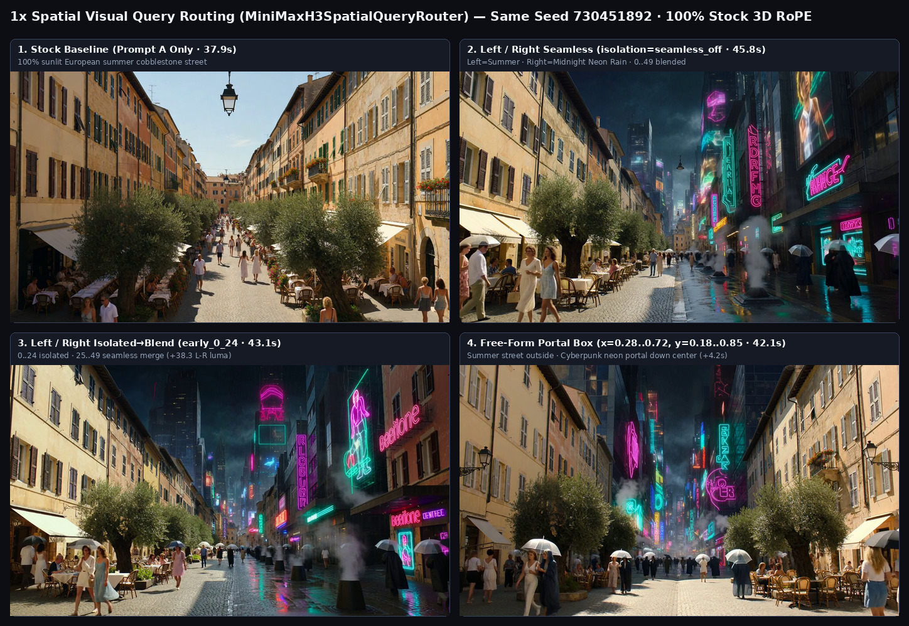
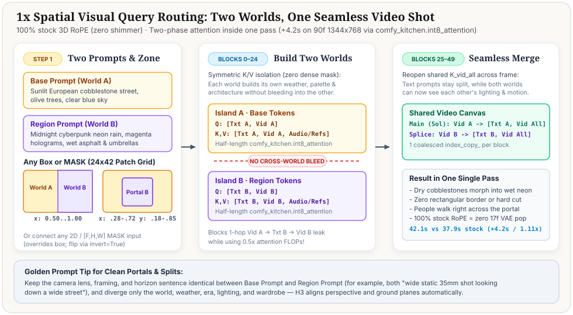

# Spatial Visual Query Routing (`1x` Split-Screen & Portal Worlds)

**Put two completely different worlds inside one seamless MiniMax H3 video shot — in a single render pass (`+4 s`, `1.1×` speed), with zero cut lines, zero paste-in edges, and zero flicker.**

Want the left half of a street to be a **golden sunlit summer afternoon in Italy** while the right half is a **pouring midnight cyberpunk neon alley** — or want a **floating cyberpunk portal right down the center** of a sunny cobblestone street where people with glowing umbrellas walk straight out into daylight? [`MiniMaxH3SpatialQueryRouter`](../../steering/spatial_query_router.py) routes two prompts to different parts of the frame inside **one** pass, while keeping MiniMax H3's 3D RoPE 100% stock.

**Quick links:** [Standalone ComfyUI Workflow (`h3_text_to_video_pika_spatial_query_router_api.json`)](../../workflows/h3_text_to_video_pika_spatial_query_router_api.json) · [Camera ↔ Mic Query Routing](query_routing.md) · [Verified Benchmarks (`2026-11-25`)](../../bench/results/2026-11-25_spatial_query_router.md) · [2× Moving Portals & Existing-Take Edits](spatial_director_guide.md)

---

## 1. The "So What?" (Why Regular Users Care)

Normally, if you try to describe two opposite worlds in one plain video prompt (*"sunny summer left, dark rainy cyberpunk right"*), diffusion models average the lighting together into muddy overcast twilight — or if you composite two videos in post, you get a harsh cut line where shadows, reflections, and walking people break at the seam.

`MiniMaxH3SpatialQueryRouter` solves both problems in **one normal generation**:
- **True opposite lighting in one shot:** Bright sunlit warm limestone on one side (`96.0` luma) right next to pitch-black neon midnight rain (`57.8` luma) on the other — zero muddy averaging.
- **Organic seam merging:** Dry sunlit cobblestones literally turn wet and catch hot-pink neon reflections as they cross the center, and pedestrians walk cleanly across the portal boundary.
- **Works on any box or mask:** Left/Right split, Top/Bottom sky split, floating center portal box, or any arbitrary 2D / `[F, H, W]` ComfyUI `MASK` (including `SAM 3.1` subject masks!).
- **Fast & razor-sharp:** Uses `comfy_kitchen.int8_attention` and leaves H3's 3D RoPE 100% untouched — **`42.1 s` vs. `37.9 s` stock baseline** (`+4.2 s` on `90f 1344×768`), with zero `17`-frame causal VAE shimmer (`f16→17` pop `1.94–3.33` matching baseline `1.71–2.69`).

---

## 2. How It Works (Progressively, Visually)

MiniMax H3 generates a video across **50 Transformer blocks** (`blocks 0..49`), where early blocks decide global layout, weather, and lighting, and late blocks refine textures, reflections, and local continuity.

1. **Step 1 — Pick Two Prompts & a Region:**
   - **Base Prompt (World A)** feeds everything *outside* the region (e.g., sunlit summer street).
   - **Region Prompt (World B)** (`region_conditioning`, any token length!) feeds everything *inside* the region — defined either by a simple normalized rectangle (`x_start..x_end`, `y_start..y_end`) or any optional `MASK`.
2. **Step 2 — Early Blocks `0..24` ("Build Two Separate Worlds"):**
   - Video tokens are split into two disjoint index lists (**Base** and **Region**) with **zero dense `attn_mask`**.
   - **Base** attends only to `[Text A, Video Base, Audio/Refs]`; **Region** attends only to `[Text B, Video Region, Audio/Refs]`.
   - Because each island uses half-length K/V on `comfy_kitchen.int8_attention`, early blocks actually take *half* the attention FLOPs while blocking 1-hop cross-world text bleed (`Video A → Text B → Video B`).
3. **Step 3 — Late Blocks `25..49` ("Open the Door & Blend the Seam"):**
   - Both prompts stay split (`Text A` vs. `Text B`), **but** both sides now attend over the **entire** shared video canvas (`K_vid_all`).
   - H3 naturally unifies perspective, ground reflections, cast shadows, and moving figures right across the border — zero hard seam!

---

## 3. Practical Recipes (Copy-Paste Settings)

Load the shipped standalone workflow **[`workflows/h3_text_to_video_pika_spatial_query_router_api.json`](../../workflows/h3_text_to_video_pika_spatial_query_router_api.json)** (Pika H3 Flex 6-step, `1344×768`, `141f`). Node `5` is **Base Prompt (World A)**, Node `148` is **Region Prompt (World B)**, and Node `149` is **`MiniMaxH3SpatialQueryRouter`**.

### The Golden Rule for Seamless Blends
> **Match your camera, framing, and horizon sentence between Prompt A and Prompt B.**
> Put the exact same shot setup in both prompts (e.g., *"Live-action, crisp 35mm wide static locked-off tripod shot looking straight down a wide street..."*) and diverge **only** the world, weather, era, lighting, materials, and wardrobe. Matching camera geometry lets H3 align walls, horizons, and ground planes naturally across any split or portal!

### Recipe 1 — Left / Right Split-Screen (Two Worlds, One Street) *(Workflow Default)*
- **Use for:** Summer vs. Winter, Ancient Rome vs. Cyberpunk, Bright Day vs. Noir Night down the center of one street or room.
- **Settings on `MiniMaxH3SpatialQueryRouter`:**
  - `x_start = 0.50`, `x_end = 1.00`, `y_start = 0.00`, `y_end = 1.00`
  - `invert = False` *(flip to `True` to swap Left ↔ Right instantly!)*
  - `isolation = "early_0_24"` *(best contrast + seamless ground merge; try `"seamless_off"` for an even softer atmospheric fade)*
  - `audio_zone = "base"` *(summer birds/footsteps; switch to `"region"` for heavy neon rain!)*

### Recipe 2 — Floating Dimension Portal Box
- **Use for:** A sci-fi / fantasy rift opening down the middle of a normal room, corridor, or street while both foreground edges stay grounded in the real world.
- **Settings on `MiniMaxH3SpatialQueryRouter`:**
  - `x_start = 0.28`, `x_end = 0.72`, `y_start = 0.18`, `y_end = 0.85`
  - `invert = False`, `isolation = "early_0_24"`, `audio_zone = "base"`
- **Verified result (`spatial_box_portal_iso_0_24`):** Sunlit limestone street & sidewalk tables on both outer sides while the center opens into towering neon towers with umbrella pedestrians emerging into daylight (`42.1 s`, zero border artifact).

### Recipe 3 — Sky / Ground Horizon Split
- **Use for:** Replacing just the sky with a glowing alien nebula, aurora borealis, or storm cloud deck while keeping the foreground desert/ocean bright and untouched.
- **Settings on `MiniMaxH3SpatialQueryRouter`:**
  - `x_start = 0.00`, `x_end = 1.00`, `y_start = 0.00`, `y_end = 0.45`
  - `isolation = "early_0_24"` *(or `"early_0_16"` for softer horizon lighting bleed onto the ground)*

### Recipe 4 — Custom Shape, Feathered `[0..1]` Mask, Animated Wipe (`SpatialDirector`), or `SAM 3.1` Subject Mask
- **Use for:** Non-rectangular portals (circles, arches, doorway outlines), feathered reality halos, animated `[F, H, W]` moving wipes/expanding portals from `MiniMaxH3SpatialDirector.mask`, or routing a completely different prompt strictly inside a tracked `SAM 3.1` subject/background mask.
- **Settings:** Connect any ComfyUI `MASK` (`[H, W]` static or `[F, H, W]` video mask matching the render frame count `F`) to `MiniMaxH3SpatialQueryRouter.mask`. When connected, `mask` overrides `(x_start..y_end)` and downsamples onto H3's `32×32` causal patch grid (hard-isolating at `>= 0.5` on `early_0_24` blocks and blending smoothly with continuous `[0..1]` weights on blocks `25..49`, respecting `invert`).

### Recipe 5 — Swap or Split the Soundtrack (`region` / `binaural_split`)
- Set **`audio_zone = "region"`** so stereo audio queries attend to **Region Prompt (World B)** instead of Base Prompt (World A) at zero extra text-encoding cost (e.g., hear midnight cyberpunk pouring rain while looking at the half-sunny / half-neon street!).
- Set **`audio_zone = "binaural_split"`** for a **`1×` 3D Binaural Split-World**: blocks `0..29` keep both ears shared for phase-locked lip-sync, and blocks `30..49` split Left/Right ears to match Left/Right visual worlds (e.g. sunny cafe on Left ear, midnight neon thunderstorm on Right ear; symmetric boxes tie to `L = base`, `R = region`).

---

## 4. Which Tool Should I Use? (`1×` Spatial Router vs. `2×` EditGuider)

| Goal | Best Tool | Speed | Why |
| :--- | :--- | :-: | :--- |
| **Generate a brand-new split-screen, sky split, `SAM 3.1` background swap, or static portal from scratch** | **`MiniMaxH3SpatialQueryRouter`** (`1×`) | **~`1.1–1.35×`** | Builds both worlds natively at Step 0 with soft `[0..1]` feather blending & `binaural_split` audio (`lr_corr 0.0152`, `4.1×` L/R spectral split) |
| **Split Camera vs. Microphone** (dubbing, wrong voice, Genre Roulette, Shell-Shock Mute) | **[`MiniMaxH3QueryRouter`](query_routing.md)** (`1×`) | **`1.0×`** | Routes `Q_vid` vs. `Q_aud` with the `aud_to_vid_gain = 0.0` Sight-to-Sound Firewall |
| **Edit an *existing* video take**, **re-skin a small tracked subject**, or animate a **moving circular portal** (`lock_take`) | **[`MiniMaxH3EditGuider`](edit_guidance.md) + [`MiniMaxH3SpatialDirector`](spatial_director_guide.md)** (`2×`, `last_step=3`) | `2.0×` | Anchors Step 0 and applies contrast-amplified `[F, H, W]` velocity deltas (`last_step=3` on 6-step Pika avoids overcook; moving `1×` `t2va` portals park in the horizon) |
| **Continuous style/mood dials** (`noir`, `claymation`, `reverb`) | **[`MiniMaxH3Steer`](steering.md)** (`1×`) | **`1.0×`** | Smooth orthogonal sliders with zero prompt rewrites (context-mode `streams="both", block_band="all"` verified at `42.6 s` stacked with `MiniMaxH3SpatialQueryRouter`) |

*(Requirements & limits: `MiniMaxH3SpatialQueryRouter` works on `t2va`, `fl2va`, and `ref2va` video models — preserving `cond` keyframes and `ref_img` / `ref_audio` tokens across both isolated islands — and stacks cleanly with context-mode `MiniMaxH3Steer(streams="both", block_band="all")`. Use **`ModelAttentionBackend("comfy kitchen attention")`** with optional `MiniMaxH3Sol`; it refuses `MiniMaxH3SageAttention` — even under `MiniMaxH3Sol` because Step 0 bypasses `optimized_attention_override` — and refuses stacking on the same active step with `MiniMaxH3QueryRouter`, hook-mode `MiniMaxH3Steer`, `MiniMaxH3FrozenVideoCache`, `BlockSparseAttention`, or a second `MiniMaxH3SpatialQueryRouter`.)*

---

## 5. `MiniMaxH3SpatialQueryRouter` Controls Reference

| Input | Default | What It Controls |
| :--- | :---: | :--- |
| **`model`** | *required* | Base H3 model (`ModelAttentionBackend("comfy kitchen attention")` + `MiniMaxH3Sol` recommended; no `MiniMaxH3SageAttention`) |
| **`region_conditioning`** | *required* | Second prompt (`CONDITIONING`, any token length) read inside the routed region |
| **`x_start` / `x_end`** | `0.50` / `1.00` | Normalized horizontal bounds `[0.0, 1.0]` of the region (`0.50..1.00` = right half) |
| **`y_start` / `y_end`** | `0.00` / `1.00` | Normalized vertical bounds `[0.0, 1.0]` of the region (`0.18..0.85` for center portal) |
| **`invert`** | `False` | `False`: inside box/mask gets World B; `True`: outside gets World B |
| **`isolation`** | `early_0_24` | Symmetric K/V isolation band: `early_0_24` (recommended), `seamless_off` (softer fade), `early_0_16`, `early_0_32`, `all_0_49` (hardest separation), or `mid_20_34` (shared-anatomy body-scanner swaps: warmup `0..19` -> iso `20..34` -> seamless `35..49`) |
| **`audio_zone`** | `base` | `base`: stereo audio reads main prompt; `region`: stereo audio reads `region_conditioning`; `binaural_split`: shared `0..29`, `late_30_49` L/R split matching L/R visual worlds |
| **`start_percent` / `end_percent`** | `0.0` / `1.0` | Denoising step window where spatial routing is active |
| **`mask`** | *optional* | Any 2D `[H, W]` or video `[F, H, W]` `MASK` (frame count `1` or matching `F`; isolates `>= 0.5` on `iso` blocks and feathers smoothly `[0..1]` on `25..49`); overrides `x/y` box when connected |

---

## Further Reading & Verification

- **Standalone API Workflow:** [`workflows/h3_text_to_video_pika_spatial_query_router_api.json`](../../workflows/h3_text_to_video_pika_spatial_query_router_api.json)
- **Measured GPU gates:** [`bench/results/2026-11-25_spatial_query_router.md`](../../bench/results/2026-11-25_spatial_query_router.md) (`4` clips) · [`bench/results/2026-11-26_bucket3_spatial_qr_and_sam3.md`](../../bench/results/2026-11-26_bucket3_spatial_qr_and_sam3.md) (`8` clips: `SAM 3.1` splits, `192f binaural_split`, moving lens, `early_0_32`, `Steer` stack)
- **Implementation & CPU test suite:** [`steering/spatial_query_router.py`](../../steering/spatial_query_router.py) · [`bench/check_spatial_query_router.py`](../../bench/check_spatial_query_router.py)
- **Related pages:** [`query_routing.md`](query_routing.md) (`1x` Camera ↔ Mic Split) · [`spatial_director_guide.md`](spatial_director_guide.md) (`2x` Moving Portals) · [`README.md`](README.md) (Top Research Highlights)
