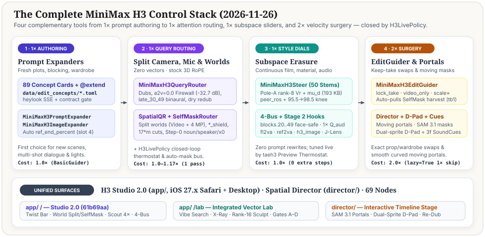
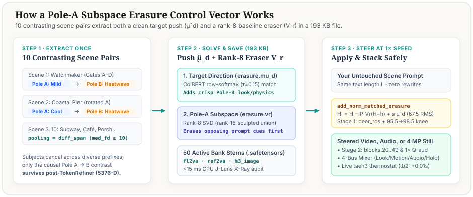

# Steering MiniMax H3: Prompt Expander, Edit Guidance, Control Vectors, and J-Lens

Last updated: 2026-11-22.

This pack separates `1x` prompt authoring from post-refiner steering and `2x` differential editing, plus one CPU tool for reading and sketching vectors:

1. **`MiniMaxH3PromptExpander` (`1x` Easy Button, [`h3_prompt_expander.py`](../../h3_prompt_expander.py), [`h3_prompt_contract.py`](../../h3_prompt_contract.py)) & `MiniMaxH3ImagePromptExpander` ([`h3_image_nodes.py`](../../h3_image_nodes.py))**: Expands a short idea (plus optional `concept` preset from `data/edit_concepts/*.toml`, `@extend:prepend|append` runtime preset overlays via `heylook_client.py::{parse_extend_directive, compose_preset_system_prompt}` synced from canonical prompts by `bench/sync_heylook_presets.py`, wired refs, or keyframes at `1152x768 @ 192f` for video with trailing `ref_end_percent` output on slot 4, or `16 -> 4 MP` for image) into a verified H3 prompt on standard `BasicGuider` graphs — first choice for fresh scenes, mutually exclusive lighting looks, wardrobe, blocking, and multi-shot dialogue.
2. **Contrastive Control Vectors (`MiniMaxH3Steer`, `MiniMaxH3LoadControlVector`, `MiniMaxH3WordVector`, `MiniMaxH3ReleaseReferences`, and legacy `MiniMaxH3ApplyControlVectors`; [`control_vectors.py`](../../control_vectors.py), [`control_vector_nodes.py`](../../control_vector_nodes.py), [`steer_attention_hooks.py`](../../steer_attention_hooks.py))**: 1-pass `5376`-d directions added to selected text rows after the 2-block `TokenRefiner` (`token_focus = 1.0`, `--families fl2va`) for **orthogonal** film stocks, optical grades, materials, and acoustic timbre (`48` active stems in `bank/`). `MiniMaxH3Steer` defaults to `add_norm_matched_erasure` (clamped prompt-centered rank-8 Pole-A subspace erasure with Stage 1 `peer_ros=True` + clamped union + smooth norm knee `95.5 -> 98.5`, plus Stage 2 trailing `block_band` and `split_backend="auto_1x_kv"` for compiler-safe `blocks.20..49` face-safe restyling and single-pass `1x` audio protection; up to rank-16 when composed via `sculpt`, plus optional dataset-centered `erasure.mu_a` for `pooling="vision_tokens"`). Legacy `MiniMaxH3ApplyControlVectors` keeps `add_norm_matched`.
3. **`MiniMaxH3EditGuider` + `MiniMaxH3AutoEditPrompt` / `MiniMaxH3PromptEdit` ([`edit_guidance.md`](edit_guidance.md), [`edit_guidance.py`](../../edit_guidance.py), [`auto_edit_prompt.py`](../../auto_edit_prompt.py))**: 2-pass latent-velocity guidance (`lazy=True` `original` skip on unmasked `1x`) for `lock_take`, `audio_only`, continuous `0 < scale < 1`, and `[F, H, W]` spatial masks.
4. **J-Lens, the word readout** (`MiniMaxH3WordVector`, [`j_lens.py`](../../j_lens.py), `models/j_lens/j_lens_h3.safetensors` + optional `model2vec_h3_lexicon.safetensors`): not a separate steering engine. It is an advisory `< 15 ms` CPU Jacobian and Wiener-inverse lexical operator that decodes any `5376`-d vector (and its `erasure.mu_d` / `erasure.vr` subspace axes) into English words and scrubs unwanted side-effect words (`hold_words`). Run backward it synthesizes a quick zero-file control vector from single-token words and `Model2Vec` whole-word/2-word terms (`words`), plus `< 2 ms` CPU `against`-SVD `erasure.{mu_d,vr,diag}` when `against_words` are provided, which `MiniMaxH3Steer` then applies like any other.

**Start here** if you are new to these, or are explaining them to someone else:

- **[`h3_steering_and_architecture.md`](h3_steering_and_architecture.md) (Canonical Consolidated Guide — Read This First):** One plain-English + visual guide uniting Subspace Erasure math (`PCRR`, Stage 1 `ROS` + smooth norm knee), H3's 50-block audio-video brain (`blocks.20..29` + Stage 2 `1x Q_aud`), Zero-Rewrite HUD Portals, 4-tool choice, 5 falsification proofs, `4`-bus bank design, and Track 2 horizon.
- [`steering/h3_cross_domain_visual_guide.html`](steering/h3_cross_domain_visual_guide.html) & [`2026-11-23_cross_domain_llm_dit_vgel_and_strategic_audit.md`](steering/research/2026-11-23_cross_domain_llm_dit_vgel_and_strategic_audit.md): **Interactive Cross-Domain Visual Field Guide (`2026-11-23`)**: `L49` vs. `L63` truncation funnel, `50`-block AV DiT & `1x Q_aud` explorer, causal LLM KV vs. frozen DiT anchor diagram, `1D` vs. `Regime A`/`de_llm_slop`/`Regime B`/`Regime C` simulator, and strategic scorecard.
- [`steering/tutorials_progressive_guide.md`](steering/tutorials_progressive_guide.md): **4-Lab Progressive Guide** connecting multi-vector retrieval intuition (`ColBERT`, `WARP`, `Model2Vec`, `ColQwen`) to H3 `1x` steering across four cumulative hands-on labs and 1-click workflows.
- [`steering/how_pole_a_erasure_works.md`](steering/how_pole_a_erasure_works.md): deep-dive & `2026-11-21` showcase companion to [`h3_steering_and_architecture.md`](h3_steering_and_architecture.md) preserving detailed TV Cooking Show, Disco Wipe, and `fl2va`/`ref2va` boundary logs.
- [`steering/which_tool_and_what_to_call_it.md`](steering/which_tool_and_what_to_call_it.md): the mechanisms side by side, and what to call the word readout in public.
- [`steering/heylook_auto_edit_guidance_design.md`](steering/heylook_auto_edit_guidance_design.md): the shipped `heylook` architecture (`1x` `MiniMaxH3PromptExpander` / `MiniMaxH3ImagePromptExpander` + `2x` `MiniMaxH3AutoEditPrompt`).
- [`steering/studio_ui_guide.md`](steering/studio_ui_guide.md): **H3 Pocket Console (`app/` `/` 4-Bus Steering Deck + `/lab`)** and standalone CLI `ui` workbench for authoring, `< 3 ms` CPU Vibe Searching, X-Raying, sculpting, and building vectors.
- [`steering/sound_cues_and_timed_masks.md`](steering/sound_cues_and_timed_masks.md): sound cues and timed mask "blooms" in plain English, and what the tortoise, elevator (`1x`), and forge runs actually proved.
- [`steering/how_the_word_readout_works.md`](steering/how_the_word_readout_works.md): the word readout step by step, in plain words, on one vector.
- [`steering/paper/README.md`](steering/paper/README.md) (**Paper v5 Canonical Home**: [`manuscript.md`](steering/paper/manuscript.md), [`main.tex`](steering/paper/main.tex), scripts & vector figures) · [`steering/research/2026-11-21_from_late_interaction_retrieval_to_av_dit_steering.md`](steering/research/2026-11-21_from_late_interaction_retrieval_to_av_dit_steering.md) & [`steering/research/2026-11-21_reproducing_late_interaction_to_dit_steering.md`](steering/research/2026-11-21_reproducing_late_interaction_to_dit_steering.md): full research monograph (v4) & zero-data reproduction map (see also [`2026-11-22_paper_v4_critical_review_prior_art_and_revision_plan.md`](steering/research/2026-11-22_paper_v4_critical_review_prior_art_and_revision_plan.md), [`2026-11-22_track1_track2_multivector_erasure_blueprint.md`](steering/research/2026-11-22_track1_track2_multivector_erasure_blueprint.md), and [`bench/results/2026-11-22_stage1_stage2_ros_norm_cap_and_unified_steer_hooks.md`](../../bench/results/2026-11-22_stage1_stage2_ros_norm_cap_and_unified_steer_hooks.md)).
- [`steering/research/2026-11-20_unpooled_multivector_sliders.md`](steering/research/2026-11-20_unpooled_multivector_sliders.md): research study and `192f` AV + `P-H3-Image` verification of **Clamped Pole-A Subspace Erasure** (`add_norm_matched_erasure` spec).
- [`steering/research/2026-11-20_multivector_retrieval_sota_to_dit_steering.md`](steering/research/2026-11-20_multivector_retrieval_sota_to_dit_steering.md): Oct–Nov 2026 multi-vector retrieval SOTA survey (Minish Lab, LightOn + Clavié, Mixedbread, Khattab, `MUVERA`, Balanced Sinkhorn OT vs. row-softmax) mapped directly into H3 `5376`-D steering.
- *(Archived Q&A)* [`archive/2026-11-12_control_vector_worked_examples.md`](archive/2026-11-12_control_vector_worked_examples.md): early seven-question FAQ ledger (superseded by the guides above).

> **Verified scope & empirical guardrails (`2026-11-22`):**
> - **Stage 1 (`dd45600e`) & Stage 2 (`340e8ded`) Shipped on `MiniMaxH3Steer`:** Per-slider `ROS` (`peer_ros=True`), clamped union (`λ_max ≤ 1.0`), smooth norm knee (`95.5 → 98.5` eliminating the `4.0 MP` `lighthouse` diptych collapse at `3.07s`), compiler-safe `block_band` (`mid_late_20_49`), and `split_backend="auto_1x_kv"` (`1.003×` `fl2va`, `+0` added breaks across all `4` backends, `ref2va` Mode 3 `+1.06 dB` audio with intact `<Picture 1>` face).
> - **Native `MiniMax-H3-Image` steering (`--families h3_image`):** Confirmed working natively across `41` `h3_image` visual stems in `<comfy>/models/control_vectors/bank/` (`48` total active stems; `48 fl2va`, `48 ref2va`; `5` retired stems in `prompt_bank/control_vectors/_retired/`: `earthquake_tremor`, `lettering`, `paper_origami`, `stained_glass_cathedral`, `wes_anderson_symmetry`).
> - **H3 Pocket Console (`app/`, [`app/VISION.md`](../../app/VISION.md), [`app/DESIGN.md`](../../app/DESIGN.md)):** Single server hosting `/` (1-tap **Create `1x`** vs **Remix `2x`** with `ref_end_percent` & split-cached `1x` `r2v`, **4-Bus** color-coded mixer `Look`/`Motion`/`Audio`/`Hold` + Stage 2 console `block_band` toggle `All blocks` vs `Blocks 20–49`, collapsed `#guide-vector-drawer`, lifted `#guide-ref-release-section`, `< 3 ms` dual `max(cos_v1, cos_mu)` CPU semantic Vibe Search via `POST /api/lab/vibe_search`, responsive Desktop 3-column Studio Desk `>= 64rem`, Take Player Groove Bar, up to 5 stacked `extra_vectors` chips, and CPU Subspace X-Ray) and **`/lab`** (`3` tabs: Library X-Ray, Sculpt Mixer, async Gates A–D Pairs builder; 1D Word Lab UI cut in `app/.git` `70ac442`); Spatial World Director (`director/`) remains separate.
> - **Boundary proof (`gpu_word_and_media_ablations.json`, Ablations 6 & 7):** Static `Model2Vec` word erasure (`noir` `0.3234` vs 1D `0.3155`) and cross-modal `<Picture 1>` patch-to-text erasure (`0.3446` vs 1D `0.3457`) **do not replace 10-pair causal text erasure (`0.0264`)**. Use `WordVector` / `Model2Vec` for `< 2 ms` sketching, `hold_words` scrubbing, and concept matching; build an 8–10 pair `.toml` when you need full global palette or material overrides.

---

## 1. Which tool to reach for (and why)

The single most important architectural distinction in H3 steering is **where the subtraction happens**:

- **Control vectors** (and **J-Lens `words`**) collapse a contrast into **one `5376`-d vector** and broadcast that single vector across every token in the chosen prompt mask *before* the 50 DiT blocks run (`0` extra DiT passes, `1x` render cost).
- **`MiniMaxH3EditGuider`** keeps both prompts **fully tokenized** through all 50 DiT blocks and subtracts their predicted latent velocities *after* cross-attention in pixel/audio latent space (`2` DiT passes per guided step, reducible to `9` or `10` total passes on 6-step Pika via `last_step`).

Because pooling collapses per-word token positions while latent-velocity subtraction preserves them, each tool wins in a distinct regime:

| Goal | Best tool | Why it works / what fails if you pick the wrong one |
|---|---|---|
| **Fresh scenes, mutually exclusive lighting looks** (`look_crimson_darkroom`, `look_direct_1990s_flash`, `look_lurid_magenta_neon`), **wardrobe, blocking, or multi-shot dialogue** | **`MiniMaxH3PromptExpander`** (`1x` `BasicGuider`, `1152x768 @ 192f` default) | An additive `1D` vector (`+s * v`) never deletes contradictory physical light sources explicitly written in the prompt (e.g. bright daylight windows) and cannot carry multi-beat choreography or distinct per-person wardrobe; authoring in plain `1x` prompts via [`h3_prompt_contract.py`](../../h3_prompt_contract.py) yields crisp multi-shot blocking and audio-video sync with `0 FAIL / 0 WARN`. |
| **Exact subject wardrobe, prop, or action swap** while keeping `<Picture 1>`'s face, hair, and existing room (`"black sweater -> 1970s rust-orange wide-collar blouse and flared jeans"`) | **`MiniMaxH3EditGuider`** (`scale = 1.5`; the clip the owner passed ran every step in two passes, the default `last_step`) | Every edited token (`"rust-orange"`, `"blouse"`, `"flared"`, `"jeans"`) attends to its own spatial patches across 50 DiT blocks, while unchanged face, hair, booth, and dialogue cancel in $(\mathbf{v}_{\text{edit}} - \mathbf{v}_{\text{orig}})$. Pooling the same `6 -> 22` token rewrite into one vector lost color-to-garment binding (rendering a **cream** blouse instead of rust-orange), and averaging 6 diverse 1970s outfits (`wardrobe_1970s`) canceled specific garments into a vague `"vintage, psychedelic"` room tint that left `<Subject 1>`'s black sweater unchanged. |
| **Continuous optical / film look or orthogonal style dial** (`film_16mm_1974`, `noir`, `charcoal_sketch_animated`, `watercolor_wash`) | **10-pair Contrastive Control Vector** on **`MiniMaxH3Steer`** (`--families fl2va` or explicit `--families h3_image`, `token_focus = 1.0`, `target = "scene_only"` or `"description_only"`; `mode = "add_norm_matched_erasure"` by default so `MiniMaxH3Steer` removes conflicting baseline traits like daylight/color on `noir`) — *or **`MiniMaxH3EditGuider`** when subtlety / holding the take matters (`2026-11-12` owner reading & `exp5`)* | Optical grain, halation, and coarse tint apply uniformly at `1x` speed (`strength = 0.5..2.0`). Plain `1D` `add_norm_matched` leaves contradictory Pole-A features in the prompt intact (`noir` stays color on `5/5` stills, `3/3` `192f` AV clips, and native `MiniMax-H3-Image`), whereas `add_norm_matched_erasure` pairs row-softmax (`tau = 0.15`) `erasure.mu_d` with clamped rank-8 Pole-A erasure (`-clip(s, 0, 1) * P_{Vr, \lambda}(h - \bar{h})`, RMS-matched to `|s| * 67.5`, verified across `5/5` stills, `192f` `fl2va`/`ref2va` AV, `4.1 MP` `P-H3-Image`, and native `4.0 MP` `MiniMax-H3-Image` `noir` flip from color `sat_mean=0.2355` to pure B&W `0.033`). Use `MiniMaxH3EditGuider` (`0 < scale <= 1.2`, `first_step = 1`) when clause-level preservation matters (`control_vectors` vs. `edit_guidance` boundaries). |
| **Coupled sight + sound physics, weather, or pyrotechnics** (`pyro_chain_explosions`, `scorching_heatwave`, `wind_tunnel_gale`, `underwater_submerged`) | **10-pair Contrastive Control Vector** on **`MiniMaxH3Steer`** (`streams = "both"` / `"video_only"` / `"audio_only"`) | H3 generates video and audio jointly inside one packed DiT sequence. Multi-pair GPU vectors built from coupled visual + `overall_soundscape:` contrasts carry multi-token dynamics and synchronized acoustics that unigram word lists drop or miss. |
| **Whole-scene world or material transformation that carries the subject with it** (`claymation_stopmotion`, `felt_muppet`, `balloon_head_inflate`, or seasonal/world shifts) | **`MiniMaxH3Steer`** (or **`MiniMaxH3WordVector`**) on `target = "scene_only"` + `end_percent = 0.5` (+ optional `MiniMaxH3ReleaseReferences` `end_percent = 0.16..0.33` for silhouette relaxation) | When a coherent single-world push moves the entire environment (`scene_only`), the DiT's world prior carries contextual surfaces and attire along with the scene. Shortening `end_percent` to `0.5` prevents high-strength facial color burn on later steps. *(On `ref2va`, `ReleaseReferences` `0.33` alone does not override Dual-Lock palette/identity anchored by `tags == 0` vision tokens and steps `0..1` VAE pixels.)* |
| **World shift *without* coupled wardrobe drift** (e.g., turning a sunny market into a snowstorm without putting a winter coat on the vendor) | **`MiniMaxH3Steer` / `MiniMaxH3WordVector` + `hold_words`** (`hold_words = "coat, parka"`, `hold_alpha = 0.5..1.0`) | Used in `$H3_OUTPUT_DIR/Video/cv_e2e_verify/10_t2va_jlens_words_00001-audio.mp4`: J-Lens projects the `"coat, parka"` direction out of the word vector in `< 1 ms` on CPU, and the clip has snowdrifts on the citrus stall with the vendor still in his canvas apron. No arm without the hold was rendered, so how much of that the hold did is not measured. |
| **Pre-render X-ray audit of any built vector** (catching washed-out or off-target builds before spending GPU time) | **J-Lens `inspect`** (`decode_erasure_payload` + `per_token_erasure_profile`, automatic at the end of `build`) | Decodes `vector.post_refiner`, `erasure.mu_d` (*Adds*), and `erasure.vr[0..3]` (*Erases*) into English words in `< 15 ms` on CPU (across the bank `cos(mu_d, v_1d)` has `median = 0.9935`, while `mu_d` rescues key `b_side` terms such as `black` on `noir` and `grain, tape` on `film_16mm_1974` that wash out of `v_1d`). On `wardrobe_1970s` the build's own readout was `"vintage, retro, nostalgia, nostalgic, decades, psychedelic"` with **zero garment nouns**. Nobody read it before rendering; read first, it would have said the vector carries an era and not clothing, which is what the renders then showed. |
| **Zero-file `< 2 ms` tinkering & rapid concept sketching** | **`MiniMaxH3WordVector` -> `MiniMaxH3Steer`** (or `words` on legacy `MiniMaxH3ApplyControlVectors`) | Synthesizes a family-matched `5376`-d vector on CPU at step 0 from single-token words plus `Model2Vec` multi-token/phrase terms (`origami`, `muppet`, `chiaroscuro`, `silver gelatin`, `direct flash` via `model2vec_h3_lexicon.safetensors` + BPE subword fallback), and builds `< 2 ms` `against`-SVD `erasure.{mu_d,vr,diag}` when `against_words` (`@replace_digital, sunlit, warm`) are given (`cos = +0.30..+0.52` with 10-pair GPU vectors; promote winners to an 8–12 pair `.toml` for hard global palette/material overrides). |
| **Audio-only acoustic space or vocal delivery** (`reverb_cathedral`, `pyro_klaxon_audio`, `whisper_asmr`, `operatic_bellow`) | **Contrastive Control Vector** with `target = "soundscape_only"` (`streams = "audio_only"` optional) | Steers `overall_soundscape:` and `non_diegetic_music:` (plus `<Audio N>:` lines) while leaving visual prose and dialogue words untouched (`streams = "audio_only"` on `MiniMaxH3Steer` keeps video unsteered across all steps). |
| **Frame-accurate impacts/hops (`24: hop`, `54: snap`) or 2D `(x, y, face)` subject paths & backward walks** | **`MiniMaxH3SoundCues`** + **`MiniMaxH3AppendSpriteTrajectory`** + **`MiniMaxH3ReleaseReferences(video_end_percent=0.33, audio_end_percent=0.33..0.60)`** ([guide](steering/research/2026-11-12_sound_cues_dpad_and_033_release_law.md)) | Control vectors and prompt edits operate on positionless prefix text and cannot pin exact frame numbers or decouple travel direction from facing direction. Timeline `cond_audio` islands and `384x224` 2D sprite plates steer steps `0..1` (`b: 1.00 -> 0.50`), then drop at `0.33` so H3 articulates native limbs and street foley on steps `2..5` while `<Picture 1>` holds identity at `end_percent = 1.0`. |

---

## 2. How the three mechanisms fit H3's architecture

Every H3 prompt passes through two text stages before the 50 DiT blocks see it:

1. **Causal encoder (`Qwen3-VL-32B`, `layers.0..49`, width `5120`)**:
   - Strictly causal (`is_causal = True`), with vision tokens tagged `0` and text tokens tagged `1` in `conditioning_token_tags`.
   - Row `0` is a massive attention sink (`||e_0|| ≈ 15,309` vs. `~292.3` median across rows `1..S-1`, a `52.4x` ratio). Every encoder pooling path in this pack excludes row `0`.
2. **Bidirectional `condition_proj` + 2-block `TokenRefiner` (width `5376`)**:
   - Lives inside each DiT (`fl2va` vs. `ref2va`) and runs **with active LoRAs applied** (such as the 6-step Pika LoRA).
   - Mixes tokens bidirectionally across the prompt and dampens attention-sink artifacts (`||r_0|| / median ≈ 2.27x`, post-refiner row median `≈ 266–270`).
   - `fl2va` and `ref2va` produce nearly parallel `5376`-d post-refiner rows (`cos ≈ 0.994` on identical text on both un-LoRA'd base `loras=[]` and Pika `SVD995`; `0.980` base / `0.989` Pika median across `54` contrast vectors; `J_ref` `0.9935`), while LoRAs inside `TokenRefiner` rotate vectors modestly. Every saved `.safetensors` vector still records its `family` (`fl2va` or `ref2va`) and `recipe` (`checkpoint`, `loras`, `encoder`): `MiniMaxH3Steer` / `MiniMaxH3LoadControlVector` auto-swap `<stem>__fl2va` <-> `<stem>__ref2va` + LoRA siblings when both exist (`resolve_vector_file_path`), and `check_vector_compatibility` warns and applies by default across `{fl2va, ref2va}` and checkpoint/LoRA recipe differences (`allow_recipe_mismatch = True`; set `False` only to hard-refuse mismatched recipes, while raw `h3_image`/`fasth3` post-refiner mismatches always refuse unless auto-projected from `vector.encoder`). Across single-frame models, PrunaAI's `P-H3-Image` (`p-h3-image_int8_convrot.safetensors`) uses the un-LoRA'd base `fl2va` refiner (`detect_family == "fl2va"` with `fl2va_base` J-Lens `J_ref_fl2va_base` / `J_wiener_fl2va_base`) and Pika stills run on `fl2va` (`t2i`) or `ref2va` (`edit` / `guide_edit`), whereas official `MiniMax-H3-Image` (`minimax_h3_image_pruned_int8_convrot.safetensors`, [`docs/wiki/image/h3_image.md`](image/h3_image.md)) has genuinely rotated text-path weights (`"h3_image"`, `cos ≈ 0.577–0.586` identical-text, `0.214` base contrast, `0.7428` `J_ref` vs. `fl2va`; served by `J_ref_h3_image` / `J_wiener_h3_image`) and refuses raw `fl2va`/`ref2va` post-refiner tensors (auto-projecting `vector.encoder` instead).

From that `5376`-d `context` tensor onward:

- **`MiniMaxH3Steer`** (and legacy `MiniMaxH3ApplyControlVectors`) wraps the DiT forward pass (`WrappersMP.DIFFUSION_MODEL`), clones `context`, and modifies only the rows selected by `target` / `mask` / `fields` during `[start_percent, end_percent)`, filtering on `h3_edit_pass` when `edit_pass` (`both | edited_only | original_only`) is paired with `MiniMaxH3EditGuider`. Multiple chained nodes accumulate in `float64` inside one wrapper (`MiniMaxH3Steer` defaults to `add_norm_matched_erasure`, which subtracts clamped prompt-centered rank-8 Pole-A erasure `-clip(s, 0, 1) * beta_cap * E(H)` from `erasure.mu_d` on unsteered per-batch rows and RMS-normalizes the shift to `|s| * 67.5`, falling back cleanly to 1D `add_norm_matched` `67.5` shift norm when erasure payloads are absent, `s <= 0`, or cross-family `h3_image` auto-projection skips `erasure.vr`; legacy `MiniMaxH3ApplyControlVectors` keeps `add_norm_matched`).
- **J-Lens** maps between `5376`-d post-refiner space (`fl2va`, `fl2va_base`, `ref2va`, or `h3_image`) and `24,912` single-token English words in `Qwen3-VL`'s `lm_head` using precomputed analytical Jacobians ($\bar{J}_{49\to 63}$ and $\bar{J}_{\text{ref}}^{(f)}$) and an empirical-covariance **Wiener inverse** ($J_{\text{Wiener}}^{(f)}$).
- **`MiniMaxH3EditGuider`** leaves `context` unmodified per branch, runs the DiT on `[original]` and `[edited]` sequentially (`h3_edit_pass` prevents ComfyUI from concatenating two `~18k`-token sequences into a `B = 2` OOM), and extrapolates the predicted velocity (globally, per `(video, audio)` stream via `streams` / `audio_scale`, or over continuous `[H, W]` / causal `[F, H, W]` / `[F, 1, 1]` masks including `MiniMaxH3SpatialDirector` portals and targets):
  $$\mathbf{v} = \mathbf{v}_{\text{original}}(x_t) + \text{scale} \cdot \left(\mathbf{v}_{\text{edited}}(x_t) - \mathbf{v}_{\text{original}}(x_t)\right)$$

---

## 3. Summary of verified empirical rules (2026-11-05 .. 2026-11-11)

Every rule below was tested on rendered 6-step Pika `t2va` and `ref2va` clips and verified on playback:

1. **Pool only the changed clause (`pooling = "diff_span"`)**:
   - Averaging across a whole 105-token scene when only 8–12 words changed (`scene_text`) dilutes raw vector norm by `2.1x–8.2x` (`10.35` vs. `85.01` on `head_swell`). `diff_span` (`[first_diff:end_diff]`) is the default across CLI `build`, `make`, and `MiniMaxH3MakeControlVector`.
2. **One pair-build implementation across CLI and ComfyUI (`fb3c978d`)**:
   - [`steering/encode.py::encode_pair_set`](../../control_vector_nodes.py) and [`steering/extract.py::pool_pair_set`](../../control_vectors.py) power CLI `build`, `make`, Studio builds, and `MiniMaxH3MakeControlVector` identically (verified bitwise `torch.equal = True` across `vector.post_refiner`, `vector.encoder`, and `holds.post_refiner`).
3. **Where a pair sits in the build prompt matters far less than what the contrast means and where you apply it**:
   - Building the same wording contrast inside `subject_definitions:` vs. `detailed_description:` vs. a 3-field prompt produces nearly the same direction. At render time, however, **which mask receives the vector decides what moves**:
     - Aiming a film/room look (`film_16mm_1974`) at `subject_definitions` or `look_only` leaves `<Subject 1>` unchanged.
     - Aiming it at `description_only` (or ticking `description` in `fields`) grades the room and lighting while keeping `<Subject 1>` clean.
     - Aiming it at `scene_only` grades the whole shot.
4. **Use J-Lens as an advisory eyeball check — enforce causal prefix diversity + rotated Pole A (Gates A–D, `2026-11-20`)**:
   - Coherent single-concept pairs (`film_16mm_1974`, `claymation_stopmotion`, `pyro_chain_explosions`) surface concrete optical, material, or physical nouns in J-Lens (`steering/xray.py::decode_vector`). Because `steering/xray.py::check_b_side_alignment` (`48031b0e`) treats remaining multi-token flags on winners like `film_16mm_1974` and `whisper_asmr` cautiously, [`bench/control_vector/build_cmd.py`](../../bench/control_vector/build_cmd.py) surfaces them as an advisory `[j_lens eyeball note]` rather than a `health=WEAK` refusal (`f7aea121`).
   - Because `Qwen3-VL` is causal, sharing an identical short prefix across pairs collapses pairwise cosine (`mpc`) without learning a valid direction; [`steering/data.py::lint_pair_set`](../../control_vectors.py) enforces Gates A–D (`med_fd >= 10` across distinct locations/subjects ahead of the diff, no boundary-append `, while ...` diffs, Gate D shared-prefix Pole-A contradiction lint via `_BASELINE_STATE_WORDS`, and rotated Pole-A baselines), compiled `<compiled:...>` builds skip rank-deficient `erasure.vr` below `MIN_ERASURE_PAIRS = 6` (`--force-low-pair-erasure` overrides), and [`bench/control_vector/cli.py`](../../bench/control_vector/cli.py) defaults to `--families fl2va` (`cos ~0.985–0.989` with `ref2va`). Leave `MiniMaxH3Steer.token_focus = 1.0`: shrinking steered rows to `0.30` diluted cross-modal attention mass in `3/3` A/B pairs (`ab_token_focus_2026-11-20`).
5. **Default `retention_analysis:` protection on `ref2va`**:
   - Default lever masks (`scene_only`, `look_only`, `soundscape_only` in [`h3_spans.py`](../../h3_spans.py)) leave `retention_analysis:` preservation contracts unsteered so high-strength vectors (`strength = 2.25..3.5`) never scramble `fully_preserved` / `partially_preserved` instructions (tick `retention_analysis` in `fields` only when you explicitly want to steer it). When unlocking a preserved trait on `<Subject 1>` (such as hair, glasses, or clothing), update `retention_analysis:` directly or via `retention_analysis: old -> new` on `MiniMaxH3PromptEdit`.
6. **High-strength facial red tint comes from late-step text steering, not `<Picture 1>` weight**:
   - When a strong vector (`strength = 2.0..3.0`) causes red burn around `<Subject 1>`'s eyes and cheeks, shortening **the vector's** window to `end_percent = 0.5` on `MiniMaxH3Steer` (first 3 of 6 Pika steps) removes the red tint on playback while preserving the style/scene effect—with `<Picture 1>` left at default `end_percent = 1.0` and `clean_level = 0.999` on `MiniMaxH3ReleaseReferences` (`ref_vae_end_percent` / `ref_vae_aug` on legacy `ApplyControlVectors`).
   - Only lower `end_percent` (`0.16` or `0.33`) on `MiniMaxH3ReleaseReferences` when you want `<Subject 1>`'s **3D silhouette or material** to relax away from the clean reference VAE latents (e.g., `claymation_stopmotion`, `felt_muppet`, `balloon_head_inflate`; note `0.33` alone still preserves `tags == 0` vision palette/identity under Dual-Lock, as seen on `s3_ref2va_gear2_rel033`).
7. **Project out correlated side effects (`[[hold]]` at build time, `hold_vector` or `hold_words` at render time)**:
   - `film_16mm_1974` pulls warm amber cast alongside grain; `film_16mm_1974_neutral` adds a `[[hold]]` group (`warm_colour_cast`) that removes the amber shift while keeping grain and gate weave (`cos = 0.72` between the two).
   - At render time, wiring `MiniMaxH3LoadControlVector` (or `MiniMaxH3WordVector`) into `MiniMaxH3Steer.hold_vector` (e.g., `cursed_cctv` + `hold_vector = chaos_panic`), or setting `hold_words` (`hold_words = "coat, parka"`), scrubs unwanted collateral concepts from the additive delta without altering the base prompt.

---

## 4. Shipped API workflows

Generated by [`workflows/build_workflows.py`](../../workflows/build_workflows.py), wiring `MiniMaxH3Steer` (bare vector stem auto-resolved to the loaded checkpoint's `fl2va`/`ref2va` + LoRA sibling) and `MiniMaxH3ReleaseReferences` where reference or guide VAE latents are present:

| Workflow | Mode | What it demonstrates |
|---|---|---|
| `workflows/h3_text_to_video_pika_prompt_expander_api.json` | 6-step Pika `t2va` (`1152x768 @ 192f`) | `MiniMaxH3PromptExpander` (`1x` `BasicGuider` Easy Button via `heylook` + `h3_prompt_contract.py`) |
| `workflows/h3_first_last_frame_pika_prompt_expander_api.json` | 6-step Pika `fl2va` (`1152x768 @ 192f`) | `MiniMaxH3PromptExpander` auto-inferring `fl2va` from `first_frame` + `last_frame` with exact Python Part One `S.SS` |
| `workflows/h3_image_ref_plus_text_to_video_pika_prompt_expander_api.json` | 6-step Pika `ref2va` (`1152x768 @ 192f`) | `MiniMaxH3PromptExpander` (`ref_end_percent` -> `MiniMaxH3ReleaseReferences.end_percent`) + split-cached `MiniMaxH3EncodeReferences` / `MiniMaxH3PromptOnReferences` + `MiniMaxH3ReleaseReferences` (`video_end_percent`) |
| `workflows/h3_text_to_video_pika_auto_edit_guidance_api.json` | 6-step Pika `t2va` | `MiniMaxH3AutoEditPrompt` + lazy `MiniMaxH3EditGuider` (`Node 26` Preflight on `edited`) |
| `workflows/h3_image_ref_plus_text_to_video_pika_auto_edit_guidance_api.json` | 6-step Pika `ref2va` | `MiniMaxH3AutoEditPrompt` + `EditPlan` + split-cached `EncodeReferences` / `PromptOnReferences` + `MiniMaxH3ReleaseReferences` |
| `workflows/h3_text_to_video_pika_1d_vs_erasure_ab_api.json` | 6-step Pika `t2va` (`1152x768 @ 141f`) | **Lab 1 (legacy `t2va_sitcom_kitchen` fixture)**: 1-click same-seed side-by-side comparison (`MiniMaxH3Steer` `noir +1.55` `add_norm_matched` vs. `add_norm_matched_erasure` -> `MiniMaxH3DirectorHUD` `split_ab_card`) |
| `workflows/h3_text_to_video_pika_word_vector_erasure_api.json` | 6-step Pika `t2va` (`1152x768 @ 141f`) | **Lab 2 (`t2va_hardware_aisle_short`)**: zero-file `< 2 ms` `MiniMaxH3WordVector` (`Model2Vec` + `against`-SVD erasure + `hold_words="coat, parka"`) -> `MiniMaxH3Steer(strength=1.60)` |
| `workflows/h3_text_to_video_pika_control_vector_api.json` | 6-step Pika `t2va` | `MiniMaxH3Steer` (`film_16mm_1974` at `+1.15`, `add_norm_matched_erasure` default, `target = "scene_only"`) |
| `workflows/h3_text_to_video_pika_dual_control_vectors_api.json` | 6-step Pika `t2va` | Two chained `MiniMaxH3Steer` nodes (`film_16mm_1974` at `+1.15` on `scene_only` + `reverb_cathedral` at `+1.25` on `soundscape_only`) |
| `workflows/h3_text_to_video_pika_stacked_erasure_api.json` | 6-step Pika `t2va` (`1152x768 @ 192f`) | **Lab 3 / Showcase 1 (`t2va_cooking_show_meltdown`)**: three chained `MiniMaxH3Steer` nodes in one `1x` pass (`noir` `+1.55` + `chaos_panic` `+0.90` on `scene_only` + `reverb_cathedral` `+1.25` on `soundscape_only`) |
| `workflows/h3_first_last_frame_pika_control_vector_api.json` | 6-step Pika `fl2va` (`1152x768 @ 141f`) | Showcase 3: First + Last Frame steering (`MiniMaxH3Steer` `noir` `+1.55` on `scene_only` + `MiniMaxH3ReleaseReferences` `end_percent = 0.33` releasing keyframe motion at midpoint `b = 0.50`) |
| `workflows/h3_image_ref_plus_text_to_video_pika_control_vector_api.json` | 6-step Pika `ref2va` | Showcase 4 / Reference-anchored `<Subject 1>` shot with split-cached `MiniMaxH3EncodeReferences` + `MiniMaxH3PromptOnReferences`, `MiniMaxH3Steer` (`target = "description_only"` or `"scene_only"`) + `MiniMaxH3ReleaseReferences` |
| `workflows/h3_image_ref_make_media_erasure_pika_api.json` | 6-step Pika `ref2va` (`1152x768 @ 141f`) | **Lab 4 (`ref2va_scene_kitchen`)**: `ColQwen`-style 2-still visual contrast slider (`MiniMaxH3MakeMediaControlVector` patch erasure -> `MiniMaxH3Steer` `target="description_only"` + `MiniMaxH3ReleaseReferences`) |
| `workflows/h3_text_to_video_pika_edit_guidance_api.json` | 6-step Pika `t2va` | `MiniMaxH3PromptEdit` + `MiniMaxH3EditGuider` (`scale = 1.5`) |
| `workflows/h3_image_ref_plus_text_to_video_pika_edit_guidance_api.json` | 6-step Pika `ref2va` | Exact `<Subject 1>` prop/wardrobe/scene edit on a `<Picture 1>` reference shot via `MiniMaxH3PromptEdit` + `MiniMaxH3EditGuider` (`1x` `MiniMaxH3EncodeReferences` + `2x` `MiniMaxH3PromptOnReferences`) |
| `workflows/h3_text_to_video_pika_sound_guide_api.json` | 6-step Pika `t2va` | Frame-accurate 3-island `cond_audio` choreography (`[24, 54, 96]` via `MiniMaxH3GuideLatent`, paired with `MiniMaxH3EditGuider` `streams = "video_only"` and `audio_end_percent = 0.60`) |
| `workflows/h3_text_to_video_pika_sound_cues_1x_api.json` | 6-step Pika `t2va` (`1x`) | `1x` `BasicGuider` zero-file `MiniMaxH3SoundCues` (`"24: thud\n72: click\n114: slam"` on `t2va_freight_elevator`) + `MiniMaxH3ReleaseReferences(audio_end_percent = 0.33)` releasing synthetic cues after step `1` (`b = 0.50`) with zero `2x` pass overhead |
| `workflows/h3_image_ref_dpad_sound_pika_api.json` | 6-step Pika `ref2va` | Hybrid `<Picture 1>` identity (`end_percent = 1.0`) + zero-file 2D cutout trajectory (`MiniMaxH3AppendSpriteTrajectory`, `video_end_percent = 0.33`) + zero-file touchdown cues (`MiniMaxH3SoundCues`, `audio_end_percent = 0.60`) + `MiniMaxH3EditGuider` (`streams = "video_only"`, `scale = 1.6`, `last_step = 3`) |
| `workflows/h3_spatial_portal_pika_api.json` | 6-step Pika `t2va` | Interactive 2D+time moving Reality Portal (`MiniMaxH3SpatialDirector` `portal_path` `[141, H, W]` mask -> `MiniMaxH3EditGuider` at `first_step = 0` + `MiniMaxH3DirectorHUD`) |
| `workflows/h3_spatial_portal_pika_erasure_api.json` | 6-step Pika `t2va` (`1152x768 @ 141f`) | Showcase 2 (`t2va_disco_roller_rink`): zero-rewrite moving `vertical_split` Noir Wipe (`MiniMaxH3SpatialDirector` `x = 0.68 -> 0.50 -> 0.30` -> `MiniMaxH3EditGuider` `same_prompt=True, scale=2.2` + `MiniMaxH3Steer(noir +1.6, add_norm_matched_erasure, edit_pass="edited_only")` + `MiniMaxH3DirectorHUD`) |
| `workflows/h3_r2v_spatial_portal_pika_api.json` | 6-step Pika `ref2va` | Reference-anchored `<Picture 1>` Courtyard + moving Reality Portal (`MiniMaxH3SpatialDirector` `[141, H, W]` mask + `MiniMaxH3EditGuider`) |
| `workflows/h3_i2v_spatial_portal_pika_api.json` | 6-step Pika `i2va` | First-frame `<Picture 1>` Courtyard + moving Reality Portal (`MiniMaxH3SpatialDirector` `[141, H, W]` mask + `MiniMaxH3EditGuider`) |
| `workflows/h3_world_targets_genie_pika_api.json` | 6-step Pika `ref2va` | Interactive Genie D-pad + Point-and-Click World Targets (`MiniMaxH3SpatialDirector` `point_targets` `[141, H, W]` mask + `3f` SoundCues + `sprite_keyframes` -> `MiniMaxH3EditGuider` + `MiniMaxH3DirectorHUD`) |
| `workflows/image/h3_image_t2i_heylook_api.json` | 4-step `MiniMax-H3-Image` `t2i` | `MiniMaxH3ImagePromptExpander` (`concept` preset support) generating `16 -> 4 MP` (`MiniMaxH3ImageDownscale`) |
| `workflows/image/h3_image_edit_heylook_api.json` | 4-step `MiniMax-H3-Image` `edit` | Split KV-prefix `<Picture N>` reference editing via `MiniMaxH3ImagePromptExpander` (`concept` preset support) + `MiniMaxH3EncodeImageReferences` / `PromptOnImageReferences` |
| `workflows/image/h3_image_t2i_control_vector_api.json` | 6-step `MiniMax-H3-Image` `t2i` | Native `h3_image` `MiniMaxH3Steer` (`noir` `+1.15`, `add_norm_matched_erasure`, `target = "scene_only"`) generating `16 -> 4 MP` |
| `workflows/image/h3_image_edit_control_vector_api.json` | 6-step `MiniMax-H3-Image` `edit` | Native `h3_image` `MiniMaxH3Steer` (`film_16mm_1974` `+1.15`, `target = "scene_only"`) + `MiniMaxH3ReleaseReferences` (`end_percent = 0.50`, `clean_level = 0.999`) |
| `workflows/image/h3_p_h3_image_t2i_control_vector_api.json` | 8-step `P-H3-Image` `t2i` | `MiniMaxH3Steer` (`film_16mm_1974` at `+1.15`, `target = "scene_only"`) |
| `workflows/image/h3_p_h3_image_edit_control_vector_api.json` | 8-step `P-H3-Image` `edit` | `MiniMaxH3Steer` (`target = "scene_only"`) + `MiniMaxH3ReleaseReferences` on `<Picture 1>`/`<Picture 2>` |
| `workflows/image/h3_pika_image_t2i_control_vector_api.json` | 6-step Pika still `t2i` | `MiniMaxH3Steer` (`film_16mm_1974` at `+1.15`, `target = "scene_only"`) |
| `workflows/image/h3_pika_image_edit_control_vector_api.json` | 6-step Pika still `edit` | `MiniMaxH3Steer` (`target = "description_only"`) + `MiniMaxH3ReleaseReferences` on `<Picture 1>` |
| `workflows/image/h3_probe_pika_image_guide_edit_control_vector_api.json` | 6-step Pika guide `edit` | `MiniMaxH3Steer` (`target = "scene_only"` on `MiniMaxH3Conditioning(single_frame=True, canvas="explicit")`) + `MiniMaxH3GuideLatent(single_frame=True)` + `MiniMaxH3ReleaseReferences` |

---

## 5. Guide map

| Page | What it covers |
|---|---|
| [`h3_steering_and_architecture.md`](h3_steering_and_architecture.md) | **Canonical Master Guide (Start Here)**: Unified plain-English + visual guide to Subspace Erasure math (`PCRR`, Stage 1 `ROS`/smooth knee), H3's 50-block AV brain (`blocks.20..29` + Stage 2 `1x Q_aud`), Zero-Rewrite HUD Portals, 4-tool choice, 5 falsification proofs, `4`-bus bank design, and Track 2 horizon |
| [`steering/tutorials_progressive_guide.md`](steering/tutorials_progressive_guide.md) | **4-Lab Progressive Guide**: retrieval-to-DiT bridge and cumulative hands-on labs |
| [`steering/how_pole_a_erasure_works.md`](steering/how_pole_a_erasure_works.md) | **Detailed `2026-11-21` Showcase & Erasure Companion**: deep-dive complement to [`h3_steering_and_architecture.md`](h3_steering_and_architecture.md) preserving detailed TV Cooking Show, Disco Wipe, and `fl2va`/`ref2va` boundary logs |
| [`system_prompts/README.md`](system_prompts/README.md) | **Canonical standalone system-prompt suite**: zero-lore `h3_video/`, `h3_image/`, `P-H3-Image`, standalone `control_vector_standalone` (`e696236c` erasure-aware), and masked edit + steering specs |
| [`edit_guidance.md`](edit_guidance.md) | **2-pass Edit Guidance under the hood**: `MiniMaxH3EditGuider` velocity math, why unpooled tokens preserve color/noun binding, `first_step` & `last_step` pass budgets, `MiniMaxH3PromptEdit` syntax & refusals |
| [`steering/building_pairs_and_vectors.md`](steering/building_pairs_and_vectors.md) | **How contrastive vectors are built**: two-stage H3 text geometry, `diff_span` pooling, `[[hold]]` Gram-Schmidt projection, why coherent concepts beat grab-bag averages, `from-prompt`, `from-toml`, `--families h3_image`, and `make-media` |
| [`steering/comfyui_nodes_and_controls.md`](steering/comfyui_nodes_and_controls.md) | **ComfyUI nodes & runtime knobs**: `MiniMaxH3Steer` (incl. `edit_pass` & `h3_image` fingerprint parity), `MiniMaxH3WordVector`, `MiniMaxH3LoadControlVector`, `MiniMaxH3ReleaseReferences`, `MiniMaxH3SpatialDirector`, `MiniMaxH3DirectorHUD` (+ legacy `ApplyControlVectors`), lever `target` vs. `fields`, 6-step `end_percent = 0.5` math, `streams`, and reference release |
| [`steering/j_lens_diagnostics_and_word_lab.md`](steering/j_lens_diagnostics_and_word_lab.md) | **J-Lens under the hood**: analytical Jacobians & Wiener inverse, `< 15 ms` X-ray readouts, `< 1 ms` `hold_words` scrubbing, `< 2 ms` `words` synthesis, single-token BPE limits, and `build-j-lens` |
| [`steering/examples_and_recipes.md`](steering/examples_and_recipes.md) | **Copy-paste recipes**: room-only film grade on `ref2va`, coupled weather/pyro, claymation world shift, snow-without-parka `hold_words`, CPU `sculpt`, native `MiniMax-H3-Image` steering, `1x` `SoundCues`, and `MiniMaxH3EditGuider` wardrobe swaps |
| [`steering/preset_catalog_and_cli_reference.md`](steering/preset_catalog_and_cli_reference.md) | **CLI & active bank reference**: every `bench/control_vectors.py` subcommand and flag (including `--families h3_image`, `--force-low-pair-erasure`, `1D_E%` metrics, `--from-concept`, `--repair`), `.safetensors` file & metadata contract, and the `48`-pack `prompt_bank/control_vectors/` catalog (`5` retired in `_retired/`) |
| [`steering/llm_prompting_guide.md`](steering/llm_prompting_guide.md) | **Authoring contrastive pairs with an LLM**: standalone vs. automated system prompts, single-clause & length-matching discipline, concrete Pole A baselines, and `from-md` import |
| [`steering/studio_ui_guide.md`](steering/studio_ui_guide.md) | **H3 Pocket Console (`app/` `/` 4-Bus Steering Deck + 3-tab `/lab`)**: Stage 2 `block_band` console toggle, `< 3 ms` CPU semantic Vibe Search, async Pairs build, responsive Desktop Studio Desk, Take Player Groove Bar, split-cached `1x` `r2v`, `@extend` composition, shared CLI/node build pipeline, GPU serialization, and security |
| [`steering/heylook_auto_edit_guidance_design.md`](steering/heylook_auto_edit_guidance_design.md) | **Shipped `heylook` `1x` Prompt Expander & `2x` Auto-Edit Guidance**: separating `MiniMaxH3PromptExpander` / `MiniMaxH3ImagePromptExpander` (`1x` `BasicGuider` + `h3_prompt_contract.py` + `data/edit_concepts/*.toml`) from `MiniMaxH3AutoEditPrompt` (`2x` surgical rewrites via `heylook_client.py` + lazy `MiniMaxH3EditGuider`) |
| [`steering/research/2026-11-12_exp5_ladder_and_temporal_guide_synthesis.md`](steering/research/2026-11-12_exp5_ladder_and_temporal_guide_synthesis.md) | **2026-11-12 `exp2`–`exp5` Synthesis & Blind Readouts**: controlled `heavy_blizzard` / `watercolor_wash` ladder settling Control Vectors (broadcast world/mood dials) vs. `MiniMaxH3EditGuider` (subtle, clause-bound, continuous edits), Pole-A shared direction (`cos = 0.72`), plus blind readout & word-share records ([`bench/results/2026-11-12_control_vector_readout_blind_score.md`](../../bench/results/2026-11-12_control_vector_readout_blind_score.md), [`bench/results/2026-11-12_control_vector_word_share.md`](../../bench/results/2026-11-12_control_vector_word_share.md)) |
| [`steering/research/2026-11-12_sound_cues_dpad_and_033_release_law.md`](steering/research/2026-11-12_sound_cues_dpad_and_033_release_law.md) | **Sound Cues, 2D Sprite D-Pad & `0.33` Release Law**: `MiniMaxH3SoundCues`, `MiniMaxH3AppendSpriteTrajectory`, and independent `MiniMaxH3ReleaseReferences` (`video_end_percent = 0.33`, `audio_end_percent = 0.33..0.60`) |
| [`steering/research/2026-11-12_chain_lens_digest_and_experiment_plan.md`](steering/research/2026-11-12_chain_lens_digest_and_experiment_plan.md) | **Chain Lens & Readout Experiment Order (§15)**: blind readout scorer, whitened whole-word table, neighbor holds, and upper-layer chain readout plan |
| [`research/2026-11-15_spatial_world_director_and_3d_edit_guidance.md`](research/2026-11-15_spatial_world_director_and_3d_edit_guidance.md) | **3D Semantic Velocity Steering & Spatial World Director (`2026-11-15`)**: `[F, H, W]` causal pooling + `40 Hz` audio envelope gating, `MiniMaxH3SpatialDirector` / `MiniMaxH3DirectorHUD`, and `141`-frame showcase benchmarks |
