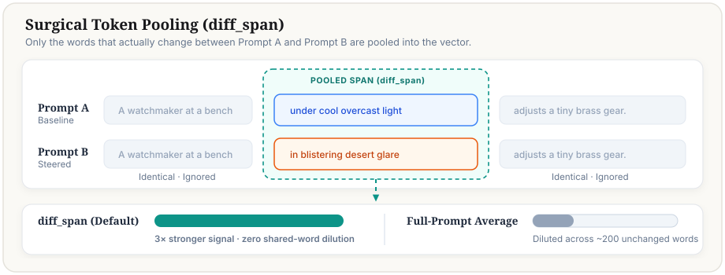
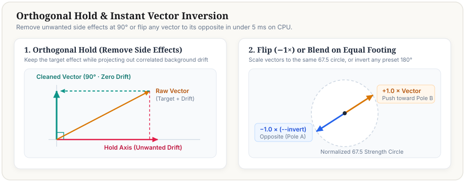

# Building Pairs and Control Vectors

Last updated: 2026-11-21 (`build_pole_a_erasure`, Pole-A Coverage Law, `Model2Vec` + `against`-SVD word erasure, and `ColQwen`-style `make-media` patch erasure).

A MiniMax H3 control vector is the mean post-refiner difference (`Pole B - Pole A`) across one or more matched contrastive pairs, computed in `float64`, scrubbed of any declared `[[hold]]` nuisance subspace via Gram-Schmidt projection, and saved to `models/control_vectors/<stem>__<family>__<pooling>[__lora_<hash>].safetensors`.

---

## 1. One shared build pipeline across CLI, Studio, and ComfyUI

As of `fb3c978d` (2026-11-11), there is **one** pair-encoding and pooling implementation across the entire pack:

1. **Encoding** ([`control_vector_nodes.py::encode_pair_set`](../../../control_vector_nodes.py)): encodes every `(a, b)` pair and every `[[hold]]` pair through `Qwen3-VL-32B` (`layers.0..49`, `5120`-d) and the loaded DiT's `condition_proj` + 2-block `TokenRefiner` (`5376`-d), with any active LoRAs applied in memory.
2. **Pooling, Pole-A erasure & orthogonal hold projection** ([`control_vectors.py::pool_pair_set`](../../../control_vectors.py)): pools the selected span rows on each side in `float64` (excluding token `0` on the encoder side because row `0` is a `52.4x` attention sink: `15,309` norm vs. `292.3` median), averages `B - A` across pairs, builds an orthonormal Gram-Schmidt basis from any `[[hold]]` group means, projects that basis out of both `vector.post_refiner` (`5376`-d, kept in raw mean-difference units) and `vector.encoder` (`5120`-d, saved at unit norm for J-Lens / EXL3 inspection), and runs [`build_pole_a_erasure`](../../../control_vectors.py) to embed optional `float32` `erasure.mu_d [5376]` (row-softmax cosine cross-attention at `tau = 0.15`), `erasure.vr [r, 5376]` (`r <= 8` thin SVD of centered Pole-A rows), and `erasure.diag [r]` (`~193.5 KB` total) with `holds.post_refiner` projected out of both `mu_d` and `A_c` before SVD.
3. **Provenance record** ([`control_vectors.py::pairs_record`](../../../control_vectors.py)): writes identical `pairs` and `pooled_tokens` metadata whether you build from:
   - `bench/control_vectors.py build` / `from-toml` / `from-prompt` / `rebuild`,
   - `bench/control_vectors.py make`,
   - the browser Studio (`bench/control_vectors.py ui`), or
   - the `MiniMaxH3MakeControlVector` node in ComfyUI (verified bitwise `torch.equal = True` across all three saved tensors on live `:8188`).

---

## 2. Pooling modes: why `diff_span` is the default



When a 120-token scene prompt differs only in a 10-token clause (`Pole A` vs. `Pole B`), the bidirectional `TokenRefiner` leaves surrounding unchanged clauses nearly identical (`B - A ≈ 0`). Averaging over the entire scene dilutes the vector's raw L2 norm by `2.1x–8.2x` (`10.35` under `scene_text` vs. `85.01` under `diff_span` on `head_swell`).

| `pooling` | Rows pooled per pair side | When to use |
|---|---|---|
| `diff_span` *(default)* | `[first_diff : end_diff]` — only the contiguous differing clause (intersected with steerable non-tag/non-dialogue rows when possible) | **Default for all text-pair builds.** Preserves full contrast norm and isolates the exact edited words. |
| `from_first_diff` | `[first_diff : end_of_tag1]` — from the first differing token to the end of text | Only when a causal prefix change intentionally alters the interpretation of identical trailing clauses. |
| `scene_text` | All steerable prose rows (`scene_only` span) | Default for `make-media` image pairs (where the text prompt is identical on both sides and `<Picture 1>` differs); diluted on localized text pairs. |
| `all_tag1` | Every tag-`1` text row (excluding row `0` on the encoder side) | Diagnostic baseline only (includes headers/punctuation). |

> **Shared-prefix rule for `diff_span`**: Because `Qwen3-VL` is causal, keep grammatical lead-in words (`"The scene is lit by ..."`, `"framed in a shot with ..."`) **identical** on both Pole A and Pole B so `first_diff` lands directly on the contrasting content words rather than averaging boilerplate wrapper tokens.

---

## 3. What makes a vector work vs. wash out (2026-11-11 findings)

Our 2026-11-05..2026-11-11 renders exposed a sharp law governing contrastive pair design:

### Coherent single-mechanism contrasts build strong vectors
When all 6–10 pairs describe the **same physical, optical, acoustic, or material phenomenon** across diverse scenes, scene-specific nouns (`alley`, `kitchen`, `harbor`, `man`, `kettle`) cancel out in the mean while the target mechanism reinforces:
- `film_16mm_1974`: every pair contrasts clean modern digital capture against 1974 16mm celluloid grain, halation, and gate weave -> crisp optical look across any shot.
- `pyro_chain_explosions`: every pair contrasts calm ambient backgrounds against erupting fireball shockwaves, flying embers, and concussive sub-bass -> synchronized explosions + audio across any shot.
- `claymation_stopmotion`: every pair contrasts live-action surfaces against hand-sculpted plasticine clay with thumbprint ridges and 12-fps stepped motion -> full stop-motion material conversion.

### Grab-bag noun averages cancel into vague mood tint (`wardrobe_1970s` lesson)
When pairs average **mutually incompatible concrete targets** under an umbrella label, the concrete nouns cancel each other out:
- On 2026-11-11, `wardrobe_1970s` averaged 6 pairs going from plain modern clothes to **six different 1970s outfits** (mustard blouse, patterned shirt + bell-bottoms, turtleneck + suede vest, plaid sport jacket, floral wrap dress, polyester shirts).
- **J-Lens readout caught the failure immediately at build time**: `vintage (+1.82), psychedelic (+1.38), nostalgic (+1.34), disco (+1.20)`—with **zero garment words** surviving in the top ranks!
- On playback, applying `wardrobe_1970s` to the diner shot tinted background patrons and lighting toward 1970s warmth (`scene_only`, `s = 2.5`) and left `<Subject 1>`'s black sweater completely unchanged even at `strength = 4.0`.
- Even a single-outfit vector built from `<Subject 1>`'s exact rewrite (`"plain black knit sweater and blue jeans -> 1970s rust-orange polyester blouse ... and flared jeans"`, `6 -> 22` tokens) lost color-to-garment binding when pooled into one vector (rendering a **cream** blouse at `s >= 2.0`, and only when baseline clothing was explicitly written into the prompt).
- **Rule of thumb**:
  1. Check the **J-Lens top `+`/`-` words** printed at the end of every `build` / `make` / `MiniMaxH3MakeControlVector` run. [`j_lens.py::check_b_side_alignment`](../../../j_lens.py) automatically audits the built vector's top `(+)` words against your `b_side` target words (warning immediately when target words fail to survive into `(+)` or fixed Pole-A nouns cancel them in `(-)`). If the warning fires, rewrite the contrast or rotate Pole-A baselines before rendering.
  2. **Rotate Pole-A baselines (`a1 | a2 | a3 -> b` or target-only `--bank-scenes N`)**: Repeating one specific baseline noun phrase on Pole A across all pairs bakes those nouns into `(-)` and cancels overlapping features on Pole B. Rotating disjoint Pole-A baselines cancels Pole-A specifics while keeping Pole B coherent.
  3. For **exact multi-attribute clothing/prop swaps on a subject**, use [`MiniMaxH3EditGuider`](../edit_guidance.md) instead of pooling a vector.
  4. If you *do* steer attire with a control vector on `ref2va`, make it a **single coherent world/costume archetype** applied on `scene_only` with `end_percent = 0.5`, and mark `<Subject 1>`'s `retention_analysis:` line as `partially_preserved` with clothing unlocked (`retention_analysis:` is kept unsteered by default under `scene_only` so high strength never corrupts `partially_preserved`).

### Build-field invariance
We also tested building the exact same clothing contrast inside `subject_definitions:` vs. `detailed_description:` vs. a 3-field `t2va` prompt (`2026-11-11`). All three produced nearly collinear directions (`diff_span` pools only the differing clause). **What a vector steers is determined by what the words mean and which runtime `target` (`mask`) or `fields` you apply it to—not which prompt header held the clause during `build`.**

### The Pole-A Coverage Law (`V_r` needs diverse baselines, not just `B - A` cancellation)
Under legacy 1D steering (`add_norm_matched`), 5 pairs were already enough for the 1D mean `mu_d` to converge (`cos(mu_d_sub, mu_d_full) = 0.949–0.981` at `N = 5` across our Monte-Carlo subsample curves in [`bench/control_vector/eval_multivector_erasure.py`](../../../bench/control_vector/eval_multivector_erasure.py)). Under default **`add_norm_matched_erasure`**, your Pole-A `diff_span` clauses also span the rank-`r` (`r <= 8`) **erasure trap `erasure.vr`** that zeroes conflicting cues inside a user's prompt:

- **Subspace coverage scales much slower than 1D cosine:** At `N = 1` pair, `erasure.vr` covers only **`32.6%–48.8%`** of the full 10–12 pair Grassmannian Pole-A subspace (`0.406` on `noir`, `0.488` on `paper_origami`, `0.401` on `chaos_panic`, `0.326` on `wes_anderson_symmetry`). At `N = 5`, coverage rises to `68.6%–74.5%`; at **`N = 8..10` diverse pairs**, coverage reaches **`80.5%–89.2%+`**.
- **Vary the conflicting baseline facets across Pole A:** If you build `noir`, make Pole A span *sunlit daylight*, *warm tungsten lamps*, *golden-hour amber*, *saturated clothing*, and *soft natural skin tones* across your 8–12 pairs—not 10 near-identical copies of `"lit by natural light"`. And keep surrounding scene settings balanced so a 5-pair file doesn't spend `vr[0..1]` erasing between-pair scene drift (`urban/nighttime/professor`, as observed on legacy 5-pair `watercolor_wash`).

---

## 4. Scrubbing correlated side effects with `[[hold]]`



Many concepts drag along an unwanted correlate in Qwen3-VL's representation space:
- `1974 16mm film` naturally pulls **warm amber color cast** alongside grain and halation.
- `cursed CCTV surveillance` naturally pulls **panicked crowd chaos** alongside low-bitrate monochrome compression.

You can remove nuisance directions at **three** places:

1. **Inside the `.toml` pair file (`[[hold]]` blocks)** — permanent, GPU-encoded orthogonalization at build time:
   ```toml
   [[hold]]
   name = "warm_colour_cast"
   a = """... neutral daylight color balance ..."""
   b = """... heavy warm amber-yellow tungsten color cast ..."""
   ```
   `pool_pair_set` averages each named `[[hold]]` group, builds an orthonormal Gram-Schmidt basis (`holds.post_refiner`), and projects it out of `vector.post_refiner`, `erasure.mu_d`, and centered Pole-A rows `A_c` prior to `erasure.vr` SVD. Compare `film_16mm_1974` vs. `film_16mm_1974_neutral` (`cos = 0.72`: grain and gate weave stay, amber cast disappears).
2. **At CLI build / sculpt time (`--hold <vec.safetensors>` or `--hold-words "amber, sepia"`)**:
   Projects out an existing `.safetensors` vector or J-Lens word subspace (`--hold-alpha 0.0..2.0`, where `1.0` is exact orthogonal projection) before saving; CLI holds also scrub `erasure.mu_d` and (when `hold_alpha >= 0.999`) orthogonalize `erasure.vr` / `erasure.diag` via [`orthogonalize_erasure_against_holds`](../../../control_vectors.py) (`_apply_erasure_holds`).
3. **At render time** (wiring `MiniMaxH3LoadControlVector` or `MiniMaxH3WordVector` into `MiniMaxH3Steer.hold_vector`, or setting `hold_words` directly on `MiniMaxH3Steer`): non-destructively scrubs the direction from the accumulated steering shift without altering the base prompt (`_apply_holds_to_rows64` scrubs the full `[M, D]` shift `mu_d - e(H)` per token row under `add_norm_matched_erasure` so `-e(H)` cannot leak along held directions).

---

## 5. The four ways to build a `.safetensors` vector

### Method 1 — `from-prompt` and `MiniMaxH3MakeControlVector` (in-place target contrast or rotated bank-only build)
Compiles `"pole_a -> pole_b"` inside `--target-prompt-file` (plus `--bank-scenes N` nuisance-canceling scenes from `prompt_bank/`), **or** compiles a reusable multi-scene vector directly from `prompt_bank/` with **no `--target-prompt`** when `--bank-scenes N` (`N > 0`) is set:
```bash
# A. Shot-specific contrast anchored to a target prompt (+ auxiliary bank scenes):
/path/to/comfy-venv/bin/python bench/control_vectors.py from-prompt \
  --target-prompt-file prompt_bank/06_t2va_kettle.txt \
  --words "natural warm morning kitchen light -> harsh flickering green fluorescent tube light" \
  --hold-words "horror, panic" \
  --name fluorescent_kitchen

# B. Target-only multi-scene build across 5 rotated Pole-A baselines (no --target-prompt needed):
/path/to/comfy-venv/bin/python bench/control_vectors.py from-prompt \
  --bank-scenes 5 \
  --words "dressed in tricorn hats, linen tunics, and weathered coats aboard a wooden tall ship" \
  --name pirate_tall_ship
```
- **Target-prompt mode**: when `--target-prompt` / `--target-prompt-file` is provided, either `pole_a` or `pole_b` must match a literal substring in `--target-prompt`.
- **Multi-baseline Pole-A rotation (`a1 | a2 | a3 -> b` or bare `pole_b`)**: in [`h3_pair_compiler.py`](../../../h3_pair_compiler.py), separating Pole-A variants with `|` rotates them across auxiliary `prompt_bank/` scenes (automatically skipping any Pole-A variant that shares `>=4`-char content words or `>=5`-char stems with `pole_b`). When `words` omits `->` in a bank-only build (`--bank-scenes 5`, or `MiniMaxH3MakeControlVector` with `target_prompt` left blank), the compiler automatically rotates its 7 domain-neutral `DEFAULT_AUX_BASELINES` so no single baseline noun phrase contaminates `(-)`.
- Separate multiple simultaneous clause swaps with `;` or newlines; prefix acoustic swaps with `soundscape: old -> new` and hold clauses with `hold: neutral -> nuisance`.

### Method 2 — `build` / `from-toml` (reusable 6–10 pair library vector)
Builds `fl2va` (default; shared cleanly across `{fl2va, ref2va}` at `cos ~0.99`; pass `--families both` only if you want a separate `ref2va` sibling) or native `MiniMax-H3-Image` **`h3_image`** (`--families h3_image`, zero LoRAs, `H3_IMAGE_UNET`, verified on `4.0 MP` stills with `J_ref_h3_image`) `.safetensors` files + companion `.md` J-Lens audit cards from a `.toml` or LLM `.md` file:
```bash
# Video (fl2va, shared with ref2va):
/path/to/comfy-venv/bin/python bench/control_vectors.py build \
  prompt_bank/control_vectors/film_16mm_1974_neutral.toml \
  --families fl2va --overwrite

# Native MiniMax-H3-Image look vector:
/path/to/comfy-venv/bin/python bench/control_vectors.py build \
  prompt_bank/control_vectors/noir.toml \
  --families h3_image --overwrite
```
- When authoring pairs from an idea or existing card via `generate-pairs`, the CLI defaults to `heylook` and accepts `--from-concept <toml>` (synthesizing 10 Gates A–D pairs from a `data/edit_concepts/*.toml` brief) or `--repair <toml>` (repairing warnings in an older pair file).
- When building `ref2va` vectors that specifically steer `<Subject 1>` interaction with encoded `<Picture 1>` vision tokens, pass `--ref-images path/to/ref.png` (or wire `encoded_references` into `MiniMaxH3MakeControlVector`).

### Method 3 — `words` and `sculpt` (`< 5 ms` on CPU, zero GPU load)
- **`words`**: synthesizes `fl2va` + `ref2va` vectors from single words, multi-token domain terms, and 2-word phrases via the Jacobian-lens word bundle + optional `Model2Vec` contextual lexicon (`models/j_lens/model2vec_h3_lexicon.safetensors`), and automatically extracts rank-`r` `against`-SVD `erasure.{mu_d,vr,diag}` when two or more `against` words (or `@replace_*` presets) are supplied (see [`j_lens_diagnostics_and_word_lab.md`](j_lens_diagnostics_and_word_lab.md)).
- **`sculpt`**: algebraically combines existing `.safetensors` vectors (`add`, `add_norm_matched`, `add_norm_matched_erasure`, `hold`) and/or `--hold-words` in `< 5 ms` on CPU with full provenance tracking and up to rank-`16` (`COMPOSED_ERASURE_MAX_RANK = 16`) union erasure preservation.

### Method 4 — `make-media` / `MiniMaxH3MakeMediaControlVector` (`ColQwen`-style image-pair contrast + patch erasure)
Extracts both 1D `B - A` and unpooled token/patch-level `erasure.{mu_d,vr,diag}` from two contrasting `<Picture 1>` reference images (`--image-a baseline.png --image-b stylized.png`) encoded under the same `--scene-prompt`:
```bash
/path/to/comfy-venv/bin/python bench/control_vectors.py make-media \
  --image-a "$H3_INPUT_DIR/clean_portrait.png" \
  --image-b "$H3_INPUT_DIR/oil_painted_portrait.png" \
  --scene-prompt prompt_bank/16_ref2va_diner.txt \
  --short-edge 512 --pooling scene_text --name oil_impasto_from_img
```
- **Why `--short-edge` snaps both images to the exact same 32-px grid**: `Qwen3-VL` assigns 3D M-RoPE `position_ids` from image patch dimensions `(grid_t, grid_h, grid_w)`. Resizing `image_a` and `image_b` to identical 32-px-snapped `(target_w, target_h)` guarantees equal vision token counts and aligned RoPE positions so both `vector.post_refiner` and unpooled `erasure.{mu_d,vr,diag}` (`make_control_vector_from_media_pairs` in [`control_vector_nodes.py`](../../../control_vector_nodes.py)) capture pure visual contrast rather than sequence-offset artifacts.
