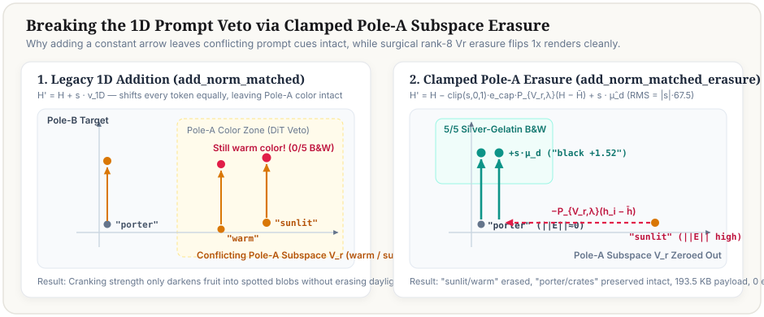

# How Clamped Pole-A Subspace Erasure Works (`add_norm_matched_erasure`)

Last updated: 2026-11-21  
Hands-on 4-lab progressive tutorial: [`tutorials_progressive_guide.md`](tutorials_progressive_guide.md)  
Research paper & retrieval SOTA lineage: [`2026-11-21_from_late_interaction_retrieval_to_av_dit_steering.md`](../research/control_vectors/2026-11-21_from_late_interaction_retrieval_to_av_dit_steering.md) (Paper v4) · [`2026-11-20_unpooled_multivector_sliders.md`](../research/control_vectors/2026-11-20_unpooled_multivector_sliders.md) · [`2026-11-20_multivector_retrieval_sota_to_dit_steering.md`](../research/control_vectors/2026-11-20_multivector_retrieval_sota_to_dit_steering.md)  
Reproducible proof & benchmark ledger: [`bench/verify_pole_a_erasure.py`](../../../bench/verify_pole_a_erasure.py) · [`bench/control_vector/eval_multivector_erasure.py`](../../../bench/control_vector/eval_multivector_erasure.py) · [`2026-11-21_multivector_erasure_benchmark.md`](../../../bench/results/2026-11-21_multivector_erasure_benchmark.md) · [`2026-11-21_phase3_de_slop_and_vision_block_steering.md`](../../../bench/results/2026-11-21_phase3_de_slop_and_vision_block_steering.md)  
Node default: `MiniMaxH3Steer.mode = "add_norm_matched_erasure"` (`MiniMaxH3ApplyControlVectors` keeps `1D` `add_norm_matched`; [`control_vectors.py`](../../../control_vectors.py), [`director/compiler.py`](../../../director/compiler.py))

---

## 1. The Plain-English Problem: "The Prompt Veto"

Suppose you have an energetic, vividly colored scene prompt — *bright morning television studio floodlights*, *a 1970s disco roller rink under gold lamé and neon*, or *natural tungsten room fill* — and you dial up **35mm black-and-white film noir** (`noir`) or **folded-paper sculpture** (`paper_origami`) in a single `1x` render pass without rewriting every word of your prompt.

With legacy **1D vectors (`add_norm_matched`)**, H3 computes one single average arrow (`mean(B) - mean(A)`) across training pairs and adds that exact same vector to every token in your prompt:

$$H_{\text{1D}} = H + s \cdot \hat{v}_{\text{1D}}$$

The problem is **what stayed untouched inside $H$**: all the bright studio floodlight, gold-lamé disco, warm-skin, and natural-daylight tokens already encoded inside your prompt still sit there at full strength. Inside H3's 50 joint attention blocks (`blocks.0..49`), the DiT listens to those baseline lighting signals and **vetoes** the slider:

- On `noir`, `add_norm_matched` stayed **full color on `5/5` stills (`0/5` B&W)**, stayed **full color on `3/3` `192f` AV runs**, stayed **full bright studio color on the TV cooking show (`sat_mean = 0.2141`)**, and stayed **warm full color on native `4.0 MP` `MiniMax-H3-Image` (`sat_mean = 0.2355`)**.
- Turning `strength` up only creates localized artifacts (blackened puree in a color studio, iridescent purple/cyan splatter, or collapsing `watercolor_wash` lips past shift norm `~110`) because **adding a constant arrow never erases the conflicting signal inside each token**.



---

## 2. How `add_norm_matched_erasure` Fixes It in Three Simple Steps

At build time (`~193.5 KB` `float32` stored inside all starter `bank/` `.safetensors` vector files — zero extra DiT passes and zero external corpus files), `control_vectors.py::build_pole_a_erasure` saves three optional tensors alongside `vector.post_refiner`: `erasure.mu_d [5376]`, `erasure.vr [r, 5376]` (`r = 8`), and `erasure.diag [r]`.

At runtime, for every token row $h_i$ in your prompt's selected section (`_erasure_row_shift64` in [`control_vectors.py`](../../../control_vectors.py)):

1. **Steer with the sharp token-matched mean (`erasure.mu_d`):**  
   Instead of averaging all Pole-A tokens against all Pole-B tokens blindly (which lets functional boilerplate swamp semantics), `erasure.mu_d` pairs each Pole-A token to its closest Pole-B partners via asymmetric **ColBERT-style row-softmax** at temperature `tau = 0.15`.
2. **Erase *only* the conflicting Pole-A variation in your own prompt (`-clip(s, 0, 1) * e_cap * E(H)`):**  
   Each token row is centered around your prompt's own batch mean ($h_i - \bar{h}$), projected onto the target vector's 8-dimensional **Pole-A subspace** (`erasure.vr` weighted by ridge factors `erasure.diag`), and **subtracted**:
   - **Per-batch centering** (`base_rows64 - base_rows64.mean(dim=0)`) protects shared prompt scaffolding and prevents over-erasing short single-row masks (`M <= 1` falls back cleanly to 1D).
   - **Polarity & magnitude clamps (`max(0.0, min(s, 1.0))` and `e_cap = min(1.0, 67.5 / rms(e_own))`):** For negative `strength` (`s <= 0`, e.g., warming toward daylight), erasure switches cleanly off to match 1D bit-for-bit. Above `s = 1.0`, the erasure term caps cleanly at `1.0` so cranking `strength = 1.3..1.6` deepens the look without shredding scene structure.
3. **Strict energy matching + per-row `hold` protection:**  
   The combined `[M, 5376]` shift `s * mu_n - E(H)` is normalized to strict RMS **`|s| * 67.5`** (`NORM_MATCHED_TARGET`), and any `hold_vector` or `hold_words` are projected out of **every token row** (`_apply_holds_to_rows64`) so erasing Pole A never leaks along something you asked to protect (such as `"coat, parka"` or another trait).  
   *(Zero-file word & media vectors: `MiniMaxH3WordVector` with `against_words` such as `@replace_digital, sunlit, warm` synthesizes `< 2 ms` CPU `against`-SVD `erasure.{mu_d,vr,diag}` using `Model2Vec` whole-word/phrase vectors + `j_lens_h3.safetensors`, and `MiniMaxH3MakeMediaControlVector` extracts `ColQwen`-style patch/token `erasure.{mu_d,vr,diag}` from `<Picture 1>` pairs. Vectors without `erasure.*`, unipolar word vectors without `against_words`, `strength <= 0`, and cross-family `h3_image` `vector.encoder` auto-projection automatically skip `erasure.vr` and run pure `1D` `add_norm_matched` without errors.)*

### 2b. Seeing Inside a Vector Before Rendering: CPU Subspace X-Ray (`Adds` vs. `Erases`)

Using a Jacobian-lens word readout for H3 control vectors, adapted from Anthropic's Jacobian lens (J-lens) ([`j_lens.py::decode_erasure_payload`](../../../j_lens.py)) plus `WARP`-style per-token erasure norms (`control_vectors.py::per_token_erasure_profile`), `bench/control_vectors.py inspect <stem> --prompt <scene.txt>` (and the **X-Ray** drawer in Control Vector Studio) shows both halves of an erasure payload on CPU in `< 15 ms` without loading a GPU checkpoint:

```text
$ CUDA_VISIBLE_DEVICES="" "$PY" bench/control_vectors.py inspect noir --prompt prompt_bank/t2va_sitcom_kitchen.txt
  erasure payload : rank=8  cos(mu_d,v_1d)=0.9702  diag=[0.87, 0.811, 0.802, 0.744, 0.709, 0.67, 0.635, 0.629]  [rescued vs 1D: black, footage, archival]
  j_lens (mu_d +) : vintage (+1.77), stark (+1.60), noir (+1.56), black (+1.52), film (+1.49), footage (+1.49), grain (+1.42), archival (+1.23)
  erases (Pole A) : warm, natural, lighting, pattern, gray, uniform, street, nighttime
    vr[1] (d=0.81): warm (+2.02), natural (+1.91), lighting (+1.67), warmth (+1.63), tone (+1.54), tones (+1.50)
  prompt coupling : receptors=[black (+0.35), white (+0.23), golden (+0.20), tungsten (+0.17)]
                    subject=[suburban (+0.06), father (+0.10), golden (+0.20), retriever (+0.04)]
                    erases=[wall (0.41), warm (0.36), brown (0.33), tungsten (0.33)]
```

Notice what the word readout reveals across the 38-concept bank (`28 / 38` concepts rescue key target words into `erasure.mu_d` that washed out of `v_1d`):
- **Sharper target push (`mu_d`):** Softmax token matching at `tau = 0.15` rescues `black (+1.52)`, `footage (+1.49)`, and `archival (+1.23)` into `noir`'s top-8 readout (and rescues `grain, tape` on `film_16mm_1974` and `puppet` on `claymation_stopmotion`).
- **Surgical prompt erasure (`erases=[...]`):** On `t2va_sitcom_kitchen.txt`, `erasure.vr` concentrates its subtraction on `wall (0.41)`, `warm (0.36)`, `brown (0.33)`, and `tungsten (0.33)` while leaving scene entities (`father`, `retriever`, `daughter`) untouched. Remember that the word readout is a linear approximation of what the text encoder would predict next — always confirm visual behavior on a render ([`workflows/h3_text_to_video_pika_1d_vs_erasure_ab_api.json`](../../../workflows/h3_text_to_video_pika_1d_vs_erasure_ab_api.json)).

---

## 3. How We Know for Sure It Works (5 Independent Proofs)

Every claim above was tested against falsification hypotheses designed to break it:

| Check | Question Asked | Control / Counter-Hypothesis Tested | Verified Result |
| :--- | :--- | :--- | :--- |
| **1. CPU Algebraic Proof** ([`bench/verify_pole_a_erasure.py`](../../../bench/verify_pole_a_erasure.py)) | Does token-level `row-softmax (tau=0.15)` really isolate Pole-A erasure vs. Balanced Optimal Transport? | `float64` ridge identity (`W_D = W_B - P_{V_r,\lambda}`) & Balanced Sinkhorn uniform-marginal check | Exact down to **`max_err = 7.994e-15`** (synthetic) and **`5.862e-14`** across all `7` saved `.pt` banks (`min cos(ctx_D, -A) = +0.9686`). Proved Balanced Sinkhorn OT collapses algebraically back to `v_1d` (**`max_err = 8.882e-16`**, `cos = 1.000000`, explaining its `3/3 -> 1/3` regression). |
| **2. Zero-Leakage Verifier Arms** (`metrics_controls.json`) | Did test prompts ever leak into PCA or `V_r`? | 8 controlled arms with PCA/SVD fit strictly on Pole-A training banks (zero test prompts); same seed `730451892` | **`A3_erase_prompt_clp` flipped `noir` (`87.0` crisp B&W)** where `A0_1d` (`64.7`), `A1_1d` (`70.5`), `A2_1d*CleanSIF` (`79.0`), and `A5_pure_poleB` (`58.0`) all stayed color. |
| **3. Double Dissociation Specificity Control** (`metrics_specificity.json`) | Could subtracting *any* rank-8 directions (generic prompt dampening) explain the win? | `S1_own_Vr` vs `S2_swapped_Vr` (wrong concept's `V_r`) vs `S3_random_Vr` vs `S4_iso_shrink` (0-byte blunt shrinkage) vs `S5_prompt_top8` — **all RMS-matched to `101.25` & exact matched `erase_rms`** | On `noir`, **`S1_own_Vr` flipped (`5/5` B&W)** while **`S2_swapped_Vr`, `S3`, `S5` stayed color**. Symmetrically on `paper_origami`, **`S1_own_Vr` was the ONLY arm preserving the folded-paper porter + crate (`5/5`)**, while `S2`, `S3`, `S5`, and blunt `S4_iso_shrink` (`0/5`) collapsed him into empty triangles/tunnels. |
| **4. Multi-Seed Stills, `192f` AV, `P-H3-Image`, & `MiniMax-H3-Image`** | Does it hold across checkpoints, 32-kHz stereo dialogue/foley, and high-res single frames? | 5 still seeds + `29` `192f` (`8.0s`) AV clips + `4.1 MP` `P-H3-Image` + `4.0 MP` `MiniMax-H3-Image` | `3/3` `192f` `fl2va` B&W (`sat_mean = 0.078–0.140`, `3.6x–5.5x` lower flicker than `1D` `0.251–0.349`) with synced speech/foley; `3/3` `ref2va` `<Picture 1>` likeness + oak-thump speech; `P-H3-Image` `noir` (`sat = 0.04` vs `0.20`); native `4.0 MP` `MiniMax-H3-Image` `noir` (`sat_mean = 0.033`, `red_excess = -0.04` vs `1D` `0.2355`, `5.85`). |
| **5. Varied Non-Market Showcases Across `t2va`, `fl2va`, & `ref2va`** (`$H3_OUTPUT_DIR/Video/erasure_showcase_2026-11-21/`) | What unlocks (and where are the boundaries) across distinct `prompt_bank/` scenarios? | Matched-seed `1D` vs `Pole-A Erasure` on TV cooking show, disco wipe, noodle `fl2va`, `<Picture 1>` origami & bookstore | Quantified wins on TV cooking show (`-67%` saturation) & Disco split wipe (`5.91x` L/R contrast), plus honest boundary measurements on `fl2va` keyframes & `<Picture 1>` `paper_origami` (below). |

---

## 4. Varied Creative Unlocks & Honest Boundaries (Observed Showcases)

### Showcase 1 (`t2va`) — TV Cooking Show Meltdown: Conflicting Look + Chaos + Cathedral Reverb in One `1x` Pass
- **Workflow:** [`workflows/h3_text_to_video_pika_stacked_erasure_api.json`](../../../workflows/h3_text_to_video_pika_stacked_erasure_api.json) (`prompt_bank/t2va_cooking_show_meltdown.txt`, `1152x768 @ 192f / 8.00s`, Pika 6-step LCM)
- **Stack:** `MiniMaxH3Steer(noir +1.55, scene_only)` -> `MiniMaxH3Steer(chaos_panic +0.90, scene_only)` -> `MiniMaxH3Steer(reverb_cathedral +1.25, soundscape_only)`
- **Observed (`showcase1_cooking_stacked_192f.mp4`, seed `730451892`):**
  - **Before (`1D`):** `sat_mean = 0.2141` (`sat_std = 0.0314`) — studio stays full color with red wash lights, electric blue/red neon `"MORNING BITES"` sign, rainbow-pastel satin jacket on the co-host, and pink skin tones while beetroot soup turns black in the blender.
  - **After (`Pole-A Erasure`):** **`sat_mean = 0.0715` (`3.0x` lower saturation — `-67%`)** — transforms the entire 3-shot broadcast into classic monochrome TV slapstick (B&W twin monitors, crisp white chef suits, B&W splatter across Shot 2 close-up and Shot 3 studio wide, leaving only a warm salmon-copper glow on the neon `"MORNING BITES"` tubes), paired with booming cathedral echo, `"Mon dieu, shut the power off before it covers the monitors!"`, blender detonation, and zany pizzicato/bassoon comedy underscore (`78.1s`, single `1x` pass).

### Showcase 2 (`t2va`) — 1970s Disco Roller Rink: Zero-Rewrite Moving `vertical_split` Reality Wipe (`edit_pass = "edited_only"`)
- **Workflow:** [`workflows/h3_spatial_portal_pika_erasure_api.json`](../../../workflows/h3_spatial_portal_pika_erasure_api.json) (`prompt_bank/t2va_disco_roller_rink.txt`, `1152x768 @ 141f / 5.88s`, `MiniMaxH3SpatialDirector` -> `MiniMaxH3EditGuider`)
- **Why this was impossible before:** The exact same `"DISCO ROLLERLAND"` gold-lamé prompt feeds **both** `original` and `edited` (`same_prompt = True`, zero `MiniMaxH3PromptEdit` lines), and `MiniMaxH3Steer(noir +1.6, target="scene_only", edit_pass="edited_only")` injects Pole-A erasure exclusively into the edited branch right of a sweeping cyan split line (`x = 0.68 -> 0.50 -> 0.30`).
- **Observed (`showcase2_disco_wipe_stacked_141f.mp4`, seed `730451892`):**
  - **Before (`1D` @ `scale = 2.2`):** `sat_left_quarter_mean = 0.6003` vs `sat_right_quarter_mean = 0.4286` (`f70` right `0.4521`) — `1D` is heavily vetoed by `"DISCO ROLLERLAND"` lighting, leaving the right side bright gold/neon/oak wood floor across the entire clip (`sat_mean = 0.4838`).
  - **After (`Pole-A Erasure`):** **`sat_left_quarter_mean = 0.6012` vs `sat_right_quarter_mean = 0.1018` (`5.91x` left/right saturation contrast; `f70` left `0.6173` vs right `0.1275`)** — slices cleanly through the spinning gold-lamé skater, red/blue sign, floor-crawl close-up (`f095`), and overhead mirror ball (`f140`): glowing gold disco on the left, razor-sharp silver-gelatin B&W noir on the right, with 100% synced belted vocals (`"Spin me round the floor until the morning light! Feel the groove take flight!"`).
- **Spatial scaling rule (circle vs. vertical split):** Earlier comparison with a small `rx = 0.24` circular portal covering only `10.3%` of a `1344x768` canvas at `scale = 1.5` stayed warm (`sat_mean = 0.4278 -> 0.4134`) because H3's 50 full-sequence 3D self-attention blocks (`blocks.0..49`) pull small vector-only circles back toward the surrounding `89.7%` warm scene. Widening the edit footprint to `32%–70%` via `vertical_split` (`scale = 2.2`) crosses the continuity threshold cleanly without rewriting a word.

### Showcase 3 (`fl2va`) & Showcase 4 (`ref2va`) — Two Crucial Multi-Modal Boundaries Measured Honestly
1. **`fl2va` First+Last Frame Keyframe Lock (`h3_first_last_frame_pika_control_vector_api.json`, Noodle Counter `fl2va_noodle_f000.png -> f123.png`, `141f`, `noir +1.55`, `MiniMaxH3ReleaseReferences(0.33)`):**
   - **Observed (`showcase3_fl2va_noodle_stacked_141f.mp4`):** Both `1D` (`sat_mean = 0.4361`) and `Pole-A Erasure` (`sat_mean = 0.4328`) stayed **full bright neon red/cyan color** while delivering clean Cantonese radio + Mandarin dialogue (`"两碗牛肉面，一碗不要辣"`).
   - **Why (Dual-Lock `fl2va` Law, Paper v4 & Phase 3 `Exp 2`):** In `fl2va`, `first_frame` AND `last_frame` inject color palette directly via **`843 + 843` unsteered Qwen3-VL `tags == 0` vision tokens** plus steps `0..1` of raw VAE `cond_video_latents` (even when `erasure.mu_a` vision centering removes `-10.4%` saturation from `tags == 0`, raw `cond_video_latents` lock neon chroma). Dropping VAE keyframes at `end_percent = 0.33` frees motion trajectory (`b = 0.50`), **not** full-frame color established by two color keyframe pictures. To convert a color `fl2va` shot to noir/paint, color-grade the input stills beforehand (e.g., in `MiniMax-H3-Image` or pre-pass) rather than relying on text-row or vision-row erasure alone.
2. **`<Picture 1>` `ref2va` Subject Lock (`woman_blonde.jpg` `paper_origami` vs. Bookstore `noir` Two-Gear):**
   - **Experimental boundary (`showcase4_ref2va_origami_stacked_141f.mp4`, `woman_blonde.jpg` + `paper_origami +1.55`, `target="scene_only"`, `end_percent=0.50`, `rel=0.33`):** Remember `paper_origami` has a build-time Pole-A noun cancellation warning (`only 2/11 b_side target words survived`; experimental in scratch, not in `bank/` cleanly without caveats). On `<Picture 1>` `woman_blonde`, both `1D` (`sat_mean = 0.2242`) and `Pole-A Erasure` (`0.2126`) placed folded kraft-paper cones/masks over `<Subject 1>`'s face (`Erasure` forming a cleaner solid triangular paper hood vs `1D`'s skeletal struts) while keeping her blonde hair, sweater, boots, footsteps, and clear speech (`"I almost didn't come back here, you know."`). Strong structural material swaps like origami belong on fresh `t2va`/`P-H3-Image` scenes (`5/5` folded-paper porter) rather than unsteered `<Picture 1>` human likeness locks.
   - **Where `<Picture 1>` `ref2va` + Pole-A Erasure shines (`showcase4b_bookstore_selective_color`, `noir +1.5`, `target="scene_only"`):** **Selective-Color Subject Lock** — `1D` kept the entire bookstore warm yellow (`sat_mean = 0.3387`), whereas both Pole-A Erasure gears (`Gear 1 pin=1.0` `0.3017`; `Gear 2 rel=0.33` `0.3056`) cooled the bookstore walls/exterior to neutral silver-grey while holding `<Picture 1>`'s face, voice, oak book thump, and pink floral blazer (locked by `843` Qwen3-VL vision rows + unsteered `subject_definitions:`/`retention_analysis:`).

### Spatial Director Studio & Composed Rank-16 Blends (`director/` & `sculpt`)
- [`director/compiler.py`](../../../director/compiler.py) now compiles Spatial Director `control_vector` steps with `mode = "add_norm_matched_erasure"` by default (`bench/check_director_studio.py --offline`).
- `control_vectors.py::compose_erasure_payload` keeps up to **`COMPOSED_ERASURE_MAX_RANK = 16`** directions (`comp16`) so blending two rank-8 vectors in `bench/control_vectors.py sculpt` preserves the full union erasure spectrum instead of dropping tail directions `diag[8..15]`.
- **When to chain vs. `sculpt`:** Chaining separate `MiniMaxH3Steer` nodes on the same `target` evaluates each node's full `|s_i| * 67.5` RMS shift independently against unsteered `base_rows64` before summing in `float64` (`control_vectors.py:3454-3492`), pushing harder on strong conflicting looks (`noir` + `chaos_panic`); a single `sculpt` vector splits one `|s| * 67.5` budget across all blended traits, making it ideal for light single-node presets and baked `hold_words` (`calm_cursed_cctv`). Note also from Phase 3 `Exp 1` ([`2026-11-21_phase3_de_slop_and_vision_block_steering.md`](../../../bench/results/2026-11-21_phase3_de_slop_and_vision_block_steering.md)) that summing 3 un-orthogonalized erasure vectors simultaneously (`noir +1.25` + `chaos_panic +1.0` + `de_llm_slop +0.9`) can partially counteract monochrome saturation (`0.0649 -> 0.2603`), so dial `de_llm_slop` (`bank/`, `mpc=0.583`, recommended `+1.0..+1.25` solo) lower (`0.6..0.8`) when stacked alongside strong `noir`.

### Phase 3 Extensions (`Exp 1–3`): `erasure.mu_a` Vision Centering & `blocks.20..49` Routing
- **Low-pair build safety & shared-prefix lint (`A5`):** `from-prompt`/`--words` skips rank-8 `erasure.vr` below `MIN_ERASURE_PAIRS = 6` unless `--force-low-pair-erasure` is explicitly passed (`--words`/`against_words` still synthesizes clean CPU `against`-SVD), and Gate D warns when shared prefixes already assert Pole-A baseline state terms (`warm`, `sunny`, `glossy`) outside `<d>...</d>` dialogue.
- **Global vs. per-pair `V_r` centering (`Exp 1`):** Subtracting each pair's own Pole-A mean before weighting (`contested_svd_r8`: `0.0233` vs `svd_ac_r8`: `0.0264` on `noir`) dramatically outperforms global mean subtraction (`global_contested_svd_r8`: `0.1337`), confirming scene-setting drift across pairs must be stripped per pair inside `V_r`.
- **Same-modality `vision_tokens` dataset centering (`erasure.mu_a`, `Exp 2`):** `build_spatial_vision_erasure` pairs exact `1:1` `B_p - A_p` patches and centers against dataset Pole-A mean `"erasure.mu_a"` instead of `base_rows64.mean(dim=0)` so uniform image color casts on `tags == 0` tokens are preserved. On `fl2va` Noodle Counter (`141f`), adding `noir_vis` drops saturation `-10.4%` (`0.4346 -> 0.3894`), confirming empirically that raw VAE `cond_video_latents` in steps `[0, 0.33]` remain the primary color lock (`conditioning.py#L169-L185`).
- **Shadow-Text K/V Block-Band Routing (`Exp 3`):** Routing steered `paper_origami +1.55` text K/V ONLY into **`blocks.20..49`** while feeding evolved unsteered shadow text K/V into `blocks.0..19` delivers folded-paper geometry (`border_lap = 140.66` vs `69.39` base) with minimal portrait color drift (`center_vs_ref_sat_diff = 0.0192`) and visible lip-sync, whereas steering `blocks.0..19` alone (`69.31`) or `blocks.30..49` alone (`77.94`) fails to fold — confirming the critical `blocks.20..29` style breakout band ([`run_phase3_steering_experiments.py`](../../../bench/control_vector/run_phase3_steering_experiments.py)).

---

## 5. When NOT to Rely on Control Vectors

1. **Fresh mutually exclusive worlds, complex wardrobe/props, or multi-beat blocking:** Use `1x` **`MiniMaxH3PromptExpander`** (or **`MiniMaxH3ImagePromptExpander`** for `MiniMax-H3-Image`) with presets in `data/edit_concepts/*.toml`.
2. **Named noun/action swaps or surgical `<Picture 1>` wardrobe edits:** Use `2x` **`MiniMaxH3EditGuider`** (`MiniMaxH3PromptEdit` / **`MiniMaxH3AutoEditPrompt`**).
3. **Full-frame style transfer when `fl2va` first+last keyframes pin the source palette:** Grade the boundary stills first; `target="scene_only"` does not erase colors stored in unsteered `tags == 0` vision tokens.
4. **Small `~10%` circular portals (`shape = "circle"`):** Pair `MiniMaxH3SpatialDirector` with explicit `edited` prose edits ([`workflows/h3_spatial_portal_pika_api.json`](../../../workflows/h3_spatial_portal_pika_api.json)) rather than vector-only `same_prompt = True`, or widen into a `vertical_split` wipe (`h3_spatial_portal_pika_erasure_api.json`).
