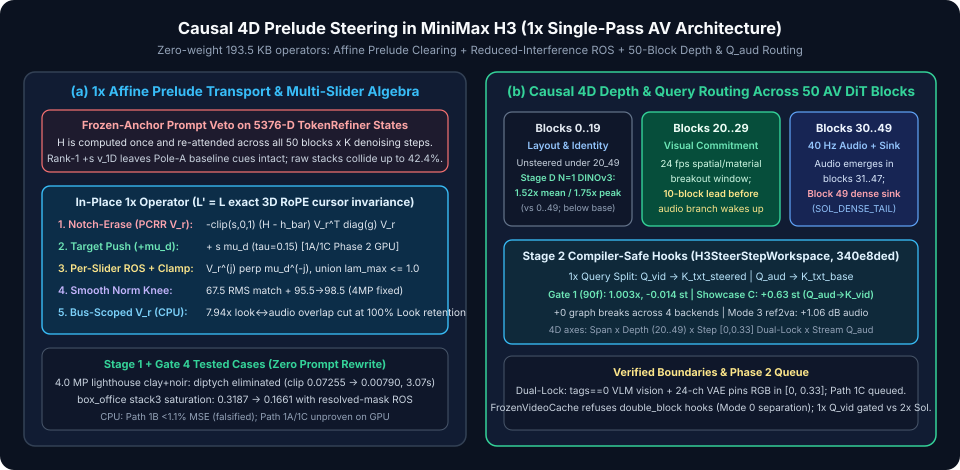

# Causal 4D Prelude Steering in a Single-Stream Joint Audio-Video Diffusion Transformer

**Subtitle:** *Resolving the `1x` Frozen-Anchor Prompt Veto in MiniMax H3 via Affine Subspace Clearing, Depth-and-Audio Query Routing, and Reduced-Interference Multi-Slider Composition*  
**Date:** 2026-11-22 (v5 Canonical Manuscript Stub — Aligned with `b657c6a8` `48`-stem active bank; `[PHASE 2 GPU]` slots explicitly marked)  
**Authors:** MiniMax H3 Explorations Research Hub  
**Home & Build Scripts:** [`README.md`](README.md) · [`main.tex`](main.tex) · [`figures/README.md`](figures/README.md)  
**Predecessor (Frozen Provenance):** [`2026-11-21_from_late_interaction_retrieval_to_av_dit_steering.md`](../research/2026-11-21_from_late_interaction_retrieval_to_av_dit_steering.md) (v4) · [`2026-11-22_paper_v4_critical_review_prior_art_and_revision_plan.md`](../research/2026-11-22_paper_v4_critical_review_prior_art_and_revision_plan.md)  
**Primary Implementations:** [`control_vectors.py`](../../../../control_vectors.py) · [`control_vector_nodes.py`](../../../../control_vector_nodes.py) · [`steer_attention_hooks.py`](../../../../steer_attention_hooks.py) · [`sol_attn_h3.py`](../../../../sol_attn_h3.py) · [`h3_spans.py`](../../../../h3_spans.py) · [`j_lens.py`](../../../../j_lens.py)

---

## Abstract

Single-pass (`1x`) linear activation steering fails in **MiniMax H3** whenever a static text/vision conditioning matrix $\mathbf{H}_{\text{prelude}} \in \mathbb{R}^{L \times D}$ is re-injected across every block and denoising iteration (*the Frozen-Anchor Prompt Veto*): opposing baseline descriptors inside $\mathbf{H}_{\text{prelude}}$ re-assert themselves across all `50` joint audio-video blocks and veto rank-1 additions, whereas `2x` differential velocity guidance doubles compute and requires text rewrites. Studying all four MiniMax H3 checkpoints (`fl2va`, `ref2va`, `P-H3-Image`, and `MiniMax-H3-Image`; `5376`-D bidirectional `TokenRefiner`, `24 fps` video + `40 Hz` stereo audio single-stream DiT), we characterize `1.00x`-NFE creative steering across three coupled mechanisms: **(1) Affine Prelude Transport** combining prompt-centered rank-$r$ baseline clearing $-\mathbf{P}_{\mathbf{V}_r,\lambda}$ with soft-MaxSim target pushes $\hat{\boldsymbol{\mu}}_d$; **(2) Causal 4D Depth & Query Routing** isolating visual/material breakout in `blocks.20..29` (`1.52x` mean / `1.75x` peak DINOv3 face retention over `blocks.0..49` on `Stage D` `90f` `ref2va` `paper_origami`, still below base `0.399 / 0.657`), a `10`-block audio emergence lag (`blocks.31..47`), terminal `block 49` consolidation, and compiler-safe `1x Q_aud -> K_txt_base` query slicing (`Gate 1` `90f` `fl2va`: `1.003x` base latency, `+0` `malloc_graph_breaks` across `4` backends, `YIN` $F_0 = -0.014\text{ st}$ global / $+0.533\text{ st}$ paired median; `Mode 3` `ref2va`: `+1.06 dB`, while Showcase C retains $+0.630\text{ st}$ global / $+0.781\text{ st}$ paired residual `Q_aud -> K_vid` coupling vs. `2x` $+0.007\text{ st}$); and **(3) Reduced-Interference Compositional Algebra** addressing up to `42.4%` cross-slider erasure and `50.9%` shared live-action scaffolding via clamped union spectra ($\lambda_{\max} \le 1.0$), per-slider Retain-Orthogonal Subspaces (`ROS`, yielding zero first-order peer-target erasure on rank-1 pushes), barrier-aware resolved-mask grouping, and a smooth conditioning-norm knee (`95.5 -> 98.5`) that eliminated the Phase 4 `4.0 MP` `lighthouse` (`claymation + noir`) diptych (`highlight_clip 0.07255 -> 0.00790`, `3.07s`) and reduced `box_office` `stack3` saturation (`0.3187 -> 0.1661`). Alongside a pre-consolidation `52`-stem CPU cross-interference census and `7`-bank LOPO audit (`median cos(mu_d, v_1d) = 0.9935`), we consolidate the active bank to `48` verified stems (`137` `.safetensors`, `5` retired including `stained_glass_cathedral` at `mpc = 0.762` -> `0/2` `t=1` screening), document an honest Regime B case study (`de_llm_slop`), falsify unsupervised `Path 1B` token routing on CPU (`< 1.1%` MSE), and define open `[PHASE 2 GPU]` gates for `Bus-Scoped drop_look_pc16` (`7.94x` CPU overlap reduction), explicit `Path 1A` facets, `Path 1C` `ColQwen` Dual-Lock release, and diverse `192f`/`243f` non-`noir` AV evaluation.

---

## 1. Introduction: Frozen-Anchor Recurrence & The Three-Pillar Thesis

### 1.1 Autoregressive Self-Steering vs. Prelude Input Injection in MiniMax H3

In causal autoregressive language models, a weak rank-1 nudge $\mathbf{h}' = \mathbf{h} + s\hat{\mathbf{v}}_{\text{1D}}$ needs only to flip early discrete *pivot tokens*; once sampled, those generated tokens append to the prefix and rewrite the KV cache to self-steer subsequent generation. Non-autoregressive Diffusion Transformers like MiniMax H3 invert this causal topology. H3's **Prelude** (`Qwen3-VL-32B` layers `0..49` + `condition_proj` + 2-block bidirectional `TokenRefiner`) produces $\mathbf{H}_{\text{prelude}} \in \mathbb{R}^{L \times 5376}$ **once** before step $k = 0$, and the iterative **Core** (`50` single-stream `MiniMaxH3Model` DiT blocks) re-attends the same $\mathbf{H}_{\text{prelude}}$ at every step $k = 0,\dots,K-1$.

When $\mathbf{H}_{\text{prelude}}$ encodes a lighting, palette, material, or acoustic prior contradicting a desired edit, rank-1 mean addition fails at `1x` NFE (`0/5` `noir` stills and `0/3` `192f` videos turn monochrome; `paper_origami` deletes foreground subjects when forced upward), whereas `2x` CFG/edit guidance doubles DiT forward passes.

### 1.2 Thesis and Tightened Contributions

This work restricts all empirical claims strictly to verified **MiniMax H3** video, audio-video, and single-frame DiT pipelines (Table 1 checkpoints) and establishes four bounded contributions:

1. **Flagship Mechanistic & Causal 4D DiT Routing (§5):** Mapping `blocks.0..49` isolates `blocks.20..29` as the spatial/material breakout band (yielding `1.521x` mean / `1.754x` peak DINOv3 CLS retention vs. `blocks.0..49` on Stage D `90f` `ref2va` `paper_origami`, still below unsteered base `0.399 / 0.657`), a `10`-block audio lag (`blocks.31..47`), and `block 49` sink behavior (`sol_attn_h3.py::SOL_DENSE_TAIL`). Promoting compiler-safe hooks ([`steer_attention_hooks.py::H3SteerStepWorkspace`](../../../../steer_attention_hooks.py#L245)) delivers `1x Q_aud -> K_txt_base` voice protection at `1.003x` base latency (`+0` added `malloc_graph_breaks`, Gate 1 `90f` `fl2va` `YIN` $F_0 = -0.014\text{ st}$ global / $+0.533\text{ st}$ paired median; Showcase C $+0.630\text{ st}$ global / $+0.781\text{ st}$ paired residual `Q_aud -> K_vid` shift vs. `2x` $+0.007\text{ st}$).
2. **Corrected Affine Prelude Transport & Diagnostic Self-Correction (§4):** We present our `Theorem 1` ridge split honestly as classical Principal Components Ridge Regression (**Lemma 1**, `5.862e-14`), whose scientific value was refuting our assumption that `M3` worked via Pole-B token transport (`97%–99.6%` was $-\mathbf{P}_{\mathbf{V}_r,\lambda}$). We state explicit post-RMS non-inversion ($\gamma \le 1$) and clamped union bounds in **Theorem 1** and pair `< 15 ms` Jacobian-lens introspection (`j_lens.py::decode_vector`) with balanced **Regime A vs. Regime B** diagnostics.
3. **Reduced-Interference Multi-Slider Algebra (§3, §4, §6.2):** Across a pre-consolidation `52`-stem `__fl2va__` census (`2,652` pairs), we measure up to `42.4%` cross-slider erasure, a `15.9%` self-overlap trap, and `50.9%` shared live-action scaffolding (`G = 0.1540` = `103.5x` random), show on CPU why `Bus-Scoped drop_look_pc16` (`7.94x` look-audio overlap cut, `100%` Look retention) beats naive global PC removal, and verify Stage 1+2 `peer_ros` + `soft_cap_stacked_rms` on Phase 4's `4.0 MP` `lighthouse` and `box_office` `stack3` cases.
4. **Honest `t=1` / Track 2 Push-Side Boundaries & Dual-Lock Law (§3.2, §6.4, §7):** Across `7` cached `.pt` banks, `35.2%–48.6%` of transition energy remains unexplained after `1D mu_d + r=8` clearing. We show that high CPU `mpc` alone does not guarantee pixel emergence (`stained_glass_cathedral` `0.762` -> `0/2` `t=1`), falsify unsupervised `Path 1B` token routing on CPU (`< 1.1%` LOPO MSE), and isolate the remaining prerequisites (`make_cmds.py` `--scene-prompts` CLI, soft-hold/`mu_a` scrubbing, Dual-Lock `[0, 0.33]` release) before `[PHASE 2 GPU]` tests of `Path 1A` facets and `Path 1C` `ColQwen` patches.

---

## 2. Related Work (Prior Art & Attribution)

To situate this system accurately inside 2020–2026 representation engineering, we explicitly distinguish inherited linear/spectral operators from our empirical joint AV findings:

- **Affine Subspace Erasure & Concept Editing (`ACE`, `LEACE`, `CURE`, `Safree`, `IPErase`, `Linear-AcT`, `RASteer`):** Iterative nullspace projection (`INLP`, `RLACE`) and closed-form oblique projection (`LEACE`) were unified with activation addition by **Affine Concept Editing (`ACE`)**, alongside SVD spectral/null-space diffusion erasers (**`CURE`**, **`Safree`**, **`IPErase`**), optimal-transport **`Linear-AcT`** (ICLR 2026), and retain-aware **`RASteer`** (`ROS` + `OAC`, Oct 2026). Rather than re-deriving negative safety unlearning, our Prelude operator adapts affine clearing to *positive, continuous creative conflict resolution* at `1.00x` NFE using prompt-local centering $\bar{\mathbf{h}}$, $[0,1]$ polarity clamping, and RMS-locked double-dissociation controls.
- **Video, Audio, & Step-Adaptive Steering (`MUTE`, `FADE`, `STAS`, `TADA!`, `DATE`, `Diffusion Steering Lens`):** To our knowledge, prior DiT steering methods evaluate single-modality video or audio backbones separately — text K/V motion unlearning (`MUTE`), frame-aware reactivation resistance (`FADE`), massive activation steering (`STAS`), dynamic step gating (`DATE`), or audio-only control (`TADA!`) — rather than mapping depth-band specialization and `1x` query-sliced modal isolation inside a unified single-stream AV DiT.
- **Late-Interaction Retrieval & Static Probes (`ColBERT`, `ColQwen`, `Ward Pooling`, `Model2Vec`, `Chain Lens`):** Asymmetric row-softmax aligns unequal-length spans (`erasure.mu_d`, `tau = 0.15`), hierarchical Ward clustering exposes Pole-B facets (`Path 1A`, CPU-analyzed), and regularized linear inversion (`j_lens.py`) provides `< 15 ms` lexical X-ray visibility into truncated VLM + bidirectional refiner states.

---

## 3. H3 Prelude Architecture, Bank Census, & `t=1` Emergence Boundary

### 3.1 Evaluated MiniMax H3 Checkpoints

| Architectural Axis | Base `MiniMax-H3` (`fl2va`) | Distilled `MiniMax-H3` (`fl2va` / `ref2va`) | `P-H3-Image` | Native `MiniMax-H3-Image` |
| :--- | :--- | :--- | :--- | :--- |
| **Prelude Stage 1 & 2** | `Qwen3-VL-32B` (`L0..49`) + `BF16` `TokenRefiner` (`5376`-D) | Same (`fl2va` $\leftrightarrow$ `ref2va` cos `0.989`) | Same (`fl2va_base` weights) | Rotated `TokenRefiner` (`1D cos ≈ 0.214` vs `fl2va`) |
| **Core (`50` Blocks) & Clocks** | `50` Euler steps; `24 fps` video + `40 Hz` stereo audio | `6` Pika steps; `cfg=1.0`, shifts `(12.0, 3.0)` | `8` steps; `4.1 MP` image (`length=1`) | `4` steps; `16 MP -> 4.0 MP` floor |

In-place modification of `context[:, mask, :]` preserves sequence length $L' = L$ and keeps `PackedLayout` `[text | refs | audio | video]` 3D RoPE phases bit-exact (`comfy/ldm/minimax/model.py::MiniMaxH3Model`). Meanwhile, unpooled token shifts discard `51.6%–76.6%` of shift energy when collapsed to rank-1 `v_1d`.

### 3.2 `52`-Stem Census, `48`-Stem Bank Consolidation, & `t=1` Screening

Auditing the pre-consolidation `52`-stem `__fl2va__` census (replacing v4's unfiltered `"28 / 38"` set-difference word metric) and the `6f7131dd` / `b657c6a8` stabilization pass establishes five empirical observations:

1. **Narrow Cosine Between `mu_d` and `v_1d` (`median = 0.9935`):** Across the `52`-stem census, `48 / 52` satisfy $\cos(\boldsymbol{\mu}_d, \mathbf{v}_{\text{1D}}) \ge 0.980$. Soft-MaxSim materially redirects only `4 / 52` length-asymmetric concepts (`film_16mm_1974_neutral` `0.9479`, `film_16mm_1974` `0.9529`, `noir` `0.9702`, `de_llm_slop` `0.9719`) and acts elsewhere as a zero-cost refinement.
2. **Cross-Interference & Self-Overlap (`2,652` Ordered Pairs):** Raw peer erasure $\|\mathbf{V}_r^{(j)} \hat{\boldsymbol{\mu}}_d^{(i)}\|_2^2$ reaches `0.4240` (`D`-weighted `0.3520`; `V_r(noir)` hits `cyberpunk_neon_rain` at `0.3166`), while **self-overlap** $\|\mathbf{V}_r^{(i)} \hat{\boldsymbol{\mu}}_d^{(i)}\|_2^2$ averages `0.1593` (`max 0.3284`). Consequently, naive global `V_r perp all mu_d` loses `+34%..+70%` Pole-A erasure potency.
3. **`50.9%` Shared Live-Action Scaffolding (`G = 0.1540` = `103.5x` Random):** Pairwise subspace alignment reaches `median cos(theta_1) = 0.6691`, with `48.8%` (`D`-weighted `49.6%`) of `P_k` energy sitting in bank `PC[0..15]`. Crucially, on held-out prompts, `64.2%–69.1%` of Look Regime A erasure energy (`noir`, `paper_origami`, `claymation`) sits inside `PC[0..15]` (the natural live-action baseline they must clear), whereas `reverb_cathedral` (`50.4%–51.0%`) and `chaos_panic` (`59.2%–59.8%`) leak across buses — requiring **bus-scoped `V_r`**, never blind global `PC[0..15]` stripping.
4. **Regime A vs. Regime B & Unexplained Push Residual:** Symmetric subtraction suits Regime A manifold replacements (`noir`, `claymation_stopmotion`, `reverb_cathedral`) but flattens both poles on Regime B directional nudges (`de_llm_slop`, `look_amber_candlelight`). On the push side across `7` `.pt` banks, `35.2%–48.6%` of transition energy remains unexplained after `1D mu_d + r=8` clearing.
5. **`48`-Stem Active Consolidation & `t=1` Visual Falsification (`6f7131dd`):** Retiring `5` stems (`earthquake_tremor` `cos=+0.7490` vs. `chaos_panic`, `stained_glass_cathedral`, `lettering`, `paper_origami`, `wes_anderson_symmetry`) yields `48` active stems (`48 fl2va`, `48 ref2va`, `41 h3_image` = `137` `.safetensors`) paired with a rebuilt `204`-term lexicon (`decone_pcs = 0`, `47/48` matched, `top1 = 0.8298`, `top3 = 0.9574`, `mrr = 0.9007`). In 2-scene `t=1` screening (`t2va_stairwell_dialogue.txt` + `t2va_restaurant_kitchen.txt`), `stained_glass_cathedral` failed **`0/2` visually despite having the highest CPU `mpc = 0.762`** (`sh = 0.942`) among the `7` new packs, while `power_outage_flashlight` darkened scenes without drawing a flashlight beam — leaving `4` verified visual winners (`charcoal_sketch_animated`, `x_ray_fluoroscope`, `mercury_liquid_chrome`, `blacklight_uv_rave`) and proving high CPU `mpc` is a necessary filter, not a sufficient predictor of GPU emergence.

---

## 4. Formal Analysis & Multi-Slider Composition Algebra

### 4.1 Design Eliminations & Fixed-Prompt Bottleneck (`Proposition 1`)

Rather than inflating engineering rejections into impossibility theorems, **Table 2** summarizes three structural constraints that eliminated alternative parameterizations:

<!-- table-caption: Eliminated Alternative Steering Parameterizations and Structural Constraints -->
| Rejected Design | Governing Constraint | Verified Failure / Elimination Reason |
| :--- | :--- | :--- |
| Ungated virtual token append ($K$ rows) | Unmodified softmax partition $Z_K > 0$ | Violates $s = 0$ neutrality unless gated to $-\infty$; adds `PackedLayout` RoPE/budget churn (`MAE = 22.73–54.15` at $s=0$). |
| Mean-pooled doubly-stochastic Sinkhorn OT | Column marginal $\mathbf{1}^\top \mathbf{T} = \frac{n_A}{n_B}\mathbf{1}^\top$ | Average displacement collapses identically to $\bar{\mathbf{B}}_p - \bar{\mathbf{A}}_p = \mathbf{v}_{\text{1D}}$ (`max_err = 8.882e-16`), requiring unpooled or asymmetric weights. |
| Unsupervised sparse dictionary atoms ($K=16$) | Sample dilution $\mathbb{E}[\|S_k\|] \le N_A / K$ | Collapses per-atom covariance rank when $N_A < 2K$ (e.g., `watercolor_wash` $N_A = 22 \implies 1.38$ tok/atom; `noir` `0/5` B&W). |

> **Proposition 1 (Fixed-Prompt Cross-Modal Subspace Bottleneck on `<Picture 1>` Pairs; formerly Prop 4).** *Encoding $N$ paired images $(\text{Pic}_{A,n}, \text{Pic}_{B,n})$ alongside a single constant prompt $P_0$ of $M_0$ tokens concentrates leading right singular directions $\mathbf{V}_r$ onto $P_0$'s lexical variance $\operatorname{span}(\bar{\mathbf{R}}_{P_0} - \mathbf{1}\boldsymbol{\mu}_A^\top)$ whenever cross-attentive perturbations $\|\boldsymbol{\Xi}_{A,n}\|_F$ are small relative to word variance, leaving unseen opposing prompt adjectives in $\ker(\mathbf{V}_r)$.* *(Operational status: `scene_prompts` is shipped in [`control_vector_nodes.py::make_control_vector_from_media_pairs`](../../../../control_vector_nodes.py#L3827), while CLI `--scene-prompts` in [`bench/control_vector/make_cmds.py`](../../../../bench/control_vector/make_cmds.py#L115) and soft-hold/`erasure.mu_a` scrubbing in [`bench/control_vector/helpers.py::_apply_erasure_holds`](../../../../bench/control_vector/helpers.py#L420) remain open Phase 2 prerequisites for `Path 1C`.)*

### 4.2 Lemma 1 (PCRR Empirical Split) & Theorem 1 (Clamped Compositional EQ)

> **Lemma 1 (Principal Components Ridge Regression Split Diagnostic).** *Let $\mathbf{A}_c = \mathbf{U}\boldsymbol{\Sigma}\mathbf{V}^\top$ denote the centered weighted `diff_span` matrix with top-$r$ factors $(\mathbf{U}_r, \boldsymbol{\Sigma}_r, \mathbf{V}_r)$. Because $\mathbf{U}_r^\top \mathbf{A}_c = \boldsymbol{\Sigma}_r \mathbf{V}_r^\top$ exactly by orthogonal columns of $\mathbf{U}$, the **Principal Components Ridge (`PCRR`)** estimator $\mathbf{W}_{\text{PCRR}} = \arg\min_{\operatorname{row}(\mathbf{W}) \subseteq \operatorname{row}(\mathbf{V}_r)} \|\mathbf{D}_c - \mathbf{A}_c \mathbf{W}\|_F^2 + \lambda\|\mathbf{W}\|_F^2$ splits for any $\mathbf{B}_c$ into:*
> $$(\mathbf{h} - \boldsymbol{\mu}_A)\mathbf{W}_{\text{PCRR}} \equiv (\mathbf{h} - \boldsymbol{\mu}_A)\mathbf{V}_r^\top \operatorname{diag}\!\left(\frac{\sigma_i}{\sigma_i^2 + \lambda}\right)\mathbf{U}_r^\top \mathbf{B}_c \;-\; (\mathbf{h} - \boldsymbol{\mu}_A)\mathbf{V}_r^\top \operatorname{diag}\!\left(\frac{\sigma_i^2}{\sigma_i^2 + \lambda}\right)\mathbf{V}_r.$$

Verified to `5.862e-14` (`bench/verify_pole_a_erasure.py`), Lemma 1 does *not* require ColBERT; its value was falsifying `M3 = Pole-B transport` by proving `97%–99.6%` (`ratio 4.2x–10.3x`, `cos +0.9686..+0.9960`) was the $-\mathbf{P}_{\mathbf{V}_r,\lambda}$ term built solely from `a_spans` (`control_vectors.py::build_pole_a_erasure`).

> **Theorem 1 (Clamped Parametric EQ, Per-Slider `ROS`, & Norm-Bounding Properties; [`control_vectors.py::_stacked_erasure_block_shift64`](../../../../control_vectors.py#L3565)).** *For $K$ grouped active sliders on identical resolved token rows (`_build_steered_context`), define per-slider Retain-Orthogonal Subspaces `ROS` projecting $\mathbf{V}_{r,j}, \mathbf{D}_j$ orthogonal to peer pushes $\{\hat{\boldsymbol{\mu}}_d^{(k)} : k \ne j\}$ (`control_vectors.py::orthogonalize_erasure_against_holds`), stack $\mathbf{W}_j = \sqrt{\operatorname{clip}(\min(s_j,1)\mathbf{D}_j^{\text{ROS}}, 0, 1)}\mathbf{V}_{r,j}^{\text{ROS}}$, and eigendecompose with strictly clamped eigenvalues $\mathbf{d}_{\text{union}} = \operatorname{clip}(\sigma^2, 0, 1)$. Then:*
> 1. **Exact Zero-Point & Polarity Symmetry:** $\Delta\mathbf{H}(0) = \mathbf{0}$; for $s_j \le 0$, erasure vanishes cleanly (`clip(s_j, 0, 1) = 0`).
> 2. **Bounded Union Spectrum:** Every union projector eigenvalue satisfies $\lambda_{\max} \le 1.0$, eliminating `> 1.0` over-subtraction spikes; offline composed payloads cap union rank at `r_union <= 16` (`control_vectors.py::COMPOSED_ERASURE_MAX_RANK`, spanning two orthogonal rank-8 subspaces cleanly), whereas runtime stacked evaluation (`control_vectors.py::_stacked_erasure_block_shift64`) retains all union modes above `1e-9` before clamping eigenvalues to $[0, 1]$.
> 3. **Post-RMS Non-Inversion Condition:** On single-slider shifts, pre-normalization Pole-A scaling $1 - \operatorname{clip}(s,0,1)\beta_{\text{cap}}g_k \in (0, 1]$ holds post-normalization whenever the outer RMS rescale satisfies $\gamma = |s|\tau_{\text{rms}} / \operatorname{RMS}(\Delta) \le 1$.
> 4. **Zero First-Order Peer-Target Erasure (`ROS`):** For rank-1 peer boosts, per-slider `ROS` guarantees $\mathbf{V}_{\text{union},-k}\hat{\boldsymbol{\mu}}_d^{(k)} = \mathbf{0}$ identically without an extra runtime pass (orthogonal pushes still share row-norm budget and token bandwidth).
> 5. **Smooth RMS Boundedness (`control_vectors.py::soft_cap_stacked_rms`):** For any active stacked shift matrix with distinct peer entries, the soft cap leaves row RMS unchanged when $\operatorname{RMS}(\Delta\mathbf{H}) \le \text{knee}$ (`STACK_SMOOTH_KNEE_NORM = 95.5`) and maps all finite inputs smoothly and monotonically below `STACK_SMOOTH_CEIL_NORM = 98.5` ($\text{ceil} = 98.5 > \text{knee}$).

---

## 5. Flagship: Causal 4D Routing Inside MiniMax H3's Single-Stream AV DiT

### 5.1 Single-Stream `blocks.0..49` Specialization & Mask Boundaries

Residual-norm profiling across all `50` single-stream DiT blocks reveals structured modal specialization rather than uniform layer processing:
- **`blocks.0..19` (Layout & Reference Identity):** Steered text perturbations in `0..19` induce `border_lap = 69.31` (identical to base `69.39`) on `Stage D` `90f` `ref2va` `paper_origami`, anchoring spatial layout and `<Picture 1>` facial geometry.
- **`blocks.20..29` (Visual/Material Breakout Window):** Injecting shadow-edited text K/V across **`blocks.20..49`** triggers crisp sculptural synthesis (`border_lap = 140.66`) while retaining **`1.521x` mean** (`0.16111 / 0.10594`) and **`1.754x` peak** (`0.32346 / 0.18445`) DINOv3 reference CLS identity over `blocks.0..49` in that `N=1` Stage D probe (still below unsteered base `0.3989 / 0.6572`).
- **`blocks.31..47` (`10`-Block Audio Lag) & `block 49` Sink:** `40 Hz` audio perturbations emerge ~10 blocks later than video and consolidate at terminal `block 49` (`sol_attn_h3.py::SOL_DENSE_TAIL`).
- **Showcase B Boundary (`description_only` + `ReleaseReferences(0.50)`):** Restricting `blocks.20..49` strictly to `description_only` while holding `<Picture 1>` leaves identity near baseline (`felt_muppet` `0.392` vs. base `0.392`) and yields only conservative edits (fluffing hair on `felt_muppet`, darkening awnings on `noir`) unless look/scene spans are targeted.

### 5.2 Compiler-Safe Production Runtime: `1x Q_aud -> K_txt_base` (`340e8ded`)

To deploy `block_band` (`mid_late_20_49`, `late_30_49`) and single-pass stream isolation (`streams="video_only"` / `"audio_only"`) without disabling ComfyUI's block-prefetch allocator (`malloc_graph`), [`steer_attention_hooks.py::H3SteerStepWorkspace`](../../../../steer_attention_hooks.py#L245) pre-allocates reusable workspace buffers outside the `50`-block loop under `pause_malloc_graph_ctx()`, patches `double_block` via `H3SteerBlockPatch`, and computes dual attention outputs across `4` backends (`Sol+Sage`, `Sage`, `Kitchen`, `Exact49`):

- **Graph-Break Integrity (`stage2_verification`):** **`+0` added `malloc_graph_breaks` and `0` rogues** across all `4` attention backends on `fl2va` (`99/0`) and `ref2va` (`149/0`).
- **Mode 2 `1x Q_aud -> K_txt_base` (Gate 1 `90f` `fl2va` vs. Phase 4 Showcase C):** On Gate 1 (`de_llm_slop +1.15`), Mode 2 runs at **`1.003x`** unsteered latency (`26.91s` vs. `26.82s`, `+75.80 MiB`, vs. `1.73x` slower `2x` `49.94s`), holding `-23.19` vs. `-23.11 dBFS` with `YIN` $F_0$ global median $-0.014\text{ st}$ and paired-frame median $+0.533\text{ st}$ (`voiced_frac 0.396 -> 0.488`, `300` splices). In Phase 4 Showcase C (`90f` `box_office`), `1x Q_aud -> K_txt_base` recovered `92.7%` of lost loudness (`-24.56 -> -22.29 dBFS`) while retaining $+0.630\text{ st}$ global / $+0.781\text{ st}$ paired median `YIN` $F_0$ shift (vs. `2x` $+0.007\text{ st}$ global / $-0.007\text{ st}$ paired) from remaining single-stream `Q_aud -> K_vid` coupling, so `legacy_2x_pass` remains available when strict pitch invariance is required.
- **Mode 3 Combined `blocks.20..49` + `1x Q_aud` (`ref2va`):** Recovers **`+1.06 dB`** audio loudness over Mode 1 (`-21.29` vs. `-22.35 dBFS`, `+236.21 MiB`, `180` block swaps) while darkening shop awnings and keeping `<Picture 1>` face/lip-sync intact (`0.0501`).
- **`[PHASE 2 GPU]` Open 4D Slots:** (1) `192f` live `streams="audio_only" + block_band="late_30_49"` + `192f` `1x Q_aud` `YIN` $F_0$ check (`t2va_stairwell_dialogue.txt`), and (2) `~90s` `1x Q_vid[mask]` bleed & wall-clock gate strictly against `2x` `MiniMaxH3Sol`.

---

## 6. Empirical Evaluation

### 6.1 Provenance-Corrected Foundation Baselines (Zero New `1D` GPU Runs)

All pre-Phase-2 foundational ablations adhere strictly to disk provenance (retiring v4 omissions and misattributions without spending new GPU cycles on `1D` comparisons):
- **Corrected v4 Table 4 (`noir` + `paper_origami`):** Soft-MaxSim `mu_d` rescues edge-case `noir` convergence (`3/3` vs. `v1d_erase` `1/3`), whereas `paper_origami` (`cos = 0.9976`) matches identically across both (`0.550/0.412/0.511` vs. `0.500/0.414/0.506`, `3/3` character retention) — showing $-\mathbf{P}_{\mathbf{V}_r,\lambda}$ carries the structural load while `mu_d` resolves length asymmetry when `cos(mu_d, v_1d) < 0.980`.
- **Corrected v4 Table 10 (`gate2b2` `192f` AV + `ref2va`):** `fl2va__noir__S1_own_Vr` hits `0.0791, 0.1398, 0.0776` saturation across 3 seeds (`8`-bit H.264 dark-scene chroma noise explains `> 0.06` vs. PNG stills), alongside omitted sibling `ref2va__noir__S1_own_Vr` (`0.3271, 0.2955, 0.2383`) illustrating Dual-Lock retention.
- **Corrected v4 Table 11 (`P-H3-Image` `4.1 MP`):** `check_c` (`s=1.0: 0.229 -> s=1.5: 0.041`) and `check_b` ran **`v1d_erase`** (not `mud_erase`), alongside `6`-arm RMS-locked (`101.25`) double dissociation (`5/5` B&W & `5/5` character retention for `S1_own_Vr` vs. `0/5` on swapped/random/prompt-PC baselines) and undistilled `50`-step Base H3 generalization.

### 6.2 Multi-Slider Equilibrium & Conditioning-Norm Cliff Proof (`Stage 1 + Gate 4`)

- **Refutation of v4's `"5+ Sliders"` Claim (Phase 4 Unprotected Stacks):** Even with clamped eigenvalues ($\lambda_{\max} \le 1.0$), omitting per-slider `ROS` and norm compression caused `box_office s=730451892` `stack3` to exceed `Base` saturation (`0.3083 > 0.2920`, deleting the clerk at `161.11` peak shift) and drove `4.0 MP` `MiniMax-H3-Image` `lighthouse` (`claymation 1.20 + noir 1.15`, `net_shift = 133.42`) into a vertical diptych (`clip = 0.07255`).
- **Stage 1 + Gate 4 Resolution (`dd45600e` + `340e8ded` on Tested Cases):** Enabling `peer_ros=True`, barrier-aware resolved-mask batching across non-consecutive masks (`h3_spans.py::inference_mask` collapse handling), and `soft_cap_stacked_rms` (`95.5 -> 98.5`) **eliminated the tested `lighthouse` diptych** (`0` diptychs, `hsv_sat = 0.1136`, `lap = 437.15`, `clip = 0.00790`, `3.07s`) and halved `box_office` `stack3` saturation (`0.3187 -> 0.1661`). Multi-scene stacked generalization beyond these diagnostic cases remains to be stress-tested in Phase 2.
- **Bus-Scoped `V_r` (`run_stage3_cpu_prototypes.py`, CPU-Only So Far) & `[PHASE 2 GPU]`:** `bus_scoped_audio_motion_drop_look_pc16` keeps **`1.0000`** Look Regime A clearing on CPU while cutting `look<->audio` Grassmann overlap **`7.94x`** (`0.1381 -> 0.0174`) and `look<->motion` **`6.66x`** (`0.1606 -> 0.0241`); adding cross-bus Look `ROS` drops `look_erases_audio` to **`0.0000`**. `[PHASE 2 GPU]` promotion is required before claiming pixel/audio improvement.

### 6.3 Honest Regime A vs. Regime B Case Study (`de_llm_slop` & `b_side_alignment`)

Contrary to Paper v4's single-metric `de_llm_slop` citation (`box_office` saturation `0.5964 -> 0.3615`), disk inspection reveals why Regime B one-sided nudges fail under symmetric subtraction: `de_llm_slop`'s `.safetensors` header shows raw `b_side_alignment.coverage = 0.071` (`1/14`, drifted toward `document/chronological/institutional`), `-0.25..-0.34` anti-correlation with `11` creative/audio stems, `-33%..-39%` Laplacian sharpness drops on clean scenes (`hardware_aisle`, `freight_elevator`, `clockmaker`), mixed-sign highlight clipping (`3.58x–6.83x` blow-up on `sitcom_kitchen`, spikes from `< 0.25%` denominators on `freight_elevator s=730451892` and `clockmaker`, decreases on `freight_elevator s=101` and `lighthouse`), and `-13.38 dB` (Phase 3) / `-2.45 dB` (Phase 4) audio attenuation. Separately, auditing [`j_lens.py::check_b_side_alignment`](../../../../j_lens.py#L772) showed raw `coverage >= 0.25` failed `44/52` (`84.6%`) built stems purely from dividing top-`8` hits by `14–25+` unfiltered tokens, motivating `effective_coverage` (`min(len(target_words), max(8, len(pos_words)))`) now landed in `48031b0e`.

### 6.4 Track 2 Push-Side Falsification & Dual-Lock Frontier (CPU vs. Unverified GPU Paths)

Evaluating zero-external-corpus Track 2 push routers on CPU across all `7` `.pt` banks ([`scripts/audit_track2_multivector_pole_b.py`](scripts/audit_track2_multivector_pole_b.py), [`scripts/run_stage3_cpu_prototypes.py`](scripts/run_stage3_cpu_prototypes.py)) establishes:
- Prompt-centering keys (`a_n - a_bar_p`) doubles/triples Track 2A LOPO MSE gains (`look_direct_1990s_flash -14.34%`, `noir -5.03%`, `molten_lava_golem -3.79%`) vs. uncentered keys.
- **Honest Falsification of Implicit `Path 1B` Cosine Role Routing:** Zero-GPU `5`-role Loewdin keys (`camera`, `lighting`, `subject`, `environment`, `motion`) win `7/7` LOPO over overfitting fixed clusters yet achieve `< 1.1%` MSE gain (`-0.09%` to `-1.08%`) because `TokenRefiner` self-attention bleeds stop-words at `0.21–0.29` cosine.
- **Unverified Track 2 Proposals Queued for `[PHASE 2 GPU]`:** Explicit **`Path 1A`** Ward sub-faders (e.g., `chaos_panic` `trembling/distress` vs. `handheld/speed`; `noir` `grain/rough` vs. `warm/glow`, decoded only in `j_lens.py` on CPU so far) paired with syntactic clause routing (`h3_spans.py`), plus **`Path 1C`** `ColQwen` `tags == 0` spatial patch banks (`N >= 6` pairs + `face_retain` `ROS` + `MiniMaxH3ReleaseReferences(0.17..0.33)`, pending CLI `--scene-prompts` and `erasure.mu_a` hold scrubbing) remain **untested on GPU** until Phase 2.

### 6.5 `[PHASE 2 GPU]` Diverse Adult-Only `192f`/`243f` Non-`noir` Matrix & `345f` Check

*(To be populated verbatim after `Bus-Scoped V_r` promotion and Phase 2 GPU completion — retiring `paper_origami`, `wes_anderson_symmetry`, `earthquake_tremor`, `stained_glass_cathedral`, and child/teen scenes, and evaluating the `4` verified `t=1` winners (`charcoal_sketch_animated`, `x_ray_fluoroscope`, `mercury_liquid_chrome`, `blacklight_uv_rave`) + cross-bus stacks across contrasting adult scenes (`prompt_bank/t2va_stairwell_dialogue.txt`, `prompt_bank/t2va_restaurant_kitchen.txt`) with `voice_spans`-gated `YIN` $F_0$, DINOv3 `M1`, optical flow, Wave 2 `[F, H, W]` Spatial Director portals, and a `345f` mid-clip reactivation check. Net-new rigid-body physics behaviors such as motorcycle takeoff remain explicitly gated tests rather than assumed standalone `1x` vector capabilities.)*

---

## 7. Systems Boundaries & Limitations

1. **Hardware Execution Boundaries:** `FrozenVideoCache` skips `double_block` hooks and requires explicit `Mode 0` separation (`control_vector_nodes.py::MiniMaxH3Steer`). For `1x Q_vid[mask]` spatial portals (`>= 30%` queries), dense `bf16` SDPA overhead competes directly against sparse `2x` `MiniMaxH3Sol`; a timeboxed `~90s` `90f` Phase 2 probe settles whether `K_vid` bleed and conditioning-sink online-softmax merges justify promoting `1x Q_vid` beyond `130–810` stereo `Q_aud` rows (`2 * audio_t`: `130` at `39f`, `300` at `90f`, `640` at `192f`, `810` at `243f`; `1x Q_aud -> K_txt_base`).
2. **Modality / Tool Frontier:** `1x` Multi-Vector Prelude Steering targets styles, materials, weather, kinematics, and `40 Hz` acoustics; `2x` `MiniMaxH3EditGuider` retains novel multi-entity attribute binding, rigid-body event invention, and `< 30%` spatial portals; `1x` `MiniMaxH3PromptExpander` owns multi-shot scripting and upstream prose cleanup.
3. **Single-Architecture Scope:** All measurements, causal depth traces, and multi-slider failure/recovery bounds in this work evaluate exclusively four MiniMax H3 checkpoints (`Qwen3-VL-32B` + `2`-block bidirectional `TokenRefiner` + `50`-block joint AV DiT). Generalization to external DiT families (`Qwen-Image-2.1`, explicitly deferred) or recurrent/masked-diffusion architectures is untested and out of scope.

---

## 8. Reproducibility & Tracked Artifact Map

All CPU verification (`bench/verify_pole_a_erasure.py`, [`scripts/audit_track1_cross_interference.py`](scripts/audit_track1_cross_interference.py), [`scripts/audit_track2_multivector_pole_b.py`](scripts/audit_track2_multivector_pole_b.py), [`scripts/run_stage3_cpu_prototypes.py`](scripts/run_stage3_cpu_prototypes.py)), Stage 2 hook tests (`bench/control_vector/verify_stage2_unified_steer_hooks.py`), vector figure generation ([`scripts/make_v5_figures.py`](scripts/make_v5_figures.py)), and LaTeX compilation ([`scripts/build_paper.py`](scripts/build_paper.py)) run reproducibly from tracked repository code using instructions in [`README.md`](README.md).
