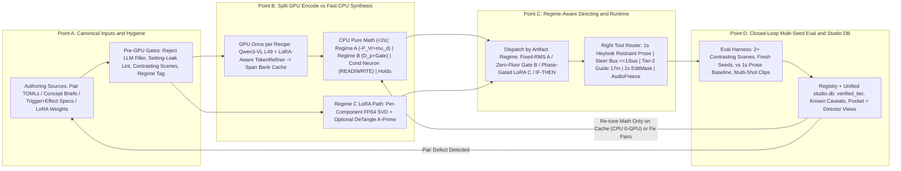

# Over-Narrowing, Overlooked Pillars (`vgel.me` & H3), and Rethinking the Concept Data DAG (`Point A -> B -> C -> D`)

**Date:** `2026-11-23`  
**Repo Baseline:** `main` (`ef1804e1`, right after Wave 4 verification `53c43220`, cross-domain audit `a5402c33`, upstream optical prompt restraint + `h3_director` presets `14b8f8b3`, and interactive visual guide `ef1804e1`)  
**Companion Anchors:** [`2026-11-23_cross_domain_llm_dit_vgel_and_strategic_audit.md`](2026-11-23_cross_domain_llm_dit_vgel_and_strategic_audit.md) · [`2026-11-20_multivector_retrieval_sota_to_dit_steering.md`](2026-11-20_multivector_retrieval_sota_to_dit_steering.md) · [`2026-11-06_detangle_comparison_and_borrowable_concepts.md`](2026-11-06_detangle_comparison_and_borrowable_concepts.md) · [`docs/wiki/research/2026-11-16_geiru_keystone_audit_and_roadmap.md`](../../research/2026-11-16_geiru_keystone_audit_and_roadmap.md) · [`docs/wiki/research/image/2026-11-14_embedded_image_in_video_plan.md`](../../research/image/2026-11-14_embedded_image_in_video_plan.md) · [`docs/wiki/research/2026-11-10_the_eval_flywheel.md`](../../research/2026-11-10_the_eval_flywheel.md)

---

## Executive Summary (Plain English)

Stepping back across **all `24` docs in [`docs/wiki/steering/research/`](README.md)**, the broader [`docs/wiki/research/`](../../research/INDEX.md) subtree, recent commit history (`git log -40` almost wholly centered on steering/erasure/docs prior to `14b8f8b3`), and Theia Vogel's (`vgel.me`) November 12–20, 2026 notebooks (`making-neurons-by-hand`, `shapes-of-model-words`, `words-all-the-way-down`), one structural pattern explains almost every diminishing return we hit this week:

1. **We over-narrowed on ONE layer and ONE operator shape:** We treated H3 — a `50`-layer `Qwen3-VL-32B` + SwiGLU `TokenRefiner` + `50`-block joint `24 fps` video / `40 Hz` audio DiT with multi-frame VAE overlap and keyframe/audio conditioning — as if steering one static `5376`-D Prelude boundary (`H_prelude`) with global unconditional vectors were the whole system.
2. **We kept walking past six high-leverage pillars we already built or read:** (a) the **creative `IF X -> THEN Y` decoupled half** of `vgel`'s `making-neurons-by-hand`, (b) `vgel`'s **self-steering phrases** + multi-token phrase readouts, (c) `2026-11-16`'s proven **long-form continuity physics** (`c % 5 == 2` VAE seam-lock, `5.89x` faster Sage `return_lse=True` balance across blocks `31–47`, avoiding `+17.6 dB` audio runaway), (d) **audio-first `audio_freeze` loose-mask (`0.25`) + `AudioRefineMask` + `FrozenVideoCache`**, (e) **direct spatial/kinematic directing** (`SpriteTrajectory` D-Pad + `SoundCues` + zero-swap `Tier 2` `P-H3-Image LoRA` `17m` keyframes), and (f) **`DeTangle` post-hoc LoRA weight surgery** for Regime C.
3. **Our Concept Data DAG itself is split, lossy, and open-loop (`A -> ? -> B` with discarded intermediates):** Five uncoordinated inputs (`prompt_bank/control_vectors/*.toml`, `data/edit_concepts/*.toml`, `llm_pairs.py`'s silent boilerplate filler, `h3_pair_compiler.py`'s opening-sentence `DEFAULT_AUX_BASELINES`, and word-list / `N=1` shortcuts) feed a one-shot [`pool_pair_set`](../../../../control_vectors.py#L1811-L1890) GPU collapse that **throws away raw token-level representations**, emits `.safetensors` artifacts with **zero `regime` tag**, and disconnects **CPU `quality_report` metadata** from **real multi-scene GPU verdicts**.

Fixing how we view the **end-to-end Concept Data DAG (`Point A -> Point B -> Point C -> Point D`)** stops us from re-paying GPU costs, stops Regime-A defaults from corrupting Regime-B/C use cases, and ties concept quality directly into multi-shot workflows and `Track App-2.0`.

---

## Part 1: Where We Continuously Over-Narrowed

Looking objectively at recent work vs. earlier November findings inside [`docs/wiki/research/`](../../research/INDEX.md):

| Tunnel Habit (Nov 20–23) | What We Optimized Inside the Tunnel | What Was Sitting Outside the Tunnel |
| :--- | :--- | :--- |
| **1. Single-tap-point fixation (`H_prelude`)** | Polished `V_r`, `tau = 0.15`, `peer_ros`, `Bus-Scoped V_r`, `vision_tokens`, and `1x Q_vid[mask]` around post-refiner `5376`-D conditioning tokens. | H3 has `50` causal VLM layers (`L0..L49`), a gated SwiGLU `TokenRefiner`, `50` AV DiT blocks with `return_lse=True` reference-balance kernels (`88.19 ms`), causal VAE `5/2` chunk overlap, `MiniMaxH3GuideLatent` (`17m`), `MiniMaxH3SoundCues`, and `MiniMaxH3AudioFreezeSong`. |
| **2. Global look hoarding (`~80%` static visual paints)** | Built dozens of full-frame surface styles (`noir`, `claymation`, `stained_glass`, `watercolor`), pushing `bank/` to `50` stems (`143` `.safetensors`). | Wave 3B proved **behavioral / physical / acoustic** controls (`youtube_overhype_influencer`, `sudden_takeoff_flight`) unlock things look-paints never touch (`3.37x` motion, `+17.43 st` `YIN` F0 shift, `+9.39 dB` beat-synced airborne takeoff with `SoundCues`). |
| **3. Always-on vectors over `IF -> THEN` conditionals** | Tried forcing always-on linear shifts to behave politely everywhere (`de_llm_slop` erasing clean kitchens `-33%..-39%`). | Conditional firing (`vgel` SwiGLU / one-way `ReLU` gates where `trigger != effect` or `clean_state == 0`) stays dormant until a specific semantic condition triggers. |
| **4. Repeating the Eval Flywheel trap** | Tuned hyperparameters via `hsv_sat`, `laplacian_var`, `mpc`, and `j_lens` hits on two over-tested prompts (`kitchen`, `stairwell`) at `seed = 730451892`. | [`docs/wiki/research/2026-11-10_the_eval_flywheel.md`](../../research/2026-11-10_the_eval_flywheel.md#L19-L29) explicitly recorded this failure mode from `'fun'`: single-clip thresholds kill flexibility, and CPU/proxy metrics never replace multi-scene fresh-seed human visual checks (`stained_glass_cathedral` `mpc = 0.762 -> 0/2` GPU fail vs. `youtube_overhype_influencer` `1/12` J-Lens match -> Wave 3B win). |
| **5. Skipping the 1-second prose baseline** | Treated `MiniMaxH3Steer` as the default answer for attribute/setting/mood shifts without racing it against fast prompt rewrites. | [`2026-11-12_new_vectors_three_ways.md`](2026-11-12_new_vectors_three_ways.md#L1-L6) staged Vector vs. Plain Rewrite vs. EditGuider cleanly (`"No clip has been judged"`), and [`14b8f8b3`](../../../../docs/wiki/system_prompts/h3_video/t2va_system_prompt.md) just proved fixing LLM prompt instructions fixes optical/HDR slop at `0 ms` GPU cost and `0` blur. |

---

## Part 2: Six High-Value Pillars We Keep Overlooking

### 2.1 The Creative Half of `vgel.me` `making-neurons-by-hand`: Decoupled `IF -> THEN` Neurons
When integrating Theia Vogel's November 20, 2026 post (`making-neurons-by-hand`), we focused narrowly on *noise gates* (`READ == WRITE`, stopping `de_llm_slop` or `L63` `'Wait...'` loops). We overlooked her equally powerful mechanism: **separating the `READ` pattern from the `WRITE` vector (`IF X -> THEN Y`)** inside a gated SwiGLU or explicit one-way `ReLU` MLP unit — e.g., *"IF asked about code -> speak Shakespeare"*, *"IF user is rude -> reply rudely"*.

- **Why H3 is uniquely built for this:** H3's `TokenRefiner` (right after `Qwen3-VL` `L49`) and LLM token rows carry contextual `READ` meaning *per token/clause*, not just globally per prompt.
- **Concrete untested H3 experiments (using existing `H_prelude` + `ReLU(z)`):**
  - *`IF` architectural/backdrop tokens (`brick`, `stairwell`, `street`) -> `WRITE charcoal`*, while portrait/face tokens stay `0.0` (single-pass `1x` selective stylization without `EditGuider` or `V_r` bleed).
  - *`IF` speech/dialogue/vocal clauses -> `WRITE whisper_asmr` or `reverb_cathedral`*.
  - *`IF` vehicle/locomotion tokens -> `WRITE sudden_takeoff_flight`*.

### 2.2 `vgel.me` Self-Steering Phrases & Multi-Token Chain Readouts
- **`shapes-of-model-words` (Nov 19, 2026) -> Upstream prompt leverage:** Models lock onto short "self-steering phrases" far more cleanly than sprawling negative-constraint paragraphs. [`14b8f8b3`](../../../../bench/sync_heylook_presets.py) took the right first step adding optical/lighting restraint into `docs/wiki/system_prompts/h3_video/` and `docs/wiki/system_prompts/h3_director/` (`shot_continuation_system_prompt.md`, `scene_suggest_system_prompt.md`, `reticle_suggest_system_prompt.md`). Treating those system prompts as first-class model-steering interfaces (`Regime 0`) gives zero-blur, zero-VRAM leverage.
- **`words-all-the-way-down` (Nov 12, 2026) + [`2026-11-12_chain_lens_digest_and_experiment_plan.md`](2026-11-12_chain_lens_digest_and_experiment_plan.md):** Single-token `j_lens.py` lookups miss multi-word behavioral concepts (`youtube_overhype_influencer` scored `1/12` on single words while dominating audio-visual behavior). Multi-token phrase scoring (`n-gram` / `chain_lens` within `L49 + TokenRefiner` — without wasting GPU cycles chasing truncated `layers.50..63`) stays a better CPU readout path.

### 2.3 Long-Form Multi-Clip Continuity Physics Proved on Nov 16
Buried in [`docs/wiki/research/2026-11-16_geiru_keystone_audit_and_roadmap.md`](../../research/2026-11-16_geiru_keystone_audit_and_roadmap.md#L9-L60) — completely sidelined by the Nov 20–23 steering sprint:
- **Causal VAE Seam-Lock Theorem (`c % 5 == 2`):** H3's Video VAE decodes overlapping temporal chunks (`tokens_chunk_size = 5, token_overlap = 2`). Every `on_both_clocks` context window (`39f -> c=12`, `90f -> c=27`, `141f -> c=42`) satisfies `c % 5 == 2`, so pinning just the final two context latents (`c-2, c-1`) at mask `0.0` locks decoder boundary overlap across shots with zero sampler callbacks.
- **`5.89x` faster Sage `return_lse=True` + Flash subset balance (`88.19 ms` vs. `519.03 ms`):** Holds exposure and palette steady across 30-clip `192.88 s` continuations (`-7.43%` vs. `-24.82%` luma drift) while corroborating blocks `31–47` (`38` & `44` strongest; `0–29` inert) as H3's brightness-transfer band.
- **Audio runaway lesson:** Carrying generated audio latents across long chains boosted audio `+17.62 dB` (`-29.20 -> -11.58 dBFS`) and crushed `> 4 kHz` treble `25x` (`2.21% -> 0.09%`) by Clip 15 — validating pre-encoded `audio_freeze` PCM slicing as mandatory for multi-shot audio continuity.

### 2.4 Audio-First Video (`audio_freeze` Loose-Mask `0.25`, Stem-Freeze, & `AudioRefineMask`)
You already hold **`1,737` LOC** in [`audio_freeze_song.py`](../../../../audio_freeze_song.py) plus [`audio_refine.py`](../../../../audio_refine.py#L1-L15) (`H3AudioRefineMask` reopening undistilled audio over frozen video) and [`frozen_video_cache.py`](../../../../frozen_video_cache.py#L1-L15) (caching frozen K/V projections across refine/masked steps). Hybrid music-stem-locked renders (`mask = 0.25` loose audio conditioning letting live dialogue & foley emerge over a frozen backing stem) remain among the highest-impact unrendered capabilities in the whole repository.

### 2.5 Direct Spatial/Kinematic Choreography & Zero-Swap `Tier 2` Image-in-Video
- **2D Kinematic D-Pad + Zero-File `SoundCues`:** [`2026-11-12_sound_cues_dpad_and_033_release_law.md`](2026-11-12_sound_cues_dpad_and_033_release_law.md) proved exact trajectory tracking (`124/124` frames across `+420 / -444 / -392 px`) paired with `3`-frame audio impulses, while Wave 3B showed `48: impact@1.1, 51: snap@0.9` lifted half-2 airborne audio `+9.39 dB`. Two-subject trajectories and SAM 3.1 sprite cutouts remain parked.
- **Zero-Swap Embedded Image-in-Video ([`2026-11-14_embedded_image_in_video_plan.md`](../../research/image/2026-11-14_embedded_image_in_video_plan.md#L11-L36)):** Respecting the `24 GiB` RTX 4090 memory envelope (`48 GiB` `ENCODER_BF16` shared in host RAM rather than VRAM): batch `Tier 3` (`MiniMax-H3-Image`) hero `<Picture 1>` sheets upfront, then run **zero-swap `Tier 2` (`P-H3-Image LoRA` via `MiniMaxH3LoRABranch` over resident `fl2va`)** + `GuideLatent(17m)` + `ReleaseReferences(guide_end_percent=0.33)` + aligned `overall_soundscape` (`4.3x` audio engagement lift) with decoded RGB pixel handoffs (`PH3ImageVAE` cannot decode `z.shape[2] != 1`). Solves exact pose, wardrobe, prop, and color changes inside video where `Path 1C` `vision_tokens` hit a hard wall.

### 2.6 `DeTangle`-Style Post-Hoc LoRA Weight Surgery for Regime C
Documented back on Nov 6 in [`2026-11-06_detangle_comparison_and_borrowable_concepts.md`](2026-11-06_detangle_comparison_and_borrowable_concepts.md#L11-L64): Dylan Matlow's **DeTangle** uses ridge regression over paired trigger vs. generic activations (`min_{A'} ||A' X_c^T||_F^2 + mu ||(A' - A) X_t^T||_F^2`) to refit `lora_A'` so an unmerged LoRA fires strictly on target phases/contexts and stays silent on neutral tasks. We borrowed scalar `hold_alpha` for text vectors and forgot the weight-space `DeTangle` step itself — which transfers directly to **Regime C** (`heylook` `Swift 1.5` LoRA eliminating neutral coding typos like `code_brackets`, and any future character/style H3 LoRAs run in [`lora_branch.py`](../../../../lora_branch.py)).

---

## Part 3: Rethinking the Concept Data DAG (`Point A -> Point B -> Point C -> Point D`)

Your core architectural observation is spot-on: **steering quality and regime clarity are downstream of the data pipeline**, and right now our concept DAG has fragmented entry points, silent string hacks, a lossy GPU-coupled bottleneck, and no closed-loop feedback from renders back to data.

### 3.1 Audit of Today's Concept Data DAG (Verified on Disk)

Tracing how a concept travels from idea to `.safetensors` to inference today exposes **five concrete structural leaks**:

1. **Five inconsistent data entry paths at Point A:**
   - Hand-authored contrastive TOMLs: `prompt_bank/control_vectors/*.toml` (`50` files, vetted through [`lint_pair_set`](../../../../control_vectors.py#L1034-L1230)).
   - Edit-concept briefs: `data/edit_concepts/*.toml` (`89` active TOMLs via symlink — concise `[concept]` briefs without pair spans, consumed by AutoEdit/Studio).
   - Local LLM pair generator: [`bench/control_vector/llm_pairs.py`](../../../../bench/control_vector/llm_pairs.py#L22-L90) — `_single_clause_section_pair` silently splices canned filler strings (`"The shot and lighting remain steady throughout."` / `"The ambient sound remains steady throughout."` at `L73-L77`) whenever an LLM produces an uneven insertion diff, injecting synthetic boilerplate straight into `a_span` / `b_span`!
   - Short-contrast compiler: [`h3_pair_compiler.py`](../../../../h3_pair_compiler.py#L58-L66) — `DEFAULT_AUX_BASELINES` splices generic 3-word phrases onto the **front** of `t2va_*` scenes (`cos = 0.72` shared bias / causal prefix collapse).
   - Word-list synthesis ([`bench/control_vector/build_cmd.py:105`](../../../../bench/control_vector/build_cmd.py#L105) `j_lens.synthesize_from_words`) & single-image media pairs (`N = 1` [`make_control_vector_from_media_pairs`](../../../../control_vector_nodes.py#L3840), bound by the `~40%–49%` 1-pair `V_r` ceiling).
2. **Domain / setting contamination inside "concept" pairs (`de_llm_slop` root cause):**
   - [`lint_pair_set`](../../../../control_vectors.py#L1034-L1230) enforces syntax (unique spans, `med_fd >= 10` Gate B, `< 60%` Pole-A repetition Gate C, `_BASELINE_STATE_WORDS` Gate D), **but checks zero domain/setting correlation between `A` and `B`**. Putting 3/12 [`de_llm_slop.toml`](../../../../prompt_bank/control_vectors/de_llm_slop.toml) pairs inside archival print shops / county clerk offices / herbarium cabinets baked `"document / official / institutional"` into `mu_d` and hallucinated metal filing cabinets into a kitchen.
3. **Lossy one-shot GPU bottleneck in [`pool_pair_set`](../../../../control_vectors.py#L1811-L1890):**
   - [`encode_pair_set`](../../../../control_vector_nodes.py#L795) loads the `48 GiB` `Qwen3-VL-32B` + LoRA-aware `token_refiner` (`fl2va`, `ref2va`, `h3_image`) and produces full token representations (`ref_a[mask_a]`, `ref_b[mask_b]`, `enc_a`, `enc_b`).
   - Immediately afterward, `pool_pair_set` collapses them into a single `5376` vector + rank-8 `erasure.{mu_d, vr, diag}` in [`save_vector`](../../../../control_vectors.py#L2951) and **discards the underlying token span tensors**. Every math experiment (testing Regime-B paired `D_p = P @ B_p - A_p`, `r=4` vs. `16`, new holds, multi-token readouts, or `vgel` `READ`/`WRITE` neurons) requires re-running GPU encoding from scratch (unless an ad-hoc debug `.pt` exists in `data/exp_unpooled_sliders/banks/`).
4. **Missing `regime` contract on saved artifacts:**
   - [`load_vector`](../../../../control_vectors.py#L2993) and [`cmd_inspect`](../../../../bench/control_vector/grading.py#L32-L90) expose `format`, `family`, `pairs`, `recipe`, `points`, and `quality_report`, **but zero `regime` field** (`regime_a_manifold` vs. `regime_b_gate` vs. `conditional_if_then`). As a result, `MiniMaxH3Steer` defaults to forcing Regime A's fixed `|s| * 67.5` RMS push onto everything — turning suppressors into blurs (`-33%..-39%`).
5. **Open-loop evaluation (`Point D` disconnected from `Point A/C`):**
   - CPU `quality_report` metrics (`mpc`, `split_half`, `j_lens` coverage) live inside `.safetensors` headers, while actual multi-scene GPU & human verdicts (`stained_glass_cathedral` `0/2` fail; `charcoal`/`x_ray` partial on dim `stairwell`; `youtube_overhype_influencer` Wave 3B win; vs. plain-rewrite deltas) live scattered across dated Markdown reports. Neither Studio (`app/`) nor pair rebuilds consume those ground-truth verdicts.

### 3.2 How Each Regime Transforms Data Across the DAG

Notice that **Regime A, Regime B, Regime C, and Conditional `IF -> THEN` Neurons do NOT consume the same input data or produce the same artifact**:

| Lifecycle Stage | **Regime A:** Attribute Manifold Swap (`noir`, `takeoff`, `reverb`) | **Regime B:** Bad-Habit Noise Gate (`H3` prompt-local gate vs. `LLM` `ACE`) | **Regime C:** Contextual Multi-Layer Policy (`Pika`, `Swift 1.5`, style LoRAs) | **Emerging:** Decoupled `IF -> THEN` Neuron (`vgel` condition != effect) |
| :--- | :--- | :--- | :--- | :--- |
| **Point A: Raw Data** | `8–12` diverse two-sided scenes (`Pole A -> Pole B`), `med_fd >= 10`, rotated `A` cues, identical untouched sections | Paired `(clean_anchor B, unwanted_habit A)` with shared scenes **or** LLM clean-vs-spin spans (`mu_clean` untouched) | `(generic_corpus X_c, target_phase_traces X_t)` / full RL delta weights `W_ft - W_base` | **Two datasets:** (1) `Trigger(on vs off)` for `READ` gate, (2) `Effect(Pole A -> Pole B)` for `WRITE` shift |
| **Hygiene Gates** | Gates B/C/D + **New Setting-Diversity Gate** (zero shared location nouns correlated with `B`) + reject LLM filler | Reject noisy `A` locations (only *the habit* varies); for H3 optical gates, ban scene-prop nouns | Phase/trigger balance; dtype parity (`BF16 vs BF16` or quantized-LoRA parity) | Cross-cosine check: `cos(READ_axis, WRITE_axis)` recorded explicitly (supports orthogonal/decoupled pairs) |
| **Point B: Cached Intermediate** | Compact **Span Bank Cache** (`ref_a_spans`, `ref_b_spans`, `pieces`, `prefixes`, `recipe_hash`) | Same Span Bank Cache (`A` bad spans + `B` clean anchors; pairs aligned for `D_p`) | Per-component SVD factors (`U, S, Vh` or `B_k, A_k`) + `X_c / X_t` covariance summaries (`DeTangle`) | Two small span caches (`Trigger` + `Effect`), plus hold subspace `U_protect` |
| **Transform Math (CPU `< 2s`)** | Ridge SVD on centered `A_spans` -> `-P_{V_r}`, plus row-softmax `mu_d`, `hold_basis` ortho | **Causal `T=1` LLM:** `mu_clean` `ACE` + one-way `ReLU` ray gate. **Full H3 prompt:** paired `D_p` `V_r`, prompt-local `h_i - h_bar` + deadzone ramp `(cos(-mu_d) - 0.10)/0.15`, `boost=0`, upper cap only | Per-component FP64 QR-SVD (`_qr_svd_truncate`) + optional **`DeTangle`** `lora_A'` surgery (`||A' X_c^T||^2 + mu ||(A'-A) X_t^T||^2`) | Fit `w_read = lda_or_diff(on, off)` (`ReLU(z)`) paired with Regime-A `WRITE = w_write` projected `I - U U^T` off protected tokens |
| **Point C: Runtime Artifact & Hook** | `.safetensors` with `regime="regime_a_manifold"`, `bus`, `target`; `MiniMaxH3Steer` + `peer_ros` + `auto_1x_kv` / `block_band` | Artifact with `regime="regime_b_gate"` (zero forced `67.5` RMS floor; hard no-op on clean inputs); LLM upstream prompt hygiene first | Phase/step-gated unmerged LoRA (`lora_branch` on H3; `in_thinking==True` on `heylook`) | Artifact with `regime="conditional_neuron"`, firing `ReLU(h_i . w_read) * w_write` per token across `TokenRefiner` / `H_prelude` |
| **Point D: Eval & Promotion** | CPU lint sanity -> **2+ contrasting fresh-seed scenes** (bright + dim) vs. **1s prose rewrite** + human eye verdict | **Zero clean-scene blur/drift test (`clip_frac`, `laplacian_var`)** + positive removal only on synthetic-slop / loop prompts | Held-out multi-bucket accuracy (`code_bug`, `knights_and_knaves`, vision intactness on multimodal tasks) | **False-positive leakage rate** on un-triggered subjects (e.g. faces untouched when only buildings trigger) |

### 3.3 The Clean End-to-End DAG (`Point A -> Point B -> Point C -> Point D`)

### 3.4 What Changes Practically Across Points A, B, C, and D

1. **Point A — Eliminate silent corruption before burning GPU cycles:**
   - Fix [`bench/control_vector/llm_pairs.py:72-84`](../../../../bench/control_vector/llm_pairs.py#L72-L84) so multi-change LLM generations fail & retry (or tighten the prompt) instead of silently splicing canned `"steady throughout"` filler.
   - Keep `DEFAULT_AUX_BASELINES` ([`h3_pair_compiler.py:58-66`](../../../../h3_pair_compiler.py#L58-L66)) strictly for quick prototyping — never promote word-compiled pairs into canonical `bank/` without diverse full-scene openings.
   - Add a lightweight **Setting/Noun Leakage check** alongside Gates B/C/D: flag when `> 2` training pairs share an unrelated setting cluster (kitchen/clerk/herbarium) correlated with `B` vs. `A`.
   - Maintain upstream optical-restraint rules (`14b8f8b3`) inside `docs/wiki/system_prompts/h3_video/` & `h3_director/` as `Regime 0` so H3 stops creating HDR slop before trying to erase it.

2. **Point B — Decouple GPU encoding (`48 GiB` Qwen3-VL) from CPU math exploration:**
   - Whenever [`encode_pair_set`](../../../../control_vector_nodes.py#L795) runs, persist an optional gitignored **Span Bank Cache** (`<stem>__<family>__spans.safetensors`, ~1–2 MB holding ragged span tensors + `row_lens`, `pieces`, `first_diff`, `recipe_hash`).
   - Result: iterating on Regime-A rank/ridge, soft holds, Regime-B paired `D_p` `V_r`, `vgel` decoupled `READ`/`WRITE` neurons, or multi-token phrase readouts drops from **multi-minute GPU reloads** to **`< 2 s` pure CPU iteration across all 50 stems**.
   - Keep existing `models/control_vectors/bank/*.safetensors` (`143` files) untouched; generate span caches lazily on the next explicit build/rebuild.

3. **Point C — Dispatch by `regime`, unify directing tools, enforce VRAM realism:**
   - Stamp explicit `"regime"` metadata in every newly built vector/LoRA (`regime_a_manifold`, `regime_b_gate`, `regime_c_lora`, `conditional_if_then`) so runtime never forces a `67.5` RMS floor onto a suppressor or conditional neuron.
   - On H3's `24 GiB` RTX 4090, honor hardware physics cleanly: batch `Tier 3` (`MiniMax-H3-Image`) hero `<Picture 1>` stills before loading video; use zero-swap `Tier 2` (`P-H3-Image LoRA` over resident `fl2va`) + `GuideLatent(17m)` + aligned `overall_soundscape` inside video shots; use latent overlap + `c % 5 == 2` VAE seam-lock + Sage `return_lse` balance rather than decoding PNGs past 2 shots; bridge room acoustics and stems via `audio_freeze` PCM slicing instead of carried audio latents.
   - Enforce **`<= 1` primary slider per bus** (`Look`, `Motion`, `Audio`, `Hold`) in Studio UX, keeping `"vision_tokens"` hidden from `/` target dropdowns (`app/static/lab.html:275` pooling & `app/static/js/steering_deck.js:192` X-Ray intact).

4. **Point D — Close the loop back into [`bench/`](../../../../bench/INDEX.md) and `Track App-2.0` (`studio.db`):**
   - Stop judging concepts by `mpc`, Grassmann overlap, or single-word `j_lens` coverage. Promote/tier concepts strictly from:
     1. **2+ contrasting adult scenes** (e.g. bright vs. dim), **fresh seeds** (beyond `seed = 730451892`), and an explicit check against **a 1-second plain prose rewrite**;
     2. Verified **multi-shot / audio-first** usability rather than isolated 90f metrics.
   - Store structured `verified_tier` (`verified_av`, `verified_still`, `experimental`, `retired`) and known caveats (e.g. `"dim scenes partial"`) in a small tracked metadata registry imported by `Track App-2.0`'s unified backend (`studio.db` serving mobile `Pocket` + desktop `Director` views) so broken/experimental builds don't masquerade alongside battle-tested winners.

---

## Part 4: Concrete Path From Here to Point D (Without Stopping Everything to Refactor)

To avoid churning `13,137` LOC of stable steering code (`control_vector_nodes.py` + `control_vectors.py` + `j_lens.py`) while multi-shot directing and `Track App-2.0` move forward:

1. **Immediate (Zero-Code Multi-Shot & Parked Pillar Proof — Active Orchestrator Lane):**
   - Run the zero-code GPU trio already staged in the tree (`audio_freeze` loose-mask `0.25` + `AudioRefineMask`/`FrozenVideoCache`, 2nd-scene `Tier 2` `guide_end_percent = 0.33`, `M3` `Ref2VA` + `attach_lse_reference_balance`) on **fresh seeds and prompts**.
   - Direct **one real 20–30s (`4–5` shot) multi-shot short** combining batched `Tier 3` `<Picture 1>` stills, `heylook` tail-frame VLM prompt grounding (`14b8f8b3`), `c % 5 == 2` / latent carry across continuations, `EditGuider.mask`, and `audio_freeze` / `SoundCues`.
2. **`Track App-2.0` (`app/.git` Unfreeze):**
   - Resolve the `app/tests/test_heylook_and_video_polish.py:976` model-default mismatch (`app/static/js/core.js:30` vs. `heylook_client.py`'s `""` `"Auto (prefer resident)"` behavior in `14b8f8b3`), decide cleanly on **one unified backend (`studio.db` + Shot-DAG + thin root adapters) serving two views (`Pocket` mobile vs. `Director` desktop)**, and build around the exact multi-shot friction exposed in Step 1.
3. **Incremental Concept DAG Upgrades (Touch Only When Needed):**
   - Patch `bench/control_vector/llm_pairs.py:72-84` silent filler injection and add optional Span Bank caching + `regime` header stamps inside `control_vectors.py` **only when next building or rebuilding concepts**.
   - Run **one timeboxed `vgel` decoupled `IF -> THEN` neuron prototype (`READ != WRITE`)** strictly from cached span banks on CPU -> 2–3 fresh-seed renders (`1x` background-only stylization vs. plain prose) once the 30s multi-shot milestone lands.
   - Defer splitting root `control_vector*.py` / `bench/` into packages until after `Track App-2.0` stabilizes its thin adapter boundary.
