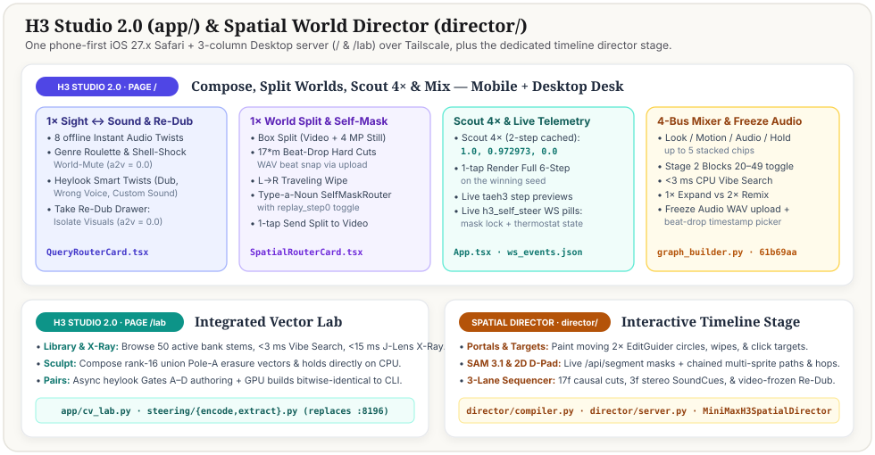

# H3 Studio 2.0 (`app/` `/` + `/lab`) & Spatial Director (`director/`)

Last updated: `2026-11-26` (**H3 Studio 2.0** [`app/`](../../../app/README.md), `app/.git` `61b69aa`: React SPA `/` **Compose / Gallery / Settings** + **`/lab`** 3-tab Vector Lab (`Library`, `Sculpt`, `Pairs`). The former standalone `bench/control_vectors.py ui` / `:8196` Control Vector Studio was retired `2026-11-22`; all browser workflows live inside `app/` `/` + `/lab`, while headless/batch workflows stay in `bench/control_vectors.py` CLI and timeline directing stays in [`director/`](../../../director/AGENTS.md).)

---

## 1. H3 Studio 2.0 Main Surface (`app/`, `/`)

Built phone-first for iOS 27.x Safari WebKit (`402×874`) and expanding cleanly to a 3-column Desktop Studio Desk (`>= 64rem`), [`app/server.py`](../../../app/server.py) + [`app/graph_builder.py`](../../../app/graph_builder.py) expose every verified `1×` and `2×` H3 capability on one Tailscale-safe server (`app/studio.sh` preserves exported `h3.env` / `--heylook-url` overrides):

- **`1×` Cross-Modal Query Router & Pixel-Locked Re-Dub (`QueryRouterCard.tsx`):**
  - Wires `MiniMaxH3QueryRouter` (`enabled`, `audio_prompt`, `video_prompt`, `section_split`, `aud_to_vid_gain`).
  - `8` offline `0 ms` **Instant Audio Twists** + `Surprise Me` Genre Roulette + action-stripped **Shell-Shock Mute** (`a2v = 0.0`).
  - **Heylook Smart Twists** (`POST /api/query_router/rewrite`: `Dub Language`, `Wrong Voice` calibrated to `a2v = 0.0`, `Custom Sound`).
  - Take Inspector adds `1× Dub / Swap Audio` and a collapsible **Re-Dub Audio** drawer (`Polish` vs `Fresh` and **`Isolate Visuals (a2v=0.0)`** skipping `FrozenVideoCache` via `director/compiler.py::compile_audio_redub(isolate_visuals=True)`).
- **`1×` World Split, `17*m` Beat Cuts, L→R Wipes, & Type-a-Noun Self-Mask (`SpatialSplitCard.tsx`, `61b69aa`):**
  - Available on **both** Video and `4 MP` Image compose with a 1-tap **Send Split to Video** handoff carrying prompt pairs + split config directly into Video.
  - Four `shape_mode` selectors wired in `app/graph_builder.py::_wire_spatial_router`:
    1. **`box`** — Left/Right, Sky/Ground, or floating portal rectangle (`MiniMaxH3SpatialQueryRouter`, all `v2-slim` isolation modes including `*_shield` & `mid_20_49`).
    2. **`beat_cut`** — Hard `1×` smash cut snapped to H3's `17 * m` standalone causal VAE clip boundaries (auto-populated from uploaded WAV beats).
    3. **`wipe_lr`** — Smooth Left-to-Right traveling vertical split via `MiniMaxH3SpatialDirector(portal_path, invert_mask=True)`.
    4. **`self_mask`** — Type-a-Noun zero-mask targeting (`MiniMaxH3SelfMaskRouter` with `target_phrase` and `replay_step0` `1.17×` toggle).
- **Zero-Wasted-Step Video `Scout 4×` & Live Closed-Loop Telemetry (`61b69aa`):**
  - **Scout `4×`:** Queues 4 fast 2-step drafts (`ManualSigmas = "1.0, 0.972973, 0.0"`, zero `/api/interrupt` races), stamps `SCOUT 2-STEP` badges, and gives a 1-tap **Render Full 6-Step** action on the winning seed.
  - **Live Previews & Policy Pills (`app/contract/ws_events.json`):** Streams `ModelPreviewOverrideKJ` (`taeh3`/`taeh3_image`) intermediate step previews and live `h3_self_steer` WS events (`self_mask_locked`, `preview_thermostat`, `audio_x0_thermostat`) directly into active run badges and take metadata.
- **Freeze Audio Upload & Causal Beat Analyzer (`POST /api/upload_audio`, `05a058e` + `61b69aa`):**
  - Uploads & normalizes any `.wav` (`analyze_wav_beats()` in `app/media.py`), returns `beats_s`, `17 * m`-snapped `causal_cut_frames`, and `recommended_cut_frame`, wires `MiniMaxH3FreezeAudio` (`_wire_freeze_audio`), muxes lossless audio, and pins `EditGuider.streams = "video_only"` automatically when frozen.
- **4-Bus Mixing Console, `1×` Expand vs `2×` Remix & Vibe Search:**
  - Color-coded `Look` / `Motion` / `Audio` / `Hold` bus strips (`M`/`S`/`Route`, up to `5` stacked `extra_vectors`), Stage 2 `Blocks 20–49 (Face-Safe)` console toggle, `< 3 ms` dual `max(cos_v1, cos_mu)` CPU Vibe Search (`POST /api/lab/vibe_search`), `< 15 ms` CPU Subspace X-Ray (`POST /api/xray_vector`), 1-tap **Create (`1×` Expand)** vs **Remix (`2×` Auto-Edit)** with `@extend` overlays and split-cached `1×` `r2v`, and `int8_convrot` attention annotation.

---

## 2. Integrated Vector Lab (`app/`, `/lab`) & Shared Execution Layer

- **Three streamlined tabs (`app/cv_lab.py`):**
  1. **Library & Vibe Search:** Browse `<comfy>/models/control_vectors/bank/` (`50` active stems), run `< 3 ms` Vibe Search (`?mint_query=`), inspect rank-8/rank-16 erasure payloads with `< 15 ms` CPU J-Lens X-Ray, or send any stem to `/` (`/?use_vector=`).
  2. **Sculpt:** Compose rank-16 union `add_norm_matched_erasure` / `hold` vectors directly on CPU and save to `bank/`.
  3. **Pairs:** Author or lint Gates A–D `.toml` packs asynchronously via `heylook` (`POST /api/lab/pairs/generate` + job polling) and run serialized GPU builds (`from-toml`, `from-prompt`, `make-media`) against an idle `:8188` queue + `/free`.
- **Single-source parity:** All `/lab` GPU builds, `bench/control_vectors.py` CLI subcommands, and ComfyUI's `MiniMaxH3MakeControlVector` node invoke the exact same [`steering/encode.py::encode_pair_set`](../../../control_vector_nodes.py) + [`steering/extract.py::pool_pair_set`](../../../control_vectors.py) pipeline, guaranteeing bitwise-identical tensors.
- **Offline & browser verification:** Run `cd app/web && bunx tsc -b && bun test src && bun run build`, `app/test_app.py` (Tier 1), `pytest app/tests/ -q --isolated-browser` (`402×874 @3x` headless Chrome CDP, `164 passed, 1 skipped` at `61b69aa`), and `bench/check_no_owner_paths.py app`.

---

## 3. Spatial World Director (`director/`)

Kept separate from `app/` for deep timeline directing ([`director/AGENTS.md`](../../../director/AGENTS.md), [`spatial_director_guide.md`](../spatial_director_guide.md)): interactive canvas painting for moving `2×` `EditGuider` portals & point targets, live GPU `SAM 3.1` `/api/segment`, `3`-lane `17f`/`3f` sequencer, chained multi-sprite 2D D-Pad trajectories (`MiniMaxH3AppendSpriteTrajectory`), stereo `MiniMaxH3SoundCues`, and video-frozen `POST /api/redub`.
